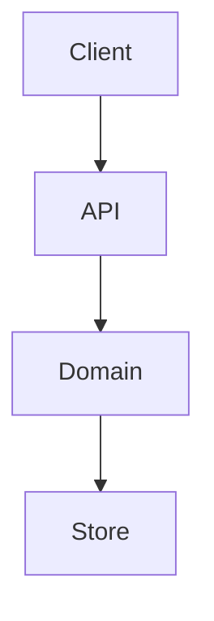

# ARCHITECTURE — <Project name>

## 1. Domain

- **Problem space:** <what problem this solves>
- **Core entities:** <list>
- **Ubiquitous language:** <term → definition>
- **Bounded contexts:** <context name → responsibility → owner>

## 2. System shape

## 3. Layers and boundaries

| Layer | May depend on | Must not depend on |
|---|---|---|
| <layer> | <lower layers> | <higher layers> |

## 4. Key decisions

| # | Decision | Context | Consequence |
|---|---|---|---|
| ADR-001 | <decision> | <why now> | <trade-off accepted> |

## 5. Cross-cutting concerns

- **Error handling:** <policy>
- **Logging:** <policy>
- **Auth:** <policy>
- **Configuration:** <source of truth>
- **Data flow:** <request → processing → persistence>
- **Concurrency:** <model, locks, idempotency>

## 6. Roadmap

| Horizon | Item | Reason |
|---|---|---|
| **Now** | | |
| **Next** | | |
| **Later** | | |
