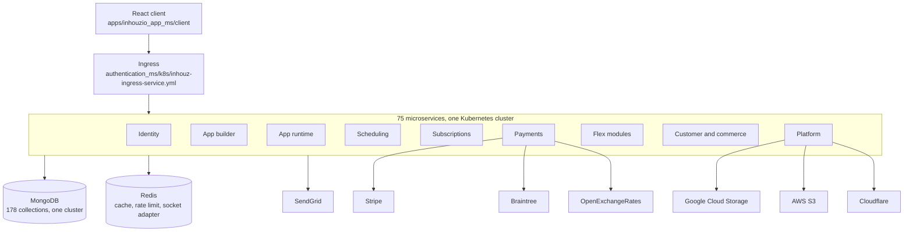

# ARCHITECTURE — Inhouz Cloud AI

## 1. Domain

- **Problem space:** a multi-tenant SaaS platform where a company builds web applications,
  publishes them, sells access to them, and manages the subscriptions that pay for both.
- **Core entities:** `company` (the tenant), `User`, `userRoles`, `roles`, `permissions`,
  `session`, `subscribers`, `subscriptions`, `subscriptionServices`, `subscribedPackages`,
  `paymentIntents`, `paymentCharges`, `paymentMethods`, `payoutAccounts`, `inhouzApps`,
  `appBuilds`, `appBuildReport`, `appDeploymentQueue`, `scheduledTasks`, `apiMetrics`,
  `inhouzProjects`, `products`.
- **Ubiquitous language:**
  - **company** — the tenant. The document every collection is scoped by. Appears in code as
    `companyId`, `systemProvidedCompanyId`, `assetOwnerCompanyId` or `tenantId` depending on the
    service.
  - **subscriber** — the company as a paying customer, distinct from `company` as the account.
  - **app** — a published web application, an `inhouzApp` document plus its builds.
  - **flex module** — the extension mechanism; a module deployed into a customer's app.
  - **charge type** — what a payment is for: `inhouz account license`, `subscription service`,
    `inhouz account utility`, `new user licenses`.
- **Bounded contexts:** nine, matching the domains in `docs/handover/README.md` §3. The boundary
  between contexts is an HTTP call, not a data boundary — see §3.

## 2. System shape

Three facts decide what this diagram means:

1. **The database is shared.** Every service reads and writes the same MongoDB cluster, and 143 of
   its 178 collections are written by more than one service. `User` is touched by 72 of the 75.
   The service boundary is real at the HTTP layer and absent at the data layer.
2. **The frontend is a client of the microservices, not a sibling.** The browser calls the
   services directly through the ingress. `inhouzapp.io.conf:11-112` in the app repository is the
   prefix-to-port map the browser uses.
3. **The ingress is owned by a service.** `authentication_ms` carries the only declaration of the
   public surface — the host path to service to port mapping.

## 3. Layers and boundaries

| Layer | May depend on | Must not depend on |
|---|---|---|
| Client (`inhouzio_app_ms/client`) | the ingress, any service's public routes | a service's MongoDB, another service's internals |
| Service handler (`controller/`) | `services/`, `middlewares/`, `model/`, `utils/` | another service's source, another service's database access |
| Service logic (`services/`) | `model/`, `utils/` | `controller/` — the handler calls the logic, not the reverse |
| Model (`model/`) | Mongoose, `config/` | `controller/`, `services/` |
| Adapter (`utils/requests/`, `utils/cryptography/`, `utils/email/`) | the network, the clock, the filesystem | business rules |

There is **no shared package**. The auth middleware, the company model, the user model, the
sanitizer, the crypto helper and the config loader are copied into every repository. The copies
have drifted: the `company` / `companies` collection name differs between services, and the
`subscriptionId` field is optional in one service and required in another.

## 4. Key decisions

| # | Decision | Context | Consequence |
|---|---|---|---|
| ADR-001 | `AGENTS.md` at the root; every other doc in `docs/` | Kilo auto-loads the root file | One place for cross-project rules |
| ADR-015 | Builders commit on their worktree branch; agents never push or merge | The human owns the base branch | Work lands through a human merge |
| ADR-018 | CLI only — plain git, no `gh`, no PR | The factory runs offline | No remote workflow to depend on |
| ADR-043 | The control repo is the orchestrator's surface; each microservice keeps its own git repository under `apps/` | 75 services, each with its own upstream remote | The repo map is the only way in; `guard.py check-repos` proves the map matches the layout |
| ADR-044 | The fleet keeps one shared MongoDB with a `company` tenant scope on every collection | The services were built as a monolith that was split by deployment, not by data | A schema change in one service can break another; there is no migration tool |
| ADR-045 | The application memory map is one handover file per microservice, plus a global index | 75 units and 1.32M lines of JavaScript | A reader can start from one service and reach its callers, callees and sibling collections |
| ADR-046 | The relationship map is derived from the code and the k8s manifests, not from a written diagram | The call graph is in the source; the ports are in the manifests | The map cannot drift from the code without a read of the source |

## 5. Cross-cutting concerns

- **Error handling:** not standardised. `res.send({error: ...})` — which returns HTTP 200 — is the
  unauthorized path of every `checkLogin` (`payment_ms/middlewares/login/checkLogin.js:14`). Some
  services use `{success: false}`, some use explicit 400/401/500. Callers cannot distinguish
  denial from success by status code.
- **Logging:** `console.log` throughout, with raw error objects. No structured logger, no
  correlation id, no request id. A Mongo error can print the failing filter and the document shape.
- **Auth:** session cookie (`SMPL` or `x-access-token` plus `x-csrfToken`), plus a permission chain
  of `User` -> `userRoles` -> `roles` -> `permissions`. Service-to-service calls use an
  RSA-encrypted envelope instead of a session. The shared symmetric secret is `SESSION_SECRET`,
  which is also the cookie secret, the email-token key, and the key under which per-tenant Stripe
  secrets are stored.
- **Configuration:** every service reads the same way — `readSecret()` loads a file under
  `SECRETS_PATH` (`/mnt/secrets`) and falls back to an environment variable
  (`config/config.js:5-15`). The k8s deployments set 40-80 environment variables per service and
  most are never read.
- **Data flow:** request -> `checkLogin` -> `controller/` -> `services/` -> Mongoose -> MongoDB.
  Cross-service calls: encrypt the payload with the public key, POST it, the receiver decrypts with
  the private key and checks `expirationTimestamp`.
- **Concurrency:** no distributed lock. The schedulers use `setInterval` with no overlap guard, and
  a slow run overlaps the next tick. `scheduled_task_scheduler_ms` is the only service that
  recovers stale work, and it clears `processing: true` only after 24 hours.

## 6. Roadmap

| Horizon | Item | Reason |
|---|---|---|
| **Now** | Decide what to do about the shared database | 143 shared collections mean a schema change in one service can break another with no warning |
| **Now** | Decide which routes are meant to be public | 23 units mount no auth middleware at all, including routes that move money |
| **Next** | One shared package for the tenant model, the auth middleware and the crypto helper | The copies have drifted in ways that already produce wrong query results |
| **Next** | A test suite | There is none, so no change can be verified by anything but inspection |
| **Next** | A standard error envelope | Callers cannot currently tell a denial from a success |
| **Later** | A migration tool for the shared collections | Needed the moment a shared schema changes |
| **Later** | Replace `SESSION_SECRET` as the encryption key for tenant secrets | One secret currently protects sessions, email tokens and per-tenant Stripe keys |

## 7. Known defects that shape the architecture

Recorded in full in each service's handover file, section 12. These are the ones that change how
the system should be read:

| Defect | Evidence |
|---|---|
| `/healthz` is probed by 71 `healthcheck.js` files and registered by no service | `payment_ms/healthcheck.js:7` |
| 12 services have no `start` script while their Dockerfile runs `npm run start` — the image cannot boot | `inhouz_pay_ms/package.json:6-8`, `inhouz_pay_ms/Dockerfile:11` |
| `$lookup` stages hardcode `companies` and `users` while the models register `company` and `User` | `payment_ms/services/transactions/getPaymentIntents.js:90` |
| `recursiveSanitizer` is a no-op in every copy — it reassigns a local primitive | `payment_ms/utils/sanitizer/recursiveSanitizer.js:13` |
| The Stripe secret key is stored per tenant in MongoDB, encrypted with a key derived from `SESSION_SECRET` and the company id | `payment_gateway_ms/model/payment/paymentGateway.js:21-33` |
| The payment distribution worker assigns `STRIPE_KEY` without a declaration, so concurrent requests can overwrite each other | `payment_gateway_ms/services/paymentDistribution/runDistribution.js:269` |
| The payout approval handler accepts any status string and treats everything but `rejected` as an approval | `payment_gateway_ms/services/paymentDistribution/approvalHandler.js:56-59` |
| The late-payment worker creates the charge before marking the intent paid, with no transaction, so a retry can charge twice | `late_payment_ms/services/payment/latePaymentParser.js:535` |
| The remote network request service forwards caller-supplied URLs with no allow-list | `remote_network_request_ms/server.js:192` |
| The database execution service runs caller-supplied SQL with no allow-list, and its `/webtransaction` route lacks the `serverValidator` its `/servertransaction` sibling carries | `database_execution_ms/controller/executionRoutes.js:11`, `database_execution_ms/utils/database/transactions/mySqlTransaction.js:113` |
| The image proxy forwards a caller-supplied URL | `image_proxy_ms/services/imageProxy.js:60` |
| The app viewer's function parser runs user-authored expressions in-process with `safe-eval` | `view_builder_ms/utils/syncFunctionParser/simpleScript/expressionParser/resolveExpression.js:96` |
