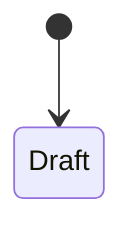

# HANDOVER — <Project name>

> **Session Notes** (keep at the very top, updated every session)
> - **Last session:** <YYYY-MM-DD> — <what was done>
> - **In flight:** <branch / worktree / unfinished steps>
> - **Next action:** <the single next recommended action>

## 1. Overview

- **What it does:** <one paragraph>
- **Who uses it:** <users / callers>
- **Tech stack:** <languages, frameworks, stores>
- **How to run:** <exact commands>

## 2. Directory map

| Path | Contents |
|---|---|
| `<path>/` | <what lives here> |

## 3. Entry points

| Entry point | Type | File:line | Trigger |
|---|---|---|---|
| `<name>` | server / CLI / job / handler / cron / migration | `path:line` | <how it starts> |

## 4. Modules, classes, functions

| Symbol | File:line | Responsibility | Public API | Pure / Effectful |
|---|---|---|---|---|
| `name` | `path:line` | <duty> | <signature> | Pure / Effectful |

> **Pure** = no I/O, no mutation of external state, deterministic.
> **Effectful** = I/O, DB, network, filesystem, env, clock, randomness, logging, shared state.

## 5. Data

- **Entities / models:** <name — file:line — fields>
- **Relationships:** <entity A 1—N entity B>
- **Schema / tables / collections:** <name, keys, indexes>
- **Validation rules:** <rule — where enforced>
- **Migrations:** <tool, where migrations live, how to run>

## 6. States and state transitions

### `<State machine name>`

| From | To | Trigger | Guard |
|---|---|---|---|

## 7. Public API / interfaces

| Method / Path | Purpose | Auth | Errors |
|---|---|---|---|

## 8. Configuration and environment

| Variable / key | Required | Purpose | Secret? |
|---|---|---|---|

## 9. Dependencies (direct only)

| Dependency | Why used |
|---|---|

## 10. Testing

- **Run tests:** `<command>`
- **Covered:** <areas>
- **Not covered:** <gaps>

## 11. Visual language

- **Tokens:** <font, accent, radius steps, spacing scale, type scale> — see `UI-UX.md`
- **Component factory:** <path> · **Gallery route:** <path>
- **Approved by:** <user, date>

## 12. Known issues / risks

## 13. Open questions

## 14. Document map

- [AGENTS.md](../AGENTS.md)
- [ARCHITECTURE.md](ARCHITECTURE.md)
- [BUSINESS-LOGIC.md](BUSINESS-LOGIC.md)
- [BOARD.md](BOARD.md)
- [changelog/CHANGELOG.md](changelog/CHANGELOG.md)
- [UI-UX.md](UI-UX.md)
