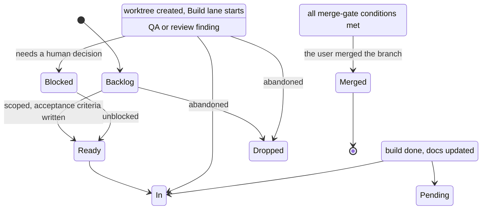

# HANDOVER — Mini Light Factory

> **Session Notes** (keep at the very top, updated every session)
> - **Last session:** 2026-10-30 — added the guard-rail policy (BOARD-001) and the documentation
>   agent with the application memory map (BOARD-002): the `docs-writer` agent, `/handover`
>   routed to it, and `docs/handover/` holding the global index plus one file per application.
> - **In flight:** branch `feat/add-a-documentation-agent-that-writes`, worktree
>   `.kilo/worktrees/add-a-documentation-agent-that-writes`. BOARD-002 is built and waiting for
>   review.
> - **Next action:** the user merges `feat/add-a-documentation-agent-that-writes` into `main`, then
>   the discovery interview (`/decide`) runs for the first project in this checkout.

## 1. Overview

- **What it is:** a software factory. It is a documentation and orchestration system: rules,
  a work board, builder and reviewer agents, and workflow commands. It has no application
  runtime of its own. `apps/web`, `apps/mobile`, and `apps/api` contain only scope rule files;
  no source, no build, no server.
- **Who uses it:** one human owner and the Kilo Code agents that act for them. The owner
  approves decisions and merges branches; the agents build and review inside worktrees.
- **Tech stack:** Markdown rules plus the Kilo Code agent and command system
  (`.kilo/agent/`, `.kilo/command/`) running on git worktrees. No language runtime, no
  package manager, no database. `docs/STACK.md` is still `TBD` for every application stack.
- **How to use it:** open the repo in Kilo Code. Read `AGENTS.md` at the root. Run
  `/board` to see the live board, `/decide` to approve a decision, `/run` to build a row in a
  worktree,   `/ui` for the QA lane, `/closeout` to refresh docs, `/handover` to write the application
  memory map under `docs/handover/`. There is no build or run command for the factory itself.

## 2. Directory map

| Path | Contents |
|---|---|
| `AGENTS.md` | Root rules for the architect, orchestrator, and every builder (Part A, Part B). |
| `README.md` | The repo front page: what the factory is, how to plug it into a project, quick start. |
| `DOMAIN.md` | Product scope and terminology for the first application. Still `TBD`; discovery has not run. |
| `ROADMAP.md` | Planned work not in progress. |
| `CHANGELOG.md` | Product-facing changelog. Updated only on the user's instruction. |
| `.kilo/agent/` | The six agent definitions: `frontend-dev`, `backend-dev`, `mobile-dev`, `qa-reviewer`, `ui-critic`, `docs-writer`. |
| `.kilo/policies/` | The canonical guard-rail policy: `git-policy.json`. |
| `.kilo/repos.json` | The repo map: a repo id → path relative to the control repo root (`control`, `web`, `mobile`, `api`). A repo is addressed by id, never by a raw path. |
| `.kilo/scopes/` | The canonical scope rules, one file per scope (`web.md`, `mobile.md`, `api.md`). `guard.py sync --repo <id>` writes them to the scope's repository as its `AGENTS.md`. |
| `.kilo/command/` | The eight slash commands: `decide`, `board`, `board-view`, `run`, `components`, `ui`, `handover`, `closeout`. |
| `.kilo/worktrees/` | Agent Manager worktrees, one per task. Git-ignored. Not part of the committed tree. |
| `.devcontainer/` | Container definition: `Dockerfile`, `devcontainer.json`, `devcontainer-lock.json`. |
| `apps/web/` | Scope rules for the future web app (`AGENTS.md` only). No code. |
| `apps/mobile/` | Scope rules for the future mobile app (`AGENTS.md` only). No code. |
| `apps/api/` | Scope rules for the future API scope (`AGENTS.md` only). No code. |
| `docs/` | The governance document set (see §5 and §14). |
| `docs/changelog/` | Engineering log: `CHANGELOG.md` plus one `<date>-<slug>.md` per notable change. |
| `docs/reviews/` | QA and UI/UX review reports and round ledgers. Does not exist yet; created by the reviewer agents. |
| `docs/handover/` | The application memory map: `README.md` is the global index, one `<unit>.md` per application. Written by the `docs-writer` agent. |
| `artifacts/` | The one canonical folder for UI evidence: `artifacts/<scope>/qa/<date>/<task-id>/`. Lives in the main checkout. Git keeps the `.md` files only. |

## 3. Entry points

The factory has no executable. Its entry points are the Kilo commands and agents.

| Entry point | Type | File:line | Trigger |
|---|---|---|---|
| `/decide` | command | `.kilo/command/decide.md:5` | Run the decision gate (§A6.1) before any implementation. |
| `/board` | command | `.kilo/command/board.md:5` | Read the live board, pick the next task, move it through the lanes. |
| `/run` | command | `.kilo/command/run.md:5` | Run Build → QA → Review for one board row in its worktree. |
| `/components` | command | `.kilo/command/components.md:5` | Frontend UI gate: build the component factory and gallery, then ask for approval. |
| `/ui` | command | `.kilo/command/ui.md:5` | QA lane and UI/UX critique with Playwright evidence. |
| `/handover` | command | `.kilo/command/handover.md:5` | Read the whole codebase and write the application memory map under `docs/handover/`. |
| `/closeout` | command | `.kilo/command/closeout.md:5` | Update docs and changelog, then hand the worktree to the user. |
| `frontend-dev` | agent | `.kilo/agent/frontend-dev.md:8` | Delegated web UI work. |
| `backend-dev` | agent | `.kilo/agent/backend-dev.md:8` | Delegated API and service work. |
| `mobile-dev` | agent | `.kilo/agent/mobile-dev.md:8` | Delegated mobile UI and platform work. |
| `qa-reviewer` | agent | `.kilo/agent/qa-reviewer.md:8` | Verification lane; produces Playwright evidence. |
| `ui-critic` | agent | `.kilo/agent/ui-critic.md:8` | Visual critique against the anti-slop rules. |
| `docs-writer` | agent | `.kilo/agent/docs-writer.md:8` | Reads the codebase and writes the application memory map. |

## 4. Modules, classes, functions

The units of this system are files, not code symbols. Each row names the unit, its file:line,
what it is responsible for, and whether reading or running it has side effects.

| Symbol | File:line | Responsibility | Public API | Pure / Effectful |
|---|---|---|---|---|
| `AGENTS.md` (architect rules) | `AGENTS.md:1` | Governs decisions, delegation, review, lanes, and documentation for every agent. | The rules themselves. | Pure |
| `AGENTS.md` §B4 (worktree workflow) | `AGENTS.md:805` | Defines the worktree-per-feature flow and the board lanes. | Lane definitions. | Pure |
| `decide` | `.kilo/command/decide.md:5` | Produce a decision sheet and get user approval before building. | `/decide`. | Effectful (reads repo, edits `docs/DECISIONS.md`) |
| `board` | `.kilo/command/board.md:5` | Report the board, select the next row, move lane status. | `/board`. | Effectful (writes `docs/BOARD.md`) |
| `run` | `.kilo/command/run.md:5` | Drive one row through Build → QA → Review in a worktree. | `/run`. | Effectful (creates worktree, writes files, runs git) |
| `components` | `.kilo/command/components.md:5` | Build the component factory and gallery, then request approval. | `/components`. | Effectful (writes app code, runs the app) |
| `ui` | `.kilo/command/ui.md:5` | Run Playwright QA and the UI/UX critique, produce artifacts. | `/ui`. | Effectful (runs Playwright, writes artifacts and review reports) |
| `handover` | `.kilo/command/handover.md:5` | Refresh the handover document set from the real tree. | `/handover`. | Effectful (writes `docs/HANDOVER.md` and related docs) |
| `closeout` | `.kilo/command/closeout.md:5` | Apply the §B1 documentation rule and hand the worktree over. | `/closeout`. | Effectful (writes docs and `docs/changelog/`) |
| `frontend-dev` | `.kilo/agent/frontend-dev.md:8` | Web UI builder: component factory first, screens second. | Delegated agent. | Effectful (writes code in the web scope) |
| `backend-dev` | `.kilo/agent/backend-dev.md:8` | API and service builder: pure domain core, explicit effects. | Delegated agent. | Effectful (writes code in the api scope) |
| `mobile-dev` | `.kilo/agent/mobile-dev.md:8` | Mobile UI and platform builder. | Delegated agent. | Effectful (writes code in the mobile scope) |
| `qa-reviewer` | `.kilo/agent/qa-reviewer.md:8` | Verify behavior against acceptance criteria with Playwright evidence. | Delegated agent. | Effectful (runs Playwright, writes `docs/reviews/`) |
| `ui-critic` | `.kilo/agent/ui-critic.md:8` | Judge screens against the anti-slop rules and the approved gallery. | Delegated agent. | Effectful (writes `docs/reviews/`) |
| `docs-writer` | `.kilo/agent/docs-writer.md:8` | Read the codebase and write the application memory map: one handover per unit plus the global index. | Delegated agent. | Effectful (writes `docs/handover/`) |
| `apps/*/AGENTS.md` | `apps/web/AGENTS.md:1`, `apps/mobile/AGENTS.md:1`, `apps/api/AGENTS.md:1` | Scope rules for each future application. | Scope rules. | Pure |
| `browser-review.mjs` | `.kilo/skills/qa-review/scripts/browser-review.mjs:1` | Captures Playwright evidence into the canonical artifacts folder and writes `summary.json` and `notes.md`. Resolves the chromium binary from `--chromium`, `PLAYWRIGHT_CHROMIUM_PATH`, the downloaded browser, then the system chromium; exits 2 with the searched list when none is found. | CLI: `--base-url`, `--route`, `--scope`, `--task-id`, `--date`, `--artifact-dir`, `--project`, `--viewports`, `--label`, `--scheme`, `--component`, `--compare`, `--chromium`. | Effectful (launches a browser, writes files) |
| `git-policy.json` | `.kilo/policies/git-policy.json:1` | The canonical guard-rail policy: the allow/ask/deny rules for bash and edit commands, plus the three context checks. | The policy file itself; read by `guard.py` and by `guard.py check-policy --write`. | Pure |
| `guard.py check-git` | `.kilo/skills/git-worktree/scripts/guard.py:536` | Classifies a git command against the policy: context checks first, then the bash rules. | CLI: `check-git -- "<command>"`; exit 0 allowed, 1 denied, 2 usage error, 3 needs approval. | Effectful (reads the policy file and the git repo context) |
| `guard.py check-policy` | `.kilo/skills/git-worktree/scripts/guard.py:658` | Proves the `permission` map in `kilo.jsonc` still matches the policy file; `--write` regenerates the map. | CLI: `check-policy [--write]`; exit 0 in sync, 1 out of sync, 2 usage error. | Effectful (reads and, with `--write`, writes `kilo.jsonc`) |
| `guard.py policy` | `.kilo/skills/git-worktree/scripts/guard.py:692` | Prints the generated permission block from the policy file, so the rules can be read without opening the JSON. | CLI: `policy`; exit 0 on success, 2 when the policy file is missing. | Effectful (reads the policy file) |
| `guard.py sync` | `.kilo/skills/git-worktree/scripts/guard.py:765` | Copies the `.kilo/` slice, the scope rules and the generated permission map from the control repo into another repo of the map. Dry run unless `--apply`. | CLI: `sync --repo <id> [--apply]`; exit 0 ok, 1 refused, 2 usage error. | Effectful (reads the control repo, writes into the target repo) |
| `guard.py check-repos` | `.kilo/skills/git-worktree/scripts/guard.py:824` | Proves the repo map and the `apps/` layout agree: every mapped path exists, every git repository under `apps/` is registered, the control repo is registered as `control`. | CLI: `check-repos`; exit 0 in sync, 1 with the disagreement spelled out. | Effectful (reads the map and the layout) |
| `worktree.py create --repo` | `.kilo/skills/git-worktree/scripts/worktree.py:316` | Creates the worktree in the repo named by the id in `.kilo/repos.json`, keeps the board in the control repo, and records the worktree path and the repo id on the row. | CLI: `create --board <ID> [--repo <id>]`; exit 0 ok, 1 refusal, 66 invalid input. | Effectful (runs git, writes the board row) |
| `board.py add-column` | `.kilo/skills/board/scripts/board.py:353` | Inserts a column into the board table and gives every row an empty cell in it, without a hand edit. | CLI: `add-column --name <Col> [--after "<Col>"]`; exit 0 ok, 1 refused. | Effectful (rewrites the board file) |

> **Pure** = no I/O, no mutation of external state, deterministic.
> **Effectful** = I/O, filesystem, git, app runtime, Playwright, logging, shared state.

## 5. Data

There is no database, no schema, and no migration in this repository. The data is a set of
Markdown files and the git repository state.

**Governance document set**

| File | Holds |
|---|---|
| `AGENTS.md` | Architect and builder rules. Source of truth for behavior. |
| `DOMAIN.md` | Product scope, terminology, entities, business rules. `TBD` today. |
| `ROADMAP.md` | Backlog of decided but unstarted work. |
| `CHANGELOG.md` | Product-facing changelog, user-approved only. |
| `docs/PROJECT_STRUCTURE.md` | Authoritative folder layout and path→purpose map. |
| `docs/HANDOVER.md` | This file: the live description of the factory. |
| `docs/ARCHITECTURE.md` | System shape, layers, cross-cutting concerns. |
| `docs/BUSINESS-LOGIC.md` | Business rules as question → answer pairs. |
| `docs/UI-UX.md` | Visual language, anti-slop rules, component factory gate, Playwright QA spec. |
| `docs/BOARD.md` | The live board. One row per unit of work. |
| `docs/STACK.md` | Stack, commands, ports, database, auth. All `TBD` today. |
| `docs/PROJECT_STATE.md` | Current phase, progress, active task, next step. |
| `docs/DECISIONS.md` | Append-only approved decisions (ADR-001 … ADR-017). |
| `docs/RISKS.md` | Active risks. |
| `docs/API_CONTRACTS.md` | API structure, auth, error formats. Not started. |
| `docs/ENVIRONMENT.md` | Env vars and config keys. Empty table today. |
| `docs/README.md` | Index of the doc set. |
| `docs/handover/README.md` | The global application map: every unit, the contracts between them, the global state and side effects. |
| `docs/changelog/CHANGELOG.md` | Engineering log, newest first. Currently the template entry. |

**Repository state**

- Branches: `main` (base) and `docs/factory-handover` (this worktree branch).
- Worktree convention: one worktree per task, named after the feature slug, at
  `.kilo/worktrees/<feature-slug>/`, on branch `feat|fix|chore|docs/<feature-slug>` (§B4).
- The worktree is the unit of work. It carries the code change and its doc updates together.
- `main` is never edited by agents, never pushed to, and never merged into by agents.
- Board rows carry `ID | Task | Type | Status | Priority | Risk | Blocked by | Repos | Branch/Worktree | Notes`.
  `Repos` holds the repo ids from `.kilo/repos.json` that the row touches.
- Validation rules: every board row needs 2–5 checkable acceptance criteria before it leaves
  `Backlog`; every doc update must land in the same change set as the change it documents (§B1).

## 6. States and state transitions

### Board lane state machine

One state per board row, from `AGENTS.md` §B4.

| From | To | Trigger | Guard |
|---|---|---|---|
| — | `Backlog` | A unit of work is identified and a row is added. | The row exists before work starts. |
| `Backlog` | `Ready` | The task is scoped. | 2–5 checkable acceptance criteria, risk level, `Blocked by` recorded. |
| `Ready` | `In Progress` | A worktree is created for the feature slug. | The row is not blocked by another row; pre-flight checks passed (§A9.1). |
| `In Progress` | `In Review` | The build lane finishes. | Verification command passed; scope docs updated. |
| `In Progress` | `Blocked` | The task cannot proceed. | One-line reason and what unblocks it recorded. |
| `Blocked` | `Ready` | The human unblocks the task. | The recorded unblock condition is met. |
| `In Review` | `In Progress` | QA fails or review finds a blocking issue. | The finding is restated with expected vs actual and a repro. |
| `In Review` | `Pending Merge` | QA and review are green. | Merge gate: criteria verified, verification passed, QA evidence, no blocking review finding, docs updated. |
| `Pending Merge` | `Merged` | The user merges the branch into `main`. | The orchestrator marks the row on `main`; the worktree is then removed. |
| any | `Dropped` | The task is abandoned. | The reason is recorded on the row. |

## 7. Public API / interfaces

**Command surface**

| Command | Purpose |
|---|---|
| `/decide` | Decision gate. Produces a decision sheet; implementation waits for user approval. |
| `/board` | Live board read and lane moves. Only writer of `docs/BOARD.md`. |
| `/run` | Build → QA → Review for one board row, ending at `Pending Merge`. |
| `/components` | Component factory and gallery, then user approval of the visual language. |
| `/ui` | Playwright QA lane plus UI/UX critique with artifacts. |
| `/handover` | Write the application memory map under `docs/handover/`. |
| `/closeout` | Documentation rule, changelog entry, worktree handover for merge. |

**Agent surface**

| Agent | Scope |
|---|---|
| `frontend-dev` | Web UI: component factory, screens, styling, accessibility. |
| `backend-dev` | API and services: routes, domain logic, persistence, integrations. |
| `mobile-dev` | Mobile UI and platform behavior. |
| `qa-reviewer` | Verification lane: Playwright evidence against acceptance criteria. |
| `ui-critic` | Visual critique against the anti-slop rules and the approved gallery. |
| `docs-writer` | The application memory map: one handover per unit plus the global index. |

**Two contracts that matter**

1. **The board is the only state.** `docs/BOARD.md` is the single place that shows what is in
   flight, including work that is not merged yet.
2. **The orchestrator is the only writer of the board.** It writes from the main checkout.
   A worktree branch never edits `docs/BOARD.md`; it updates scope docs and reports its lane
   status instead.

## 8. Configuration and environment

Nothing to configure today. There is no application, no build, and no service.

| Variable / key | Required | Purpose | Secret? |
|---|---|---|---|
| — | — | No env vars or config keys in use. `docs/ENVIRONMENT.md` holds an empty table. | No |

- `.devcontainer/` holds the container definition: `Dockerfile`, `devcontainer.json`,
  `devcontainer-lock.json`. It defines the development container only.
- `.gitignore` excludes `node_modules/`, `dist/`, `build/`, `.venv/`, `.env`,
  `.kilo/worktrees/`, and `.kilo/agent-manager.json`.

## 9. Dependencies (direct only)

| Dependency | Why used |
|---|---|
| Kilo Code | The agent and command runtime. `.kilo/agent/` and `.kilo/command/` are loaded by it. |
| git | Worktree-per-feature workflow (§B4) and the branch/merge gate (§B11). |
| Markdown | The only file format used for rules, docs, and the board. |

No application dependencies exist. Playwright is referenced by the QA lane spec
(`docs/UI-UX.md` §4) and will be added with the first frontend app.

## 10. Testing

There is no automated test suite in this repository. No test runner, no test files, no CI.

- **Run tests:** not applicable. There is nothing to run.
- **Covered:** none by automation. Verification today is file review plus
  `git status --short` and `git diff --stat` for documentation changes.
- **Not covered:** everything an application would need.
- **How verification will work once an application exists:**
  - The **QA lane** uses Playwright: full-page screenshots per route per viewport, component
    screenshots, console and network checks, overflow at 320px. Spec in `docs/UI-UX.md` §4,
    driven by the `/ui` command.
  - The **reviewer agents** are independent of the builder's claims. `qa-reviewer` writes
    `docs/reviews/<task-id>-qa.md` plus artifacts under `artifacts/<scope>/qa/<date>/<task-id>/`;
    `ui-critic` writes `docs/reviews/<task-id>-ui.md`. The reports and the round ledger are
    documents, not artifacts; they stay in `docs/reviews/`.
  - The **merge gate** (§B4) requires evidence before a row can reach `Pending Merge`.

## 11. Visual language

Not applicable yet. There is no interface in this repository.

- **Tokens:** none defined. `docs/UI-UX.md` holds the rules to follow when the first frontend
  app starts.
- **Component factory:** not built. Its scope is `apps/web/`.
- **Gallery route:** not built.
- **Approved by:** nobody. Approval happens per project after the `/components` gate.
- **Gate:** for any frontend work the visual language is decided first, then the component
  factory and gallery route are built, then the user approves the gallery, and only then are
  screens built from approved components (§A7, ADR-012).

## 12. Known issues / risks

Copied from `docs/RISKS.md`.

- **Documentation drift risk:** with no commits and no PRs, doc updates depend on the agent
  following `AGENTS.md` §B1 in the same change set. Mitigation: every task ends with the
  Definition of Done checklist.
- **Not yet a git repository:** the workspace has no `.git`, so Agent Manager worktrees cannot be
  created and the worktree workflow (§B4) cannot run. Mitigation: `git init` + a first commit
  by the user is required before the first feature worktree.
- **Bootstrapping the repo:** the first commit lands on `main` and must be made before any
  worktree can branch from it. After that, every change happens on a worktree branch (ADR-015).
- **Uncommitted board on `main`:** after each merge the orchestrator edits `docs/BOARD.md` to mark
  the row `Merged`, leaving one uncommitted change for the user to commit (§B3).

Two of these are stale as of this session: the repository now has a `.git` and one commit
(`13b8953` on `main`), so worktrees can be created. `docs/RISKS.md` has not been updated.
The other two still apply.

## 13. Open questions

- Which application does this factory build first? `DOMAIN.md` is `TBD` and the discovery
  interview (§A4) has not run.
- Which stack will the first app use? Every value in `docs/STACK.md` is `TBD`, except the web
  port `15173`.
- Which scope comes first: `apps/web`, `apps/mobile`, or `apps/api`? The order changes which
  builder agent is needed.
- Is `docs/ARCHITECTURE.md` and `docs/BUSINESS-LOGIC.md` written for the factory itself or for
  the first application? Both are placeholders today.
- Should `docs/RISKS.md` be corrected now that the repository has a first commit?

## 14. Document map

**Root**

- [AGENTS.md](../AGENTS.md) — rules for every agent working here.
- [DOMAIN.md](../DOMAIN.md) — product scope and terminology.
- [ROADMAP.md](../ROADMAP.md) — planned work not in progress.
- [CHANGELOG.md](../CHANGELOG.md) — product-facing changelog, user-approved only.

**docs/**

- [docs/README.md](README.md) — index of the doc set.
- [docs/PROJECT_STRUCTURE.md](PROJECT_STRUCTURE.md) — authoritative folder layout.
- [docs/HANDOVER.md](HANDOVER.md) — this file.
- [docs/handover/README.md](handover/README.md) — the global application map, written by the `docs-writer` agent.
- [docs/ARCHITECTURE.md](ARCHITECTURE.md) — system shape and layers.
- [docs/BUSINESS-LOGIC.md](BUSINESS-LOGIC.md) — business rules as question → answer.
- [docs/UI-UX.md](UI-UX.md) — visual language, anti-slop rules, QA spec.
- [docs/BOARD.md](BOARD.md) — the live work board.
- [docs/STACK.md](STACK.md) — stack, commands, ports.
- [docs/PROJECT_STATE.md](PROJECT_STATE.md) — phase, progress, next step.
- [docs/DECISIONS.md](DECISIONS.md) — approved decisions, append-only.
- [docs/RISKS.md](RISKS.md) — active risks.
- [docs/API_CONTRACTS.md](API_CONTRACTS.md) — API structure and error formats.
- [docs/ENVIRONMENT.md](ENVIRONMENT.md) — env vars and config keys.
- [docs/changelog/CHANGELOG.md](changelog/CHANGELOG.md) — engineering log, newest first.
