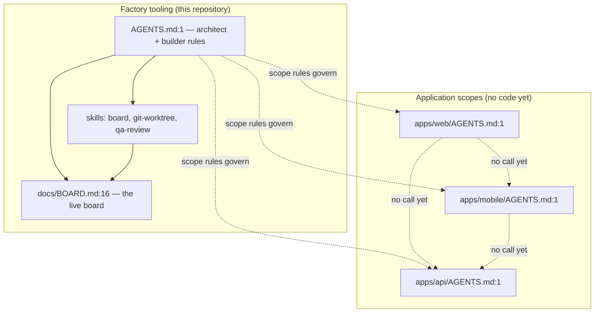

# APPLICATION MEMORY MAP — Mini Light Factory

Every claim below carries a `file:line` citation. A row without one was dropped.

Written by the `docs-writer` agent (`.kilo/agent/docs-writer.md:8`). Mode: **full read** of every
unit listed in `docs/PROJECT_STRUCTURE.md:35`.

## 1. Summary

The system in this repository is the factory itself: a set of Markdown rules, a live work board,
six Kilo agents, eight workflow commands, and the scripts that enforce the rules. It has three
empty application scopes — `apps/web`, `apps/mobile`, `apps/api` — each holding only its scope
rules file (`apps/web/AGENTS.md:1`, `apps/mobile/AGENTS.md:1`, `apps/api/AGENTS.md:1`). No
application has been built, so no unit below has code, an entry point, or a runtime. The factory
tooling is the only thing here that runs.

This repository is the **control repo**: it holds the rules, the board, the documentation and the
policy. Each application scope is registered as a repo of its own in `.kilo/repos.json:1`, so an
application can become a separate git repository at `apps/<name>/` and still receive the same
guard rails through `guard.py sync` (`.kilo/skills/git-worktree/scripts/guard.py:774`). Today all
three app repos are plain folders inside the control repo.

## 2. Units

| Unit | Path | Repository | Kind | Stack | Entry points | Handover |
|---|---|---|---|---|---|---|
| `web` | `apps/web/` | `web` — `apps/web` | app | `TBD` — see `docs/STACK.md:25` | none yet | [web.md](web.md) |
| `mobile` | `apps/mobile/` | `mobile` — `apps/mobile` | app | `TBD` — see `docs/STACK.md:63` | none yet | [mobile.md](mobile.md) |
| `api` | `apps/api/` | `api` — `apps/api` | service | `TBD` — see `docs/STACK.md:71` | none yet | [api.md](api.md) |

The units are the `apps/<name>` scopes that own their own `AGENTS.md`, as listed in
`docs/PROJECT_STRUCTURE.md:35`. No other unit exists: the factory tooling (agents, commands,
skills) is not a deployable application.

Each unit's repository comes from `.kilo/repos.json:1`: `control` is this repository, and `web`,
`mobile` and `api` are the app repos registered at `apps/web`, `apps/mobile` and `apps/api`. Today
those three folders are plain folders inside the control repo — `guard.py check-repos` reports them
as registered but not yet git repositories — so every unit below was read from the control repo
checkout.

## 3. System map

The solid arrows are real dependencies today. The dashed arrows are the shape the units will have
once they are built; none of them exist yet.

## 4. Cross-service contracts

No service calls another yet. `apps/api/AGENTS.md:1` fixes the API scope's own responsibilities,
and `apps/web/AGENTS.md:1` and `apps/mobile/AGENTS.md:1` fix theirs, but no endpoint, event,
queue topic or shared schema exists. The contract that will bind them is recorded in
`docs/API_CONTRACTS.md:1`, which is still a placeholder.

## 5. Global state

| What | Where | Kind | file:line |
|---|---|---|---|
| Work rows and their lanes | `docs/BOARD.md:16` | stateful — written by `board.py` only | `docs/BOARD.md:1` |
| Branch and worktree layout | `.kilo/worktrees/<slug>/` per worktree, on branch `<type>/<slug>` | stateful — git and the filesystem | `AGENTS.md:908`, `.gitignore:11` |
| Git remote `origin` | the repository git config (`.git/config` in the main checkout; a worktree's `.git` is a file pointing at the common git dir) | stateful — network on fetch/push | `AGENTS.md:1528` |
| The rules themselves | `AGENTS.md:1`, the six agent files, the eight command files | pure — Markdown, no runtime | `AGENTS.md:1` |
| Unit scope rules | `.kilo/scopes/web.md:1`, `.kilo/scopes/mobile.md:1`, `.kilo/scopes/api.md:1` (canonical), copied to `apps/web/AGENTS.md:1`, `apps/mobile/AGENTS.md:1`, `apps/api/AGENTS.md:1` | pure — Markdown, no runtime | `.kilo/scopes/web.md:1` |

Nothing is reactive across the system: there is no signal, store, observable, context or cache
anywhere in the repository. The factory is a set of files plus scripts that read and write them.

## 6. Global side effects

| Unit | External system | Effect | file:line |
|---|---|---|---|
| `board` | filesystem | writes `docs/BOARD.md` atomically | `.kilo/skills/board/scripts/board.py:126` |
| `git-worktree` | git, filesystem | creates worktrees and branches, writes the board row | `.kilo/skills/git-worktree/scripts/worktree.py:185` |
| `git-worktree` | git | classifies git commands against the policy | `.kilo/skills/git-worktree/scripts/guard.py:517` |
| `qa-review` | filesystem, browser | launches chromium, writes artifacts and review reports | `.kilo/skills/qa-review/scripts/browser-review.mjs:654` |
| `qa-review` | filesystem | writes the round ledger | `.kilo/skills/qa-review/scripts/ledger.py:74` |
| `board` | network | the read-only viewer serves the board over HTTP on port 15180 | `.kilo/skills/board/scripts/board_serve.py:480` |
| `docs-writer` | filesystem | writes `docs/handover/**` | `.kilo/agent/docs-writer.md:8` |

No unit writes to a database, a queue or an external API: none exists in this repository.

## 7. Entry points

The factory has no executable of its own. Its entry points are the commands and agents the Kilo
runtime loads.

| Entry point | Type | File:line | How it is started |
|---|---|---|---|
| `/decide` | command | `.kilo/command/decide.md:5` | typed in Kilo Code |
| `/board` | command | `.kilo/command/board.md:5` | typed in Kilo Code |
| `/board-view` | command | `.kilo/command/board-view.md:5` | typed in Kilo Code |
| `/run` | command | `.kilo/command/run.md:5` | typed in Kilo Code |
| `/components` | command | `.kilo/command/components.md:5` | typed in Kilo Code |
| `/ui` | command | `.kilo/command/ui.md:5` | typed in Kilo Code |
| `/handover` | command | `.kilo/command/handover.md:5` | typed in Kilo Code; routes to the `docs-writer` agent |
| `/closeout` | command | `.kilo/command/closeout.md:5` | typed in Kilo Code |
| `frontend-dev` | agent | `.kilo/agent/frontend-dev.md:8` | delegated by the orchestrator |
| `backend-dev` | agent | `.kilo/agent/backend-dev.md:8` | delegated by the orchestrator |
| `mobile-dev` | agent | `.kilo/agent/mobile-dev.md:8` | delegated by the orchestrator |
| `qa-reviewer` | agent | `.kilo/agent/qa-reviewer.md:8` | delegated by the orchestrator |
| `ui-critic` | agent | `.kilo/agent/ui-critic.md:8` | delegated by the orchestrator |
| `docs-writer` | agent | `.kilo/agent/docs-writer.md:8` | delegated by the orchestrator, or run by `/handover` |
| `board.py` | CLI | `.kilo/skills/board/scripts/board.py:390` | `python3 .kilo/skills/board/scripts/board.py …` |
| `board_serve.py` | CLI server | `.kilo/skills/board/scripts/board_serve.py:556` | `python3 .kilo/skills/board/scripts/board_serve.py --port 15180` (`docs/STACK.md:37`) |
| `worktree.py` | CLI | `.kilo/skills/git-worktree/scripts/worktree.py:394` | `python3 .kilo/skills/git-worktree/scripts/worktree.py …` |
| `guard.py` | CLI | `.kilo/skills/git-worktree/scripts/guard.py:668` | `python3 .kilo/skills/git-worktree/scripts/guard.py check-git -- "<command>"` |
| `check-finding.py` | CLI | `.kilo/skills/qa-review/scripts/check-finding.py:236` | `python3 .kilo/skills/qa-review/scripts/check-finding.py --body-file <file> …` |
| `ledger.py` | CLI | `.kilo/skills/qa-review/scripts/ledger.py:194` | `python3 .kilo/skills/qa-review/scripts/ledger.py status --task-id BOARD-005` |
| `browser-review.mjs` | CLI | `.kilo/skills/qa-review/scripts/browser-review.mjs:654` | `node .kilo/skills/qa-review/scripts/browser-review.mjs --base-url <url> --route /path` |

## 8. Shared code and conventions

| What is shared | Where | Why |
|---|---|---|
| The rules every agent obeys | `AGENTS.md:1` | one source for the lanes, the delegation protocol and the documentation rule |
| The three skills and their scripts | `.kilo/skills/board/SKILL.md:1`, `.kilo/skills/git-worktree/SKILL.md:1`, `.kilo/skills/qa-review/SKILL.md:1` | the rules that must be a script are a script |
| The board as the only state | `docs/BOARD.md:1` | one place shows what is in flight, including unmerged work |
| The guard-rail policy | `.kilo/policies/git-policy.json:1` | one policy file feeds both the `kilo.jsonc` permission map and `guard.py` |
| The repo map and the scope rules | `.kilo/repos.json:1`, `.kilo/scopes/web.md:1` | the map is the only way into a repository; the scope rules are copied into each repo as its `AGENTS.md` |
| Markdown as the only file format | `docs/README.md:1` | rules, docs and the board are text |

## 9. Document map

- [docs/handover/README.md](README.md) — this file, the global map.
- [docs/handover/web.md](web.md) — the `apps/web` scope.
- [docs/handover/mobile.md](mobile.md) — the `apps/mobile` scope.
- [docs/handover/api.md](api.md) — the `apps/api` scope.
- [docs/HANDOVER.md](../HANDOVER.md) — the factory's own handover.
