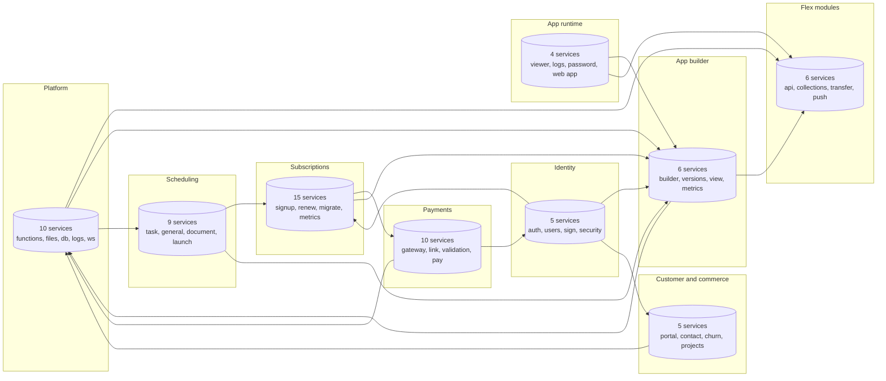

# APPLICATION MEMORY MAP — Inhouz Cloud AI

The global index of the **75 microservices** that make up the Inhouz platform, each one a
separate git repository under `apps/`. Every claim carries a `file:line` citation.

Written by the `docs-writer` agent (`.kilo/agent/docs-writer.md:8`). Mode: **full read** of every
unit, fanned out across per-cluster passes, followed by an orchestrator pass that assembled the
relationship map below.

> **The repositories are the units.** `apps/<unit>/` is a git repository with its own remote
> (`https://github.com/Inhouz-Cloud-AI/<unit>.git`). The control repo holds the rules, the board
> and this documentation set. The repo map is `.kilo/repos.json:1`.

## 1. Summary

Inhouz Cloud AI is a multi-tenant SaaS platform for building and selling web applications. It is
a **Node.js/Express fleet of 75 microservices** behind one Kubernetes cluster, one MongoDB
database, and one shared `company` tenant model. A tenant is a `company` document; every
collection in the system is scoped by `companyId` or by a document that resolves to one.

The fleet divides into nine domains. Every service is the same shape: an Express server, a
Mongoose model layer, a `controller/` of routes, a `services/` layer of business logic, a
`middlewares/` layer of auth and permissions, and a `k8s/` directory that declares a ClusterIP
service. What differs is the responsibility: payments, subscriptions, the app builder and its
viewer, the schedulers, the shared platform services, the flex-module system, identity, and
customer-facing commerce.

Two facts dominate every reading of this codebase:

1. **The services share one database.** 178 MongoDB collections, 143 of them written by more
   than one service. `User` is read or written by 72 of the 75 services. There is no
   service boundary at the data layer — only at the HTTP layer.
2. **The HTTP surface is much smaller than the code.** A single-line pattern match over the
   fleet finds 619 route declarations — and that is an undercount, because many route definitions
   span several lines. What the pattern match shows is that a large share of those routes carry
   no authentication middleware, and that the `/healthz` endpoint every `healthcheck.js` probes
   is registered by none of them.

## 2. Units

All 75 microservices, plus the three scope folders that hold rules but no code.

| Unit | Repository | Kind | Port | k8s service | Entry point | Handover |
|---|---|---|---|---|---|---|
| `account_termination_cron_ms` | `account_termination_cron_ms` — `apps/account_termination_cron_ms` | worker | — | `—` | scheduler interval | [account_termination_cron_ms.md](account_termination_cron_ms.md) |
| `account_termination_ms` | `account_termination_ms` — `apps/account_termination_ms` | service | 5048 | `account-termination-ms-cluster-ip-service` | `server.js` | [account_termination_ms.md](account_termination_ms.md) |
| `api_service_ms` | `api_service_ms` — `apps/api_service_ms` | service | 5010 | `api-service-ms-cluster-ip-service` | `server.js` | [api_service_ms.md](api_service_ms.md) |
| `app_builder_ms` | `app_builder_ms` — `apps/app_builder_ms` | service | 5016 | `app-builder-ms-cluster-ip-service` | `server.js` | [app_builder_ms.md](app_builder_ms.md) |
| `app_metrics_ms` | `app_metrics_ms` — `apps/app_metrics_ms` | service | 5054 | `app-metrics-ms-cluster-ip-service` | `server.js` | [app_metrics_ms.md](app_metrics_ms.md) |
| `app_version_manager_ms` | `app_version_manager_ms` — `apps/app_version_manager_ms` | service | 5074 | `app-version-manager-ms-cluster-ip-service` | `server.js` | [app_version_manager_ms.md](app_version_manager_ms.md) |
| `app_viewer_ms` | `app_viewer_ms` — `apps/app_viewer_ms` | service | 3000 | `app-viewer-ms-cluster-ip-service` | `server.js` | [app_viewer_ms.md](app_viewer_ms.md) |
| `appbuilder_multiplayer_ms` | `appbuilder_multiplayer_ms` — `apps/appbuilder_multiplayer_ms` | service | 5019 | `appbuilder-multiplayer-ms-cluster-ip-service` | `server.js` | [appbuilder_multiplayer_ms.md](appbuilder_multiplayer_ms.md) |
| `appviewer_log_ms` | `appviewer_log_ms` — `apps/appviewer_log_ms` | service | 5046 | `appviewer-log-ms-cluster-ip-service` | `server.js` | [appviewer_log_ms.md](appviewer_log_ms.md) |
| `appviewer_password_ms` | `appviewer_password_ms` — `apps/appviewer_password_ms` | service | 5040 | `appviewer-password-ms-cluster-ip-service` | `server.js` | [appviewer_password_ms.md](appviewer_password_ms.md) |
| `authentication_ms` | `authentication_ms` — `apps/authentication_ms` | service | 5002 | `authentication-ms-cluster-ip-service` | `server.js` | [authentication_ms.md](authentication_ms.md) |
| `churn_tracker_ms` | `churn_tracker_ms` — `apps/churn_tracker_ms` | worker | — | `—` | scheduler interval | [churn_tracker_ms.md](churn_tracker_ms.md) |
| `contact_ms` | `contact_ms` — `apps/contact_ms` | service | 5071 | `contact-ms-cluster-ip-service` | `server.js` | [contact_ms.md](contact_ms.md) |
| `customer_portal_ms` | `customer_portal_ms` — `apps/customer_portal_ms` | service | 5062 | `customer-portal-ms-cluster-ip-service` | `server.js` | [customer_portal_ms.md](customer_portal_ms.md) |
| `data_scanner_ms` | `data_scanner_ms` — `apps/data_scanner_ms` | worker | — | `—` | scheduler interval | [data_scanner_ms.md](data_scanner_ms.md) |
| `database_execution_ms` | `database_execution_ms` — `apps/database_execution_ms` | service | 5021 | `database-execution-ms-cluster-ip-service` | `server.js` | [database_execution_ms.md](database_execution_ms.md) |
| `document_generation_parser_ms` | `document_generation_parser_ms` — `apps/document_generation_parser_ms` | service | 5069 | `document-generation-parser-ms-cluster-ip-service` | `server.js` | [document_generation_parser_ms.md](document_generation_parser_ms.md) |
| `document_scheduler_ms` | `document_scheduler_ms` — `apps/document_scheduler_ms` | worker | — | `—` | scheduler interval | [document_scheduler_ms.md](document_scheduler_ms.md) |
| `file_operations_ms` | `file_operations_ms` — `apps/file_operations_ms` | service | 5008 | `file-operations-ms-cluster-ip-service` | `server.js` | [file_operations_ms.md](file_operations_ms.md) |
| `flex_api_ms` | `flex_api_ms` — `apps/flex_api_ms` | service | 5006 | `flex-api-ms-cluster-ip-service` | `server.js` | [flex_api_ms.md](flex_api_ms.md) |
| `flex_module_collection_ms` | `flex_module_collection_ms` — `apps/flex_module_collection_ms` | service | 5004 | `flex-module-collection-ms-cluster-ip-service` | `server.js` | [flex_module_collection_ms.md](flex_module_collection_ms.md) |
| `function_parser_ms` | `function_parser_ms` — `apps/function_parser_ms` | service | 5035 | `function-parser-ms-cluster-ip-service` | `server.js` | [function_parser_ms.md](function_parser_ms.md) |
| `functions_ms` | `functions_ms` — `apps/functions_ms` | service | 5001 | `functions-ms-cluster-ip-service` | `server.js` | [functions_ms.md](functions_ms.md) |
| `general_task_parser_ms` | `general_task_parser_ms` — `apps/general_task_parser_ms` | service | 5042 | `general-task-parser-ms-cluster-ip-service` | `server.js` | [general_task_parser_ms.md](general_task_parser_ms.md) |
| `general_task_scheduler_ms` | `general_task_scheduler_ms` — `apps/general_task_scheduler_ms` | worker | — | `—` | scheduler interval | [general_task_scheduler_ms.md](general_task_scheduler_ms.md) |
| `image_proxy_ms` | `image_proxy_ms` — `apps/image_proxy_ms` | service | 5034 | `image-proxy-ms-cluster-ip-service` | `server.js` | [image_proxy_ms.md](image_proxy_ms.md) |
| `inhouz_commerce_ms` | `inhouz_commerce_ms` — `apps/inhouz_commerce_ms` | service | 5060 | `inhouz-commerce-ms-cluster-ip-service` | `server.js` | [inhouz_commerce_ms.md](inhouz_commerce_ms.md) |
| `inhouz_file_upload_ms` | `inhouz_file_upload_ms` — `apps/inhouz_file_upload_ms` | service | 5053 | `inhouz-file-upload-ms-cluster-ip-service` | `server.js` | [inhouz_file_upload_ms.md](inhouz_file_upload_ms.md) |
| `inhouz_pay_metrics_ms` | `inhouz_pay_metrics_ms` — `apps/inhouz_pay_metrics_ms` | service | 5064 | `inhouz-pay-metrics-ms-cluster-ip-service` | `server.js` | [inhouz_pay_metrics_ms.md](inhouz_pay_metrics_ms.md) |
| `inhouz_pay_ms` | `inhouz_pay_ms` — `apps/inhouz_pay_ms` | service | 5058 | `inhouz-pay-ms-cluster-ip-service` | `server.js` | [inhouz_pay_ms.md](inhouz_pay_ms.md) |
| `inhouz_pay_recurring_stats_ms` | `inhouz_pay_recurring_stats_ms` — `apps/inhouz_pay_recurring_stats_ms` | service | 5063 | `inhouz-pay-recurring-stats-ms-cluster-ip-service` | `server.js` | [inhouz_pay_recurring_stats_ms.md](inhouz_pay_recurring_stats_ms.md) |
| `inhouz_pay_scheduler_ms` | `inhouz_pay_scheduler_ms` — `apps/inhouz_pay_scheduler_ms` | service | 5061 | `inhouz-pay-scheduler-ms-cluster-ip-service` | `server.js` | [inhouz_pay_scheduler_ms.md](inhouz_pay_scheduler_ms.md) |
| `inhouz_project_ms` | `inhouz_project_ms` — `apps/inhouz_project_ms` | service | 5067 | `inhouz-project-ms-cluster-ip-service` | `server.js` | [inhouz_project_ms.md](inhouz_project_ms.md) |
| `inhouz_security_ms` | `inhouz_security_ms` — `apps/inhouz_security_ms` | service | 5068 | `inhouz-security-ms-cluster-ip-service` | `server.js` | [inhouz_security_ms.md](inhouz_security_ms.md) |
| `inhouz_sign_metrics_ms` | `inhouz_sign_metrics_ms` — `apps/inhouz_sign_metrics_ms` | service | 5070 | `inhouz-sign-metrics-ms-cluster-ip-service` | `server.js` | [inhouz_sign_metrics_ms.md](inhouz_sign_metrics_ms.md) |
| `inhouz_sign_ms` | `inhouz_sign_ms` — `apps/inhouz_sign_ms` | service | 5065 | `inhouz-sign-ms-cluster-ip-service` | `server.js` | [inhouz_sign_ms.md](inhouz_sign_ms.md) |
| `inhouz_subscription_ms` | `inhouz_subscription_ms` — `apps/inhouz_subscription_ms` | service | 5041 | `inhouz-subscription-ms-cluster-ip-service` | `server.js` | [inhouz_subscription_ms.md](inhouz_subscription_ms.md) |
| `inhouz_subscription_renewal_ms` | `inhouz_subscription_renewal_ms` — `apps/inhouz_subscription_renewal_ms` | service | 5044 | `inhouz-subscription-renewal-ms-cluster-ip-service` | `server.js` | [inhouz_subscription_renewal_ms.md](inhouz_subscription_renewal_ms.md) |
| `inhouz_subscription_renewal_scheduler_ms` | `inhouz_subscription_renewal_scheduler_ms` — `apps/inhouz_subscription_renewal_scheduler_ms` | worker | — | `—` | scheduler interval | [inhouz_subscription_renewal_scheduler_ms.md](inhouz_subscription_renewal_scheduler_ms.md) |
| `inhouzio_app_ms` | `inhouzio_app_ms` — `apps/inhouzio_app_ms` | service | 5000 | `inhouzio-app-ms-cluster-ip-service` | `server.js` | [inhouzio_app_ms.md](inhouzio_app_ms.md) |
| `late_payment_ms` | `late_payment_ms` — `apps/late_payment_ms` | service | 5051 | `late-payment-ms-cluster-ip-service` | `server.js` | [late_payment_ms.md](late_payment_ms.md) |
| `log_manager_ms` | `log_manager_ms` — `apps/log_manager_ms` | worker | — | `—` | scheduler interval | [log_manager_ms.md](log_manager_ms.md) |
| `module_transfer_ms` | `module_transfer_ms` — `apps/module_transfer_ms` | service | 5078 | `module-transfer-ms-cluster-ip-service` | `server.js` | [module_transfer_ms.md](module_transfer_ms.md) |
| `module_transfer_parser_ms` | `module_transfer_parser_ms` — `apps/module_transfer_parser_ms` | service | 5077 | `module-transfer-parser-ms-cluster-ip-service` | `server.js` | [module_transfer_parser_ms.md](module_transfer_parser_ms.md) |
| `multimedia_ms` | `multimedia_ms` — `apps/multimedia_ms` | service | 5013 | `multimedia-ms-cluster-ip-service` | `server.js` | [multimedia_ms.md](multimedia_ms.md) |
| `payment_gateway_ms` | `payment_gateway_ms` — `apps/payment_gateway_ms` | service | 5057 | `payment-gateway-ms-cluster-ip-service` | `server.js` | [payment_gateway_ms.md](payment_gateway_ms.md) |
| `payment_link_ms` | `payment_link_ms` — `apps/payment_link_ms` | service | 5059 | `payment-link-ms-cluster-ip-service` | `server.js` | [payment_link_ms.md](payment_link_ms.md) |
| `payment_ms` | `payment_ms` — `apps/payment_ms` | service | 5014 | `payment-ms-cluster-ip-service` | `server.js` | [payment_ms.md](payment_ms.md) |
| `payment_validation_ms` | `payment_validation_ms` — `apps/payment_validation_ms` | service | 5050 | `payment-validation-ms-cluster-ip-service` | `server.js` | [payment_validation_ms.md](payment_validation_ms.md) |
| `payment_validation_scheduler_ms` | `payment_validation_scheduler_ms` — `apps/payment_validation_scheduler_ms` | service | 5049 | `payment-validation-scheduler-ms-cluster-ip-service` | `server.js` | [payment_validation_scheduler_ms.md](payment_validation_scheduler_ms.md) |
| `pdf_generator_ms` | `pdf_generator_ms` — `apps/pdf_generator_ms` | service | 5072 | `pdf-generator-ms-cluster-ip-service` | `server.js` | [pdf_generator_ms.md](pdf_generator_ms.md) |
| `push_notification_parser_ms` | `push_notification_parser_ms` — `apps/push_notification_parser_ms` | service | 5076 | `push-notification-parser-ms-cluster-ip-service` | `server.js` | [push_notification_parser_ms.md](push_notification_parser_ms.md) |
| `remote_network_request_ms` | `remote_network_request_ms` — `apps/remote_network_request_ms` | service | 5045 | `remote-network-request-ms-cluster-ip-service` | `server.js` | [remote_network_request_ms.md](remote_network_request_ms.md) |
| `scheduled_launch_ms` | `scheduled_launch_ms` — `apps/scheduled_launch_ms` | worker | — | `—` | scheduler interval | [scheduled_launch_ms.md](scheduled_launch_ms.md) |
| `scheduled_task_function_parser_ms` | `scheduled_task_function_parser_ms` — `apps/scheduled_task_function_parser_ms` | service | 5038 | `scheduled-task-function-parser-ms-cluster-ip-service` | `server.js` | [scheduled_task_function_parser_ms.md](scheduled_task_function_parser_ms.md) |
| `scheduled_task_ms` | `scheduled_task_ms` — `apps/scheduled_task_ms` | service | 5007 | `scheduled-task-ms-cluster-ip-service` | `server.js` | [scheduled_task_ms.md](scheduled_task_ms.md) |
| `scheduled_task_parser_ms` | `scheduled_task_parser_ms` — `apps/scheduled_task_parser_ms` | service | 5037 | `scheduled-task-parser-ms-cluster-ip-service` | `server.js` | [scheduled_task_parser_ms.md](scheduled_task_parser_ms.md) |
| `scheduled_task_scheduler_ms` | `scheduled_task_scheduler_ms` — `apps/scheduled_task_scheduler_ms` | worker | — | `—` | scheduler interval | [scheduled_task_scheduler_ms.md](scheduled_task_scheduler_ms.md) |
| `subscriber_data_function_ms` | `subscriber_data_function_ms` — `apps/subscriber_data_function_ms` | service | 5055 | `subscriber-data-function-ms-cluster-ip-service` | `server.js` | [subscriber_data_function_ms.md](subscriber_data_function_ms.md) |
| `subscription_authentication_ms` | `subscription_authentication_ms` — `apps/subscription_authentication_ms` | service | 5030 | `subscription-authentication-ms-cluster-ip-service` | `server.js` | [subscription_authentication_ms.md](subscription_authentication_ms.md) |
| `subscription_authorization_ms` | `subscription_authorization_ms` — `apps/subscription_authorization_ms` | service | 5031 | `subscription-authorization-ms-cluster-ip-service` | `server.js` | [subscription_authorization_ms.md](subscription_authorization_ms.md) |
| `subscription_metrics_ms` | `subscription_metrics_ms` — `apps/subscription_metrics_ms` | service | 5011 | `subscription-metrics-ms-cluster-ip-service` | `server.js` | [subscription_metrics_ms.md](subscription_metrics_ms.md) |
| `subscription_migration_parser_ms` | `subscription_migration_parser_ms` — `apps/subscription_migration_parser_ms` | service | 5025 | `subscription-migration-parser-ms-cluster-ip-service` | `server.js` | [subscription_migration_parser_ms.md](subscription_migration_parser_ms.md) |
| `subscription_migration_scheduler_ms` | `subscription_migration_scheduler_ms` — `apps/subscription_migration_scheduler_ms` | service | 5024 | `subscription-migration-scheduler-ms-cluster-ip-service` | `server.js` | [subscription_migration_scheduler_ms.md](subscription_migration_scheduler_ms.md) |
| `subscription_ms` | `subscription_ms` — `apps/subscription_ms` | service | 5005 | `subscription-ms-cluster-ip-service` | `server.js` | [subscription_ms.md](subscription_ms.md) |
| `subscription_payment_ms` | `subscription_payment_ms` — `apps/subscription_payment_ms` | service | 5032 | `subscription-payment-ms-cluster-ip-service` | `server.js` | [subscription_payment_ms.md](subscription_payment_ms.md) |
| `subscription_renewal_ms` | `subscription_renewal_ms` — `apps/subscription_renewal_ms` | service | 5027 | `subscription-renewal-ms-cluster-ip-service` | `server.js` | [subscription_renewal_ms.md](subscription_renewal_ms.md) |
| `subscription_renewal_scheduler_ms` | `subscription_renewal_scheduler_ms` — `apps/subscription_renewal_scheduler_ms` | service | 5026 | `subscription-renewal-scheduler-ms-cluster-ip-service` | `server.js` | [subscription_renewal_scheduler_ms.md](subscription_renewal_scheduler_ms.md) |
| `subscription_settings_ms` | `subscription_settings_ms` — `apps/subscription_settings_ms` | service | 5033 | `subscription-settings-ms-cluster-ip-service` | `server.js` | [subscription_settings_ms.md](subscription_settings_ms.md) |
| `subscription_signup_ms` | `subscription_signup_ms` — `apps/subscription_signup_ms` | service | 5023 | `subscription-signup-ms-cluster-ip-service` | `server.js` | [subscription_signup_ms.md](subscription_signup_ms.md) |
| `system_users_ms` | `system_users_ms` — `apps/system_users_ms` | service | 5022 | `system-user-ms-cluster-ip-service` | `server.js` | [system_users_ms.md](system_users_ms.md) |
| `view_builder_ms` | `view_builder_ms` — `apps/view_builder_ms` | service | 5017 | `view-builder-ms-cluster-ip-service` | `server.js` | [view_builder_ms.md](view_builder_ms.md) |
| `webcomponent_ms` | `webcomponent_ms` — `apps/webcomponent_ms` | service | 5039 | `webcomponent-ms-cluster-ip-service` | `server.js` | [webcomponent_ms.md](webcomponent_ms.md) |
| `website_resource_ms` | `website_resource_ms` — `apps/website_resource_ms` | service | 5056 | `website-resource-ms-cluster-ip-service` | `server.js` | [website_resource_ms.md](website_resource_ms.md) |
| `websocket_ms` | `websocket_ms` — `apps/websocket_ms` | service | 5079 | `websocket-ms-cluster-ip-service` | `server.js` | [websocket_ms.md](websocket_ms.md) |
| `web` | `web` — `apps/web` | scope | — | — | none (rules only) | [web.md](web.md) |
| `mobile` | `mobile` — `apps/mobile` | scope | — | — | none (rules only) | [mobile.md](mobile.md) |
| `api` | `api` — `apps/api` | scope | — | — | none (rules only) | [api.md](api.md) |

Image and replica count for each service are in `apps/<unit>/k8s/<unit>-deployment.yml` and
recorded in that unit's handover file, section 2.

## 3. System map

The nine domains and the HTTP edges between them. Node labels are the service count in the
domain, not the service names.



Arrows are **HTTP call edges** measured from the code — the fleet calls itself over
`http://<service>-ms-cluster-ip-service:<port>`. The edge list is in section 4. A domain arrow
means at least one service in the domain calls at least one service in the other domain.

Two shapes are worth naming:

- **`inhouzio_app_ms` is the web frontend.** It is an Express server that serves a React client
  from `client/build` (`server.js`, `client/package.json`). The browser, not the server, calls
  the sibling services; `inhouzapp.io.conf:11-112` is the prefix-to-port map the client uses.
  Its own backend is currently disconnected — `mongoose.connect` is commented out
  (`server.js:14-17`) and no route module is mounted.
- **`authentication_ms` owns the cluster ingress.** `k8s/inhouz-ingress-service.yml` maps the
  public host paths to the sibling services' ports. It is the only place the public surface is
  declared.

## 4. Cross-service contracts

86 HTTP call edges between distinct services. The caller is on the left. `file:line` is the
first place the target URL appears in the caller.

| Caller | Target | Port | Where |
|---|---|---|---|
| `api_service_ms` | `function_parser_ms` | 5035 | `k8s/api-service-ms-deployment.yml:115` |
| `app_builder_ms` | `payment_ms` | 5014 | `k8s/app-builder-ms-deployment.yml:217` |
| `authentication_ms` | `inhouz_subscription_ms` | 5041 | `k8s/authentication-ms-deployment.yml:170` |
| `authentication_ms` | `inhouz_subscription_renewal_ms` | 5044 | `k8s/authentication-ms-deployment.yml:172` |
| `authentication_ms` | `payment_ms` | 5014 | `k8s/authentication-ms-deployment.yml:168` |
| `document_scheduler_ms` | `inhouz_sign_ms` | 5065 | `k8s/document-scheduler-ms-deployment.yml:281` |
| `file_operations_ms` | `authentication_ms` | 5002 | `k8s/file-operations-ms-deployment.yml:72` |
| `flex_api_ms` | `view_builder_ms` | 5017 | `k8s/flex-api-ms-deployment.yml:122` |
| `function_parser_ms` | `account_termination_ms` | 5048 | `k8s/function-parser-ms-deployment.yml:164` |
| `function_parser_ms` | `authentication_ms` | 5002 | `k8s/function-parser-ms-deployment.yml:154` |
| `function_parser_ms` | `database_execution_ms` | 5021 | `k8s/function-parser-ms-deployment.yml:158` |
| `function_parser_ms` | `functions_ms` | 5001 | `k8s/function-parser-ms-deployment.yml:152` |
| `function_parser_ms` | `general_task_parser_ms` | 5042 | `k8s/function-parser-ms-deployment.yml:190` |
| `function_parser_ms` | `inhouz_commerce_ms` | 5060 | `k8s/function-parser-ms-deployment.yml:178` |
| `function_parser_ms` | `inhouz_pay_ms` | 5058 | `k8s/function-parser-ms-deployment.yml:176` |
| `function_parser_ms` | `inhouz_project_ms` | 5067 | `k8s/function-parser-ms-deployment.yml:170` |
| `function_parser_ms` | `inhouz_sign_ms` | 5065 | `k8s/function-parser-ms-deployment.yml:166` |
| `function_parser_ms` | `multimedia_ms` | 5013 | `k8s/function-parser-ms-deployment.yml:182` |
| `function_parser_ms` | `payment_gateway_ms` | 5057 | `k8s/function-parser-ms-deployment.yml:160` |
| `function_parser_ms` | `payment_link_ms` | 5059 | `k8s/function-parser-ms-deployment.yml:172` |
| `function_parser_ms` | `pdf_generator_ms` | 5072 | `k8s/function-parser-ms-deployment.yml:184` |
| `function_parser_ms` | `push_notification_parser_ms` | 5076 | `k8s/function-parser-ms-deployment.yml:162` |
| `function_parser_ms` | `scheduled_task_ms` | 5007 | `k8s/function-parser-ms-deployment.yml:174` |
| `function_parser_ms` | `scheduled_task_parser_ms` | 5037 | `k8s/function-parser-ms-deployment.yml:150` |
| `function_parser_ms` | `subscriber_data_function_ms` | 5055 | `k8s/function-parser-ms-deployment.yml:180` |
| `function_parser_ms` | `subscription_ms` | 5005 | `k8s/function-parser-ms-deployment.yml:168` |
| `function_parser_ms` | `subscription_signup_ms` | 5023 | `k8s/function-parser-ms-deployment.yml:156` |
| `function_parser_ms` | `system_users_ms` | 5022 | `k8s/function-parser-ms-deployment.yml:186` |
| `functions_ms` | `flex_api_ms` | 5006 | `k8s/functions-ms-deployment.yml:108` |
| `functions_ms` | `scheduled_task_ms` | 5007 | `k8s/functions-ms-deployment.yml:106` |
| `functions_ms` | `view_builder_ms` | 5017 | `k8s/functions-ms-deployment.yml:104` |
| `general_task_scheduler_ms` | `app_version_manager_ms` | 5074 | `k8s/general-task-scheduler-ms-deployment.yml:253` |
| `general_task_scheduler_ms` | `push_notification_parser_ms` | 5076 | `k8s/general-task-scheduler-ms-deployment.yml:255` |
| `inhouz_pay_ms` | `inhouz_commerce_ms` | 5060 | `k8s/inhouz-pay-ms-deployment.yml:177` |
| `inhouz_pay_ms` | `inhouz_sign_ms` | 5065 | `k8s/inhouz-pay-ms-deployment.yml:181` |
| `inhouz_pay_ms` | `payment_link_ms` | 5059 | `k8s/inhouz-pay-ms-deployment.yml:179` |
| `inhouz_pay_scheduler_ms` | `inhouz_pay_ms` | 5058 | `k8s/inhouz-pay-scheduler-ms-deployment.yml:245` |
| `inhouz_pay_scheduler_ms` | `inhouz_pay_recurring_stats_ms` | 5063 | `k8s/inhouz-pay-scheduler-ms-deployment.yml:251` |
| `inhouz_pay_scheduler_ms` | `payment_gateway_ms` | 5057 | `k8s/inhouz-pay-scheduler-ms-deployment.yml:255` |
| `inhouz_pay_scheduler_ms` | `payment_ms` | 5014 | `k8s/inhouz-pay-scheduler-ms-deployment.yml:187` |
| `inhouz_pay_scheduler_ms` | `payment_validation_ms` | 5050 | `k8s/inhouz-pay-scheduler-ms-deployment.yml:249` |
| `inhouz_sign_ms` | `app_builder_ms` | 5016 | `k8s/inhouz-sign-ms-deployment.yml:305` |
| `inhouz_sign_ms` | `document_generation_parser_ms` | 5069 | `k8s/inhouz-sign-ms-deployment.yml:327` |
| `inhouz_sign_ms` | `payment_link_ms` | 5059 | `k8s/inhouz-sign-ms-deployment.yml:349` |
| `inhouz_sign_ms` | `view_builder_ms` | 5017 | `k8s/inhouz-sign-ms-deployment.yml:307` |
| `inhouz_subscription_renewal_scheduler_ms` | `inhouz_subscription_renewal_ms` | 5044 | `k8s/inhouz-subscription-renewal-scheduler-ms-deployment.yml:62` |
| `late_payment_ms` | `inhouz_pay_ms` | 5058 | `k8s/late-payment-ms-deployment.yml:177` |
| `payment_validation_ms` | `inhouz_pay_ms` | 5058 | `k8s/payment-validation-ms-deployment.yml:182` |
| `payment_validation_ms` | `payment_gateway_ms` | 5057 | `k8s/payment-validation-ms-deployment.yml:204` |
| `payment_validation_scheduler_ms` | `payment_gateway_ms` | 5057 | `k8s/payment-validation-scheduler-ms-deployment.yml:172` |
| `payment_validation_scheduler_ms` | `payment_validation_ms` | 5050 | `k8s/payment-validation-scheduler-ms-deployment.yml:148` |
| `pdf_generator_ms` | `app_builder_ms` | 5016 | `k8s/pdf-generator-ms-deployment.yml:299` |
| `pdf_generator_ms` | `view_builder_ms` | 5017 | `k8s/pdf-generator-ms-deployment.yml:301` |
| `scheduled_launch_ms` | `view_builder_ms` | 5017 | `k8s/scheduled-launch-ms-deployment.yml:92` |
| `scheduled_task_function_parser_ms` | `account_termination_ms` | 5048 | `k8s/scheduled-task-function-parser-ms-deployment.yml:162` |
| `scheduled_task_function_parser_ms` | `authentication_ms` | 5002 | `k8s/scheduled-task-function-parser-ms-deployment.yml:152` |
| `scheduled_task_function_parser_ms` | `database_execution_ms` | 5021 | `k8s/scheduled-task-function-parser-ms-deployment.yml:156` |
| `scheduled_task_function_parser_ms` | `functions_ms` | 5001 | `k8s/scheduled-task-function-parser-ms-deployment.yml:150` |
| `scheduled_task_function_parser_ms` | `general_task_parser_ms` | 5042 | `k8s/scheduled-task-function-parser-ms-deployment.yml:188` |
| `scheduled_task_function_parser_ms` | `inhouz_commerce_ms` | 5060 | `k8s/scheduled-task-function-parser-ms-deployment.yml:176` |
| `scheduled_task_function_parser_ms` | `inhouz_pay_ms` | 5058 | `k8s/scheduled-task-function-parser-ms-deployment.yml:174` |
| `scheduled_task_function_parser_ms` | `inhouz_project_ms` | 5067 | `k8s/scheduled-task-function-parser-ms-deployment.yml:168` |
| `scheduled_task_function_parser_ms` | `inhouz_sign_ms` | 5065 | `k8s/scheduled-task-function-parser-ms-deployment.yml:164` |
| `scheduled_task_function_parser_ms` | `multimedia_ms` | 5013 | `k8s/scheduled-task-function-parser-ms-deployment.yml:180` |
| `scheduled_task_function_parser_ms` | `payment_gateway_ms` | 5057 | `k8s/scheduled-task-function-parser-ms-deployment.yml:158` |
| `scheduled_task_function_parser_ms` | `payment_link_ms` | 5059 | `k8s/scheduled-task-function-parser-ms-deployment.yml:170` |
| `scheduled_task_function_parser_ms` | `pdf_generator_ms` | 5072 | `k8s/scheduled-task-function-parser-ms-deployment.yml:182` |
| `scheduled_task_function_parser_ms` | `push_notification_parser_ms` | 5076 | `k8s/scheduled-task-function-parser-ms-deployment.yml:160` |
| `scheduled_task_function_parser_ms` | `scheduled_task_ms` | 5007 | `k8s/scheduled-task-function-parser-ms-deployment.yml:172` |
| `scheduled_task_function_parser_ms` | `scheduled_task_parser_ms` | 5037 | `k8s/scheduled-task-function-parser-ms-deployment.yml:148` |
| `scheduled_task_function_parser_ms` | `subscriber_data_function_ms` | 5055 | `k8s/scheduled-task-function-parser-ms-deployment.yml:178` |
| `scheduled_task_function_parser_ms` | `subscription_ms` | 5005 | `k8s/scheduled-task-function-parser-ms-deployment.yml:166` |
| `scheduled_task_function_parser_ms` | `subscription_signup_ms` | 5023 | `k8s/scheduled-task-function-parser-ms-deployment.yml:154` |
| `scheduled_task_function_parser_ms` | `system_users_ms` | 5022 | `k8s/scheduled-task-function-parser-ms-deployment.yml:184` |
| `scheduled_task_ms` | `scheduled_task_parser_ms` | 5037 | `k8s/scheduled-task-ms-deployment.yml:155` |
| `scheduled_task_parser_ms` | `scheduled_task_function_parser_ms` | 5038 | `k8s/scheduled-task-parser-ms-deployment.yml:91` |
| `scheduled_task_scheduler_ms` | `scheduled_task_parser_ms` | 5037 | `k8s/scheduled-task-scheduler-ms-deployment.yml:96` |
| `subscription_migration_parser_ms` | `inhouz_pay_ms` | 5058 | `k8s/subscription-migration-parser-ms-deployment.yml:164` |
| `subscription_migration_scheduler_ms` | `subscription_migration_parser_ms` | 5025 | `k8s/subscription-migration-scheduler-ms-deployment.yml:55` |
| `subscription_ms` | `payment_ms` | 5014 | `k8s/subscription-ms-deployment.yml:147` |
| `subscription_renewal_ms` | `inhouz_pay_ms` | 5058 | `k8s/subscription-renewal-ms-deployment.yml:152` |
| `subscription_renewal_scheduler_ms` | `subscription_renewal_ms` | 5027 | `k8s/subscription-renewal-scheduler-ms-deployment.yml:55` |
| `subscription_signup_ms` | `inhouz_pay_ms` | 5058 | `k8s/subscription-signup-ms-deployment.yml:181` |
| `subscription_signup_ms` | `payment_ms` | 5014 | `k8s/subscription-signup-ms-deployment.yml:147` |
| `system_users_ms` | `view_builder_ms` | 5017 | `k8s/system-user-ms-deployment.yml:77` |
| `view_builder_ms` | `app_builder_ms` | 5016 | `k8s/view-builder-ms-deployment.yml:123` |

### Self-calls

A service that calls its own ClusterIP address is not a cross-service contract, but it does
mean the service cannot run without its own k8s Service object. These exist:

| Service | Calls itself at |
|---|---|
| `app_builder_ms` | `k8s/app-builder-ms-deployment.yml:219` |
| `inhouz_sign_ms` | `k8s/inhouz-sign-ms-deployment.yml:317` |
| `payment_gateway_ms` | `k8s/payment-gateway-ms-deployment.yml:317` |
| `payment_link_ms` | `k8s/payment-link-ms-deployment.yml:301` |
| `subscription_metrics_ms` | `k8s/subscription-metrics-ms-deployment.yml:129` |
| `view_builder_ms` | `k8s/view-builder-ms-deployment.yml:145` |

### The payload envelope

Most internal calls do not send JSON. They send an **RSA-encrypted envelope**:

    { encryptedPayload: <base64>, expirationTimestamp: <ms>, serverEncrypted: <bool> }

The receiver decrypts it with the private key, checks the expiry, and rewrites `req.params`
or `req.body` from the decrypted object. The pattern is implemented independently in every
service — `utils/cryptography/encryptDecrypt.js` in each repo — and there is no shared
library. The shared secret is `SESSION_SECRET`, which means a compromise of one service's
session secret compromises the envelope for every service.

## 5. Data coupling — the shared MongoDB database

This is the part of the system a reader cannot infer from any single repository.

| Measure | Value |
|---|---|
| Distinct collections | 178 |
| Collections written by more than one service | 143 |
| Collections written by one service only | 35 |
| Services that read or write `User` | 72 of 75 |

The most widely shared collections:

| Collection | Services |
|---|---|
| `company` | 73 |
| `User` | 72 |
| `permissions` | 72 |
| `roles` | 72 |
| `session` | 72 |
| `userRoles` | 72 |
| `authenticationLogs` | 71 |
| `sessionValidator` | 71 |
| `subscriptions` | 71 |
| `inhouzApps` | 70 |
| `subscribers` | 70 |
| `subscriptionServices` | 70 |
| `subscribedPackages` | 69 |
| `flexApi` | 68 |
| `flexCollections` | 68 |
| `subscriberMigrationQueue` | 68 |
| `churnTracker` | 67 |
| `contacts` | 67 |
| `customers` | 67 |
| `exchangeRateCache` | 67 |
| `ipAddressLocations` | 67 |
| `payoutAccounts` | 67 |
| `serviceDiscounts` | 67 |
| `subscriberActionLogs` | 67 |
| `subscriptionSessions` | 67 |

The full ownership map — collection to every service that touches it — is not repeated here.
Each service's handover file, section 7, lists its own collections and names the siblings that
share them. The authoritative source for the map is the `*_MODEL` environment variable in each
service's `k8s/<unit>-deployment.yml`: the variable name is the model, the value is the
collection name.

### The tenant model

`company` is the tenant. The same document name appears in the code as `companyId`,
`systemProvidedCompanyId`, `assetOwnerCompanyId` and `tenantId` depending on the service.
`User` is the human inside a tenant, and `userRoles` binds a user to `roles`, and `roles` to
`permissions`. That chain is copied into 40+ services rather than shared.

## 6. Global state

| What | Where | Kind |
|---|---|---|
| Tenant | `company` collection | stateful — MongoDB |
| Identity | `User`, `userRoles`, `roles`, `permissions` collections | stateful — MongoDB |
| Sessions | `session`, `subscriptionSessions`, `sessionValidator` collections | stateful — MongoDB |
| Money | `paymentCharges`, `paymentIntents`, `paymentMethods`, `payoutAccounts`, `inhouzPayments` | stateful — MongoDB |
| Subscriptions | `subscriptions`, `subscribedPackages`, `subscriptionServices`, `subscribers` | stateful — MongoDB |
| App builds | `appBuilds`, `appBuildReport`, `appDeploymentQueue`, `versionTracker` | stateful — MongoDB |
| Metrics | `apiMetrics`, `apiUsageLogs`, `inhouzAppMetrics`, `metricsCache` | stateful — MongoDB |
| Schedules | `scheduledTasks`, `scheduledTaskLogs` | stateful — MongoDB |
| Rate limiting and one-shot tokens | `queryKeyTracker` | stateful — MongoDB |
| Caching | Redis, in `app_viewer_ms`, `flex_api_ms`, `api_service_ms`, `system_users_ms` | reactive |
| Realtime | Socket.IO rooms in `websocket_ms` (port 5079), Redis adapter | reactive |
| Encryption keys | `paymentGateways.liveSecretKey` / `testSecretKey`, encrypted with `SESSION_SECRET` | stateful — MongoDB |

Nothing in the fleet is a shared library. Every service carries its own copy of the session
model, the company model, the user model, the role model, the permission model, the sanitizer
and the crypto helper. The copies have drifted — see the `company` / `companies` collection-name
mismatch recorded in `app_version_manager_ms.md` and the `subscriptionId` optional-vs-required
drift recorded in `subscription_authorization_ms.md`.

## 7. Global side effects

Which external system each domain reaches. The provider is an npm dependency, an HTTP call in
the code, or a k8s secret reference.

| External system | Used by | How |
|---|---|---|
| MongoDB | all 75 | `mongoose.connect`, shared `MONGO_URL` secret |
| Redis | 5 | `REDIS_HOST` / `REDIS_PASSWORD` |
| Stripe | `payment_ms`, `payment_gateway_ms`, `payment_link_ms`, `inhouz_pay_ms`, `subscription_payment_ms`, `subscription_signup_ms`, `subscription_renewal_ms`, `churn_tracker_ms` | `stripe` npm package |
| Braintree | `payment_ms`, `payment_gateway_ms` | `braintree` npm package |
| SendGrid | 20+ | `@sendgrid/mail`, `SENDGRID_API_KEY` secret |
| OpenExchangeRates | 12+ | `https://openexchangerates.org/latest.json` (`utils/exchangeRate/getExchangeRate.js`) |
| Cloudflare DNS / CDN | 5+ | `api.cloudflare.com`, `CLOUDFLARE_AUTH_KEY` secret |
| Google Cloud Storage | 5+ | `storage.googleapis.com`, `@google-cloud/storage` |
| AWS S3 | `inhouz_file_upload_ms`, `multimedia_ms`, `pdf_generator_ms`, `subscription_authorization_ms` | `aws-sdk`, `S3_ACCESS_KEY_ID` secret |
| Azure Blob | `multimedia_ms`, `pdf_generator_ms` | `azure-storage-blob` |
| Vimeo | `multimedia_ms` | `vimeo` config |
| ip-api.com | 67 | IP geolocation lookup |
| SendGrid and leMList | `contact_ms`, `churn_tracker_ms` | `api.lemlist.com` |
| Let's Encrypt | `website_resource_ms` | `acme-v02.api.letsencrypt.org` |

Every credential is read through a `readSecret()` helper that loads a file under
`SECRETS_PATH` (`/mnt/secrets`) and falls back to an environment variable
(`config/config.js:5-15` in every repo). No plaintext secret value is committed to any source
file. Each repository does commit an encrypted `service-account.json.enc` blob at its root;
nothing in the runtime path reads it.

## 8. Entry points

How each unit is started.

| Kind | Units | How |
|---|---|---|
| HTTP service | 66 | `node server.js` (or `node --max-old-space-size=8192 server.js`), listening on `process.env.PORT` |
| Worker / scheduler | 9 | `setInterval` inside `server.js`; no route module mounted |
| Web frontend | 1 | `inhouzio_app_ms` serves `client/build` statically |

Every service's `healthcheck.js` requests `/healthz`. **No service registers that route** —
the health check cannot pass against a healthy pod.

The services without a ClusterIP service object, and therefore reachable only from inside the
cluster or by a scheduler:

```
account_termination_cron_ms
churn_tracker_ms
data_scanner_ms
document_scheduler_ms
general_task_scheduler_ms
inhouz_subscription_renewal_scheduler_ms
log_manager_ms
scheduled_launch_ms
scheduled_task_scheduler_ms
```

## 9. Shared code and conventions

There is no shared package. Every convention below is a **copy**, not a dependency.

| Convention | Where it lives | Note |
|---|---|---|
| Service layout | `controller/`, `services/`, `model/`, `middlewares/`, `utils/`, `config/`, `k8s/`, `kus/` | identical across the fleet |
| Tenant scoping | `companyId` on every collection | the enforcement point for multi-tenancy |
| Auth middleware | `middlewares/login/checkLogin.js` | copied; **not mounted** in several services |
| Permission check | `middlewares/permissions/*` | copied; several services never mount it |
| Payload encryption | `utils/cryptography/encryptDecrypt.js` | copied; 4 different crypto schemes in use |
| Input sanitisation | `utils/sanitizer/recursiveSanitizer.js` | copied; **a no-op in every copy** |
| Config loader | `config/config.js` with `readSecret()` | copied; caches the config for the process lifetime |
| CORS | `app.use(cors())` or a `/inhouz.localhost/` regex | copied; the regex pins dev domains in production |
| Model registration | `mongoose.model(config.<name>Model)` | the env value is the collection name |
| Clustering | `cluster.fork()` per CPU | multiplies the Mongo connection pool |
| Packaging | `package.json` name is often a template leftover | `micro_service_template` appears in many repos |

## 10. Document map

| Document | What it holds |
|---|---|
| [README.md](README.md) | this file — the global index and the relationship map |
| [payment_ms.md](payment_ms.md) … 75 files | one handover per microservice |
| [web.md](web.md), [mobile.md](mobile.md), [api.md](api.md) | the three scope folders — rules only, no code |
| [../HANDOVER.md](../HANDOVER.md) | the control repo's own handover |
| [../ARCHITECTURE.md](../ARCHITECTURE.md) | the system shape and the cross-cutting concerns |
| [../API_CONTRACTS.md](../API_CONTRACTS.md) | the route surface and the auth model |
| [../RISKS.md](../RISKS.md) | the active risks found while documenting |
| [../STACK.md](../STACK.md) | the stack, the ports and the commands |

