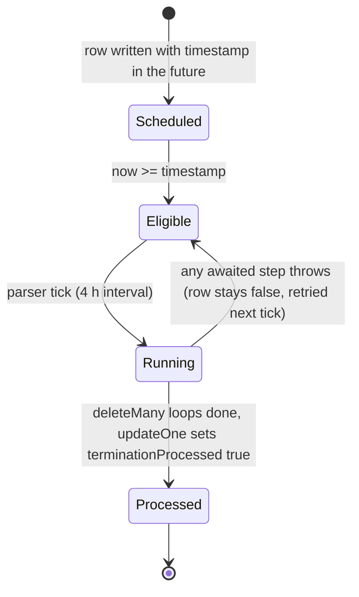
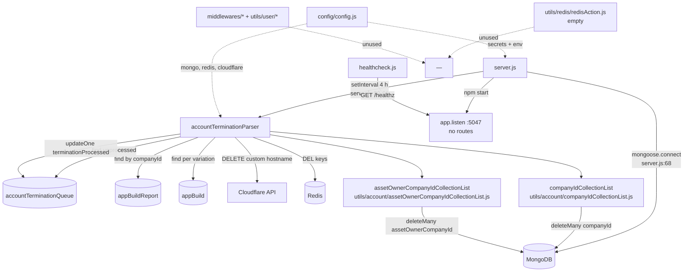

# account_termination_cron_ms

## 1. Summary

A periodic account-erasure worker. Every four hours it picks up rows from the
`accountTerminationQueue` collection whose `timestamp` has passed and `terminationProcessed` is
still `false`, then, per company: removes Cloudflare custom hostnames through the Cloudflare API,
deletes per-build Redis keys, and runs `deleteMany({ companyId })` or
`deleteMany({ assetOwnerCompanyId })` across two hard-coded collection lists. It finally marks the
queue row processed. It lives in its own repository, `apps/account_termination_cron_ms` (repo id
`account_termination_cron_ms` from `.kilo/repos.json`). It is a deployment only: there is no
ClusterIP Service object, and no other service calls it.

## 2. Stack and commands

- Runtime: Node.js on `node:16.4-alpine` (`Dockerfile:1`).
- `package.json` name is the template name `micro_service_template` (`package.json:2`). The brief
  for this service asserted `subscription_migration_scheduler_ms`; the file on disk says
  `micro_service_template`, so the file wins (`package.json:2`).
- Scripts: `test` (the npm placeholder, exits 1) and `start: node server.js`
  (`package.json:6-9`). The Dockerfile's `CMD ["npm", "run", "start"]` (`Dockerfile:11`) resolves.
- Start command: `npm start` → `node server.js`. `server.js:63` calls `app.listen(process.env.PORT)`.
  The deployment sets `PORT=5047` (`kus/base/account-termination-cron-ms-deployment.yml:45`).
- Image `inhouz/account_termination_cron_ms`, `replicas: 1`
  (`k8s/account-termination-cron-ms-deployment.yml:6,17`), `containerPort: 5047` (`:26`), plus a
  VerticalPodAutoscaler (`k8s/account-termination-cron-ms-vpa.yml:2`).
- No Service manifest exists: `k8s/` holds only the deployment and the VPA, and `kus/base`,
  `kus/dev`, `kus/prod` hold the same pair plus kustomization files. Nothing routes traffic to the
  pod.
- Verification command: none. `npm test` exits 1 by design (`package.json:7`).

## 3. Entry points

| Entry point | Location | How it starts |
|---|---|---|
| Worker loop | `server.js:59-61` | `setInterval(() => accountTerminationParser(), 14400000)` — every four hours, first run four hours after boot |
| Parser | `services/accountTerminationParser.js:17` | required at `server.js:9`, called only by the interval |
| HTTP listener | `server.js:63-65` | `app.listen(process.env.PORT)`; no route is registered on the app |
| Express middleware chain | `server.js:17-29` | `cors`, `body-parser`, `hpp`, `helmet`, `cookie-parser`; **no router, no `app.use` of any route module** |
| Mongo connect | `server.js:67-78` | called at `server.js:31`, retried from the disconnect handler at `server.js:40-42` |
| Mongo event handlers | `server.js:34-47` | `connected`, `disconnected`, `error` |
| Shutdown hooks | `server.js:49-56` | `SIGINT`, `SIGTERM`, `uncaughtException` → close mongoose connection |
| Model registration | `server.js:12-15` | four models required: the queue, `appBuild`, `appBuildReport`, `appPageBuild` |
| Healthcheck probe | `healthcheck.js:7` | separate `node healthcheck.js`; GET `/healthz` on `PORT` |
| Redis client | `services/accountTerminationParser.js:15` | `redis.createClient(redisOptions)` at module load |

`/healthz` is not registered anywhere (`server.js:17-29` mounts middleware only), so the probe at
`healthcheck.js:7` receives a 404 and `healthcheck.js:12` sets exit code 1.

## 4. Module inventory

| Module / function | Location | Owns | Public API | Kind |
|---|---|---|---|---|
| bootstrap | `server.js:1-79` | env, express app, mongo lifecycle, interval loop, signals | side effect on require | effectful |
| `connectMongo()` | `server.js:67-78` | `mongoose.connect` with `maxPoolSize: 1` | none | effectful |
| `shutdownFunction()` | `server.js:52-56` | close mongoose | none | effectful |
| `accountTerminationParser` | `services/accountTerminationParser.js:17-172` | the whole erasure pass: queue read, Cloudflare deletes, Redis deletes, collection `deleteMany` loops, queue row update | `async () => void` | effectful (Mongo, Redis, network, clock, logging) |
| Redis client | `services/accountTerminationParser.js:7-15` | module-level connection built from config | `redisClient` (module-private) | effectful (network) |
| config factory | `config/config.js:17-57` | builds and memoises config | `() => config` | effectful — reads env and secret files, caches in module-level `cachedConfig` (`config/config.js:16,18`) |
| `readSecret(name, envFallback)` | `config/config.js:4-14` | reads `/mnt/secrets/<name>`, falls back to an env var | `(string, string) => string` | effectful (filesystem, env) |
| `companyIdCollectionList` | `utils/account/companyIdCollectionList.js:1-66` | 65 collection names erased by `{ companyId }` | exported array | pure (constant) |
| `assetOwnerCompanyIdCollectionList` | `utils/account/assetOwnerCompanyIdCollectionList.js:1-16` | 15 collection names erased by `{ assetOwnerCompanyId }` | exported array | pure (constant) |
| `redisAction` | `utils/redis/redisAction.js:1` | **empty file**, not required by anything | none | pure (no behaviour) |
| `getUser` | `utils/user/getUser.js:5` | loads user, roles, permissions from the auth collections | `(userId) => user \| {error}` | effectful (db) — not called in this service |
| `recursiveSanitizer` | `utils/sanitizer/recursiveSanitizer.js` | request-body sanitisation helper | named export(s) | pure — not called in this service |
| `createEditByObject` | `utils/user/createEditByObject.js:1` | create/edit attribution object | `(user, deployDate) => object` | pure (signature only, §14) — not called in this service |
| `checkLogin` | `middlewares/login/checkLogin.js:9` | session middleware carried over from the template | express middleware | effectful (db, clock, cookies) — never imported (`server.js:1-56` has no reference) |
| `moduleAccessCheck` | `middlewares/module/moduleAccessCheck.js:7` | module permission middleware | express middleware | effectful (db) — never imported |
| `singleSubdomainValidation` | `middlewares/subdomain/*` | subdomain guard | express middleware | reactive — never imported |
| model registrations | `model/account/accountTerminationQueue.js:50-54`, `model/appBuilder/appBuild.js:51`, `appBuildReport.js:74`, `appPageBuild.js:64` | mongoose schemas for the four models the service requires | model per file | effectful (reads config env at require time) |
| unused model files | `model/company/company.js`, `model/rolesAndPermissions/*.js`, `model/session/session.js`, `model/user/*.js` | auth models copied from the template | — | never required by `server.js:12-15`, so never registered |

## 5. Side effects

| Effect | Location |
|---|---|
| MongoDB connect (`maxPoolSize: 1`) | `server.js:68-78` |
| Mongo reconnect after 5 s | `server.js:40-42` |
| Queue read: `terminationProcessed:false` and `timestamp <= now` | `services/accountTerminationParser.js:23-28` |
| Mongo find on `appBuildReport` by `companyId` | `services/accountTerminationParser.js:38-40` |
| Cloudflare API `DELETE /client/v4/zones/{zone}/custom_hostnames/{id}` | `services/accountTerminationParser.js:61-68` |
| Redis `DEL build_report_<domain>` | `services/accountTerminationParser.js:75` |
| Redis `DEL` on `compressedAppVariationDataMapRedisKey` | `services/accountTerminationParser.js:80` |
| Redis `DEL` on each `redisCacheKeys[]` entry | `services/accountTerminationParser.js:83-86` |
| Mongo find on `appBuild` per variation, then Redis `DEL <appId>_<variationId>_<environment>` | `services/accountTerminationParser.js:90-103` |
| Mongo `deleteMany({companyId})` across 65 collections | `services/accountTerminationParser.js:108-127` |
| Mongo `deleteMany({assetOwnerCompanyId})` across 15 collections | `services/accountTerminationParser.js:130-150` |
| Mongo update: set `terminationProcessed: true` | `services/accountTerminationParser.js:153-166` |
| Dynamic model creation (schema-less, `strict:false`) for unregistered collections | `services/accountTerminationParser.js:114-118`, `:136-140` |
| Filesystem read of secret files under `SECRETS_PATH` | `config/config.js:9` |
| Clock reads | `services/accountTerminationParser.js:22` |
| Logging (`console.log`) | `server.js:35,38,46,64,77`; `services/accountTerminationParser.js:30,42,70,124,147,164,169`; `healthcheck.js:11,17` |
| Outbound HTTP to internal services | none — only the Cloudflare API URL is fetched (`services/accountTerminationParser.js:61`) |

The service makes no calls to any other Inhouz microservice and no other microservice calls it.

## 6. State and state transitions

The only state machine is the queue-row lifecycle.

| State | Transition | Trigger | Guard | Evidence |
|---|---|---|---|---|
| `terminationProcessed: false` (queued) | → `true` (done) | end of one company's pass | every earlier step in the company pass has been awaited without throwing | `services/accountTerminationParser.js:23-28` selects; `:153-166` updates |
| `terminationProcessed: false` with `timestamp` in the future | stays queued | interval tick | `timestamp <= now` filter excludes it | `services/accountTerminationParser.js:25-27` |
| `terminationProcessed: true` | terminal | — | not selected again | `services/accountTerminationParser.js:24` |

The "Running → Eligible on throw" edge is the failure mode: the whole loop body is inside one
`try` (`services/accountTerminationParser.js:18-171`), so an uncaught throw aborts the remaining
companies for that tick and leaves their rows unprocessed. The queue row for the failing company is
also left `false`, so the pass repeats and partially re-runs.

Redis keys and Cloudflare hostnames have no state model here: they are deleted, and a repeat tick
re-issues the deletes.

## 7. Data

| Collection | Env var | Schema | Key fields and rules |
|---|---|---|---|
| `accountTerminationQueue` | `ACCOUNT_TERMINATION_QUEUE_MODEL` | `model/account/accountTerminationQueue.js:6-48` | required `companyName`, `companyType`, `timestamp` (Number), `companyId`, `adminEmail` (email-validated via `validator.isEmail` at `:26-31`); optional `terminationNotes`; `terminationProcessed` Boolean default `false`; `timestamps: true`, `strict: true`; index `companyId+timestamp+terminationProcessed` (`:45-48`) |
| `appBuildReport` | `APP_BUILD_REPORT_MODEL` | `model/appBuilder/appBuildReport.js:5-74` | read-only here. Fields used by the parser: `companyId` (`:10`), `customDomains[]` (`:19-24`, **only a `domain` sub-field is declared**), `variationBuildReport[]` with `variationId` (`:34-39`), `environment` with enum `development\|test\|production` (`:43-47`), `compressedAppVariationDataMapRedisKey` (`:51`), `redisCacheKeys` `[String]` (`:60`); `strict: true` (`:62`) |
| `appBuild` | `APP_BUILD_MODEL` | `model/appBuilder/appBuild.js:5-49` | read-only here. Looked up by `companyId`, `appId`, `environment`, `variationId` (`services/accountTerminationParser.js:90-95`); all four are required in the schema (`model/appBuilder/appBuild.js:6-27`) |
| `appPageBuild` | `APP_PAGE_BUILD_MODEL` | `model/appBuilder/appPageBuild.js:5-64` | required at `server.js:15` but never queried by the parser |

**Collections erased by `{ companyId }`** — `utils/account/companyIdCollectionList.js:2-66`, 65
names, including `appBuilds`, `appBuildReport`, `authenticationLogs`, `flexApi`, `functions`,
`inhouzApps`, `paymentMethods`, `payoutAccounts`, `permissions`, `roles`, `session`,
`sessionValidator`, `subscribers`, `subscriptionServices`, `userRoles` and `users`.

**Collections erased by `{ assetOwnerCompanyId }`** —
`utils/account/assetOwnerCompanyIdCollectionList.js:2-16`, 15 names: `apiUsageLogs`, `churnTracker`,
`dailySubscriptionRecurringRevenueTracker`, `paymentCharges`, `paymentIntents`, `paymentMethods`,
`subscriberActionLogs`, `subscriberMigrationQueue`, `subscriberUsageLogs`, `subscribers`,
`subscriptionRecurringRevenueTracker`, `subscriptionSessionAuthLogs`, `subscriptionSessionValidator`,
`subscriptionSessions`, `subscriptions`.

**Case variants that match no collection the cluster configures** (the cluster maps the singular,
camelCase names; see §9): `flexcollections` (`utils/account/companyIdCollectionList.js:25`),
`functionversiontrackers` (`:27`), `operationtrackers` (`:33`), `queries` (`:38`),
`queryversiontrackers` (`:39`), `scheduledtasks` (`:45`), `schemas` (`:47`), `sessions` (`:53`),
`systmeUsers` (`:59`). `users` (`:61`) is the lowercase plural, while `USER_MODEL` maps to `User`,
so the user collection is also not matched. Each mismatch makes that `deleteMany` a silent no-op.

**Collections that are never erased**: `company` itself is in neither list, and neither are
`contacts`, `customers`, `exchangeRateCache`, `ipAddressLocations`, `schema`, `query`,
`systemUsers`, `versionTracker` or `inhouzSubscriptions` from the cluster's model map. A terminated
tenant therefore keeps its company record and several related collections.

**Shared-collection coupling**: every name in both lists belongs to another microservice's domain
(app builder, auth, subscription, payments). This service reaches into those collections directly
with schema-less models (`services/accountTerminationParser.js:114-118,136-140`) instead of calling
the owning service.

## 8. Public interfaces

- **HTTP**: none. The listener at `server.js:63` exists, but zero routes are registered
  (`server.js:17-29` has no router), so every request returns Express's 404.
- **Queue consumed**: `accountTerminationQueue` rows (`services/accountTerminationParser.js:23-28`).
  This is the only input contract: a row must carry `companyId` and a `timestamp` that has passed,
  and `terminationProcessed: false`. The writer of those rows is outside this repository.
- **External calls**: Cloudflare `DELETE /client/v4/zones/{CLOUDFLARE_ZONE_ID}/custom_hostnames/{id}`
  with `X-Auth-Email` and `X-Auth-Key` headers (`services/accountTerminationParser.js:61-68`).
- **Redis keys deleted**: `build_report_<domain>`, the value of
  `compressedAppVariationDataMapRedisKey`, each entry of `redisCacheKeys`, and
  `<appId>_<variationId>_<environment>` (`services/accountTerminationParser.js:75,80,85,101-102`).
- **Events published**: none. **CLI commands**: none. **Cron**: internal `setInterval` only
  (`server.js:59-61`).

## 9. Configuration

Env vars read in this repo (names only): `SECRETS_PATH`, `FLEX_FORM_FILE_MODEL`, `FLEX_MODULE_MODEL`,
`FLEX_COLLECTION_MODEL`, `FORM_MODEL`, `SENDGRID_API_KEY`, `SMPL_EMAIL`,
`DATA_RULE_EXECUTION_RESULT_MODEL`, `SESSION_SECRET`, `MONGO_URL`, `USER_MODEL`, `COMPANY_MODEL`,
`ROLE_MODEL`, `PERMISSION_MODEL`, `USER_ROLES_MODEL`, `SESSION_MODEL`, `SESSION_VALIDATOR_MODEL`,
`AUTH_LOG_MODEL`, `CLIENT_SECRET_KEY`, `COOKIE_DOMAIN`, `ACCOUNT_TERMINATION_QUEUE_MODEL`,
`CLOUDFLARE_ZONE_ID`, `CLOUDFLARE_API_URL`, `CLOUDFLARE_AUTH_EMAIL`, `CLOUDFLARE_AUTH_KEY`,
`APP_BUILD_REPORT_MODEL`, `APP_BUILD_MODEL`, `APP_PAGE_BUILD_MODEL`, `REDIS_HOST`,
`REDIS_PASSWORD`, `REDIS_DB`, `REDIS_PORT`, `PORT`, `NODE_ENV`
(`config/config.js:4-55`, `server.js:63`, `services/accountTerminationParser.js:59`,
`healthcheck.js:6`).

Secret file names read under `SECRETS_PATH`: `sendgridapikey`, `sessionsecret`, `mongourl`,
`clientsecretkey`, `cloudflarezoneid`, `cloudflareauthemail`, `cloudflareauthkey`, `redishost`,
`redispassword` (`config/config.js:24,27,28,38,41,43-44,47,51-52`).

The deployment mounts a CSI secrets volume at `/mnt/secrets`
(`kus/base/account-termination-cron-ms-deployment.yml:22-43`) and sets `PORT=5047` (`:44-45`).

## 10. Dependencies

Direct `package.json` dependencies (`package.json:12-34`):

| Package | Why it is here |
|---|---|
| `mongoose` | all MongoDB access and dynamic model creation (`server.js:3`, `services/accountTerminationParser.js:1`) |
| `redis` | deleting build caches (`services/accountTerminationParser.js:6,15`) |
| `node-fetch` | Cloudflare custom-hostname deletion (`services/accountTerminationParser.js:5,61`) |
| `dotenv` | loads `.env` in development (`server.js:1`) |
| `express` | the HTTP app that serves no routes (`server.js:2,17`) |
| `body-parser`, `cookie-parser`, `cors`, `hpp`, `helmet` | express middleware copied from the service template (`server.js:4-8,18-29`); unused because there are no routes |
| `validator` | `adminEmail` validation in the queue schema (`model/account/accountTerminationQueue.js:3,26-31`) |
| `lodash`, `moment`, `cryptr`, `crypto-js`, `sanitizer` | auth helpers copied in (`middlewares/login/checkLogin.js:3-6`, `middlewares/module/moduleAccessCheck.js:2,5`); never invoked |
| `@sendgrid/mail`, `connect-mongo`, `express-session`, `bcryptjs`, `request-ip`, `shortid` | template leftovers; no use found in the files read |

## 11. Testing

No tests. `npm test` is the npm placeholder that exits 1 (`package.json:7`). No test directory, no
framework. `test-cicd.yml` exists at the repository root but is a CI pipeline definition, not a test
suite, and was not read in full (§14). Nothing verifies the erasure logic, and because the deletion
lists are strings compared against a live database, a typo is invisible without an integration test.

## 12. Known issues and risks

1. **`cloudflareId` is undefined in the Cloudflare URL.** The guard tests
   `domainObj['cloudflareId']` (`services/accountTerminationParser.js:58`) but the URL interpolates
   the bare identifier `cloudflareId` (`:61`). If that branch is ever reached it throws a
   `ReferenceError`, which the outer `try` swallows (`:168-171`). The queue row is then never marked
   processed and is retried every four hours.
2. **The Cloudflare branch is normally unreachable anyway.** `customDomains` only declares `domain`
   (`model/appBuilder/appBuildReport.js:19-24`) under `strict: true` (`:62`), so a
   `cloudflareId` field is not part of the hydrated document and `domainObj['cloudflareId']` is
   undefined. Cloudflare cleanup silently never runs.
3. **Deletion lists contain names that match no collection.** `flexcollections`,
   `functionversiontrackers`, `operationtrackers`, `queries`, `queryversiontrackers`,
   `scheduledtasks`, `schemas`, `sessions`, `systmeUsers`
   (`utils/account/companyIdCollectionList.js:25,27,33,38,39,45,47,53,59`) and `users` (`:61`) do
   not match the cluster's configured collection names. Each is a silent no-op, so data that should
   be erased survives account termination. This is a data-retention and privacy risk.
4. **The tenant record is never deleted.** `company` is in neither list; neither are `contacts`,
   `customers`, `schema`, `query`, `systemUsers`, `versionTracker` and others the cluster
   configures. The account is "terminated" but the company row and several of its collections
   remain.
5. **No Redis error handler.** `redis.createClient` is called at
   `services/accountTerminationParser.js:15` and no `redisClient.on('error', …)` is registered. An
   unreachable Redis emits an unhandled `error` event, which in Node terminates the process; the
   `uncaughtException` handler at `server.js:51` only closes Mongo and does not exit or log.
6. **Redis `del` results are ignored.** Four `redisClient.del` calls
   (`services/accountTerminationParser.js:75,80,85,102`) are not awaited and not checked, so a
   failed delete is invisible and no retry is scheduled.
7. **One throw aborts the whole pass.** All companies are processed inside a single `try`
   (`services/accountTerminationParser.js:18-171`), and several `catch` blocks swallow errors and
   return the wrong shape, for example `return;` at `:31` for a queue read failure, which makes the
   `for` loop at `:34` throw on `queue.length`. A single bad row stops the tick for every row after
   it.
8. **A failed deleteMany still marks the company terminated.** Each `deleteMany` catch returns
   `{deletedCount: 0}` (`:123-126`, `:146-149`) and the loop continues; the queue row is then set to
   `terminationProcessed: true` (`:153-166`), so partial erasure is recorded as complete.
9. **First run is four hours after start.** Only `setInterval` is used (`server.js:59-61`); there is
   no immediate call at boot, so a restart delays every pending termination by up to four hours.
10. **No overlap guard.** `setInterval` does not wait for the previous invocation; if a pass takes
    more than four hours, two parsers run concurrently against the same queue rows.
11. **The HTTP listener serves nothing and its healthcheck always fails.** `app.listen` at
    `server.js:63`, no routes, and `healthcheck.js:7` probes `/healthz`. Any liveness probe wired to
    this script reports failure.
12. **Dead middleware and an empty helper.** `middlewares/login/checkLogin.js`,
    `middlewares/module/moduleAccessCheck.js`, `middlewares/subdomain/*`, `utils/user/*`,
    `utils/sanitizer/*` and `utils/redis/redisAction.js` (empty file) are never imported by
    `server.js` or the parser. They add attack surface and confusion without behaviour.
13. **The service bypasses service boundaries.** It writes directly into collections owned by the
    app builder, auth and subscription services using schema-less models
    (`services/accountTerminationParser.js:114-118,136-140`), so a schema change in an owning
    service cannot be detected here.
14. **An encrypted service-account blob is committed** as `service-account.json.enc` next to
    `build_ga.sh` and `build_ga_prod.sh`, and the deployment uses a GCP secrets-store CSI driver
    (`kus/base/account-termination-cron-ms-deployment.yml:22-27`). Decryption handling was not
    audited (§14).
15. **Package name is the template name** `micro_service_template` (`package.json:2`), which hides
    which service the artifact is.

## 13. Module map

## 14. Open questions

- **Who writes `accountTerminationQueue` rows?** Nothing in this repository inserts them. The
  expected fields (`companyId`, `timestamp`, `companyName`, `companyType`, `adminEmail`) imply an
  admin or subscription-side service, but that writer is not identified here.
- **Is `cloudflareId` ever stored on a `customDomains` entry?** The read schema does not declare it
  (`model/appBuilder/appBuildReport.js:19-24`). If the app builder writes it under a different name,
  the intended cleanup target is unclear.
- **Which collection name is authoritative for users?** The cluster maps `USER_MODEL` to `User`,
  while the deletion list uses `users` (`utils/account/companyIdCollectionList.js:61`) and the
  cluster also lists `systemUsers`. Whether the platform is mid-rename could not be determined.
- **What does `test-cicd.yml` do?** Not read; skipped because the step budget went to the parser,
  the config, the queue schema and the two deletion lists.
- **Does the deployment run a liveness probe against `healthcheck.js`?** The manifest's probe block
  was not read in full; if it does, the pod is permanently unhealthy (§12.11).
- **Skipped files.** Not read: `model/appBuilder/appPageBuild.js`, `model/company/company.js`,
  `model/rolesAndPermissions/*.js`, `model/session/session.js`, `model/user/*.js`,
  `middlewares/**`, `utils/user/*`, `utils/sanitizer/*`, `deploy.sh`, `build_ga.sh`,
  `build_ga_prod.sh`, `docker-compose.yml`, `test-cicd.yml`, and the kustomization files under
  `kus/`. They are either template copies never imported by the service or build tooling outside
  the runtime behaviour being documented.
