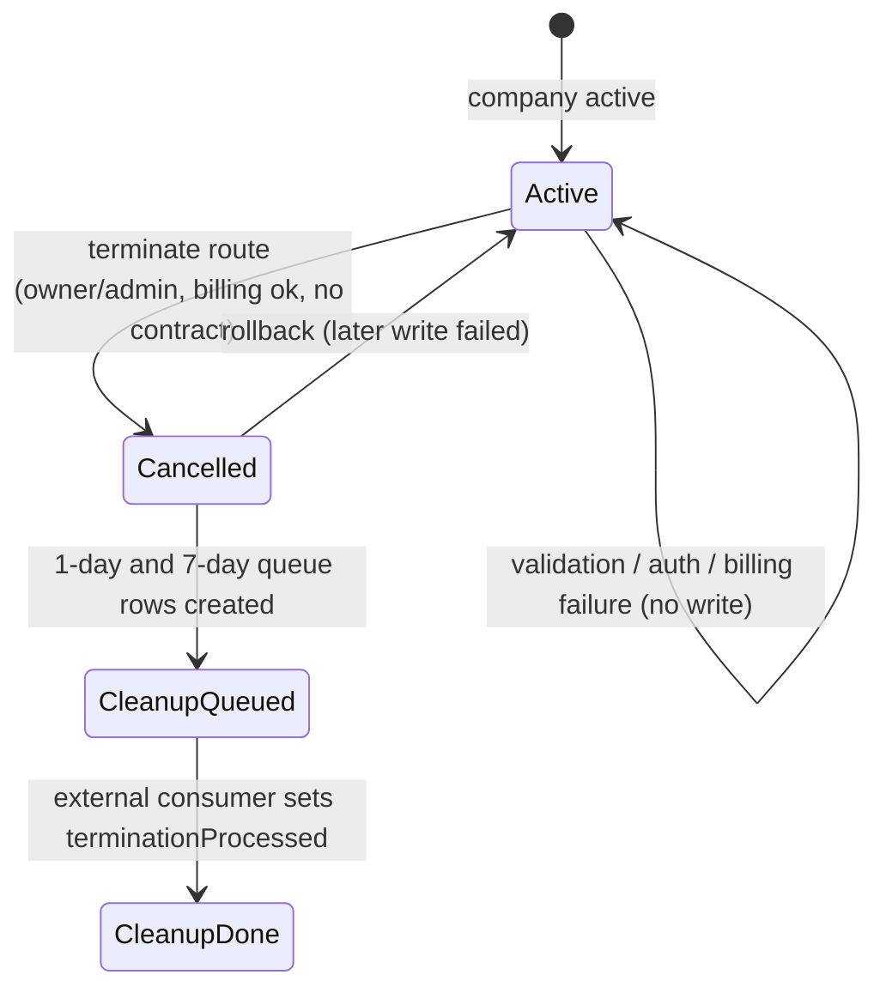
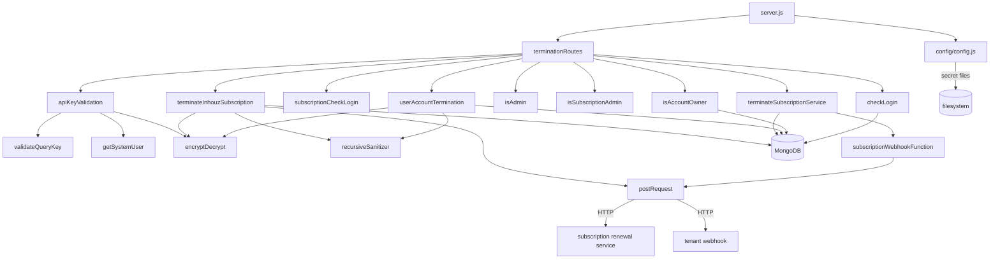

# account_termination_ms

## 1. Summary

The account-termination entry point for the platform. Three POST routes: terminate a whole Inhouz
subscription (the vendor's platform licence), terminate a third-party subscription service, and
terminate a single user account with one of three licence policies. It deactivates the company,
its subscription, subscriptions, subscribers and licences, deletes or preserves the user licence,
writes audit rows, and enqueues follow-up account-deletion work at 1 day and 7 days. It calls the
subscription renewal service over HTTP to bill the final month and it fires the tenant's
subscription webhook. It is its own git repository at `apps/account_termination_ms/`, separate from
the control repo.

## 2. Stack and commands

| Item | Value | Evidence |
|---|---|---|
| Runtime | Node.js `>=12.0.0 <17.5.0` declared; image is Node 16.4 Alpine | `package.json:5`, `Dockerfile:1` |
| Start command | `node server.js` (`npm start`) | `package.json:10` |
| Framework | Express 4 | `package.json:16`, `server.js:2` |
| Database | MongoDB via Mongoose 7 | `package.json:26`, `server.js:3,102` |
| Port | `PORT`, 5048 in k8s | `server.js:96`, `kus/base/account-termination-ms-deployment.yml:36,45` |
| ClusterIP service | `account-termination-ms-cluster-ip-service` | `k8s/account-termination-ms-cluster-ip-service.yml:4` |
| Test command | the npm placeholder that exits 1 | `package.json:9` |

`npm start` exists, so the image command works (`Dockerfile:11`). No lint, build or typecheck
script.

## 3. Entry points

| Entry point | Where | How it starts |
|---|---|---|
| HTTP server | `server.js:96` | `app.listen(process.env.PORT)` in the cluster worker |
| Cluster master / workers | `server.js:35-52` | one worker outside production, one per CPU in production (`server.js:36`) |
| Route registration | `server.js:67` | `require("./controller/terminationRoutes/terminationRoutes")(app)` |
| Mongo connect / reconnect | `server.js:101-113`, `server.js:75-82` | `mongoose.connect` with `maxPoolSize: 1`; 5 s retry on `disconnected` |
| Shutdown | `server.js:87-94` | `SIGINT`, `SIGTERM`, `uncaughtException` close Mongo |
| Docker healthcheck | `healthcheck.js:1-21` | probes `/healthz`, which no route serves |

Routes (`controller/terminationRoutes/terminationRoutes.js:12-14`):

| Method | Path | Middleware chain | Handler | Line |
|---|---|---|---|---|
| POST | `/api/accounttermination/inhouzsubscriptiontermination` | `isLoggedIn`, `isAccountOwner` | `terminateInhouzSubscription` | `:12` |
| POST | `/api/accounttermination/subcriptionservicetermination` | `subscriptionCheckLogin`, `isSubscriptionAdmin` | `terminateSubscriptionService` | `:13` |
| POST | `/api/accounttermination/useraccounttermination` | `apiKeyValidation`, `isLoggedIn`, `isAdmin` | `userAccountTermination` | `:14` |

Note the typo `subcription` (one `s`) in the second route path. Callers must use that spelling.

No cron. The termination *queue* is written here and drained elsewhere; this repo has no consumer.

## 4. Module inventory

| Module | Where | Responsibility | Public API | Kind |
|---|---|---|---|---|
| `terminateInhouzSubscription` | `services/accountTermination/terminateInhouzSubscription.js:11` | Terminate the vendor's platform licence: final billing call, company cancel, licence off, enqueue 1/7-day cleanup, audit log, with rollback | `(req,res)` | `effectful` — Mongo read/write, HTTP, clock |
| `terminateSubscriptionService` | `services/accountTermination/terminateSubscriptionService.js:10` | Terminate a third-party subscription service: contract check, cancel subscriptions/subscribers/packages, clear sessions, enqueue cleanup, fire webhooks, audit | `(req,res)` | `effectful` — Mongo read/write, HTTP, clock |
| `userAccountTermination` | `services/accountTermination/userAccountTermination.js:10` | Deactivate one user; apply `preserve license` / `cancel license` / `delete license and data`; cancel their subscriptions, log actions, delete sessions and role | `(req,res)` | `effectful` — Mongo read/write, clock |
| `terminationRoutes` | `controller/terminationRoutes/terminationRoutes.js:11` | Registers the three routes | `(app)` | `reactive` — mutates the express app |
| `apiKeyValidation` | `middlewares/apiKey/apiKeyValidation.js:7` | Server-to-server auth: decrypts `X-SE-API-KEY` (Cryptr) or `X-CE-API-KEY` (RSA), validates the query key, loads the system user | `(req,res,next)` | `effectful` — decrypt, Mongo read, clock |
| `checkLogin` | `middlewares/login/checkLogin.js:9` | Human session auth via `SMPL` cookie or `x-access-token`, slides the session, loads user and company | `(req,res,next)` | `effectful` — Mongo read/update, clock, cookie write |
| `subscriptionCheckLogin` | `middlewares/login/subscriptionCheckLogin.js` | Subscription-session auth | `(req,res,next)` | `effectful` — Mongo read, clock |
| `isAccountOwner` | `middlewares/roles/isAccountOwner.js:4` | Requires the caller to hold the company's `owner` signup role | `(req,res,next)` | `effectful` — Mongo read |
| `isAdmin` | `middlewares/permissions/isAdmin.js` | Requires the `admin` permission | `(req,res,next)` | `pure` — reads `req.user` |
| `isSubscriptionAdmin` | `middlewares/permissions/isSubscriptionAdmin.js` | Requires the subscription-admin permission | `(req,res,next)` | `pure` — reads `req.user` |
| `moduleAccessCheck`, `singleSubdomainValidation` | `middlewares/module/`, `middlewares/subdomain/` | Template guards | `(req,res,next)` | `effectful` / `reactive`. **Not mounted** |
| `subscriptionWebhookFunction` | `utils/subscriptionService/subscriptionWebhookFunction.js:4` | POSTs an `accountTermination` event to the tenant's webhook URL | `(params)` | `effectful` — network; fire-and-forget (`:29`) |
| `postRequest` | `utils/requests/postRequest.js:3` | `node-fetch` POST wrapper returning the JSON body or `{hasError}` | `(url, headers, data)` | `effectful` — network |
| `encryptDecrypt` | `utils/cryptography/encryptDecrypt.js` | RSA decrypt with the client key | `(data, encrypt)` | `effectful` — reads secret config |
| `recursiveSanitizer` | `utils/sanitizer/recursiveSanitizer.js` | Recursive `sanitizer` pass | `(value, sanitizer)` | `pure` |
| `getSystemUser` | `utils/systemUser/getSystemUser.js` | Loads the system user named in the API key payload | `(payload, req)` | `effectful` — Mongo read |
| `validateQueryKey` | `utils/query/validateQueryKey.js` | Checks the query key against the query-key tracker | `(queryKey)` | `effectful` — Mongo read |
| `config` | `config/config.js:17` | Cached config, secrets from files with env fallback | `()` | `effectful` — filesystem, env, RSA key |

## 5. Side effects

**MongoDB reads**

| Operation | Collection (env → value) | Line |
|---|---|---|
| `findOne` active Inhouz subscription | `INHOUZ_SUBSCRIPTIONS_MODEL` → `inhouzSubscriptions` | `terminateInhouzSubscription.js:73` |
| `find` active user licences | `INHOUZ_USER_LICENSE_MODEL` → `inhouzUserLicenses` | `:100` |
| `findOne` company | `COMPANY_MODEL` → `company` | `:118`, `terminateSubscriptionService.js:72` |
| `find` active contract packages | `SUBSCRIBED_PACKAGE_MODEL` → `subscribedPackages` | `terminateSubscriptionService.js:98` |
| `find` active subscribers / subscriptions | `SUBSCRIBER_MODEL` → `subscribers`, `SUBSCRIPTION_MODEL` → `subscriptions` | `:142,161` |
| `findOne` deployed subscription service | `SUBSCRIPTION_SERVICE_MODEL` → `subscriptionServices` | `:436` |
| `findOne` owner role | `ROLE_MODEL` → `roles` | `isAccountOwner.js:21`, `userAccountTermination.js:85` |
| `findOne` user / user role | `USER_MODEL`, `USER_ROLES_MODEL` | `userAccountTermination.js:106,145` |
| `findOne` session, company (login middleware) | `SESSION_MODEL`, `COMPANY_MODEL` | `middlewares/login/checkLogin.js:27,108` |
| `findOne` subscription session | `SUBSCRIPTION_SESSION_MODEL` | `middlewares/login/subscriptionCheckLogin.js:23` |
| query-key validation | `QUERY_KEY_TRACKER_MODEL` | `utils/query/validateQueryKey.js` |
| system user load | `SYSTEM_USER_MODEL` | `utils/systemUser/getSystemUser.js` |

**MongoDB writes**

| Operation | Collection | Line |
|---|---|---|
| `updateOne` company `status: cancelled` | `company` | `terminateInhouzSubscription.js:186`, `terminateSubscriptionService.js:265` |
| `updateOne` Inhouz subscription `active:false`, `finalUserCount`, `deactivationDate`, `cancellationReason: 'switchOff'`, `terminationNote` | `inhouzSubscriptions` | `terminateInhouzSubscription.js:210-224` |
| rollback company status / licence `active:true` | `company`, `inhouzSubscriptions` | `:231-318` |
| `create` 1-day and 7-day cleanup rows | `ACCOUNT_TERMINATION_QUEUE_MODEL` → `accountTerminationQueue` | `:258`, `terminateSubscriptionService.js:374` |
| `deleteMany` queue rows on rollback | `accountTerminationQueue` | `:279` |
| `create` termination audit | `ACCOUNT_TERMINATION_LOG_MODEL` → `accountTerminationLogs` | `:328`, `terminateSubscriptionService.js:416` |
| `updateMany` subscriptions `activeSubscriber:false` | `subscriptions` | `terminateSubscriptionService.js:190` |
| `updateMany` subscribers `active:false` | `subscribers` | `:218` |
| `deleteMany` subscription sessions / validators / auth logs | `subscriptionSessions`, `subscriptionSessionValidator`, `subscriptionSessionAuthLogs` | `:330-349` |
| `updateMany` packages `active:false`, `isDepricated:true` | `subscribedPackages` | `:351` |
| `create` subscriber action logs | `SUBSCRIBER_ACTION_LOG_MODEL` → `subscriberActionLogs` | `:393`, `userAccountTermination.js:430` |
| `updateOne` user `active:false` | `User` | `userAccountTermination.js:171` |
| licence `updateOne` email blank / `active:false` / `deleteOne` | `inhouzUserLicenses` | `:198,238,278` |
| `deleteOne` user on "delete license and data" | `User` | `:314` |
| `updateMany` subscriptions `status:'cancelled'`, `activeSubscriber:false` | `subscriptions` | `:379-390` |
| `updateOne`/`deleteMany` subscriber | `subscribers` | `:398,415` |
| `deleteMany` subscription sessions | `subscriptionSessions` | `:452` |
| `deleteMany` platform sessions | `session` | `:463` |
| `create` user termination audit | `USER_ACCOUNT_TERMINATION_LOG_MODEL` → `userAccountTerminationLogModel` | `:473` |
| `deleteOne` user role | `userRoles` | `:484` |

**Network**

- `POST {INHOUZ_SUBSCRIPTION_RENEWAL_MS_URL}/api/inhouzsubscriptionrenewal/accountutilityrenewal`
  (`terminateInhouzSubscription.js:169-173`), forwarding the caller's `Cookie` and `x-csrfToken`
  headers (`:153-157`) with a Cryptr-encrypted payload expiring in 30 seconds (`:158-167`).
- Tenant webhook `POST` to `subscriptionWebhookUrl` (`terminateSubscriptionService.js:473`,
  `utils/subscriptionService/subscriptionWebhookFunction.js:29`), not awaited.
- No other outbound client. `@sendgrid/mail` is a dependency but never required.

**Filesystem / env** — `fs.readFileSync` for `sendgridapikey`, `sessionsecret`, `mongourl`,
`clientsecretkey` under `SECRETS_PATH` (`config/config.js:5-14,24,27,28,41`).

**Clock** — `new Date().getTime()` for audit timestamps and payload expiry; `moment()` for the
1-day and 7-day queue timestamps (`terminateInhouzSubscription.js:261`,
`terminateSubscriptionService.js:378`).

**Randomness** — none.

**Logging** — `console.log` on every catch (`server.js:42,50,73,76,84`,
`terminateInhouzSubscription.js:79,346`, and repeated through both long services). The one log
that prints a full response body is `terminateInhouzSubscription.js:176`.

## 6. State and state transitions

Three distinct state machines, one per route.

**Company account** (`company.status`)

| From | To | Trigger | Guard |
|---|---|---|---|
| `active` | `cancelled` | `updateOne` in either account route | caller is owner / subscription admin of that company; no unexpired contract (service route) |
| `cancelled` (attempted) | previous status restored | rollback block | a later write fails (`terminateInhouzSubscription.js:231-244`, `:287-300`; `terminateSubscriptionService.js:280-323`) |

**Inhouz platform subscription** (`inhouzSubscriptions.active`)

| From | To | Trigger | Guard |
|---|---|---|---|
| `true` | `false`, `cancellationReason: 'switchOff'`, `deactivationDate`, `terminationNote` | `terminateInhouzSubscription.js:210-224` | final billing call succeeded (`:175`) |
| `false` (attempted) | `true`, fields cleared | rollback when queue write fails (`:302-318`) | — |

**User account** (`User.active`) and licence (`inhouzUserLicenses`)

| Termination type | User | Licence | Sessions / roles |
|---|---|---|---|
| `preserve license` | `active:false` | `email: ''`, stays active | platform + subscription sessions deleted, user role deleted |
| `cancel license` | `active:false` | `active:false` | same |
| `delete license and data` | document deleted | document deleted | same, plus subscriber rows deleted |

Every branch rolls the user back to `active:true` when the licence step fails
(`userAccountTermination.js:214-236,254-276,289-311`).

**Termination queue** (`accountTerminationQueue.terminationProcessed`)

| From | To | Trigger | Guard |
|---|---|---|---|
| (created) `false` | `true` | **not in this repo** | the queue consumer is another service |



## 7. Data

| Model | Collection | Key fields and rules | Evidence |
|---|---|---|---|
| `accountTerminationQueue` | `accountTerminationQueue` | required `companyName`, `companyType`, `timestamp`, `companyId`, `adminEmail` (email validator); `terminationNotes`; `terminationProcessed` default `false`; index `{companyId, timestamp, terminationProcessed}` | `model/account/accountTerminationQueue.js:6-48` |
| `accountTerminationLog` | `accountTerminationLogs` | required `companyName`, `companyType`, `timestamp`, `companyId`, `adminEmail` (email validator); optional `assetOwnerCompanyId`, `terminationNotes`, `userCount`; index `{companyId, timestamp, assetOwnerCompanyId}` | `model/account/accountTerminationLog.js:6-45` |
| `userAccountTerminationLog` | `userAccountTerminationLogModel` | required `companyId`, `email` (validator), `timestamp`, `terminationType` enum `preserve license`, `cancel license`, `delete license and data`; `finalCleanupCheck` default `false`; index names `userEmail` which is not a schema field | `model/account/userAccountTerminationLog.js:6-46` |
| `inhouzSubscription` | `inhouzSubscriptions` | read + deactivated; carries `inSubscriptionTrial`, `inUtilityTrial`, `subscriptionServicePlanType` used by the billing guard | `model/inhouzSubscription/inhouzSubscription.js:5`, `terminateInhouzSubscription.js:142-150` |
| `inhouzUserLicense` | `inhouzUserLicenses` | one licence per user email | `model/inhouzSubscription/inhouzUserLicense.js:6` |
| `subscription` | `subscriptions` | `activeSubscriber`, `status` enum `active`, `paused`, `inRenewal`, `cancelled` | `model/subscription/subscription.js:6,230` |
| `subscriber` | `subscribers` | `active` | `model/subscription/subscriber.js:6` |
| `subscribedPackage` | `subscribedPackages` | `active`, `enforceContractDuration`, `contractExpirationTimestamp`, `subscriberCount`, `isDepricated`, `deprecationDate` | `model/subscription/subscriptionPackage.js:5` |
| `subscriptionService` | `subscriptionServices` | `deployed`, `customPaymentTiers[]`, `subscriptionWebhookUrl`, `serviceName`, `environment` | `terminateSubscriptionService.js:436-459` |
| `session` | `session` | platform session, deleted per user on termination | `model/session/session.js:5` |
| `subscriptionSession` | `subscriptionSessions` | deleted per company or user | `model/session/subscriptionSession.js:6` |
| `subscriptionSessionValidator` | `subscriptionSessionValidator` | deleted per company | `model/session/subscriptionSessionValidator.js:6` |
| `subscriptionSessionAuthLog` | `subscriptionSessionAuthLogs` | deleted per company | `model/session/subscriptionSessionAuthLog.js:6` |
| `subscriberActionLog` | `subscriberActionLogs` | one `unsubscribed` row per cancelled subscription | `model/subscription/subscriberActionLogs.js:6` |
| `role` / `userRoles` | `roles`, `userRoles` | owner-role lookup; user role deleted on termination | `model/rolesAndPermissions/roles.js:93`, `model/user/useRoles.js:51` |
| `systemUser` | `systemUsers` | caller identity for `X-SE-API-KEY` | `model/system/systemUser.js:6` |
| `queryKeyTracker` | `queryKeyTracker` | validates the API-key payload's query key | `model/queryTracker/queryKeyTracker.js:5` |

**Shared collections (data coupling):** this service **writes** `company`, `inhouzSubscriptions`,
`inhouzUserLicenses`, `subscriptions`, `subscribers`, `subscribedPackages`, `session`,
`subscriptionSessions`, `subscriptionSessionValidator`, `subscriptionSessionAuthLogs`,
`subscriberActionLogs`, `userRoles`, `User`, `accountTerminationQueue` and
`accountTerminationLogs`. Those are the same documents the sign-in, subscription, billing and
reporting services read, which is why a rollback path exists at all. **`accountTerminationQueue` is
written here and read by another service** — the brief names `function_parser_ms` and
`scheduled_task_function_parser_ms` as callers of this service, not as consumers of the queue; the
consumer is not in this repo.

## 8. Public interfaces

All routes accept JSON and require `encryptedPayload`, an RSA-encrypted envelope
`{payload, expirationTimestamp}` (`terminateInhouzSubscription.js:29-46`). The main user route also
accepts `serverEncrypted: true` to mean "Cryptr, not RSA" (`userAccountTermination.js:30-35`).

**`POST /api/accounttermination/inhouzsubscriptiontermination`** — middleware `isLoggedIn`,
`isAccountOwner` (`terminationRoutes.js:12`)

```json
// request
{ "encryptedPayload": "<RSA envelope>" }
// payload: { "companyId": "<ObjectId>", "terminationNotes": "..." }
// 200 { "success": true }
// 400 bad envelope or companyId · 401 caller is not owner of that company
// 404 no active subscription or no company · 500 billing, write, or rollback failure
```

**`POST /api/accounttermination/subcriptionservicetermination`** — middleware
`subscriptionCheckLogin`, `isSubscriptionAdmin` (`:13`)

```json
// payload: { "companyId": "...", "terminationNotes": "..." }   (company must be companyType: thirdParty)
// 200 { "success": true }
// 200 { "error": { "message": "Your account has unexpired contracts. Please try again after <date>." } }
// 404 company not found · 500 write failure · 200-with-error for partial failures
```

**`POST /api/accounttermination/useraccounttermination`** — middleware `apiKeyValidation`,
`isLoggedIn`, `isAdmin` (`:14`)

```json
// request
{ "encryptedPayload": "...", "serverEncrypted": true, "functionGenerated": false }
// payload: { "userId", "companyId", "terminationType", "email", "terminationNotes" }
// terminationType: "preserve license" | "cancel license" | "delete license and data"
// 200 { "success": true }
// 400 validation or owner-protected automation · 401 company mismatch / not admin
// 404 user not found · 500 write failure
```

The API-key middleware reads `X-SE-API-KEY` (Cryptr, from this platform) or `X-CE-API-KEY` (RSA,
from an external caller) and requires `userType === "systemUser"` (`apiKeyValidation.js:12-115`).
When the header is absent the middleware calls `next()` (`:13-15`), so the route falls back to the
human session path.

No events, queue topics or CLI commands. The queue rows are documents, not messages.

## 9. Configuration

Names only.

- `SECRETS_PATH` (default `/mnt/secrets`); secret files `sendgridapikey`, `sessionsecret`,
  `mongourl`, `clientsecretkey` (`config/config.js:5-14,24,27,28,41`).
- Env fallbacks: `SENDGRID_API_KEY`, `SESSION_SECRET`, `MONGO_URL`, `CLIENT_SECRET_KEY`.
- Runtime: `PORT`, `NODE_ENV`.
- Collection names: `ACCOUNT_TERMINATION_QUEUE_MODEL`, `ACCOUNT_TERMINATION_LOG_MODEL`,
  `USER_ACCOUNT_TERMINATION_LOG_MODEL`, `INHOUZ_SUBSCRIPTIONS_MODEL`,
  `INHOUZ_USER_LICENSE_MODEL`, `INHOUZ_SUBSCRIPTION_RENEWAL_MS_URL`, `SUBSCRIBED_PACKAGE_MODEL`,
  `SUBSCRIBER_MODEL`, `SUBSCRIPTION_MODEL`, `SUBSCRIPTION_SERVICE_MODEL`,
  `SUBSCRIBER_ACTION_LOG_MODEL`, `SUBSCRIPTION_SESSION_MODEL`,
  `SUBSCRIPTION_SESSION_AUTH_LOG_MODEL`, `SUBSCRIPTION_SESSION_VALIDATOR_MODEL`,
  `SUBSCRIPTION_PACKAGE_DEPRICATION_LOG_MODEL`, `SYSTEM_USER_MODEL`, `QUERY_KEY_TRACKER_MODEL`,
  `COMPANY_MODEL`, `USER_MODEL`, `USER_ROLES_MODEL`, `ROLE_MODEL`, `PERMISSION_MODEL`,
  `SESSION_MODEL`, `SESSION_VALIDATOR_MODEL`, `AUTH_LOG_MODEL` (`config/config.js:20-64`).
- Misc: `SMPL_EMAIL`, `COOKIE_DOMAIN`.
- Hard-coded: `adminPermission: "admin"` (`config/config.js:40`), CORS regex
  `/inhouz.localhost/` (`server.js:57`), cleanup intervals `[1, 7]` days
  (`terminateInhouzSubscription.js:255`, `terminateSubscriptionService.js:372`), billing-envelope
  TTL 30 s (`terminateInhouzSubscription.js:165`), cookie names `SMPL`, `x-java`,
  `sessionExpirationTimestamp` (`middlewares/login/checkLogin.js:14,139,147`).
- k8s sets many more `*_MODEL` names (function, schema, query, operation tracker, API usage log,
  and so on) that this code never reads; they are inherited from the shared deployment template
  (`kus/base/account-termination-ms-deployment.yml`).

## 10. Dependencies

Direct only, `package.json:12-33`.

| Package | Why |
|---|---|
| `express` | server and routes |
| `mongoose` | all models and queries |
| `body-parser` | JSON parsing, 20 mb (`server.js:63`) |
| `cookie-parser` | reads the `SMPL` cookie (`server.js:66`) |
| `cors`, `helmet`, `hpp` | credentialed CORS, security headers, parameter-pollution guard (`server.js:55-65`) |
| `cryptr` | decrypts the API key and session cookie, encrypts the billing call and the API-key envelope |
| `node-rsa` | decrypts client-encrypted route payloads and `X-CE-API-KEY` |
| `node-fetch` | the final billing call and tenant webhook |
| `moment` | queue offsets and contract-expiry formatting |
| `lodash` | `isEqual` company comparison |
| `sanitizer` | XSS sanitising of bodies |
| `validator` | email validation in models and services |
| `dotenv` | local `.env` loading (`server.js:1`) |
| `crypto-js` | second-layer encryption of the CSRF cookie in the login middleware |
| `bcryptjs`, `@sendgrid/mail`, `connect-mongo`, `express-session`, `request-ip`, `shortid` | template dependencies; not required by mounted code |

## 11. Testing

No tests. `package.json:9` is the npm placeholder that fails. Nothing is covered. Verification
today is manual: a Mongo copy, a real session cookie or API key, and a check of each collection
after a route call.

## 12. Known issues and risks

1. **The final billing call may report failure on success.** `postRequest` returns the parsed JSON
   body on success (`utils/requests/postRequest.js:33`), but the caller requires
   `utilityPaymentResponse['success']` to be truthy (`terminateInhouzSubscription.js:175`). If the
   renewal service returns any other success shape, every termination is blocked with
   "An error occured while processing final account billing."
2. **The caller's credentials are forwarded to another service.**
   `terminateInhouzSubscription.js:153-157` copies `req.headers.cookie` and `x-csrfToken` into the
   outbound request, so a stolen cookie is replayed to the renewal service.
3. **No transaction around multi-collection writes.** Company, subscription, queue, log and
   session writes happen in sequence with manual compensating updates
   (`terminateInhouzSubscription.js:231-318`, `terminateSubscriptionService.js:280-323`,
   `userAccountTermination.js:214-311`). A crash between writes leaves a half-terminated account
   and no reconciliation job.
4. **Rollback is incomplete in `terminateSubscriptionService`.** It restores subscriptions and
   subscribers when the company write fails (`:280-323`), but the three `deleteMany` session
   calls and the package deprecation (`:331-368`) happen after the point of no return and are
   never undone.
5. **`subscriberIds` / `modifiedCount` treats "nothing to change" as failure.** If there are no
   active subscribers, `updateMany` reports `modifiedCount: 0` and the route rolls back with
   "Failed to deactivate subscriber account(s)." (`terminateSubscriptionService.js:219-260`). Same
   pattern for subscriptions (`:208`).
6. **`userAccountTermination` "delete license and data" can delete a user with no rollback.**
   The user is soft-deactivated first (`:171`), the licence deleted (`:278`) and then the user
   document deleted (`:314`). If the subscription step later fails, the code recreates the user
   from the in-memory `userAccount` (`:355-361`), which resurrects a document with the old
   `_id` and audit fields.
7. **`preserve license` blanks the email but the licence may be matched by email.** The update
   filter is `{companyId, email}` and the update sets `email: ''` (`:198-207`), so a second
   termination for the same user cannot find the licence again.
8. **Webhook and queue side effects are not awaited or checked.**
   `subscriptionWebhookFunction` calls `postRequest` without `await` (`:29-33`), and queue creates
   ignore their result in `terminateSubscriptionService.js:375-386`. A webhook failure is silent.
9. **`apiKeyValidation` lets unauthenticated requests through when no key header is present.**
   `if(!encryptedApiKey){ return next(); }` (`apiKeyValidation.js:13-15`). The route then depends on
   `isLoggedIn` and `isAdmin`; that is a deliberate fallback, but it means the API-key gate is
   optional.
10. **The API key authorises every company.** `getSystemUser` loads the system user from the
    decrypted key, but the service routes only compare the payload `companyId` with
    `req.user.companyId` (`terminateInhouzSubscription.js:64`, `userAccountTermination.js:73`). If
    the system user belongs to a different company than the target, the call is rejected — which is
    safe, but it makes cross-tenant automation impossible.
11. **Errors are returned with HTTP 200 in several places.**
    `terminateSubscriptionService.js:115,133,210,257,319` and
    `userAccountTermination.js:188,372` send `{error}` with status 200.
12. **Internal error detail is logged, including a full response body.**
    `terminateInhouzSubscription.js:176` prints `utilityPaymentResponse`.
13. **The healthcheck path is not served.** `healthcheck.js:7` vs `terminationRoutes.js:12-14`.
14. **Route path typo.** `/api/accounttermination/subcriptionservicetermination`
    (`terminationRoutes.js:13`) is misspelled and must be kept for compatibility.
15. **Dead template middleware.** `middlewares/module/moduleAccessCheck.js` and
    `middlewares/subdomain/singleSubdomainValidation.js` are never mounted.
16. **No credential embedded in source.** `service-account.json.enc` is encrypted; no key literal
    was found in any `.js` file.

## 13. Module map



## 14. Open questions

- The brief says `function_parser_ms` and `scheduled_task_function_parser_ms` call this service.
  The code supports that via `X-SE-API-KEY` (`apiKeyValidation.js:18-22`), but no caller is visible
  in this repo. Which of the two owns each route cannot be determined here.
- Who drains `accountTerminationQueue` and sets `terminationProcessed` is not in this repo. The
  brief lists no consumer; the queue would be invisible work if none exists.
- The exact success shape of `POST /api/inhouzsubscriptionrenewal/accountutilityrenewal` is
  unknown; issue 1 depends on it.
- Whether `inhouzSubscriptions` should be filtered by `environment` is unclear: the read
  (`terminateInhouzSubscription.js:73-76`) does not filter, while the model has an `environment`
  field.
- `utils/subscription/`, `utils/user/`, `utils/query/` and `middlewares/permissions/` contain more
  files than were opened; each was read only through the call sites cited above.
- The `kus/dev` and `kus/prod` overlays, the HPA/VPA manifests and the build/deploy scripts were
  skipped as deployment noise.
- `service-account.json.enc` was not decrypted.
