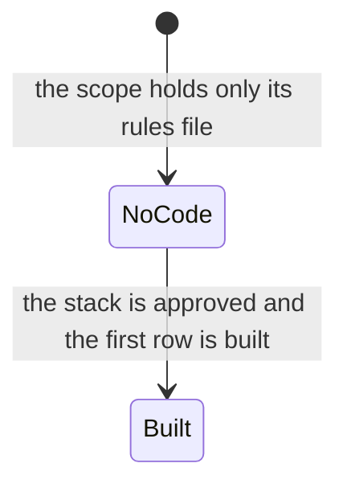
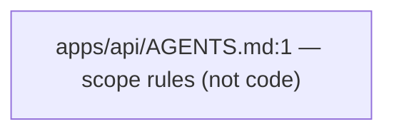

# HANDOVER — `api` unit

Every claim below carries a `file:line` citation. A row without one was dropped.

Written by the `docs-writer` agent (`.kilo/agent/docs-writer.md:8`). Mode: **full read** of
`apps/api/`.

## 1. Summary

The API scope exists as a placeholder. The folder `apps/api/` holds exactly one file,
`apps/api/AGENTS.md:1`, the scope rules for the API builder. There is no source, no package
manifest, no server, no schema and no test file. The unit is a rulebook for code that has not been
written yet, and nothing may be written into it before the decision gate and the discovery
interview have run (`AGENTS.md:150`).

**Repository:** `api`, registered at `apps/api` in `.kilo/repos.json:1`. This unit was read from the
control repo checkout, because `apps/api` is not yet a git repository of its own. The scope rules
are canonical in `.kilo/scopes/api.md:1` and copied into the app repo as its `AGENTS.md` by
`guard.py sync --repo api` (`.kilo/skills/git-worktree/scripts/guard.py:774`).

## 2. Stack and commands

| Item | Value |
|---|---|
| Stack | `TBD` — `docs/STACK.md:71` |
| Package manager | `TBD` — `docs/STACK.md:74` |
| Dev command | `TBD` — `docs/STACK.md:75` |
| Verification command | `TBD` — `docs/STACK.md:76` |
| Port | `TBD` — `docs/STACK.md:77` |
| Database | `TBD` — `docs/STACK.md:79` |
| Auth approach | `TBD` — `docs/STACK.md:83` |

The stack is decided by the user at the decision gate (`AGENTS.md:214`); nothing is guessed. The
scope rules also say the stack comes from `docs/STACK.md` (`apps/api/AGENTS.md:18`).

## 3. Entry points

None yet. There is no server, no route, no CLI and no migration in this scope. The files the
scope will own once it is built are named by its own rules (`apps/api/AGENTS.md:23`):

- routes
- controllers
- services
- repositories
- schemas
- middleware
- config
- integration clients
- tests

## 4. Module inventory

| Symbol | file:line | Responsibility | Public API | Kind |
|---|---|---|---|---|
| `apps/api/AGENTS.md` | `apps/api/AGENTS.md:1` | The scope rules for the API builder: scope, structure, code style, production expectations, runtime logging, verification. | The rules themselves. | not code — a Markdown rules file, so it carries no pure/reactive/effectful kind |

There is no other file in this scope, so there is no other row.

## 5. Side effects

None. There is no code in this scope, so it touches no database, network, filesystem, env, clock,
randomness source or logger. The rules it will impose on the code that arrives are about
structure, logging and runtime behaviour (`apps/api/AGENTS.md:62`), not effects.

## 6. State and state transitions

None yet. The scope rules name `repositories` and `schemas` as future places state is held
(`apps/api/AGENTS.md:23`), but no state, no store and no transition exists today.

## 7. Data

None. No models, schemas, tables, collections or migrations exist in this scope. The database is
`TBD` (`docs/STACK.md:79`), and the API contract that will bind the clients to this scope lives
in `docs/API_CONTRACTS.md:1`, still a placeholder.

## 8. Public interfaces

None yet. No HTTP route, event, queue topic or CLI command is exposed by this scope. The rules
that will govern them — route, controller, service, repository, schema, middleware — are listed
at `apps/api/AGENTS.md:23`.

## 9. Configuration

None. No env var or config key is used by this scope. `docs/ENVIRONMENT.md:1` holds the empty
table for the whole repository. Names only would be recorded here; values are never written
(`AGENTS.md:1501`).

## 10. Dependencies

None yet. There is no `package.json` or `requirements.txt` in this scope, so the unit has no
direct dependency. The scope rules ask for production-ready behaviour with no placeholder
architecture (`apps/api/AGENTS.md:55`).

## 11. Testing

None. There is no test runner, no test file and no CI in this scope. The scope rules require the
verification command from `docs/STACK.md` (`apps/api/AGENTS.md:80`), which is `TBD` today.

## 12. Known issues and risks

- **The scope rules are written but no application has been built.** Every section of this
  handover is empty because the scope holds one rules file (`apps/api/AGENTS.md:1`). That is the
  truth, not a gap in the read.
- **The stack, the database and the auth approach are all `TBD`** (`docs/STACK.md:71`,
  `docs/STACK.md:79`, `docs/STACK.md:83`), so the API scope cannot be built or verified yet.

## 13. Module map

One node, because the scope holds one file. When code arrives it will grow along the
route → controller → service → repository → schema chain (`apps/api/AGENTS.md:23`).

## 14. Open questions

- What application will this scope serve? `DOMAIN.md:1` is `TBD` and the discovery interview
  (`AGENTS.md:150`) has not run.
- Which framework, database and auth approach? `docs/STACK.md:71` is `TBD`.
- Will this scope be the first unit built? The API scope is usually built before the clients
  (`AGENTS.md:580`).
