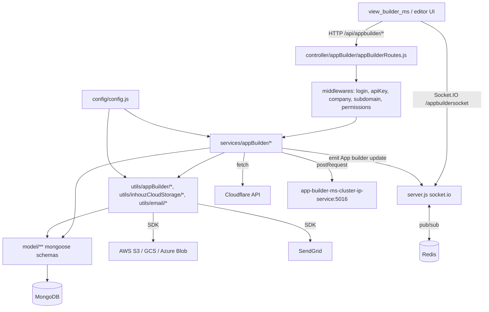

# app_builder_ms

## 1. Summary

`app_builder_ms` is the Inhouz no-code application builder backend. It owns the lifecycle of an
`inhouzApps` record: create, clone, edit, commit, rebase, undeploy, delete, custom-domain
activation through Cloudflare, per-app access passwords, app folders, saved styles, style guides,
saved elements and the app commit history. It also serves the app JSON that `view_builder_ms`
renders, holds the deployment and update queues as MongoDB documents, and pushes live editor
updates over a Socket.IO namespace. It lives in its own git repository at `apps/app_builder_ms/`.
All paths below are relative to that repository.

## 2. Stack and commands

- Runtime: Node.js. `package.json:5` declares `engines.node` `>=12.0.0 <17.5.0`; the container
  image is `node:16.4-alpine` (`Dockerfile:1`).
- Start command: `npm run start` → `node --max-old-space-size=10000 server.js`
  (`package.json:12`, `Dockerfile:11`).
- Test command: `npm run test` → `echo "Error: no test specified" && exit 1` (`package.json:11`).
- HTTP port: `process.env.PORT` (`server.js:156`); the k8s service exposes port 5016
  (`k8s/app-builder-ms-cluster-ip-service.yml:10`).
- Device/probe: `healthcheck.js:6` probes `http://localhost:$PORT/healthz`, but no `/healthz`
  route is registered (see §12).
- Data store: MongoDB via mongoose (`server.js:161`), cached Redis publisher/subscriber for the
  Socket.IO adapter (`server.js:24`).

## 3. Entry points

| Entry point | Where | How it starts |
|---|---|---|
| HTTP server | `server.js:156` `server.listen(process.env.PORT)` | `npm run start` in the container |
| Route registration | `server.js:125` calls `controller/appBuilder/appBuilderRoutes.js` | during module load, before listen |
| Express app + middleware stack | `server.js:107-118` | during module load |
| Socket.IO server | `server.js:31`, path `/appbuildersocket/socket.io` | attached to the same HTTP server |
| Redis adapter connect | `server.js:39-42` | `Promise.all([connect])` on boot |
| Mongo connect / reconnect | `server.js:126-127`, `server.js:160-171` | boot, plus retry 5 s after a disconnect (`server.js:133-140`) |
| Graceful shutdown hook | `server.js:144-154` | `SIGINT`, `SIGTERM`, `uncaughtException` |
| Model registration (47 requires) | `server.js:58-105` | during module load |
| Standalone health probe script | `healthcheck.js:1-20` | not wired to any npm script |

There is no worker loop, cron job or queue consumer in this service. The deployment and update
queues are written as MongoDB documents only (`services/appBuilder/deleteInhouzApp.js:198`
removes a queue entry; no code reads or processes the queue here).

## 4. Module inventory

Kind: `pure` = no I/O, deterministic; `reactive` = reads/writes state; `effectful` = DB, network,
filesystem, env, clock, logging.

| Module | `file:line` | Owns | Public API | Kind |
|---|---|---|---|---|
| Server bootstrap | `server.js:1` | HTTP server, Socket.IO, Mongo, Redis, model loading, route mount | side-effect module | effectful |
| Socket accessor | `server.js:120` | returns the Socket.IO instance to services | `getSocketIoInstance()` | reactive |
| Mongo connector | `server.js:160` | mongoose connect with `maxPoolSize: 10` | `connectMongo()` | effectful |
| Config loader | `config/config.js:18` | env + secret-file config, cached in a module singleton | `() => config` | effectful (reads env and files, caches) |
| Secret reader | `config/config.js:5` | reads a mounted secret file, falls back to env | `readSecret(name, envFallback)` | effectful |
| Route table | `controller/appBuilder/appBuilderRoutes.js:55-98` | 43 active routes plus one commented-out route | `(app) => void` | effectful (binds handlers) |
| Auth: session login | `middlewares/login/checkLogin.js:9` | decrypts `SMPL` cookie / `x-access-token`, loads session, CSRF check | `(req,res,next)` | effectful |
| Auth: server login | `middlewares/login/checkServerLogin.js:5` | server-to-server caller authentication | `(req,res,next)` | effectful |
| Auth: encrypted client/server login | `middlewares/login/clientEncryptedLogin.js:5`, `middlewares/login/serverEncryptedLogin.js:6` | decrypt encrypted login envelopes, set `req.isServerAuthorized` | `(req,res,next)` | effectful |
| API key validation | `middlewares/apiKey/apiKeyValidation.js:8` | reads `X-SE-API-KEY` / `X-CE-API-KEY`, decrypts, checks query key | `(req,res,next)` | effectful |
| Company account check | `middlewares/company/companyAccountCheck.js:1` | company/account validity gate | `(req,res,next)` | effectful |
| Module access check | `middlewares/module/moduleAccessCheck.js:7` | flex module entitlement | `(req,res,next)` | effectful |
| Subdomain check | `middlewares/subdomain/singleSubdomainValidation.js:1` | single-subdomain rule | `(req,res,next)` | effectful |
| Developer permission | `middlewares/permissions/isAllowedDeveloper.js:3` | api/ui/admin developer permission | `(req,res,next)` | reactive (reads `req.user`) |
| Delete permission | `middlewares/permissions/hasDeletePermission.js:3` | delete-app permission | `(req,res,next)` | reactive (reads `req.user`) |
| App creation | `services/appBuilder/createApp.js:9` | builds app + pages + elements from template | Express handler | effectful |
| App clone | `services/appBuilder/cloneApp.js` | deep-clones app, pages, elements | Express handler | effectful |
| App read (compressed) | `services/appBuilder/getApp.js` | returns app JSON | Express handler | effectful |
| Encrypted app read | `services/appBuilder/encGetCompressedApp.js:9` | decrypts envelope, returns app | Express handler | effectful |
| App edit | `services/appBuilder/editApp.js:5` | persists element/page deltas, emits socket update | Express handler | effectful |
| App commit | `services/appBuilder/commitApp.js:10` | writes an `inhouzAppCommits` version | Express handler | effectful |
| Commit version set | `services/appBuilder/setCommitVersion.js` | moves active version pointer | Express handler | effectful |
| Rebase fallback | `services/appBuilder/appRebaseFallback.js` | stores rebase fallback log | Express handler | effectful |
| Undeploy | `services/appBuilder/undeployApp.js:12` | clears deploy flags, self-call to deactivate domain | Express handler | effectful |
| App delete | `services/appBuilder/deleteInhouzApp.js:11` | cascade delete app, pages, elements, queue entries, Cloudflare hostnames | Express handler | effectful |
| Custom domain activate | `services/appBuilder/customDomains/activateCustomDomain.js:9` | Cloudflare custom hostname create/verify | Express handler | effectful |
| Custom domain deactivate | `services/appBuilder/customDomains/deactivateCustomDomain.js` | Cloudflare hostname delete | Express handler | effectful |
| Cloudflare cache purge | `services/appBuilder/cloudflare/purgeDomainCache.js` | purge zone cache | Express handler | effectful |
| Folder CRUD | `services/appBuilder/appFolder/*.js` | app folders and name availability | Express handlers | effectful |
| Saved styles CRUD | `services/appBuilder/savedStyles/*.js` | per-app saved styles and name check | Express handlers | effectful |
| Style guide CRUD | `services/appBuilder/styleGuide/*.js` | per-app style guide | Express handlers | effectful |
| Saved elements | `services/appBuilder/elements/*.js` | save/delete/get saved elements | Express handlers | effectful |
| App access passwords | `services/appBuilder/appAccess/setAppPassword.js`, `changeAppPassword.js:9`, `requestAppPasswordChange.js` | bcrypt password set/change, emailed change request | Express handlers | effectful |
| External editor access log | `services/appBuilder/logExternalUserEditorAccess.js` | appends to `externalUserEditorAccessLogs` | Express handler | effectful |
| App JSON assembler | `utils/appBuilder/getApp.js:8` | loads app, pages, elements, functions, S3 assets | `(params,user,req,clone)` | effectful |
| Element writer | `utils/appBuilder/editInhouzElement.js` | writes a single element, emits socket update at `:573` | internal | effectful |
| Storage router | `utils/inhouzCloudStorage/triggerFileStorageTransaction.js:20` | dispatches to GCS / AWS S3 / Azure Blob | `(params)` | effectful |
| Email sender | `utils/email/sendEmail/sendEmail.js:4` | SendGrid send | `(to,from,subject,text,html)` | effectful |
| Cryptography | `utils/cryptography/encryptDecrypt.js:3` | symmetric encrypt/decrypt of envelopes | `(data,encrypt)` | pure (same input yields same output for decrypt; encryption uses fixed key/IV from config) |
| Models | `model/**` (48 schema files) | mongoose schemas registered from env-named collections | mongoose models | effectful |

## 5. Side effects

| Effect | `file:line` |
|---|---|
| MongoDB connect | `server.js:161-171` |
| MongoDB usage across services | e.g. `services/appBuilder/createApp.js:9`, `utils/appBuilder/getApp.js:8`, `services/appBuilder/deleteInhouzApp.js:198` |
| Redis connect, publisher and subscriber | `server.js:24-25`, `server.js:39-42` |
| Socket.IO emit to app room `${appId}-${variationId}` | `utils/appBuilder/editApp.js:483` |
| Socket.IO emit to a socket id | `utils/appBuilder/editInhouzElement.js:573` |
| HTTP self-call to `APP_BUILDER_MS_URL/api/appbuilder/deactivatecustomdomain` | `services/appBuilder/undeployApp.js:165` |
| Cloudflare API: create hostname | `services/appBuilder/customDomains/activateCustomDomain.js:230` |
| Cloudflare API: get hostname | `services/appBuilder/customDomains/activateCustomDomain.js:182` |
| Cloudflare API: patch hostname | `services/appBuilder/customDomains/activateCustomDomain.js:324` |
| Cloudflare API: delete hostname | `services/appBuilder/customDomains/deactivateCustomDomain.js:129`, `services/appBuilder/deleteInhouzApp.js:603` |
| Cloudflare API: purge cache | `services/appBuilder/cloudflare/purgeDomainCache.js:65` |
| AWS S3 client | `utils/appBuilder/getApp.js:405` |
| Google Cloud Storage, Azure Blob, S3 transactions | `utils/inhouzCloudStorage/triggerFileStorageTransaction.js:63-110` |
| SendGrid email | `utils/email/sendEmail/sendEmail.js:1`, `:6` |
| Randomness (`shortid`) | `services/appBuilder/appAccess/requestAppPasswordChange.js:6`, `utils/appBuilder/clone/elementDeepClone.js:3` |
| Clock (`moment`, `Date`) | `middlewares/login/checkLogin.js:4`, `services/appBuilder/commitApp.js:6` |
| Logging (`console.log`) | `server.js:28-29`, `server.js:131`, `server.js:142`, `services/appBuilder/appAccess/changeAppPassword.js` catch block |

## 6. State and state transitions

Three state machines are visible in the data model.

**App deployment state** (`inhouzApps.deployed`, `.pendingDeployment`,
`.activeVersionMap` / `.deployedVersionMap` / `.productionDeployedVersionMap`,
`model/appBuilder/inhouzApp.js:66-80`):

| From | To | Trigger | Guard |
|---|---|---|---|
| not deployed | pending | an app deployment queue row is written by another service with `deployed: false` (`model/appBuilder/appDeploymentQueue.js:7-20`) | app, company and version exist |
| pending | deployed | deployment worker flips `deployed: true` | not performed in this repository |
| deployed | undeployed | `POST /api/appbuilder/undeploy` → `services/appBuilder/undeployApp.js:12` | logged in, subdomain, developer permission |
| any | deleted | `POST /api/appbuilder/deleteapp` (`services/appBuilder/deleteInhouzApp.js:11`) | logged in, developer permission, `hasDeletePermission` (`controller/appBuilder/appBuilderRoutes.js:72`) |

**Custom domain state** (`inhouzApps.customDomains[].active`, `.cloudflareId`,
`model/appBuilder/inhouzApp.js:15-24`):

| From | To | Trigger | Guard |
|---|---|---|---|
| inactive | pending verification | `activatecustomdomain` calls Cloudflare create hostname (`activateCustomDomain.js:230`) | developer permission |
| pending | active | Cloudflare returns verified hostname (`activateCustomDomain.js:182-324`) | hostname exists in zone |
| active | removed | `deactivatecustomdomain` or app delete (`deactivateCustomDomain.js:129`) | Cloudflare hostname id stored |

**Deployment approval state** (`model/appBuilder/appDeploymentQueue.js:25-80`): `approvalRequired`,
`numberOfRequiredApprovals`, `approvedCount`, plus `approvals[]` and `rejections[]` arrays with
per-person `versionMap`. A row moves to approved when `approvedCount` reaches
`numberOfRequiredApprovals`; this service only creates and deletes rows, the transition is owned
elsewhere.

`appAccessPasswords` (`model/appBuilder/appAccessPasswords.js`) hold the bcrypt hash and a
`changeRequestPassword` short id; the transition is set → change-requested → changed, driven by
`setAppPassword`, `requestAppPasswordChange`, `changeAppPassword`.

## 7. Data

Collection names come from env values set in `k8s/app-builder-ms-deployment.yml`; the schema
files register `mongoose.model(config.<key>, schema, config.<key>)`, e.g.
`model/appBuilder/inhouzApp.js:325`. Example mappings verified in the deployment file:
`INHOUZ_APP_MODEL=inhouzApps` (`:226-227`), `APP_ELEMENT_MODEL=appElements` (`:228-229`),
`APP_DEPLOYMENT_QUEUE_MODEL=appDeploymentQueue` (`:160-161`),
`APP_DEPLOYMENT_QUEUE_LOG_MODEL=appDeploymentQueueLogs`, `COMPANY_MODEL=company` (`:164-165`),
`INHOUZ_APP_COMMIT_MODEL=inhouzAppCommits` (`:304-305`).

| Collection (env key) | Model file | Key fields and rules |
|---|---|---|
| `inhouzApps` (`INHOUZ_APP_MODEL`) | `model/appBuilder/inhouzApp.js:6` | `appName` required, `companyId` required, `appId` required, `appType` required enum `webApp\|webComponent\|pdfFunction\|emailFunction\|inhouzSign\|presentation` (`:50-56`), `createdDate` and `createdById` required, `customDomains[]`, version maps, `deployed` default false |
| `appElements` (`APP_ELEMENT_MODEL`) | `model/appBuilder/appElements.js:5` | element tree per app/page |
| `appPages` (`APP_PAGE_MODEL`) | `model/appBuilder/appPage.js:181` | page definitions |
| `appPageBuilds` (`APP_PAGE_BUILD_MODEL`) | `model/appBuilder/appPageBuild.js:64` | build output per page |
| `appBuilds` / `appBuildReport` | `model/appBuilder/appBuild.js:51`, `appBuildReport.js:74` | build records and reports |
| `appDeploymentQueue` | `model/appBuilder/appDeploymentQueue.js:112` | `companyId`, `appId` required, `approvalRequired`, `approvedCount`, `approvals[]`/`rejections[]` with email validator (`:42-48`) |
| `appDeploymentQueueLogs` | `model/appBuilder/appDeploymentQueueLog.js:104` | queue history |
| `appUpdateQueue`, `appElementUpdateQueue`, `pageUpdateQueue` | `model/appBuilder/appUpdateQueue.js:40`, `appElementUpdateQueue.js:37`, `pageUpdateQueue.js:41` | editor write queues |
| `inhouzAppCommits` (`INHOUZ_APP_COMMIT_MODEL`) | `model/appBuilder/inhouzAppCommit.js:6` | commit versions |
| `inhouzAppRebaseFallbackLogs` | `model/appBuilder/appRebaseFallbackLog.js:5` | rebase fallbacks |
| `appFolders` | `model/appBuilder/appFolder.js:46` | folder per company |
| `savedAppStyles`, `styleGuide` | `model/appBuilder/savedAppStyles.js:62`, `styleGuide.js:46` | per-app style assets |
| `savedAppElements` | `model/appBuilder/savedAppElements.js:51` | reusable elements |
| `appAccessPasswords` | `model/appBuilder/appAccessPasswords.js:48` | bcrypt hash, change-request short id |
| `externalUserEditorAccessLogs` | `model/appBuilder/externalUserEditorAccessLog.js:63` | editor access log |
| `customDomainLogs`, `customDomainTerminationQueue` | `model/appBuilder/customDomainLog.js:45`, `customDomainTerminationQueue.js:35` | domain lifecycle |
| `abTests` | `model/appBuilder/abTests.js:94` | A/B test definitions |
| `appBuilderSocketTracker` | `model/appBuilder/appBuilderSocketTracker.js:55` | socket/session presence |
| `personalizedAppBuilderSettings` | `model/appBuilder/personalizedAppBuilderSettings.js:38` | per-user builder prefs |
| `company`, `customers`, `contacts` | `model/company/company.js:108` | shared company record |
| `users`, `roles`, `permissions`, `userRoles`, `sessions`, `authenticationLogs` | `model/user/*`, `model/rolesAndPermissions/*`, `model/session/session.js:28` | shared auth data |
| `functions`, `deployedFunctions`, `functionVersionTracker`, `operationTracker` | `model/functions/*` | app functions |
| `fileStorageServices`, `inhouzCloudStorageFiles` | `model/fileStorageService/fileStorageServices.js:79`, `model/inhouzCloudStorage/inhouzCloudStorageFiles.js:5` | storage provider credentials and file registry |
| `inhouzSignDocs`, `inhouzSignTemplates`, `inhouzSignStaticFiles` | `model/inhouzSign/*` | sign documents, read/written by app builder |
| `pdfGeneratorTemplates` | `model/pdfGenerator/pdfGeneratorTemplate.js:5` | PDF templates |
| `queryKeyTracker` | `model/queryTracker/queryKeyTracker.js:23` | API query keys |
| `webComponentAccessTracker`, `staticBase64File`, `systemUsers`, `subscribers`, `subscriptions`, `subscriptionServices`, `inhouzSubscriptions`, `exchangeRateCache`, `ipAddressLocations`, `churnTracker`, `paymentCharges`, `paymentIntents`, `paymentMethods`, `payoutAccounts` | `server.js:90-105` model requires and `config/config.js:22-148` keys | registered by this service even where another service owns the writes |

Shared collections are the coupling that cannot be seen from this repository alone:
`company`, `users`, `roles`, `permissions`, `sessions`, `functions`, `inhouzApps`,
`appElements`, `appPages`, `inhouzSignDocs`, `inhouzSignTemplates`, `pdfGeneratorTemplates`,
`fileStorageServices` and `inhouzCloudStorageFiles` are read or written by
`inhouz_sign_ms`, `pdf_generator_ms` and `view_builder_ms` as well. Registering a schema for a
collection it does not own (`server.js:90-105`) means a field change here can break those
services.

## 8. Public interfaces

All routes are mounted under `/api/appbuilder`, `POST` unless noted
(`controller/appBuilder/appBuilderRoutes.js:55-98`). Every handler receives and returns JSON.
Request bodies are sanitised with `recursiveSanitizer` (`services/appBuilder/appAccess/changeAppPassword.js:11`).
Common error shape: `{ error: { message: string } }`; success shapes vary by handler
(e.g. `{ success: true }` at `services/appBuilder/appAccess/changeAppPassword.js` tail).

| Method | Path | Guards | Handler |
|---|---|---|---|
| POST | `/createapp` | login, company, subdomain, developer | `services/appBuilder/createApp.js:9` |
| POST | `/cloneapp` | api key, client+server encrypted login, server login, login, company, subdomain, developer | `services/appBuilder/cloneApp.js` |
| POST | `/getapp` | api key, client+server encrypted login, server login, login, subdomain, developer | `services/appBuilder/getApp.js` |
| POST | `/getcompressedapp` | login, subdomain, developer | `services/appBuilder/getCompressedApp.js` |
| POST | `/encgetcompressedapp` | none (envelope carries its own expiry) | `services/appBuilder/encGetCompressedApp.js:9` |
| POST | `/editapp` | login, company, subdomain, developer | `services/appBuilder/editApp.js:5` |
| POST | `/commitapp` | login, company, subdomain, developer | `services/appBuilder/commitApp.js:10` |
| POST | `/getappcommits` | login, company, subdomain, developer | `services/appBuilder/getAppCommits.js` |
| POST | `/setcommitversion` | login, company, subdomain, developer | `services/appBuilder/setCommitVersion.js` |
| POST | `/setrebasefallback` | login, company, subdomain, developer | `services/appBuilder/appRebaseFallback.js` |
| POST | `/getrebasefallbacks` | login, company, subdomain, developer | `services/appBuilder/getAppRebaseFallbacks.js` |
| POST | `/undeploy` | login, subdomain, developer | `services/appBuilder/undeployApp.js:12` |
| POST | `/getapps` | login, subdomain, developer | `services/appBuilder/getApps.js` |
| POST | `/getappsbyname` | login, subdomain, developer | `services/appBuilder/getAppsByName.js` |
| POST | `/activatecustomdomain` | login, subdomain, developer | `services/appBuilder/customDomains/activateCustomDomain.js:9` |
| POST | `/deactivatecustomdomain` | login, subdomain, developer | `services/appBuilder/customDomains/deactivateCustomDomain.js` |
| POST | `/cloudflare/purgedomaincache` | none | `services/appBuilder/cloudflare/purgeDomainCache.js` |
| POST | `/deleteapp` | login, subdomain, developer, delete permission | `services/appBuilder/deleteInhouzApp.js:11` |
| POST | `/serverdeleteapp` | api key, client+server encrypted login, server login, login | `services/appBuilder/deleteInhouzApp.js:11` |
| POST | `/logexternalusereditoraccess` | login, company, subdomain, developer | `services/appBuilder/logExternalUserEditorAccess.js` |
| POST | `/getuniqueid` | login, subdomain, developer | `services/appBuilder/getUniqueId.js` |
| POST | `/fieldnamecheck` | login, subdomain, developer | `services/appBuilder/appFieldAvailability.js` |
| POST | `/appfolder/create`, `/appfolder/edit`, `/appfolder/getfolders`, `/appfolder/foldernamecheck` | login, company, subdomain, developer | `services/appBuilder/appFolder/*` |
| DELETE | `/appfolder/delete/:folderId` | login, subdomain, developer | `services/appBuilder/appFolder/deleteAppFolder.js` |
| GET | `/appfolder/getfolder/:folderId` | login, subdomain, developer | `services/appBuilder/appFolder/getFolder.js` |
| POST | `/savedstyles/create`, `/edit`, `/getstyles`, `/namecheck` | login, company, subdomain, developer | `services/appBuilder/savedStyles/*` |
| DELETE | `/savedstyles/delete/:appId/:styleId` | login, subdomain, developer | `services/appBuilder/savedStyles/deletAppStyles.js` |
| POST | `/styleguide/create`, `/edit`, `/getstyleguide` | login, company, subdomain, developer | `services/appBuilder/styleGuide/*` |
| DELETE | `/styleguide/delete/:appId/:styleGuideId` | login, subdomain, developer | `services/appBuilder/styleGuide/deleteStyleGuide.js` |
| POST | `/appaccess/setpassword`, `/changepassword`, `/requestpasswordchange` | login, company, subdomain, developer | `services/appBuilder/appAccess/*` |
| POST | `/elements/save`, `/elements/delete`, `/elements/getsavedappelements` | login, company, subdomain, developer | `services/appBuilder/elements/*` |

Removed: `POST /api/appbuilder/editpage` is commented out at
`controller/appBuilder/appBuilderRoutes.js:75`, while its handler still exists at
`services/appBuilder/editAppPage.js`.

Socket interface: namespace path `/appbuildersocket/socket.io` (`server.js:32`), CORS origin
regex `/inhouz.localhost/` (`server.js:34`). Server emits event `App builder update` to room
`${appId}-${variationId}` (`utils/appBuilder/editApp.js:483`) with payload
`{ nextVersion, updatedById, variationId, versionToQuery, appId, browserId, success }`.

Headers used: `SMPL` cookie or `x-access-token` for session, `x-csrfToken` for CSRF
(`middlewares/login/checkLogin.js:13-14`), `X-SE-API-KEY` and `X-CE-API-KEY` for API keys
(`middlewares/apiKey/apiKeyValidation.js:12`).

## 9. Configuration

Env var names only. Secret values are read from files under `SECRETS_PATH` (default
`/mnt/secrets`) with an env fallback (`config/config.js:5-14`).

Model-name env vars (each value is a collection name): `AB_TESTS_MODEL`,
`APP_ACCESS_PASSWORD_MODEL`, `APP_BUILDER_EXTERNAL_ACCESS_MODEL`,
`APP_BUILDER_SOCKET_TRACKER_MODEL`, `APP_BUILD_MODEL`, `APP_BUILD_REPORT_MODEL`,
`APP_DEPLOYMENT_QUEUE_LOG_MODEL`, `APP_DEPLOYMENT_QUEUE_MODEL`, `APP_ELEMENT_MODEL`,
`APP_ELEMENT_UPDATE_QUEUE_MODEL`, `APP_FOLDER_MODEL`, `APP_PAGE_BUILD_MODEL`, `APP_PAGE_MODEL`,
`APP_UPDATE_QUEUE_MODEL`, `AUTH_LOG_MODEL`, `CHURN_TRACKER_MODEL`, `COMPANY_MODEL`,
`CONTACTS_MODEL`, `CUSTOMERS_MODEL`, `CUSTOM_DOMAIN_LOG_MODEL`,
`CUSTOM_DOMAIN_TERMINATION_QUEUE_MODEL`, `DATA_RULE_EXECUTION_RESULT_MODEL`,
`DEPLOYED_FUNCTION_MODEL`, `EXTERNAL_USER_EDITOR_ACCESS_LOG_MODEL`, `FILE_STORAGE_SERVICE_MODEL`,
`FLEX_COLLECTION_MODEL`, `FLEX_FORM_FILE_MODEL`, `FLEX_MODULE_MODEL`, `FORM_MODEL`,
`FUNCTION_MODEL`, `FUNCTION_VERSION_TRACKER_MODEL`, `INHOUZ_APP_COMMIT_MODEL`,
`INHOUZ_APP_MODEL`, `INHOUZ_APP_REBASE_FALLBACK_LOG_MODEL`, `INHOUZ_CLOUD_STORAGE_FILE_MODEL`,
`INHOUZ_SIGN_DOC_MODEL`, `INHOUZ_SIGN_STATIC_FILE_MODEL`, `INHOUZ_SIGN_TEMPLATE_MODEL`,
`INHOUZ_SUBSCRIPTIONS_MODEL`, `OPERATION_TRACKER_MODEL`, `PAGE_UPDATE_QUEUE_MODEL`,
`PAYMENT_CHARGE_MODEL`, `PAYMENT_INTENT_MODEL`, `PAYMENT_METHOD_MODEL`, `PAYOUT_ACCOUNT_MODEL`,
`PDF_GENERATOR_TEMPLATE_MODEL`, `PERMISSION_MODEL`, `PERSONALIZED_APP_BUILDER_SETTINGS_MODEL`,
`QUERY_KEY_TRACKER_MODEL`, `ROLE_MODEL`, `SAVED_APP_ELEMENT_MODEL`, `SAVED_APP_STYLES`,
`SESSION_MODEL`, `SESSION_VALIDATOR_MODEL`, `SMPL_EMAIL`, `STATIC_BASE64_FILE_MODEL`,
`STYLE_GUIDE_MODEL`, `SUBSCRIBER_MODEL`, `SUBSCRIPTION_MODEL`, `SUBSCRIPTION_SERVICE_MODEL`,
`SYSTEM_USER_MODEL`, `USER_MODEL`, `USER_ROLES_MODEL`, `WEB_COMPONENT_ACCESS_TRACKER`.

Behaviour env vars: `NODE_ENV`, `PORT`, `MONGO_URL`, `REDIS_HOST`, `REDIS_PORT`, `REDIS_PASSWORD`,
`REDIS_DB`, `COOKIE_DOMAIN`, `COOKIE_NAME`, `SECRETS_PATH`, `APP_BUILDER_MS_URL`,
`PAYMENT_MS_URL`, `CLOUDFLARE_API_URL`, `CLOUDFLARE_ZONE_ID`, `CLOUDFLARE_AUTH_EMAIL`,
`CLOUDFLARE_AUTH_KEY`, `CLOUDFLARE_CACHE_PURGE_TOKEN`, `S3_ACCESS_KEY_ID`, `S3_SECRET_KEY`,
`S3_BUCKET_NAME`, `GCS_PROJECT_ID`, `GCS_PRIVATE_KEY_ID`, `GCS_PRIVATE_KEY`, `GCS_CLIENT_EMAIL`,
`GCS_CLIENT_ID`, `GCS_CLIENT_X509_CERT_URL`, `INHOUZ_SIGN_DRAFT_BUCKET_NAME`,
`INHOUZ_SIGN_ATTACHMENT_BUCKET_NAME`, `INHOUZ_SIGN_COMPLETED_DOCUMENT_BUCKET_NAME`,
`INHOUZ_PDF_GENERATOR_DRAFT_BUCKET_NAME`, `SENDGRID_API_KEY`, `OPEN_EXCHANGE_RATES_API_KEY`,
`OPEN_EXCHANGE_RATES_BASE_URL`, `IP_LOCATION_FINDER_URL`, `IP_ADDRESS_LOCATION_MODEL`,
`EXCHANGE_RATE_CACHE_MODEL`, `STRIPE_API_KEY`, `CLIENT_SECRET_KEY`, `SESSION_SECRET`,
`ADMIN_DEVELOPER_PERMISSION`, `API_DEVELOPER_PERMISSION`, `UI_DEVELOPER_PERMISSION`,
`APP_PRODUCTION_DEPLOYMENT_PERMISSION`, `DELETE_APP_PERMISSION`,
`SUBSCRIPTION_SERVICE_CHARGE_FEE`.

Secret file names read under `SECRETS_PATH` (`config/config.js:26-127`): `sendgridapikey`,
`sessionsecret`, `mongourl`, `clientsecretkey`, `redishost`, `redispassword`,
`cloudflarezoneid`, `cloudflareauthemail`, `cloudflareauthkey`, `cloudflarecachepurgetoken`,
`s3accesskeyid`, `s3secretkey`, `s3bucketname`, `gcsprojectid`, `gcsprivatekeyid`,
`gcsprivatekey`, `gcsclientemail`, `gcsclientid`, `gcsclientx509certurl`.

## 10. Dependencies

Direct dependencies from `package.json:15-49`, each with why it is here:

| Package | Why |
|---|---|
| `express` | HTTP framework |
| `body-parser` | JSON body limit 300 MB (`server.js:115`) |
| `cookie-parser` | session cookie (`server.js:118`) |
| `cors`, `helmet`, `hpp` | origin policy, headers, parameter-pollution guard (`server.js:107-117`) |
| `socket.io`, `@socket.io/redis-adapter` | live editor updates (`server.js:31-40`) |
| `socket.io-redis` | listed, import commented out (`server.js:8`) |
| `redis` | pub/sub clients (`server.js:7`, `:24`) |
| `mongoose`, `mongodb`, `connect-mongo` | MongoDB access; `mongodb` used for raw driver features |
| `dotenv` | env loading (`server.js:1`) |
| `node-fetch` | Cloudflare and internal HTTP calls (`services/appBuilder/customDomains/activateCustomDomain.js:7`) |
| `lzutf8`, `shrink-string` | app payload compression (`services/appBuilder/getCompressedApp.js:4`, `services/appBuilder/commitApp.js:8`) |
| `shortid` | ids for password-change requests and cloned elements |
| `bcryptjs` | app access password hashing (`services/appBuilder/appAccess/changeAppPassword.js:5`) |
| `cryptr` | cookie/token encryption (`middlewares/login/checkLogin.js:3`) |
| `node-rsa` | RSA key handling in config (`config/config.js:1`) |
| `crypto-js` | hashing helpers in `utils/cryptography` |
| `moment` | timestamps and expiry (`services/appBuilder/commitApp.js:6`) |
| `lodash` | collection helpers (`middlewares/login/checkLogin.js:5`) |
| `validator` | email validation in schemas (`model/appBuilder/appDeploymentQueue.js:4`) |
| `sanitizer` | request body sanitisation (`services/appBuilder/appAccess/changeAppPassword.js:1`) |
| `@sendgrid/mail` | password-change email (`utils/email/sendEmail/sendEmail.js:1`) |
| `aws-sdk`, `@google-cloud/storage`, `@azure/storage-blob` | storage providers (`utils/inhouzCloudStorage/triggerFileStorageTransaction.js:1-18`) |
| `object-sizeof` | PDF static file size (`utils/staticFile/uploadPdfStaticFile.js:3`) |
| `request-ip` | client IP for logs |
| `randomcolor` | default colour generation |
| `express-session` | listed; no `express-session` use found in `server.js` |

## 11. Testing

No tests. `package.json:11` defines `test` as `echo "Error: no test specified" && exit 1`. There
is no test directory and no test framework in the dependencies. Nothing in this repository is
covered by an automated test. Verification is manual against a running deployment.

## 12. Known issues and risks

- No test suite, so every route is unverified by CI (`package.json:11`).
- `healthcheck.js:7` probes `/healthz`, but no `/healthz` route is registered anywhere in the
  repository (the only `healthz` string is that probe). `Dockerfile` has no `HEALTHCHECK` line,
  despite the comment at `healthcheck.js:7`. A probe based on this file would fail.
- Expiry bug in the undeploy self-call: `moment(60, 'seconds').unix() * 1000`
  (`services/appBuilder/undeployApp.js:162`) does not produce "now + 60 s". The receiving
  middleware compares `new Date().getTime() <= expirationTimestamp` and will reject the call, so
  the custom domain is not deactivated on undeploy by this path.
- `PAYMENT_MS_URL` is set in k8s (`k8s/app-builder-ms-deployment.yml:216-217`) but never read
  from `config/config.js`. Dead configuration.
- Cloudflare auth email fallback name mismatch: `config/config.js:99-102` falls back to
  `CLOUDFLAREAUTHEMAIL` while the deployment sets `CLOUDFLARE_AUTH_EMAIL`
  (`k8s/app-builder-ms-deployment.yml:65`). It only works because the mounted secret file name
  matches.
- `POST /api/appbuilder/cloudflare/purgedomaincache` and
  `POST /api/appbuilder/encgetcompressedapp` are registered with no authentication middleware
  (`controller/appBuilder/appBuilderRoutes.js:71`, `:59`). Both rely entirely on an encrypted
  payload envelope.
- Body limit is 300 MB (`server.js:115`) and `maxHttpBufferSize` is 100 MB (`server.js:37`),
  which is a memory-exhaustion surface on a 1-replica deployment.
- CORS origin is the regex `/inhouz.localhost/` (`server.js:34`, `server.js:109`), which matches
  any host containing that substring rather than an exact origin.
- `mongoose.connection.on("error")` logs the full error object with `console.log`
  (`server.js:142`); connection strings can appear in mongoose errors. This is a log-hygiene risk.
- The config module caches a single object on first call (`config/config.js:16-21`); any env
  change requires a process restart.
- `services/appBuilder/editAppPage.js` exists but its route is commented out
  (`controller/appBuilder/appBuilderRoutes.js:75`), so it is dead code.
- `service-account.json.enc` is committed at the repository root. It is encrypted, but the
  decrypting key is not in the repository and the file's rotation is undocumented.
- This service registers schemas for collections owned elsewhere (`server.js:90-105`:
  payments, subscriptions, exchange rates, sign documents). A field change here can break
  `payment_ms`, `inhouz_sign_ms` and `pdf_generator_ms`.

## 13. Module map

## 14. Open questions

- Who consumes `appDeploymentQueue`, `appBuilds`, `appPageBuilds`, `appUpdateQueue`,
  `appElementUpdateQueue` and `pageUpdateQueue`? No consumer exists in this repository, so the
  worker is presumed to live in another service; it was not traced.
- Which services write `inhouzApps` besides this one? `deleteInhouzApp` and the routes suggest
  `view_builder_ms` reads it, but the write path was not confirmed.
- Is `GET /healthz` served by an ingress or a sidecar rather than this app? Nothing in the
  repository registers it.
- Why does `config/config.js` construct `NodeRsaClientPrivateKey` (`:81-86`) when no consumer was
  found by grep? Possibly used by a middleware not opened in this pass.
- `k8s/app-builder-ms-hpa.yml:10-11` allows 1 to 5 replicas, but the Socket.IO editor updates
  are room-based with a Redis adapter, so fan-out is presumed safe; this was not tested.
- Skipped for budget: 68 files under `utils/`, 158 of the 198 mongoose registrations listed in
  the brief, and all model field definitions except `inhouzApp`, `appDeploymentQueue` and
  `appElements`. These are cited by directory and by the representative model files above.
