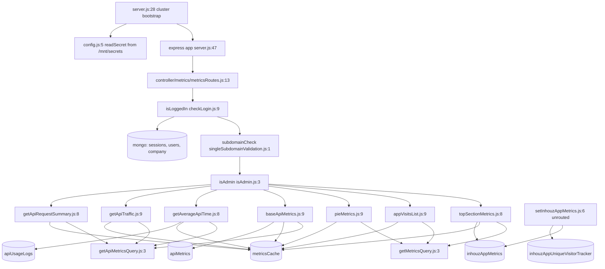

# app_metrics_ms

Repository: `apps/app_metrics_ms` (separate git repository, read through `.kilo/repos.json`; not
the control repo). All `file:line` citations are relative to that repository root.

## 1. Summary

Read-only analytics service for the Inhouz app platform. It serves six admin-facing aggregation
endpoints that answer "how many people visited app X, from where, on what device, and how did its
API behave in this date range". Results are computed from pre-aggregated MongoDB collections and
memoised in a `metricsCache` collection for 10 minutes. A seventh write endpoint that ingested app
telemetry exists as a handler but is not registered on the router, so the service is today
read-only despite its name.

## 2. Stack and commands

Node.js, Express 4, Mongoose. No framework version pinned in the brief output; read
`package.json` for the exact ranges.

- Start: `npm start` → `node --max-old-space-size=8192 server.js` (`package.json:8`).
- Test: `npm test` → `echo "Error: no test specified" && exit 1` (`package.json:7`). There is no
  test suite.
- Port: from `PORT`; `app.listen(process.env.PORT, ...)` at `server.js:91`. The k8s Service maps
  5054 (`k8s/app-metrics-ms-cluster-ip-service.yml:10`).
- Container port env is set in the deployment at `k8s/app-metrics-ms-deployment.yml:28`.
- Runtime model: `cluster` fork of one worker in non-production, `os.cpus().length` workers in
  production (`server.js:28-45`).
- Image: `inhouz/app_metrics_ms`, replicas `1`
  (`k8s/app-metrics-ms-deployment.yml:6`, `:17`). HPA and VPA manifests also ship
  (`k8s/app-metrics-ms-hpa.yml`, `k8s/app-metrics-ms-vpa.yml`).

## 3. Entry points

| Entry | Location | Started by |
|---|---|---|
| HTTP server | `server.js:91` | `node server.js` (container command), after config load `server.js:9` |
| Route registrations | `server.js:61` → `controller/metrics/metricsRoutes.js:13` | server bootstrap |
| Mongo connect | `server.js:96-108`, called at `server.js:64` | bootstrap when `readyState` is not 1 or 2 |
| Reconnect timer | `server.js:70-77` | mongoose `disconnected` event, 5 s `setTimeout` |
| Graceful shutdown | `server.js:81-89` | `SIGINT`, `SIGTERM`, `uncaughtException` |
| Health probe script | `healthcheck.js:3-6` | `HEALTHCHECK` in the Dockerfile, hits `localhost:$PORT/healthz` |
| Model registration (boot) | `server.js:13-26` | 14 `require` calls before the cluster fork |

There is no cron, no queue consumer, no worker loop and no websocket handler. The only timer is
the Mongo reconnect delay at `server.js:73`.

## 4. Module inventory

| Name | Location | Owns | Public API | Kind |
|---|---|---|---|---|
| server bootstrap | `server.js:28-94` | cluster fork, express wiring, mongo lifecycle, signals | process entry | `effectful` |
| `connectMongo` | `server.js:96-108` | Mongo connection with `maxPoolSize: 1` | internal | `effectful` |
| metrics router | `controller/metrics/metricsRoutes.js:13-22` | mounts the six admin POSTs | `module.exports(app)` | `effectful` |
| `isLoggedIn` | `middlewares/login/checkLogin.js:9` | decrypts session cookie with Cryptr, loads session/company, attaches `req.user` | `(req,res,next)` | `effectful` |
| `isAdmin` | `middlewares/permissions/isAdmin.js:3` | rejects unless `req.user.permissions` contains `admin` | `(req,res,next)` | `reactive` (reads request state) |
| `subdomainCheck` | `middlewares/subdomain/singleSubdomainValidation.js:1` | requires exactly one subdomain equal to `www` or `req.user.subDomain` | `(req,res,next)` | `reactive` |
| `topSectionMetrics` | `services/metrics/topSectionMetrics.js:8` | headline counts for one app + environment + range | express handler | `effectful` |
| `appVisitsList` | `services/metrics/appVisitsList.js:9` | per-day visit rows | express handler | `effectful` |
| `pieMetrics` | `services/metrics/pieMetrics.js:9` | device/country/referrer breakdown | express handler | `effectful` |
| `baseApiMetrics` | `services/metrics/baseApiMetrics.js:9` | API call totals and success/fail split | express handler | `effectful` |
| `getAverageApiTime` | `services/metrics/getAverageApiTime.js:8` | mean response time per endpoint | express handler | `effectful` |
| `getApiTraffic` | `services/metrics/getApiTraffic.js:9` | request volume over the range | express handler | `effectful` |
| `getApiRequestSummary` | `services/metrics/getApiRequestSummary.js:8` | per-endpoint request summary | express handler | `effectful` |
| `setInhouzAppMetrics` | `services/metrics/setInhouzAppMetrics.js:6` | telemetry ingest (decrypt, upsert counters) | express handler, **not routed** | `effectful` |
| `getMetricsQuery` | `utils/metrics/getMetricsQuery.js:3` | builds the Mongo filter from range type | `(reqBody, companyId) => query` | `pure` |
| `getApiMetricsQuery` | `utils/metrics/getApiMetricsQuery.js:3` | same for the API metric collections | `(reqBody, companyId) => query` | `pure` |
| `encryptDecrypt` | `utils/cryptography/encryptDecrypt.js:3` | RSA decrypt of the telemetry payload | `(data, encrypt) => string` | `effectful` (crypto + config read) |
| `recursiveSanitizer` | `utils/sanitizer/recursiveSanitizer.js:19` | walks a body and sanitises every string | object map | `pure` |
| `getUser` | `utils/user/getUser.js:5` | loads user, roles, permissions | `(userId) => user` | `effectful` |
| `createEditByObject` | `utils/user/createEditByObject.js:1` | audit stamp for a write | `(user, date)` | `pure` |
| `getMetricsQuery` call sites | all six handlers | read the request body once | — | — |

`utils/user/getUser.js` and `utils/user/createEditByObject.js` are required by no handler in this
repository; they are leftovers from the template.

## 5. Side effects

| Effect | Location |
|---|---|
| MongoDB connect | `server.js:97-107` |
| MongoDB reads `metricsCache` | `services/metrics/topSectionMetrics.js:41`, and the same pattern in `appVisitsList.js:40`, `baseApiMetrics.js:40`, `getApiRequestSummary.js:39`, `getApiTraffic.js:40`, `getAverageApiTime.js:38`, `pieMetrics.js:41` |
| MongoDB read `inhouzAppMetrics` | `services/metrics/topSectionMetrics.js:60`, `appVisitsList.js:62`, `pieMetrics.js:63` |
| MongoDB read `apiMetrics` | `services/metrics/baseApiMetrics.js:61`, `getApiRequestSummary.js:60`, `getApiTraffic.js:65` |
| MongoDB read `apiUsageLogs` | `services/metrics/getAverageApiTime.js:63` |
| MongoDB read `inhouzAppSessionDurationLogs` | `services/metrics/topSectionMetrics.js:61` |
| MongoDB read `company` | `services/metrics/getApiRequestSummary.js:61` |
| MongoDB read `users` / `userRoles` / `roles` / `permissions` | `utils/user/getUser.js:18,44,84,118` |
| MongoDB cache write (`updateOne`, upsert) | e.g. `services/metrics/topSectionMetrics.js:116-124` |
| MongoDB upsert telemetry | `services/metrics/setInhouzAppMetrics.js:61-62` (dead path) |
| Filesystem read of secrets | `config/config.js:10` (`fs.readFileSync` under `SECRETS_PATH`) |
| Environment read | `config/config.js:21-56` |
| Clock (`new Date()`, `moment()`) | `utils/metrics/getMetricsQuery.js:25-53`, `services/metrics/topSectionMetrics.js:31`, `setInhouzAppMetrics.js:63` |
| Logging (`console.log`) | `server.js:35,43,68,71,79,92,106`; every handler catch block |
| Crypto | `middlewares/login/checkLogin.js:20-22,126`; `utils/cryptography/encryptDecrypt.js:8-10` |

No outgoing HTTP call exists in this repository. No SendGrid, Stripe, S3 or Cloudflare client is
instantiated, even though the k8s deployment injects those env var names.

## 6. State and state transitions

The service has no domain state machine. The only transitions are infrastructure:

| State | Trigger | Guard | Next |
|---|---|---|---|
| Mongo disconnected | `disconnected` event | `readyState` not 1/2 | `setTimeout` 5 s → reconnect (`server.js:70-77`) |
| Mongo connected | driver connect | — | logs `Database connection confirmed` (`server.js:67`) |
| Process stopping | `SIGINT` / `SIGTERM` / `uncaughtException` | — | `mongoose.connection.close()` (`server.js:81-89`) |
| Cache entry fresh | read | `expirationTimestamp > now` and `companyId` matches (`topSectionMetrics.js:34-40`) | serve from cache |
| Cache entry stale | read miss | — | recompute and `updateOne` with `now + 10 min` (`topSectionMetrics.js:124`) |

## 7. Data

Fourteen schemas are registered (`server.js:13-26`). The ones this service actually queries:

| Model file | Collection (from env) | Key fields | Rules |
|---|---|---|---|
| `model/metrics/inhouzAppMetrics.js:5` | `INHOUZ_APP_METRICS_MODEL` → `inhouzAppMetrics` | `appId`, `companyId`, `monthYear`, `timestamp`, `datestamp`, counters, `environment`, `referrerTracker`, `countryTracker` | all strings/numbers `required`; `environment` enum `production/development/test`; counters default 0; `strict: true` |
| `model/metrics/apiMetrics.js:5` | `API_METRICS_MODEL` → `apiMetrics` | `flexApiId`, `endpointId`, `companyId`, `timestamp`, `datestamp`, `requestMethod`, `statusCodeTracker`, counters | `environment` required (no enum); `strict: true` |
| `model/metrics/sessionDurationLog.js:5` | `INHOUZ_APP_SESSION_DURATION_LOG_MODEL` → `inhouzAppSessionDurationLogs` | `appId`, `companyId`, `monthYear`, `timestamp`, `sessionDurationMillisecond` | `environment` enum as above |
| `model/metrics/inhouzAppUniqueVisitorTracker.js:5` | `INHOUZ_APP_UNIQUE_VISITOR_TRACKER` → `inhouzAppUniqueVisitorTracker` | `appId`, `companyId`, `deviceId`, `visitCount`, `countryTracker` | `deviceId` required |
| `model/metrics/metricsCache.js:5` | `METRICS_CACHE_MODEL` → `metricsCache` | `key`, `data` (Mixed), `expirationTimestamp`, `companyId` | all required; compound index `key+expirationTimestamp+companyId` (`:23-25`) |
| `model/api/apiUsageLog.js:5` | `API_USAGE_LOG_MODEL` → `apiUsageLogs` | response-time log rows | see file |
| `model/company/company.js:5` | `COMPANY_MODEL` → `company` | company record | see file |

Shared-collection coupling (the part not visible from this repo alone): `inhouzAppMetrics`,
`apiMetrics`, `apiUsageLogs`, `inhouzAppSessionDurationLogs` and `inhouzAppUniqueVisitorTracker` are
written by whichever service records the app/API telemetry — the writer is not in this repository.
`users`, `userRoles`, `roles`, `permissions`, `session` and `company` are shared identity
collections read by nearly every Inhouz service through the same `checkLogin`/`getUser` pair.
`metricsCache` is this service's own cache but is also registered in
`services/metrics/topSectionMetrics.js:39` and five sibling services.

The collection name is `process.env.<X>_MODEL`, so the same schema can be pointed at a different
collection per environment. The names in the table are the values supplied by the k8s deployment.

## 8. Public interfaces

All routes are `POST`, JSON body, cookie session. Every route below is guarded by
`isLoggedIn, subdomainCheck, isAdmin` (`controller/metrics/metricsRoutes.js:15-21`).

| Route | Handler | Request body | Response |
|---|---|---|---|
| `POST /api/appmetrics/gettopsection` | `topSectionMetrics.js:8` | `environment`, `appId`, `dateRangeType`, `startDate`, `endDate` (numbers when `custom`) | cached JSON of headline counts |
| `POST /api/appmetrics/getappvisitlist` | `appVisitsList.js:9` | same range body | visit rows |
| `POST /api/appmetrics/getpiemetrics` | `pieMetrics.js:9` | same range body | device/country/referrer slices |
| `POST /api/appmetrics/getBasicApiMetrics` | `baseApiMetrics.js:9` | range body + API identifiers | API totals |
| `POST /api/appmetrics/getaverageapitime` | `getAverageApiTime.js:8` | range body | per-endpoint mean time |
| `POST /api/appmetrics/getapitraffic` | `getApiTraffic.js:9` | range body | traffic series |
| `POST /api/appmetrics/getapiusagesummary` | `getApiRequestSummary.js:8` | range body | per-endpoint summary |

Error shape is uniform: `400 { error: { message: 'Invalid request. Required fields are missing.' } }`
(`services/metrics/topSectionMetrics.js:24-28`) or `200 { error: { message: 'Not Authorized.' } }`
from the guards (`middlewares/permissions/isAdmin.js:12-16`).

`dateRangeType` accepts `day`, `week`, `month`, `halfYear`, `year`, `custom`
(`utils/metrics/getMetricsQuery.js:24-58`).

Not exposed: `POST /api/appmetrics/setinhouzappmetrics` is commented out at
`controller/metrics/metricsRoutes.js:14`.

## 9. Configuration

Names only, no values.

- Secrets read from files under `SECRETS_PATH` (default `/mnt/secrets`), with env fallback:
  `sendgridapikey`/`SENDGRID_API_KEY`, `sessionsecret`/`SESSION_SECRET`,
  `mongourl`/`MONGO_URL`, `clientsecretkey`/`CLIENT_SECRET_KEY` (`config/config.js:5-15,28-32,42-46`).
- Domains: `INHOUZ_DOMAIN`, `INHOUZ_API_DOMAIN`, `INHOUZ_APP_DOMAIN`, `COOKIE_DOMAIN` (`config/config.js:21-23,43`).
- Collection names: `USER_MODEL`, `COMPANY_MODEL`, `ROLE_MODEL`, `PERMISSION_MODEL`,
  `USER_ROLES_MODEL`, `SESSION_MODEL`, `SESSION_VALIDATOR_MODEL`, `AUTH_LOG_MODEL`,
  `INHOUZ_APP_METRICS_MODEL`, `INHOUZ_APP_SESSION_DURATION_LOG_MODEL`,
  `INHOUZ_APP_UNIQUE_VISITOR_TRACKER`, `METRICS_CACHE_MODEL`, `API_METRICS_MODEL`,
  `API_USAGE_LOG_MODEL`, `DEPLOYED_API_ENDPOINTS_MODEL`, `FLEX_API_MODEL`,
  `FLEX_COLLECTION_MODEL`, `FLEX_MODULE_MODEL`, `FLEX_FORM_FILE_MODEL`, `FORM_MODEL`,
  `DATA_RULE_EXECUTION_RESULT_MODEL` (`config/config.js:24-57`).
- Behaviour: `PORT`, `NODE_ENV`, `SMPL_EMAIL`, `SECRETS_PATH` (`healthcheck.js:6`, `server.js:29,91`, `config/config.js:6,29`).
- Injected by k8s but unread here: `REDIS_HOST`, `REDIS_PASSWORD`, `REDIS_PORT`,
  `S3_ACCESS_KEY_ID`, `S3_SECRET_KEY`, `S3_BUCKET_NAME`, `CLOUDFLARE_API_URL`, `COOKIE_NAME`,
  `PAYMENT_MS_URL`, and the full model-name block
  (`k8s/app-metrics-ms-deployment.yml:28-94` and beyond).

## 10. Dependencies

Direct, from `package.json`: `express` (HTTP), `mongoose` (Mongo), `cluster`/`os`/`fs`/`path`
(node built-ins for forking and secrets), `dotenv` (env loading), `body-parser` (JSON body, 20 mb
limit `server.js:56`), `cookie-parser` (signed cookies `server.js:59`), `cors` (origin restricted
to `/inhouz.localhost/` `server.js:50`), `helmet`, `hpp`, `cryptr` (AES for the session cookie
`middlewares/login/checkLogin.js:20`), `node-rsa` (RSA for the telemetry payload
`config/config.js:44`), `moment` (range maths), `lodash` (`orderBy`, `isEmpty`, `uniq`),
`sanitizer` (string sanitising), `validator` (used in the flex/permission schemas),
`bcryptjs`, `express-session`, `connect-mongo`, `crypto-js`, `shortid`, `request-ip` — the last
group is template baggage and is not imported by any handler on the live path.

## 11. Testing

There is no test suite. `npm test` is the create-react template stub and exits 1
(`package.json:7`). No test directory, no fixtures. Nothing is covered; correctness of the
aggregation pipelines is unverified by any automated check.

## 12. Known issues and risks

- **Broken ingest path.** `services/metrics/setInhouzAppMetrics.js:61-62` calls
  `mongoose.model(...)` but the file never requires `mongoose` (its requires are
  `config`, `recursiveSanitizer`, `sanitizer`, `encryptDecrypt`, lines 1-4). Re-enabling the route
  at `controller/metrics/metricsRoutes.js:14` would throw `ReferenceError: mongoose is not defined`
  on the first request.
- **`year` range is really six months.** `utils/metrics/getMetricsQuery.js:48-53` subtracts
  6 months for `dateRangeType === 'year'`, identical to the `halfYear` branch at `:42-47`. A
  twelve-month query silently returns six months.
- **Cache schema option is a no-op.** `model/metrics/metricsCache.js:20` uses `timestamp: true`
  (singular). Mongoose only honours `timestamps`, so cache documents get no `createdAt`/`updatedAt`.
  Every sibling schema uses the plural (`model/metrics/inhouzAppMetrics.js:74`).
- **Health probe target may not exist.** `healthcheck.js:7` probes `GET /healthz`, but no such
  route is registered anywhere (`server.js:61` mounts only the metrics router). A Docker
  `HEALTHCHECK` using this script would report the container unhealthy.
- **Cluster forks regsiter handlers twice.** Models are `require`d before the fork at
  `server.js:13-26`, which is correct, but the express app and mongo connection are created only in
  the worker branch (`server.js:46`), so each worker opens its own pool with `maxPoolSize: 1`
  (`server.js:104`).
- **Auth errors return HTTP 200.** `isAdmin` and `subdomainCheck` use `res.send({error})` without a
  status code (`middlewares/permissions/isAdmin.js:12`, `middlewares/subdomain/singleSubdomainValidation.js:15,22`).
  Clients cannot distinguish denial from success by status alone.
- **Subdomain check depends on `req.subdomains`**, which needs the proxy `Host` header; the app
  never calls `app.set('trust proxy')` (`server.js:47-59`).
- **Dead code shipped.** `utils/user/getUser.js` and `utils/user/createEditByObject.js` are never
  required by a live route, and `setInhouzAppMetrics` is unrouted.

## 13. Module map

## 14. Open questions

- Who writes `inhouzAppMetrics`, `apiMetrics`, `apiUsageLog`, `inhouzAppSessionDurationLogs` and
  `inhouzAppUniqueVisitorTracker`? No writer exists in this repository; the only candidate is the
  unrouted `setInhouzAppMetrics`.
- Was `setinhouzappmetrics` disabled deliberately, and if so where does ingest live now?
- Do the k8s-injected `REDIS_*`, `S3_*`, `CLOUDFLARE_API_URL` and `PAYMENT_MS_URL` names belong to
  this image, or are they copied from a shared deployment template? No code reads them.
- Should the `year` branch be `subtract(1, 'years')`? The code and the enum name disagree; no
  commit message available in this read-only pass.
- The brief lists `INHOUZ_APP_METRICS_MODEL` etc. as "env vars set in k8s"; only the subset read by
  `config/config.js` is confirmed in code. The rest are deployment entries with no reader.

Skipped: `model/api/*`, `model/user/*`, `model/rolesAndPermissions/*`, `model/session/*` were read
only where they are referenced (line numbers) because they are the shared identity schemas
documented in other service handovers. `utils/country/ISOCountryList.js` and
`utils/date/monthIndexMap.js` were checked for shape only (static data tables). No Dockerfile was
read.
