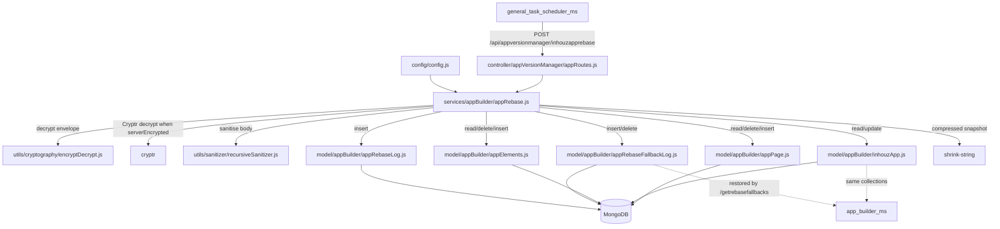

# app_version_manager_ms

## 1. Summary

`app_version_manager_ms` is a single-purpose backend job service. It exposes one internal route,
`POST /api/appversionmanager/inhouzapprebase`, which rebuilds the pages and elements of an Inhouz
app for every variation so that each document carries a single-entry `versionTracker`. It writes a
compressed fallback snapshot before it deletes anything, deletes and reinserts the pages and
elements, then marks the app `rebased: true`. It is triggered by `general_task_scheduler_ms`, not
by a user. It lives in its own git repository at `apps/app_version_manager_ms/`. All paths below are
relative to that repository.

## 2. Stack and commands

- Runtime: Node.js. The container image is `node:16.4-alpine` (`Dockerfile:1`). `package.json` does
  not declare an `engines` field.
- Start command: `npm run start` → `node --max-old-space-size=10000 server.js`
  (`package.json:12`, `Dockerfile:11`).
- Test command: `npm run test` → `echo "Error: no test specified" && exit 1` (`package.json:11`).
- HTTP port: `process.env.PORT` (`server.js:86`); k8s service port 5074
  (`k8s/app-version-manager-ms-cluster-ip-service.yml:10`).
- Process model: `cluster.fork()` once per CPU when `NODE_ENV === "production"`, one worker
  otherwise (`server.js:25-42`).
- Data store: MongoDB via mongoose with `maxPoolSize: 1` per worker (`server.js:92-102`).
- Package name is still the template default: `micro_service_template` with description "The base
  of all simple erp microservices" (`package.json:2-3`).

## 3. Entry points

| Entry point | Where | How it starts |
|---|---|---|
| Cluster master | `server.js:25` | `npm run start`; forks workers, respawns on exit (`server.js:31-42`) |
| HTTP server (worker) | `server.js:86` `app.listen(process.env.PORT)` | inside each forked worker |
| Express app and middleware | `server.js:44-56` | worker startup |
| Route registration | `server.js:57` calls `controller/appVersionManager/appRoutes.js` | worker startup |
| Rebase route | `controller/appVersionManager/appRoutes.js:4` | `POST /api/appversionmanager/inhouzapprebase` |
| Rebase handler | `services/appBuilder/appRebase.js:10` | invoked by the route |
| Model registration (11 requires) | `server.js:13-23` | worker startup |
| Mongo connect / reconnect | `server.js:58-72`, `server.js:91-103` | startup, then retry 5 s after a disconnect |
| Shutdown hook | `server.js:76-84` | `SIGINT`, `SIGTERM`, `uncaughtException` |
| Health probe script | `healthcheck.js:1-20` | not referenced by any npm script |

There is no timer, cron, queue consumer or Socket.IO server in this repository. The only periodic
code is the 5 s Mongo reconnect (`server.js:68`).

## 4. Module inventory

| Module | `file:line` | Owns | Public API | Kind |
|---|---|---|---|---|
| Cluster bootstrap | `server.js:25` | forks workers, respawns dead ones | `cluster.fork()` loop | effectful |
| Express app | `server.js:44` | CORS, body parser, hpp, helmet, cookie parser, route mount | app instance | effectful |
| Mongo connector | `server.js:91` | mongoose connect, pool size 1 | `connectMongo()` | effectful |
| Config loader | `config/config.js:18` | env plus secret file config, cached singleton | `() => config` | effectful (reads env and files, caches) |
| Secret reader | `config/config.js:5` | reads `/mnt/secrets/<name>`, falls back to env | `readSecret(name, envFallback)` | effectful |
| Route table | `controller/appVersionManager/appRoutes.js:3` | one POST route, no auth middleware | `(app) => void` | effectful |
| Rebase handler | `services/appBuilder/appRebase.js:10` | decrypt envelope, load app, rebuild pages/elements per variation, write logs | Express handler | effectful |
| Session login | `middlewares/login/checkLogin.js:9` | decrypts session token, loads session — **not mounted on any route** | `(req,res,next)` | effectful |
| Module access | `middlewares/module/moduleAccessCheck.js:7` | flex module entitlement — **not mounted** | `(req,res,next)` | effectful |
| Subdomain check | `middlewares/subdomain/singleSubdomainValidation.js:1` | single-subdomain rule — **not mounted** | `(req,res,next)` | effectful |
| Envelope crypto | `utils/cryptography/encryptDecrypt.js:3` | symmetric encrypt/decrypt of payload envelopes | `(data, encrypt, publicEncrypt, publicDecrypt)` | pure (fixed key from config) |
| Recursive sanitiser | `utils/sanitizer/recursiveSanitizer.js:19` | deeply sanitises a request body | `{ recursiveSanitizer }` | pure |
| User loader | `utils/user/getUser.js:5` | loads user, roles and permissions | `(userId)` | effectful |
| Edit-by builder | `utils/user/createEditByObject.js:1` | builds a createdBy/editBy object | `(user, deployDate)` | pure |
| Models | `model/**` (11 files) | mongoose schemas | mongoose models | effectful |

## 5. Side effects

| Effect | `file:line` |
|---|---|
| MongoDB connect | `server.js:92-102` |
| Read `inhouzApps` (`rebased: false`) | `services/appBuilder/appRebase.js:66-74` |
| Read `appPages` per variation | `services/appBuilder/appRebase.js:103-112` |
| Read `appElements` per variation | `services/appBuilder/appRebase.js:122-135` |
| Insert `inhouzAppRebaseFallbackLogs` | `services/appBuilder/appRebase.js:148-158` |
| Delete `appPages` for the variation | `services/appBuilder/appRebase.js:186-195` |
| Delete `appElements` for the variation | `services/appBuilder/appRebase.js:203-213` |
| Re-insert pages and elements | `services/appBuilder/appRebase.js:225-245` |
| Delete the fallback log after success | `services/appBuilder/appRebase.js:247-254` |
| Insert `inhouzAppRebaseLogs` | `services/appBuilder/appRebase.js:256-266` |
| Update `inhouzApps.rebased = true` | `services/appBuilder/appRebase.js:288-301` |
| Filesystem read of secret files | `config/config.js:9-10` |
| Clock (`new Date().getTime()`, `timestamp`) | `services/appBuilder/appRebase.js:28`, `:157` |
| Logging (`console.log`) | `services/appBuilder/appRebase.js:75`, `:110`, `:133`, `:152`, `:193`, `:206`, `:230`, `:238`, `:244`, `:262`, `:297`, `:305` |
| Process signals | `server.js:76-79` |

No outbound HTTP, no email, no storage provider, no Redis client is used, even though the package
and deployment carry those settings.

## 6. State and state transitions

The service drives one field on an existing record, plus two log collections.

**App rebase state** (`inhouzApps.rebased`, default `false`,
`model/appBuilder/inhouzApp.js:283-286`):

| From | To | Trigger | Guard |
|---|---|---|---|
| `rebased: false` | in progress | `POST /api/appversionmanager/inhouzapprebase` (`services/appBuilder/appRebase.js:66`) | app exists with matching `appId` and `companyId`; encrypted payload unexpired (`:34-36`) |
| in progress | `rebased: true` | `updateOne` after every variation succeeds (`services/appBuilder/appRebase.js:288-301`) | no variation produced an error |
| in progress | `rebased: false` (unchanged) | any error in the loop returns 500 (`services/appBuilder/appRebase.js:270-274`) | `hasError` set; completed variations are not rolled back |
| `rebased: true` | unchanged | a second call | the query filters `rebased: false`, so the app is not found (`:66-71`) and the route returns 404 |

There is no version field and no optimistic-lock guard (`versionKey` is not disabled, but no
`__v` check is used). Two concurrent calls can both read `rebased: false` and both run the delete
and insert sequence for the same variation.

## 7. Data

Collection names come from env values set in `k8s/app-version-manager-ms-deployment.yml`, and the
models register `mongoose.model(config.<key>, schema, config.<key>)`
(`model/appBuilder/inhouzApp.js:302`, `model/appBuilder/appElements.js:187`,
`model/appBuilder/appPage.js:181`). Verified mappings from the deployment file:
`INHOUZ_APP_MODEL=inhouzApps` (`:105-106`), `APP_ELEMENT_MODEL=appElements`,
`APP_PAGE_MODEL=appPages`, `INHOUZ_APP_REBASE_FALLBACK_LOG_MODEL=inhouzAppRebaseFallbackLogs`,
`INHOUZ_APP_REBASE_LOG_MODEL=inhouzAppRebaseLogs`, `COMPANY_MODEL=company` (`:75-76`),
`USER_MODEL=User` (`:71-72`), `SESSION_MODEL=session` (`:85-86`).

| Collection | Model file | Fields this service reads or writes | Rules |
|---|---|---|---|
| `inhouzApps` | `model/appBuilder/inhouzApp.js:6` | reads `activeVersionMap`, `appType`, `appId`, `companyId`, `rebased`; writes `rebased` | `appName`, `companyId`, `appId`, `appType` required; `appType` enum includes `webApp`, `webComponent`, `pdfFunction`, `emailFunction`, `inhouzSign`, `presentation`; compound index over 14 fields at `:290-297` |
| `appPages` | `model/appBuilder/appPage.js:181` | reads all pages for `appId` + `companyId` + `variationId` + `versionTracker.version`; deletes all pages for the variation; reinserts cleaned copies with `versionTracker: [{version}]` | required fields are defined in the schema file |
| `appElements` | `model/appBuilder/appElements.js:187` | same read/delete/reinsert cycle as pages, keyed by `versionTracker.version` and `variationId` | same |
| `inhouzAppRebaseFallbackLogs` | `model/appBuilder/appRebaseFallbackLog.js:5` | inserts `{appId, appType, companyId, variationId, version, compressedAppData, timestamp}`; deletes on success | every field required (`:6-36`); index at `:39-42` |
| `inhouzAppRebaseLogs` | `model/appBuilder/appRebaseLog.js:5` | inserts `{appId, appType, companyId, variationId, version, timestamp}` | every field required (`:6-29`) |
| `company` / `User` / `roles` / `permissions` / `userRoles` / `session` | `model/company/company.js:108`, `model/user/user.js:138`, `model/rolesAndPermissions/*`, `model/session/session.js:28` | registered for the login and user utilities; the routes never call them | see `model/user/user.js` for validators |

Shared-collection coupling: `inhouzApps`, `appPages`, `appElements`,
`inhouzAppRebaseFallbackLogs` and `inhouzAppRebaseLogs` are also registered by
`app_builder_ms` (its own repository, `model/appBuilder/*.js`). `app_builder_ms` writes the
fallback log entries through `services/appBuilder/appRebaseFallback.js` and reads them back with
`services/appBuilder/getAppRebaseFallbacks.js`, so the two services share the recovery contract:
this service writes the snapshot, `app_builder_ms` restores from it.

**Collection-name risk.** `model/company/company.js:108` and `model/user/user.js:138` call
`mongoose.model(name, schema)` with two arguments, so mongoose derives `companies` and `users`.
`app_builder_ms` registers the same env values with a third argument
(`apps/app_builder_ms/model/company/company.js:108`), so it uses `company` and `User` literally.
See §12.

## 8. Public interfaces

| Interface | Shape | Auth |
|---|---|---|
| `POST /api/appversionmanager/inhouzapprebase` | body `{ encryptedPayload: string, serverEncrypted?: boolean }` (`services/appBuilder/appRebase.js:11-24`) | none in the route table (`controller/appVersionManager/appRoutes.js:4`); the encrypted envelope must decrypt and carry an unexpired `expirationTimestamp` (`:34-36`) |
| Decrypted payload | `{ appId: string, companyId: string }` (`services/appBuilder/appRebase.js:45-50`) | both must be non-empty strings |
| Success response | `{ success: true }` (`services/appBuilder/appRebase.js:303`) | 200 |
| Missing or expired payload | `400 { error: { message: 'Invalid request. Required fields are missing.' } }` (`:29-32`, `:39-43`, `:57-64`) | |
| App not found | `404 { error: { message: 'App was not found' } }` (`:76-81`) | |
| Read error | `500 { error: { message: 'An error occurred while finding Inhouz App.' } }` (`:83-88`) | |
| Partial failure | `500 { errorMessage: string }` (`:270-274`) | one of: pages read, elements read, fallback log create, page delete, element delete, page insert, element insert |

There are no Socket.IO events, queue topics or CLI commands.

## 9. Configuration

Env var names read by code: `PORT`, `NODE_ENV` (`server.js:26`, `:86`), `SECRETS_PATH`
(`config/config.js:6`), `SENDGRID_API_KEY`, `SMPL_EMAIL`, `SESSION_SECRET`, `MONGO_URL`,
`USER_MODEL`, `COMPANY_MODEL`, `ROLE_MODEL`, `PERMISSION_MODEL`, `USER_ROLES_MODEL`,
`SESSION_MODEL`, `SESSION_VALIDATOR_MODEL`, `CLIENT_PUBLIC_KEY`, `CLIENT_SECRET_KEY`,
`COOKIE_DOMAIN`, `INHOUZ_APP_MODEL`, `APP_ELEMENT_MODEL`, `APP_PAGE_MODEL`,
`INHOUZ_APP_REBASE_FALLBACK_LOG_MODEL`, `INHOUZ_APP_REBASE_LOG_MODEL`
(`config/config.js:20-49`). `middlewares/login/checkLogin.js:129` reads `NODE_ENV`.

Secret file names read under `SECRETS_PATH` (default `/mnt/secrets`): `sendgridapikey`,
`sessionsecret`, `mongourl`, `clientpublickey`, `clientsecretkey` (`config/config.js:21-41`).

Env vars present in the deployment but never read by this service (dead configuration):
`REDIS_HOST`, `REDIS_PASSWORD`, `REDIS_PORT`, `COOKIE_NAME`, `FUNCTION_MODEL`, `APP_BASE_URL`,
`AUTH_LOG_MODEL`, `INTERNAL_HOST_DOMAIN`, `MEDIA_PROXY_URL`, `UI_DEVELOPER_PERMISSION`,
`INHOUZ_SUBSCRIPTIONS_MODEL`, `ADMIN_DEVELOPER_PERMISSION`, `APP_BUILDER_MS_URL`, `AB_TESTS_MODEL`,
`APP_BUILD_REPORT_MODEL`, `APP_BUILD_REPORT_LOG_MODEL`, `APP_BUILD_MODEL`,
`APP_DEPLOYMENT_QUEUE_MODEL`, `APP_DEPLOYMENT_QUEUE_LOG_MODEL`, `VIEW_BUILDER_URL`,
`DEPLOYED_API_ENDPOINTS_MODEL`, `INHOUZ_API_DOMAIN`, `SYSTEM_USER_MODEL`, `SUBSCRIPTION_MODEL`,
`SUBSCRIBER_MODEL`, `SUBSCRIPTION_SERVICE_MODEL`, `QUERY_KEY_TRACKER_MODEL`,
`INHOUZ_APP_COMMIT_MODEL` (all in `k8s/app-version-manager-ms-deployment.yml`).

Note the deployment supplies secrets through `secretKeyRef` env vars, while `config/config.js:5-14`
reads mounted files first and falls back to env. Only the fallback path works in this deployment.

## 10. Dependencies

From `package.json:13-37`:

| Package | Why it is here |
|---|---|
| `express` | HTTP framework (`server.js:2`) |
| `body-parser` | JSON body with a 20 MB limit (`server.js:53`) |
| `cookie-parser` | cookie parsing, currently unused by the mounted route (`server.js:56`) |
| `cors`, `helmet`, `hpp` | origin policy `/inhouz.localhost/`, headers, parameter-pollution guard (`server.js:45-55`) |
| `mongoose` | MongoDB (`server.js:3`, `:92`) |
| `connect-mongo` | session store; no session middleware is configured |
| `dotenv` | env loading (`server.js:1`) |
| `cryptr` | decrypts server-encrypted envelopes (`services/appBuilder/appRebase.js:5`, `:29-31`) |
| `crypto-js` | hashing helper used by the login middleware (`middlewares/login/checkLogin.js:4`) |
| `node-rsa` | RSA keys built in config (`config/config.js:32-39`) |
| `lodash` | collection helpers (`services/appBuilder/appRebase.js:4`); imported as `_` and not used in the rebase flow |
| `moment` | timestamps in login middleware |
| `sanitizer` | request body sanitisation (`services/appBuilder/appRebase.js:1-2`) |
| `shrink-string` | compresses the fallback snapshot (`services/appBuilder/appRebase.js:8`, `:146-149`) |
| `validator` | schema validation (`model/appBuilder/inhouzApp.js:4`) |
| `bcryptjs`, `shortid`, `request-ip`, `object-sizeof`, `@sendgrid/mail`, `node-fetch`,
`express-session` | template leftovers; no call site found in this repository |

## 11. Testing

No tests. `package.json:11` defines `test` as `echo "Error: no test specified" && exit 1`. There is
no test directory and no test framework. The only route is verified manually through the scheduler
caller.

## 12. Known issues and risks

- **No authentication on the only route.** `controller/appVersionManager/appRoutes.js:4` mounts the
  handler with no `checkLogin`, API-key or server-login middleware. Protection is only the
  encrypted envelope plus a timestamp (`services/appBuilder/appRebase.js:24-43`).
- **Fire-and-forget write.** `InhouzAppCollection.updateOne(...)` is not awaited
  (`services/appBuilder/appRebase.js:288-301`), so `{ success: true }` can return before
  `rebased: true` is persisted, and its rejection is logged but not surfaced.
- **No rollback across variations.** Pages and elements are deleted per variation and reinserted
  (`:186-245`); if variation 2 fails after variation 1 succeeded, variation 1 stays rebased and the
  app stays `rebased: false`, so a retry reprocesses it. Only the delete-elements failure path
  restores pages (`:214-223`).
- **Fallback snapshot deleted before the run is durable.** The fallback log row is deleted per
  variation right after reinsert (`:247-254`), before the app update. A crash after that delete
  leaves no local snapshot for that variation.
- **Collection-name mismatch risk on shared auth data.** `model/company/company.js:108` and
  `model/user/user.js:138` register with two arguments while `app_builder_ms` registers with three
  for the same env values, so the effective collection names differ (`companies` vs `company`,
  `users` vs `User`). If the login utilities are ever mounted here, they may read a different
  collection than the writer.
- **`console.log` prints full Mongo errors** that can include the connection string
  (`server.js:74`, `services/appBuilder/appRebase.js:75` and the other catch blocks).
- **Cluster mode multiplies Mongo connections.** Each forked worker opens its own pool
  (`server.js:26-29`, `:99`); with `NODE_ENV=production` that is one connection per CPU per
  replica, up to the HPA maximum of 3 replicas (`k8s/app-version-manager-ms-hpa.yml:10-11`).
- **No `/healthz` route.** `healthcheck.js:7` probes `/healthz`, but no route is registered
  (`controller/appVersionManager/appRoutes.js:3-5`), and `Dockerfile` has no `HEALTHCHECK`.
- **Package still identifies as the template.** `package.json:2-3` says `micro_service_template`,
  which makes build and image provenance harder to audit.
- **`helmet` is at version 3** (`package.json:23`) while the rest of the platform is on the same
  pinned set; outdated security headers.
- **Unused middleware and utilities.** `middlewares/login/checkLogin.js`,
  `middlewares/module/moduleAccessCheck.js`, `middlewares/subdomain/singleSubdomainValidation.js`,
  `utils/user/getUser.js` and `utils/user/createEditByObject.js` are dead code in this service.
- **Single compound index** on `inhouzApps` (`model/appBuilder/inhouzApp.js:290-297`) covers 14
  fields; every write updates it, which is a write-amplification cost for a job that only touches
  `rebased`.
- No credential value is embedded in any source file in this repository. Secrets are read from
  files or env by name (`config/config.js:5-14`).

## 13. Module map

## 14. Open questions

- Which component retries a failed rebase? The scheduler caller (`general_task_scheduler_ms`) was not
  traced; this repository has no retry logic.
- Does `app_builder_ms` restore from `inhouzAppRebaseFallbackLogs` automatically, or only when an
  operator calls `/getrebasefallbacks`? The restore trigger is in the other repository and was not
  confirmed.
- The brief lists `outgoing internal HTTP: none found`, which the code confirms. The many unused
  HTTP-related env vars (`APP_BUILDER_MS_URL`, `VIEW_BUILDER_URL`, `MEDIA_PROXY_URL`,
  `INTERNAL_HOST_DOMAIN`, `APP_BASE_URL`) suggest a removed code path; its purpose is unknown.
- Are the derived collections `companies` and `users` the real ones, or is this a latent bug? Only
  `app_builder_ms` uses explicit third-argument collection names, so the answer needs a database
  inspection, which was out of scope.
- Skipped for budget: `middlewares/login/checkLogin.js` body, `utils/user/getUser.js` body, and the
  full field lists of `appPage`, `appElements`, `user`, `company`, `roles`, `permissions` schemas.
  They are cited by file and line where used.
