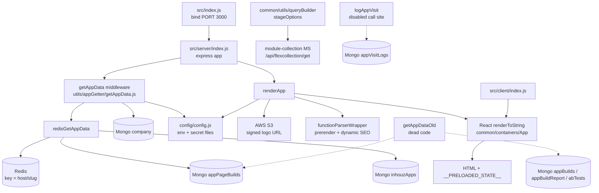

# app_viewer_ms

Repository: `apps/app_viewer_ms` (`/workspaces/kilo_inhouz_ai/apps/app_viewer_ms`), a separate git
repository, not part of the control repo. All `file:line` citations below are relative to that
repository root unless stated otherwise.

## 1. Summary

`app_viewer_ms` is the server-side rendering host for published Inhouz apps. It takes every request
for a hosted app domain, loads the pre-bound app data for `domain + slug` from Redis or from the
`appPageBuilds` collection, wraps it in a Redux initial state, renders the React application tree
with `renderToString`, and returns one HTML document per URL. It also serves the client bundle and
static public files for the same host. The service is a Razzle (React SSR + Express) application,
not a JSON API: it has exactly one HTTP route, `GET /*`, which is both the SSR entry point and the
static-file fallback.

## 2. Stack and commands

- Runtime: Node `>=12.0.0 <17.5.0` (`package.json:5-7`). The Docker image runs Node 16.4.2 Alpine
  (`Dockerfile:1`).
- Framework: Razzle, which wraps Express + React 17-era SSR (`razzle.config.js:1-19`).
- Port: `PORT`, default `3000` (`src/index.js:17`); the k8s container port is 3000
  (`k8s/app-viewer-ms-deployment.yml:26`).
- Scripts, quoted from `package.json:8-19`:
  - `start` — `SET NODE_OPTIONS=--openssl-legacy-provider && razzle start` (development; the `SET`
    prefix is Windows cmd syntax and does not work in the Linux container).
  - `prod-build` — `env-cmd -f .env.production razzle build --noninteractive`.
  - `dev-build` — `env-cmd -f .env.development razzle build --noninteractive`.
  - `build` — `razzle build`; `nonInteractiveBuild` — `razzle build --noninteractive`.
  - `start:prod` — `node build/server.js`.
  - `prodstart` — `npm run nonInteractiveBuild && npm run start:prod`.
  - `test` — `razzle test --env=jsdom`.
  - `analyze` — `source-map-explorer 'build/public/static/js/*.js'`.
- Container start: `CMD ["npm", "run", "start:prod"]` (`Dockerfile:14`), after
  `npm run prod-build` (`Dockerfile:12`).
- Verification: `npm test` is the only test command and no test files exist (see §11). The practical
  check is a build plus a manual request against a known domain.

## 3. Entry points

| Entry point | Where | How it starts |
|---|---|---|
| Node process bootstrap | `src/index.js:19-27` | `node build/server.js` executes the compiled Razzle server entry; it binds `PORT` (default 3000) |
| Express app construction | `src/server/index.js:498-508` | Imported by `src/index.js:3`; `cookieParser`, `useragent.express`, `express.static`, `compression`, cache header middleware |
| HTTP route `GET /*` | `src/server/index.js:511-519` | `server.get('/*', getAppData, renderApp wrapper)`, sends `html` with status, redirects on `context.url` |
| SSR render function | `src/server/index.js:119` (`renderApp`) | Called from the route handler at `src/server/index.js:513` |
| Request pre-processing middleware | `src/server/utils/appGetter/getAppData.js:13` | Mounted as the only route middleware at `src/server/index.js:511` |
| Client hydration | `src/client/index.js:19-28` | Runs in the browser bundle, reads `window.__PRELOADED_STATE__` and `hydrate`s the same `App` |
| Mongo connection + reconnect loop | `src/server/index.js:71-95` | Runs at module load on `src/server/index.js:69`; reconnects after 5000 ms on `disconnected` (`src/server/index.js:75-83`) |
| Redis client connection | `src/server/index.js:46-67` | Awaited async IIFE at module load; exported as `redisClient` (`src/server/index.js:66`) |
| Deployment manifest | `k8s/app-viewer-ms-deployment.yml:4-6` | `app-viewer-ms-deployment`, replicas 1 |
| ClusterIP service | `k8s/app-viewer-ms-cluster-ip-service.yml:4-11` | `app-viewer-ms-cluster-ip-service`, port 3000 → 3000 |

There are no cron jobs, workers, queue consumers or migration scripts in this repository.

## 4. Module inventory

Server-side modules, all under `src/server/` unless stated.

| Module | `file:line` | Responsibility | Public API | Kind |
|---|---|---|---|---|
| `src/index.js` | `src/index.js:1-27` | Binds the Express app to the port, hot-reload hook | default export = listening server | effectful (network, env) |
| `server` (Express app) | `src/server/index.js:498-558` | Middleware stack and the single catch-all route | default export | effectful (network) |
| `renderApp` | `src/server/index.js:119-496` | Builds the per-request Redux initial state, injects SEO tags and `deviceId` cookie, renders HTML | `(req, res) => {html, status, context}` | effectful (S3 signing, random, clock, cookies, logging) |
| `connectMongo` | `src/server/index.js:87-95` | Opens the Mongoose connection with `maxPoolSize: 1` | none | effectful (DB) |
| `redisClient` | `src/server/index.js:46-66` | Shared Redis connection, exported | exported const | effectful (network) |
| `cssLinksFromAssets`, `jsScriptTagsFromAssets` | `src/server/index.js:100-117` | Turn the Razzle asset manifest into `<link>`/`<script>` tags | `(assets, entrypoint) => string` | pure (string transform) |
| `config` (server) | `src/server/config/config.js:16-35` | Reads env vars and secret files into one cached object | default export object | effectful (env, filesystem) |
| `readSecret` | `src/server/config/config.js:4-13` | Reads a file from the secrets mount, falls back to an env var | `(name, envFallback) => string` | effectful (filesystem, env) |
| `getAppData` (middleware) | `src/server/utils/appGetter/getAppData.js:13-152` | Resolves app data for host+slug, validates `company` status, decrypts the `CVMD` cookie | Express `(req,res,next)` | effectful (Redis, Mongo, clock, cookies, logging) |
| `redisGetAppData` | `src/server/utils/appGetter/redisGetAppData.js:6-72` | Redis-first app data lookup, Mongo `appPageBuilds` fallback incl. 404 page | `{domainUrl, domain, slug} => {appData, comp, isRedisApp} \| {appNotFound} \| {error}` | effectful (Redis, Mongo, logging) |
| `logAppVisit` | `src/server/utils/appGetter/logAppVisit.js:6-75` | Writes a visit document and sets the encrypted `CVMD` cookie | `(params, res, setCookie) => void` | effectful (Mongo, clock, cookies, logging) |
| `redisGetBuildReport` | `src/server/utils/appGetter/redisGetBuildReport.js:8-48` | Reads and decompresses a build report key from Redis | `(id) => object \| {error}` | effectful (Redis, logging) |
| `getAppDataOld` | `src/server/utils/appGetter/getAppDataOld.js:13-311` | Older lookup path: variant selection, build report, AB tests | Express `(req,res,next)` | effectful (Redis, Mongo, clock, logging). **Not imported anywhere; dead code.** |
| `abTests` model | `src/server/model/appBuilder/abTests.js:5-94` | AB test schema, registered at `:94` | Mongoose model | effectful (schema registration) |
| `appBuild` model | `src/server/model/appBuilder/appBuild.js:5-39` | Whole-app build schema, registered at `:39` | Mongoose model | effectful |
| `appBuildReport` model | `src/server/model/appBuilder/appBuildReport.js:5-66` | Build report schema, registered at `:66` | Mongoose model | effectful |
| `appPageBuild` model | `src/server/model/appBuilder/appPageBuild.js:5-63` | Per-page build schema, registered at `:63` | Mongoose model | effectful |
| `appVisitLog` model | `src/server/model/appBuilder/appVisitLog.js:5-56` | Visit log schema, registered at `:56` | Mongoose model | effectful |
| `inhouzApp` model | `src/server/model/appBuilder/inhouzApp.js:5-148` | App definition schema, registered at `:148` | Mongoose model | effectful |
| `company` model | `src/server/model/company/company.js:5-108` | Company/account schema, registered at `:108` | Mongoose model | effectful |

Shared client/common code that affects server behaviour: `src/common/config/config.js:4-25`
(client-safe config constants), `src/common/containers/App` (the render root, imported at
`src/server/index.js:3`), `src/common/utils/requests/*` (`node-fetch` wrappers),
`src/common/utils/queryBuilder/aggregation/stageOptions/*` (calls another service).

## 5. Side effects

| Effect | Where |
|---|---|
| Mongo connect, `maxPoolSize: 1` | `src/server/index.js:87-95` |
| Mongo reconnect timer (5000 ms) | `src/server/index.js:75-83` |
| Mongo connection event logging | `src/server/index.js:72-85` |
| Redis connect at boot | `src/server/index.js:52-58` |
| Redis read by `domainUrl` (cache hit path) | `src/server/utils/appGetter/redisGetAppData.js:14` |
| Redis read by build-report id | `src/server/utils/appGetter/redisGetBuildReport.js:29` |
| Mongo read `appPageBuilds` by `{domain, pageSlug}` | `src/server/utils/appGetter/redisGetAppData.js:26-30` |
| Mongo read `appPageBuilds` 404 page fallback | `src/server/utils/appGetter/redisGetAppData.js:38-47` |
| Mongo read `company` by app `companyId` | `src/server/utils/appGetter/getAppData.js:90-106` |
| Mongo write `appVisitLogs` | `src/server/utils/appGetter/logAppVisit.js:39-44` |
| S3 client construction (access key, secret) | `src/server/index.js:41-44` |
| S3 pre-signed logo URL, 1-week expiry | `src/server/index.js:172-178` |
| Filesystem read of secret files under `SECRETS_PATH` | `src/server/config/config.js:4-13` |
| Env var reads | `src/server/config/config.js:17-32`, `src/common/config/config.js:16-22`, `src/server/index.js:103,404,514,537,548` |
| Clock: `new Date().getTime()` | `src/server/utils/appGetter/getAppData.js:15`, `src/server/utils/appGetter/logAppVisit.js:31,47`, `src/server/index.js:214` |
| Randomness: `Math.random()` for the `deviceId` cookie suffix | `src/server/index.js:481` |
| Randomness: `shortid.generate()` for `routeHash` | `src/server/index.js:239,436` |
| Cookies written: `deviceId`, `CVMD` | `src/server/index.js:481-489`, `src/server/utils/appGetter/logAppVisit.js:62-69` |
| Cookies read: `deviceMode`, `sessionExpirationTimestamp`, `ECAL`, `CVMD` | `src/server/index.js:212-216`, `src/server/utils/appGetter/getAppData.js:54-55` |
| HTTP out to module-collection service | `src/common/utils/queryBuilder/aggregation/stageOptions/getLookupOptions.js:15`, `getGraphLookupOptions.js:16` |
| HTTP client wrappers over `node-fetch` | `src/common/utils/requests/getRequest.js:2`, `postRequest.js:2`, `deleteRequest.js:2`, `formDataPostRequest.js:2` |
| Logging: `console.log` / `console.error` throughout | `src/server/index.js:73,77,81,493`, `src/server/utils/appGetter/*.js:16,33,43,67,104,150` |
| Static file serving from `RAZZLE_PUBLIC_DIR` | `src/server/index.js:501` |
| Response cache header set in development | `src/server/index.js:503-508` |

## 6. State and state transitions

The service has no persisted state machine of its own. It is a stateless renderer over collections
owned by the app-builder and company services. The only per-request decision tree is the request
resolution flow in `getAppData` + `redisGetAppData`:

| From | Trigger | Guard | To | Evidence |
|---|---|---|---|---|
| Request | `host` header present | host is a non-empty string | resolve app data | `src/server/utils/appGetter/getAppData.js:19-25` |
| Resolve app data | Redis key `domainUrl` hit | value is a non-empty string | decompress, mark `isRedisApp` | `src/server/utils/appGetter/redisGetAppData.js:14-24` |
| Resolve app data | Redis miss | `appPageBuilds` row for `{domain, pageSlug}` | decompress build data | `src/server/utils/appGetter/redisGetAppData.js:26-31` |
| Resolve app data | Page row missing | a row with `is404Page: true` for the domain | serve the 404 page build | `src/server/utils/appGetter/redisGetAppData.js:37-47` |
| Resolve app data | No build row at all | — | `appNotFound` → HTTP 404 `App not found` | `src/server/utils/appGetter/redisGetAppData.js:62-64`, `getAppData.js:42-44` |
| Resolve app data | Redis or Mongo throws | — | `{error}` → HTTP 500 | `src/server/utils/appGetter/redisGetAppData.js:66-71`, `getAppData.js:38-40` |
| Company check | `CVMD` cookie decrypts | `expirationTimestamp > now` and `companyStatus === 'active'` | reuse cached company, no Mongo read | `src/server/utils/appGetter/getAppData.js:71-87` |
| Company check | No usable cache | `company` row found | proceed; set `CVMD` cookie | `src/server/utils/appGetter/getAppData.js:89-117` |
| Company check | Company row missing | — | HTTP 404 `Account was not found.` | `src/server/utils/appGetter/getAppData.js:108-110` |
| Company gate | Company loaded | `status !== 'active'` | HTTP 403 `Account is not active.` | `src/server/utils/appGetter/getAppData.js:119-121` |
| Render | `page` present in parsed app data | `appType === 'webApp'` | apply `headerTagMap` SEO or dynamic SEO | `src/server/index.js:146-157`, `src/server/index.js:399-471` |
| Render | `page` absent | — | HTTP 404 `Page not found` | `src/server/index.js:158-163` |
| Render | Any throw | — | HTTP 500 `Internal server error` | `src/server/index.js:489-495` |

`logAppVisit` would write an `appVisitLogs` document and set `CVMD`, but its call site is commented
out (`src/server/utils/appGetter/getAppData.js:123-146`), so the visit log is not written on this
path in the current code.

## 7. Data

Mongoose models are registered with the collection name taken from an env var, so the collection
name is deployment-configured, not literal in the code. Registration sites:

| Model file | Registered at | Collection (env var → name in k8s) |
|---|---|---|
| `src/server/model/appBuilder/inhouzApp.js` | `:148` | `RAZZLE_INHOUZ_APP_MODEL` → `inhouzApps` |
| `src/server/model/appBuilder/abTests.js` | `:94` | `RAZZLE_AB_TESTS_MODEL` → `abTests` |
| `src/server/model/appBuilder/appBuild.js` | `:39` | `RAZZLE_APP_BUILD_MODEL` → `appBuilds` |
| `src/server/model/appBuilder/appPageBuild.js` | `:63` | `RAZZLE_APP_PAGE_BUILD_MODEL` → `appPageBuilds` |
| `src/server/model/appBuilder/appBuildReport.js` | `:66` | `RAZZLE_APP_BUILD_REPORT_MODEL` → `appBuildReport` |
| `src/server/model/appBuilder/appVisitLog.js` | `:56` | `RAZZLE_APP_VISIT_LOG_MODEL` → `appVisitLogs` |
| `src/server/model/company/company.js` | `:108` | `RAZZLE_COMPANY_MODEL` / `COMPANY_MODEL` → `company` |

Note `company.js:108` passes only two arguments (`mongoose.model(name, schema)`), so its collection
name is Mongoose's pluralised model name unless k8s sets the same string for both uses. The brief
reports `company` as the deployed name.

Key fields and validation:

- `company` — `companyName` required, `companyType` required with enum
  `enterpriseMax, enterprise, solopreneur, entrepreneur, thirdParty, smb, founder, freelancer`
  (default `solopreneur`), `subDomain` lowercased, `addresses[]`, `status`, `subscribedAssetIds`,
  `assetOwnerCompanyId`, `environment`; compound index at `company.js:100-107`.
- `inhouzApps` — `appName`, `subdomain`, `companyId`, `appId`, `appType` all required;
  `hostedExternally` defaults `false`; `externalDomain`, `folderId` (default `''`), `thumbnail`,
  `initialState`, `deployed`; compound index at `inhouzApp.js:141-146`.
- `appPageBuilds` — `appId`, `appType`, `environment`, `pageId`, `pageSlug`, `variationId`,
  `companyId`, `domain` required; `buildData` holds the compressed payload; `is404Page`,
  `isRootPage`, `notFoundPageId`, `redisKey`, `systemUserIds[]`, `deployedEndpointIds[]`;
  `timestamps: true`, `strict: true`; index at `appPageBuild.js:56-61`.
- `appBuilds` — `appId`, `variationId`, `companyId`, `domain` required; `sizeBytes`, `buildData`,
  `hostedExternally`, `createdById`; `timestamps: true`, `strict: true`;
  index at `appBuild.js:34-37`.
- `appBuildReport` — `appId`, `companyId`, `domain` required; `customDomains[]`, `deployDate`,
  `abTestId`, `variationBuildReport[]`, `buildSizeBytes`, `functionIds[]`,
  `compressedAppVariationDataMap`, `environment`; index at `appBuildReport.js:58-64`.
- `appVisitLogs` — `appId`, `companyId`, `appType`, `variationId`, `timestamp`, `systemId`,
  `domain` required; `ipAddress`, `referrer`, `buildQueryTimeMS`, `environment`, `countryCode`,
  `deviceId`, `deviceMode`, `requestQuery` free-form; index at `appVisitLog.js:49-54`.
- `abTests` — `abTestName`, `appId`, `companyId` required; `versionTracker[]`, `hasTestingLimit`,
  `testLimitType`, `testLimitCount`, `testLimitDate`, `autoSelectWinningTest`, `active`,
  `variations[]`, `manageSegments`, `segments[]`; `useNestedStrict: true`;
  index at `abTests.js:90-92`.

Shared collections (the data coupling that cannot be inferred from this repo alone): this service
**reads** `appPageBuilds` and `company`, and **would write** `appVisitLogs` if the call site were
live. Those collections are written by the app-builder and company services; `company` is the
account record shared across the Inhouz product surface. `appBuilds`, `appBuildReport`, `abTests`
and `inhouzApps` are registered here but only consumed by the dead `getAppDataOld` path. Server-side
writes to `appVisitLogs` are disabled at `src/server/utils/appGetter/getAppData.js:123-146`.

## 8. Public interfaces

- `GET /*` on the service port (`src/server/index.js:511-519`). There is no route prefix, no JSON
  API, no versioning. Every path is served by the same handler.
  - Request: any path; the first path segment is the page slug, the remaining segments are route
    parameters (`src/server/utils/appGetter/getAppData.js:28-31`). The `Host` header selects the
    app. Cookies `deviceMode`, `sessionExpirationTimestamp`, `ECAL`, `CVMD`, `deviceId` are read.
  - Response 200: an HTML document with `window.__PRELOADED_STATE__` embedded
    (`src/server/index.js:326-397`).
  - Response 301: when React Router produced a redirect (`src/server/index.js:514-517`).
  - Response 403 `Account is not active.` (`src/server/utils/appGetter/getAppData.js:120`).
  - Response 404 `App not found` (`getAppData.js:43`), `Account was not found.`
    (`getAppData.js:109`), `Page not found` (`src/server/index.js:161`).
  - Response 500 `Internal server error` (`getAppData.js:24,39,113,151`, `src/server/index.js:494`).
  - Cookies set: `deviceId` (`src/server/index.js:481-489`), `CVMD` in `logAppVisit`
    (`logAppVisit.js:62-69`).
- `redisClient` export (`src/server/index.js:66`) — in-process only, not an external interface.
- No CLI commands, no queue topics, no event handlers.

## 9. Configuration

Env var names only. Read in code:
`PORT`, `SECRETS_PATH`, `RAZZLE_NODE_ENV`, `RAZZLE_ASSETS_MANIFEST`, `RAZZLE_PUBLIC_DIR`,
`RAZZLE_MONGO_URL`, `RAZZLE_REDIS_HOST`, `RAZZLE_REDIS_PASSWORD`, `RAZZLE_REDIS_PORT`,
`RAZZLE_REDIS_DB`, `RAZZLE_SESSION_SECRET`, `RAZZLE_COOKIE_DOMAIN`, `RAZZLE_CLIENT_PUBLIC_KEY`,
`RAZZLE_MEDIA_PROXY_URL`, `RAZZLE_APP_WEB_PUSH_PUBLIC_KEY`, `RAZZLE_INHOUZ_BASE_URL`,
`RAZZLE_MODULE_COLLECTION_MS_URL`, `RAZZLE_S3_ACCESS_KEY_ID`, `RAZZLE_S3_SECRET_KEY`,
`RAZZLE_S3_BUCKET_NAME`, `RAZZLE_AB_TESTS_MODEL`, `RAZZLE_APP_BUILD_MODEL`,
`RAZZLE_APP_BUILD_REPORT_MODEL`, `RAZZLE_APP_PAGE_BUILD_MODEL`, `RAZZLE_APP_VISIT_LOG_MODEL`,
`RAZZLE_INHOUZ_APP_MODEL`, `RAZZLE_COMPANY_MODEL`, `RAZZLE_CSRF_KEY`, `RAZZLE_GRAY_BACKGROUND`,
`RAZZLE_PLUS_CRYPTO_STRING`, `RAZZLE_SLASH_CRYPTO_STRING`, `RAZZLE_EQUALS_CRYPTO_STRING`,
`RAZZLE_APP_STRIPE_API_KEY`, `RAZZLE_APP_TEST_STRIPE_API_KEY`, `REACT_APP_CLIENT_SECRET_KEY`,
`REACT_APP_ROUTER_PARAM_INDEX`.

Set in the k8s deployment but not read in server code: `SENDGRID_API_KEY`,
`OPEN_EXCHANGE_RATES_API_KEY`, `OPEN_EXCHANGE_RATES_BASE_URL`, `PAYMENT_MS_URL`, `COOKIE_NAME`,
`NODE_ENV`, `INHOUZ_FROM_EMAIL`, `IP_LOCATION_FINDER_URL`, and the model-name vars for
`FLEX_COLLECTION_MODEL`, `FLEX_API_MODEL`, `ROLE_MODEL`, `USER_MODEL`, `PERMISSION_MODEL`,
`USER_ROLES_MODEL`, `SESSION_MODEL`, `SESSION_VALIDATOR_MODEL`, `AUTH_LOG_MODEL`,
`SUBSCRIBER_MODEL`, `SUBSCRIPTION_SERVICE_MODEL`, `SUBSCRIBER_CHANGE_LOG`,
`SUBSCRIPTION_USAGE_LOG`, `VERSION_TRACKER_MODEL`, `SUBSCRIBER_ACTION_LOG_MODEL`,
`SUBSCRIBER_MIGRATION_QUEUE_MODEL`, `SERVICE_DISCOUNT_MODEL`, `CUSTOMERS_MODEL`, `CONTACTS_MODEL`,
`PAYMENT_CHARGE_MODEL`, `PAYOUT_ACCOUNT_MODEL`, `PAYMENT_METHOD_MODEL`, `PAYMENT_INTENT_MODEL`,
`SUBSCRIPTION_SESSION_MODEL`, `SUBSCRIPTION_SERVICE_CHARGE_FEE`,
`SUBSCRIPTION_SERVICE_CHARGE_TYPE`, `CHURN_TRACKER_MODEL`, `EXCHANGE_RATE_CACHE_MODEL`,
`SUBSCRIPTION_MODEL`, `IP_ADDRESS_LOCATION_MODEL`, `SUBSCRIBED_PACKAGE_MODEL`
(`k8s/app-viewer-ms-deployment.yml:28-`). Most of these belong to the retired monolith this
viewer was split from and are carried over unused.

Secret file names read from `SECRETS_PATH` (`src/server/config/config.js:21-31`): `mongourl`,
`redishost`, `redispassword`, `sessionsecret`, `s3accesskeyid`, `s3secretkey`, `s3bucketname`.
Config file names: `.env.development`, `.env.production` (present at repo root, contents not read).

## 10. Dependencies

Direct dependencies only, by role (`package.json:22-`):

- `express`, `compression`, `cookie-parser`, `cors`, `helmet`, `hpp`, `body-parser`,
  `express-useragent` — HTTP server, the request pipeline and headers.
- `mongoose` — MongoDB models and reads; `redis` + `bluebird` — the shared Redis client, promisified.
- `react`, `react-dom`, `react-router-dom`, `react-redux`, `redux`, `redux-thunk`,
  `redux-promise`, `redux-form` — the SSR component tree and store.
- `serialize-javascript` — embeds the Redux state into the HTML document.
- `razzle`, `react-app-polyfill`, `web-vitals` — build, SSR dev server and browser bundle.
- `aws-sdk` — S3 pre-signed logo URLs.
- `node-fetch` — HTTP client for the request wrappers in `src/common/utils/requests`.
- `cryptr` — encrypt/decrypt the `CVMD` view-metadata cookie; `node-rsa`, `crypto-js`,
  `json-fn`, `safe-eval` — client-side crypto and the function-parser runtime.
- `lzutf8`, `shrink-string` — compression for the embedded app payload.
- `lodash`, `moment`, `moment-timezone`, `qs`, `query-string`, `uuid`, `shortid`, `validator` —
  general utilities.
- `@carbon/charts*`, `d3*`, `chart.js`-adjacent chart packages, `mapbox-gl`, `pdf-lib`, `jspdf-html2canvas`,
  `react-pdf`, `bwip-js`, `qrcode` — the widget renderers used by the app viewer.
- `@stripe/react-stripe-js`, `@stripe/stripe-js`, `stripe` — payment elements in the viewer.
- `dotenv`, `env-cmd` — load `.env.*` files for build/start.
- `@fingerprintjs/fingerprintjs`, `browser-cookies`, `idb-keyval`, `localforage` — device
  identity and browser storage.
- `dompurify`, `isomorphic-dompurify`, `sanitize-html`, `sanitizer`, `he` — HTML sanitisation of
  user-supplied app content.
- `turndown`, `showdown`, `react-markdown`, `html-to-draftjs`, `draft-js`,
  `draftjs-to-html`, `react-draft-wysiwyg`, `react-simplemde-editor` — rich-text conversions.
- `@testing-library/*`, `source-map-explorer` — test and bundle-analysis tooling.

## 11. Testing

- The only configured test command is `razzle test --env=jsdom` (`package.json:17`).
- No test files exist: `find` for `*.test.js`, `*.spec.js` and `__tests__` under the repo (excluding
  `node_modules`) returned nothing.
- There is no CI test step in `.travis.yml` beyond the build; no coverage configuration exists.
- What is therefore unverified: the Redis-first/Mongo-fallback branch, the `CVMD` cache path, the
  404-page fallback, company-status gating, and the SSR HTML/SEO substitution. All of these are
  exercised only by production traffic.

## 12. Known issues and risks

- **Dead lookup path.** `getAppDataOld.js` (311 lines) is imported by nothing; only `getAppData` is
  wired at `src/server/index.js:11`. `redisGetBuildReport` is imported only by that dead file
  (`getAppDataOld.js:9`). Maintaining two divergent lookup implementations is a correctness risk.
- **Visit logging is disabled.** The `logAppVisit(...)` call in `getAppData` is commented out
  (`src/server/utils/appGetter/getAppData.js:123-146`), so `appVisitLogs` is not written and the
  `CVMD` cookie is never set on this path. Analytics that depend on it silently see no data.
- **Single Mongo connection pool.** `maxPoolSize: 1` (`src/server/index.js:93`) serialises every
  Mongo read behind one connection; a slow query stalls all renders on the instance.
- **Unbounded 404 fallback.** Any unknown slug on a known domain serves a 404 page build with HTTP
  200 unless `renderApp` then rejects the missing `page` (`redisGetAppData.js:38-47` vs
  `src/server/index.js:158-163`). Serving soft-404s with status 200 is an SEO risk.
- **`CVMD` cookie is `httpOnly: false`** (`src/server/utils/appGetter/logAppVisit.js:62-64`), so the
  encrypted view metadata is readable by page scripts.
- **`deviceId` cookie is also `httpOnly: false`** (`src/server/index.js:481-489`) and lives for
  about 100 years (`100 * 12 * 30 * 24 * 60 * 60 * 1000` ms).
- **Hardcoded third-party CSS/JS from CDNs** in the SSR document (`src/server/index.js:344-390`):
  bootstrapcdn, fontawesome kit, Google fonts, cdnjs, cdn.muicss.com. Any CDN outage or pin change
  alters every rendered page, and the document relies on Subresource Integrity only for some tags.
- **`safe-eval` and `json-fn`** are dependencies used by the function parser
  (`src/common/utils/functionParser/simpleScript/expressionParser/resolveExpression.js:10`).
  Executing user-authored functions is the core product feature and the highest-risk surface.
- **`Math.random()` for a device identifier** (`src/server/index.js:481`) — not cryptographically
  random, so `deviceId` is guessable and not a security boundary.
- **`npm start` is Windows-specific** (`package.json:9`: `SET NODE_OPTIONS=...`), so local dev on
  Linux/macOS fails as written; the container uses `start:prod` instead.
- **Node 16 with Razzle/webpack 4** (`Dockerfile:1`, `package.json:5-7`) is out of support; the
  `--openssl-legacy-provider` flag exists only to work around that.
- **Large dependency surface**: ~200 direct dependencies (`package.json`), with `npm install --force`
  in the image (`Dockerfile:7`), so peer-dependency conflicts are resolved by force rather than by
  version alignment.
- **Secrets are read from a filesystem mount at runtime** (`src/server/config/config.js:4-13`) with a
  silent empty-string fallback. A missing secret file produces a service that boots and fails later
  with confusing errors instead of failing fast.
- **`company.js:108` registers the model with two arguments**, so the collection name depends on
  Mongoose pluralisation unless the env var happens to match it. A mismatch would read the wrong
  collection.
- No credential literal was found in the JavaScript source: `grep` for `sk_live`, `sk_test`, `SG.`,
  `AKIA` and `mongodb://` URIs across `src/` returned nothing. `service-account.json.enc` at the
  repo root is an encrypted blob, not a plaintext key, and was not decrypted.
- `RAZZLE_APP_STRIPE_API_KEY`, `RAZZLE_APP_TEST_STRIPE_API_KEY` and `REACT_APP_CLIENT_SECRET_KEY`
  are referenced in client code (`src/common/components/customComponents/appViewer/elementUi/
  elements/stripePaymentElementViewer.js:1026-1030`,
  `subscriptionPaymentElementViewer.js:666-670`, `src/common/components/Counter.js:6`). Any
  `RAZZLE_*`/`REACT_APP_*` value is inlined into the browser bundle at build time, so these must be
  publishable keys only. Worth confirming in deployment.

## 13. Module map

## 14. Open questions

- The brief says "outgoing internal HTTP: none found" and "called by: none found". The first is
  wrong: the query builder calls `RAZZLE_MODULE_COLLECTION_MS_URL` at
  `src/common/utils/queryBuilder/aggregation/stageOptions/getLookupOptions.js:15` and
  `getGraphLookupOptions.js:16`. Whether that call runs server-side during SSR, or only in the
  browser bundle, I did not trace. The second is unverifiable from this repo: callers are the
  ingress/company-domain routing, which is not in this repository.
- The deployment sets `PAYMENT_MS_URL`, `SENDGRID_API_KEY`, `OPEN_EXCHANGE_RATES_*` and about 30
  model-name variables that no server code in this repo reads. Whether a build-time or client-side
  path consumes them was not determined; they look like leftovers from the monolith split.
- Whether `appPageBuilds`/`company` collection names match the env values in every environment could
  not be confirmed, because the values are secret/config and were not read.
- Which service actually writes `appVisitLogs` now that the call site here is commented out is not
  in this repository.
- The client-side behaviour of the ~640 files under `src/common/components/` and
  `src/common/utils/functionParser/` is not documented here. They are the renderer and the
  user-authored-function runtime; documenting them is a separate unit of work.
- Skipped and why, per the step budget:
  - ~640 of ~700 JavaScript files under `src/common/` (component library, function parser,
    query builder, styles). Read by `grep -n` only.
  - `src/server/utils/appGetter/getAppDataOld.js` was read only in part (first 40 lines plus the
    grep hits); it is dead code, so a full read would not change the map.
  - All 7 model files were reduced to their top-level field names via `grep -nE`, not read in full.
  - `.env.development` and `.env.production` were not read. They contain values, and only names
    belong in this document.
  - `.github/`, `.travis.yml`, `build_ga*.sh`, `attributes/`, `kus/`, `public/`, `APP_DATA_STORE_MIGRATION.md`
    (46 KB) were not read. They affect build/CI or are generated/asset content, not runtime
    behaviour of this service.
  - `node_modules/` and `build/` do not exist in the checkout and were not considered.
