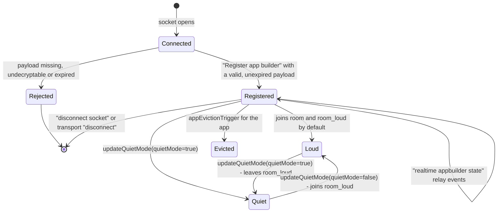
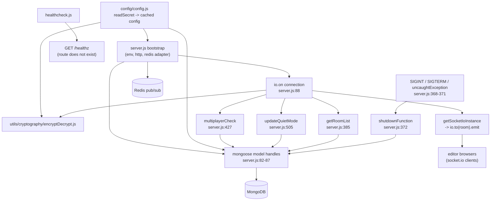

# appbuilder_multiplayer_ms

Repository: `apps/appbuilder_multiplayer_ms` (repo id `appbuilder_multiplayer_ms`, from
`.kilo/repos.json`). All `file:line` citations below are relative to that repository root.

## 1. Summary

A Socket.IO presence and fan-out service for the Inhouz app builder. It does not serve an
application API. It holds no business documents of its own beyond two ephemeral tracker
collections: who is currently in which `appId-variationId` editing room, on which socket, and
which sockets have muted themselves to quiet mode. Every edit the browser sends is relayed
unchanged to the other sockets in the same room, so the service is a shared-state relay plus a
Redis pub/sub bridge that lets several pods share the same socket namespace.

## 2. Stack and commands

| Item | Value | Evidence |
|---|---|---|
| Runtime | Node.js, container `node:16.4-alpine` | `Dockerfile:1` |
| Declared engine range | `>=12.0.0 <17.5.0` | `package.json:6` |
| Module system | CommonJS | `server.js:1-12` |
| Start command | `node --max-old-space-size=8192 server.js` | `package.json:11` |
| Test command | none — `echo "Error: no test specified" && exit 1` | `package.json:10` |
| Container entry | `npm run start` | `Dockerfile:12` |
| Listening port | `process.env.PORT`; k8s sets `5019` | `server.js:587`, `k8s/...-deployment.yml:28-29` |
| ClusterIP service | `appbuilder-multiplayer-ms-cluster-ip-service` | `k8s/appbuilder-multiplayer-ms-cluster-ip-service.yml:4` |
| Socket.IO path | `/appbuildersocket/socket.io` | `server.js:27` |

Dev loop: no dev script exists. Start the process directly with `PORT` and `MONGO_URL` set, plus a
reachable Redis. `docker-compose.yml:3-19` builds a local `node` container on `5001` with a bundled
`mongo:latest`, but it does not define Redis, which the service connects to at boot (`server.js:24`).

## 3. Entry points

| Entry point | Where | How it starts |
|---|---|---|
| Process | `server.js:1` | `npm run start` → `node server.js` |
| HTTP server | `server.js:7` | `http.createServer(app)`, listens at `server.js:587` |
| Socket.IO server | `server.js:26-33` | attached to the same HTTP server, custom path and CORS allow-list |
| Redis adapter wiring | `server.js:24-37` | pub client + duplicate sub client, `createAdapter` installed after both connect |
| Mongo connection | `server.js:55-57`, `server.js:591-603` | called at module load; retried 5 s after a disconnect (`server.js:62-69`) |
| Health-check client | `healthcheck.js:1-21` | separate process that GETs `/healthz` on `localhost:$PORT` |
| Shutdown hook | `server.js:368-383` | `SIGINT`, `SIGTERM`, `uncaughtException` |

There are **no HTTP routes** in this service. The only `app.use` calls are middleware
(`server.js:74-79`): `cors()`, `bodyParser.json({limit:"100mb"})`, `hpp()`, `helmet()`,
`cookieParser()`. No `app.get`/`app.post` exists, so `/healthz` — the path `healthcheck.js:7`
probes — is not served. See §12.

## 4. Module inventory

| Name | Where | Owns | Public API | Kind |
|---|---|---|---|---|
| `server.js` bootstrap | `server.js:1-87` | env, express app, http server, redis adapter, model handles | module side effects; exports `getSocketIoInstance` | `effectful` |
| Socket connection handler | `server.js:88-361` | every inbound event for one socket | registers 4 event names on the socket | `effectful` — writes Mongo, Redis and emits to peers |
| `getSocketIoInstance` | `server.js:363-366` | returns the module-level `io` instance | `() => io` | `reactive` — reads module state |
| `shutdownFunction` | `server.js:372-383` | deletes this pod's tracker rows, closes Mongo | signal handler | `effectful` |
| `getRoomList` | `server.js:385-425` | lists rooms for an app+company, then deletes their tracker rows | `async (appId, companyId) => string[]` | `effectful` — reads and deletes Mongo |
| `multiplayerCheck` | `server.js:427-503` | whether a peer exists in the room, the member list, quiet-mode snapshot | `async (room, socketId) => {multiplayer, roomMembers, quietModeData}` | `effectful` — Mongo reads |
| `updateQuietMode` | `server.js:505-585` | increments/decrements the quiet-mode socket counter per room | `async ({room, socketId, companyId, quietMode, appId}) => quietModeData` | `effectful` — Mongo upsert + read |
| `connectMongo` | `server.js:591-603` | one `mongoose.connect` with `maxPoolSize: 1` | `() => void` | `effectful` |
| config factory | `config/config.js:18-38` | resolves 12 config keys once, caches the object | `() => config` | `effectful` — filesystem, env |
| `readSecret` | `config/config.js:5-15` | reads `/mnt/secrets/<name>`, falls back to an env var | `(name, envFallback) => string` | `effectful` — filesystem, env |
| `encryptDecrypt` | `utils/cryptography/encryptDecrypt.js:3-17` | RSA decrypt (default) or encrypt of the registration payload | `(data, encrypt=false) => string` | `effectful` — key is read from cached config; logs on failure |
| `createEditByObject` | `utils/user/createEditByObject.js:1-23` | builds the `{userId, fullName, editDate, ...}` edit stamp | `(user, deployDate) => object` | `pure` |
| `getUser` | `utils/user/getUser.js:5-159` | user + roles + permissions lookup | `async (userId) => user & {permissions, permissionIdList}` | `effectful` — four Mongo reads; **unreferenced and non-functional**, see §12 |
| `recursiveSanitizer` | `utils/sanitizer/recursiveSanitizer.js:3-17` | walks a payload and sanitizes leaf strings | `(element, sanitizer) => element` | `pure` by intent, **broken**, see §12 |
| tracker model | `model/appBuilder/appBuilderSocketTracker.js:5-56` | one live socket per app/variation/user | `mongoose.model(...)` | `reactive` — schema plus model registration |
| quiet-mode model | `model/appBuilder/appBuilderSocketQuietModeTracker.js:5-33` | per-room quiet-mode counter and socket list | `mongoose.model(...)` | `reactive` — schema plus model registration |

## 5. Side effects

| Effect | Where |
|---|---|
| MongoDB connect, `maxPoolSize: 1` | `server.js:591-603` |
| MongoDB tracker `findOne` on register | `server.js:141-150` |
| MongoDB tracker upsert on register | `server.js:153-177` |
| MongoDB tracker `find` in `multiplayerCheck` | `server.js:440-448` |
| MongoDB quiet-tracker `findOne` | `server.js:479-486`, `server.js:559-568` |
| MongoDB quiet-tracker `updateOne` (upsert) | `server.js:543-556` |
| MongoDB tracker `deleteMany` (shutdown, eviction, disconnect) | `server.js:374`, `server.js:414`, `server.js:310` |
| MongoDB tracker `deleteOne` (disconnect) | `server.js:348` |
| MongoDB quiet-tracker `$inc`/`$pull` on disconnect | `server.js:317-333` |
| Redis pub/sub clients (two connections) | `server.js:24-25`, connected `server.js:34` |
| Redis URL built from host, password, port, optional db | `server.js:13-22` |
| Filesystem read of secret files | `config/config.js:10` |
| Env reads | `config/config.js:6`, `config/config.js:25`, `config/config.js:28`, `server.js:13`, `server.js:16-17`, `server.js:587`, `healthcheck.js:6` |
| Clock (`Date.now` via `new Date().getTime()`) | `server.js:102`, `server.js:163`, `server.js:202`, `server.js:516` |
| Randomness (per-pod id, socket ids) | `server.js:81` (`shortid.generate`) |
| Logging (console) | `server.js:60`, `server.js:63`, `server.js:71`, `server.js:175`, `server.js:331`, `server.js:373`, `server.js:399`, `server.js:420`, `server.js:446`, `server.js:484`, `server.js:554`, `server.js:566`, `server.js:582`, `server.js:588`, `server.js:601`, `config/config.js` failure path, `encryptDecrypt.js:14`, `healthcheck.js:11-17` |
| HTTP egress | none. No `http.request`, `axios`, `fetch` or `request` call in the service |
| Filesystem write | none |

The service makes **no outbound HTTP calls** to other Inhouz services. Its only network peers are
MongoDB, Redis, and the browsers connected over Socket.IO.

## 6. State and state transitions

The unit of state is one socket's presence in one room. There is no persisted domain state; both
collections are derived from live sockets and are deleted on shutdown (`server.js:374`).

| From | To | Trigger | Guard |
|---|---|---|---|
| Connected | Registered | `Register app builder` `server.js:90` | `encryptedPayload` is a non-empty string (`:92`); RSA decrypt succeeds (`:99`); `expirationTimestamp` not passed (`:102`); `appId` and `variationId` are non-empty strings and `appId` is a valid ObjectId (`:124-135`) |
| Connected | Rejected | same event | any guard above fails; emits `Registration response {success:false}` (`:93`, `:107`, `:131`) |
| Registered | Registered | `realtime appbuilder state` (`:189`) | unknown `type` values are silently ignored — there is no `else` branch |
| Registered | Quiet | `updateQuietMode` where `quietMode` is truthy (`:239`, `:248`) | the socket is removed from `<room>_loud` (`:249`) |
| Registered | Loud | `updateQuietMode` where `quietMode` is falsy (`:251`) | the socket joins `<room>_loud` |
| Registered | Evicted | `appEvictionTrigger` (`:259`) | `appId` and `companyId` must both be non-empty strings (`:386-393`); all tracker rows for those rooms are deleted (`:414`) |
| Registered | Gone | `disconnect socket` (`:308`) | always allowed; deletes tracker rows for the socket, iterates quiet counter only if `removeFromQuietModeTracker` (`:316`) |
| Registered | Gone | transport `disconnect` (`:339`) | always fires; deletes one tracker row by `socketId` (`:348`) |

Two known state hazards are recorded in §12: the double-delete on both disconnect events, and the
uncapped `$inc: -1` on the quiet counter.

## 7. Data

No documents are created by a user flow. Both collections are socket bookkeeping.

### `appBuilderSocketTracker`

Collection name comes from `APP_BUILDER_SOCKET_TRACKER_MODEL` (`config/config.js:29`); the
`model()` call passes the same value as the third argument, so the collection name is the env value
(`model/appBuilder/appBuilderSocketTracker.js:56`). The checked-in k8s manifest sets it to
`appBuilderSocketTracker` (`k8s/...-deployment.yml:92-93`).

| Field | Type | Rule | Line |
|---|---|---|---|
| `userId` | String | optional | `:6-8` |
| `companyId` | String | optional | `:9-11` |
| `appId` | String | required | `:12-15` |
| `variationId` | String | required | `:16-19` |
| `socketId` | String | required | `:20-23` |
| `timestamp` | Number | required | `:24-27` |
| `builderId` | String | required | `:28-31` |
| `room` | String | required; `"${appId}-${variationId}"` | `:32-35`, `server.js:137` |
| `firstName`, `lastName`, `bgColor`, `imageUrl` | String | optional | `:36-37`, `:42-43` |
| `serverId` | String | required; the pod's `shortid` | `:38-41`, `server.js:81` |

Compound index on `room, timestamp, serverId, userId, variationId, appId, socketId`
(`:49-54`). `strict: true`, `timestamps: true` (`:44-47`) — so `createdAt`/`updatedAt` are also
written even though `timestamp` duplicates the intent.

`builderId` is `required: true` (`:28-31`), but the registration handler defaults it to `""`
(`server.js:119`) and upserts it as `""` when the payload omits it (`server.js:158`). An empty
string satisfies `required`, so a registration without `builderId` still succeeds.

### `appBuilderSocketQuietModeTracker`

Collection name from `APP_BUILDER_SOCKET_QUIET_MODE_TRACKER_MODEL`
(`config/config.js:34-35`; `model/appBuilder/appBuilderSocketQuietModeTracker.js:33`). The k8s
manifest sets `appBuilderSocketQuietModeTracker` (`k8s/...-deployment.yml:154-155`).

| Field | Type | Rule | Line |
|---|---|---|---|
| `appId` | String | required | `:6-9` |
| `companyId` | String | optional | `:10-12` |
| `room` | String | required | `:13-16` |
| `socketIds` | [String] | quiet sockets for the room | `:17` |
| `socketCount` | Number | default `0` | `:18-21` |
| `lastUpdateTimestamp` | Number | optional | `:22` |

Index on `appId, companyId, room, lastUpdateTimestamp` (`:28-31`), `strict: true` (`:23-26`).
`globalQuietMode` is derived, not stored: it is `socketCount > 0 ? false : true`
(`server.js:493`, `server.js:575`).

### Coupling to other services

The two collections are keyed by `appId`, `variationId` and `companyId`, which are ObjectIds owned
by the app-builder and company services. This repository never validates those ids against another
service and never reads their documents. Whether other services read
`appBuilderSocketTracker`/`appBuilderSocketQuietModeTracker` cannot be determined from this
repository alone; it is an open question in §14. The real cross-pod coupling here is Redis, not
Mongo: room membership is shared through the Socket.IO Redis adapter (`server.js:34-37`), so two
pods can serve one room.

## 8. Public interfaces

The public interface is a Socket.IO namespace on path `/appbuildersocket/socket.io` (`server.js:27`)
with a CORS allow-list of `*.inhouz.localhost` and `*.inhouz.io` (`server.js:29`). No HTTP route
exists.

### Inbound events

| Event | Payload | Handled at |
|---|---|---|
| `Register app builder` | `{ encryptedPayload: string }` — RSA-decrypted to `{expirationTimestamp, payload:{appId, variationId, companyId, userId, firstName, lastName, builderId, imageUrl, bgColor}}` | `server.js:90-187` |
| `realtime appbuilder state` | `{ appId, type, data }`; `data.variationId` builds the room | `server.js:189-306` |
| `disconnect socket` | `{ appId, variationId, removeFromQuietModeTracker?, ...filter }` — the whole object is used as a Mongo delete filter | `server.js:308-337` |
| `disconnect` (transport) | none | `server.js:339-360` |

### `realtime appbuilder state` `type` values and their outbound events

| `type` | Target | Emitted event | Line |
|---|---|---|---|
| `mouse` | `<room>_loud` | `users mouse state` | `:193-196` |
| `recentElementUpdate` | room | `recent element updates` | `:197-203` |
| `clearEditQueue` | room | `clear edit queue` | `:204-210` |
| `recentPageUpdate` | room | `recent page updates` | `:211-217` |
| `recentAppObjectUpdate` | room | `recent app object updates` | `:218-224` |
| `elementHoverSync` | room | `element hover sync` | `:225-231` |
| `multiplayerCheck` | the caller's own socket id | `multiplayerCheck response` | `:232-238` |
| `updateQuietMode` | room | `global quiet mode update` | `:239-258` |
| `appEvictionTrigger` | every room returned by `getRoomList` | `app eviction notice` | `:259-269` |
| `getLatestAppObject` | room | `send latest app object` | `:270-276` |
| `deliverLatestAppObject` | `data.socketId` | `latest app object delivery` | `:277-283` |
| `inhouzSignDocumentUpdate` | room | `inhouzSign doc update` | `:284-290` |
| `inhouzSignRefreshParentApp` | room | `inhouzSign parent app refresh` | `:291-297` |
| `broadcastAppDataUpdate` | room | `sync app data` | `:298-304` |

Every relayed payload is the caller's `data` spread plus a server `timestamp`; the server never
inspects or validates the content. That is intentional for a relay, but it means any socket that
has joined a room can write any shape into every other client in it.

### Outbound events with server-computed payloads

| Event | Shape | Line |
|---|---|---|
| `Registration response` | `{success:true, socketId, ...multiplayerRes}` or `{success:false}` | `server.js:181-185`, `:93`, `:107`, `:131` |
| `Recalculate multiplayer` | no payload | `server.js:186`, `:336`, `:358` |
| `multiplayerCheck response` | `{multiplayer, roomMembers, quietModeData}` | `server.js:234-238` |
| `global quiet mode update` | `{quiteModeSocketIds, globalQuietMode}` (note the misspelling `quiteModeSocketIds` in the payload) | `server.js:254-258`, `:492`, `:574` |
| `server disconnected` | no payload, emitted to the closing socket | `server.js:354` |

`getSocketIoInstance()` is exported (`server.js:363-366`) so another module in a larger deployment
could emit into these rooms, but nothing in this repository imports it.

## 9. Configuration

Names only. Secrets are read from files under `SECRETS_PATH/<name>` first and fall back to the env
var (`config/config.js:5-15`).

| Name | Read at | Purpose |
|---|---|---|
| `PORT` | `server.js:587`, `healthcheck.js:6` | listen port and health-check port |
| `SECRETS_PATH` | `config/config.js:6` | mount point for secret files, default `/mnt/secrets` |
| `SESSION_SECRET` | `config/config.js:22` | cookie-parser secret |
| `MONGO_URL` | `config/config.js:23` | Mongo connection string |
| `CLIENT_SECRET_KEY` | `config/config.js:24`, `:31` | RSA key material for `encryptDecrypt` |
| `COOKIE_DOMAIN` | `config/config.js:25` | cookie domain (loaded, never used in this file) |
| `REDIS_HOST` | `config/config.js:26` | Redis host |
| `REDIS_PASSWORD` | `config/config.js:27` | Redis password |
| `REDIS_DB` | `config/config.js:28` | optional Redis database suffix |
| `APP_BUILDER_SOCKET_TRACKER_MODEL` | `config/config.js:29` | collection name for the tracker |
| `APP_BUILDER_SOCKET_QUIET_MODE_TRACKER_MODEL` | `config/config.js:34-35` | collection name for quiet mode |
| `REDIS_PORT` | `server.js:13`, `:17` | Redis port, read from `process.env` directly |
| `NODE_ENV` | k8s only | not read in code |
| `COOKIE_NAME` | k8s only | not read in code |

The checked-in deployment injects about 55 env vars
(`k8s/appbuilder-multiplayer-ms-deployment.yml:27-155`), but the code above reads only 12. The
remainder — `SENDGRID_API_KEY`, `STRIPE_API_KEY`, `OPEN_EXCHANGE_RATES_*`, `PAYMENT_*`,
`SUBSCRIBER_*`, `SUBSCRIPTION_*`, `FLEX_*`, `USER_MODEL`, `ROLE_MODEL`, `PERMISSION_MODEL`,
`INHOUZ_FROM_EMAIL`, `IP_LOCATION_FINDER_URL` and the rest — are dead for this container. They
look copied from a shared deployment template. Dropping them would shrink the pod's secret surface
with no behaviour change; that is a decision for the orchestrator, not this document.

## 10. Dependencies

From `package.json:15-41`. "Used" means a `require` reachable from `server.js`.

| Dependency | Why | Used |
|---|---|---|
| `@socket.io/redis-adapter` | cross-pod room broadcast | yes, `server.js:12` |
| `redis` | pub/sub clients for that adapter | yes, `server.js:9` |
| `socket.io` | the websocket server | yes, `server.js:26` |
| `express` | hosts the http server and middleware chain | yes, `server.js:2` |
| `mongoose` | Mongo models and ObjectId validation | yes, `server.js:44` |
| `lodash` | `uniqBy` for unique room members, `isEmpty`/`uniq` in `getUser` | yes, `server.js:6` |
| `node-rsa` | decrypts the registration payload | yes, `config/config.js:1` |
| `shortid` | per-pod `serverId`, socket-id fallback | yes, `server.js:50`, `:81` |
| `body-parser`, `cookie-parser`, `cors`, `helmet`, `hpp` | HTTP hardening middleware, though no route consumes a body | yes, `server.js:45-49` |
| `dotenv` | loads `.env` in local runs | yes, `server.js:1` |
| `bcryptjs`, `connect-mongo`, `crypto-js`, `cryptr`, `express-session`, `moment`, `request-ip`, `sanitizer`, `validator`, `socket.io-redis`, `randomcolor` | none appear in any `require` reachable from `server.js`; `randomcolor` and `socket.io-redis` are present only as commented-out lines (`server.js:5`, `server.js:11`) | no |

The unused group is eleven of twenty-five direct dependencies. It inflates the image and the audit
surface. Recorded, not changed.

## 11. Testing

None. `package.json:10` is the npm placeholder that exits 1, and the repository has no test file,
no test directory, and no test runner dependency. `.travis.yml` exists but the pipeline state is not
verifiable from source. Every behaviour in this file is read from code, not from a passing test.

What a test suite would need to cover first: registration guard ordering (`server.js:92-135`),
`multiplayerCheck` with zero, one and two peers (`server.js:427-503`), the quiet-mode counter
(`server.js:505-585`), and the double-delete on disconnect (`server.js:310`, `:348`).

## 12. Known issues and risks

1. **The health check can never pass.** `healthcheck.js:7` GETs `/healthz`; the express app
   registers no route and no catch-all (`server.js:74-79`), so Express answers 404 and
   `healthcheck.js:12` exits 1. Any liveness/readiness probe built on this script will restart the
   pod forever. No probe is declared in the k8s manifests, so the defect is latent today.
2. **Two disconnect paths both delete, and one deletes more than it should.**
   `disconnect socket` deletes by a filter built from the client-supplied payload
   (`server.js:310-315`), and the transport `disconnect` then deletes by `socketId`
   (`server.js:348-352`). The client controls the first filter, so a client can pass
   `{userId, companyId}` and clear every tracker row for that user/company, not just its own.
3. **The quiet-mode counter can go negative without bound.** `$inc: {socketCount:-1}` runs on
   every `disconnect socket` with `removeFromQuietModeTracker` (`server.js:317-333`) and on every
   `updateQuietMode(true)` (`server.js:517-528`) with no guard that the socket was counted.
   `globalQuietMode = socketCount > 0 ? false : true` (`server.js:493`, `:575`) then reports
   "globally quiet" whenever the counter has drifted below zero, muting everyone.
4. **`:239` `updateQuietMode` reads `data["appId"]`, but the room was built from `dataObj.appId`**
   (`server.js:190-191`, `:246`). A client that sends `appId` at the top level and not inside
   `data` causes a quiet-mode upsert with `appId: undefined`, which fails the schema's `required`
   rule and is only `console.log`ged (`server.js:554`).
5. **`recursiveSanitizer` does not sanitize.** It writes the sanitized value to a local
   `element` (`utils/sanitizer/recursiveSanitizer.js:13`) without assigning it back into the
   parent, and the array branch calls itself without the `sanitizer` argument (`:10`), which throws
   on the first array element. It is also never imported by `server.js`, so today the payloads are
   relayed unsanitized regardless.
6. **`getUser.js` cannot run.** It reads `config.userModel`, `config.userRolesModel`,
   `config.roleModel` and `config.permissionModel` (`utils/user/getUser.js:18`, `:44`, `:84`,
   `:118`), but `config/config.js:21-36` defines none of them, so `mongoose.model(undefined)`
   throws `MissingSchemaError`. Nothing imports the module, so the failure is latent.
7. **`encryptDecrypt` fails open.** On any RSA error it returns the input unchanged
   (`utils/cryptography/encryptDecrypt.js:13-16`). The registration handler then `JSON.parse`s it
   (`server.js:101`); a malformed payload throws inside the async handler with no try/catch, which
   is an unhandled rejection on Node 16.
8. **`maxHttpBufferSize: 100000000`** (`server.js:33`) allows a 100 MB websocket frame per
   connected editor, with no rate limit and no per-socket quota. A single client can push memory
   and bandwidth toward the pod's `3Gi` limit (`k8s/...-deployment.yml:20`).
9. **CORS is an implicit regex match.** `origin: [/inhouz.localhost/, /inhouz.io/]`
   (`server.js:29`) is an unanchored substring test, so `inhouz.io.attacker.example` matches.
10. **The service trusts `appId`/`variationId` without an authorization check.** Any socket that
    decrypts a valid payload may join any `${appId}-${variationId}` room and receive every edit
    in it (`server.js:137-138`). The RSA payload is the only gate, and it is minted by another
    service.
11. **`maxPoolSize: 1`** (`server.js:599`) serialises all Mongo work per pod. Every relay that
    touches the tracker collections queues behind the previous one.
12. **`service-account.json.enc` is committed** at the repo root. It is encrypted, so it is not a
    plaintext credential, but it is a stored blob whose plaintext form and key are not described
    anywhere in this repository. Recorded, not opened.
13. **No credential found embedded in a source file.** Secrets come from files under
    `SECRETS_PATH` or env vars (`config/config.js:5-15`); the k8s manifests use `secretKeyRef`
    for every secret. The only literal values in the manifest are non-secret config: collection
    names, ports, URLs and the `PORT`/`NODE_ENV` strings.

## 13. Module map

## 14. Open questions

- Which service mints the RSA-encrypted registration payload that `encryptDecrypt` expects? The
  `expirationTimestamp` + `payload` envelope (`server.js:101-105`) implies a signer, but no signer
  is named here and there is no outbound call to find it.
- Do any other services read `appBuilderSocketTracker` or `appBuilderSocketQuietModeTracker`?
  Nothing in this repository says. If another service does, that is an undocumented data contract.
- Is the stale env-var block in `k8s/appbuilder-multiplayer-ms-deployment.yml:27-155` intentional,
  or a copy of a shared template? Removing it changes the pod spec, so it is left as found.
- `kus/` holds a base/dev/prod kustomize tree that duplicates `k8s/`. Which one is deployed is not
  determinable from source; both declare the same image, one replica and port 5019.
- `COOKIE_DOMAIN` is loaded (`config/config.js:25`) and never used. Dead config or a planned
  feature?
- Skipped: `.github/workflows/cicd-dev.yml`, `.github/workflows/cicd-prod.yml`,
  `build_ga.sh`, `build_ga_prod.sh`, `deploy.sh`, `.travis.yml`, `service-account.json.enc`,
  `.dockerignore`, `.gitignore`. These are build and release plumbing, not service behaviour; the
  delivery path is not part of this handover's contract.
