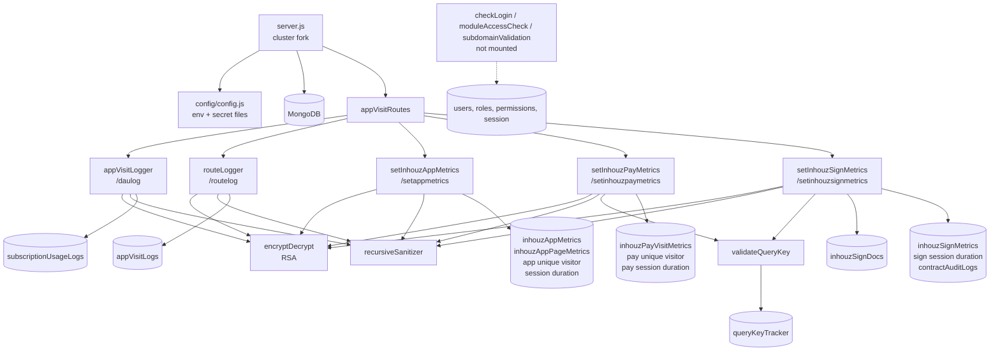

# appviewer_log_ms

Repository: `apps/appviewer_log_ms` (`/workspaces/kilo_inhouz_ai/apps/appviewer_log_ms`), a separate
git repository. All `file:line` citations are relative to that repository root.

## 1. Summary

`appviewer_log_ms` is the write-side telemetry service for the Inhouz product surface. Five
`POST /api/appviewerlog/*` routes accept an RSA-encrypted payload, decrypt it, check an expiry
timestamp, and then write Mongoose documents: app route visits, subscription usage logs, and
aggregated app / Inhouz Pay / Inhouz Sign metrics (daily and monthly counters, unique-visitor
trackers, session-duration logs, contract audit entries). It stores data only. It computes no
business decisions beyond validation and counters, and it calls no other service over HTTP. The
repository is a copy of the `micro_service_template` skeleton: `package.json:2` still names it
`micro_service_template`, and the login / module / subdomain middlewares it carries are not mounted.

## 2. Stack and commands

- Runtime: Node `>=12.0.0 <17.5.0` (`package.json:6`); container is `node:16.4-alpine`
  (`Dockerfile:1`).
- Framework: Express 4 with MongoDB via Mongoose 7 (`package.json:23,29`).
- Port: `PORT`, read directly (`server.js:97`); k8s sets it to `"5046"`
  (`k8s/appviewer-log-ms-deployment.yml:28-29`).
- Scripts, quoted from `package.json:7-10`:
  - `start` — `node server.js`.
  - `test` — `echo "Error: no test specified" && exit 1`.
- Container start: `CMD ["npm", "run", "start"]` (`Dockerfile:11`). There is no `HEALTHCHECK`
  instruction in the Dockerfile.
- Verification: there is no working test command. The only practical check is a build plus a
  `POST` to one route with a valid encrypted payload.

## 3. Entry points

| Entry point | Where | How it starts |
|---|---|---|
| Process entry | `server.js:1-100` | `node server.js` |
| Cluster master | `server.js:34-51` | Forks `os.cpus().length` workers in production, 1 otherwise (`server.js:35`); re-forks on worker exit (`server.js:40-51`) |
| Express app | `server.js:53-67` | Constructed in each worker |
| Middleware stack | `server.js:54-65` | `cors`, `bodyParser.json({limit: "20mb"})`, `hpp`, `helmet`, `cookieParser(sessionSecret)` |
| Route registration | `controller/appVisitController/appVisitRoutes.js:7-13` | Called from `server.js:67` |
| `POST /api/appviewerlog/daulog` | `appVisitRoutes.js:8` → `services/logFunctions/appVisitLogger.js:9` | HTTP |
| `POST /api/appviewerlog/routelog` | `appVisitRoutes.js:9` → `services/logFunctions/routeLogger.js:9` | HTTP |
| `POST /api/appviewerlog/setappmetrics` | `appVisitRoutes.js:10` → `services/metrics/setInhouzAppMetrics.js:9` | HTTP |
| `POST /api/appviewerlog/setinhouzpaymetrics` | `appVisitRoutes.js:11` → `services/metrics/setInhouzPayMetrics.js` | HTTP |
| `POST /api/appviewerlog/setinhouzsignmetrics` | `appVisitRoutes.js:12` → `services/metrics/setInhouzSignMetrics.js` | HTTP |
| Mongo connect + reconnect | `server.js:102-114`, retry timer `server.js:76-83` | Module load, 5000 ms retry |
| Graceful shutdown | `server.js:87-95` | `SIGINT`, `SIGTERM`, `uncaughtException` close the Mongo connection |
| Health probe script | `healthcheck.js:1-21` | Standalone `node healthcheck.js`; requests `/healthz` |
| k8s deployment | `k8s/appviewer-log-ms-deployment.yml:4-17` | `appviewer-log-ms-deployment`, image `inhouz/appviewer_log_ms`, replicas 1 |
| k8s service | `k8s/appviewer-log-ms-cluster-ip-service.yml:4-11` | ClusterIP `appviewer-log-ms-cluster-ip-service`, port 5046 → 5046 |

No cron, worker loop, queue consumer or migration exists. The only timer is the Mongo reconnect
`setTimeout` (`server.js:79`).

## 4. Module inventory

| Module | `file:line` | Responsibility | Public API | Kind |
|---|---|---|---|---|
| `server.js` | `server.js:1-114` | Cluster fork, Express wiring, Mongo lifecycle | starts the process | effectful (network, env, process) |
| `connectMongo` | `server.js:102-114` | Connects with `maxPoolSize: 1` | none | effectful (DB) |
| `config` | `config/config.js:18-64` | Cached env + secret-file reader | `() => object` | effectful (env, filesystem); memoised in module state |
| `readSecret` | `config/config.js:5-15` | Reads a secret file, falls back to an env var | `(name, envFallback) => string` | effectful (filesystem, env) |
| `appVisitRoutes` | `controller/appVisitController/appVisitRoutes.js:7-13` | Registers the five POST routes | `(app) => void` | effectful (network) |
| `appVisitLogger` | `services/logFunctions/appVisitLogger.js:9-84` | Decrypts payload, validates three ObjectIds, creates one `subscriptionUsageLogs` document with `monthYear` | Express handler | effectful (crypto, clock, DB, logging) |
| `routeLogger` | `services/logFunctions/routeLogger.js:9-152` | Decrypts payload, validates fields and the `CVMD` cookie, creates one `appVisitLogs` document | Express handler | effectful (crypto, cookies, clock, DB, logging) |
| `setInhouzAppMetrics` | `services/metrics/setInhouzAppMetrics.js:9-206` | Increments app visit, unique-visitor, page and session-duration counters | Express handler | effectful (clock, DB, logging) |
| `setInhouzPayMetrics` | `services/metrics/setInhouzPayMetrics.js:9-182` | Same for Inhouz Pay, guarded by a single-use `queryKey` | Express handler | effectful |
| `setInhouzSignMetrics` | `services/metrics/setInhouzSignMetrics.js:9-272` | Same for Inhouz Sign, plus a contract audit log | Express handler | effectful |
| `encryptDecrypt` | `utils/cryptography/encryptDecrypt.js:3-22` | RSA encrypt/decrypt with the client key pair | `(data, encrypt?, publicEncrypt?) => string` | effectful (crypto); fails open, see §12 |
| `recursiveSanitizer` | `utils/sanitizer/recursiveSanitizer.js:3-17` | Walks a body and sanitises strings | `(element, sanitizer) => element` | effectful (mutates input in place); incorrect for nested values, see §12 |
| `validateQueryKey` | `utils/query/validateQueryKey.js:4-51` | Rejects a `queryKey` already present in `queryKeyTracker`, else records it | `(queryKey) => {success} \| {error}` | effectful (clock, DB, logging); has an undefined `res`, see §12 |
| `monthIndexMap` | `utils/date/monthIndexMap.js:1-13` | Month index 0-11 → English month name | const map | pure |
| `getUser` | `utils/user/getUser.js:5-` | Loads a user, their roles and permissions | `(userId) => object \| {error}` | effectful (DB) |
| `checkLogin` | `middlewares/login/checkLogin.js:1-` | Session/login middleware | Express middleware | effectful (cookies, DB, clock). **Not mounted anywhere.** |
| `moduleAccessCheck` | `middlewares/module/moduleAccessCheck.js:1-` | Module permission middleware | Express middleware | effectful (DB). **Not mounted anywhere.** |
| `singleSubdomainValidation` | `middlewares/subdomain/singleSubdomainValidation.js:1-` | Subdomain check | Express middleware | effectful. **Not mounted anywhere.** |
| 20 schema modules under `model/` | see §7 | Mongoose schemas and registrations | model constructors | effectful (schema registration) |

## 5. Side effects

| Effect | Where |
|---|---|
| Mongo connect, `maxPoolSize: 1`, one connection per cluster worker | `server.js:102-114`, forked at `server.js:34-38` |
| Mongo reconnect timer, 5000 ms | `server.js:76-83` |
| Mongo connection lifecycle logging | `server.js:73-86` |
| Mongo create `subscriptionUsageLogs` | `services/logFunctions/appVisitLogger.js:65-73` |
| Mongo create `appVisitLogs` | `services/logFunctions/routeLogger.js:134-141` |
| Mongo upsert/update `inhouzAppUniqueVisitorTracker` | `services/metrics/setInhouzAppMetrics.js:64,88-` |
| Mongo upsert/update `inhouzAppMetrics` | `services/metrics/setInhouzAppMetrics.js:65` |
| Mongo upsert/update `inhouzAppPageMetrics` | `services/metrics/setInhouzAppMetrics.js:66` |
| Mongo create `inhouzAppSessionDurationLogs` | `services/metrics/setInhouzAppMetrics.js:67` |
| Mongo writes for `inhouzPayVisitMetrics`, `inhouzPayUniqueVisitorTracker`, `inhouzPaySessionDurationLog` | `services/metrics/setInhouzPayMetrics.js:85-87` |
| Mongo read `inhouzSignDocs` by `{_id, companyId}` | `services/metrics/setInhouzSignMetrics.js:82,87-91` |
| Mongo writes `inhouzSignMetrics`, `inhouzSignSessionDurationLogs`, `contractAuditLogs` | `services/metrics/setInhouzSignMetrics.js:83-85` |
| Mongo read + create `queryKeyTracker` (single-use key) | `utils/query/validateQueryKey.js:6-40` |
| RSA decrypt of every request body | `utils/cryptography/encryptDecrypt.js:15` |
| Cookie reads: `CVMD`, `deviceId`, `systemId` | `services/logFunctions/routeLogger.js:58-60` |
| Cookie parse middleware keyed by the session secret | `server.js:65` |
| Clock: `new Date()`, `Date.now` equivalents, `moment()` | `appVisitLogger.js:11,41`, `routeLogger.js:10`, `setInhouzAppMetrics.js:69-71`, `validateQueryKey.js:35` |
| Request headers read: `CF-Connecting-IP`, `x-forwarded-for`, `referrer`, `CF-IPCountry` | `routeLogger.js:127-131`, `setInhouzAppMetrics.js:84-85` |
| Env reads | `config/config.js:21-62`, `server.js:35,97`, `routeLogger.js:131`, `setInhouzAppMetrics.js:84` |
| Filesystem read of secret files | `config/config.js:5-15` |
| Logging: `console.log` / `console.error` | `server.js:41-49,74,77,85,98`, each handler's catch block |
| Outbound HTTP from the service itself | none found |
| Health probe outbound `GET /healthz` | `healthcheck.js:10-14` |

## 6. State and state transitions

`queryKeyTracker` is the only stored state with a lifecycle: a `queryKey` is single-use.

| From | Trigger | Guard | To | Evidence |
|---|---|---|---|---|
| key absent | `POST /setinhouzpaymetrics` or `/setinhouzsignmetrics` | `queryKey` is a non-empty string | key recorded with a timestamp | `utils/query/validateQueryKey.js:32-41` |
| key recorded | same route replayed with the same key | row found | request rejected as `Expired authorization token.` | `utils/query/validateQueryKey.js:24-30` |
| key recorded | never | no TTL index on `queryKeyTracker` | stays forever | `model/queryTracker/queryKeyTracker.js` (no TTL index) |

The metric counters themselves are append/increment only. There is no status field and no
transition guard on `appVisitLogs`, `subscriptionUsageLogs` or the metrics documents.

Request-level flow shared by all five routes: encrypted body → `recursiveSanitizer` → RSA decrypt →
expiry check (`now <= expirationTimestamp`) → field validation → Mongo write. An expired payload
yields an empty `payload` and an HTTP 400 (`appVisitLogger.js:41-43`, `routeLogger.js:39-48`,
`setInhouzAppMetrics.js:29-38`).

## 7. Data

All collections are env-configured names passed as the third argument to `mongoose.model`, so the
literal collection name in code is the env var value.

| Model file | Registered at | Collection (env → name) | Access here |
|---|---|---|---|
| `model/appViewer/appVisitLog.js` | `:59` | `APP_VISIT_LOG_MODEL` → `appVisitLogs` | create |
| `model/subscription/subscriptionUsageLog.js` | `new Schema` `:6` | `SUBSCRIPTION_USAGE_LOG` → `subscriptionUsageLogs` | create via `appVisitLogger` |
| `model/metrics/inhouzAppMetrics.js` | `:84` | `INHOUZ_APP_METRICS_MODEL` → `inhouzAppMetrics` | upsert/inc |
| `model/metrics/inhouzAppPageMetrics.js` | `:68` | `INHOUZ_APP_PAGE_METRICS_MODEL` → `inhouzAppPageMetrics` | upsert/inc |
| `model/metrics/inhouzAppUniqueVisitorTracker.js` | `:59` | `INHOUZ_APP_UNIQUE_VISITOR_TRACKER` → `inhouzAppUniqueVisitorTracker` | upsert/inc |
| `model/metrics/sessionDurationLog.js` | `:61` | `INHOUZ_APP_SESSION_DURATION_LOG_MODEL` → `inhouzAppSessionDurationLogs` | create |
| `model/payment/inhouzPayVisitMetrics.js` | `:77` | `INHOUZ_PAY_VISIT_METRICS_MODEL` → `inhouzPayVisitMetrics` | upsert/inc |
| `model/payment/inhouzPayUniqueVisitorTracker.js` | `:58` | `INHOUZ_PAY_UNIQUE_VISITOR_TRACKER_MODEL` → `inhouzPayUniqueVisitorTracker` | upsert/inc |
| `model/payment/inhouzPaySessionDurationLog.js` | `:58` | `INHOUZ_PAY_SESSION_DURATION_LOG_MODEL` → `inhouzPaySessionDurationLog` | create |
| `model/inhouzSign/inhouzSignDoc.js` | `:774` | `INHOUZ_SIGN_DOC_MODEL` → `inhouzSignDocs` | read only |
| `model/inhouzSign/inhouzSignMetrics.js` | `:67` | `INHOUZ_SIGN_METRICS_MODEL` → `inhouzSignMetrics` | upsert/inc |
| `model/inhouzSign/inhouzSignSessionDurationLog.js` | `new Schema` `:5` | `INHOUZ_SIGN_SESSION_DURATION_LOG_MODEL` → `inhouzSignSessionDurationLogs` | create |
| `model/inhouzSign/contractAuditLog.js` | `:54` | `CONTRACT_AUDIT_LOG_MODEL` → `contractAuditLogs` | create |
| `model/queryTracker/queryKeyTracker.js` | `:23` | `QUERY_KEY_TRACKER_MODEL` → `queryKeyTracker` | read + create |
| `model/company/company.js` | `:29` | `COMPANY_MODEL` → `company` | schema only, unused by routes |
| `model/user/user.js` | `:107` | `USER_MODEL` → `User` | via unused login middleware |
| `model/user/useRoles.js` | `:51` | `USER_ROLES_MODEL` → `userRoles` | via unused login middleware |
| `model/rolesAndPermissions/roles.js` | `:87` | `ROLE_MODEL` → `roles` | via unused login middleware |
| `model/rolesAndPermissions/permissions.js` | `:89` | `PERMISSION_MODEL` → `permissions` | via unused login middleware |
| `model/session/session.js` | `:28` | `SESSION_MODEL` → `session` | via unused login middleware |

Key fields and validation:

- `appVisitLogs` — `appId`, `companyId`, `appType`, `variationId`, `timestamp`, `systemId`, `domain`
  required; `hostedExternally`, `ipAddress`, `referrer`, `buildQueryTimeMS`, `deviceId`,
  `environment`, `deviceMode`, `countryCode`, `requestQuery`; `timestamps: true`, `strict: true`;
  index on `{appId, appType, variationId, timestamp, companyId, domain, hostedExternally,
  environment, deviceId}` (`model/appViewer/appVisitLog.js:52-57`).
- `inhouzAppMetrics` — `appId`, `companyId`, `monthYear`, `timestamp`, `datestamp`, `hour`, `day`,
  `month`, `year`, `environment` required; counters `pageVisitCount`, `appVisitCount`,
  `uniqueVisitorCount`, `mobileDeviceCount`, `tabletDeviceCount`, `desktopDeviceCount`; free-form
  `referrerTracker`, `countryTracker`; index at `:78-82`.
- `queryKeyTracker` — `key` unique, `timestamp`; no TTL, so keys accumulate.
- `inhouzSignDocs` — read only, filtered by `companyId` so a caller cannot read another company's
  document. Fields consumed: `viewMetricsCollected`, `collectPayment`, `monetaryValue`,
  `paymentAmount`, `environment`, `projectId`, `createdById`, `currency`, `recipients`
  (`services/metrics/setInhouzSignMetrics.js:115-122`).

Shared collections (the coupling a reader cannot infer from this repo): `appVisitLogs` is the same
collection `app_viewer_ms` registers (`RAZZLE_APP_VISIT_LOG_MODEL`), `company` is the shared account
collection, `inhouzSignDocs` is owned by the Inhouz Sign service, and the metrics/unique-visitor
collections are read by the reporting surfaces. This repository is the only writer of the metric
and tracker collections among the three services in this cluster.

## 8. Public interfaces

All five routes are `POST`, JSON body, no authentication header, no CSRF check. The request body is
`{ encryptedPayload: string }`; the decrypted payload is `{ expirationTimestamp: number,
payload: object }`. Every handler returns `{done: true}` or `{success: true}` on success.

| Route | Body fields after decrypt | Writes | Errors |
|---|---|---|---|
| `POST /api/appviewerlog/daulog` | `companyId`, `assetOwnerCompanyId`, `subscriptionId` (all valid ObjectIds) plus arbitrary fields copied verbatim | `subscriptionUsageLogs` with `monthYear` added | 400 missing/invalid; 500 on throw (`appVisitLogger.js:21-83`) |
| `POST /api/appviewerlog/routelog` | `appId`, `companyId`, `variationId`, `domain`, `deviceMode`, `appType`, optional `skipCVMD`; cookies `deviceId`, `systemId`, `CVMD` unless skipped | `appVisitLogs` | 400 missing field or bad `CVMD`; 500 on throw (`routeLogger.js:11-151`) |
| `POST /api/appviewerlog/setappmetrics` | `appId`, `companyId`, `environment` required; `metricsType`, `deviceType`, `referrer`, `pageInFocusId`, `pathName`, `sessionDurationMillisecond` | app metrics, page metrics, unique visitor, session duration | 400 only (`setInhouzAppMetrics.js:9-60`) |
| `POST /api/appviewerlog/setinhouzpaymetrics` | same plus `queryKey` | pay metrics, pay unique visitor, pay session duration | 400, 500 when the query key is rejected (`setInhouzPayMetrics.js:72-82`) |
| `POST /api/appviewerlog/setinhouzsignmetrics` | `documentId`, `recipientEmail`, `fingerprint`, `companyId`, `metricsType`, `queryKey`, plus metric fields | sign metrics, sign session duration, contract audit log | 400, 404 document not found, 500 on key or DB error (`setInhouzSignMetrics.js:69-110`) |

No CLI commands, queue topics or event handlers.

## 9. Configuration

Env var names read in code: `PORT`, `NODE_ENV`, `SECRETS_PATH`, `MONGO_URL`, `SESSION_SECRET`,
`CLIENT_SECRET_KEY`, `SENDGRID_API_KEY`, `SMPL_EMAIL`, `COOKIE_DOMAIN`, `USER_MODEL`,
`COMPANY_MODEL`, `ROLE_MODEL`, `PERMISSION_MODEL`, `USER_ROLES_MODEL`, `SESSION_MODEL`,
`SESSION_VALIDATOR_MODEL`, `AUTH_LOG_MODEL`, `APP_VISIT_LOG_MODEL`, `SUBSCRIPTION_USAGE_LOG`,
`INHOUZ_APP_METRICS_MODEL`, `INHOUZ_APP_SESSION_DURATION_LOG_MODEL`,
`INHOUZ_APP_UNIQUE_VISITOR_TRACKER`, `INHOUZ_APP_PAGE_METRICS_MODEL`,
`INHOUZ_PAY_VISIT_METRICS_MODEL`, `INHOUZ_PAY_SESSION_DURATION_LOG_MODEL`,
`INHOUZ_PAY_UNIQUE_VISITOR_TRACKER_MODEL`, `QUERY_KEY_TRACKER_MODEL`, `INHOUZ_SIGN_METRICS_MODEL`,
`INHOUZ_SIGN_SESSION_DURATION_LOG_MODEL`, `INHOUZ_SIGN_DOC_MODEL`, `CONTRACT_AUDIT_LOG_MODEL`,
`FLEX_FORM_FILE_MODEL`, `FLEX_MODULE_MODEL`, `FLEX_COLLECTION_MODEL`, `FORM_MODEL`,
`DATA_RULE_EXECUTION_RESULT_MODEL` (`config/config.js:21-62`, `server.js:35,97`).

Secret file names read from `SECRETS_PATH`: `sendgridapikey`, `sessionsecret`, `mongourl`,
`clientsecretkey` (`config/config.js:25-44`). Config files: `.env` via `dotenv`
(`server.js:1`); no `.env.example` exists in the repository.

k8s sets many more names than the code reads (`FUNCTION_MS_URL`, `FUNCTION_PARSER_MS_URL`,
`SCHEDULED_TASK_MS_URL`, `PAYMENT_MS_URL`, `OPEN_EXCHANGE_RATES_*`, `IP_LOCATION_FINDER_URL`,
`INHOUZ_FROM_EMAIL`, and about 20 payment/subscription model names). They are template leftovers
from the monolith; nothing in this repository reads them.

## 10. Dependencies

Direct only (`package.json:13-35`):

- `express`, `body-parser`, `cookie-parser`, `cors`, `helmet`, `hpp` — the HTTP pipeline.
- `mongoose` — the 20 schemas and every write.
- `node-rsa` — decrypting request payloads with the client key pair; also builds the private key at
  config load (`config/config.js:42-45`).
- `cryptr` — decrypting the `CVMD` cookie in `routeLogger` (`routeLogger.js:6,90`).
- `sanitizer` — HTML sanitisation of every request body.
- `lodash` — `isEmpty` / `isObject` / `isArray` checks.
- `moment` — day, hour and month bucket stamps in the metric handlers.
- `dotenv` — loads `.env` at boot.
- `validator` — field validation inside the sign and user schemas.
- `crypto-js` — used only by the unmounted login middleware.
- Unused in this repo despite being declared: `bcryptjs`, `connect-mongo`, `express-session`,
  `request-ip`, `@sendgrid/mail`, `shortid` (no `require` found for any of them).

## 11. Testing

- `npm test` is `echo "Error: no test specified" && exit 1` (`package.json:8`). There is no test
  runner, no test file, and no CI test step.
- Nothing is covered. The RSA payload format, the expiry rule, the `CVMD` requirement, the metric
  bucket arithmetic and the single-use query key are all unverified by any automated check.
- `healthcheck.js` is the only executable check, and it probes a route that does not exist (§12).

## 12. Known issues and risks

- **`res` is undefined in `validateQueryKey`.** The Mongo-error branch calls
  `res.status(500).send(...)` inside a utility with no `res` in scope
  (`utils/query/validateQueryKey.js:17`). A Mongo read failure on a metrics call therefore throws a
  `ReferenceError` instead of returning a clean error.
- **RSA decryption fails open.** `encryptDecrypt` returns the *input* when decryption throws
  (`utils/cryptography/encryptDecrypt.js:18-21`), so a malformed `encryptedPayload` reaches
  `JSON.parse` and then the 400 path only by accident. Callers must treat a decrypt failure as a
  rejection.
- **Public-key encryption is broken.** `encryptDecrypt` reads `config.NodeRsaClientPublicKey`
  (`encryptDecrypt.js:6`), but `config/config.js` only defines `NodeRsaClientPrivateKey`
  (`:42-45`). Any `publicEncryt` call throws and falls into the fail-open path above.
- **Sanitiser does not sanitise nested values.** `recursiveSanitizer` assigns
  `element = sanitizer.sanitize(element)` to a local variable after recursing
  (`utils/sanitizer/recursiveSanitizer.js:5-14`), so mutated values are not written back into the
  parent object or array. The array branch also calls `recursiveSanitizer(element[i])` without the
  `sanitizer` argument (`:10`). Request bodies are effectively unsanitised.
- **Routes are unauthenticated.** The only gate is the RSA payload plus `expirationTimestamp`
  (`routeLogger.js:39-48`). The `login`, `module` and `subdomain` middlewares exist but no
  `app.use` mounts them (`server.js:54-67`; no other reference found).
- **`/healthz` does not exist.** `healthcheck.js:7` probes `/healthz`, but the only routes are the
  five under `/api/appviewerlog` (`appVisitRoutes.js:8-12`). If a `HEALTHCHECK` is added to the
  Dockerfile as the comment instructs, the container will report unhealthy. The Dockerfile
  currently has no `HEALTHCHECK` (`Dockerfile:1-11`).
- **Hardcoded dev CORS origin.** `origin: /inhouz.localhost/` (`server.js:56`) is the only allowed
  origin pattern. A browser call from any production Inhouz domain is rejected; the service is
  presumably called server-to-server only, but the setting is a local-development literal.
- **Cluster multiplies Mongo connections.** Each worker opens its own `maxPoolSize: 1` connection
  (`server.js:34-38`, `server.js:110`). On a 16-core node that is 16 connections and 16 render-free
  processes for a log-writing service.
- **`uncaughtException` is wired to the shutdown function** (`server.js:90`) which only closes
  Mongo. The process keeps running in an undefined state after an uncaught error.
- **`appVisitLogger` writes subscription usage, not a visit.** `/api/appviewerlog/daulog` writes
  `subscriptionUsageLogs` (`appVisitLogger.js:65`), so the route name and the collection disagree.
  It also spreads the decrypted `payload` into the document verbatim (`:66-69`), so the writer
  accepts any field the caller sends.
- **Single-use `queryKey` grows without bound.** No TTL index on `queryKeyTracker`
  (`model/queryTracker/queryKeyTracker.js`), so the collection accumulates one row per metrics call
  forever.
- **Misnamed package.** `package.json:2` is `micro_service_template` with the template's
  description and author (`:4,11`), so SBOM and dependency tooling will mislabel the service.
- **Node 16 is out of support** (`Dockerfile:1`, `package.json:6`) and `mongoose@7` requires
  Node 14+, so the declared engine floor of 12 is wrong.
- No credential literal was found in the JavaScript source: `grep` for `sk_live`, `sk_test`, `SG.`,
  `AKIA` and `mongodb://` URIs across the repo returned nothing. Keys come from the secret mount via
  `readSecret`.

## 13. Module map

## 14. Open questions

- Who calls these five routes, and with which key? The callers are the app viewer, Inhouz Pay and
  Inhouz Sign front ends, none of which are in this repository. The brief reports "called by: none
  found", which is a limit of the grep, not a fact.
- Whether `subscriptionUsageLogs` is also written by the subscription service could not be
  determined; only the brief's collection map, not the writer, is available here.
- The `metricsType` values other than `appVisit` are not enumerated in code; the handlers branch on
  string comparisons inside `setInhouzAppMetrics.js` and `setInhouzPayMetrics.js`, and the full set
  of accepted values needs a client-side read.
- Whether the `Company`/`User`/`Session` schemas registered here must stay byte-compatible with
  their owning services is unclear. They are registered but unused, so a schema drift would only
  matter if the unmounted middlewares are ever revived.
- Skipped and why:
  - `services/metrics/setInhouzPayMetrics.js` (182 lines) and `setInhouzSignMetrics.js` (272 lines)
    were read only in part (head plus targeted greps for writes and responses). Their structure
    mirrors `setInhouzAppMetrics.js`, which was read in full to 110 of 206 lines.
  - 18 of 20 model files were reduced to field names via `grep`, not read in full.
  - `middlewares/login/checkLogin.js`, `middlewares/module/moduleAccessCheck.js`,
    `middlewares/subdomain/singleSubdomainValidation.js`, `utils/user/getUser.js` were read only at
    their heads; they are not mounted, so they do not affect runtime behaviour.
  - `.env` was not read. Only env var names belong in this document.
  - `model/inhouzSign/inhouzSignDoc.js` (774 lines) was not read; only its registration line and
    the fields consumed by the metrics handler are recorded.
