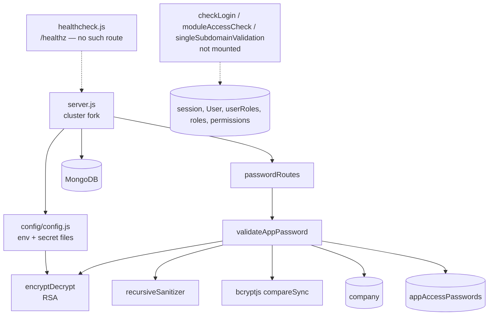

# appviewer_password_ms

Repository: `apps/appviewer_password_ms` (`/workspaces/kilo_inhouz_ai/apps/appviewer_password_ms`), a
separate git repository. All `file:line` citations are relative to that repository root.

## 1. Summary

`appviewer_password_ms` answers one question: does this password unlock this published app? It
exposes a single `POST /api/appviewerpassword/validatepassword` route. The caller sends an
RSA-encrypted payload containing `appId`, `assetOwnerCompanyId`, `password` and `environment`. The
service decrypts it, checks the payload expiry, confirms the company is active, loads the
`appAccessPasswords` row for that app/company/environment with `resetInProgress` not set, and runs
`bcrypt.compareSync` against the stored hash. It returns `{success: true}` or a `401`. It issues no
session, cookie or token, so it is a password check and not an authentication endpoint. The
repository is a copy of `micro_service_template`: 19 JavaScript files, of which the login, module
and subdomain middlewares are not mounted.

## 2. Stack and commands

- Runtime: Node `>=12.0.0 <17.5.0` (`package.json:6`); container `node:16.4-alpine`
  (`Dockerfile:1`).
- Framework: Express 4 + Mongoose 7 (`package.json:23,29`).
- Port: `PORT`, read directly (`server.js:78`); k8s sets it to `"5040"`
  (`k8s/appviewer-password-ms-deployment.yml:28-29`).
- Scripts, quoted from `package.json:7-10`:
  - `start` — `node server.js`.
  - `test` — `echo "Error: no test specified" && exit 1`.
- Container start: `CMD ["npm", "run", "start"]` (`Dockerfile:11`). No `HEALTHCHECK` instruction.
- Verification: no working test command exists. The practical check is a `POST` to the one route
  with a valid encrypted payload.

## 3. Entry points

| Entry point | Where | How it starts |
|---|---|---|
| Process entry | `server.js:1-95` | `node server.js` |
| Cluster master | `server.js:16-33` | Forks `os.cpus().length` workers in production, 1 otherwise (`server.js:17`); re-forks on exit (`server.js:22-33`) |
| Express app | `server.js:34-48` | One per worker |
| Middleware stack | `server.js:36-47` | `cors`, `bodyParser.json({limit: "20mb"})`, `hpp`, `helmet`, `cookieParser(sessionSecret)` |
| Route registration | `controller/password/passwordRoutes.js:3-5` | Called from `server.js:48` |
| `POST /api/appviewerpassword/validatepassword` | `passwordRoutes.js:4` → `services/password/validateAppPassword.js:8` | HTTP |
| Model preloading | `server.js:13-14` | Requires `company` and `appAccessPasswords` schemas at boot |
| Mongo connect + reconnect | `server.js:83-95`, retry timer `server.js:57-64` | Module load, 5000 ms retry |
| Graceful shutdown | `server.js:68-76` | `SIGINT`, `SIGTERM`, `uncaughtException` close Mongo |
| Health probe script | `healthcheck.js:1-21` | Standalone `node healthcheck.js`; requests `/healthz` |
| k8s deployment | `k8s/appviewer-password-ms-deployment.yml:4-17` | `appviewer-password-ms-deployment`, image `inhouz/appviewer_password_ms`, replicas 1 |
| k8s service | `k8s/appviewer-password-ms-cluster-ip-service.yml:4-11` | ClusterIP `appviewer-password-ms-cluster-ip-service`, port 5040 → 5040 |

No cron, queue, worker loop or migration. The only timer is the Mongo reconnect `setTimeout`
(`server.js:60`).

## 4. Module inventory

| Module | `file:line` | Responsibility | Public API | Kind |
|---|---|---|---|---|
| `server.js` | `server.js:1-95` | Cluster fork, Express wiring, Mongo lifecycle | starts the process | effectful (network, env, process) |
| `connectMongo` | `server.js:83-95` | Connects with `maxPoolSize: 1` | none | effectful (DB) |
| `config` | `config/config.js:18-48` | Cached env + secret-file reader | `() => object` | effectful (env, filesystem); memoised in module state |
| `readSecret` | `config/config.js:5-15` | Reads a secret file, falls back to an env var | `(name, envFallback) => string` | effectful (filesystem, env) |
| `passwordRoutes` | `controller/password/passwordRoutes.js:3-5` | Registers the single POST route | `(app) => void` | effectful (network) |
| `validateAppPassword` | `services/password/validateAppPassword.js:8-156` | Decrypt, validate, load company and password row, `bcrypt.compareSync` | Express handler | effectful (crypto, clock, DB, logging) |
| `encryptDecrypt` | `utils/cryptography/encryptDecrypt.js:3-17` | RSA decrypt/encrypt with the client private key | `(data, encrypt?) => string` | effectful (crypto); fails open, see §12 |
| `recursiveSanitizer` | `utils/sanitizer/recursiveSanitizer.js:3-17` | Walks the body and sanitises strings | `(element, sanitizer) => element` | effectful (mutates input in place); incorrect for nested values, see §12 |
| `createEditByObject` | `utils/user/createEditByObject.js:1-23` | Builds a `createdBy`/`editBy` sub-document from a user | `(user, deployDate) => object` | pure apart from the catch-block `console.log`; unused by the route |
| `getUser` | `utils/user/getUser.js:5-` | Loads a user with roles and permissions | `(userId) => object \| {error}` | effectful (DB); used only by the unmounted login middleware |
| `checkLogin` | `middlewares/login/checkLogin.js:9-` | Session + CSRF cookie check | Express middleware | effectful (cookies, DB, clock). **Not mounted.** |
| `moduleAccessCheck` | `middlewares/module/moduleAccessCheck.js:1-` | Module permission check | Express middleware | effectful (DB). **Not mounted.** |
| `singleSubdomainValidation` | `middlewares/subdomain/singleSubdomainValidation.js:1-` | Subdomain check | Express middleware | effectful. **Not mounted.** |
| `appAccessPasswords` model | `model/appBuilder/appAccessPasswords.js:5-48` | Password-hash schema, registered `:48` | Mongoose model | effectful (schema registration) |
| `company`, `user`, `useRoles`, `roles`, `permissions`, `session` models | see §7 | Shared account schemas | Mongoose models | effectful (schema registration) |

## 5. Side effects

| Effect | Where |
|---|---|
| Mongo connect, `maxPoolSize: 1`, one connection per cluster worker | `server.js:83-95`, forked at `server.js:16-20` |
| Mongo reconnect timer, 5000 ms | `server.js:57-64` |
| Mongo lifecycle logging | `server.js:54-67` |
| Mongo read `company` by `{_id, status: 'active'}` | `services/password/validateAppPassword.js:73-81` |
| Mongo read `appAccessPasswords` by `{appId, companyId, environment, resetInProgress}` | `services/password/validateAppPassword.js:99-111` |
| bcrypt compare (CPU-bound, synchronous) | `services/password/validateAppPassword.js:138` |
| RSA decrypt of the request body | `utils/cryptography/encryptDecrypt.js:10` |
| RSA private key construction at config load | `config/config.js:42-45` |
| Cookie parse middleware keyed by the session secret | `server.js:47` |
| Clock: `new Date().getTime()` for the payload expiry | `services/password/validateAppPassword.js:31` |
| Request body sanitisation | `services/password/validateAppPassword.js:10` |
| Env reads | `config/config.js:21-45`, `server.js:17,78` |
| Filesystem read of secret files | `config/config.js:5-15` |
| Logging: `console.log` / `console.error` | `server.js:23-32,55,58,66,79`, `validateAppPassword.js:79,109,149`, `encryptDecrypt.js:14` |
| Outbound HTTP from the service | none found |
| Health probe outbound `GET /healthz` | `healthcheck.js:10-14` |

## 6. State and state transitions

The service stores no state of its own; it only reads. The `resetInProgress` flag on
`appAccessPasswords` is the one field with a lifecycle, and it is owned by another service (the
password-reset flow), not by this one.

| From | Trigger | Guard | To | Evidence |
|---|---|---|---|---|
| `resetInProgress: false` or missing | a password-reset flow starts (outside this repo) | not in this code | `resetInProgress: true` | schema at `model/appBuilder/appAccessPasswords.js:23-26` |
| `resetInProgress: true` | this route is called | query filters `{$in: [false, null]}` | row is invisible, request answers 401 | `validateAppPassword.js:103-105,121-127` |

Request-level decision flow:

| From | Trigger | Guard | To | Evidence |
|---|---|---|---|---|
| Request | body parsed | `encryptedData` non-empty string | decrypt | `validateAppPassword.js:11-24` |
| Decrypt | payload JSON parses | `now <= expirationTimestamp` | validate fields | `validateAppPassword.js:28-35` |
| Validate | `data` is an object | `appId`, `assetOwnerCompanyId` are valid ObjectIds; `password`, `environment` non-empty | load company | `validateAppPassword.js:45-67` |
| Company | row found | `status: 'active'` | load password row | `validateAppPassword.js:73-97` |
| Password row | row found | `passwordHash` non-empty | bcrypt compare | `validateAppPassword.js:99-136` |
| Compare | hash matches | — | `200 {success: true}` | `validateAppPassword.js:138-140` |
| Compare | hash differs | — | `401 Not Authorized.` | `validateAppPassword.js:141-147` |

## 7. Data

| Model file | Registered at | Collection (env → name) | Access |
|---|---|---|---|
| `model/appBuilder/appAccessPasswords.js` | `:48` | `APP_ACCESS_PASSWORD_MODEL` → `appAccessPasswords` | read only |
| `model/company/company.js` | `:108` | `COMPANY_MODEL` → `company` | read only |
| `model/user/user.js` | `:107` | `USER_MODEL` → `User` | schema only |
| `model/user/useRoles.js` | `:51` | `USER_ROLES_MODEL` → `userRoles` | schema only |
| `model/rolesAndPermissions/roles.js` | `:87` | `ROLE_MODEL` → `roles` | schema only |
| `model/rolesAndPermissions/permissions.js` | `:89` | `PERMISSION_MODEL` → `permissions` | schema only |
| `model/session/session.js` | `:28` | `SESSION_MODEL` → `session` | schema only (used by unmounted middleware) |

`appAccessPasswords` (the only collection this service reads for its decision):

- `appId` — String, required (`appAccessPasswords.js:6-9`).
- `companyId` — String, required (`:10-13`). This is the asset-owner company, not the caller.
- `environment` — String, required, enum `development | test | production` (`:14-18`).
- `passwordHash` — String, required (`:19-22`). No format check; `bcrypt.compareSync` is the only
  consumer, so a non-bcrypt value simply never matches.
- `resetInProgress` — Boolean, default `false` (`:23-26`).
- `createdDate` — Number, required (`:27-30`); `createdById` — String, required (`:31-34`);
  `updatedById`, `editDate` optional.
- Options: `strict: true`, `useNestedStrict: true`, `timestamps: true` (`:37-41`).
- Index on `{editDate, appId, companyId, environment}` (`:43-46`). The read query filters on
  `appId + companyId + environment + resetInProgress`, so `resetInProgress` is not indexed.
- No unique index on `{appId, companyId, environment}`. Two rows for the same triple are possible;
  `findOne` then makes the result depend on natural order.

`company` is read with `{_id, status: 'active'}` and only `{error}`/null is inspected
(`validateAppPassword.js:73-97`), so the company document's other fields do not matter here.

Shared collections (coupling not inferable from this repo): `appAccessPasswords` is written by the
app-builder/password-reset flow, and `company` is the account collection shared across the Inhouz
services. The `user`, `role`, `permission` and `session` schemas mirror the auth service's
collections and are registered only because the template's middleware is present.

## 8. Public interfaces

`POST /api/appviewerpassword/validatepassword` (`passwordRoutes.js:4`).

- Request body: `{ encryptedData: string }`.
- Decrypted plaintext: `{ expirationTimestamp: number, payload: { appId: string,
  assetOwnerCompanyId: string, password: string, environment: string } }`.
- Responses:
  - `200 {success: true}` — password matched (`validateAppPassword.js:140`).
  - `400 {error: {message: 'Invalid request. Required fields are missing.'}}` — missing
    `encryptedData` (`:19-24`), unparseable/expired payload (`:38-43`).
  - `401 {error: {message: 'Not Authorized'}}` — malformed or missing fields after decrypt
    (`:62-67`).
  - `401 {error: {message: 'Not Authorized.'}}` — company not found/inactive (`:91-97`), password
    row not found (`:121-127`), password mismatch (`:141-147`).
  - `500 {error: {message: 'An error occured in the authentication process.'}}` — Mongo error on
    either read (`:83-89`, `:113-119`), missing `passwordHash` (`:130-136`), or any throw
    (`:148-155`).
- Response headers carry no `Set-Cookie`. The route issues no token, so a caller must already hold
  whatever credential it uses to reach the app.
- No CLI, queue topic or event handler.

## 9. Configuration

Env var names read in code: `PORT`, `NODE_ENV`, `SECRETS_PATH`, `MONGO_URL`, `SESSION_SECRET`,
`CLIENT_SECRET_KEY`, `SENDGRID_API_KEY`, `SMPL_EMAIL`, `COOKIE_DOMAIN`, `APP_ACCESS_PASSWORD_MODEL`,
`USER_MODEL`, `COMPANY_MODEL`, `ROLE_MODEL`, `PERMISSION_MODEL`, `USER_ROLES_MODEL`, `SESSION_MODEL`,
`SESSION_VALIDATOR_MODEL`, `AUTH_LOG_MODEL`, `FLEX_FORM_FILE_MODEL`, `FLEX_MODULE_MODEL`,
`FLEX_COLLECTION_MODEL`, `FORM_MODEL`, `DATA_RULE_EXECUTION_RESULT_MODEL`
(`config/config.js:21-45`, `server.js:17,78`).

Secret file names read from `SECRETS_PATH`: `sendgridapikey`, `sessionsecret`, `mongourl`,
`clientsecretkey` (`config/config.js:25-44`). Config files: `.env` via `dotenv` (`server.js:1`);
no `.env.example` exists.

k8s sets additional names that no code reads: `OPEN_EXCHANGE_RATES_API_KEY`,
`OPEN_EXCHANGE_RATES_BASE_URL`, `STRIPE_API_KEY`, `PAYMENT_MS_URL`, `IP_LOCATION_FINDER_URL`,
`INHOUZ_FROM_EMAIL`, plus about 15 payment/subscription model names
(`k8s/appviewer-password-ms-deployment.yml:28-`). The deployment also sets `COOKIE_NAME` and
`SUBSCRIPTION_USAGE_LOG`, neither of which this repository reads; `COOKIE_DOMAIN` is set there as a
literal, and its value is not reproduced here.

## 10. Dependencies

Direct only (`package.json:13-35`):

- `express`, `body-parser`, `cookie-parser`, `cors`, `helmet`, `hpp` — the HTTP pipeline.
- `mongoose` — the schemas and both reads.
- `bcryptjs` — `compareSync` against `passwordHash` (`validateAppPassword.js:3,138`).
- `node-rsa` — the request-payload key (`config/config.js:1,42-45`).
- `sanitizer` — body sanitisation before decryption.
- `lodash` — `isObject` / `isArray` in the sanitiser and `isEmpty` in the unmounted middleware.
- `cryptr` — used only by the unmounted `checkLogin` middleware.
- `moment` — used only by the unmounted `checkLogin` middleware.
- `dotenv` — loads `.env` at boot.
- `validator` — field validation inside the role and permission schemas.
- Declared but never `require`d here: `@sendgrid/mail`, `connect-mongo`, `crypto-js`,
  `express-session`, `request-ip`, `shortid`.

## 11. Testing

- `npm test` is `echo "Error: no test specified" && exit 1` (`package.json:8`). No test runner, no
  test file, no CI test step.
- Nothing is covered. In particular the bcrypt comparison, the environment enum match, the
  `resetInProgress` filter and the expiry rule have no automated check.
- `healthcheck.js` is the only executable check, and it probes a route that does not exist (§12).

## 12. Known issues and risks

- **No authentication on a password-check endpoint.** The route takes `appId` and
  `assetOwnerCompanyId` from the caller and returns whether a password matches
  (`validateAppPassword.js:45-67,138-147`). There is no rate limit, no attempt counter, no lockout
  and no CAPTCHA, so it is an offline-speed password oracle for any app whose ids are known.
- **No session issued.** A successful check returns `{success: true}` and nothing else
  (`:140`). Whether the caller can then reach the app depends entirely on client-side state, which
  is outside this repository.
- **Synchronous bcrypt blocks the event loop.** `bcrypt.compareSync` (`:138`) runs on the request
  thread. With `maxPoolSize: 1` and one worker per CPU, a burst of login attempts stalls every other
  request in that worker.
- **`environment` is caller-supplied and only type-checked.** The handler checks it is a string
  (`:58`) and passes it straight into the query (`:102`). The schema enum
  (`appAccessPasswords.js:17`) constrains stored data, not the query, so an arbitrary string simply
  finds nothing.
- **No unique index on the lookup triple.** `{appId, companyId, environment}` can have duplicate
  rows; `findOne` picks whichever Mongo returns first (`validateAppPassword.js:99-107`).
- **RSA decryption fails open.** `encryptDecrypt` returns the input on any error
  (`utils/cryptography/encryptDecrypt.js:13-16`), so a malformed payload reaches `JSON.parse` and
  becomes a 500 rather than a 400/401. Error classification therefore leaks whether decryption or
  parsing failed.
- **Same fail-open helper is used by `checkLogin`** (`middlewares/login/checkLogin.js:7`), so the
  pattern would spread if that middleware were ever mounted.
- **Sanitiser does not sanitise nested values.** `recursiveSanitizer` assigns the sanitised value to
  a local variable after recursing (`utils/sanitizer/recursiveSanitizer.js:5-14`) and omits the
  `sanitizer` argument in the array branch (`:10`), so `req.body` is effectively unsanitised.
- **Unmounted middleware and unused helpers.** `checkLogin`, `moduleAccessCheck`,
  `singleSubdomainValidation`, `getUser` and `createEditByObject` exist but nothing mounts or calls
  them except each other (`server.js:34-48` has no reference). They register the `session`, `user`,
  `role` and `permission` models against collections owned by other services, which is schema drift
  waiting to happen.
- **`/healthz` does not exist.** `healthcheck.js:7` probes `/healthz`; the only route is the
  password route (`passwordRoutes.js:4`). Adding the `HEALTHCHECK` the comment describes would mark
  every container unhealthy. The Dockerfile currently has none (`Dockerfile:1-11`).
- **Hardcoded dev CORS origin.** `origin: /inhouz.localhost/` (`server.js:38`).
- **Cluster multiplies Mongo connections.** Each forked worker opens its own `maxPoolSize: 1`
  connection (`server.js:16-20,91`).
- **`uncaughtException` only closes Mongo** (`server.js:71-76`); the process keeps serving in an
  undefined state.
- **Node 16 is out of support** (`Dockerfile:1`, `package.json:6`), and `mongoose@7` needs Node 14+,
  so the declared engine floor of 12 is wrong.
- No credential literal was found in the JavaScript source: `grep` for `sk_live`, `sk_test`, `SG.`,
  `AKIA`, `mongodb://` URIs and bcrypt hashes (`$2a$`/`$2b$`) across the repo returned nothing. The
  bcrypt hash is read from `appAccessPasswords.passwordHash` at runtime.

## 13. Module map

## 14. Open questions

- Who calls this route? The brief reports "called by: none found". The caller is presumably the app
  viewer's password gate, which lives in `app_viewer_ms` or in the browser bundle; neither is in this
  repository.
- Which service writes `appAccessPasswords`, and when `resetInProgress` is set and cleared, is not
  in this repository. The reset flow is the other half of this collection's lifecycle.
- Whether a caller is supposed to get any credential after `{success: true}` could not be
  determined. As written the answer is no.
- The deployment's `SUBSCRIPTION_USAGE_LOG`, `COOKIE_NAME`, `STRIPE_API_KEY` and payment model
  variables are unread here; whether another process in the same image uses them is not determined.
  The image runs only `server.js`.
- Skipped and why:
  - `model/company/company.js`, `model/user/user.js`, `model/user/useRoles.js`,
    `model/rolesAndPermissions/roles.js`, `model/rolesAndPermissions/permissions.js`,
    `model/session/session.js` were not read. Only their registration lines matter here, because the
    route never queries them.
  - `middlewares/login/checkLogin.js` was read only for its first 40 lines; it is not mounted.
    `middlewares/module/moduleAccessCheck.js` and
    `middlewares/subdomain/singleSubdomainValidation.js` were not read at all.
  - `utils/user/getUser.js` was read only at its head; it is called only by the unmounted
    middleware.
  - `.env` was not read. Only env var names belong in this document.
  - The k8s deployment's literal config values (`COOKIE_DOMAIN` and the model names) were not
    reproduced; only the key names are recorded.
