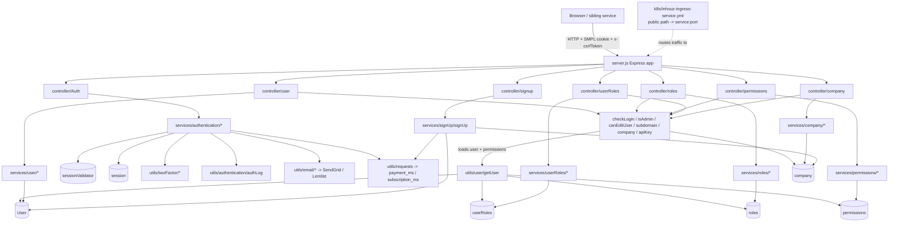

# authentication_ms

## 1. Summary

`authentication_ms` is the identity and authorization service for the Inhouz platform. It owns the
login/logout/two-factor/password flows, the server-side session record and its sliding expiry, the
company (tenant) record, users, roles, permissions, user-role assignment, API-key rotation, a small
"who am I" endpoint, and company self-signup. Every other microservice that needs to know "is this
caller logged in, and what may they do" reads the Mongo collections this service writes. The
service also ships the cluster's shared nginx ingress manifest, so it is the de-facto owner of the
public host-to-service path map. It lives in its own git repository at
`apps/authentication_ms/` (repo id `authentication_ms` in `.kilo/repos.json`), not in the control
repo; every path in this file is relative to that repository root.

## 2. Stack and commands

Node.js. `package.json:5-7` pins `engines.node` to `>=12.0.0 <17.5.0`; the Docker image is
`node:16.4-alpine` (`Dockerfile:1`) and runs `npm run start` (`Dockerfile:11`).

`package.json:8-11` declares exactly two scripts:

- `start` → `node server.js`
- `test` → `echo "Error: no test specified" && exit 1` (there is no test suite)

There is no build step, no TypeScript, no linter config, and no lockfile in the repository; the only
manifest is `package.json`.

Port: `server.js:101` listens on `process.env.PORT`. The k8s Service exposes
`authentication-ms-cluster-ip-service` as ClusterIP on port `5002`, targetPort `5002`
(`k8s/authentication-ms-cluster-ip-service.yml:4-11`). The Deployment runs image
`inhouz/authentication_ms` with `replicas: 1` (`k8s/authentication-ms-deployment.yml:6,17`).
`PORT` has no literal value in the manifest; it is injected from the environment.

Verification command: none exists. `npm test` always exits 1 by design.

## 3. Entry points

| Entry point | Where | How it starts |
|---|---|---|
| HTTP server bootstrap | `server.js:50-104` | `node server.js` (`package.json:10`), which the Docker image runs (`Dockerfile:11`) |
| Cluster master fork loop | `server.js:32-49` | Always taken when the module is loaded as master; forks `os.cpus().length` workers in production, `1` otherwise (`server.js:33`) |
| Express app assembly | `server.js:51-71` | Runs inside each forked worker |
| Route registration | `server.js:65-71` | Six `require(...)(app)` calls, one per route module |
| `app.listen` | `server.js:101` | Last statement of the worker branch |
| Mongo connect | `server.js:106-117` (called at `:74`, retried at `:83-85`) | Module load; also re-called every 5 s after a disconnect |
| Graceful shutdown | `server.js:91-99` | `SIGINT`, `SIGTERM`, `uncaughtException` → closes the Mongo connection only |
| Health probe script | `healthcheck.js:1-21` | Standalone script, not referenced by `package.json` or the `Dockerfile`; it probes `GET /healthz` (`healthcheck.js:7`) which **no route registers** |
| Migration / cron / job | none | The only timer is the Mongo reconnect `setTimeout` at `server.js:83` |

The HTTP surface is 32 routes, registered in seven modules. The per-route auth model is in §8.

## 4. Module inventory

Kind is `pure` (no I/O), `reactive` (reads/writes shared state) or `effectful` (DB, network, FS,
env, clock, randomness, logging). Almost everything here is effectful because the handlers go
straight to Mongo.

| Module | `file:line` | Owns | Public API | Kind |
|---|---|---|---|---|
| server bootstrap | `server.js:1-118` | Cluster fork, Express middleware stack, Mongo connection, shutdown | process entry | effectful |
| config loader | `config/config.js:19-82` | Cached config object; secret files read from `SECRETS_PATH` with env fallback | `module.exports() -> object` | effectful (FS, env, RSA key parse) |
| auth controller | `controller/Auth/authController.js:11-20` | 8 auth routes | `module.exports(app)` | reactive (route table) |
| company controller | `controller/company/companyRoutes.js:8-9` | 2 company routes | `module.exports(app)` | reactive |
| permissions controller | `controller/permissions/permissonRoutes.js:12-16` | 5 permission routes | `module.exports(app)` | reactive |
| roles controller | `controller/roles/roleRoutes.js:12-16` | 5 role routes | `module.exports(app)` | reactive |
| signup controller | `controller/signup/signUpController.js:4` | 1 company-registration route | `module.exports(app)` | reactive |
| user controller | `controller/user/userRoutes.js:16-22` | 7 user/session routes | `module.exports(app)` | reactive |
| userRoles controller | `controller/userRoles/userRolesRoute.js:12-15` | 4 user-role routes | `module.exports(app)` | reactive |
| `checkLogin` | `middlewares/login/checkLogin.js:9-168` | Session cookie/token validation, sliding expiry, `req.user`, `req.company`, response cookies | `(req,res,next)` | effectful (Mongo read+write, clock, logging) |
| `isAdmin` | `middlewares/permissions/isAdmin.js:3-23` | Requires `req.user.permissions` to contain `admin` | `(req,res,next)` | pure decision over `req` (no I/O) |
| `canEditUser` | `middlewares/permissions/canEditUser.js:5-39` | Admin, or the caller editing their own record, within the same company | `(req,res,next)` | pure decision over `req` |
| `companyAccountCheck` | `middlewares/company/companyAccountCheck.js:1-28` | Company status must be `active` | `(req,res,next)` | pure decision (logging on error) |
| `singleSubdomainValidation` | `middlewares/subdomain/singleSubdomainValidation.js:1-27` | Request subdomain must equal `req.user.subDomain` (or be empty/`www`) | `(req,res,next)` | pure decision |
| `apiKeyValidation` | `middlewares/apiKey/apiKeyValidation.js:7-…` | Decrypts `X-SE-API-KEY`/`X-CE-API-KEY`, validates expiry and payload, loads a system user | `(req,res,next)` | effectful (crypto, Mongo via `getSystemUser`) |
| `resolveEncryptedAutomationPayload` | `middlewares/automation/resolveEncryptedAutomationPayload.js:1-…` | Decrypts automation payload with `cryptr` | `(req,res,next)` | effectful (crypto) |
| `moduleAccessCheck` | `middlewares/module/moduleAccessCheck.js:7-…` | Compares `moduleName` suffix to company id, loads the flex module, checks `restrictedAccess` | `(req,res,next)` | effectful (Mongo) |
| `webLogin` | `services/authentication/webLogin.js:16-381` | Full login: sanitize, email lookup, password match, lock/2FA branches, one-session policy, cookie issue | `(req,res)` | effectful |
| `webLogOut` | `services/authentication/webLogOut.js:1-…` | Deletes the session, clears cookies | `(req,res)` | effectful |
| `validateTwoFactor` | `services/authentication/validateTwoFactor.js:1-…` | Verifies the 2FA code, promotes the IP/device, creates the session | `(req,res)` | effectful |
| `resendTwoFactor` | `services/authentication/resendTwoFactor.js:1-…` | Re-sends the 2FA code | `(req,res)` | effectful |
| `forgotPassword` | `services/authentication/forgotPassword.js:1-…` | Issues a reset token, marks `passwordChangeInProgress` | `(req,res)` | effectful |
| `changePassword` | `services/authentication/changePassword.js:1-…` | Consumes the reset token, rewrites the hash, invalidates sessions | `(req,res)` | effectful |
| `getLoggedInUser` | `services/authentication/getLoggedInUser.js:1-…` | Returns the caller profile; uses `aws-sdk` S3 (`:1`, `:6`) | `(req,res)` | effectful |
| `checkSubDomainAvailability` | `services/authentication/checkSubDomainAvailability.js:1-…` | Subdomain uniqueness check against `company` | `(req,res)` | effectful |
| `getUser` | `utils/user/getUser.js:5-…` | Loads user, user-roles, role, permissions; returns the identity + `permissions[]` used by `isAdmin` | `(userId) -> object` | effectful (Mongo) |
| session services | `services/sessions/getSessions.js`, `services/sessions/endSession.js:8-…` | Paged session list; force-terminate a user's session | `(req,res)` | effectful |
| user services | `services/user/addUsers.js`, `editUser.js`, `getApiKey.js`, `changeApiKey.js`, `getCompanyMembers.js` | Company member CRUD and API-key rotation | `(req,res)` | effectful |
| role services | `services/roles/{create,edit,delete,get}Role*.js` | Role CRUD | `(req,res)` | effectful |
| permission services | `services/permissions/{create,edit,delete,get}Permission*.js` | Permission CRUD | `(req,res)` | effectful |
| userRole services | `services/userRoles/{update,getUsers,getUser}*.js` | Role assignment and the role+permission view | `(req,res)` | effectful |
| company services | `services/company/getCompanyInfo.js`, `updateCompanyInfo.js` | Tenant read/update | `(req,res)` | effectful |
| signUp | `services/signUp/signUp.js:1-…` | Company + owner-user + roles + subscription provisioning | `(req,res)` | effectful |
| outbound HTTP helpers | `utils/requests/getRequest.js:1`, `postRequest.js:1`, `deleteRequest.js:1` | `node-fetch` wrappers | `(url, …) -> Promise` | effectful |
| auth log | `utils/authentication/authLog/authLog.js` | Writes `authenticationLogs` per attempt | function | effectful |
| two-factor helpers | `utils/twoFactor/twoFactorWorkflow.js:9-…`, `utils/twoFactor/evaluateTwoFactor.js` | Send/verify 2FA, decide whether it is required | function | effectful |
| email helpers | `utils/email/**` | SendGrid mail (`utils/email/sendEmail/sendEmail.js:1`), Lemlist lead push (`utils/email/signup/sendAccountCreationSuccessEmail.js:66`) | function | effectful |
| sanitizer | `utils/sanitizer/recursiveSanitizer.js` | Recursively sanitizes request bodies | `(value, sanitizer) -> value` | pure |

## 5. Side effects

**MongoDB** (the dominant effect):
- Connect with `maxPoolSize: 1`: `server.js:107-117`; reconnect timer `server.js:83`.
- Session read/write in `checkLogin`: `middlewares/login/checkLogin.js:28`, `:86-95`.
- Session create/delete in login: `services/authentication/webLogin.js:268`, `:311-321`.
- Session delete on logout/force-end: `services/authentication/webLogOut.js:19`,
  `services/sessions/endSession.js:24-27`.
- User/role/permission resolution: `utils/user/getUser.js:19,45,85,119`.
- Company read inside auth: `middlewares/login/checkLogin.js:108-122`.
- Signup writes company, user, roles, subscription: `services/signUp/signUp.js` (e.g. `:537`).
- Auth attempt audit trail: `services/authentication/webLogin.js:29,61,126,339`.

**Outbound HTTP** (`node-fetch` wrappers `utils/requests/*.js:1`):
- Payment service: `PAYMENT_MS_URL` → `payment-ms-cluster-ip-service:5014`
  (`config/config.js:61`, `k8s/authentication-ms-deployment.yml:168`); called from
  `services/signUp/signUp.js:616` (payment-method creation) and
  `services/user/addUsers.js:342` (new-user billing).
- Inhouz subscription service: `INHOUZ_SUBSCRIPTION_MS_URL` →
  `inhouz-subscription-ms-cluster-ip-service:5041` (`config/config.js:62`,
  `k8s/authentication-ms-deployment.yml:170`); called from `services/signUp/signUp.js:537`.
- Subscription renewal service: `INHOUZ_SUBSCRIPTION_RENEWAL_MS_URL` →
  `inhouz-subscription-renewal-ms-cluster-ip-service:5044` (`config/config.js:67`,
  `k8s/authentication-ms-deployment.yml:172`).
- SendGrid send API: `https://api.sendgrid.com/v3/mail/send` (`config/config.js:74`), used by
  `utils/email/signup/sendAccountCreationSuccessEmail.js:54`.
- Lemlist campaign API: `https://api.lemlist.com/api/campaigns/<id>/leads/<email>`
  (`utils/email/signup/sendAccountCreationSuccessEmail.js:66`).

**AWS S3**: `aws-sdk` client constructed in `services/authentication/getLoggedInUser.js:1,6` to
sign image URLs; keys from `config/config.js:68-70`.

**Filesystem**: secret files read at `config/config.js:11` from `SECRETS_PATH` (default
`/mnt/secrets`).

**Clock**: `new Date().getTime()` for session expiry (`middlewares/login/checkLogin.js:26`,
`services/authentication/webLogin.js:135`), `moment().add(60,'minutes')` for sliding expiry
(`checkLogin.js:85`, `webLogin.js:262`).

**Randomness**: `new mongoose.Types.ObjectId().toHexString()` as CSRF token
(`services/authentication/webLogin.js:263`); `shortid` in `services/user/addUsers.js:7`,
`services/sessions/endSession.js:4`.

**Crypto**: `cryptr` with `SESSION_SECRET` for the session cookie / CSRF cookie
(`checkLogin.js:23`, `webLogin.js:136,344,352`); `node-rsa` for the client key pair
(`config/config.js:49-60`); `bcryptjs` password hashing (`services/signUp/signUp.js:11`,
`services/user/addUsers.js:13`).

**Logging**: `console.log` on startup, Mongo events, shutdown and error paths
(`server.js:39,47,78,81,89,102`; `checkLogin.js:161`; `webLogin.js:374`; middleware catch blocks).

## 6. State and state transitions

Two state machines. Both live in Mongo; there is no in-process state.

### 6.1 Session lifecycle (`session` collection)

| State | Meaning | Guard |
|---|---|---|
| absent | no session document for `userId` | `findOne({userId})` returns null (`webLogin.js:233`) |
| active | `expirationTimestamp > now` | `checkLogin.js:65-73` |
| expired | `expirationTimestamp <= now` | same comparison, inverted |

| From | To | Trigger | Guard |
|---|---|---|---|
| absent | active | successful login with password (+2FA already satisfied) | `webLogin.js:264-291` |
| active | rejected (no transition) | second login for the same user | `userSession.expirationTimestamp > dateStamp` (`webLogin.js:296-309`) — one session per user |
| expired | active | login after expiry: `deleteMany({userId})` then `create` | `webLogin.js:310-336` |
| active | active (extended) | any authenticated request | `checkLogin.js:85-107` sets expiry to now+60 min |
| active | absent | logout, admin force-end, password change | `webLogOut.js:19`, `endSession.js:24`, `changePassword.js:99` |

The comment "one user one session only" (`model/session/session.js:16`) is a policy enforced in
code, not by a unique index (§12).

### 6.2 Account / two-factor state (`sessionValidator` collection, one doc per user+company)

Fields: `twoFactorRequired` (default `true`, `model/session/sessionValidator.js:24-27`),
`twoFactorExpirationTimestamp`, `accountLocked` (default `false`, `:29-32`),
`accountReOpenTimestamp`, `passwordChangeInProgress` (default `false`, `:39-42`),
`unprovenIpAddresses`, `approvedIpAddresses`, `approvedDeviceIdList`, `twoFactorAttempts`.

Login decision order (`services/authentication/webLogin.js`):

| # | Condition | Outcome | Line |
|---|---|---|---|
| 1 | no validator doc | password check → `twoFactorWorkflow` (first-time enrollment path) | `:109-134` |
| 2 | `passwordChangeInProgress` | 403 "Password reset is in progress." | `:143-149` |
| 3 | `accountLocked` and `accountReOpenTimestamp > now` | 403 with the reopen time | `:151-165` |
| 4 | `accountLocked` and reopen time passed | password check → `twoFactorWorkflow` (lock released by time) | `:166-182` |
| 5 | `twoFactorRequired` and `twoFactorExpirationTimestamp > now` | return encrypted validator id + `twoFactorRequired: true` | `:185-205` |
| 6 | `twoFactorRequired` and window passed | re-run `twoFactorWorkflow` | `:206-209` |
| 7 | password mismatch | 401 "Not Authorized" | `:212-223` |
| 8 | password match, 2FA still required by IP/device evaluation | return `twoFactorRequired` + encrypted validator id | `:225-231` |
| 9 | password match, 2FA satisfied | create/replace session, set cookies | `:232-370` |

Transitions: unlocked → locked is set on failed 2FA attempts (written by
`validateTwoFactor.js` / `twoFactorWorkflow.js`, not read here); locked → unlocked happens
implicitly when `accountReOpenTimestamp` passes (`webLogin.js:166`) — nothing clears the flag in
this repository. 2FA-satisfied is per IP and per device (`sessionValidator.js:16-46`).

## 7. Data

Collection names are **not** hard-coded: each model registers
`mongoose.model(config.xModel, schema, config.xModel)` (`model/session/session.js:37`), so the
collection name is the value of the env var. The mapping below is the extraction pass's reading of
the manifests, not verified against a live database.

| Model var | Collection (per brief) | Schema file | Key fields and rules |
|---|---|---|---|
| `SESSION_MODEL` | `session` | `model/session/session.js:5-35` | `ipAddress` (req, index), `companyId` (req, index), `userId` (req, index), `beginTimeStamp` (req), `expirationTimestamp` (req), `csrfToken` (req); `timestamps: true` |
| `SESSION_VALIDATOR_MODEL` | `sessionValidator` | `model/session/sessionValidator.js:5-54` | `userId`+`companyId` required; `twoFactorRequired` default true; `accountLocked` default false; `passwordChangeInProgress` default false; arrays for IPs, devices, attempts; compound index `:51-54` |
| `USER_MODEL` | `User` | `model/user/user.js:6-137` | `userType` enum `enterprise/nonEnterprise/thirdParty`; `email` lowercased, trimmed, `validator.isEmail`; `companyId` req+index; `key` unique+required; `passwordHash` required; `active` default true |
| `COMPANY_MODEL` | `company` | `model/company/company.js:5-…` | tenant record; `status`, `subDomain`, `companyType`, `logoUrl` read by auth (`checkLogin.js:113-121`) |
| `ROLE_MODEL` | `roles` | `model/rolesAndPermissions/roles.js:6-91` | role doc per company |
| `PERMISSION_MODEL` | `permissions` | `model/rolesAndPermissions/permissions.js:6-89` | permission doc; `admin` is the privileged name (`config/config.js:43`) |
| `USER_ROLES_MODEL` | `userRoles` | `model/user/useRoles.js:6-46` | user → role link; read by `getUser` (`utils/user/getUser.js:45`) |
| `AUTH_LOG_MODEL` | `authenticationLogs` | `model/session/authLogs.js:5-33` | one row per login attempt |
| `SUBSCRIBER_MODEL` | `subscribers` | `model/subscription/subscriber.js:6-71` | billing subscriber |
| `WEB_COMPONENT_ACCESS_LOG_MODEL` | `webComponentAccessLogs` | `model/webComponent/webComponentAccessLog.js:5-36` | component access audit |
| `WEB_COMPONENT_ACCESS_TRACKER` | (n/a, value only) | `model/webComponent/webComponentAccessTracker.js:5-22` | per-user component tracker |
| `INHOUZ_SUBSCRIPTIONS_MODEL` | `inhouzSubscriptions` | `model/inhouzSubscription/inhouzSubscription.js:5-250` | platform subscription |
| `INHOUZ_USER_LICENSE_MODEL` | `inhouzUserLicenses` | `model/inhouzSubscription/inhouzUserLicense.js:6-38` | per-user license |
| `INHOUZ_SIGNUP_PROMO_CODE_MODEL` | `inhouzSignupPromoCodes` | `model/inhouzSubscription/inhouzSignupPromoCode.js:5-38` | promo code |
| `INHOUZ_SIGNUP_PROMO_USAGE_LOG_MODEL` | `inhouzSignupPromoCodeUsageLogs` | `model/inhouzSubscription/inhouzSignupPromoUsageLog.js:5-33` | promo redemption |
| `STATIC_BASE64_FILE_MODEL` | `staticBase64Files` | `model/staticFiles/staticBase64File.js:5-18` | inline asset store |
| `SYSTEM_USER_MODEL` | `systmeUsers` (spelling as extracted) | `model/system/systemUser.js:6-63` | machine identity used by `apiKeyValidation` |
| `QUERY_KEY_TRACKER_MODEL` | `queryKeyTracker` | `model/queryTracker/queryKeyTracker.js:5-21` | API-key usage |

**Shared collections (the cross-service coupling).** Every service in the cluster that points at
the same `MONGO_URL` and the same `USER_MODEL` / `SESSION_MODEL` / `ROLE_MODEL` /
`PERMISSION_MODEL` / `USER_ROLES_MODEL` / `SESSION_VALIDATOR_MODEL` value reads and writes the same
documents. Downstream services do not call this API for authorization; they read these collections
directly. Evidence for the mechanism: `config/config.js:33-41` (names are env-driven) and
`model/session/session.js:37` (collection name = config value). The concrete list of sibling
services that share each collection cannot be derived from this repository — see §14.

## 8. Public interfaces

### 8.1 Routes and their auth model

`checkLogin` = `middlewares/login/checkLogin.js`; `admin` = `middlewares/permissions/isAdmin.js`;
`company` = `companyAccountCheck.js`; `subdomain` = `singleSubdomainValidation.js`;
`apiKey` = `apiKeyValidation.js`; `canEdit` = `canEditUser.js`.

| Method | Path | Middleware chain | File:line |
|---|---|---|---|
| POST | `/api/authentication/login` | **none** | `controller/Auth/authController.js:12` |
| POST | `/api/authentication/logout` | **none** | `:13` |
| POST | `/api/authentication/validatetwofactor` | **none** | `:14` |
| POST | `/api/authentication/resendtwofactor` | **none** | `:15` |
| POST | `/api/authentication/forgotpassword` | **none** | `:16` |
| POST | `/api/authentication/changepassword` | **none** | `:17` |
| POST | `/api/authentication/checksubdomainavailability` | **none** | `:18` |
| GET | `/api/authentication/getloggedinuser` | checkLogin | `:19` |
| POST | `/api/authentication/registercompany` | **none** | `controller/signup/signUpController.js:4` |
| POST | `/api/company/update` | checkLogin + subdomain + admin | `controller/company/companyRoutes.js:8` |
| GET | `/api/company/get` | checkLogin + subdomain + admin | `:9` |
| POST | `/api/permissions/create` | checkLogin + company + subdomain + admin | `controller/permissions/permissonRoutes.js:12` |
| POST | `/api/permissions/edit` | checkLogin + company + subdomain + admin | `:13` |
| POST | `/api/permissions/delete` | checkLogin + subdomain + admin | `:14` |
| POST | `/api/permissions/getpermissions` | checkLogin + subdomain (no admin) | `:15` |
| GET | `/api/permissions/getpermission/:permissionId` | checkLogin + subdomain (no admin) | `:16` |
| POST | `/api/roles/create` | checkLogin + company + subdomain + admin | `controller/roles/roleRoutes.js:12` |
| POST | `/api/roles/edit` | checkLogin + company + subdomain + admin | `:13` |
| POST | `/api/roles/delete` | checkLogin + subdomain + admin | `:14` |
| POST | `/api/roles/getroles` | checkLogin + subdomain (no admin) | `:15` |
| GET | `/api/roles/getrole/:roleId` | checkLogin + subdomain (no admin) | `:16` |
| POST | `/api/users/addusers` | apiKey + checkLogin + company + subdomain + admin | `controller/user/userRoutes.js:16` |
| POST | `/api/users/edituser` | checkLogin + company + subdomain + canEdit | `:17` |
| GET | `/api/users/getapikey` | checkLogin + company + subdomain (no admin) | `:18` |
| POST | `/api/users/changeapikey` | checkLogin + company + subdomain (no admin) | `:19` |
| GET | `/api/users/getcompanymembers` | checkLogin only | `:20` |
| GET | `/api/users/getsessions/:skip/:limit` | checkLogin + subdomain + admin | `:21` |
| POST | `/api/users/endsession` | checkLogin + subdomain + admin | `:22` |
| POST | `/api/userroles/updateuserroles` | checkLogin + company + subdomain + admin | `controller/userRoles/userRolesRoute.js:12` |
| POST | `/api/userroles/automateupdateuserroles` | apiKey + admin + resolveEncryptedPayload | `:13` |
| POST | `/api/userroles/getusersroles` | checkLogin + subdomain | `:14` |
| POST | `/api/userroles/getuserroles` | checkLogin + subdomain | `:15` |

There is **no per-permission check** anywhere except `isAdmin`'s `permissions.includes("admin")`
(`middlewares/permissions/isAdmin.js:8`). No route checks a granular permission name.

### 8.2 Request/response shapes

- Login request: `{ email, password, rememberDevice? }` (`webLogin.js:19-21`). Success:
  `{ success: true }` plus `Set-Cookie: SMPL` (HttpOnly, encrypted session id), `x-java`
  (encrypted CSRF token), `sessionExpirationTimestamp` (`webLogin.js:344-369`). Failure: HTTP 401
  or 403 with `{ error: { message } }`; the "account in use" case returns HTTP 200 with an
  `error` body (`webLogin.js:305-309`).
- 2FA-required response: `{ id: <encrypted validator id>, twoFactorRequired: true }`
  (`webLogin.js:202-205`, `:227-231`).
- Any authenticated call must send `Cookie: SMPL` (or `x-access-token`) **and** header
  `x-csrfToken` (`checkLogin.js:14-15`).
- Forced logout: `{ userId }` (`services/sessions/endSession.js:11`).
- Error envelope is consistently `{ error: { message } }`. Most failures use `res.send` without a
  status code, so the HTTP status is 200 (`checkLogin.js:17-21,44-48,68-72`, `isAdmin.js:12-16`).

### 8.3 The cluster ingress (cross-service contract)

`k8s/inhouz-ingress-service.yml` is owned by this repository and is the public host map for the
whole cluster. Hosts include `inhouz.io`, `*.inhouz.io`, `inhouzapp.io`, `*.inhouzapp.io`,
`*.test/dev.inhouzapp.io`, `inhouzapi.io`, `*.inhouzapi.io`, `*.test/dev.inhouzapi.io`
(`:18-31`), TLS secret `inhouz-io`, class `nginx`, `proxy-body-size 20000m`, 3600 s read/send
timeouts, websocket services `appbuilder-multiplayer-ms-cluster-ip-service` and
`app-builder-ms-cluster-ip-service` (`:5-14`).

Path → backend service:port (all `pathType: Prefix`):

```
/                                        -> inhouzio-app-ms:5000
/api/authentication                      -> authentication-ms:5002
/api/permissions                         -> authentication-ms:5002
/api/roles                               -> authentication-ms:5002
/api/userroles                           -> authentication-ms:5002
/api/users                               -> authentication-ms:5002
/api/company                             -> authentication-ms:5002
/api/moduletransfer                      -> module-transfer-ms:5078
/api/moduletransferparser                -> module-transfer-parser-ms:5077
/api/database|/api/flexmodule|/api/flexcollection|/api/filestorageservice
                                         -> flex-module-collection-ms:5004
/api/flexapi                             -> flex-api-ms:5006
/api/function|/api/secret                -> functions-ms:5001
/api/scheduledtask                       -> scheduled-task-ms:5007
/api/fileoperations                      -> file-operations-ms:5008
/api/subscriptionservice|/api/servicediscount|/api/subscriber
                                         -> subscription-ms:5005
/api/functionparser                      -> function-parser-ms:5035
/api/subscriptionmetrics                 -> subscription-metrics-ms:5011
/api/multimedia                          -> multimedia-ms:5013
/api/payment|/api/payoutaccount          -> payment-ms:5014
/api/appbuilder                          -> app-builder-ms:5016
/api/viewbuilder                         -> view-builder-ms:5017
/api/remoteexecution                     -> database-execution-ms:5021
/api/systemuser                          -> system-user-ms:5022
/api/subscribe                           -> subscription-signup-ms:5023
/api/servicemigration                    -> subscription-migration-parser-ms:5025
/api/subscriptionrenewal                 -> subscription-renewal-ms:5027
/api/subscriptionauthentication          -> subscription-authentication-ms:5030
/api/subscriptionauthorization           -> subscription-authorization-ms:5031
/api/subscriptionpayment                 -> subscription-payment-ms:5032
/api/subscriptionsettings                -> subscription-settings-ms:5033
/api/imageproxy                          -> image-proxy-ms:5034
/api/scheduledtaskparser                 -> scheduled-task-parser-ms:5037
/api/scheduledtaskfunctionparser         -> scheduled-task-function-parser-ms:5038
/api/webcomponent                        -> webcomponent-ms:5039
/appbuildersocket                        -> appbuilder-multiplayer-ms:5019
/api/accounttermination                  -> account-termination-ms:5048
/api/generaltaskparser                   -> general-task-parser-ms:5042
/api/inhouzsubscription                  -> inhouz-subscription-ms:5041
/api/inhouzsubscriptionrenewal           -> inhouz-subscription-renewal-ms:5044
/api/latepayment                         -> late-payment-ms:5051
/api/paymentvalidator                    -> payment-validation-ms:5050
/api/remotenetworkrequest                -> remote-network-request-ms:5045
/api/subscriberdatafunction              -> subscriber-data-function-ms:5055
/api/inhouzfileupload                    -> inhouz-file-upload-ms:5053
/api/appmetrics                          -> app-metrics-ms:5054
/api/inhouzpay                           -> inhouz-pay-ms:5058
/api/customerportal                      -> customer-portal-ms:5062
/api/inhouzcommerce                      -> inhouz-commerce-ms:5060
/api/inhouzpaymetrics                    -> inhouz-pay-metrics-ms:5064
/api/inhouzpayrecurringstats             -> inhouz-pay-recurring-stats-ms:5063
/api/paymentgateway                      -> payment-gateway-ms:5057
/api/paymentlink                         -> payment-link-ms:5059
/api/appviewerlog                        -> appviewer-log-ms:5046
/api/contacts                            -> contact-ms:5071
/api/documentgeneratorparser             -> document-generation-parser-ms:5069
/api/inhouzproject                       -> inhouz-project-ms:5067
/api/inhouzsecurity                      -> inhouz-security-ms:5068
/api/inhouzsign                          -> inhouz-sign-ms:5065
/api/inhouzsignmetrics                   -> inhouz-sign-metrics-ms:5070
/api/pdfgenerator                        -> pdf-generator-ms:5072
/api/appversionmanager                   -> app-version-manager-ms:5074
/api/pushnotificationparser              -> push-notification-parser-ms:5076
/api/websiteresource                     -> website-resource-ms:5056
```

The file also contains a second rules block (the extraction shows the map repeated from
`/` onward). Only the first block was read in full; the duplicate may be a second host.
`/api/healthz`, `/healthz` and `/api/authentication/logout` are **not** in the map beyond the
`/api/authentication` prefix.

## 9. Configuration

Names only. Values are injected at deploy time and are never reproduced here.

Read in code (`config/config.js` unless noted): `SECRETS_PATH` (`:7`), `INHOUZ_API_DOMAIN` (`:22`),
`INHOUZ_APP_DOMAIN` (`:23`), `FLEX_FORM_FILE_MODEL` (`:24`), `FLEX_MODULE_MODEL` (`:25`),
`FLEX_COLLECTION_MODEL` (`:26`), `FORM_MODEL` (`:27`), `SENDGRID_API_KEY` (`:28`),
`SMPL_EMAIL` (`:29`), `DATA_RULE_EXECUTION_RESULT_MODEL` (`:30`), `SESSION_SECRET` (`:31`),
`CLIENT_SECRET_KEY` (`:32`), `MONGO_URL` (`:33`), `USER_MODEL` (`:34`), `COMPANY_MODEL` (`:35`),
`ROLE_MODEL` (`:36`), `PERMISSION_MODEL` (`:37`), `USER_ROLES_MODEL` (`:38`), `SESSION_MODEL`
(`:39`), `SESSION_VALIDATOR_MODEL` (`:40`), `AUTH_LOG_MODEL` (`:41`), `SUBSCRIBER_MODEL` (`:42`),
`INHOUZ_ADMIN_EMAIL` (`:44`), `COOKIE_DOMAIN` (`:45`), `WEB_COMPONENT_ACCESS_LOG_MODEL` (`:47`),
`WEB_COMPONENT_ACCESS_TRACKER` (`:48`), `CLIENT_PUBLIC_KEY` (`:56`), `PAYMENT_MS_URL` (`:61`),
`INHOUZ_SUBSCRIPTION_MS_URL` (`:62`), `INHOUZ_SUBSCRIPTIONS_MODEL` (`:63`),
`INHOUZ_USER_LICENSE_MODEL` (`:64`), `INHOUZ_SUBSCRIPTION_RENEWAL_MS_URL` (`:67`),
`S3_ACCESS_KEY_ID` (`:68`), `S3_SECRET_KEY` (`:69`), `S3_BUCKET_NAME` (`:70`),
`INHOUZ_SIGNUP_PROMO_CODE_MODEL` (`:71`), `INHOUZ_SIGNUP_PROMO_USAGE_LOG_MODEL` (`:73`),
`LEMLIST_API_KEY` (`:75`), `STATIC_BASE64_FILE_MODEL` (`:77`), `SYSTEM_USER_MODEL` (`:78`),
`QUERY_KEY_TRACKER_MODEL` (`:79`); plus `PORT` (`server.js:101`, `healthcheck.js:6`) and
`NODE_ENV` (`server.js:33`, `checkLogin.js:144`).

Secret file names read under `SECRETS_PATH` (`config/config.js:28-70`): `sendgridapikey`,
`sessionsecret`, `clientsecretkey`, `mongourl`, `clientpublickey`, `s3accesskeyid`, `s3secretkey`,
`s3bucketname`, `lemlistapikey`.

Injected but not read by code in this repo (from the deployment manifest): `COOKIE_NAME`,
`OPEN_EXCHANGE_RATES_API_KEY`, `STRIPE_API_KEY`, `INHOUZ_FROM_EMAIL`, `SUBSCRIPTION_SERVICE_MODEL`,
`SUBSCRIBER_CHANGE_LOG`, `SUBSCRIPTION_USAGE_LOG`, `VERSION_TRACKER_MODEL`, `FLEX_API_MODEL`,
`SUBSCRIBER_ACTION_LOG_MODEL`, `SUBSCRIBER_MIGRATION_QUEUE_MODEL`, `SERVICE_DISCOUNT_MODEL`,
`CUSTOMERS_MODEL`, `CONTACTS_MODEL`, `PAYMENT_CHARGE_MODEL`, `PAYOUT_ACCOUNT_MODEL`,
`PAYMENT_METHOD_MODEL`, `PAYMENT_INTENT_MODEL`, `SUBSCRIPTION_SESSION_MODEL`,
`OPEN_EXCHANGE_RATES_BASE_URL`, `SUBSCRIPTION_SERVICE_CHARGE_FEE`,
`SUBSCRIPTION_SERVICE_CHARGE_TYPE`, `CHURN_TRACKER_MODEL`, `EXCHANGE_RATE_CACHE_MODEL`,
`SUBSCRIPTION_MODEL`, `INHOUZ_APP_MODEL`, `IP_ADDRESS_LOCATION_MODEL`, `IP_LOCATION_FINDER_URL`,
`SUBSCRIBED_PACKAGE_MODEL`.

## 10. Dependencies

Direct only, from `package.json:12-39`:

| Package | Why |
|---|---|
| `express` | HTTP framework; routes in `controller/**` |
| `mongoose` | All persistence; models in `model/**` |
| `body-parser` | JSON body parsing, 20 MB limit (`server.js:60`) |
| `cookie-parser` | Signed cookie parsing with the session secret (`server.js:63`) |
| `cors` | CORS for the frontend origin (`server.js:52-58`) |
| `helmet` | Security headers (`server.js:62`) |
| `hpp` | HTTP parameter-pollution guard (`server.js:61`) |
| `express-session`, `connect-mongo`, `passport`, `passport-local-mongoose` | Declared but not referenced by `server.js`; the session is hand-rolled in `webLogin`/`checkLogin` |
| `bcryptjs` | Password hashing (`services/signUp/signUp.js:11`, `services/user/addUsers.js:13`) |
| `cryptr` | AES encryption of the session id and CSRF token (`checkLogin.js:23`) |
| `node-rsa` | Client key pair for payload encryption (`config/config.js:1,49-60`) |
| `crypto-js` | Declared; not found in the read modules |
| `dotenv` | `.env` loading (`server.js:1`) |
| `@sendgrid/mail` | Transactional email (`utils/email/sendEmail/sendEmail.js:1`) |
| `aws-sdk` | S3 presigning for user images (`services/authentication/getLoggedInUser.js:1,6`) |
| `node-fetch` | Outbound HTTP to payment/subscription services (`utils/requests/*.js:1`) |
| `moment` | Timestamps and session expiry (`checkLogin.js:4,85`) |
| `lodash` | `isEmpty` and collection helpers (`checkLogin.js:5`) |
| `validator` | Email validation on login and in the user schema (`webLogin.js:5,27`) |
| `sanitizer` | Recursive body sanitization (`webLogin.js:1-2`) |
| `request-ip` | Client IP for the session record (`webLogin.js:13,271`) |
| `shortid` | Generated identifiers in user/session flows (`addUsers.js:7`) |
| `nodemon` | Development auto-restart; in `dependencies`, not `devDependencies` |

## 11. Testing

No tests. `package.json:9` is the npm placeholder that exits 1, and there is no test directory,
framework, fixture or CI test step. `.travis.yml` runs a single `deploy` stage
(`deploy.sh`), so CI builds and deploys but never tests. Nothing is covered.

## 12. Known issues and risks

1. **No unique index on `session.userId`.** The schema comments "one user one session only"
   (`model/session/session.js:16`) but defines only a plain `index: true` (`:19`). Two concurrent
   logins can insert two sessions, and `findOne({userId})` (`webLogin.js:233`) then picks an
   arbitrary one. One-session policy is a race.
2. **Missing `x-csrfToken` throws instead of rejecting cleanly.** `checkLogin.js:25` decrypts the
   header unconditionally; a null header throws into the catch at `:160`, which returns HTTP 200
   with `{error:{message:'An error occured in the authorization process'}}` — a different shape
   from the 401-style rejection at `:17`.
3. **Auth failures return HTTP 200.** Most rejections use `res.send({error})` without a status
   (`checkLogin.js:17,44`, `isAdmin.js:12`, `singleSubdomainValidation.js:15`), so clients and
   upstream gateways cannot distinguish unauthorized from success without parsing the body.
4. **API key is optional where it looks required.** `apiKeyValidation` calls `next()` when the
   header is absent (`middlewares/apiKey/apiKeyValidation.js:13-15`), so `/api/users/addusers`
   (`userRoutes.js:16`) and `/api/userroles/automateupdateuserroles` (`userRolesRoute.js:13`)
   still rely only on the session cookie. The automation route also runs `isAdmin` after it.
5. **Any company member can read and rotate the company API key.**
   `/api/users/getapikey` and `/api/users/changeapikey` carry `checkLogin + company + subdomain`
   but no `isAdmin` and no `canEditUser` (`controller/user/userRoutes.js:18-19`).
6. **Any member can list roles and permissions.** `getroles`, `getrole`,
   `getpermissions`, `getpermission` have no `isAdmin` (`roleRoutes.js:15-16`,
   `permissonRoutes.js:15-16`). `deletePermission` and `deleteRole` skip
   `companyAccountCheck` (`permissonRoutes.js:14`, `roleRoutes.js:14`), so a suspended company can
   still mutate them.
7. **Session expiry copy contradicts the code.** The sliding window is 60 minutes
   (`checkLogin.js:85`) and the login cookie is issued for 60 minutes (`webLogin.js:262`), but the
   "account in use" message tells the user to wait 30 minutes (`webLogin.js:307`).
8. **`secure` cookies in `development`.** `NODE_ENV === 'development'` sets `secure: true`
   (`checkLogin.js:144`, `webLogin.js:346`), so cookies are dropped over plain HTTP in local dev.
9. **CORS origin is a hard-coded regex.** `origin: /inhouz.localhost/` (`server.js:54`) does not
   match `inhouzapp.io` or the API hosts, so direct browser traffic only works through the ingress.
10. **`healthcheck.js` is dead and would fail.** It probes `/healthz` (`healthcheck.js:7`), but no
    route registers `/healthz` (`server.js:65-71` registers only the seven controllers) and the
    `Dockerfile` declares no `HEALTHCHECK` (only `FROM` and `CMD`). k8s liveness/readiness must
    therefore be absent or wrong.
11. **No rate limiting on login or 2FA.** No throttling middleware or dependency; the only
    control is the lockout in `sessionValidator` (`webLogin.js:151-183`).
12. **`PASSWORD reset in progress` blocks login but nothing in this repo clears the flag.**
    `passwordChangeInProgress` is read at `webLogin.js:143`; the clearing write is in
    `changePassword.js` (not read in this pass).
13. **`uncaughtException` is wired to `shutdownFunction`** (`server.js:94`) which only closes
    Mongo; the process is left in an undefined state rather than exiting.
14. **`cluster` forks `os.cpus().length` workers in production** (`server.js:33`) with only one
    Mongo connection per worker and `maxPoolSize: 1` (`server.js:114`) — connection count scales
    with CPU cores, not with replicas.
15. **No lockfile.** Only `package.json` is committed, so `node_modules` resolve differently per
    build. `nodemon` sits in `dependencies` (`package.json:35`), shipping a dev tool to production.
16. **`express-session` / `connect-mongo` / `passport` are declared but unused** in the server
    (`server.js:1-11`), adding attack surface and image size for nothing.

No credential was found in the source files read. All secrets are read from files under
`SECRETS_PATH` or the environment (`config/config.js:6-16`).

## 13. Module map



## 14. Open questions

- **How `changepassword`, `logout`, `validatetwofactor` and `resendtwofactor` authenticate.**
  None of them is behind `checkLogin` (`authController.js:13-17`); each must validate a token from
  the body or a cookie itself. `services/authentication/changePassword.js` was not read in this
  pass, so the reset-token check is unverified.
- **Which sibling services share each collection.** The env-driven model names
  (`config/config.js:34-41`) mean the physical collection is a deploy-time choice. Mapping
  `USER_MODEL`/`SESSION_MODEL`/`ROLE_MODEL` values across the 75 repositories is outside this
  repository and was not attempted.
- **Which services call this one over HTTP.** The brief lists `file_operations_ms`,
  `function_parser_ms`, `scheduled_task_function_parser_ms`. That is an inbound edge; it cannot be
  verified from this repository alone (no client code here calls back into `/api/authentication`).
- **Whether the duplicate rules block in `k8s/inhouz-ingress-service.yml` is a second host or a
  stale copy.** Only the first block was read in full; the second starts at `/` again and repeats
  the same path map.
- **Whether `PORT` is actually 5002 in the pod.** The Service maps 5002→5002
  (`authentication-ms-cluster-ip-service.yml:10-11`), but the Deployment's `PORT` value was
  injected from a value not visible in the manifest read; the match is inferred, not proven.
- **Skipped on purpose:** `node_modules` (if present), `service-account.json.enc` (encrypted
  credential blob for the Travis GCP deploy — not decrypted, not inspected), `kus/` and `build_ga*.sh`
  (deploy tooling), and the 63 uncited `mongoose.model` call sites listed in the brief beyond the
  ones read. The `utils/` tree was sampled (`getUser`, `twoFactorWorkflow`, `requests/*`,
  `email/sendEmail`, `email/signup`) rather than read in full, so a few helper-level effects may
  be under-reported in §5.
