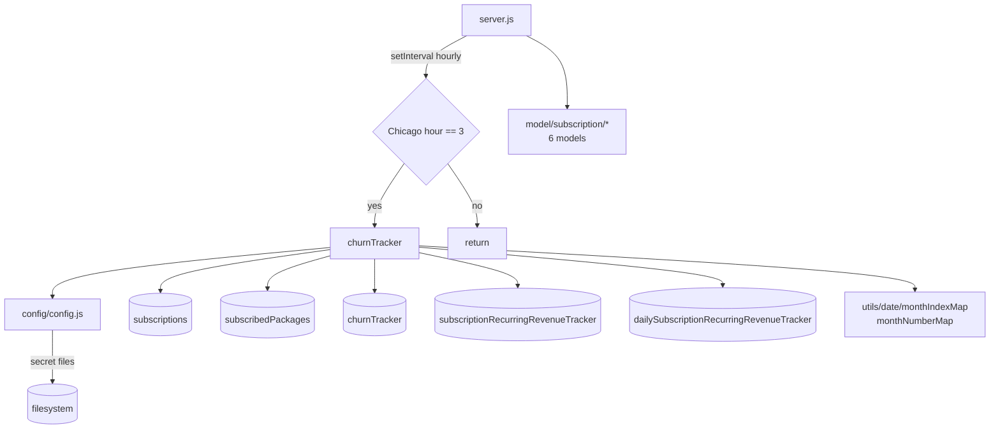

# churn_tracker_ms

## 1. Summary

An hourly-idle, once-a-day batch job that computes subscription churn and recurring revenue. Every
hour it wakes, checks the wall clock in `America/Chicago`, and when the hour is `3` it walks every
`production` subscription in `status: active | inRenewal`, groups them by asset owner, company,
service, tier and service type, then upserts three tracker collections: monthly recurring revenue,
daily recurring revenue, and churn against the month's baseline. It has no HTTP API, no queue
consumer and no caller. It is its own git repository at `apps/churn_tracker_ms/`, separate from the
control repo, and its `package.json` still carries the template name
`subscription_migration_scheduler_ms` (`package.json:2`).

## 2. Stack and commands

| Item | Value | Evidence |
|---|---|---|
| Runtime | Node.js `>=12.0.0 <17.5.0` declared; image is Node 16.4 Alpine | `package.json:6-8`, `Dockerfile:1` |
| Start command | `node --max-old-space-size=8192 server.js` (`npm start`) | `package.json:11` |
| Framework | Express 4, started only to satisfy the template | `package.json:20`, `server.js:2,84` |
| Database | MongoDB via Mongoose 7 | `package.json:29`, `server.js:3,89` |
| Port | `PORT`, 5029 in k8s | `server.js:84`, `kus/base/churn-tracker-ms-deployment.yml:44-45` |
| Test command | the npm placeholder that exits 1 | `package.json:10` |

`npm start` is real here, so the container command works (`Dockerfile:11`). No lint, build or
typecheck script exists.

## 3. Entry points

| Entry point | Where | How it starts |
|---|---|---|
| HTTP server (dummy) | `server.js:84` | `app.listen(process.env.PORT)`; no routes are registered |
| **Churn job scheduler** | `server.js:74-82` | `setInterval` every 1 hour; when `moment.tz(moment(), "America/Chicago").format("HH") === "3"` it calls `churnTracker()` |
| `churnTracker` job body | `services/subscription/churnTracker.js:7` | invoked by the interval, not exported for HTTP |
| Mongo reconnect timer | `server.js:52-59` | `setTimeout(connectMongo, 5000)` on `disconnected` |
| Mongo connect | `server.js:88-100` | `mongoose.connect(config.mongoUrl, {maxPoolSize: 1})`, `server.js:46` |
| Shutdown | `server.js:64-72` | `SIGINT`, `SIGTERM`, `uncaughtException` close Mongo |
| Docker healthcheck | `healthcheck.js:1-21` | probes `/healthz`, which no route serves |

There is **no k8s ClusterIP Service** — only a Deployment and a VPA
(`k8s/churn-tracker-ms-deployment.yml`, `k8s/churn-tracker-ms-vpa.yml`). Nothing calls this service.

Model registration at boot (`server.js:25-30`) covers only the six subscription models:
`subscriptionPackage`, `subscriptionRecurringRevenueTracker`,
`dailySubscriptionRecurringRevenueTracker`, `subscription`, `subscriber`, `churnTracker`. The user,
role, permission, company, session and payment model requires are commented out
(`server.js:14-24`).

## 4. Module inventory

| Module | Where | Responsibility | Public API | Kind |
|---|---|---|---|---|
| `churnTracker` | `services/subscription/churnTracker.js:7` | The whole batch job: read subscriptions, group, upsert three trackers | `()` → `Promise<void>` | `effectful` — Mongo reads/writes, clock |
| `server` interval | `server.js:74-82` | Hourly gate on Chicago hour 3 | inline | `effectful` — clock |
| `subscription` model | `model/subscription/subscription.js:6` | Source of truth for subscriptions | mongoose model | `reactive` — model definition; queries are effectful |
| `subscriptionPackage` | `model/subscription/subscriptionPackage.js:6` | Pricing per service/tier per company (`isFree`, `isLifetime`, `perUser`, rates) | mongoose model | `reactive` |
| `churnTracker` model | `model/subscription/churnTracker.js:5` | Daily churn snapshot vs month baseline | mongoose model | `reactive` |
| `subscriptionRecurringRevenueTracker` | `model/subscription/subscriptionRecurringRevenueTracker.js:5` | Monthly MRR/ARR snapshot per company/service/tier | mongoose model | `reactive` |
| `dailySubscriptionRecurringRevenueTracker` | `model/subscription/dailySubscriptionRecurringRevenueTracker.js:5` | Daily MRR/ARR snapshot | mongoose model | `reactive` |
| `subscriber` | `model/subscription/subscriber.js:6` | Subscriber records; registered but not read by the job | mongoose model | `reactive` |
| `monthIndexMap` | `utils/date/monthIndexMap.js:1` | Month number → English name | constant | `pure` |
| `monthNumberMap` | `utils/date/monthNumberMap.js:1` | Month number → zero-padded string | constant | `pure` |
| `monthDayCountMap` | `utils/date/monthDayCountMap.js` | Month → day count | constant | `pure`; **not required by the job** |
| `getRequest` / `postRequest` / `deleteRequest` | `utils/requests/*.js:1` | `node-fetch` wrappers | `(url, ...)` | `effectful`; **not required by any mounted code** |
| `encryptDecrypt` | `utils/cryptography/encryptDecrypt.js` | RSA helper | `(data, encrypt)` | `effectful` — reads secret config; unused |
| `getUser` | `utils/user/getUser.js` | user/role/permission loader for the dead login middleware | `(userId)` | `effectful` — Mongo; unused |
| `recursiveSanitizer` | `utils/sanitizer/recursiveSanitizer.js` | recursive sanitizer | `(value, sanitizer)` | `pure`; unused |
| `config` | `config/config.js:18` | Cached config, secrets from files with env fallback | `()` | `effectful` — filesystem, env, RSA key |

## 5. Side effects

**MongoDB reads**

| Operation | Collection (env var → value) | Line |
|---|---|---|
| `find` production active/renewal subscriptions | `SUBSCRIPTION_MODEL` → `subscriptions` | `services/subscription/churnTracker.js:21-26` |
| `findOne` active package per service/tier/company | `SUBSCRIBED_PACKAGE_MODEL` → `subscribedPackages` | `:80-86` |
| `findOne` existing churn row for the day | `CHURN_TRACKER_MODEL` → `churnTracker` | `:168-177` |

**MongoDB writes**

| Operation | Collection | Line |
|---|---|---|
| `updateOne` upsert monthly MRR/ARR | `SUBSCRIPTION_RECURRING_REVENUE_TRACKER_MODEL` → `subscriptionRecurringRevenueTracker` | `:110-133` |
| `updateOne` upsert daily MRR/ARR | `DAILY_SUBSCRIPTION_RECURRING_REVENUE_TRACKER_MODEL` → `dailySubscriptionRecurringRevenueTracker` | `:140-161` |
| `create` first churn row of the month | `CHURN_TRACKER_MODEL` → `churnTracker` | `:224` |
| `updateOne` churn row after the first | `CHURN_TRACKER_MODEL` → `churnTracker` | `:230-248` |

**Network** — none at runtime. `node-fetch` is a dependency and three wrapper modules exist
(`utils/requests/getRequest.js:1`, `postRequest.js:1`, `deleteRequest.js:1`), but nothing requires
them. `OPEN_EXCHANGE_RATES_BASE_URL`, `PAYMENT_MS_URL` and `SUBSCRIPTION_RENEWAL_MS_URL` are read
into config (`config/config.js:51,54`) and never used.

**Filesystem / env** — `fs.readFileSync` for `sendgridapikey`, `sessionsecret`, `mongourl`,
`clientsecretkey`, `openexchangeratesapikey` under `SECRETS_PATH`
(`config/config.js:5-15,25,28,29,39,47-50`); `process.env` reads listed in section 9.

**Clock** — `new Date()` for the calendar date (`churnTracker.js:9-12`), `moment()` for
`dateString` and month timestamps (`:14,127`), and `moment.tz(..., "America/Chicago")` for the
scheduler gate (`server.js:76`).

**Randomness** — none.

**Logging** — `console.log` on every catch and on connection lifecycle
(`server.js:50,53,61,85`, `churnTracker.js:28,89,135,163,256`). No run summary is logged, so a
silent run and a successful run look identical.

## 6. State and state transitions

The service itself has no state machine. The documents it writes have a daily cycle:

| State | Document | Entered by | Guard |
|---|---|---|---|
| No tracker for this month | `churnTracker` | first run of a month | no row for company + service + tier + month + day + year + env (`churnTracker.js:168-177`) |
| Baseline row | `churnTracker` (`baseSubscriberCount`, `baseMrr`) | first run of the month at hour 3 Chicago | `existingTracker` falsy (`:205-212`) |
| Churn row | `churnTracker` (`dailyChurnRate`, `revenueChurnRate`, diffs) | later runs in the same month | `existingTracker` truthy (`:213-221`) |
| Updated snapshot | `churnTracker` | every run after the first | `updateOne` by company/service/tier/day (`:230-248`) |
| Monthly rollup | `subscriptionRecurringRevenueTracker` | every run | `updateOne` upsert keyed by `monthYear` (`:110-133`) |
| Daily rollup | `dailySubscriptionRecurringRevenueTracker` | every run | `updateOne` upsert keyed by `datestamp` (`:140-161`) |

```mermaid
stateDiagram-v2
    [*] --> NoRow: new month, no document
    NoRow --> Baseline: hour 3 Chicago, first run (create baseSubscriberCount/baseMrr)
    Baseline --> Churned: next run in same month (compute diffs vs baseline)
    Churned --> Churned: further runs in same month (recompute diffs)
    Baseline --> Baseline: rerun same day (updateOne, no new churn math)
    Churned --> [*]: month ends; next month starts a new NoRow
```



Note that the "first run" is whichever run first sees the day, not necessarily the first of the
month: `day` is part of the lookup key (`:173-175`), so each calendar day gets its own baseline if
the month started before the job first ran.

## 7. Data

| Model | Collection | Key fields and rules | Evidence |
|---|---|---|---|
| `subscription` (read) | `subscriptions` | `status` enum `active`, `paused`, `inRenewal`, `cancelled`; `environment` enum `development`, `test`, `production`; `serviceType` enum `internal`, `external` | `model/subscription/subscription.js:45,107-110,184-188` |
| `subscribedPackage` (read) | `subscribedPackages` | required `subscriptionServiceId`, `packageType` (`subscriptionPlan`\|`addOn`), `companyId`, `assetOwnerCompanyId`, `assetType` (`api`\|`view`); `isFree`, `isLifetime`, `perUser` booleans; `recurringRate`; `currency` | `model/subscription/subscriptionPackage.js:6-80` |
| `churnTracker` (write) | `churnTracker` | required `companyId`, `assetOwnerCompanyId`, `subscriptionServiceId`, `subscriptionServiceTierId`, `baseSubscriberCount`, `subscriberCount`, `monthYear`, `day`, `month`, `year`, `timestamp`, `serviceType`, `environment`; defaults `0` for diffs and rates; `strict: true` | `model/subscription/churnTracker.js:5-98` |
| `subscriptionRecurringRevenueTracker` (write) | `subscriptionRecurringRevenueTracker` | required ids, `serviceType`, `mrr`, `arr`, `currency`, `userCount`, `monthYear`, `timestamp`, `environment`; `perUser` boolean; `strict: true` | `model/subscription/subscriptionRecurringRevenueTracker.js:5-67` |
| `dailySubscriptionRecurringRevenueTracker` (write) | `dailySubscriptionRecurringRevenueTracker` | same as monthly plus `datestamp` | `model/subscription/dailySubscriptionRecurringRevenueTracker.js:5-66` |
| `subscriber` | `subscribers` | registered at boot (`server.js:29`), not read by the job | `model/subscription/subscriber.js:6` |

Indexes: `churnTracker` declares per-field indexes on every key field
(`model/subscription/churnTracker.js:9,14,19,24,37,42,47,52,69,88`); the two revenue trackers
declare per-field indexes on their key fields (`...SubscriptionRecurringRevenueTracker.js:9,14,19,24,30,51,60`).

**Shared collections (data coupling):** this service **writes** `churnTracker`,
`subscriptionRecurringRevenueTracker` and `dailySubscriptionRecurringRevenueTracker` and **reads**
`subscriptions` and `subscribedPackages`. All five are platform collections written by the
subscription and billing services; the reporting/dashboard service reads the trackers. Ownership
cannot be proved from this repo alone. `subscriptions` and `subscribedPackages` are also read by
`inhouz_subscription_ms` and the payment cluster per their k8s env blocks.

## 8. Public interfaces

No HTTP routes, no events, no queue topics, no CLI commands. The only public surface is the
scheduled job, with no input and no output:

```
churnTracker() : Promise<void>
  reads:  subscriptions {environment: production, status: {in: [active, inRenewal]}}
          subscribedPackages {active: true, ids..., companyId, assetOwnerCompanyId}
          churnTracker {ids..., month, day, year, environment}
  writes: subscriptionRecurringRevenueTracker (upsert by monthYear)
          dailySubscriptionRecurringRevenueTracker (upsert by datestamp)
          churnTracker (create or update by ids + month/day/year)
```

Failure mode: every error is caught and logged; the function returns `undefined` either way.

## 9. Configuration

Names only.

- `SECRETS_PATH` (default `/mnt/secrets`); secret files `sendgridapikey`, `sessionsecret`,
  `mongourl`, `clientsecretkey`, `openexchangeratesapikey` (`config/config.js:5-15,25,28,29,47-50`).
- Env fallbacks: `SENDGRID_API_KEY`, `SESSION_SECRET`, `MONGO_URL`, `CLIENT_SECRET_KEY`,
  `OPEN_EXCHANGE_RATES_API_KEY`.
- Runtime: `PORT`, `NODE_ENV`.
- Collection names: `SUBSCRIPTION_MODEL`, `SUBSCRIBED_PACKAGE_MODEL`, `CHURN_TRACKER_MODEL`,
  `SUBSCRIBER_MODEL`, `SUBSCRIPTION_RECURRING_REVENUE_TRACKER_MODEL`,
  `DAILY_SUBSCRIPTION_RECURRING_REVENUE_TRACKER_MODEL`, `SUBSCRIBER_MIGRATION_QUEUE_MODEL`,
  `PAYMENT_CHARGE_MODEL`, `PAYOUT_ACCOUNT_MODEL`, `PAYMENT_METHOD_MODEL`, `PAYMENT_INTENT_MODEL`,
  `EXCHANGE_RATE_CACHE_MODEL`, `COMPANY_MODEL`, `USER_MODEL`, `USER_ROLES_MODEL`, `ROLE_MODEL`,
  `PERMISSION_MODEL`, `SESSION_MODEL`, `SESSION_VALIDATOR_MODEL`, `AUTH_LOG_MODEL`,
  `FLEX_MODULE_MODEL`, `FLEX_COLLECTION_MODEL`, `FLEX_FORM_FILE_MODEL`, `FORM_MODEL`,
  `DATA_RULE_EXECUTION_RESULT_MODEL`.
- URLs: `OPEN_EXCHANGE_RATES_BASE_URL`, `SUBSCRIPTION_RENEWAL_MS_URL` (read, unused).
- Misc: `SMPL_EMAIL`, `COOKIE_DOMAIN`.
- Hard-coded: Chicago timezone and hour `3` (`server.js:76-77`), CORS regex `/inhouz.localhost/`
  (`server.js:35`).
- k8s sets `STRIPE_API_KEY` only as a **commented-out** block (`kus/base/churn-tracker-ms-deployment.yml:71-74`);
  the brief lists it as set. The code never reads it.

## 10. Dependencies

Direct only, `package.json:13-36`.

| Package | Why |
|---|---|
| `mongoose` | all tracker reads/writes |
| `express` | a server that serves no route; required by the template boot |
| `body-parser`, `cookie-parser`, `cors`, `helmet`, `hpp` | template middleware; harmless, unused |
| `moment`, `moment-timezone` | date keys and the Chicago hour gate |
| `node-fetch` | HTTP wrappers in `utils/requests`; not called |
| `dotenv` | local `.env` loading (`server.js:1`) |
| `lodash`, `cryptr`, `crypto-js`, `node-rsa`, `validator`, `sanitizer`, `bcryptjs`, `@sendgrid/mail`, `connect-mongo`, `express-session`, `request-ip`, `shortid` | template dependencies; not required by mounted code |

## 11. Testing

No tests. `package.json:10` is the npm placeholder that fails. Nothing is covered. Verification
today is manual: point the service at a Mongo copy, set the clock to Chicago hour 3, run
`npm start`, and inspect the three tracker collections.

## 12. Known issues and risks

1. **The job can run more than once per day.** There is no run lock and no "already ran today"
   guard (`server.js:74-82`); a restart during the 3 o'clock hour runs the job again. The churn
   maths uses `updateOne` (`churnTracker.js:230`), so a rerun rewrites the row rather than
   double-counting — but the baseline row for the day is whatever the first run saw
   (`:205-212`).
2. **"First run" is keyed by day, not by month.** `day` is part of the churn lookup
   (`churnTracker.js:173-175`), so a month that begins before the job first runs gets a baseline on
   the first day it runs, not on the 1st.
3. **Division by zero on the baseline.** `churnTracker.js:216-218` divides by
   `baseSubscriberCount` and `baseMrr` without a guard, so a zero baseline writes `Infinity` or
   `NaN`, which MongoDB stores as `null` in a Double field.
4. **Timezone mismatch between scheduler and job.** The gate is Chicago time (`server.js:76`) but
   the date keys come from the process-local clock (`churnTracker.js:9-12`), so in a UTC pod the
   run at 03:00 Chicago computes the previous UTC date.
5. **The daily tracker overwrites instead of appending history.** `updateOne` with a plain update
   object on the daily collection (`churnTracker.js:140-161`) upserts one row per company/service/
   tier/day and rewrites `userCount`, `mrr`, `arr` on a rerun.
6. **`serviceType` is not part of the churn lookup key on creation.** The `findOne`
   (`churnTracker.js:168-177`) omits `serviceType` while the `updateOne` (`:230-241`) includes it,
   so a second service type for the same tier and day is treated as "existing" and then not
   updated, because the update filter does not match it.
7. **`environment` is copied from the subscription but hard-coded on read.** The read filter forces
   `production` (`:22`) while the write key uses the document's own `environment` (`:176`), so a
   subscriber record with a null environment produces a document the job will never find again.
8. **Model boot is incomplete.** `server.js:14-24` comments out user, role, permission, company,
   session and payment models while the shipped middlewares and `utils/user/getUser.js` call
   `mongoose.model(...)` on them; mounting those middlewares would throw `MissingSchemaError`.
9. **Dead HTTP client and dead config.** `utils/requests/*.js` and
   `OPEN_EXCHANGE_RATES_BASE_URL` / `SUBSCRIPTION_RENEWAL_MS_URL` are never used
   (`config/config.js:51,54`).
10. **Wrong package identity.** `package.json:2-3` says `subscription_migration_scheduler_ms`,
    which makes the image and the on-call runbook misleading.
11. **The healthcheck probes a route that does not exist.** `healthcheck.js:7` vs `server.js:84`
    (no `app.get` anywhere in the repo).
12. **No run observability.** Nothing records that a run started, ended, or how many rows it wrote;
    the only signal is `console.log` on failure (`churnTracker.js:256`).
13. **No credential embedded in source.** `service-account.json.enc` is an encrypted artifact; no
    key literal was found in any `.js` file.

## 13. Module map



## 14. Open questions

- Nobody calls this service over the network, and it calls nobody. Who consumes the three tracker
  collections (the reporting service or the console back end) cannot be determined from this repo;
  it is inferred from the collection names alone.
- Whether `churnTracker` should hold one row per month or one row per day is ambiguous: the write
  key includes `day` (`churnTracker.js:173-175`) but the model also stores `monthYear`, and the
  dashboard query is not in this repo.
- The brief calls `STRIPE_API_KEY` a set env var; the deployment has it commented out
  (`kus/base/churn-tracker-ms-deployment.yml:71-74`) and no code reads it. The code wins.
- The brief lists a `CONTACTS_MODEL` and other non-subscription collections; this repo never reads
  them. They are inherited k8s env entries.
- `k8s/churn-tracker-ms-vpa.yml`, the `kus/dev` and `kus/prod` overlays, and the build/deploy
  shell scripts were skipped as deployment noise.
- `service-account.json.enc` was not decrypted.
