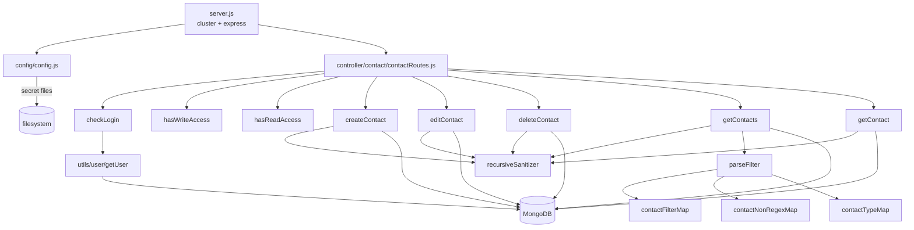

# contact_ms

## 1. Summary

CRUD for the contacts (people) that belong to a vendor company. A logged-in user can create,
edit, delete, list with filter/sort/paging, and read a single contact. Every query is scoped to
`req.user.companyId`, so a user from one company can never see another company's contacts. The
service is its own git repository at `apps/contact_ms/`, separate from the control repo, and is a
copy of the shared microservice template (`package.json:2-3` still says
`micro_service_template`).

## 2. Stack and commands

| Item | Value | Evidence |
|---|---|---|
| Runtime | Node.js 16.4 on Alpine | `Dockerfile:1` |
| Framework | Express 4 | `package.json:13`, `server.js:2` |
| Database | MongoDB via Mongoose 7 | `package.json:20`, `server.js:3,88` |
| Package manager | npm | `Dockerfile:7` |
| Port | `PORT`, 5071 in k8s | `server.js:82`, `kus/base/contact-ms-deployment.yml:44-45` |
| ClusterIP service | `contact-ms-cluster-ip-service` | `k8s/contact-ms-cluster-ip-service.yml:4` |
| Start command | `node server.js` (the container asks for `npm run start`) | `package.json:5-7`, `Dockerfile:11` |

`package.json` defines one script, `test`, and it is the npm placeholder that exits 1
(`package.json:5-7`). There is **no `start` script**, while the image runs
`CMD ["npm", "run", "start"]` (`Dockerfile:11`). No lint, build or typecheck script exists.

## 3. Entry points

| Entry point | Where | How it starts |
|---|---|---|
| HTTP server | `server.js:82` | `app.listen(process.env.PORT)` in the cluster worker |
| Cluster master / worker fork | `server.js:21-38` | one worker outside production, one per CPU in production (`server.js:22`) |
| Route registration | `server.js:53` | `require("./controller/contact/contactRoutes")(app)` |
| Mongo reconnect timer | `server.js:61-68` | `setTimeout(connectMongo, 5000)` on `disconnected` |
| Mongo connect | `server.js:87-99` | `mongoose.connect(config.mongoUrl, {maxPoolSize: 1})`, called at `server.js:55` |
| Shutdown | `server.js:72-80` | `SIGINT`, `SIGTERM`, `uncaughtException` close Mongo |
| Docker healthcheck | `healthcheck.js:1-21` | probes `localhost:PORT/healthz` — no such route (section 12) |

Routes, all guarded by `isLoggedIn` plus a permission middleware
(`controller/contact/contactRoutes.js:11-15`):

| Method | Path | Handler | Guards | Line |
|---|---|---|---|---|
| POST | `/api/contacts/create` | `createContact` | `hasWriteAccess` | `:11` |
| POST | `/api/contacts/edit` | `editContact` | `hasWriteAccess` | `:12` |
| DELETE | `/api/contacts/delete/:contactId` | `deleteContact` | `hasWriteAccess` | `:13` |
| POST | `/api/contacts/getcontacts` | `getContacts` | `hasReadAccess` | `:14` |
| GET | `/api/contacts/getcontact/:contactId` | `getContact` | `hasReadAccess` | `:15` |

No cron, queue consumer or websocket.

## 4. Module inventory

| Module | Where | Responsibility | Public API | Kind |
|---|---|---|---|---|
| `createContact` | `services/contact/createContact.js:7` | Validates and inserts a contact, stamping the caller's company and user | `(req,res)` | `effectful` — Mongo write, clock |
| `editContact` | `services/contact/editContact.js:7` | Updates one contact owned by the caller's company | `(req,res)` | `effectful` — Mongo update, clock |
| `deleteContact` | `services/contact/deleteContact.js:6` | Deletes one contact owned by the caller's company | `(req,res)` | `effectful` — Mongo delete |
| `getContact` | `services/contact/getContact.js:6` | Reads one contact owned by the caller's company | `(req,res)` | `effectful` — Mongo read |
| `getContacts` | `services/contact/getContacts.js:11` | Aggregation list with filter, sort, skip, limit and a total count | `(req,res)` | `effectful` — two Mongo aggregations |
| `contactRoutes` | `controller/contact/contactRoutes.js:10` | Registers the five routes and their middleware chain | `(app)` | `reactive` — mutates the express app |
| `checkLogin` | `middlewares/login/checkLogin.js:12` | Validates the `SMPL` cookie / `x-access-token` against the session collection, slides the 30-minute session, loads the user and company | `(req,res,next)` | `effectful` — Mongo read/update, clock, cookie write |
| `hasWriteAccess` | `middlewares/permissions/hasWriteAccess.js:3` | Requires `writeInhouzContacts` or `admin` in `req.user.permissions` | `(req,res,next)` | `pure` — reads `req.user` only |
| `hasReadAccess` | `middlewares/permissions/hasReadAccess.js:3` | Requires `readInhouzContacts` or `admin` | `(req,res,next)` | `pure` — reads `req.user` only |
| `moduleAccessCheck` | `middlewares/module/moduleAccessCheck.js:7` | Template flex-module guard | `(req,res,next)` | `effectful` — Mongo read. **Not mounted** |
| `singleSubdomainValidation` | `middlewares/subdomain/singleSubdomainValidation.js:1` | Template subdomain guard | `(req,res,next)` | `reactive` — reads `req.user`, `req.subdomains`. **Not mounted** |
| `parseFilter` | `utils/filter/parseFilter.js:1` | Turns a client filter object into a Mongo query using an allow-list of keys, a regex list and a type map | `(filter, filterMap, nonRegexList, typeMap)` | `pure` |
| `contactFilterMap` | `utils/contact/filter/contactFilterMap.js:1` | Allowed client filter keys → document fields | module constant | `pure` |
| `contactNonRegexMap` | `utils/contact/filter/contactNonRegexMap.js:1` | Fields matched exactly instead of by regex | module constant | `pure` |
| `contactTypeMap` | `utils/contact/filter/contactTypeMap.js:1` | Expected JS type per field | module constant | `pure` |
| `recursiveSanitizer` | `utils/sanitizer/recursiveSanitizer.js` | Recursive `sanitizer` pass over request input | `(value, sanitizer)` | `pure` |
| `getUser` | `utils/user/getUser.js` | Loads user, userRoles, roles, permissions | `(userId)` | `effectful` — four Mongo reads |
| `config` | `config/config.js:18` | Cached config, secrets from files with env fallback | `()` | `effectful` — filesystem, env, RSA key construction |

## 5. Side effects

**MongoDB**

| Operation | Collection | Line |
|---|---|---|
| `create` contact | `CONTACT_MODEL` → `inhouzContacts` | `services/contact/createContact.js:30` |
| `updateOne` contact | same | `services/contact/editContact.js:32` |
| `deleteOne` contact | same | `services/contact/deleteContact.js:23` |
| `findOne` contact | same | `services/contact/getContact.js:23` |
| `aggregate` list + count | same | `services/contact/getContacts.js:92,93` |
| session `findOne` / `updateOne` | `SESSION_MODEL` → `session` | `middlewares/login/checkLogin.js:27,86` |
| company `findOne` | `COMPANY_MODEL` → `company` | `middlewares/login/checkLogin.js:108` |
| user / userRoles / roles / permissions reads | `USER_MODEL`, `USER_ROLES_MODEL`, `ROLE_MODEL`, `PERMISSION_MODEL` | `utils/user/getUser.js:18,44,84,118` |

**Network** — none. No outgoing HTTP client in this repo; `@sendgrid/mail` is a dependency but is
never required here.

**Filesystem / env** — `fs.readFileSync` for `sendgridapikey`, `sessionsecret`, `mongourl`,
`clientsecretkey` under `SECRETS_PATH` (`config/config.js:5-15,21,23,24,36-40`); `process.env`
for `SECRETS_PATH`, `NODE_ENV`, `PORT`.

**Clock** — `new Date().getTime()` for `createdTimestamp` / `updatedTimestamp`
(`createContact.js:28`, `editContact.js:30`); `moment()` for session expiry
(`middlewares/login/checkLogin.js:23,82`).

**Randomness** — none in this repo.

**Logging** — `console.log` in every catch and on connection lifecycle
(`server.js:29,36,59,62,70,83`).

## 6. State and state transitions

A contact has no state machine. It is created, optionally edited, optionally deleted; there is no
soft-delete flag and no status field (`model/contact/contact.js:6-68`). Request authorization has
a three-state gate: no session → `401`-shaped error body from `checkLogin`; session but missing
permission → `Not Authorized.` from the permission middleware; otherwise the route runs. One line
is enough: **no persisted state machine in this service.**

## 7. Data

**Model `contact`** — collection `inhouzContacts` (`CONTACT_MODEL` value per
`kus/base/contact-ms-deployment.yml`; model registration at `model/contact/contact.js:78`).

| Field | Type | Rules |
|---|---|---|
| `companyId` | String | required (`:7-10`) |
| `projectId` | String | optional (`:11`) |
| `firstName` | String | required (`:12-15`) |
| `lastName` | String | required (`:16-19`) |
| `middleName` | String | optional (`:20`) |
| `email` | String | required, indexed, lowercased, `validator.isEmail` (`:21-32`) |
| `organizationName`, `organizationId`, `jobTitle`, `phoneNumber` | String | optional (`:33-36`) |
| `address` | Object | `line1`, `line2`, `city`, `country`, `postalCode`, all optional (`:37-43`) |
| `sex` | String | enum `''`, `female`, `male`, `transgender`, `non-binary`, `other` (`:44-47`) |
| `maritalStatus` | String | enum `''`, `married`, `single` (`:48-51`) |
| `ethnicity` | String | enum `''`, `white`, `black`, `asian`, `hispanic`, `latino`, `other` (`:52-55`) |
| `dob` | Number | optional (`:56`) |
| `createdTimestamp`, `updatedTimestamp` | Number | required (`:57-64`) |
| `createdById` | String | optional (`:65`) |

Compound index on `{companyId, projectId, firstName, lastName, email, organizationName,
organizationId, jobTitle, createdTimestamp, updatedTimestamp, createdById}`
(`model/contact/contact.js:70-76`). `timestamps: true` is also set (`:67`), so Mongoose adds
`createdAt` / `updatedAt` beside the hand-managed numeric stamps.

Other models in this repo, read-only here: `company` (`model/company/company.js:5`), `user`
(`model/user/user.js:6`), `userRoles` (`model/user/useRoles.js:6`), `roles`
(`model/rolesAndPermissions/roles.js:6`), `permissions`
(`model/rolesAndPermissions/permissions.js:6`), `session` (`model/session/session.js:5`).

**Shared collections (data coupling):** `company`, `User`, `userRoles`, `roles`, `permissions` and
`session` are platform collections written by the user/auth services. `contact_ms` reads them and
owns only `inhouzContacts`. No other service in this cluster reads `inhouzContacts`; the commerce
and project services use `customers` and `contacts` instead, which are different collections
(`CUSTOMERS_MODEL` → `customers`, `CONTACTS_MODEL` → `contacts` in the k8s env list).

## 8. Public interfaces

Every body is JSON; every response is JSON. The session cookie is `SMPL`, or the
`x-access-token` header (`middlewares/login/checkLogin.js:11`), with the CSRF token in
`x-csrfToken` (`:12`).

**`POST /api/contacts/create`** (`createContact.js:7`)

```json
// request: any contact field; email, firstName, lastName required
{ "firstName": "A", "lastName": "B", "email": "a@b.co", "jobTitle": "CTO" }
// 200: the created document
// 400 { "error": { "message": "Invalid request. Required fields are missing. Email, firstName, and lastName are required." } }
// 500 failed to create
```

**`POST /api/contacts/edit`** (`editContact.js:7`)

```json
// request: { "_id": "...", "email": "...", "firstName": "...", "lastName": "...", ... }
// 200 { "success": true }
// 400 validation · 500 modifiedCount 0 or error
```

**`DELETE /api/contacts/delete/:contactId`** (`deleteContact.js:6`)

```json
// 200 { "success": true }
// 500 invalid id, deletedCount 0, or error
```

**`POST /api/contacts/getcontacts`** (`getContacts.js:11`)

```json
// request
{ "filter": { "firstName": "an" }, "sort": { "lastName": 1 }, "limit": 20, "skip": 0 }
// 200
{ "results": [ { "_id": "...", "name": "A B", "companyId": "...", "firstName": "A", "lastName": "B" } ],
  "total_count": 1 }
// 400 missing companyId · 500 aggregation error
```

The projection returns `_id`, `name`, `companyId`, `projectId`, `firstName`, `lastName`,
`middleName`, `email`, `organizationName`, `organizationId`, `jobTitle`, `phoneNumber`, `address`,
`sex`, `maritalStatus`, `ethnicity`, `dob`, `createdTimestamp`, `updatedTimestamp`, `createdById`
(`getContacts.js:48-71`).

**`GET /api/contacts/getcontact/:contactId`** (`getContact.js:6`)

```json
// 200: the raw contact document
// 404 { "error": { "message": "Contact was not found." } }
// 500 error
```

No events, queue topics or CLI commands.

## 9. Configuration

Names only.

- `SECRETS_PATH` (default `/mnt/secrets`), with secret files `sendgridapikey`, `sessionsecret`,
  `mongourl`, `clientsecretkey` (`config/config.js:5-15,21,23,24`).
- Env fallbacks: `SENDGRID_API_KEY`, `SESSION_SECRET`, `MONGO_URL`, `CLIENT_SECRET_KEY`.
- Runtime: `PORT`, `NODE_ENV`.
- Collection names: `CONTACT_MODEL`, `COMPANY_MODEL`, `USER_MODEL`, `USER_ROLES_MODEL`,
  `ROLE_MODEL`, `PERMISSION_MODEL`, `SESSION_MODEL`, `SESSION_VALIDATOR_MODEL`, `AUTH_LOG_MODEL`,
  `FLEX_MODULE_MODEL` (`config/config.js:25-42`).
- Misc: `SMPL_EMAIL`, `COOKIE_DOMAIN`.
- Hard-coded permission names: `admin` (`config/config.js:33`), `readInhouzContacts` (`:34`),
  `writeInhouzContacts` (`:35`).
- CORS origin regex `/inhouz.localhost/` (`server.js:43`); cookie names `SMPL`, `x-java`,
  `sessionExpirationTimestamp` (`middlewares/login/checkLogin.js:11,126,134`).

## 10. Dependencies

Direct only, `package.json:9-30`.

| Package | Why |
|---|---|
| `express` | server and routes |
| `mongoose` | contact model, session/user lookups |
| `body-parser` | JSON parsing, 20 mb (`server.js:49`) |
| `cookie-parser` | reads the `SMPL` cookie (`server.js:52`) |
| `cors` | credentialed CORS for the platform origins (`server.js:41-47`) |
| `helmet`, `hpp` | security headers and parameter-pollution guard (`server.js:50-51`) |
| `cryptr` | decrypts the session cookie (`middlewares/login/checkLogin.js:20-22`) |
| `crypto-js` | second-layer encryption of the CSRF cookie in the login middleware |
| `node-rsa` | constructs the client key in config; not used by a mounted route here |
| `validator` | email validation in model and services |
| `sanitizer` | XSS sanitising of bodies and params |
| `moment` | session expiry arithmetic |
| `lodash` | `isEmpty` in login and module middleware, and in `getContacts` |
| `@sendgrid/mail`, `bcryptjs`, `connect-mongo`, `express-session`, `shortid`, `request-ip` | template dependencies; not required by this repo |
| `dotenv` | local `.env` loading (`server.js:1`) |

## 11. Testing

No tests. `package.json:5-7` is the npm placeholder that fails. There is no test directory and no
test runner dependency. Nothing is covered. Verification today is manual against a live Mongo with
a valid session cookie.

## 12. Known issues and risks

1. **The container cannot start.** `Dockerfile:11` runs `npm run start`; `package.json:5-7` has no
   `start` script.
2. **The healthcheck path is not served.** `healthcheck.js:7` probes `/healthz`; the only routes
   are under `/api/contacts` (`controller/contact/contactRoutes.js:11-15`).
3. **Update writes the whole request body.** `editContact.js:37-40` spreads `...reqBody` into
   `updateOne` with no `$set`, no field allow-list and no `strict` schema option set, so any client
   key that Mongo accepts is written. The `_id` is also in the spread.
4. **`getContact` catch block is broken.** `return res.send(500).send({...})`
   (`getContact.js:52`) calls `.send` on the result of `.send`, which throws inside the catch and
   surfaces as an unhandled rejection instead of a 500 body.
5. **Error status is wrong in several places.** `deleteContact.js:15` and `getContact.js:15`
   return **500** for a bad client-supplied id; that should be 400.
6. **`modifiedCount` is treated as failure.** `editContact.js:47` returns 500 when a client sends
   an unchanged body, because Mongo reports `modifiedCount: 0`. The same pattern makes a repeated
   save look like an error.
7. **`name` is a filter that cannot work.** `contactFilterMap.js:7` allows `name`, but `$match`
   runs before the `$addFields` that creates `name` (`getContacts.js:39,42-47`), so a name filter
   matches nothing.
8. **Regex filter on every text field is a hot path and an injection surface.**
   `parseFilter.js:29-32` wraps any string in `.*value.*` with `i`. The value is not escaped, so a
   client can supply regex syntax and cause pathological scans on a large collection.
9. **No `projectId` scoping on write.** `createContact.js:32-35` stamps `companyId` but accepts
   `projectId` straight from the body, so a contact can be attached to another company's project
   id as long as the company check on read later hides it.
10. **A generated `name` concat breaks on missing names.** `getContacts.js:44` concatenates
    `firstName + ' ' + lastName`; a null name yields `null` for the whole `name` field.
11. **Dead template code ships.** `middlewares/module/moduleAccessCheck.js` and
    `middlewares/subdomain/singleSubdomainValidation.js` are never mounted
    (`server.js:53, controller/contact/contactRoutes.js:10-16`).
12. **Catch handlers swallow errors into 200s.** `createContact.js:53` and `editContact.js:58`
    return a JSON error body with no error status, so a client checking the status sees success.
13. **No credential embedded in source.** `service-account.json.enc` is an encrypted artifact; no
    key literal was found in any `.js` file (`grep` for `sk_live|AKIA|AIza|SG\.|BEGIN` returned
    nothing).

## 13. Module map



## 14. Open questions

- The brief says "outgoing internal HTTP: none found" and "called by: none found". That matches the
  code: no HTTP client and no inbound route from another service. Who calls these routes over the
  network (the web front end, or an API gateway) cannot be determined from this repo.
- The brief lists `CONTACTS_MODEL` and `CONTACT_MODEL` as two collections (`contacts` and
  `inhouzContacts`). Only `CONTACT_MODEL` is read in this repo (`config/config.js:42`,
  `model/contact/contact.js:78`); `CONTACTS_MODEL` appears only in the k8s env block, so it is
  unused here.
- The brief's count of 19 `mongoose.model` registrations is really 7 schema definitions plus 12
  runtime lookups.
- The brief's "websocket handler" at `server.js:61` is a Mongoose `disconnected` event, not a
  websocket.
- `kus/dev` and `kus/prod` overlays and the `build_ga*.sh` / `deploy.sh` scripts were skipped as
  deployment noise; only the base deployment was read for the image, port and replicas.
- `service-account.json.enc` was not decrypted.
