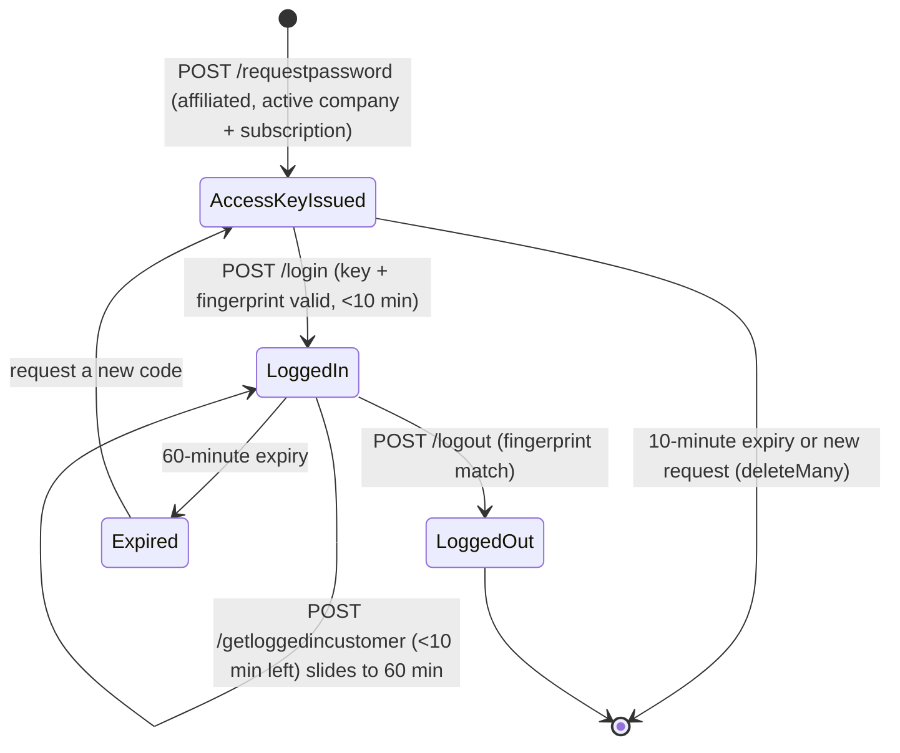
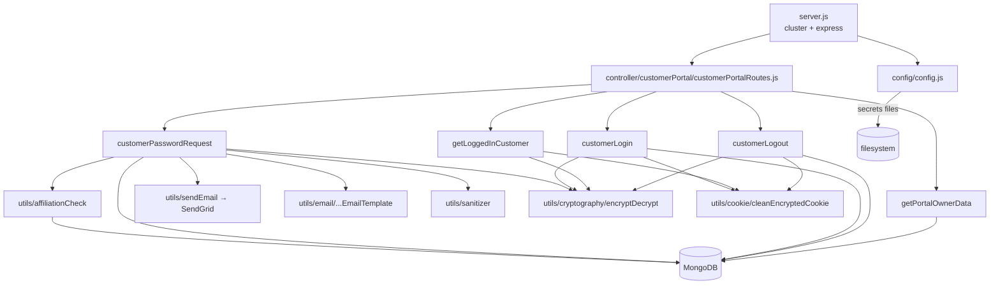

# customer_portal_ms

## 1. Summary

Customer-facing login for an Inhouz customer portal. It lets a person who is an external user of a
vendor company obtain a one-time access code by email, exchange that code for an encrypted
`inhouz_cpt` cookie, keep that cookie alive while they work, and log out. It also serves the vendor
branding (`companyName`, `companyLogoId`) the portal shell needs before login. The service is its
own git repository at `apps/customer_portal_ms/`, separate from the control repo. It is a copy of
the shared microservice template: `package.json:2-3` still says `micro_service_template`, and the
unused `login`, `module` and `subdomain` middlewares are inherited from it.

## 2. Stack and commands

| Item | Value | Evidence |
|---|---|---|
| Runtime | Node.js 16.4 on Alpine (container) | `Dockerfile:1` |
| Framework | Express 4 | `package.json:13`, `server.js:2` |
| Database | MongoDB via Mongoose 7 | `package.json:20`, `server.js:3,92` |
| Package manager | npm | `Dockerfile:7` |
| Port | `PORT`, 5062 in k8s | `server.js:86`, `kus/base/customer-portal-ms-deployment.yml:44-45` |
| ClusterIP service | `customer-portal-ms-cluster-ip-service` | `k8s/customer-portal-ms-cluster-ip-service.yml:4` |
| Start command | `node server.js` (the container asks for `npm run start`) | `package.json:5-7`, `Dockerfile:11` |

`package.json` defines exactly one script, `test`, and it is the npm placeholder that exits 1:
`"test": "echo \"Error: no test specified\" && exit 1"` (`package.json:5-7`). There is **no
`start` script**, while the image runs `CMD ["npm", "run", "start"]` (`Dockerfile:11`). See
section 12.

There is no lint, build or typecheck script. The only runnable command that is not node itself is
`node healthcheck.js` (`healthcheck.js:1-21`), which probes `/healthz` on localhost.

## 3. Entry points

| Entry point | Where | How it starts |
|---|---|---|
| HTTP server | `server.js:86` | `app.listen(process.env.PORT)` inside the cluster worker |
| Cluster master / worker fork | `server.js:25-42` | `cluster.isMaster`; one worker outside production, one per CPU in production (`server.js:26`) |
| Route registration | `server.js:57` | `require("./controller/customerPortal/customerPortalRoutes")(app)` |
| Mongo reconnect timer | `server.js:65-72` | `mongoose.connection.on("disconnected")` schedules `connectMongo()` after 5 s |
| Mongo connect | `server.js:91-102` | `mongoose.connect(config.mongoUrl, {maxPoolSize: 1})`, called at `server.js:59` |
| Shutdown handler | `server.js:76-84` | `SIGINT`, `SIGTERM`, `uncaughtException` close the Mongo connection |
| Docker healthcheck | `healthcheck.js:3-21` | `http.request` to `localhost:PORT/healthz` |
| **No `/healthz` route exists** | see section 12 | no route in `controller/customerPortal/customerPortalRoutes.js` |

Routes registered, all in `controller/customerPortal/customerPortalRoutes.js`:

| Method | Path | Handler | Line |
|---|---|---|---|
| POST | `/api/customerportal/requestpassword` | `services/customerPortal/customerPasswordRequest` | `:8` |
| POST | `/api/customerportal/login` | `services/customerPortal/customerLogin` | `:9` |
| POST | `/api/customerportal/getloggedincustomer` | `services/customerPortal/getLoggedInCustomer` | `:10` |
| POST | `/api/customerportal/logout` | `services/customerPortal/customerLogout` | `:11` |
| GET | `/api/customerportal/getportalmetadata/:subDomain` | `services/customerPortal/getPortalOwnerData` | `:12` |

There is no cron loop and no worker queue consumer. The only timer is the Mongo reconnect
`setTimeout` at `server.js:68`.

## 4. Module inventory

| Module | Where | Responsibility | Public API | Kind |
|---|---|---|---|---|
| `customerPasswordRequest` | `services/customerPortal/customerPasswordRequest.js:14` | Decrypts the request payload, validates vendor + licence + affiliation, issues a 6-digit access code, emails it | `(req,res)` | `effectful` — Mongo read/write, RSA decrypt, clock, randomness, SendGrid |
| `customerLogin` | `services/customerPortal/customerLogin.js:11` | Re-checks the access code against the device fingerprint and sets the portal cookie | `(req,res)` | `effectful` — Mongo read/delete, clock, cookie write |
| `getLoggedInCustomer` | `services/customerPortal/getLoggedInCustomer.js:7` | Reads the cookie, verifies fingerprint and expiry, slides the 60-minute window when under 10 minutes remain | `(req,res)` | `effectful` — reads cookies, clock, sets cookies |
| `customerLogout` | `services/customerPortal/customerLogout.js:7` | Verifies the cookie, deletes the access keys for that email + company, clears both cookies | `(req,res)` | `effectful` — Mongo delete, cookie write |
| `getPortalOwnerData` | `services/customerPortal/getPortalOwnerData.js:9` | Returns public vendor branding for a subdomain | `(req,res)` | `effectful` — Mongo read |
| `getHello` | `services/helloWorld/getHello.js:4` | Template demo: returns every `User` document | `(req,res)` | `effectful` — Mongo read; **not mounted** |
| `recursiveSanitizer` | `utils/sanitizer/recursiveSanitizer.js` | Recursively runs the `sanitizer` package over a body/params object | `(value, sanitizer)` | `pure` |
| `encryptDecrypt` | `utils/cryptography/encryptDecrypt.js:3` | RSA decrypt (or private-key encrypt when `encrypt` is true) with the configured key | `(data, encrypt)` | `effectful` — reads secret config; falls back to returning the input on error (`:13-16`) |
| `cleanEncryptedCookie` | `utils/cookie/cleanEncryptedCookie.js` | Reverses the `+ / =` substitution used on cookies | `(cookie)` | `pure` |
| `affilliationCheck` | `utils/affiliationCheck/affilliationCheck.js` | Decides whether an email belongs to the vendor: payment, subscriber, or sign-document match | `({companyId,email})` | `effectful` — three Mongo reads |
| `getUser` | `utils/user/getUser.js` | Loads user, roles, permissions for the login middleware | `(userId)` | `effectful` — four Mongo reads |
| `createEditByObject` | `utils/user/createEditByObject.js` | Builds an audit `createdBy` / `updatedBy` object | n/a | `pure` (no I/O) |
| `customerPortalAccessKeyEmailTemplate` | `utils/email/customerPortalAccessKeyEmailTemplate.js` | Builds the access-code email HTML | `({email, accessCode})` | `pure` |
| `sendEmail` | `utils/sendEmail/sendEmail.js:4` | Sends one message through SendGrid | `(to, from, subject, text, html)` | `effectful` — network, fire-and-forget (`:23` returns before delivery is known) |
| `checkLogin` | `middlewares/login/checkLogin.js:9` | Template session validator; looks for cookie `SMPL` or `x-access-token` | `(req,res,next)` | `effectful` — Mongo read/update, clock, cookie write. **Not mounted by this service** |
| `moduleAccessCheck` | `middlewares/module/moduleAccessCheck.js:7` | Template flex-module permission check | `(req,res,next)` | `effectful` — Mongo read. **Not mounted** |
| `singleSubdomainValidation` | `middlewares/subdomain/singleSubdomainValidation.js:1` | Compares `req.subdomains[0]` with `req.user.subDomain` | `(req,res,next)` | `reactive` — reads `req.user`, `req.subdomains`. **Not mounted** |
| `config` | `config/config.js:18` | Builds and caches the single config object, reading secrets from files under `SECRETS_PATH` with env fallbacks | `()` | `effectful` — filesystem, env, RSA key construction |

## 5. Side effects

**MongoDB** (via Mongoose; the collection name is the *value* of the env var, see section 9):

| Operation | Collection env var | Line |
|---|---|---|
| `findOne` active company by `subDomain` | `COMPANY_MODEL` | `services/customerPortal/customerPasswordRequest.js:71`, `customerLogin.js:70`, `getPortalOwnerData.js:16` |
| `findOne` active subscription by `companyId` | `INHOUZ_SUBSCRIPTIONS_MODEL` | `customerPasswordRequest.js:100`, `customerLogin.js:99` |
| `deleteMany` access keys | `CUSTOMER_PORTAL_ACCESS_KEY_MODEL` | `customerPasswordRequest.js:152`, `customerLogin.js:204`, `customerLogout.js:43` |
| `create` access key | `CUSTOMER_PORTAL_ACCESS_KEY_MODEL` | `customerPasswordRequest.js:162` |
| `findOne` access key by email/company/fingerprint/expiry | `CUSTOMER_PORTAL_ACCESS_KEY_MODEL` | `customerLogin.js:132-139` |
| affiliation reads (`payments`, `paymentSubscribers`, `inhouzSignDocs`) | `INHOUZ_PAYMENT_MODEL`, `PAYMENT_SUBSCRIBER_MODEL`, `INHOUZ_SIGN_DOC_MODEL` | `utils/affiliationCheck/affilliationCheck.js:9,43,67` |
| session / user lookups (unmounted middleware) | `SESSION_MODEL`, `USER_MODEL`, `USER_ROLES_MODEL`, `ROLE_MODEL`, `PERMISSION_MODEL` | `middlewares/login/checkLogin.js:24,105`, `utils/user/getUser.js:18,44,84,118` |

**Network**

- SendGrid: `@sendgrid/mail` `sgMail.send` (`utils/sendEmail/sendEmail.js:6,23`). Address used as
  `from` is hard-coded `noreply@inhouz.io` at `customerPasswordRequest.js:188`.
- No internal HTTP calls in this repo. No `axios`, `request`, `fetch` or `http` client outside
  `healthcheck.js`.

**Filesystem / env**

- `fs.readFileSync` from `SECRETS_PATH` (default `/mnt/secrets`) for `sendgridapikey`,
  `sessionsecret`, `mongourl`, `clientsecretkey` (`config/config.js:5-15,25,28,29,39`).
- `process.env` reads: `SECRETS_PATH`, `NODE_ENV`, `PORT` (`config/config.js:6`, `server.js:26,86`,
  `services/customerPortal/customerLogin.js:187`).

**Clock / randomness / logging**

- Clock: `moment()` and `new Date().getTime()` for cookie and key expiry
  (`customerLogin.js:173,195`, `customerPasswordRequest.js:167`).
- Randomness: `Math.random().toFixed(7).slice(3)` generates the access code
  (`customerPasswordRequest.js:149`) — see section 12.
- Logging: `console.log` on every catch block and on connection lifecycle
  (`server.js:32,63,66,74,87`). No structured logger and no request logging.

## 6. State and state transitions

The service has a small login state machine. No document is transitioned; the state lives in
cookies and in the short-lived access-key row.

| State | Where it lives | Entered by | Guard |
|---|---|---|---|
| No access key | nothing on disk | request-password not called, or key expired/consumed | — |
| Access key issued | `customerPortalAccessKeys` row, 10-minute TTL | `POST /requestpassword` | caller is affiliated with the vendor (`customerPasswordRequest.js:126-141`) |
| Logged in | `inhouz_cpt` cookie, 60 minutes | `POST /login` | key exists for email + company + fingerprint and has not expired (`customerLogin.js:132-152`); plaintext key matches (`:164`) |
| Sliding | `inhouz_cpt` replaced | `POST /getloggedincustomer` | fewer than 10 minutes remain (`getLoggedInCustomer.js:52`) and fingerprint matches (`:34-40`) |
| Logged out | cookies cleared, keys deleted | `POST /logout` | fingerprint matches (`customerLogout.js:34-40`) |
| Expired | cookie rejected | any authenticated read | `timestamp > expirationTimestamp` (`getLoggedInCustomer.js:43`) |



## 7. Data

All models are declared with `strict: true` unless noted. Collection names are supplied by env var
values; the values below are the ones the k8s deployment sets
(`kus/base/customer-portal-ms-deployment.yml:117-218`).

| Model | Collection | Key fields | Validation | Evidence |
|---|---|---|---|---|
| `customerPortalAccessKey` | `customerPortalAccessKeys` | `email`, `assetOwnerCompanyId`, `encyptedKey`, `fingerprint`, `expirationTimestamp` | email required + `validator.isEmail`; all fields required; compound index `{email, assetOwnerCompanyId}` | `model/customerPortal/customerPortalAccessKey.js:6-41` |
| `company` | `company` | `companyName`, `companyType`, `subDomain`, `industry`, `logoUrl`, `addresses[]`, default storage/database ids | `companyName` and `companyType` required; `companyType` enum of 8 values; `subDomain` lowercased | `model/company/company.js:5-17,19-35` |
| `inhouzSubscription` | `inhouzSubscriptions` | licence record for the vendor company | see model file | `model/inhouzSubscription/inhouzSubscription.js:5` |
| `inhouzPayment` | `inhouzPayments` | payment records, read for affiliation | see model file | `model/payment/inhouzPayment.js:5` |
| `paymentSubscriber` | `paymentSubscribers` | subscriber records, read for affiliation | see model file | `model/payment/paymentSubscribers.js:6` |
| `inhouzSignDoc` | `inhouzSignDocs` | signed documents, read for affiliation | see model file | `model/inhouzSign/inhouzSignDoc.js:6` |
| `user` | `User` | portal-side users (mounted only via the dead middleware) | see model file | `model/user/user.js:6` |
| `userRoles` | `userRoles` | user ↔ role mapping | see model file | `model/user/useRoles.js:6` |
| `role` | `roles` | roles | see model file | `model/rolesAndPermissions/roles.js:6` |
| `permission` | `permissions` | permissions | see model file | `model/rolesAndPermissions/permissions.js:6` |
| `session` | `session` | template session store, unused by mounted routes | see model file | `model/session/session.js:5` |

**Shared collections (data coupling):** `company`, `inhouzSubscriptions`, `inhouzPayments`,
`paymentSubscribers`, `inhouzSignDocs`, `User`, `userRoles`, `roles`, `permissions` and `session`
are the platform-wide collections owned by other services (user/auth, subscription, payment, sign).
This repo reads them; it owns only `customerPortalAccessKeys`
(`model/customerPortal/customerPortalAccessKey.js:43`).

The access-key document is deleted on successful login (`customerLogin.js:204`), on logout
(`customerLogout.js:43`), and before a new one is created (`customerPasswordRequest.js:152`), so at
most one live key exists per email + company + fingerprint.

## 8. Public interfaces

All bodies are JSON. Authenticated calls carry two httpOnly-ish cookies: `inhouz_cpt` (encrypted
session) and `inhouz_df` (encrypted device fingerprint); `portalExpirationTimestamp` is a
readable cookie for the UI.

**`POST /api/customerportal/requestpassword`** (`customerPasswordRequest.js:14`)

```json
// request
{ "encryptedPayload": "<string>", "serverEncrypted": false }
// decrypted payload: { "email": "...", "subDomain": "...", "expirationTimestamp": 0, "payload": {...} }
// 200
{ "success": true }
// 400 { "error": { "message": "Invalid request. Required fields are missing." } }
// 401 { "error": { "message": "Not authorized." } }
// 404 vendor / licence not found · 500 internal
```

**`POST /api/customerportal/login`** (`customerLogin.js:11`)

```json
// request: same envelope, decrypted payload adds "password"
{ "encryptedPayload": "...", "serverEncrypted": true }
// 200 { "success": true } + Set-Cookie inhouz_cpt, portalExpirationTimestamp
// 401 not authorized / wrong code · 404 vendor or licence missing · 500
```

**`POST /api/customerportal/getloggedincustomer`** (`getLoggedInCustomer.js:7`)

```json
// request: no body, cookies only
// 200 { "email": "...", "assetOwnerCompanyId": "..." }  (+ refreshed cookies when <10 min left)
// 400 missing cookies · 401 fingerprint mismatch or expired
```

**`POST /api/customerportal/logout`** (`customerLogout.js:7`)

```json
// 200 { "success": true }  (cookies cleared, keys deleted)
// 400 missing cookies · 401 fingerprint mismatch
```

**`GET /api/customerportal/getportalmetadata/:subDomain`** (`getPortalOwnerData.js:9`)

```json
// 200 { "companyName": "...", "companyLogoId": "..." }
// 404 vendor not found · 500
```

No events, queue topics or CLI commands.

## 9. Configuration

Names only. `config.js:5-15` reads each secret from a file under `SECRETS_PATH` first and falls
back to the env var.

- Secrets directory: `SECRETS_PATH` (default `/mnt/secrets`).
- Secret files: `sendgridapikey`, `sessionsecret`, `mongourl`, `clientsecretkey`
  (`config/config.js:25,28,29,39`).
- Fallback env names: `SENDGRID_API_KEY`, `SESSION_SECRET`, `MONGO_URL`, `CLIENT_SECRET_KEY`.
- Runtime: `PORT`, `NODE_ENV`.
- Collection names: `COMPANY_MODEL`, `INHOUZ_SUBSCRIPTIONS_MODEL`,
  `CUSTOMER_PORTAL_ACCESS_KEY_MODEL`, `INHOUZ_PAYMENT_MODEL`, `PAYMENT_SUBSCRIBER_MODEL`,
  `INHOUZ_SIGN_DOC_MODEL`, `USER_MODEL`, `USER_ROLES_MODEL`, `ROLE_MODEL`, `PERMISSION_MODEL`,
  `SESSION_MODEL`, `SESSION_VALIDATOR_MODEL`, `AUTH_LOG_MODEL`, `FLEX_MODULE_MODEL`,
  `FLEX_COLLECTION_MODEL`, `FLEX_FORM_FILE_MODEL`, `FORM_MODEL`,
  `DATA_RULE_EXECUTION_RESULT_MODEL`.
- Misc: `SMPL_EMAIL`, `COOKIE_DOMAIN`.
- Hard-coded config values (not env): `adminPermission: "admin"` (`config/config.js:38`), CORS
  origin regex `/inhouz.localhost/` (`server.js:47`), cookie names `inhouz_cpt`, `inhouz_df`,
  `portalExpirationTimestamp`, `x-java`, `SMPL`.
- k8s-only env names present in the deployment but unused by this code: `REDIS_PORT`,
  `CLOUDFLARE_API_URL`, `COOKIE_NAME`, `INHOUZ_FROM_EMAIL`, `PAYMENT_MS_URL`,
  `OPEN_EXCHANGE_RATES_BASE_URL`, `SUBSCRIPTION_SERVICE_CHARGE_FEE`,
  `SUBSCRIPTION_SERVICE_CHARGE_TYPE`, plus ~40 `*_MODEL` names (`kus/base/customer-portal-ms-deployment.yml:111-218`).

## 10. Dependencies

Direct only, from `package.json:9-30`.

| Package | Why it is here |
|---|---|
| `express` | HTTP server and routing |
| `mongoose` | Mongo models and connection |
| `body-parser` | JSON body parsing, 20 mb limit (`server.js:53`) |
| `cookie-parser` | Reads `inhouz_cpt` / `inhouz_df` (`server.js:56`) |
| `cors` | Allows `inhouz.localhost` origins with credentials (`server.js:45-51`) |
| `helmet` | Security headers (`server.js:55`) |
| `hpp` | HTTP parameter pollution guard (`server.js:54`) |
| `cryptr` | AES encryption of the cookie payload and access code |
| `crypto-js` | Second-layer AES for the `x-java` CSRF cookie in the unmounted middleware |
| `node-rsa` | RSA decrypt of client-encrypted payloads |
| `validator` | Email validation |
| `sanitizer` | XSS sanitising of request bodies and params |
| `moment` | Expiry timestamps |
| `lodash` | `isEmpty` in middleware |
| `@sendgrid/mail` | Access-code email |
| `bcryptjs` | Template dependency; no `require` in this repo |
| `connect-mongo`, `express-session`, `shortid`, `request-ip` | Template dependencies; no `require` in this repo |
| `dotenv` | Loads `.env` in local dev (`server.js:1`) |

## 11. Testing

No tests. `package.json:5-7` is the npm placeholder that prints
`Error: no test specified` and exits 1. There is no test directory, no test runner dependency, and
no fixture. Nothing is covered. Verification today is manual: build the image, start the container
with a Mongo instance and the four secret files, then exercise the five routes.

## 12. Known issues and risks

1. **The container cannot start.** `Dockerfile:11` runs `npm run start`, but `package.json:5-7`
   declares only `test`. The pod would exit immediately.
2. **The Docker healthcheck target does not exist.** `healthcheck.js:7` probes `/healthz`; no
   route serves it (`controller/customerPortal/customerPortalRoutes.js:7-13`).
3. **The access code is predictable.** `Math.random().toFixed(7).slice(3)`
   (`customerPasswordRequest.js:149`) yields four digits, not six, from a non-cryptographic PRNG.
   It is paired with a 10-minute expiry and a device fingerprint, which limits but does not remove
   the risk.
4. **Email send is fire-and-forget.** `sgMail.send(msg)` is not awaited and its rejection is not
   handled (`utils/sendEmail/sendEmail.js:23`); the route returns `{success:true}` before delivery
   is known, so a user can be told a code was sent when it was not.
5. **`deleteMany` after login is not awaited.** `customerLogin.js:204-212` starts the delete and
   returns; a slow delete can leave a usable key behind. The same pattern appears at
   `customerPasswordRequest.js:152`.
6. **Catch handlers return an object where a document is expected, and callers only sometimes
   check.** `customerLogin.js:75-78` returns `{error:true}` on a Mongo failure; `:88` checks it.
   But `getPortalOwnerData.js:21-24` returns `{error:true}` and `:34` checks it; meanwhile a
   *null* result is checked first at `:26`, so the ordering is fragile. `getUser` and the
   affiliation check follow the same convention.
7. **`encryptDecrypt` silently returns the ciphertext on failure.** `utils/cryptography/encryptDecrypt.js:13-16`
   returns the input when decrypt throws, so a bad payload reaches `JSON.parse` and surfaces as a
   500 instead of a 400.
8. **Device fingerprints are read from a client-controlled cookie.** `inhouz_df` is decrypted and
   used as the access-key lookup key (`customerLogin.js:126-138`). The service never sets that
   cookie, so whoever sets it controls which fingerprint bucket the key belongs to.
9. **Dead template code ships in the image.** `middlewares/login/checkLogin.js`,
   `middlewares/module/moduleAccessCheck.js`, `middlewares/subdomain/singleSubdomainValidation.js` and
   `services/helloWorld/getHello.js` are never mounted (`server.js:57` registers only the portal
   routes). `getHello` exposes every `User` document (`services/helloWorld/getHello.js:6`).
10. **Errors leak internal text.** `console.log` prints the raw error object and stack on every
    catch (`services/customerPortal/customerLogin.js:216`), which lands in pod logs.
11. **CORS is pinned to a regex that only matches `inhouz.localhost`** (`server.js:47`), so a
    production portal origin is not allowed unless it is proxied.
12. **`NODE_ENV` also drives cookie `secure`.** `customerLogin.js:186-188` marks the cookie secure
    when `NODE_ENV` is `development` or `uat` as well as production.
13. **No credential is embedded in the source.** `.enc` files (`service-account.json.enc`) are
    encrypted artifacts; no key literal was found in any `.js` file.

## 13. Module map



## 14. Open questions

- The brief listed `AUTH_LOG_MODEL`, `SESSION_VALIDATOR_MODEL`, `DATA_RULE_EXECUTION_RESULT_MODEL`,
  `FLEX_FORM_FILE_MODEL`, `FLEX_MODULE_MODEL`, `FORM_MODEL` and `FLEX_COLLECTION_MODEL` as used
  collections. In this repo they are only read into the config object
  (`config/config.js:21-37`) and used by middleware that is not mounted (`middlewares/login`,
  `middlewares/module`). Whether another service writes those collections cannot be determined
  from this repository alone.
- The brief named sixteen models; the code registers eleven in `model/` plus repeated
  `mongoose.model(...)` lookups in services and middleware. The brief's count of 30 registrations
  is really 11 schema definitions and 19 runtime lookups of already-registered models.
- The brief's "websocket handler" at `server.js:65` is a Mongoose `disconnected` event, not a
  websocket.
- Whether the portal's `inhouz_df` fingerprint cookie is expected to be set by a CDN edge or by a
  web front end could not be determined; no writer exists in this repo.
- The `build_ga.sh`, `build_ga_prod.sh`, `deploy.sh`, `docker-compose.yml` and `kus/` overlays were
  read only enough to find the port and image; the dev/prod overlays were not compared line by
  line and are skipped as deployment noise.
- `service-account.json.enc` was not decrypted and its contents are unknown.
