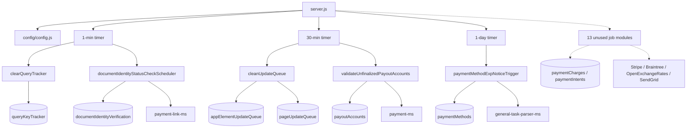

# data_scanner_ms

## 1. Summary

`data_scanner_ms` is a background worker, not an API. It has no routes. It starts an Express server
only to satisfy the platform healthcheck, then runs five recurring sweeps on three timers: clearing
the app-builder update queues, clearing expired query-tracker keys, checking document-identity
verification status, sanity-checking unfinalised payout accounts, and sending payment-method
expiry notices. Every sweep reads the platform MongoDB directly and most call another microservice
over HTTP to do the actual work. Repository: `apps/data_scanner_ms/` (repo id `data_scanner_ms`).

## 2. Stack and commands

| Item | Value | Source |
|---|---|---|
| Runtime | Node.js `>=12.0.0 <17.5.0` | `package.json` engines |
| Container base | `node:16.4-alpine` | `Dockerfile` |
| Framework | Express 4 (listener only, no routes) | `server.js:2-3` |
| ODM | Mongoose 7 | `server.js:4` |
| Start | `npm start` → `node --max-old-space-size=8192 server.js` | `package.json:9` |
| Test | `npm test` → `echo "Error: no test specified" && exit 1` | `package.json:8` |
| Port | `PORT` | `server.js:132` |
| Replicas | 1 | `k8s/data-scanner-ms-deployment.yml:6` |
| k8s Service | **none** — deployment plus VPA only | `k8s/` directory listing |

The 8 GB heap flag is deliberate: the sweeps load whole collections.

## 3. Entry points

There are no HTTP routes and no CLI. The entry points are the process and its timers.

| Entry point | file:line | How it starts |
|---|---|---|
| Express listener | `server.js:132` | `node server.js`; serves nothing, registers no routes |
| Mongo connect | `server.js:136-148` | boot, and on `disconnected` after 5 s (`server.js:83-90`) |
| 1-minute timer | `server.js:114-117` | `clearQueryTracker()` (`utils/query/clearQueryTracker.js`) and `documentIdentityStatusCheckScheduler()` (`utils/identity/documentIdentityStatusCheckScheduler.js`) |
| 30-minute timer | `server.js:120-123` | `cleanUpdateQueue()` (`utils/appBuilder/cleanUpdateQueue.js`) and `validateUnfinalizedPayoutAccounts()` (`utils/payment/validateUnfinalizedPayoutAccounts.js`) |
| 1-day timer | `server.js:126-130` | `paymentMethodExpNoticeTrigger(14,0)`, `(7,1)`, `(1,2)` (`utils/payment/paymentMethodExpNoticeTrigger.js`) |
| Graceful shutdown | `server.js:99-104` | `SIGINT`, `SIGTERM`, `uncaughtException` → close Mongo then `process.exit()` |
| Model registration | `server.js:39-62`; 23 models are **commented out** | see §7 |
| Health probe | `healthcheck.js` | GETs `localhost:$PORT/healthz` |

There is no cluster module here. One process runs all timers, which is why replicas is 1.

### Jobs imported but never called

`server.js:11-29` imports 19 job modules. Only five are ever invoked. The following are dead
imports — grep finds no call site outside their own file:

`scanSubscriptionsCreatePaymentIntent`, `chargeSubscriptionPaymentIntents`,
`runSubscriptionMigration`, `calculateRecurringRevenue`, `churnTrackingFunction`,
`dailyRecurringRevenueCalculation`, `parseScheduledTasks`, `reactivateTasks`,
`parseEditInhouzElementQueue`, `parseAppPageQueue`, `migratePaymentIntents`,
`paymentMethodMigration`, `updateInhouzSubscriptionField`.

## 4. Module inventory

83 JavaScript files. The rows below cover the process, the wired jobs, their utilities, and the
model group.

| Module | file:line | Responsibility | Public API | Kind |
|---|---|---|---|---|
| server | `server.js:1` | Bootstrap, timers, Mongo | entry | effectful |
| config | `config/config.js` | Env + secret cache, RSA keys, Stripe/Braintree keys | default object | effectful (env, fs) |
| clearQueryTracker | `utils/query/clearQueryTracker.js` | Deletes expired query-key tracker rows | async `()` | effectful (Mongo) |
| documentIdentityStatusCheckScheduler | `utils/identity/documentIdentityStatusCheckScheduler.js:43` | Asks `payment_link_ms` to re-check pending document verifications | async `()` | effectful (Mongo, HTTP, crypto) |
| cleanUpdateQueue | `utils/appBuilder/cleanUpdateQueue.js:4` | `deleteMany({processed:true})` on the element queue and page queue | async `()` | effectful (Mongo) |
| validateUnfinalizedPayoutAccounts | `utils/payment/validateUnfinalizedPayoutAccounts.js:28` | Asks `payment_ms` to sanity-check payout accounts | async `()` | effectful (Mongo, HTTP) |
| paymentMethodExpNoticeTrigger | `utils/payment/paymentMethodExpNoticeTrigger.js:41` | Asks `general_task_parser_ms` to send expiry notices at 14/7/1 days | async `(days, offset)` | effectful (Mongo, HTTP) |
| *dead jobs* | `utils/subscriptions/*`, `utils/payment/{migratePaymentIntents,paymentMethodMigration}.js`, `utils/scheduledTasks/*`, `utils/appBuilder/{parseEditInhouzElementQueue,parseAppPageQueue}.js`, `utils/inhouzSubscription/updateInhouzSubscriptionField.js` | Migration, revenue calculation, churn tracking, scheduled-task parsing | async | effectful (Mongo, HTTP) but unreachable |
| getExchangeRate | `utils/exchangeRate/getExchangeRate.js:37` | Calls OpenExchangeRates `/latest.json` | async `(currency)` | effectful (external HTTP) |
| sendEmail + templates | `utils/email/sendEmail/*`, `utils/email/templates/*`, `utils/email/subscriptionService/*` | SendGrid sends | async | effectful (network) |
| stripe/* | `utils/payment/stripe/marketplaceTransaction.js:2` | Stripe marketplace charges | async | effectful (external API) |
| braintree/serviceFeeTransaction | `utils/payment/braintree/serviceFeeTransaction.js:1` | Braintree service-fee charge | async | effectful (external API) |
| sanitizer | `utils/sanitizer/recursiveSanitizer.js` | deep sanitize | function | pure |
| encryptDecrypt | `utils/cryptography/encryptDecrypt.js` | RSA/AES envelope | function | effectful (crypto) |
| date helpers | `utils/date/*` | time math | functions | pure |
| permissions helpers | `utils/permissions/*` | permission checks | functions | pure |
| user/getUser | `utils/user/getUser.js` | user + roles hydration | async | effectful (Mongo) |
| middlewares/login/checkLogin | `middlewares/login/checkLogin.js:24` | session hydration; **unused, no routes** | `(req,res,next)` | effectful |
| middlewares/module/moduleAccessCheck | `middlewares/module/moduleAccessCheck.js:29` | **unused** | `(req,res,next)` | effectful |
| middlewares/subdomain/* | `middlewares/subdomain/` | **unused** | `(req,res,next)` | effectful |
| 33 models | `model/**` | collection schemas, see §7 | mongoose models | effectful |

## 5. Side effects

| Effect | Where | Detail |
|---|---|---|
| MongoDB | `server.js:136-148` and every job | `maxPoolSize: 1`, direct collection access |
| Mongo delete | `utils/appBuilder/cleanUpdateQueue.js:9-21` | `deleteMany` on `appElementUpdateQueue` and `pageUpdateQueue` |
| Mongo reconnect timer | `server.js:86-88` | 5 s |
| HTTP → `payment_link_ms` | `utils/identity/documentIdentityStatusCheckScheduler.js:43` | `POST {PAYMENT_LINK_MS_URL}/api/paymentlink/documentverificationstatuscheck` |
| HTTP → `payment_ms` | `utils/payment/validateUnfinalizedPayoutAccounts.js:28` | `POST {PAYMENT_MS_URL}/api/payoutaccount/sanitycheck` |
| HTTP → `general_task_parser_ms` | `utils/payment/paymentMethodExpNoticeTrigger.js:41` | `POST {GENERAL_TASK_PARSER_MS_URL}/api/generaltaskparser/paymentmethodexpirationnotice` |
| HTTP → `function_parser_ms` | `utils/scheduledTasks/parseScheduledTasks.js:116` | `POST {APP_BASE_URL}/api/functionparser/parsefunction` — dead path |
| External API — OpenExchangeRates | `utils/exchangeRate/getExchangeRate.js:37` | `GET {OPEN_EXCHANGE_RATES_BASE_URL}/latest.json` with `app_id` in the query string |
| External API — Stripe | `utils/payment/stripe/marketplaceTransaction.js:2` | charges |
| External API — Braintree | `utils/payment/braintree/serviceFeeTransaction.js:1` | charges |
| SendGrid | `utils/email/sendEmail/*` | transactional email |
| Filesystem read | `config/config.js:10` | secret files under `SECRETS_PATH` |
| Env read | `config/config.js` | ~59 vars, cached |
| Clock | every timer and job | `Date`, `moment`, `moment-timezone` |
| Timers | `server.js:114,120,126` | 60 s, 1.8e6 ms, 8.64e7 ms |
| Logging | `server.js:81,84,92,133`; every job `catch` | `console.*` only |
| Network listener | `server.js:132` | Express with no routes |
| Process exit | `server.js:103` | `process.exit()` inside the shutdown handler |

## 6. State and state transitions

No domain state machine. The service is a set of idempotent sweeps over collections owned by other
services. The only transitions are on the documents it touches:

| Collection | Field | Transition | Trigger |
|---|---|---|---|
| `appElementUpdateQueue` | `processed` | `true` → row deleted | 30-minute timer (`server.js:121`) |
| `pageUpdateQueue` | `processed` | `true` → row deleted | 30-minute timer (`server.js:122`) |
| `queryKeyTracker` | expiry | expired rows deleted | 1-minute timer (`server.js:115`) |
| `documentIdentityVerification` | status | pending → checked (via `payment_link_ms`) | 1-minute timer (`server.js:116`) |
| `payoutAccounts` | finalised flag | unfinalised → validated (via `payment_ms`) | 30-minute timer (`server.js:122`) |
| `paymentMethods` | expiry | notice sent at 14/7/1 days | 1-day timer (`server.js:127-129`) |

All timers use `setInterval` with no overlap guard: if a sweep runs longer than its interval, a
second copy starts. Nothing in `server.js` prevents that.

## 7. Data

33 `new Schema()` sites; 23 model registrations are commented out at `server.js:31-62` and only
these are loaded: `paymentCharge`, `paymentIntent`, `payoutAccount`, `paymentMethod`,
`documentIdentityVerification`, `appElementUpdateQueue`, `pageUpdateQueue`, `queryKeyTracker`,
`metricsCache`, `apiServiceCache`, `appBuilderSocketTracker`.

| Model | Env var | Collection | Source |
|---|---|---|---|
| PaymentCharge | `PAYMENT_CHARGE_MODEL` | `paymentCharges` | `model/payment/paymentCharge.js:142` |
| PaymentIntent | `PAYMENT_INTENT_MODEL` | `paymentIntents` | `model/payment/paymentIntent.js:84` |
| PayoutAccount | `PAYOUT_ACCOUNT_MODEL` | `payoutAccounts` | `model/payment/payoutAccount.js:68` |
| PaymentMethod | `PAYMENT_METHOD_MODEL` | `paymentMethods` | `model/payment/paymentMethod.js:91` |
| DocumentIdentityVerification | `DOCUMENT_IDENTITY_VERIFICATION_MODEL` | `documentIdentityVerification` | `model/identity/documentIdentityVerification.js:6` |
| AppElementUpdateQueue | `APP_ELEMENT_UPDATE_QUEUE_MODEL` | `appElementUpdateQueue` | `model/appBuilder/appElementUpdateQueue.js:38` |
| PageUpdateQueue | `PAGE_UPDATE_QUEUE_MODEL` | `pageUpdateQueue` | `model/appBuilder/pageUpdateQueue.js:41` |
| QueryKeyTracker | `QUERY_KEY_TRACKER_MODEL` | `queryKeyTracker` | `model/queryTracker/queryKeyTracker.js:23` |
| MetricsCache | `METRICS_CACHE_MODEL` | `metricsCache` | `model/metrics/metricsCache.js:23` |
| ApiServiceCache | `API_SERVICE_CACHE_MODEL` | `apiServiceCache` | `model/api/apiServiceCache.js` |
| AppBuilderSocketTracker | `APP_BUILDER_SOCKET_TRACKER_MODEL` | `appBuilderSocketTracker` | `model/appBuilder/appBuilderSocketTracker.js:56` |

Schemas that exist but are **not loaded** (their `require` is commented out at `server.js:31-58`)
include `subscriber`, `subscriberActionLogs`, `subscriberMigrationQueue`, `churnTracker`,
`exchangeRateCache`, `scheduledTask`, `inhouzApp`, `appElements`, `appPage`,
`personalizedAppBuilderSettings`, `abTests`, `subscriptionService`,
`subscriptionRecurringRevenueTracker`, `dailySubscriptionRecurringRevenueTracker`, `session`,
`company`, `user`, `useRoles`, `roles`, `permissions`, `inhouzSubscription`. If any of the dead jobs
were called, `mongoose.model(...)` would throw `MissingSchemaError` for those collections.

**Shared collections (data coupling).** Every collection here is owned elsewhere.
`paymentCharges`, `paymentIntents`, `paymentMethods`, `payoutAccounts` belong to `payment_ms` /
`inhouz_pay_ms`; `documentIdentityVerification` to `inhouz_sign_ms`; `appElementUpdateQueue`,
`pageUpdateQueue`, `appBuilderSocketTracker` to `app_builder_ms` and `appbuilder_multiplayer_ms`;
`queryKeyTracker` and `metricsCache` are cache tables; `apiServiceCache` belongs to
`api_service_ms`. This service is a janitor across those tables, so a schema change in any owner
silently changes this service's behaviour.

## 8. Public interfaces

### Inbound

None. No routes are registered (`server.js:64-75` adds middleware, then nothing calls an
`app.use(router)` or `app.post`). No ClusterIP Service exists in `k8s/`, so nothing in the cluster
routes to it. The Express listener at `server.js:132` exists for the healthcheck only, and the
healthcheck probes `/healthz`, which is not registered either.

### Outbound

| Target | Path | Site | Live? |
|---|---|---|---|
| `payment_link_ms` | `/api/paymentlink/documentverificationstatuscheck` | `documentIdentityStatusCheckScheduler.js:43` | yes, every minute |
| `payment_ms` | `/api/payoutaccount/sanitycheck` | `validateUnfinalizedPayoutAccounts.js:28` | yes, every 30 min |
| `general_task_parser_ms` | `/api/generaltaskparser/paymentmethodexpirationnotice` | `paymentMethodExpNoticeTrigger.js:41` | yes, daily |
| `function_parser_ms` | `/api/functionparser/parsefunction` | `parseScheduledTasks.js:116` | dead |
| OpenExchangeRates | `/latest.json` | `getExchangeRate.js:37` | only from dead jobs |
| Stripe, Braintree | SDK calls | `utils/payment/stripe/*`, `utils/payment/braintree/*` | only from dead jobs |
| SendGrid | SDK call | `utils/email/sendEmail/*` | from the notice job indirectly |

Note the inconsistency: `parseScheduledTasks.js:116` targets `config.appBaseUrl` even though the
config also has a dedicated `GENERAL_TASK_PARSER_MS_URL`; that path is dead either way.

### Kubernetes

Only `k8s/data-scanner-ms-deployment.yml` (name `data-scanner-ms-deployment`, image
`inhouz/data_scanner_ms`, replicas 1) and `k8s/data-scanner-ms-vpa.yml`. **No ClusterIP service
manifest exists**, which matches the code: nothing should call it.

### Called by

Nothing. It is a puller, not a receiver.

## 9. Configuration

**Infrastructure:** `PORT`, `MONGO_URL`, `NODE_ENV`, `SECRETS_PATH`.

**Secret files** (`config/config.js:5-15`): `mongourl`, `sessionsecret`, `clientsecretkey`,
`clientpublickey`, `sendgridapikey`; env fallbacks for the same names.

**Model names:** `PAYMENT_CHARGE_MODEL`, `PAYMENT_INTENT_MODEL`, `PAYMENT_METHOD_MODEL`,
`PAYOUT_ACCOUNT_MODEL`, `DOCUMENT_IDENTITY_VERIFICATION_MODEL`, `APP_ELEMENT_UPDATE_QUEUE_MODEL`,
`PAGE_UPDATE_QUEUE_MODEL`, `QUERY_KEY_TRACKER_MODEL`, `METRICS_CACHE_MODEL`,
`API_SERVICE_CACHE_MODEL`, `APP_BUILDER_SOCKET_TRACKER_MODEL`, plus the commented-out group
(`SUBSCRIBER_MODEL`, `SUBSCRIBER_ACTION_LOG_MODEL`, `SUBSCRIBER_MIGRATION_QUEUE_MODEL`,
`CHURN_TRACKER_MODEL`, `EXCHANGE_RATE_CACHE_MODEL`, `SCHEDULED_TASK_MODEL`, `INHOUZ_APP_MODEL`,
`APP_ELEMENT_MODEL`, `APP_PAGE_MODEL`, `PERSONALIZED_APP_BUILDER_SETTINGS_MODEL`,
`AB_TESTS_MODEL`, `SUBSCRIPTION_SERVICE_MODEL`, `SUBSCRIPTION_RECURRING_REVENUE_TRACKER_MODEL`,
`DAILY_SUBSCRIPTION_RECURRING_REVENUE_TRACKER_MODEL`, `INHOUZ_SUBSCRIPTIONS_MODEL`,
`SESSION_MODEL`, `COMPANY_MODEL`, `USER_MODEL`, `USER_ROLES_MODEL`, `ROLE_MODEL`,
`PERMISSION_MODEL`).

**Service URLs:** `PAYMENT_LINK_MS_URL`, `PAYMENT_MS_URL`, `GENERAL_TASK_PARSER_MS_URL`,
`FUNCTION_PARSER_MS_URL`, `APP_BASE_URL`.

**External APIs:** `OPEN_EXCHANGE_RATES_BASE_URL`, `OPEN_EXCHANGE_RATES_API_KEY`,
`STRIPE_API_KEY`, `BRAINTREE_MERCHANT_ID`, `BRAINTREE_PUBLIC_KEY`, `BRAINTREE_PRIVATE_KEY`.

**Tuning:** `SUBSCRIPTION_CHARGE_TIME_INTERVAL_MS`, `SUBSCRIPTION_SERVICE_CHARGE_FEE`,
`SUBSCRIPTION_SERVICE_CHARGE_TYPE`.

**Other:** `INHOUZ_FROM_EMAIL`, `INHOUZ_CREATEDBY_ID`,
`INHOUZ_SUBSCRIPTION_MANAGEMENT_TEAM_EMAIL`, `SMPL_EMAIL`, `COOKIE_DOMAIN`, `COOKIE_NAME`.

Set in k8s but not read by the live timers: the whole commented-out model group, plus the
`AUTH_LOG_MODEL` / `CONTACTS_MODEL` / `CUSTOMERS_MODEL` / `FLEX_*` / `IP_*` shared block.

## 10. Dependencies

| Package | Why |
|---|---|
| `express`, `body-parser`, `cookie-parser`, `cors`, `helmet`, `hpp`, `dotenv` | HTTP stack, unused except the listener |
| `mongoose` | direct access to 11 collections owned by other services |
| `node-fetch` | outbound HTTP |
| `stripe` | Stripe SDK for the payment jobs |
| `braintree` | Braintree SDK for the service-fee job |
| `@sendgrid/mail` | email |
| `node-rsa`, `cryptr`, `crypto-js` | envelope crypto |
| `moment`, `moment-timezone` | schedule and expiry math |
| `lodash` | helpers |
| `sanitizer` | body sanitization (no bodies to sanitize — no routes) |
| `validator` | schema validation on identity/permission models |
| `shortid` | id generation |
| `bcryptjs`, `connect-mongo`, `express-session`, `request-ip` | declared; no import found in this pass |

## 11. Testing

None. `npm test` exits 1 (`package.json:8`). No test directory. Nothing here is easy to test by
hand either: the jobs have no HTTP surface, so verification means inspecting the target collections
after a timer fires. That is a large risk for a service that deletes rows.

## 12. Known issues and risks

| Issue | Evidence |
|---|---|
| **13 of 19 imported jobs are never called**, including migrations and revenue calculations, so a reader will assume they run | `server.js:11-29` vs the three timers at `:114-130` |
| If any dead job were enabled, it would throw `MissingSchemaError` because its model `require` is commented out | `server.js:31-58` vs `model/**` |
| Timers have no overlap guard: a slow sweep stacks a second invocation | `server.js:114-130` |
| No leader election and no cluster: with replicas > 1 every replica would run every sweep and delete rows concurrently. Replicas is pinned to 1, so the guard is a deployment setting, not code | `k8s/data-scanner-ms-deployment.yml:6` |
| `cleanUpdateQueue` deletes **every** row with `processed: true` and swallows the result; a schema change that makes `processed` mean something else silently deletes data | `utils/appBuilder/cleanUpdateQueue.js:9-21` |
| The 8 GB heap flag is required because the sweeps load whole collections; a larger tenant could still OOM | `package.json:9` |
| `process.exit()` is called from the `uncaughtException` handler, so one bad job kills the whole service and all timers | `server.js:98,103` |
| No retry, no backoff, no dead-letter: a failed job is only a `console.log` line | every `catch` block |
| The healthcheck probes `/healthz`, which is not registered, so the container is perpetually unhealthy if the probe is wired | `healthcheck.js` vs `server.js:64-75` |
| Three middlewares (login, module, subdomain) are present but unreachable | `middlewares/**`, no route |
| OpenExchangeRates is called with the API key in the URL query string, which lands in access logs of anything between | `utils/exchangeRate/getExchangeRate.js:37` |
| `parseScheduledTasks` targets `APP_BASE_URL` for a function-parser call instead of a dedicated URL, and the path is dead | `utils/scheduledTasks/parseScheduledTasks.js:116` |
| A service with no routes still accepts 20 MB JSON bodies on every path | `server.js:72` |

No credential was found embedded in a source file. Stripe and Braintree keys are read from env
(`config/config.js:53-56`), and Mongo/SendGrid secrets from `SECRETS_PATH`.

## 13. Module map

## 14. Open questions

**Skipped, and why.**

- The 13 dead job modules were not read. They total several thousand lines
  (`runSubscriptionMigration.js` alone is 325 lines) and none is reachable from a timer. Their
  intended schedule is unknown.
- `documentIdentityStatusCheckScheduler.js`, `validateUnfinalizedPayoutAccounts.js` and
  `paymentMethodExpNoticeTrigger.js` were read only through the outbound call lines.
- `utils/payment/stripe/*`, `utils/payment/braintree/*`, `utils/email/**`,
  `utils/subscriptions/*` were not opened.
- The 33 model files were not read; only their registration lines and collection names are
  recorded.
- `middlewares/**` was not read; it is unreachable.
- `k8s/*.yml` beyond replicas and image.

**Unanswered:**

- Whether the 13 dead jobs were disabled deliberately (a decommission) or by an unfinished
  refactor. The commented `require` lines next to the commented timer calls at `server.js:106-111`
  suggest a deliberate switch-off of some, but not all.
- Whether anything else in the fleet calls these functions; there is no route and no queue, so
  almost certainly not, but that was not proven.
- Which service owns `documentIdentityVerification` — `payment_link_ms` is asked to check it, which
  is unusual for a signing document.
- Whether the deployment ever sets replicas above 1. The sweeps are not replica-safe.
- Why `FUNCTION_PARSER_MS_URL` is configured while the only function-parser call uses
  `APP_BASE_URL`.
