# database_execution_ms

## 1. Summary

`database_execution_ms` is the single execution proxy for every data source an Inhouz function or
web client touches. It receives an encrypted transaction request, resolves and decrypts the target
data source record for the caller's company and environment, borrows a pooled connection, runs the
operation against MongoDB, Redis, S3, MySQL, PostgreSQL, MSSQL or Oracle, logs the transaction,
increments the company's API-usage counter, and returns the result. It is the only service that
holds outbound database credentials, which is why the parser services reach data through it instead
of connecting directly. Repository: `apps/database_execution_ms/` (repo id
`database_execution_ms`).

## 2. Stack and commands

| Item | Value | Source |
|---|---|---|
| Runtime | Node.js `>=12.0.0 <17.5.0` | `package.json:6-8` |
| Container base | `node:16.4-alpine` | `Dockerfile:1` |
| Framework | Express 4 | `package.json` dependencies |
| ODM | Mongoose 7 | `package.json` dependencies |
| Start | `npm start` → `node --max-old-space-size=4000 server.js` | `package.json:11` |
| Test | `npm test` → `echo "Error: no test specified" && exit 1` | `package.json:10` |
| Port | `PORT` (k8s sets 5021) | `server.js:104`, `k8s/database-execution-ms-cluster-ip-service.yml:10` |
| Replicas | 6 | `k8s/database-execution-ms-deployment.yml:6` |

The 4 GB heap flag is in the start script, so it applies in Kubernetes
(`package.json:11`, `Dockerfile:11`).

## 3. Entry points

| Entry point | file:line | How it starts |
|---|---|---|
| HTTP server | `server.js:104` | `node --max-old-space-size=4000 server.js` |
| Cluster master | `server.js:33-50` | `os.cpus().length` workers in `production`, 1 otherwise; refork on exit |
| Route table | `server.js:68` → `controller/executionRoutes.js:10` | Three POST routes |
| Mongo connect | `server.js:109-121` | Called at boot and on `disconnected` (`server.js:77-82`), no backoff delay |
| Connection-cache sweeper | `server.js:100-102` | `setInterval` every 60 s → `databaseCache.clearExpiredConnections()` |
| Graceful shutdown | `server.js:91-97` | `SIGINT`, `SIGTERM`, `uncaughtException` → flush the cache, close Mongo |
| Health probe | `healthcheck.js` | GETs `localhost:$PORT/healthz` |
| Model registration | `server.js:17-31` | 15 models registered eagerly |

The `module.exports = { databaseCache }` at `server.js:53` is how every transaction adapter gets
the shared cache (`getDatabaseData.js:5`, `transactions/*.js`). That is a circular require resolved
by load order — see §12.

No cron, no queue consumer, no websocket. The `mongoose.connection.on("disconnected")` handler at
`server.js:77` is a DB reconnect hook, not a websocket handler.

## 4. Module inventory

| Module | file:line | Responsibility | Public API | Kind |
|---|---|---|---|---|
| server | `server.js:1` | Bootstrap, cluster, cache lifecycle, Mongo | entry | effectful |
| config | `config/config.js:18` | Env + secret-file cache | default object | effectful (env, fs) |
| executionRoutes | `controller/executionRoutes.js:10` | 3 routes | `(app)=>void` | effectful |
| partialDecryptTransaction | `middlewares/database/partialDecryptTransaction.js:5` | Decrypts `encryptedQuery`, merges `dbData` into the body | `(req,res,next)` | effectful (crypto, clock) |
| decryptTransaction | `middlewares/database/decryptTransaction.js` | Full decrypt variant used by `testconnection` | `(req,res,next)` | effectful |
| getDatabaseData | `middlewares/database/getDatabaseData.js:7` | Validates ids, loads or caches the company and data-source record, decrypts credentials, sets `req.database` / `req.company` / `req.environment` | `(req,res,next)` | effectful (Mongo, cache) |
| checkLogin | `middlewares/login/checkLogin.js` | Session + company hydration | `(req,res,next)` | effectful (Mongo, crypto) |
| companyAccountCheck | `middlewares/company/companyAccountCheck.js` | Company active guard | `(req,res,next)` | effectful |
| serverValidator | `middlewares/serverValidator/serverValidator.js` | Server-to-server auth via `x-server-validator-key` | `(req,res,next)` | effectful (Mongo) |
| moduleAccessCheck | `middlewares/module/moduleAccessCheck.js` | Flex-module guard; not wired into `executionRoutes` | `(req,res,next)` | effectful |
| executeTransaction | `services/database/executeTransaction.js:11` | Dispatches by `databaseType`, writes the transaction log, increments usage | `(req,res)` | effectful (network, Mongo, clock) |
| testConnection | `services/database/testConnection.js` | Attempts a raw connection to the data source | `(req,res)` | effectful (network) |
| dbOpsExecution | `services/database/dbOpsExecution.js` | Older execution path; **not required anywhere** | `(req,res)` | effectful (dead) |
| mongodbTransaction | `utils/database/transactions/mongodbTransaction.js:1` | 12 Mongo operations + connection pooling | `(database, transactionData, req)` | effectful |
| redisTransaction | `utils/database/transactions/redisTransaction.js:1` | 11 Redis operations | same | effectful |
| awsTransaction | `utils/database/transactions/awsTransaction.js:1` | 3 S3 operations | same | effectful |
| mySqlTransaction | `utils/database/transactions/mySqlTransaction.js:1` | Raw SQL over `mysql` | same | effectful |
| postgresTransaction | `utils/database/transactions/postgresTransaction.js:1` | Raw SQL over `pg` | same | effectful |
| mssqlTransaction | `utils/database/transactions/mssqlTransaction.js:1` | Raw SQL over `mssql` | same | effectful |
| oracleSqlTransaction | `utils/database/transactions/oracleSqlTransaction.js:1` | Raw SQL over `oracledb` | same | effectful |
| databaseConnectorCache (class `DbCache`) | `utils/database/cacheFunction/databaseConnectorCache.js:4` | Company cache, encrypted-database cache, connection-object cache with acquire/release ref-counting and expiry | class | reactive (in-memory state) + effectful (clock, I/O) |
| getDatabaseConfig | `utils/database/getDatabaseConfig.js` | Builds host/port/user config per environment | function | pure |
| getMongoConfig | `utils/database/getMongoConfig.js` | Builds a Mongo URI config per environment | function | pure |
| decryptDatabase | `utils/database/decryptDatabase.js` | Decrypts the credentials for the requested environment | function | effectful (crypto) |
| encryptDecrypt | `utils/cryptography/encryptDecrypt.js` | RSA/AES envelope | function | effectful (crypto) |
| crypto/encrypt | `utils/crypto/encrypt.js:1` | Response encryption + compression for error payloads | async function | effectful (crypto) |
| getCollection | `utils/collections/getCollection.js:19` | Loads a flex-collection definition | async function | effectful (Mongo) |
| getSchema | `utils/collections/schema/getSchema.js:20` | Loads a schema definition | async function | effectful (Mongo) |
| schemaParser | `utils/collections/schema/schemaParser.js` | Translates a flex schema to a query shape | function | pure |
| parseCloudConfig | `utils/collections/parseCloudConfig.js` | Parses a cloud config block | function | pure |
| collectionOperationPermissionValidation | `utils/collections/collectionOperationPermissionValidation.js` | Checks the caller may run the operation on the collection | function | pure |
| connectionTester/* (7 files) | `utils/database/connectionTester/*.js` | One `testConnection` implementation per engine | async function | effectful |
| recursiveSanitizer | `utils/sanitizer/recursiveSanitizer.js` | Deep-sanitizes the body | function | pure |
| user/getUser, createEditByObject | `utils/user/getUser.js:19`, `createEditByObject.js` | User hydration and author sub-document | async function / function | effectful / pure |
| winston-logger | `helpers/winston-logger.js:1` | Winston wrapper with a file transport | class | effectful (logging, fs) |

## 5. Side effects

| Effect | Where | Detail |
|---|---|---|
| MongoDB (own cluster) | `server.js:109-121`; every model; `getDatabaseData.js:33,80` | `maxPoolSize: 1` |
| **Outbound database connections** | `utils/database/transactions/*.js` | MongoDB URI, Redis, S3, MySQL, PostgreSQL, MSSQL, Oracle — client databases owned by tenants |
| Connection pool | `databaseConnectorCache.js:14-100` | in-memory, ref-counted, 60 s sweeper at `server.js:100-102` |
| Transaction log write | `executeTransaction.js:64-81` | `databaseTransactionLogs` |
| API-usage increment | `executeTransaction.js:82-98` | `$inc apiUtilizationCount` on the tenant's `inhouzSubscriptions` document when `companyType !== 'freelancer'` |
| HTTP listener | `server.js:104` | Express on `PORT` |
| Inbound HTTP from `function_parser_ms` and `scheduled_task_function_parser_ms` | `executionRoutes.js:12` | `POST /api/remoteexecution/servertransaction` |
| Filesystem read | `config/config.js:10`, `helpers/winston-logger.js:3` | secret files and the log directory |
| Env read | `config/config.js:20-50` | cached at module scope |
| Crypto | `config/config.js:45-48`, `encryptDecrypt.js`, `crypto/encrypt.js` | node-rsa keys; response encryption |
| Clock | `executeTransaction.js:71`, `partialDecryptTransaction.js:8,27`, cache expiry | timestamps and durations |
| Timers | `server.js:100` (60 s interval); `mongodbTransaction.js:153` and `redisTransaction.js:55` (15 s connect timeouts) | |
| Logging | `server.js:40-105`; service catch blocks; `helpers/winston-logger.js` | console plus a Winston file transport |
| Cluster fork | `server.js:33-49` | worker processes |

## 6. State and state transitions

The service is stateless per request apart from the in-memory connection cache.

### Request state

| State | Condition | Transition |
|---|---|---|
| no `encryptedQuery` | body missing the field | terminal: `{error:{message:"Invalid request. Required fields are missing."}}` (`partialDecryptTransaction.js:12-21`) |
| envelope expired | `now > expirationTimestamp` | terminal: `{error:{message:"Transaction timed out."}}` (`partialDecryptTransaction.js:27-40`) |
| decrypted | `req.transactionData` set | next middleware |
| bad ids | missing `databaseId`/`companyId`/`environment` or `companyId` not an ObjectId | terminal: encrypted `Failed data resource validation.` (`getDatabaseData.js:14-30`) |
| company missing | no company document | terminal: encrypted `Database owner account was not found.` (`getDatabaseData.js:51-59`) |
| company inactive | `status !== 'active'` | terminal: encrypted `Database owner account is not active.` (`getDatabaseData.js:61-73`) |
| data source missing | no `database` document | terminal: encrypted `Data resource was not found.` (`getDatabaseData.js:108-122`) |
| credentials undecryptable | decrypted doc has no `_id` | terminal: encrypted `Failed to decrypt database.` (`getDatabaseData.js:131-139`) |
| ready | all above pass | `req.database`, `req.company`, `req.environment`, `req.encryptedDB` set → `next()` (`getDatabaseData.js:141-146`) |
| executing | dispatch by `databaseType` | to one of 7 adapters (`executeTransaction.js:19-61`) |
| logged | transaction log written | response sent (`executeTransaction.js:64-113`) |
| threw | any adapter throws | terminal: HTTP 500 `{error:{message}}` (`executeTransaction.js:114-121`) |

### Connection cache entry

| From | To | Trigger | Guard |
|---|---|---|---|
| absent | cached | first successful connect (`cacheConnection`) | `dbId = databaseId_companyId_environment` |
| cached | extended | each hit (`extendSession`) | before `expirationTimestamp` |
| cached | evicted | `expirationTimestamp` passed | `getConnectionObject` returns null after expiry |
| cached | failed → closed | adapter detects a dead handle | `markFailed` then `releaseConnection` |
| cached | closed | 60 s sweeper, or shutdown with `true` | `clearExpiredConnections` |

### Transaction log outcome

`success` is derived as `false` only when the adapter returns `{error:{message}}`; anything else,
including `undefined`, is logged as success (`executeTransaction.js:75-76`).

## 7. Data

| Model | Env var | Collection | Key fields | Validation |
|---|---|---|---|---|
| Database (data source) | `DATABASE_MODEL` | `database` | `companyId`, per-environment connection fields (`<env>UseConnectionString`, `<env>ConnectionString`, host/port/user/…) | `model/database/database.js:5` |
| DatabaseTransactionLog | `DATABASE_TRANSACTION_LOG_MODEL` | `databaseTransactionLogs` | `companyId`, `databaseId`, `environment`, `timestamp`, `durationMs`, `operationType`, `databaseType`, `userEmail`, `success`, `errorMessage` | `services/database/executeTransaction.js:66-77`, `model/database/databaseTransactionLog.js:5` |
| InhouzSubscription | `INHOUZ_SUBSCRIPTIONS_MODEL` | `inhouzSubscriptions` | `companyId`, `active`, `apiUtilizationCount` | `$inc` at `executeTransaction.js:83-93` |
| FlexCollection | `FLEX_COLLECTION_MODEL` | `flexCollections` | collection definitions | `model/collection/flexCollections.js:6` |
| Schema | `SCHEMA_MODEL` | `schema` | flex schema definitions | `model/collection/schema.js:6` |
| Query | `QUERY_MODEL` | `query` | saved queries | `model/query/query.js:6` and `:39` |
| QueryVersionTracker | `QUERY_VERSION_TRACKER` | (env-driven) | query version history | `model/query/queryVersionTracker.js:6` |
| Company | `COMPANY_MODEL` | `company` | `_id`, `status`, `companyType` | `model/company/company.js:5` |
| User | `USER_MODEL` | `User` | identity | `model/user/user.js:6` |
| UserRoles / Role / Permission | `USER_ROLES_MODEL`, `ROLE_MODEL`, `PERMISSION_MODEL` | `userRoles`, `roles`, `permissions` | RBAC | models under `model/rolesAndPermissions/` |
| Session | `SESSION_MODEL` | `session` | cookie sessions | `model/session/session.js:5` |
| ServerValidation | `SERVER_VALIDATOR_MODEL` | `serverValidators` | server keys | `model/serverValidation/serverValidations.js:5` |
| OperationTracker | `OPERATION_TRACKER_MODEL` | `operationTracker` | operation history | `model/function/operationTracker.js:5` |

The tenant's own database is **not** in Mongo. Its credentials live encrypted in the `database`
collection, one document per data source, with a separate credential set per environment; the
adapter decrypts the set for `req.environment` (`getDatabaseData.js:125-129`).

**Shared collections (data coupling).** `serverValidators`, `company`, `session`, `User`, `roles`,
`permissions`, `userRoles` and `operationTracker` are the platform auth tables shared with
`functions_ms` and every other `*_ms` service. `inhouzSubscriptions` is shared with `payment_ms` /
`inhouz_pay_ms`; the `apiUtilizationCount` increment here is that shared counter. `database`,
`databaseTransactionLogs`, `flexCollections` and `schema` are owned here.

## 8. Public interfaces

| Method | Path | Middleware chain | Handler | Request |
|---|---|---|---|---|
| POST | `/api/remoteexecution/webtransaction` | partialDecryptTransaction → getDatabaseData | `executeTransaction.js:11` | `{ encryptedQuery }` |
| POST | `/api/remoteexecution/servertransaction` | serverValidator → partialDecryptTransaction → getDatabaseData | `executeTransaction.js:11` | `{ encryptedQuery }` + `x-server-validator-key` header |
| POST | `/api/remoteexecution/testconnection` | isLoggedIn → companyAccountCheck → decryptTransaction | `testConnection.js` | decrypted connection data |

`encryptedQuery` decrypts to `{ dbData, expirationTimestamp }`; `dbData` carries `databaseId`,
`companyId`, `environment`, `databaseType`, `operationType`, and the operation's own fields
(`partialDecryptTransaction.js:24-33`).

`databaseType` values: `mongodb`, `redis`, `s3`, `mysql`, `postgressql` (note the spelling),
`mssql`, `oraclesql` (`executeTransaction.js:19-60`).

### Operation vocabulary per engine

| Engine | Operations |
|---|---|
| MongoDB | `update`, `updateOne`, `updateMany`, `find`, `findOne`, `findOneAndUpdate`, `deleteOne`, `deleteMany`, `remove`, `aggregation`, `count`, `distinct` (`mongodbTransaction.js:258-427`) |
| Redis | `get`, `set`, `del`, `keys`, `exists`, `hget`, `hset`, `hgetall`, `hdel`, `hkeys`, `hexists` (`redisTransaction.js`) |
| S3 | `getObject`, `putObject`, `deleteObject` (`awsTransaction.js`) |
| MySQL / PostgreSQL / MSSQL / Oracle | **no operation switch** — a raw `query` string is executed (`postgresTransaction.js:13-14`) |

All three routes are POST with a JSON body, 20 MB limit (`server.js:63`). Response is the raw
adapter result; numbers are stringified (`executeTransaction.js:100-113`).

### Kubernetes

ClusterIP `database-execution-ms-cluster-ip-service`, 5021 → 5021
(`k8s/database-execution-ms-cluster-ip-service.yml:4,10-11`). Deployment
`database-execution-ms-deployment`, image `inhouz/database_execution_ms`, replicas 6
(`k8s/database-execution-ms-deployment.yml:4,6,17`). HPA is partly commented out; a VPA exists.

### Called by

`function_parser_ms` (`sqlDbParser.js:146`, `mongoDbParser.js:205`, `redisParser.js:196` all post
to `/api/remoteexecution/servertransaction`) and `scheduled_task_function_parser_ms`.
This service makes **no outbound HTTP calls of its own** — it calls databases, not services.

## 9. Configuration

**Infrastructure:** `PORT`, `MONGO_URL`, `NODE_ENV`, `SECRETS_PATH`.

**Secret files** (`config/config.js:5-15`): `mongourl`, `sessionsecret`, `clientsecretkey`,
`sendgridapikey`; env fallbacks `MONGO_URL`, `SESSION_SECRET`, `CLIENT_SECRET_KEY`,
`SENDGRID_API_KEY`.

**Model / collection names:** `DATABASE_MODEL`, `DATABASE_TRANSACTION_LOG_MODEL`,
`INHOUZ_SUBSCRIPTIONS_MODEL`, `FLEX_COLLECTION_MODEL`, `SCHEMA_MODEL`, `QUERY_MODEL`,
`QUERY_VERSION_TRACKER`, `OPERATION_TRACKER_MODEL`, `PERMISSION_MODEL`, `ROLE_MODEL`,
`USER_MODEL`, `USER_ROLES_MODEL`, `SESSION_MODEL`, `COMPANY_MODEL`, `SERVER_VALIDATOR_MODEL`,
`FLEX_FORM_FILE_MODEL`, `FLEX_MODULE_MODEL`, `FORM_MODEL`, `DATA_RULE_EXECUTION_RESULT_MODEL`.

**Other:** `SMPL_EMAIL`, `STRIPE_API_KEY` (set in k8s, not read here), `PAYMENT_MS_URL` (set, not
read here).

Set in k8s but **not read** by this repo: `AUTH_LOG_MODEL`, `CHURN_TRACKER_MODEL`,
`CONTACTS_MODEL`, `CUSTOMERS_MODEL`, `EXCHANGE_RATE_CACHE_MODEL`, `FLEX_API_MODEL`,
`INHOUZ_APP_MODEL`, `IP_ADDRESS_LOCATION_MODEL`, `IP_LOCATION_FINDER_URL`,
`OPEN_EXCHANGE_RATES_API_KEY`, `OPEN_EXCHANGE_RATES_BASE_URL`, `PAYMENT_CHARGE_MODEL`,
`PAYMENT_INTENT_MODEL`, `PAYMENT_METHOD_MODEL`, `PAYOUT_ACCOUNT_MODEL`,
`SERVICE_DISCOUNT_MODEL`, `SESSION_VALIDATOR_MODEL`, `SUBSCRIBED_PACKAGE_MODEL`,
`SUBSCRIBER_*`, `SUBSCRIPTION_*`, `VERSION_TRACKER_MODEL`, `COOKIE_DOMAIN`, `COOKIE_NAME`,
`INHOUZ_FROM_EMAIL`.

Tenant database credentials are **not** env vars: they are documents in the `database` collection,
encrypted per environment (`getDatabaseData.js:125-129`).

## 10. Dependencies

| Package | Why |
|---|---|
| `express`, `body-parser`, `cookie-parser`, `cors`, `helmet`, `hpp`, `dotenv` | HTTP stack, same shape as the other services |
| `mongoose` | platform Mongo (auth tables, data-source metadata, transaction log) |
| `mongodb` | native driver for **tenant** MongoDB connections (`mongodbConnectionTester.js:1`) |
| `redis` | tenant Redis |
| `aws-sdk` | tenant S3 |
| `mysql` | tenant MySQL |
| `pg` | tenant PostgreSQL |
| `mssql` | tenant MSSQL |
| `oracledb` | tenant Oracle |
| `bluebird` | promise wrappers in the Redis adapter and tester |
| `shrink-string` | decompresses the encrypted query payload |
| `node-rsa`, `crypto-js`, `cryptr` | envelope and session encryption |
| `sanitizer` | body sanitization |
| `validator` | flex-collection / schema field validation |
| `lodash`, `moment` | helpers, cache comparisons, log timestamps |
| `winston` | logging with a file transport |
| `@sendgrid/mail`, `connect-mongo`, `express-session`, `node-fetch` | declared; no import found in this pass (see §14) |

## 11. Testing

None. No `test` script that runs, no test directory. `services/database/testConnection.js` and the
seven `connectionTester/*` modules are *product* code that tests a tenant's connection, not tests of
this service. Verification is manual against a real tenant data source.

## 12. Known issues and risks

| Issue | Evidence |
|---|---|
| No tests on the path that runs arbitrary SQL against tenant databases | `package.json:10` |
| **Raw SQL execution.** The four SQL adapters run the caller-supplied `query` string with no allow-list or read/write distinction, so a caller that can mint the encrypted envelope has full SQL access to the tenant database | `postgresTransaction.js:13-14` and siblings |
| The `webtransaction` route has **no authentication middleware**; it relies only on the encrypted envelope and its expiry | `executionRoutes.js:11` vs `:12` |
| Response errors are encrypted, but the final `catch` returns plain `{error:{message: e.message}}`, leaking driver messages | `executeTransaction.js:114-121` |
| The transaction log and the usage counter are fire-and-forget (`catch` swallows), so a failed log or a lost increment is invisible | `executeTransaction.js:66-98` |
| `success` is `true` for any adapter result without `error.message`, including `undefined` and `null` | `executeTransaction.js:75-76` |
| Circular require: adapters import `{ databaseCache }` from `../../../server`, and `server.js` imports the route which imports the adapters. It works only because the export runs before the route is required | `server.js:52-53,68`; `postgresTransaction.js:3` |
| Cache expiry check is `>=` on a wall-clock timestamp with no clock-skew protection; a 60 s sweeper is the only cleanup | `databaseConnectorCache.js:47`, `server.js:100-102` |
| `databaseType` is spelled `postgressql` in dispatch, which no other service would guess | `executeTransaction.js:43` |
| `dbOpsExecution.js` is dead code (`require`d nowhere) with its own model lookups, so a reader can mistake it for the live path | `services/database/dbOpsExecution.js:17,63` |
| `moduleAccessCheck` is present but not wired into any route | `executionRoutes.js:1-8` |
| The healthcheck probes `/healthz`, which is not registered | `healthcheck.js` vs `executionRoutes.js:11-13` |
| Mongo reconnect has no backoff delay, unlike `functions_ms` which waits 5 s | `server.js:77-82` vs `functions_ms/server.js:74-76` |
| 20 MB JSON limit on a route that accepts SQL text | `server.js:63` |

No credential was found embedded in a source file. Tenant credentials live encrypted in the
`database` collection; platform secrets come from `SECRETS_PATH` or env
(`config/config.js:5-15`).

## 13. Module map

```mermaid
graph TD
  server[server.js] --> cfg[config/config.js]
  server --> cache[DbCache databaseConnectorCache]
  server --> routes[controller/executionRoutes]

  routes --> pdec[partialDecryptTransaction]
  routes --> fdec[decryptTransaction]
  routes --> gdd[getDatabaseData]
  routes --> login[checkLogin]
  routes --> cac[companyAccountCheck]
  routes --> sv[serverValidator]
  routes --> exec[services/executeTransaction]
  routes --> testconn[services/testConnection]

  gdd --> cache
  gdd --> ddb[utils/database/decryptDatabase]
  gdd --> company[(company)]
  gdd --> dbsrc[(database)]

  exec --> mongo_t[transactions/mongodbTransaction]
  exec --> redis_t[transactions/redisTransaction]
  exec --> s3_t[transactions/awsTransaction]
  exec --> mysql_t[transactions/mySqlTransaction]
  exec --> pg_t[transactions/postgresTransaction]
  exec --> mssql_t[transactions/mssqlTransaction]
  exec --> ora_t[transactions/oracleSqlTransaction]
  exec --> tlog[(databaseTransactionLogs)]
  exec --> subs[(inhouzSubscriptions)]

  mongo_t --> cache
  redis_t --> cache
  pg_t --> cache
  mongo_t --> tenantmongo[(tenant MongoDB)]
  redis_t --> tenantredis[(tenant Redis)]
  s3_t --> tenants3[(tenant S3)]
  mysql_t --> tenantmysql[(tenant MySQL)]
  pg_t --> tenantpg[(tenant PostgreSQL)]
  mssql_t --> tenantmssql[(tenant MSSQL)]
  ora_t --> tenantora[(tenant Oracle)]
```

## 14. Open questions

**Skipped, and why.**

- The seven transaction adapters were only grepped for their operation vocabulary and one was read
  (50 lines of `postgresTransaction.js`). Their pooling, transaction and cleanup semantics are not
  documented here.
- `databaseConnectorCache.js` was read only through its method names and the expiry check.
- `services/database/testConnection.js`, the seven `connectionTester/*` modules, and
  `utils/collections/*` (getCollection, getSchema, schemaParser, parseCloudConfig, permission
  validation) were not opened. Their role in flex-collection authorisation is inferred from names.
- `middlewares/database/decryptTransaction.js` was grepped, not read.
- `helpers/winston-logger.js` beyond its existence.
- `k8s/*.yml` beyond service name, port, image, replicas.

**Unanswered:**

- Whether `getCollection` / `getSchema` / `collectionOperationPermissionValidation` are reachable
  from an HTTP route at all. `executionRoutes.js` does not import them; they may be called from the
  adapters rather than the route.
- Whether the SQL adapters enforce any authorisation before executing the query. `getDatabaseData`
  proves the caller's *company* owns the data source, but nothing read so far proves the caller's
  *user* may run a write.
- How the encrypted envelope's `companyId` is bound to the caller on `webtransaction`, given there is
  no auth middleware on that route.
- What `INHOUZ_SUBSCRIPTIONS_MODEL` is called in other deployments; the brief records
  `inhouzSubscriptions`, but the env value is deployment-controlled.
- Whether `mongodbTransaction.js` opens a single connection per request or per cache entry; the
  cache suggests the latter, but the adapter was not read in full.
- Why `dbOpsExecution.js` is still in the tree; it may be reachable through a require that this pass
  missed.
