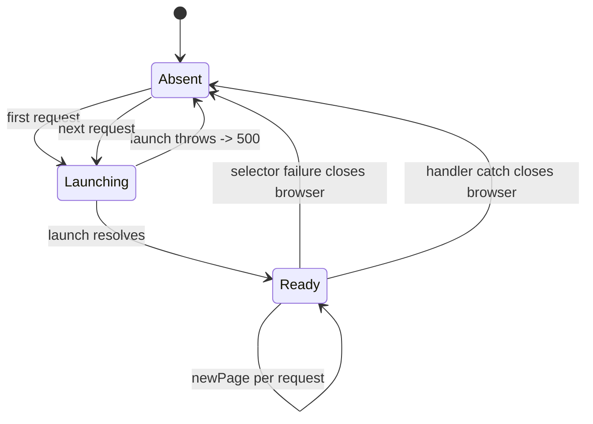
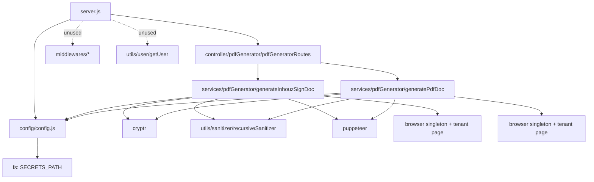

# document_generation_parser_ms

## 1. Summary

A headless-Chrome renderer for Inhouz Sign documents and generic PDF functions. It receives a
Cryptr-encrypted envelope naming a tenant subdomain and a router key, opens the tenant's web page
`/pdfgeneration/inhouzsign/<routerKey>` or `/pdfgeneration/pdffunction/<routerKey>` with Puppeteer,
clicks the render button, waits for the "sending" element, and returns `{ success: true }`. The
actual PDF work happens in the browser page. It lives in its own git repository at
`apps/document_generation_parser_ms/`; every `file:line` below is relative to that repository.

## 2. Stack and commands

Runtime: Node.js, plain CommonJS. `package.json:5-8` declares only:

```json
"scripts": { "test": "echo \"Error: no test specified\" && exit 1",
             "start": "node --max-old-space-size=10000 server.js" }
```

Dockerfile base `node:lts`, installs the Chrome shared libraries, then
`CMD ["npm", "run", "start"]` (`Dockerfile:1-37`). Puppeteer is a direct dependency
`^24.26.1` (`package.json:30`).

Port: `PORT`, read at `server.js:36`. k8s service
`document-generation-parser-ms-cluster-ip-service` maps port `5069`
(`k8s/document-generation-parser-ms-cluster-ip-service.yml:9-10`); `containerPort: 5069`
(`k8s/document-generation-parser-ms-deployment.yml:28-29`). Image
`inhouz/document_generation_parser_ms`, `replicas: 1`
(`k8s/document-generation-parser-ms-deployment.yml:6`, `:17`). An HPA and a VPA also exist
(`k8s/document-generation-parser-ms-hpa.yml`, `-vpa.yml`).

**Package identity mismatch.** `package.json:2-3` says `micro_service_template` / "The base of all
simple erp microservices".

## 3. Entry points

| Entry point | Location | How it starts |
|---|---|---|
| Express app + listener | `server.js:12-25`, `:36-38` | `node --max-old-space-size=10000 server.js` |
| Route registration | `server.js:25` → `controller/pdfGenerator/pdfGeneratorRoutes.js:4-7` | `require(...)(app)` installs 2 POST routes |
| `POST /api/documentgeneratorparser/inhouzsign` | `pdfGeneratorRoutes.js:5` | handler `services/pdfGenerator/generateInhouzSignDoc.js:9` |
| `POST /api/documentgeneratorparser/pdffunction` | `pdfGeneratorRoutes.js:6` | handler `services/pdfGenerator/generatePdfDoc.js:9` |
| Health probe script | `healthcheck.js:1-21` | Standalone `node healthcheck.js`; probes `localhost:$PORT/healthz` |
| Cluster | none active | The `cluster.isMaster` block is entirely commented out (`server.js:40-78`) |
| Mongo connection | **none** | `config.mongoUrl` exists but no `mongoose.connect` is ever called |
| Timers / cron | none | — |

## 4. Module inventory

12 JavaScript files.

| Name | file:line | Responsibility | Public API | Kind |
|---|---|---|---|---|
| `server.js` | `server.js:1-78` | Middleware, route wiring, listener, shutdown stub | process entry | effectful |
| `config()` | `config/config.js:27-59` | Memoised config; secret files (K8s and Cloud Run layouts) with env fallback | `() => config` | effectful (filesystem, env) |
| `readSecret` | `config/config.js:4-24` | Tries `<SECRETS_PATH>/<name>` then `<SECRETS_PATH>/<name>/<name>`, then env | `(name, envFallback) => string` | effectful |
| `pdfGeneratorRoutes(app)` | `controller/pdfGenerator/pdfGeneratorRoutes.js:4-7` | Registers the 2 POST endpoints | `(app) => void` | effectful (mutates app) |
| `generateInhouzSignDoc` | `services/pdfGenerator/generateInhouzSignDoc.js:9-176` | Decrypts envelope, drives Puppeteer against `/pdfgeneration/inhouzsign/<key>` | Express handler | effectful (browser, network, clock) |
| `generatePdfDoc` | `services/pdfGenerator/generatePdfDoc.js:9-178` | Same, against `/pdfgeneration/pdffunction/<key>` | Express handler | effectful (browser, network, clock) |
| `browser` (module singleton) | `generateInhouzSignDoc.js:7`, `generatePdfDoc.js:7` | One lazily launched browser per process, reused across requests | module-level `let` | reactive (shared mutable state) + effectful |
| `recursiveSanitizer` | `utils/sanitizer/recursiveSanitizer.js` | Deep body sanitisation | `(value, sanitizer) => value` | pure |
| `getUser` | `utils/user/getUser.js:18-130` | User/roles/permissions assembly; unreachable (no route calls it) | `async (...) => user` | effectful |
| `createEditByObject` | `utils/user/createEditByObject.js` | Audit byline helper; unused | `(...)` | pure |
| `checkLogin` | `middlewares/login/checkLogin.js:1-140` | Session/company lookup; not mounted | `(req,res,next)` | effectful |
| `moduleAccessCheck` | `middlewares/module/moduleAccessCheck.js:1-40` | Flex module access check; not mounted | `(req,res,next)` | effectful |
| `singleSubdomainValidation` | `middlewares/subdomain/singleSubdomainValidation.js` | Subdomain check; not mounted | `(req,res,next)` | effectful |

No Mongoose schema is declared in this repository (`new Schema()` sites: 0). The model names in
config are unused.

## 5. Side effects

| Effect | Where |
|---|---|
| Filesystem: secret files | `config/config.js:4-24` (two candidate layouts, K8s and Cloud Run) |
| Browser launch | `generateInhouzSignDoc.js:60-108`, `generatePdfDoc.js:60-108` |
| Browser page: viewport, navigation | `generateInhouzSignDoc.js:110-123`, `generatePdfDoc.js:110-125` |
| Browser page: element wait, click, network idle | `generateInhouzSignDoc.js:124-159`, `generatePdfDoc.js:126-161` |
| HTTP out via the browser: tenant site | `https://<subDomain>.<INHOUZ_DOMAIN>/pdfgeneration/...` at `generateInhouzSignDoc.js:120`, `generatePdfDoc.js:122` |
| Browser close on failure | `generateInhouzSignDoc.js:133`, `:167`, `generatePdfDoc.js:135`, `:169` |
| Crypto: Cryptr decrypt | `generateInhouzSignDoc.js:28-29`, `generatePdfDoc.js:28-29` |
| Clock: envelope expiry | `new Date().getTime()` at `generateInhouzSignDoc.js:32`, `generatePdfDoc.js:32` |
| Clock: Puppeteer timeouts | `:65` (`protocolTimeout: 510000` / `310000`), `:84` (30 s), `:111` (60 s), `:122` (60 s), `:125` (60 s), `:148` (600 s) |
| Logging | `console.log` at `generateInhouzSignDoc.js:101`, `:119`, `:129`, `:144`, `:154`, `:165`, `generatePdfDoc.js:101`, `:119`, `:131`, `:146`, `:156`, `:167`, `server.js:33`, `:37` |
| Environment switch | `NODE_ENV` decides headless args, scheme and domain (`generateInhouzSignDoc.js:62`, `:116-118`) |
| No database | no `mongoose.connect` anywhere in the repo |
| No email, no message queue | — |
| K8s secret material | `service-account.json.enc` at the repo root, encrypted; no plaintext credential found |

## 6. State and state transitions

No persistent entity state. The service is a per-request render pipeline plus one process-level
browser singleton.

Browser singleton:



Per-request pipeline (identical in both handlers):

| Transition | Trigger | Guard |
|---|---|---|
| `Received → 400` | `encryptedPayload` missing or not a string | `generateInhouzSignDoc.js:16-25` |
| `Received → 400` | envelope expired or malformed | `:27-43` |
| `Received → 400` | `routerKey` or `subDomain` missing / not string | `:45-58` |
| `Launching → 500` | Puppeteer launch throws | `:100-107` |
| `Navigating → 500` | page load or selector wait fails | `:124-140` |
| `Rendering → Success` | `#sendingGeneratedInhouzSignPdfButton` appears | `:147-150` |
| `Any → 500` | thrown error | `:165-175` |

## 7. Data

No models, schemas, collections or migrations in this repository. Zero `new Schema()` sites. The
seven `mongoose.model(...)` registrations named in the brief are all inside
`middlewares/login/checkLogin.js` and `utils/user/getUser.js`, neither of which is mounted or
called, and no Mongoose connection is opened.

Data in flight only:

| Value | Shape | Where |
|---|---|---|
| Envelope | `{ encryptedPayload }`, decrypts to `{ payload: { routerKey, subDomain }, expirationTimestamp }` | `generateInhouzSignDoc.js:13-35` |
| Success body | `{ success: true }` | `generateInhouzSignDoc.js:163` |
| Error body | `{ error: { message } }` | `:20-24`, `:38-42`, `:53-57`, `:102-106`, `:135-139`, `:170-174` |

The sign-document data itself lives in the tenant's web page and in `inhouzSignDocs`, read by the
web app the browser navigates to, not by this service. The brief's long collection list is
deployment env, not used code.

## 8. Public interfaces

| Route | Request | Response |
|---|---|---|
| `POST /api/documentgeneratorparser/inhouzsign` | `{ encryptedPayload }` → `{ routerKey, subDomain }` | `200 { success: true }`; `400` missing/expired payload; `500` launch/selector/render failure |
| `POST /api/documentgeneratorparser/pdffunction` | `{ encryptedPayload }` → `{ routerKey, subDomain }` | same |

Outgoing: the browser performs `GET https://<subDomain>.<INHOUZ_DOMAIN>/pdfgeneration/inhouzsign/<routerKey>`
(or `/pdffunction/...`) and then whatever XHRs the page makes (`generateInhouzSignDoc.js:120`,
`generatePdfDoc.js:122`). The service itself makes no direct HTTP call.

No CLI beyond `healthcheck.js`. No events, topics or queue subscriptions.

## 9. Configuration

Env var names only.

Secrets: `MONGO_URL` (`mongourl`), `SESSION_SECRET` (`sessionsecret`), `CLIENT_SECRET_KEY`
(`clientsecretkey`), `SENDGRID_API_KEY` (`sendgridapikey`), `DOCUMENT_GENERATION_API_KEY`
(`documentgenerationapikey`), plus `SECRETS_PATH` (`config/config.js:4-55`). Only
`SESSION_SECRET` is actually consumed by a live route (`config/config.js:39` →
`generateInhouzSignDoc.js:28`).

Domains: `INHOUZ_DOMAIN`, `INHOUZ_API_DOMAIN`, `INHOUZ_APP_DOMAIN`. Each has a hard-coded
fallback domain literal in code (`config/config.js:30-32`); the fallbacks are not reproduced here.

Other: `DOCUMENT_GENERATION_SERVER_URL`, `NODE_ENV`, `PORT`, `COOKIE_DOMAIN`, `SMPL_EMAIL`,
`DATA_RULE_EXECUTION_RESULT_MODEL`, `FLEX_FORM_FILE_MODEL`, `FLEX_MODULE_MODEL`,
`FLEX_COLLECTION_MODEL`, `USER_MODEL`, `COMPANY_MODEL`, `ROLE_MODEL`, `PERMISSION_MODEL`,
`USER_ROLES_MODEL`, `SESSION_MODEL`, `SESSION_VALIDATOR_MODEL`, `AUTH_LOG_MODEL`. Constant:
`adminPermission = "admin"` (`config/config.js:49`).

Set in k8s but never read here: the large `*_MODEL`, `*_MS_URL`, `CLOUDFLARE_*`,
`DOCUMENT_GENERATION_PARSER_MS_URL` and identity/contract env blocks
(`k8s/document-generation-parser-ms-deployment.yml`). No values are reproduced.

## 10. Dependencies

| Dependency | Why |
|---|---|
| `puppeteer` | The entire rendering mechanism |
| `express`, `body-parser`, `cors`, `helmet`, `hpp`, `cookie-parser` | Server and middleware (`server.js:2-7`, `:13-24`) |
| `cryptr` | Envelope decryption |
| `sanitizer` | Body sanitisation |
| `mongoose` | Declared and imported by dead middleware; no connection is opened |
| `moment`, `lodash`, `validator`, `shortid`, `crypto-js`, `bcryptjs`, `request-ip` | Carried in dead middleware/model code |
| `@scrapeless-ai/sdk` | Present, only referenced in a commented-out `Puppeteer.connect` block (`generateInhouzSignDoc.js:5`, `:87-93`) |
| `@sendgrid/mail`, `connect-mongo`, `express-session` | Template carry-over; unused |

## 11. Testing

No tests. `package.json:7` is the placeholder that exits 1. No test framework. The handlers
require a running Chrome, a reachable tenant site and a valid envelope, so nothing is unit-testable
as written.

## 12. Known issues and risks

- **Unauthenticated URL construction.** `subDomain` and `routerKey` come from the decrypted body
  and are interpolated straight into a URL (`generateInhouzSignDoc.js:120`, `generatePdfDoc.js:122`).
  `routerKey` is not encoded, so a value containing `?`, `#`, `/` or `..` changes the path or query
  the browser loads. `subDomain` can also contain dots and thus address another host under the
  configured domain.
- **Browser singleton shared across concurrent requests.** One `browser` per process
  (`generateInhouzSignDoc.js:7`, `generatePdfDoc.js:7`) is reused by every request; on any selector
  failure or thrown error the handler closes it (`:133-134`, `:165-168`), killing every other
  in-flight render in the same process. With `replicas: 1` that is a single point of failure.
- **Two independent browser singletons.** Each handler module has its own `let browser`, so the
  pod can hold two Chrome processes, which conflicts with the HPA/VPA memory settings.
- **`--no-sandbox` in production.** `generateInhouzSignDoc.js:68-69`, `generatePdfDoc.js:68-69`.
- **Hard-coded Windows Chrome path.** The else branch of the launch uses
  `C:/Program Files/Google/Chrome/Application/chrome.exe` (`generateInhouzSignDoc.js:97`,
  `generatePdfDoc.js:97`), so any non-`production`/`development` `NODE_ENV` fails on Linux.
- **`NODE_ENV=development` is treated as production** for scheme and domain
  (`:62`, `:116-118`), so a dev deploy renders `https://<sub>.<INHOUZ_DOMAIN>`.
- **CORS pinned to a dev regex.** `origin: /inhouz.localhost/` (`server.js:15`) rejects production
  callers.
- **500 MB JSON body limit.** `server.js:21`; the payload is a small envelope.
- **No database, despite config.** `mongoUrl` and seven model names are loaded but never used; the
  config misleads operators into provisioning MongoDB credentials.
- **Selector copy-paste.** `generatePdfDoc` waits for `#generateInhouzSignPdfButton`
  (`generatePdfDoc.js:126`), the same id as the sign route; if the generic PDF page renames it,
  this route fails silently at 60 s.
- **600 s selector timeout with no job timeout.** A stuck render holds a request for 10 minutes
  (`:148-150`).
- **`shutdownFunction` logs the signal object and exits nothing** (`server.js:32-34`), and
  `uncaughtException` is wired to it, so the process keeps running in an unknown state.
- **`page` is declared but not always cleaned up** on the early-return paths
  (`generateInhouzSignDoc.js:10`); only `page.close()` on success and `browser.close()` on error.
- **Success is only "the button appeared".** `{ success: true }` says nothing about whether a PDF
  was produced or stored.
- **Healthcheck probes a missing route.** `healthcheck.js:7` requests `/healthz`; no such handler
  exists.
- **Dead code shipped**: all middleware, `getUser`, `createEditByObject`, and the `mongoose`
  dependency.
- **Encrypted service-account blob in the repo**: `service-account.json.enc`; no plaintext
  credential is exposed, but key custody should be confirmed.

No plaintext credential literal was found in the source; secrets are read from files or env
(`config/config.js:4-24`).

## 13. Module map



## 14. Open questions

- **Mode: full read?** No. Read in full: `server.js`, `config/config.js`,
  `controller/pdfGenerator/pdfGeneratorRoutes.js`, `services/pdfGenerator/generateInhouzSignDoc.js`,
  `services/pdfGenerator/generatePdfDoc.js`, `Dockerfile`. The remaining ~5 files (middleware,
  `getUser`, `createEditByObject`, `recursiveSanitizer`, `healthcheck.js`) were catalogued by
  directory listing and the brief's greps; none is reachable from a live route except
  `recursiveSanitizer`.
- **Who calls these routes** cannot be confirmed here. The brief says `inhouz_sign_ms`; the
  envelope shape (`routerKey`, `subDomain`) is consistent with a caller that already holds the
  session secret.
- **What the tenant page does with the click** is outside this repository; the render result is not
  returned, only `{ success: true }`.
- **Why a MongoDB config and seven model names exist** in a service that never connects to Mongo is
  unexplained; likely a template inheritance from `micro_service_template`.
- **Whether `@scrapeless-ai/sdk` is intended as the browser provider** is unresolved. It is
  declared and the `Puppeteer.connect` block that would use it is commented out
  (`generateInhouzSignDoc.js:5`, `:87-93`).
- **What the HPA scales on** cannot be determined without opening `k8s/...-hpa.yml`; the handlers
  are long-lived (up to 10 minutes) and memory-heavy, so CPU-based scaling would be a poor fit.
