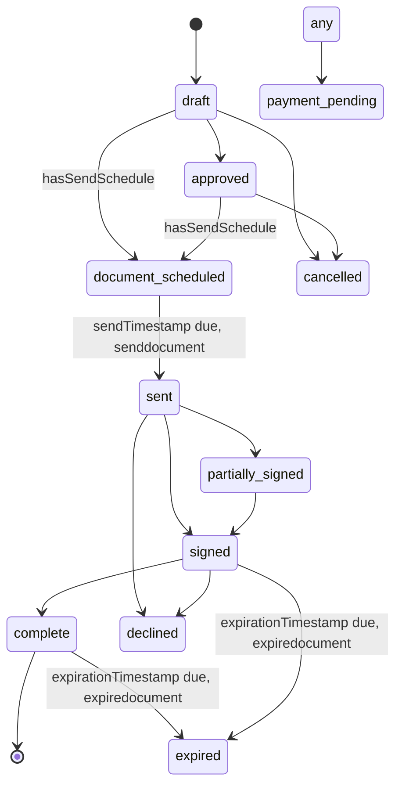
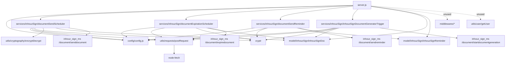

# document_scheduler_ms

## 1. Summary

A timer-driven worker that advances the Inhouz Sign document lifecycle. Every five minutes it
sends scheduled documents, expires overdue documents, and fires signing reminders. Every ten
minutes it triggers generation of completed documents that were never generated. All work is
delegated to `inhouz_sign_ms` over HTTP with Cryptr-encrypted envelopes; this service reads and
filters the sign collections but does not own them. It registers no HTTP route. It lives in its own
git repository at `apps/document_scheduler_ms/`; every `file:line` below is relative to that
repository.

## 2. Stack and commands

Runtime: Node.js, plain CommonJS. `package.json:5-7` declares
`"engines": { "node": ">=12.0.0 <17.5.0" }`. Dockerfile pins `node:16.4-alpine`
(`Dockerfile:1`). Express 4, Mongoose 7, `node-fetch` 2, `cryptr`, `shrink-string`.

Scripts quoted from `package.json:9-12`:

| Script | Command |
|---|---|
| `start` | `node --max-old-space-size=8192 server.js` |
| `test` | `echo "Error: no test specified" && exit 1` |

`Dockerfile:11` runs `CMD ["npm", "run", "start"]`, so the image starts correctly. Port: `PORT`,
read at `server.js:82`; the deployment sets `containerPort: 5066` and a `PORT` env
(`k8s/document-scheduler-ms-deployment.yml:26-28`). No k8s Service object exists (`k8s/` holds only
a Deployment and a VPA). Image `inhouz/document_scheduler_ms`, `replicas: 1`
(`k8s/document-scheduler-ms-deployment.yml:6`, `:17`).

**Package name is wrong.** `package.json:2-3` says `scheduled_task_scheduler_ms`; the repository,
the image and the deployment say `document_scheduler_ms`.

## 3. Entry points

| Entry point | Location | How it starts |
|---|---|---|
| Express app + listener | `server.js:21-33`, `:82-84` | `node server.js`; no routes registered |
| 5-minute job group | `server.js:57-64` | `setInterval(..., 5min)`; calls `documentSendScheduler()`, `documentExpirationScheduler()`, `documentSendReminder()` |
| 10-minute generator trigger | `server.js:65-70` | `setInterval(..., 10min)`; calls `inhouzSignDocumentGeneratorTrigger()` |
| Disabled one-shot generator | `server.js:54-56` | Commented out (was a 5-minute `setTimeout`) |
| Model registration | `server.js:15-19` | Requires the user, user-roles, company, sign-doc and sign-reminder schemas |
| Mongo connect / reconnect | `server.js:35-52`, `:86-98` | `connectMongo()`; 5 s retry on disconnect (`:45-47`) |
| Health probe script | `healthcheck.js:1-21` | Standalone `node healthcheck.js`; probes `localhost:$PORT/healthz` |
| Cluster | none | No `cluster.fork`; one process only |

## 4. Module inventory

22 JavaScript files.

| Name | file:line | Responsibility | Public API | Kind |
|---|---|---|---|---|
| `server.js` | `server.js:1-98` | Middleware, Mongo lifecycle, two intervals, listener | process entry | effectful |
| `config()` | `config/config.js:18-55` | Memoised config; secret files with env fallback; RSA key objects | `() => config` | effectful (filesystem, env) |
| `readSecret` | `config/config.js:5-15` | Reads `SECRETS_PATH/<name>` then env fallback | `(name, envFallback) => string` | effectful |
| `documentSendScheduler` | `services/inhouzSign/documentSendScheduler.js:8-132` | Finds `hasSendSchedule && !sendScheduleProcessed && sendTimestamp <= now && status in [draft, approved]`; posts `senddocument` per document | `async () => void` | effectful (DB, HTTP, clock) |
| `documentExpirationScheduler` | `services/inhouzSign/documentExpirationScheduler.js:7-81` | Finds `hasExpiration && !documentExpired && expirationTimestamp <= now && status != complete`; posts `expiredocument` | `async () => void` | effectful (DB, HTTP, clock) |
| `documentSendReminder` | `services/inhouzSign/documentSendReminder.js:7-60` | Finds reminders with `reminderTimestamp <= now`; posts `sendreminder` | `async () => void` | effectful (DB, HTTP, clock) |
| `inhouzSignDocumentGeneratorTrigger` | `services/inhouzSign/inhouzSignDocumentGeneratorTrigger.js:7-112` | Finds `!documentGenerated && updateTimestamp <= now-20min && status in [complete, expired, cancelled, declined, payment pending]`; posts `startdocumentgeneration` with `waitForCompletion` | `async () => void` | effectful (DB, HTTP, clock, randomness) |
| `postRequest` | `utils/requests/postRequest.js:3-...` | JSON POST with normalised error shape | `async (url, headers, data) => json` | effectful |
| `getRequest` | `utils/requests/getRequest.js` | JSON GET | `async (url) => json` | effectful |
| `deleteRequest` | `utils/requests/deleteRequest.js` | JSON DELETE | `async (url) => json` | effectful |
| `encryptDecrypt` | `utils/cryptography/encryptDecrypt.js` | RSA encrypt/decrypt with configured keys | `(data, encrypt, publicEncrypt, publicDecrypt) => string` | effectful (key material) |
| `recursiveSanitizer` | `utils/sanitizer/recursiveSanitizer.js` | Deep body sanitisation | `(value, sanitizer) => value` | pure |
| `getUser` | `utils/user/getUser.js:18-130` | User/roles/permissions assembly; unused by the worker | `async (...) => user` | effectful |
| `createEditByObject` | `utils/user/createEditByObject.js` | Audit byline helper; unused | `(...)` | pure |
| `checkLogin` | `middlewares/login/checkLogin.js:1-140` | Session/company lookup; not mounted | `(req,res,next)` | effectful |
| `moduleAccessCheck` | `middlewares/module/moduleAccessCheck.js:1-40` | Flex module access check; not mounted | `(req,res,next)` | effectful |
| `singleSubdomainValidation` | `middlewares/subdomain/singleSubdomainValidation.js` | Subdomain check; not mounted | `(req,res,next)` | effectful |
| `inhouzSignDoc` model | `model/inhouzSign/inhouzSignDoc.js:6-774` | The sign document: status enum, scheduling and generation flags, recipients | mongoose model | effectful |
| `inhouzSignReminder` model | `model/inhouzSign/inhouzSignReminder.js:5-45` | Reminder row with index on `{companyId, documentId, reminderTimestamp}` | mongoose model | effectful |
| `company`, `user`, `useRoles` models | `model/company/company.js:5-108`, `model/user/user.js:6-107`, `model/user/useRoles.js:6-51` | Shared schemas; unused by the worker | mongoose models | effectful |

## 5. Side effects

| Effect | Where |
|---|---|
| MongoDB connect / reconnect | `server.js:35-52`, `:86-98` |
| MongoDB read: documents to send | `documentSendScheduler.js:16-42` |
| MongoDB read: documents to expire | `documentExpirationScheduler.js:15-39` |
| MongoDB read: reminders | `documentSendReminder.js:15-25` |
| MongoDB read: documents to generate | `inhouzSignDocumentGeneratorTrigger.js:15-42` |
| Filesystem: secret files | `config/config.js:5-15` |
| HTTP out: `INHOUZ_SIGN_MS_URL/api/inhouzsign/document/senddocument` | `documentSendScheduler.js:112-121` |
| HTTP out: `.../document/expiredocument` | `documentExpirationScheduler.js:64-70` |
| HTTP out: `.../document/sendreminder` | `documentSendReminder.js:45-51` |
| HTTP out: `.../document/startdocumentgeneration` | `inhouzSignDocumentGeneratorTrigger.js:76-83` |
| Clock | `new Date().getTime()` at `documentSendScheduler.js:11`, `documentExpirationScheduler.js:10`, `documentSendReminder.js:9`; `moment()` at `:83`, `:95`, `:106`, `documentExpirationScheduler.js:60`, `documentSendReminder.js:41`, `inhouzSignDocumentGeneratorTrigger.js:10`, `:71` |
| Randomness | `Math.random()` three times in the query key at `inhouzSignDocumentGeneratorTrigger.js:69` |
| Crypto: Cryptr envelopes | `new Cryptr(config.sessionSecret)` at `documentSendScheduler.js:10`, `documentExpirationScheduler.js:9`, `documentSendReminder.js:12`, `inhouzSignDocumentGeneratorTrigger.js:9` |
| Crypto: RSA envelope | `encryptDecrypt(..., true, true)` at `documentSendScheduler.js:100-110` |
| Logging | `console.log` at `server.js:40`, `:43`, `:51`, `:83`; per-batch/per-document logs at `inhouzSignDocumentGeneratorTrigger.js:53`, `:85`, `:90`, `:99`, `:101` |
| Timers | `server.js:45`, `:57`, `:65` |
| K8s secret material | `service-account.json.enc` at the repo root, encrypted; no plaintext credential found |

## 6. State and state transitions

The document lifecycle is owned by `inhouz_sign_ms`; this worker reads flags and triggers
transitions there. The status enum is `draft, sent, partially signed, signed, complete, partially
agreed, agreed, cancelled, awaiting approval, document scheduled, approved, expired, payment
pending, declined` (`model/inhouzSign/inhouzSignDoc.js:48-58`).

| Transition this worker triggers | Trigger | Guard (query filter) | Where |
|---|---|---|---|
| `draft`/`approved` → `sent` (delegated) | 5-minute tick | `hasSendSchedule: true`, `sendScheduleProcessed: false`, `sendTimestamp <= now`, `status in [draft, approved]` | `documentSendScheduler.js:17-26` |
| any non-`complete` → `expired` (delegated) | 5-minute tick | `hasExpiration: true`, `documentExpired: false`, `expirationTimestamp <= now`, `status not in [complete]` | `documentExpirationScheduler.js:16-27` |
| reminder dispatched | 5-minute tick | `reminderTimestamp <= now` (no `reminderSendCount` guard, no dedupe) | `documentSendReminder.js:15-19` |
| `* → documentGenerated: true` (delegated) | 10-minute tick | `documentGenerated: false`, `updateTimestamp <= now-20min`, `status in [complete, expired, cancelled, declined, payment pending]` | `inhouzSignDocumentGeneratorTrigger.js:16-29` |

Guards are read-only here; the actual field writes happen in `inhouz_sign_ms`. Because the worker
does not set `sendScheduleProcessed`, `documentExpired` or `documentGenerated`, the same rows are
re-selected on the next tick unless the downstream service flips the flag.

## 7. Data

Five schemas are declared; only two are read by the worker.

| Model file | Schema | Collection env var | Key fields for this worker |
|---|---|---|---|
| `model/inhouzSign/inhouzSignDoc.js:6-774` | Inhouz Sign document | `INHOUZ_SIGN_DOC_MODEL` | `companyId` (`:39`), `status` enum (`:48-58`), `documentGenerated` (`:64`), `hasExpiration` (`:665`), `documentExpired` (`:687`), `hasSendSchedule` (`:707`), `sendScheduleProcessed` (`:711`), `sendTimestamp` (`:717`), `expirationTimestamp` (`:76`), `updateTimestamp` (`:85`), `createdById` (`:78`), `createdByEmail` (`:725`), `createdBySubscriber` (`:737`), `createdBySubscriptionServiceId` (`:739`), `environment` (`:17`) |
| `model/inhouzSign/inhouzSignReminder.js:5-45` | Sign reminder | `INHOUZ_SIGN_REMINDER_MODEL` | `email` required lowercased, `companyId` required, `documentId` required, `environment`, `createTimestamp` required, `reminderTimestamp` required, `repeatReminderIntervalDays`, `emailSubject`, `emailMessage`, `reminderSendCount` default 0; compound index `{companyId, documentId, reminderTimestamp}` (`:42-45`) |
| `model/company/company.js:5-108` | Company | `COMPANY_MODEL` | shared, unused |
| `model/user/user.js:6-107` | User | `USER_MODEL` | shared, unused |
| `model/user/useRoles.js:6-51` | User roles | `USER_ROLES_MODEL` | shared, unused |

**Shared collections.** `inhouzSignDocs` (per the deployment value at
`k8s/document-scheduler-ms-deployment.yml` for `INHOUZ_SIGN_DOC_MODEL`) is also written by
`inhouz_sign_ms`, the document-generation parser and the Inhouz Sign web app. `inhouzSignReminders`
is written by `inhouz_sign_ms` when a reminder is scheduled. This service only reads both. Note the
collection values are deployment state, not code.

## 8. Public interfaces

No inbound HTTP route, no CLI command, no queue subscription. Four outbound calls, all to
`inhouz_sign_ms`:

| Outbound call | Headers | Body | Where |
|---|---|---|---|
| `POST {INHOUZ_SIGN_MS_URL}/api/inhouzsign/document/senddocument` | `serverEncryptedHeader` **or** `serverEncryptedAccessHeader` (Cryptr) | `{ encryptedPayload }` (RSA) | `documentSendScheduler.js:112-121` |
| `POST .../document/expiredocument` | none | `{ encryptedPayload }` (Cryptr) | `documentExpirationScheduler.js:64-70` |
| `POST .../document/sendreminder` | none | `{ encryptedPayload }` (Cryptr), payload = the whole reminder document | `documentSendReminder.js:38-51` |
| `POST .../document/startdocumentgeneration` | none | `{ encryptedPayload, serverEncrypted: true, waitForCompletion: true }` | `inhouzSignDocumentGeneratorTrigger.js:76-83` |

Envelope payload shapes:

- send: `{ payload: { documentId, companyId }, expirationTimestamp }`, 50 s TTL
  (`documentSendScheduler.js:100-110`).
- expire: same shape, 50 s TTL (`documentExpirationScheduler.js:54-62`).
- reminder: `{ payload: reminder, expirationTimestamp }`, 50 s TTL
  (`documentSendReminder.js:38-43`).
- generate: `{ payload: { documentId, companyId, queryKey }, expirationTimestamp }`, 50 s TTL
  (`inhouzSignDocumentGeneratorTrigger.js:64-73`).

Access headers for `senddocument`:

- when `createdBySubscriber || createdBySystemUser`:
  `{ payload: { assetOwnerCompanyId, companyId, email, subscriptionId, subscriptionServiceId, environment, _id, userId, isSystemUser, isInternal }, expirationTimestamp }`
  200 s TTL (`documentSendScheduler.js:68-85`).
- otherwise: `{ payload: { user: { _id, companyId } }, expirationTimestamp }` 200 s TTL
  (`documentSendScheduler.js:86-97`).

## 9. Configuration

Env var names only.

Secrets: `MONGO_URL` (`mongourl`), `SESSION_SECRET` (`sessionsecret`), `CLIENT_SECRET_KEY`
(`clientsecretkey`), `CLIENT_PUBLIC_KEY` (`clientpublickey`), `SENDGRID_API_KEY`
(`sendgridapikey`), plus `SECRETS_PATH` (`config/config.js:5-49`).

Model names: `USER_MODEL`, `USER_ROLES_MODEL`, `COMPANY_MODEL`, `ROLE_MODEL`, `PERMISSION_MODEL`,
`SESSION_MODEL`, `SESSION_VALIDATOR_MODEL`, `AUTH_LOG_MODEL`, `INHOUZ_SIGN_DOC_MODEL`,
`INHOUZ_SIGN_REMINDER_MODEL`, `SCHEDULED_TASK_PARSER_MS_URL` (as a URL, despite the name),
`FLEX_FORM_FILE_MODEL`, `FLEX_MODULE_MODEL`, `FLEX_COLLECTION_MODEL`, `FORM_MODEL`,
`DATA_RULE_EXECUTION_RESULT_MODEL`.

Other: `INHOUZ_SIGN_MS_URL`, `SMPL_EMAIL`, `COOKIE_DOMAIN`, `PORT`, `NODE_ENV`. Constant:
`adminPermission = "admin"` (`config/config.js:38`).

Set in k8s but never read here (examples from the deployment env block): `CLOUDFLARE_API_URL`,
`CLOUDFLARE_ZONE_ID`, `APP_BUILDER_MS_URL`, `PAYMENT_MS_URL`,
`DOCUMENT_GENERATION_PARSER_MS_URL`, `REDIS_PORT`, and the large `*_MODEL` set for app-builder,
payment, contract and sign collections (`k8s/document-scheduler-ms-deployment.yml:100-290`). No
values are reproduced.

## 10. Dependencies

| Dependency | Why |
|---|---|
| `express`, `body-parser`, `cors`, `helmet`, `hpp`, `cookie-parser` | Listener and middleware (`server.js:2-8`, `:22-33`); no route uses them |
| `mongoose` | All four read queries |
| `node-fetch` | All outbound calls (`utils/requests/*.js`) |
| `cryptr` | Default envelope for every outbound call |
| `node-rsa` | RSA envelope in `utils/cryptography/encryptDecrypt.js` and config key objects |
| `moment` | Timestamps and expiry |
| `moment-timezone` | Present, not imported by any live path |
| `shrink-string` | Present, not imported by any live path |
| `lodash`, `sanitizer`, `validator` | Present in middleware/model code the worker never executes |
| `shortid` | Present, not used by the worker (the generator uses `Math.random`) |
| `@sendgrid/mail`, `bcryptjs`, `crypto-js`, `request-ip`, `connect-mongo`, `express-session` | Template carry-over; unused by the worker |

## 11. Testing

No tests. `package.json:10` is the placeholder that exits 1. No test framework, no fixtures.
Coverage: none. The four schedulers can only be exercised against a real Mongo and a stub
`inhouz_sign_ms`; no clock injection exists, so the time filters cannot be unit-tested as written.

## 12. Known issues and risks

- **Fire-and-forget in three of four schedulers.** `documentSendScheduler`, `documentExpirationScheduler`
  and `documentSendReminder` call `postRequest` without `await` (`documentSendScheduler.js:112`,
  `documentExpirationScheduler.js:64`, `documentSendReminder.js:45`), so failures are dropped and
  the loop advances regardless.
- **Unbounded fan-out.** Each page of up to 1000 documents opens that many requests at once
  (`documentSendScheduler.js:57-122`, `documentExpirationScheduler.js:48-71`,
  `documentSendReminder.js:36-52`).
- **Reminders are re-sent on every tick.** The query has no `reminderSendCount` or processed guard
  (`documentSendReminder.js:15-19`), and `reminderSendCount` exists in the schema but is never
  incremented here. Every 5 minutes the same due reminders are re-posted.
- **The generator trigger bypasses its own concurrency comment.** `limit = 50` with the comment
  "Process 5 documents at a time" and "max 5 at a time"; it actually fires 50 concurrent
  `waitForCompletion` requests and awaits the batch (`inhouzSignDocumentGeneratorTrigger.js:12`,
  `:55-100`).
- **Weak query key.** `queryKey` is `Math.random()` concatenated three times with no separator
  (`inhouzSignDocumentGeneratorTrigger.js:69`); the string is not a reliable nonce and can
  collide.
- **Paging over a mutating query.** All four use `skip += limit` while the consumer updates the
  filter fields, so rows can be skipped or double-processed between pages
  (`documentSendScheduler.js:41-54`, `documentExpirationScheduler.js:34-46`,
  `inhouzSignDocumentGeneratorTrigger.js:37-51`).
- **Error path advances the page.** On a query error the send and generator loops set
  `docCount = limit`, add a page to `skip`, and continue (`documentSendScheduler.js:48-52`,
  `inhouzSignDocumentGeneratorTrigger.js:44-48`), so a transient DB error silently skips 1000
  documents.
- **Expiration ignores signed-but-not-complete documents.** The filter excludes only `complete`
  (`documentExpirationScheduler.js:22-26`), so a `signed` or `partially signed` document can be
  expired by the downstream service.
- **Reminder payload is the raw document.** The entire reminder row, including `email` and
  `emailMessage`, is encrypted and posted (`documentSendReminder.js:40`). Any field added to the
  schema later leaves the service automatically.
- **No inbound auth and no route.** The listener exists only for a port; there is nothing to
  harden, but also no health endpoint.
- **Healthcheck probes a missing route.** `healthcheck.js:7` requests `/healthz`; no such handler
  exists (`server.js` registers none).
- **The 5-minute interval runs three multi-page loops serially** (`server.js:57-64`). If the send
  pass takes longer than 5 minutes, intervals overlap and the same documents are posted twice.
- **`shutdownFunction` ignores the signal argument** and closes Mongo without draining in-flight
  posts (`server.js:76-80`).
- **Package name is wrong** (`package.json:2`).
- **Encrypted service-account blob in the repo**: `service-account.json.enc` at the root. No
  plaintext credential is exposed, but key custody should be confirmed.
- **Dead code shipped**: all middleware, `getUser`, `getRequest`, `deleteRequest`, `encryptDecrypt`
  (used only by one scheduler), and three of five models.

No plaintext credential literal was found in the source.

## 13. Module map

## 14. Open questions

- **Mode: full read?** No. Read in full: `server.js`, `config/config.js`, all four
  `services/inhouzSign/*.js`, `Dockerfile`; read partially: the sign-doc schema (field grep plus
  the status enum and lines 48-60, 665-740), the reminder schema (first 45 lines). The remaining
  ~14 files (middleware, `getUser`, request helpers, `encryptDecrypt`, user/company/useRoles
  models, `healthcheck.js`) were catalogued by directory listing and the brief's greps. None is
  executed by the worker except the request helpers.
- **Which service flips `sendScheduleProcessed`, `documentExpired` and `documentGenerated`** is
  assumed to be `inhouz_sign_ms` from the endpoint names; that code is not in this repository.
- **Whether `waitForCompletion: true` is honoured** by `startdocumentgeneration` cannot be
  confirmed from this side.
- **The real collection names** are `*_MODEL` env values. The deployment shows
  `INHOUZ_SIGN_REMINDER_MODEL=inhouzSignReminders` (`k8s/document-scheduler-ms-deployment.yml`),
  but `INHOUZ_SIGN_DOC_MODEL` was not opened; the brief's mapping is not treated as fact.
- **Why `SCHEDULED_TASK_PARSER_MS_URL` is configured** in `config/config.js:41` is unexplained.
  Nothing reads it in this repository.
- **The generator's intended batch size** is contradictory in the code itself (50 vs the "5 at a
  time" comments at `:12` and `:98`); the intended value cannot be recovered from the source.
- **Whether expired documents should include `signed`** is a product question; the code excludes
  only `complete`.
