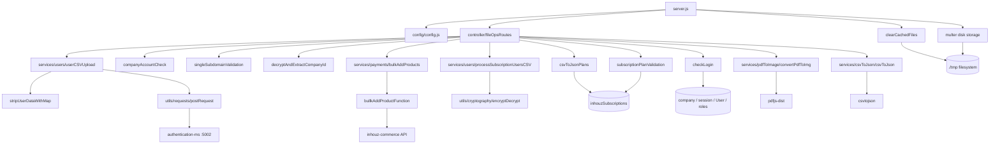

# file_operations_ms

## 1. Summary

`file_operations_ms` turns uploaded files into records. It accepts CSV and PDF uploads over five
POST routes, writes the file to a local `tmp` directory, parses it with `csvtojson` or `pdfjs-dist`,
maps columns through a caller-supplied mapping, and forwards the result to the owning service over
HTTP: bulk users go to `authentication_ms`, bulk products go to the inhouz-commerce API, and the
CRM upload path is disabled. It has no stored data of its own beyond the shared auth tables.
Repository: `apps/file_operations_ms/` (repo id `file_operations_ms`).

## 2. Stack and commands

| Item | Value | Source |
|---|---|---|
| Runtime | Node.js `>=12.0.0 <17.5.0` | `package.json:6-8` |
| Container base | `node:16.4-alpine` | `Dockerfile:1` |
| Framework | Express 4 | `package.json` dependencies |
| Uploads | `multer` with disk storage into `./tmp` | `server.js:10,62-76` |
| CSV | `csvtojson` | `services/csvToJson/csvToJson.js:3` |
| PDF | `pdfjs-dist/legacy/build/pdf.js` | `utils/pdfToImg/getPdfImages.js:2` |
| Start | `npm start` → `node server.js` | `package.json:11` |
| Test | `npm test` → `echo "Error: no test specified" && exit 1` | `package.json:10` |
| Port | `PORT` (k8s sets 5008) | `server.js:109`, `k8s/file-operations-ms-cluster-ip-service.yml:10` |
| Replicas | 1 | `k8s/file-operations-ms-deployment.yml:6` |

## 3. Entry points

| Entry point | file:line | How it starts |
|---|---|---|
| HTTP server | `server.js:109` | `node server.js` |
| Cluster master | `server.js:25-46` | forks workers; **only the master runs the tmp-file sweeper** |
| Route table | `server.js:78` → `controller/fileOpsRoutes.js:17` | five live POST routes |
| Temp-file sweeper | `server.js:44-46` → `clearCachedFiles` at `server.js:128` | master-only `setInterval` every 60 s; deletes files older than 3 minutes |
| Multer storage config | `server.js:62-77` | exported as `{ multerStorage }`; the route file imports it from `../server` |
| Mongo connect | `server.js:114-126` | boot, and on `disconnected` after 5 s (`server.js:87-94`) |
| Graceful shutdown | `server.js:98-107` | `SIGINT`, `SIGTERM`, `uncaughtException` |
| Models | `server.js:17-23` | six models registered eagerly |
| Health probe | `healthcheck.js` | GETs `localhost:$PORT/healthz` |

The `module.exports = { multerStorage }` at `server.js:77` followed by `require("./controller/
fileOpsRoutes")` at `server.js:78` is a circular require that works because the export precedes the
import.

## 4. Module inventory

| Module | file:line | Responsibility | Public API | Kind |
|---|---|---|---|---|
| server | `server.js:1` | Bootstrap, multer disk storage, tmp sweeper | entry | effectful |
| config | `config/config.js:18` | Env + secret-file cache, RSA keys | default object | effectful (env, fs) |
| fileOpsRoutes | `controller/fileOpsRoutes.js:17` | 5 live routes (a 6th is commented out) | `(app)=>void` | effectful |
| checkLogin | `middlewares/login/checkLogin.js` | session + company hydration | `(req,res,next)` | effectful (Mongo, crypto) |
| companyAccountCheck | `middlewares/company/companyAccountCheck.js` | company active guard | `(req,res,next)` | effectful |
| subdomainCheck | `middlewares/subdomain/singleSubdomainValidation.js` | subdomain scoping | `(req,res,next)` | effectful |
| decryptAndExtractCompanyId | `middlewares/company/decryptAndExtractCompanyId.js` | decrypts the company id for the unauthenticated CSV route | `(req,res,next)` | effectful (crypto) |
| csvToJsonPlans | `middlewares/company/csvToJsonPlans.js` | resolves the caller's plan for `csvtojson` | `(req,res,next)` | effectful (Mongo) |
| subscriptionPlanValidation | `middlewares/company/subscriptionPlanValidation.js:6` | plan gate | `(req,res,next)` | effectful (Mongo read) |
| moduleAccessCheck | `middlewares/module/moduleAccessCheck.js` | flex-module guard; **not wired into any route** | `(req,res,next)` | effectful |
| userCSVUpload | `services/users/userCSVUpload.js:11` | CSV → users array → `authentication_ms` | `(req,res)` | effectful (fs, HTTP) |
| processSubscriptionUsersCSV | `services/users/processSubscriptionUsersCSV.js:13` | CSV → subscription user array with restriction flags | `(req,res)` | effectful (fs, crypto, Mongo) |
| csvToJson | `services/csvToJson/csvToJson.js:6` | CSV → JSON, returned to the client | `(req,res)` | effectful (fs) |
| bulkAddProducts | `services/payments/bulkAddProducts.js:9` | CSV → product array, fires a batch upload | `(req,res)` | effectful (fs, HTTP, background) |
| convertPdfToImg | `services/pdfToImage/convertPdfToImg.js` | PDF → images | `(req,res)` | effectful (fs, CPU) |
| uploadCrmFile | `services/crm/uploadCrmFile.js` | CSV → CRM customers/contacts | `(req,res)` | effectful (fs, HTTP) — **route commented out** |
| getHello | `services/helloWorld/getHello.js:2` | Registers a `'User'` model and returns a string; not routed | function | effectful (Mongo) |
| stripUserDataWithMap | `utils/userUpload/stripUserDataWithMap.js` | CSV row → user object using the map | function | pure |
| stripCustomerData | `utils/crmUpload/stripCustomerData.js` | CSV row → CRM object using the map | function | pure |
| bullkAddProductFunction | `utils/payment/bullkAddProductFunction.js:128` | Batch product POST loop | async function | effectful (HTTP) |
| getPdfImages | `utils/pdfToImg/getPdfImages.js:2` | Renders PDF pages to images | async function | effectful (fs, CPU) |
| sendEmail | `utils/sendEmail/sendEmail.js` | SendGrid send | async function | effectful (network) |
| bulkProductUploadConfirmationEmail | `utils/sendEmail/product/bulkProductUploadConfirmationEmail.js` | Email template for bulk upload | function | pure |
| getUser | `utils/user/getUser.js:19` | user + roles + permissions hydration | async function | effectful (Mongo) |
| createEditByObject | `utils/user/createEditByObject.js` | author sub-document | function | pure |
| recursiveSanitizer | `utils/sanitizer/recursiveSanitizer.js` | deep sanitize | function | pure |
| encryptDecrypt | `utils/cryptography/encryptDecrypt.js` | RSA/AES envelope | function | effectful (crypto) |
| dotNotationMapper | `utils/data/dotNotationMapper.js` | dot-path get | function | pure |
| getRequest / postRequest / deleteRequest | `utils/requests/*.js` | `node-fetch` wrappers | functions | effectful |

## 5. Side effects

| Effect | Where | Detail |
|---|---|---|
| Filesystem write | `server.js:62-76` (multer disk storage) | uploads land in `./tmp`, named `<field>-<ObjectId>-<epochMs>.<ext>` |
| Filesystem read | `services/*/*.js` (`csvtojson().fromFile`, `pdfjs-dist`) | reads the uploaded file back |
| Filesystem delete | `services/users/userCSVUpload.js:33`, `csvToJson.js:24`, `bulkAddProducts.js:56`, `processSubscriptionUsersCSV.js:85` | `fs.unlink` after parse |
| Filesystem sweep | `server.js:128-151` | master process deletes `tmp` files older than 3 min |
| HTTP → `authentication_ms` | `services/users/userCSVUpload.js:52-56` | `POST {AUTHENTICATION_MS_URL}/api/users/addusers` |
| HTTP → inhouz-commerce | `utils/payment/bullkAddProductFunction.js:128` | `POST {INHOUZ_BASE_URL}/api/inhouzcommerce/product/servercreate` |
| HTTP → CRM | `services/crm/uploadCrmFile.js:52,55` | `/api/crm/customer/addcustomers`, `/api/crm/contact/addContacts` — dead path |
| MongoDB | `middlewares/*`, `utils/user/getUser.js`, `middlewares/company/subscriptionPlanValidation.js:6` | shared auth tables |
| SendGrid | `utils/sendEmail/sendEmail.js` | `sendGridApiKey` from config |
| HTTP listener | `server.js:109` | Express on `PORT` |
| Env read | `config/config.js:20-53` | cached at module scope |
| Crypto | `config/config.js:45-52`, `encryptDecrypt.js` | node-rsa keys |
| Clock | `server.js:71,142`, multer filename | epoch timestamps |
| Randomness | `server.js:69` | `new mongoose.Types.ObjectId()` in the upload filename |
| Logging | `server.js:32-110,133,148`; every service `catch` | `console.*` only |
| Cluster fork | `server.js:25-42` | worker processes |

## 6. State and state transitions

The service holds no domain state. The only lifecycle is the uploaded file and the request:

| From | To | Trigger | Guard |
|---|---|---|---|
| request received | file on disk | multer `upload.single(...)` (`server.js:62-76`) | field name must match (`csv` or `pdf`) |
| file on disk | parsed | `csvtojson().fromFile` / `pdfjs` | file readable |
| parsed | unlinked | `fs.unlink` in the handler | always attempted, error only logged |
| parsed | forwarded | `postRequest` / `bullkAddProductFunction` | mapping object non-empty |
| request | responded | handler returns | — |
| file on disk | deleted by sweeper | `clearCachedFiles` every 60 s | file older than 3 min (`server.js:142`) |

`bulkproductupload` is asynchronous: the HTTP response `Product upload batch process has started.`
is sent before the per-product POSTs finish (`bulkAddProducts.js:64-73`), so the request has no
terminal success state from the client's view.

## 7. Data

| Model | Env var | Collection | Key fields | Source |
|---|---|---|---|---|
| Company | `COMPANY_MODEL` | `company` | `_id`, `status` | `model/company/company.js:5` |
| InhouzSubscription | `INHOUZ_SUBSCRIPTIONS_MODEL` | `inhouzSubscriptions` | plan, `active` | `model/inhouzSubscription/inhouzSubscription.js:5` |
| User | `USER_MODEL` | `User` | identity | `model/user/user.js:6` |
| UserRoles | `USER_ROLES_MODEL` | `userRoles` | user ↔ role | `model/user/useRoles.js:6` |
| Role | `ROLE_MODEL` | `roles` | role → permissions | `model/rolesAndPermissions/roles.js:6` |
| Permission | `PERMISSION_MODEL` | `permissions` | permission ids | `model/rolesAndPermissions/permissions.js:6` |
| Session | `SESSION_MODEL` | `session` | cookie sessions | `model/session/session.js:5` |

There is no collection owned by this service. Every model is one of the shared platform auth or
subscription tables (`company`, `User`, `roles`, `permissions`, `userRoles`, `session`,
`inhouzSubscriptions`), so the data coupling is total: this service can read and gate on them but
owns none of them.

`services/helloWorld/getHello.js:2` registers the `User` model **by the literal string `'User'`**
rather than `config.userModel`. If `USER_MODEL` is not `User`, that registration creates a second
model for the same schema. The module is not imported anywhere.

The uploaded file is transient state on disk, not in Mongo. There is no model of the upload itself.

## 8. Public interfaces

All routes are `POST`. Uploaded files use the multer field name shown.

| Method | Path | Middleware chain | Handler | File field |
|---|---|---|---|---|
| POST | `/api/fileoperations/adduserscsv` | isLoggedIn → companyAccountCheck → subdomainCheck → upload.single('csv') | `userCSVUpload.js:11` | `csv`, plus `csvMap` in the body |
| POST | `/api/fileoperations/subcriptionusercsv` | upload.single('csv') | `processSubscriptionUsersCSV.js:13` | `csv` — **no auth middleware**; note the misspelled path |
| POST | `/api/fileoperations/pdftoimage` | isLoggedIn → upload.single('pdf') | `convertPdfToImg.js` | `pdf` |
| POST | `/api/fileoperations/csvtojson` | decryptAndExtractCompanyId → csvToJsonPlans → subscriptionPlanValidation → upload.single('csv') | `csvToJson.js:6` | `csv` |
| POST | `/api/fileoperations/bulkproductupload` | isLoggedIn → companyAccountCheck → upload.single('csv') | `bulkAddProducts.js:9` | `csv`, plus `mappings` JSON |

The sixth route in the brief, `POST /api/fileoperations/crmupload/:module`, is **commented out**
(`controller/fileOpsRoutes.js:19`), along with its service import (`:3`).

Response shapes:

| Route | Success | Error |
|---|---|---|
| `adduserscsv` | passthrough of `authentication_ms` `addusers` response | `{error:{message}}` |
| `subcriptionusercsv` | array of user objects, optionally with restriction flags (`processSubscriptionUsersCSV.js:291`) | HTTP 400 / 403 (`:21,:48,:71,:140`) |
| `pdftoimage` | images | see handler |
| `csvtojson` | `{ JSON: [...] }` | `{ error:{message}, JSON: [] }` (`csvToJson.js:9-14,46-51`) |
| `bulkproductupload` | `{ message: 'Product upload batch process has started.' }` | HTTP 400 / 500 |

### Outbound calls

| Target | Path | Site |
|---|---|---|
| `authentication_ms` (5002) | `POST /api/users/addusers` | `userCSVUpload.js:53` |
| inhouz-commerce (through `INHOUZ_BASE_URL`) | `POST /api/inhouzcommerce/product/servercreate` | `bullkAddProductFunction.js:128` |
| CRM (through `CRM_MS_URL`) | `POST /api/crm/customer/addcustomers`, `/api/crm/contact/addContacts` | `uploadCrmFile.js:52,55` — dead |

### Kubernetes

ClusterIP `file-operations-ms-cluster-ip-service`, 5008 → 5008
(`k8s/file-operations-ms-cluster-ip-service.yml:4,10-11`). Deployment
`file-operations-ms-deployment`, image `inhouz/file_operations_ms`, replicas 1
(`k8s/file-operations-ms-deployment.yml:4,6,17`). HPA and VPA manifests exist.

### Called by

None found. No other service in the fleet posts to this service in the extract; the client is the
web app.

## 9. Configuration

**Infrastructure:** `PORT`, `MONGO_URL`, `NODE_ENV`, `SECRETS_PATH`.

**Secret files** (`config/config.js:5-15`): `mongourl`, `sessionsecret`, `clientsecretkey`,
`clientpublickey`, `sendgridapikey`; env fallbacks `MONGO_URL`, `SESSION_SECRET`,
`CLIENT_SECRET_KEY`, `CLIENT_PUBLIC_KEY`, `SENDGRID_API_KEY`.

**Models:** `USER_MODEL`, `COMPANY_MODEL`, `ROLE_MODEL`, `PERMISSION_MODEL`, `USER_ROLES_MODEL`,
`SESSION_MODEL`, `SESSION_VALIDATOR_MODEL`, `AUTH_LOG_MODEL`, `INHOUZ_SUBSCRIPTIONS_MODEL`,
`FLEX_FORM_FILE_MODEL`, `FLEX_MODULE_MODEL`, `FLEX_COLLECTION_MODEL`, `FORM_MODEL`,
`DATA_RULE_EXECUTION_RESULT_MODEL`.

**Service URLs:** `AUTHENTICATION_MS_URL`, `CRM_MS_URL`, `INHOUZ_BASE_URL`.

**Other:** `COOKIE_NAME`, `COOKIE_DOMAIN`, `SMPL_EMAIL`, `STRIPE_API_KEY`, `PAYMENT_MS_URL`.

`CRM_MS_URL` is read at `config/config.js:43` but **is not in the k8s deployment env list**, so on
the cluster it resolves to `undefined`; only the disabled CRM route would use it.

Set in k8s but not read here: the full shared collection block (`CHURN_TRACKER_MODEL`,
`CONTACTS_MODEL`, `CUSTOMERS_MODEL`, `EXCHANGE_RATE_CACHE_MODEL`, `FLEX_API_MODEL`,
`INHOUZ_APP_MODEL`, `IP_ADDRESS_LOCATION_MODEL`, `IP_LOCATION_FINDER_URL`,
`OPEN_EXCHANGE_RATES_*`, `PAYMENT_*`, `PAYOUT_ACCOUNT_MODEL`, `SERVICE_DISCOUNT_MODEL`,
`SUBSCRIBED_PACKAGE_MODEL`, `SUBSCRIBER_*`, `SUBSCRIPTION_*`, `VERSION_TRACKER_MODEL`,
`INHOUZ_FROM_EMAIL`, `SESSION_SECRET`).

## 10. Dependencies

| Package | Why |
|---|---|
| `express`, `body-parser`, `cookie-parser`, `cors`, `helmet`, `hpp`, `dotenv` | HTTP stack |
| `multer` | disk upload storage |
| `csvtojson` | CSV → JSON |
| `pdfjs-dist` | PDF page rendering |
| `app-root-path` | resolves `${appRoot}/tmp` from any module |
| `mongoose` | shared auth models |
| `node-fetch` | outbound calls |
| `node-rsa`, `cryptr`, `crypto-js` | envelope + session crypto |
| `lodash` | `isEmpty` |
| `moment` | sweeper age check |
| `sanitizer` | body sanitization |
| `validator` | role/permission schema validation |
| `shortid` | id generation |
| `@sendgrid/mail` | email |
| `bcryptjs`, `connect-mongo`, `express-session`, `request-ip`, `window` | declared; `window` is required by `utils/pdfToImg/getPdfImages.js:1` (a DOM shim), the others were not found in an import in this pass |

## 11. Testing

None. `npm test` exits 1 (`package.json:10`). No test directory or test file. Verification is
manual: start the service, upload a CSV with a mapping, and check the downstream service received
the rows.

## 12. Known issues and risks

| Issue | Evidence |
|---|---|
| **`/api/fileoperations/subcriptionusercsv` has no authentication middleware** — anyone who can reach the service can post a CSV and get back a processed user array | `fileOpsRoutes.js:20` vs `:18,:23` |
| That same route returns user data in the response body, which makes the missing auth a data-exposure path, not just an upload path | `processSubscriptionUsersCSV.js:291` |
| Multer writes to the **relative** path `./tmp`, but the sweeper reads `${appRoot}/tmp`; if the worker's cwd differs from the app root, uploads are never swept | `server.js:63` vs `server.js:130` |
| Only the cluster **master** runs the sweeper, so the sweeper is not stopped by the worker lifecycle and writes to a directory the workers may not share | `server.js:44-46` |
| The sweeper parses the timestamp out of the filename with `split(".")` then `split("-")`; a filename whose original extension contains a `-` or extra dots yields `NaN` and the file is never deleted | `server.js:138-142` |
| Uploads have no size limit at the multer layer; only the JSON body limit (20 MB) applies, and file bodies bypass it | `server.js:58,62-76` |
| Uploads have no MIME allow-list beyond the extension derived from `file.mimetype` | `server.js:73` |
| `bulkproductupload` responds before the batch finishes and never reports per-row failures to the caller | `bulkAddProducts.js:64-73` |
| `.catch` in `bulkAddProducts` returns an object instead of sending a response, so a conversion failure leaves the request hanging | `bulkAddProducts.js:75-82` vs the `try` block |
| `getHello.js` registers `mongoose.model('User')` with a literal name instead of `config.userModel` | `services/helloWorld/getHello.js:2` |
| `moduleAccessCheck` is present but wired into no route | `fileOpsRoutes.js:1-15` |
| The CRM service and route are dead but still compiled and still read `CRM_MS_URL` | `fileOpsRoutes.js:3,19`, `config/config.js:43` |
| The route path is misspelled `subcriptionusercsv` (missing "s" in "subscription"), so clients must reproduce the typo | `fileOpsRoutes.js:20` |
| Healthcheck probes `/healthz`, which is not registered | `healthcheck.js` vs `fileOpsRoutes.js:18-23` |
| No sendEmail import was found on the live paths even though SendGrid is configured and a template exists | `utils/sendEmail/*` |
| 20 MB JSON limit alongside multipart uploads | `server.js:58` |

No credential was found embedded in a source file. Secrets come from `SECRETS_PATH` files or env
(`config/config.js:5-15`).

## 13. Module map

## 14. Open questions

**Skipped, and why.**

- `services/users/processSubscriptionUsersCSV.js` (300 lines) was grepped, not read. Its
  restriction logic, the `403` branch at `:140`, and its use of `encryptDecrypt` at `:57` are not
  documented.
- `services/pdfToImage/convertPdfToImg.js`, `utils/pdfToImg/getPdfImages.js`,
  `utils/payment/bullkAddProductFunction.js` (165 lines) and `services/crm/uploadCrmFile.js` were
  not opened; their outbound calls come from grep only.
- `middlewares/company/decryptAndExtractCompanyId.js`, `csvToJsonPlans.js` and
  `subscriptionPlanValidation.js` were not read; their guards are inferred from names and the one
  grep hit.
- `utils/sendEmail/*` beyond their existence.
- `k8s/*.yml` beyond service name, port, image, replicas.

**Unanswered:**

- Whether the `csvtojson` route's `decryptAndExtractCompanyId` is equivalent to authentication, or
  only binds the request to a company. It is the only guard on that route.
- Which service actually consumes `INHOUZ_BASE_URL` vs a dedicated commerce URL; the code uses the
  base URL plus a path, which is inconsistent with every other service's `*_MS_URL` pattern.
- Whether `CRM_MS_URL` is set in any other environment, since it is absent from this deployment.
- Whether the master-only sweeper is intentional; a master that does not serve traffic owns the
  cleanup for all workers, which works only if the `tmp` directory is shared.
- Where `subscriptionPlanValidation` gets the plan, and whether the `subscriptionPlanValidation`
  route gate can be bypassed by omitting the encrypted company id.
