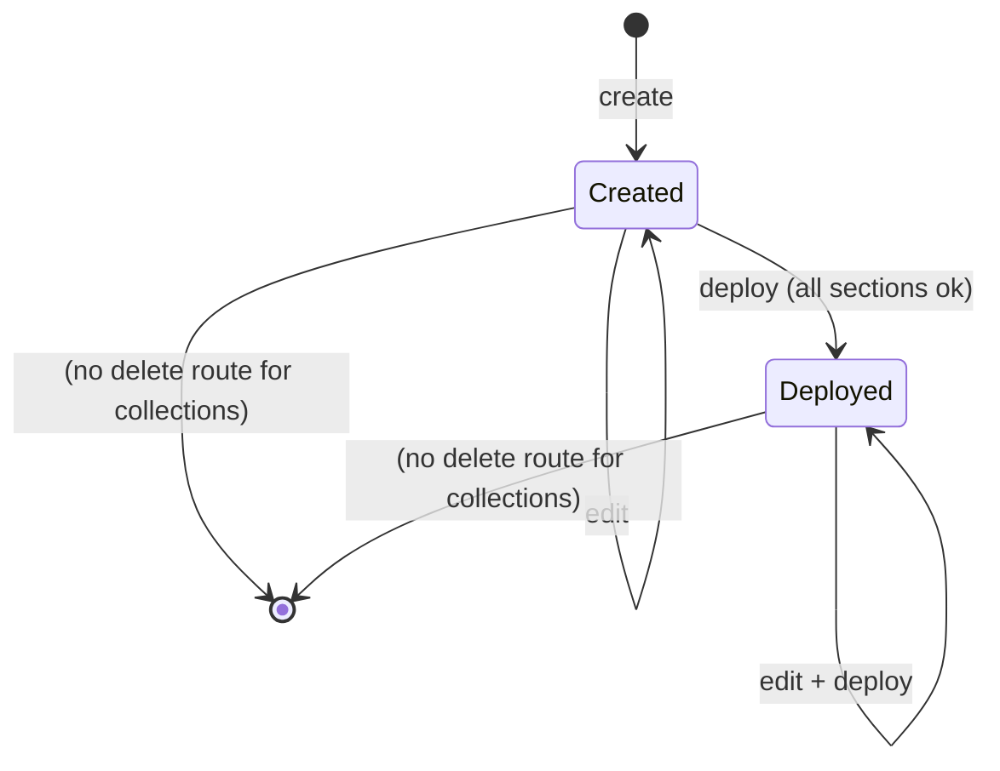
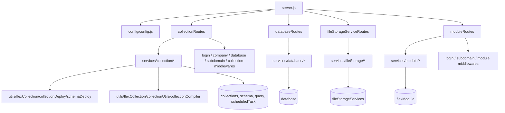

# flex_module_collection_ms

## 1. Summary

`flex_module_collection_ms` is the schema and database layer of the Inhouz Flex product. It owns
Flex collections (a customer's logical table), their field schemas and deploy state, Flex modules
(groups of collections), external database connections, and file-storage service registrations. It
creates, edits, deploys and lists those resources, and compiles a collection for the runtime. It
lives in the separate repository `/workspaces/kilo_inhouz_ai/apps/flex_module_collection_ms/`.

## 2. Stack and commands

- Node.js `>=12.0.0 <17.5.0` (`package.json:5-7`).
- `package.json:9-12` — `start` = `node server.js`; `test` = the npm-init placeholder that exits 1.
- Port `PORT` (`server.js:96`); k8s pins `5004` (`k8s/flex-module-collection-ms-cluster-ip-service.yml`).
- Image `inhouz/flex_module_collection_ms`, 1 replica (`k8s/flex-module-collection-ms-deployment.yml`).
- Health probe: `node healthcheck.js` against `/healthz` (`healthcheck.js:3-8`).
- `package-lock.json` is committed; the other services in this cluster do not commit one.
- Build scripts: `build_ga.sh`, `build_ga_prod.sh`, `deploy.sh`, `Dockerfile`, `docker-compose.yml`.

## 3. Entry points

| Entry point | Location | How it starts |
|---|---|---|
| HTTP server | `server.js:3` (app), `:96` (listen) | `npm start` |
| Cluster master / workers | `server.js:31-48` | production forks one worker per CPU (`:32`) |
| Route registration | `server.js:63-66` | four route modules mounted at boot |
| Mongo connect + 5 s reconnect | `server.js:68-70`, `:75-82`, `:101-113` | at boot and on disconnect |
| Healthcheck binary | `healthcheck.js:1-20` | container probe |

No cron, worker loop, queue consumer or websocket handler.

## 4. Module inventory

| Module | Location | Owns | Public API | Kind |
|---|---|---|---|---|
| server bootstrap | `server.js:1` | app, 11 model registrations (`:14-29`), cluster, middleware | none | effectful |
| config factory | `config/config.js:18` | `readSecret` (`:5`), model names, permission names, storage-location literals | `() => config` | effectful |
| collection routes | `controller/collection/collectionRoutes.js:15` | 6 active collection routes | `(app) => void` | effectful |
| database routes | `controller/database/databaseRoutes.js:13` | 6 database routes | `(app) => void` | effectful |
| file-storage routes | `controller/database/fileStorageServiceRoutes.js:12` | 5 file-storage routes | `(app) => void` | effectful |
| module routes | `controller/module/moduleRoutes.js:13` | 6 module routes | `(app) => void` | effectful |
| `createCollection` | `services/collection/createCollection.js:8` | insert a collection doc, reject duplicate name (`:24-36`) | `(req,res)` | effectful |
| `editCollection` | `services/collection/editCollection.js:14` | edit collection metadata | `(req,res)` | effectful |
| `getCollection` | `services/collection/getCollection.js:3` | read one collection by id and `prod` flag | `(req,res)` | effectful |
| `getCollections` | `services/collection/getCollections.js:7` | list collections | `(req,res)` | effectful |
| `deployCollection` | `services/collection/deployCollection.js:12` | run `schemaDeploy` for the requested section (`:23-27`), stamp `lastDeployDate` and `latestDeployed` on success (`:37-56`), return the compiled collection (`:58`) | `(req,res)` | effectful |
| `collectionExistsCheck` | `services/collection/collectionExistsCheck.js:7` | name-uniqueness probe | `(req,res)` | effectful |
| `getDataRule` | `services/collection/getDataRule.js:6` | read a data rule by id; uses `mongoose.model(config.dataRuleModel)` (`:32`) although that model is not registered | `(req,res)` | effectful |
| `createModule` | `services/module/createModule.js:7` | insert a module | `(req,res)` | effectful |
| `editModule` / `editModuleCollections` | `services/module/editModule.js:7`, `editModuleCollections.js:5` | edit module fields; attach/detach collections | `(req,res)` | effectful |
| `getModule` / `moduleExistsCheck` | `services/module/getModule.js:7`, `moduleExistsCheck.js:7` | read / uniqueness probe | `(req,res)` | effectful |
| `deployModule` | `services/module/deployModule.js:5` | rewrite the module to its deployed name `<moduleNameDev>_<companyId>`, stamp `latestDeployed` (`:36-56`) | `(req,res)` | effectful |
| `createDatabase` / `editDatabase` / `deleteDatabase` / `changePassword` / `getDatabases` / `getDatabase` | `services/database/*.js:8,10,7,9,6,9` | external database connection records | `(req,res)` | effectful |
| file-storage services | `services/fileStorage/createFileStorageService.js:8`, `editFileStorageService.js:9`, `deleteFileStorageService.js:8`, `getFileStorageService.js:8`, `getFileStorageServices.js:5` | storage backend registrations | `(req,res)` | effectful |
| `schemaDeploy` | `utils/flexCollection/collectionDeploy/schemaDeploy.js` | apply schema changes (`deployCollection.js:6`) | `(params)` | effectful |
| `collectionCompiler` | `utils/flexCollection/collectionUtils/collectionCompiler.js` | build the runtime collection payload (`deployCollection.js:9`) | `(id, user)` | effectful |
| `createEditByObject` | `utils/user/createEditByObject.js` | audit sub-object for writes | `(user, timestamp)` | pure |
| `checkUserAccess` | `utils/accessManagement/checkUserAccess.js` | per-record access restriction (`deleteDatabase.js:42`) | `(params)` | pure |
| `checkLogin` | `middlewares/login/checkLogin.js:24` | session + company | `(req,res,next)` | effectful |
| `isDbAdmin` / `isDbAdminDeveloper` | `middlewares/database/isDbAdmin.js`, `isDbAdminDeveloper.js` | `databaseAdmin` and `databaseDeveloper` permission gates (`config/config.js:42-43`) | `(req,res,next)` | pure |
| `companyAccountCheck` | `middlewares/company/companyAccountCheck.js` | active-account gate | `(req,res,next)` | effectful |
| `singleSubdomainValidation` | `middlewares/subdomain/singleSubdomainValidation.js` | subdomain match | `(req,res,next)` | effectful |
| `basicModuleValidation` | `middlewares/module/basicModuleValidation.js:26` | loads `req.Module` for module routes | `(req,res,next)` | effectful |
| `moduleAccessCheck` / `moduleAccessCheckAndPopulate` | `middlewares/module/moduleAccessCheck.js:29`, `moduleAccessCheckAndPopulate.js:29` | module entitlement; not mounted on these routes | `(req,res,next)` | effectful |
| `collectionValidator` | `middlewares/collection/collectionValidator.js:27` | validates the deploy payload | `(req,res,next)` | effectful |
| models | `model/collection/*.js`, `model/module/flexModule.js:181`, `model/database/*.js:123,79`, identity models | schema definitions | mongoose models | effectful |
| `createEditDocument` | `utils/flexCollection/createEditDocument.js:22` | builds an edit document with a dynamic schema | `(params)` | effectful |
| `mongooseModel` | `utils/model/mongooseModel.js:13` | dynamic model factory | `(name, schema)` | effectful |

## 5. Side effects

| Effect | Location |
|---|---|
| Secret files (`sessionsecret`, `clientsecretkey`, `sendgridapikey`, `mongourl`) | `config/config.js:21-52` |
| Env vars | `config/config.js:23-46`, `server.js:32`, `:96` |
| Mongo connect, pool 1 | `server.js:101-113` |
| Reconnect timer 5 s | `server.js:75-82` |
| 20 MB JSON body limit | `server.js:58` |
| Collection insert | `createCollection.js:50` |
| Collection deploy-date update | `deployCollection.js:41-56` |
| Schema deploy (writes to the target database) | `utils/flexCollection/collectionDeploy/schemaDeploy.js`, called at `deployCollection.js:24` |
| Module insert / update / deploy rewrite | `services/module/*.js`, `deployModule.js:46-57` |
| Database record delete | `services/database/deleteDatabase.js:53` |
| File-storage record writes | `services/fileStorage/*.js` |
| Clock: `new Date()` / `Date.now()` | `createCollection.js:38`, `deployCollection.js:19`, `deployModule.js:30` |
| Randomness: none in the modules read | — |
| Logging: `console.log` on every failure branch | e.g. `createCollection.js:78`, `deployCollection.js:67` |
| Outbound HTTP: none — `node-fetch` is not a dependency and no `fetch` call exists in `services/`, `utils/` | `package.json:14-34` |

## 6. State and state transitions

| State | Field | Where |
|---|---|---|
| Collection created, not deployed | `latestDeployed: false` (default) | `model/collection/flexCollections.js:42-45` |
| Collection deployed | `latestDeployed: true`, `lastDeployDate` set | `deployCollection.js:46-52` |
| Collection schema versioned | `schemaVersion`, `schemaVersionTracker[]` | `model/collection/flexCollections.js:25-32` |
| Module active | `moduleStatus: "active"` (default) | `model/module/flexModule.js:22-25` |
| Module not deployed | `latestDeployed: false` | `model/module/flexModule.js:30-34` |
| Module deployed | `latestDeployed: true`, name rewritten to `<moduleNameDev>_<companyId>` | `deployModule.js:39-56` |
| Database record | stored in the `database` collection; `addExtraRestriction` controls per-record access | `deleteDatabase.js:41-50` |

Guards:

- Duplicate collection name is rejected before insert (`createCollection.js:28-36`).
- Deploy only stamps the collection when every deployed section reports success
  (`deployCollection.js:32-36`).
- Deploying an already-deployed module returns it unchanged (`deployModule.js:24-27`).
- Delete of a database record checks ownership and `addExtraRestriction` unless the caller is a DB
  admin (`deleteDatabase.js:22-51`).
- Permission gates: `isDbAdminDeveloper` on collection and database routes, `isDbAdmin` on
  file-storage create/edit/delete (`collectionRoutes.js:16-21`, `fileStorageServiceRoutes.js:13-17`).

There is no collection delete route and no module delete route; only database records and
file-storage services have delete endpoints.

## 7. Data

| Collection | Env var | Key fields | Validation |
|---|---|---|---|
| `flexCollections` | `FLEX_COLLECTION_MODEL` (`config/config.js:26`) | `collectionName`, `collectionNameDev`, `companyId`, `relatedModules[]`, `schemaVersion`, `schemaVersionTracker[]`, `onExternalDatabase`, `externalDatabaseId`, `lastUpdateDate`, `lastDeployDate`, `latestDeployed`, `createdBy`, `editedBy[]` | `collectionName` and `collectionNameDev` are `unique` (`model/collection/flexCollections.js:6-18`); `companyId` required; audit sub-objects require `userId`, `firstName`, `lastName`, `email` with `isEmail` |
| `flexModule` | `FLEX_MODULE_MODEL` (`config/config.js:25`) | `moduleName` (unique), `moduleNameDev`, `companyId`, `restrictedAccess`, `moduleStatus`, `latestDeployed`, `collections[]`, `flexForms[]`, `moduleExtensionHistory[]` | `moduleName` unique and required; audit entries require the same four fields (`model/module/flexModule.js:6-73`) |
| `schema` | `SCHEMA_MODEL` (`config/config.js:32`) | `collectionId`, `field`, `type`, `index`, `referencedCollection`, `unique`, `required`, `min`, `max`, `enum`, `minlength`, `maxlength`, `default`, `deployed`, `versionTracker[]` | `field` and `type` required; `type` enum of 11; `index` enum `text\|regular\|unique\|''` (`model/collection/schema.js:6-53`) |
| `query` | `QUERY_MODEL` (`config/config.js:36`) | two schemas in one file (`model/collection/query.js:5`, `:38`) | see file |
| `scheduledTask` | `SCHEDULED_TASK_MODEL` (`config/config.js:35`) | scheduled task definitions | registered at boot (`server.js:25`) |
| `editCollectionAction` | `EDIT_COLLECTION_ACTION_MODEL` (`config/config.js:33`) | collection edit audit | model file exists but the `require` is commented out (`server.js:23`) |
| `dataRule` | `DATA_RULE_MODEL` (`config/config.js:34`) | data rules | model file exists but the `require` is commented out (`server.js:24`) |
| `aggregationStage` | `AGGREGATION_STAGE_MODEL` (`config/config.js:37`) | aggregation stages | model file exists but the `require` is commented out (`server.js:26`) |
| `database` | `DATABASE_MODEL` (`config/config.js:38`) | external database connection records | schema at `model/database/database.js:123` |
| `fileStorageServices` | `FILE_STORAGE_SERVICE_MODEL` (`config/config.js:46`) | storage backend registrations | schema at `model/database/fileStorageServices.js:79` |

Shared data coupling:

- `flexCollections` is referenced by `relatedModules[]` in `flexModule` and by `collectionId` in
  `schema`; the flex API and flex app services read the same collections to resolve runtime queries.
- `database` and `fileStorageServices` are consumed by the query, function and storage services
  (`nonFilestorageAccountTypes: ["solopreneur","freelancer"]` at `config/config.js:55` decides who
  may register one).
- `company`, `User`, `userRoles`, `permissions`, `roles`, `session` are identity collections owned
  elsewhere and only read here.
- `flexModule` is the `ref` target of `flexCollections.relatedModules` (`model/collection/flexCollections.js:20-23`).

## 8. Public interfaces

23 active routes across four route modules. All bodies are JSON; all requests pass `isLoggedIn`.

**Collections** (`controller/collection/collectionRoutes.js:16-21`):

| Route | Extra middleware |
|---|---|
| `POST /api/flexcollection/create` | `companyAccountCheck`, `subdomainCheck`, `isDbAdminDeveloper` |
| `POST /api/flexcollection/edit` | same |
| `POST /api/flexcollection/get/getCollections` | `subdomainCheck`, `isDbAdminDeveloper` |
| `GET /api/flexcollection/get/:collectionId/:prod` | `subdomainCheck`, `isDbAdminDeveloper` |
| `POST /api/flexcollection/deploy` | `companyAccountCheck`, `subdomainCheck`, `collectionValidator`, `isDbAdminDeveloper` |
| `POST /api/flexcollection/collectionexistscheck` | `subdomainCheck`, `isDbAdminDeveloper` |

`GET /api/flexcollection/datarule/get/:collectionId/:dataRuleId` is present but commented out
(`collectionRoutes.js:22`).

**Databases** (`controller/database/databaseRoutes.js:14-19`):

| Route | Extra middleware |
|---|---|
| `POST /api/database/create` | `companyAccountCheck`, `subdomainCheck`, `isDbAdminDeveloper` |
| `POST /api/database/edit` | same |
| `POST /api/database/changepassword` | same |
| `DELETE /api/database/delete/:id` | `subdomainCheck`, `isDbAdminDeveloper` |
| `POST /api/database/getall` | `subdomainCheck`, `isDbAdminDeveloper` |
| `POST /api/database/getdatabase` | `subdomainCheck`, `isDbAdminDeveloper` |

**File storage** (`controller/database/fileStorageServiceRoutes.js:13-17`):

| Route | Extra middleware |
|---|---|
| `POST /api/filestorageservice/create` | `companyAccountCheck`, `subdomainCheck`, `isDbAdmin` |
| `POST /api/filestorageservice/edit` | same |
| `POST /api/filestorageservice/getservices` | `subdomainCheck`, `isDbAdminDeveloper` |
| `GET /api/filestorageservice/getservice/:fileStorageServiceId` | `subdomainCheck`, `isDbAdminDeveloper` |
| `DELETE /api/filestorageservice/deleteservice/:fileStorageServiceId` | `subdomainCheck`, `isDbAdmin` |

**Modules** (`controller/module/moduleRoutes.js:14-19`):

| Route | Extra middleware |
|---|---|
| `POST /api/flexmodule/create` | `subdomainCheck` |
| `POST /api/flexmodule/editmodulecollections` | `subdomainCheck`, `basicModuleValidation` |
| `POST /api/flexmodule/editmodule` | same |
| `POST /api/flexmodule/getmodule` | `subdomainCheck` |
| `POST /api/flexmodule/deploymodule` | `subdomainCheck`, `basicModuleValidation` |
| `POST /api/flexmodule/moduleexistscheck` | `subdomainCheck` |

Request shapes seen in code: collection create `{collectionName, collectionDescription}`
(`createCollection.js:12-15`); deploy `{collectionId, sectionToDeploy}` (`deployCollection.js:15-17`);
module deploy `{deploy, moduleId}` (`deployModule.js:9-11`). Errors are `{error:{message,
errorPayload?}}` and are usually sent with HTTP 200.

No events, topics or CLI commands. No outbound HTTP.

## 9. Configuration

Secret files: `sessionsecret`, `clientsecretkey`, `sendgridapikey`, `mongourl` with
`SESSION_SECRET`, `CLIENT_SECRET_KEY`, `SENDGRID_API_KEY`, `MONGO_URL` fallbacks
(`config/config.js:21-52`).

Env vars: `USER_MODEL`, `FLEX_FORM_FILE_MODEL`, `FLEX_MODULE_MODEL`, `FLEX_COLLECTION_MODEL`,
`FORM_MODEL`, `SMPL_EMAIL`, `COMPANY_MODEL`, `SCHEMA_MODEL`, `EDIT_COLLECTION_ACTION_MODEL`,
`DATA_RULE_MODEL`, `SCHEDULED_TASK_MODEL`, `QUERY_MODEL`, `AGGREGATION_STAGE_MODEL`,
`DATABASE_MODEL`, `ROLE_MODEL`, `PERMISSION_MODEL`, `USER_ROLES_MODEL`, `SESSION_MODEL`,
`COOKIE_DOMAIN`, `FILE_STORAGE_SERVICE_MODEL`, `PORT`, `NODE_ENV` (`config/config.js:23-46`,
`server.js:32`, `:96`).

Permission names in code: `databaseAdmin`, `databaseDeveloper` (`config/config.js:42-43`).
Storage-location literals: `AWS S3`, `Azure Blob Storage`, `Google Cloud Storage`, `Vimeo`
(`config/config.js:47-50`).

The k8s deployment injects many extra model and payment env vars (`STRIPE_API_KEY`,
`PAYMENT_MS_URL`, `OPEN_EXCHANGE_RATES_API_KEY`, `SUBSCRIBER_MODEL`, and others) that this service
never reads.

## 10. Dependencies

| Package | Why |
|---|---|
| `express`, `body-parser`, `cookie-parser`, `cors`, `helmet`, `hpp`, `dotenv` | HTTP stack (`server.js:1-9`) |
| `mongoose` | models and dynamic model creation (`utils/model/mongooseModel.js:13`) |
| `sanitizer` | `recursiveSanitizer` on every body and param |
| `lodash` | `isEmpty` checks throughout the services |
| `moment` | login middleware date handling |
| `node-rsa` | RSA key material (`config/config.js:1`, `:51`) |
| `cryptr` | password encryption in `services/database/changePassword.js:6` |
| `validator` | email and schema validation |
| `@sendgrid/mail` | declared; no send call found in the modules read |
| `connect-mongo`, `express-session`, `crypto-js`, `request-ip` | template carry-overs |
| `bcryptjs` | not in the dependency list; absent although the template usually carries it |

## 11. Testing

No tests. `package.json:10` is the placeholder that exits 1. Nothing covers schema deploy, module
deploy, or access control.

## 12. Known issues and risks

- **Broken type guard everywhere.** `!typeof x === 'string'` is always false, because `typeof`
  returns a non-empty string that is then negated. Seen at `createCollection.js:19`,
  `deleteDatabase.js:11`, `getDataRule.js:11`, `deployModule.js:14`. Input validation is a no-op.
- **`errorPayload: e` before `e` exists.** `createCollection.js:20` references the catch variable
  inside the `try` block, so that branch would throw a `ReferenceError` if it ever ran (it cannot
  today, because of the broken guard above).
- **Data-rule model is not registered.** `server.js:24` comments out
  `require("./model/collection/dataRule")`, but `services/collection/getDataRule.js:32` calls
  `mongoose.model(config.dataRuleModel)`. If the route were re-enabled it would throw
  `MissingSchemaError`. The same is true for `editCollectionAction` and `aggregationStage`
  (`server.js:23`, `:26`).
- **`findOneAndRemove` is removed in Mongoose 7.** `deleteDatabase.js:53` uses
  `Database.findOneAndRemove(...)` while `package.json` pins `mongoose ^7.4.0`; the call is not a
  function on that version, so database deletion throws and returns the generic error.
- **Routes answer 200 on errors.** Most handlers `res.send({error:{...}})` instead of setting a
  status (for example `createCollection.js:29-35`, `deployCollection.js:66-70`), so clients cannot
  distinguish success from failure by status code.
- **Deploy is partial by design.** Only `schema` deploy is active; data-rule and scheduled-task
  deploy are commented out (`deployCollection.js:21-29`), yet the endpoint still accepts
  `sectionToDeploy: "all"` and reports success for the missing sections.
- **No delete for collections or modules.** A collection can never be removed through this service;
  only database and file-storage records have delete routes.
- **Module deploy rewrites the name in place.** `deployModule.js:39` overwrites `moduleName` with
  `<moduleNameDev>_<companyId>`; the original survives only inside `moduleExtensionRecord`
  (`:47-52`), so a second deploy renames from the already-suffixed value.
- **Deploy metadata is not scoped per environment.** `lastDeployDate` and `latestDeployed` are
  single fields (`deployCollection.js:46-52`), while collections carry both a prod and a dev name
  (`createCollection.js:31-33`).
- **Health probe mismatch.** `healthcheck.js:7` requests `/healthz`; no such route exists.
- **`uncaughtException` only closes Mongo** (`server.js:89-94`) and the cluster respawns the worker.
- **`app` is constructed outside the cluster branch** (`server.js:3`), which is harmless but means
  the master process also holds an Express instance it never uses.

## 13. Module map

## 14. Open questions

- Are `dataRule`, `editCollectionAction` and `aggregationStage` deprecated, or did the `require`
  lines get commented out by accident? Nothing in the repo explains it.
- Who executes the compiled collection at runtime? `collectionCompiler` output is returned to the
  caller but no service name is recorded here.
- Why does only `schema` deploy remain active while the API still accepts `sectionToDeploy: "all"`?
- Are `STRIPE_API_KEY`, `PAYMENT_MS_URL` and the open-exchange-rate vars injected into this
  deployment by a shared manifest, or deliberately configured for a feature that was removed?
- Not read (step budget): `editCollection.js`, `getCollection.js`, `getCollections.js`,
  `collectionExistsCheck.js`, `services/module/*` except `deployModule.js`,
  `services/database/*` except `deleteDatabase.js`, `services/fileStorage/*`,
  `utils/flexCollection/*`, `utils/model/mongooseModel.js`, `utils/query/*`,
  `utils/aggregation/*`, the six middlewares beyond their export lines, and all models except
  `flexCollections`, `schema` and `flexModule`. Claims about those rest on grep output.
