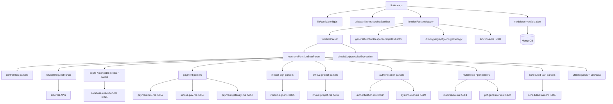

# function_parser_ms

## 1. Summary

`function_parser_ms` is the runtime interpreter for Inhouz low-code functions. It receives an
encrypted payload describing a function and its inputs, resolves the function graph from a
compressed `functionData` blob (or from `functions_ms` when the blob is absent), and walks the
function's steps with `recursiveFunctionStepParser`, which dispatches 96 step types — control flow,
expression evaluation, database and Redis access, storage, payments, signing, PDF, notifications —
to either a local implementation or an HTTP call to the owning microservice. It holds no business
data of its own: its only Mongo model is the server validator. Repository: `apps/function_parser_ms/`
(repo id `function_parser_ms`).

## 2. Stack and commands

| Item | Value | Source |
|---|---|---|
| Runtime | Node.js `>=12.0.0 <17.5.0`, ES modules through Babel | `package.json:6-8` |
| Container base | `node:16.4-alpine` | `Dockerfile:1` |
| Framework | Express 4 | `package.json:31` |
| ODM | Mongoose 7 | `package.json:42` |
| Start (dev) | `npm start` → `nodemon lib/index.js --exec babel-node --presets es2015,stage-2` | `package.json:10` |
| Build | `npm run build` → `babel lib -d dist` | `package.json:11` |
| Start (prod) | `npm run serve` → `node dist/index.js`; the image runs this | `package.json:12`, `Dockerfile:13` |
| One-shot prod build+run | `npm run prodstart` → `babel lib -d dist && node dist/index.js` | `package.json:13` |
| Test | **no test script and no tests** | `package.json:9-14` |
| HTTP port | `PORT` (k8s sets 5035) | `lib/index.js:196`, `k8s/function-parser-ms-cluster-ip-service.yml:10` |
| Package name | `node_babel_template` — the template name was never changed | `package.json:2` |

The image builds with Babel (`Dockerfile:11`) and then runs the compiled `dist` tree, so a source
change needs a rebuild. There is no lint script; `eslint` is a runtime dependency, not a script.

## 3. Entry points

| Entry point | file:line | How it starts |
|---|---|---|
| HTTP server | `lib/index.js:196` | `node dist/index.js` (compiled from `lib/index.js`) |
| Cluster master | `lib/index.js:32-49` | Forks `os.cpus().length` in `production`, 1 otherwise; refork on exit |
| POST `/api/functionparser/parsefunction` | `lib/index.js:87` | Inline handler, not a router module |
| Mongo connect + reconnect | `lib/index.js:201-213`, `lib/index.js:66-73` | Called at boot and on `disconnected` after 5 s |
| Graceful shutdown | `lib/index.js:77-85` | `SIGINT`, `SIGTERM`, `uncaughtException` → close connection |
| Model registration | `lib/index.js:29` | `import "./models/serverValidation/serverValidations"` |
| `lib/routes/index.js` | `lib/routes/index.js:1-10` | **Entirely commented out and never imported.** The brief's `get /` route does not exist. |

No cron, no queue consumer, no websocket handler. The `setTimeout` at `lib/index.js:69` is the
reconnect backoff; the one at `lib/utils/functionParser/functionTypeParser/setTimeoutParser.js:40`
is the modelled `setTimeout` step inside a parsed function, not a service timer.

## 4. Module inventory

151 JavaScript files under `lib/` (~21.6k lines). The rows below cover every module that defines
service behaviour, grouped, with an exact entry point. The 101 files in `functionTypeParser/` are
listed as a group because each is one step type.

### Server and config

| Module | file:line | Responsibility | Public API | Kind |
|---|---|---|---|---|
| index (server) | `lib/index.js:1` | Express bootstrap, cluster, Mongo, the single route | none (entry) | effectful |
| config | `lib/config/config.js:17` | Env + secret-file cache, RSA key objects | default object | effectful (env, fs) |
| serverValidations model | `lib/models/serverValidation/serverValidations.js:5` | Mongo model registration | mongoose model | effectful |
| serverValidatorFunction | `lib/utils/serverValidator/serverValidatorFunction.js:9` | Fetches a server-validator key for outbound calls | async function | effectful (Mongo read) |
| winston-logger | `lib/helpers/winston-logger.js:1` | Winston logger wrapper; **not imported by `lib/index.js`** (import is commented at `lib/index.js:21`) | class | effectful (logging) |

### Parser pipeline

| Module | file:line | Responsibility | Public API | Kind |
|---|---|---|---|---|
| functionParserWrapper | `lib/utils/functionParser/functionParserWrapper.js:8` | Entry from the route: resolves the function document (map or `functions_ms`), builds the parser context, calls `functionParser` | async `(params)` | effectful (HTTP, crypto, clock) |
| functionParser | `lib/utils/functionParser/functionParser.js:5` | Initialises variables and parameters, normalises workflows to a flat step list, calls the step parser | async `(functionObject, parameterObj, setStateFunction, functionMap, mappedVariables)` | reactive (builds mutable variable map) + effectful (awaits `resolveExpression`) |
| recursiveFunctionStepParser | `lib/utils/functionParser/recursiveFunctionStepParser.js:1` | The interpreter loop: 96 `functionType === '...'` branches, recursion for loops and nested steps | async `(steps, variables, parameters, functionMap, variableIdMap, setStateFunction)` | reactive (mutates the variable map) + effectful |
| functionResponseObjectExtractor | `lib/utils/functionParser/general/functionResponseObjectExtractor.js` | Normalises the final response object | function | pure |
| getLoopLimit | `lib/utils/functionParser/general/getLoopLimit.js` | Loop iteration cap | function | pure |
| resolveExpression | `lib/utils/functionParser/simpleScript/expressionParser/resolveExpression.js:1` | Evaluates a simpleScript expression to a value | async function | reactive (expression context) |
| simpleScriptParser | `lib/utils/functionParser/simpleScript/simpleScriptParser.js` | simpleScript program loop | function | reactive |
| simpleScriptInitObject | `lib/utils/functionParser/simpleScript/simpleScriptInitObject.js` | Builds the expression context | function | pure |
| scriptObjectParser | `lib/utils/functionParser/scriptObjectParser/scriptObjectParser.js` | Parses a script object step | function | reactive |

### Step types — `lib/utils/functionParser/functionTypeParser/` (101 files, 96 dispatched)

Each file exports one parser for one `functionType`. The dispatch table is the if/else chain in
`recursiveFunctionStepParser.js` (96 branches; examples: `ifElseParser` at
`recursiveFunctionStepParser.js:271` for `switch`, `secretKeyParser` at
`recursiveFunctionStepParser.js:337`, `executeExternalFunctionParser` at
`recursiveFunctionStepParser.js:571`, `redisParser` at `recursiveFunctionStepParser.js:653`).

| Group | Files | Kind |
|---|---|---|
| Control flow | `ifElseParser`, `forLoopParser`, `whileLoopParser`, `switchParser`, `setTimeoutParser` | reactive |
| Data / expression | `objectAssignParser`, `idParser`, `base64Parse`, `parseCrypto`, `jsonToCsvParser`, `xmlToJsonParser`, `jsonToXmlParser`, `compressDecompressParser`, `objectSizeParser`, `imageResizeParser`, `stringToArrayBufferParser`, `arrayBufferToBase64Parser`, `fileToBase64Parser`, `jsonToObjectParser`-family | pure or effectful (crypto/compression resize touch CPU, not I/O) |
| HTTP and network | `networkRequestParser`, `executeExternalFunctionParser`, `apiReturnFileParser` | effectful (network) |
| Datastores | `sqlDbParser`, `mongoDbParser`, `redisParser`, `awsS3Parser` | effectful (network via `database_execution_ms` / AWS) |
| Response shaping | `setResponseStatusParser`, `setResponseHeaderParser`, `setCookieParser`, `getEnvironmentParser` | reactive (response context) |
| Commerce / subscribers | `enrichSubscriberDataParser`, `getSubscriberCountParser`, `getSubscribersParser`, `getSubscribedTenantParser`, `getSubscribedTenantCountParser`, `updateSubscriptionSubscriberDataParser`, `manageSubscriptionUserRestrictionParser`, `enrichProductDataParser`, `productSearchParser`, `productCountParser`, `enrichPaymentSubscriberDataParser`, `paymentSubscriberSearchParser`, `getPaymentSubscriberCountParser` | effectful (HTTP) |
| Payments | `createOneTimePaymentLinkParser`, `createFixedSchedulePaymentLinkParser`, `paymentLinkStatusUpdateParser`, `deletePaymentLinkParser`, `subscriptionOnDemandPaymentParser`, `paymentRefundParser`, `singlePaymentDistributionParser`, `batchPaymentDistributionParser`, `deactiveInhouzPaymentParser` | effectful (HTTP) |
| Signing | `createInhouzSignDocumentParser`, `sendInhouzSignDocumentParser`, `getInhouzSignDocumentParser`, `getInhouzSignDocumentFileParser`, `getInhouzSignDocumentsParser`, `cancelInhouzSignDocumentParser`, `deleteInhouzSignDocumentParser`, `generateInhouzSignUrlParser` | effectful (HTTP) |
| Projects | `createInhouzProjectParser`, `getInhouzProjectParser`, `getInhouzProjectsParser`, `changeInhouzProjectOwnerParser`, `changeInhouzProjectStatusParser`, `deleteInhouzProjectParser` | effectful (HTTP) |
| Users and auth | `addInhouzCloudUserParser`, `cancelInhouzCloudUserParser`, `setInhouzCloudUserRoleParser`, `getSystemUserApiKeyParser`, `jwtSignParser`, `jwtVerifyParser`, `jwkToPemParser`, `secretKeyParser` | effectful (HTTP / crypto) |
| Scheduling and push | `createScheduledTaskParser`, `deactivateScheduledTaskParser`, `singleBrowserPushNotificationParser`, `bulkBrowserPushNotificationParser`, `refreshWsClientKeyParser` | effectful (HTTP) |
| Files and PDF | `fileStorageUploadParser`, `fileStorageStreamUploadParser`, `fileStorageDeleteParser`, `fileStorageGetFileParser`, `generateServerPdfParser` | effectful (HTTP, streams) |
| Browser shims | `windowLocationParser`, `browserStorageParser`, `eventBasicMethodParser` | pure |

### Utilities

| Module | file:line | Responsibility | Kind |
|---|---|---|---|
| getRequest / postRequest / deleteRequest | `lib/utils/requests/getRequest.js:1`, `postRequest.js:1`, `deleteRequest.js:1` | `node-fetch` wrappers used by every HTTP parser | effectful |
| recursiveSanitizer | `lib/utils/sanitizer/recursiveSanitizer.js` | Deep-sanitizes the request body | pure |
| cryptography/encryptDecrypt | `lib/utils/cryptography/encryptDecrypt.js` | RSA/AES envelope for cross-service payloads | effectful (crypto) |
| data/dotNotationMapper, dotNotationObjectUpdate | `lib/utils/data/dotNotationMapper.js`, `dotNotationObjectUpdate.js` | Dot-path get/set used by variable mapping | pure |

## 5. Side effects

| Effect | Where | Detail |
|---|---|---|
| MongoDB connect | `lib/index.js:201-213` | single connection, `maxPoolSize: 1` |
| Mongo reconnect timer | `lib/index.js:66-73` | `setTimeout(..., 5000)` |
| Mongo read | `lib/utils/serverValidator/serverValidatorFunction.js:9` | server-validator key lookup |
| HTTP to `functions_ms` | `functionParserWrapper.js` (`/api/function/getfunction`), `secretKeyParser.js:101` (`/api/secret/getserversecret`) | function document and secrets |
| HTTP to 18 other services | the `config.<x>MsUrl` call sites listed in §8 | 50+ distinct endpoint paths |
| Filesystem read | `lib/config/config.js:5-14` | secret files under `SECRETS_PATH` (default `/mnt/secrets`) |
| Env read | `lib/config/config.js:17-57` | config object frozen at import |
| Crypto | `lib/index.js:57` (`new Cryptr`), `lib/config/config.js:25-36` (node-rsa) | payload decrypt/encrypt |
| Compression | `lib/index.js:144` | `decompress(functionData)` via `shrink-string` |
| Clock | `lib/index.js:90,109`, `functionParserWrapper.js` | `Date.getTime()`, `moment().add(...)` |
| Logging | `lib/index.js:39-48,64,67,75,182,197`; `functionParser.js:70` | `console.*`; Winston exists but is unused |
| Network listener | `lib/index.js:196` | Express on `PORT` |
| Cluster fork | `lib/index.js:32-36,48` | worker processes |
| Sanitization | `lib/index.js:91` | all request bodies pass through `recursiveSanitizer` |

## 6. State and state transitions

The service itself is stateless — one route, one Mongo model, no stored runtime state. All state
lives for the duration of a single request:

| State | Meaning | Transition | Trigger |
|---|---|---|---|
| `encryptedData` absent or not a string | reject | terminal → HTTP 400 | `lib/index.js:93-104` |
| decrypted but expired (`expirationTimestamp < now`) | `payload` stays undefined | terminal → HTTP 400 | `lib/index.js:109-128` |
| `payload.functionId` ≠ `reqBody.functionId` | binding mismatch | terminal → HTTP 400 | `lib/index.js:116` |
| `functionData` decompressed | `primaryFunction` + `referencedFunctions` map built | proceed to the parser | `lib/index.js:144-155` |
| parser running | variable map mutated step by step | loop until steps exhaust or a `return` step fires | `recursiveFunctionStepParser.js` |
| parser threw | terminal → HTTP 500 with a generic payload | `lib/index.js:181-193` | |

Inside the parser the only "state machine" is the interactive step protocol: a parser can return a
value that tells `recursiveFunctionStepParser` to stop, and `setStateFunction` is threaded through
so a function can pause for an external event (used by signing and webhook-style steps). The exact
pause/resume contract is in `recursiveFunctionStepParser.js` and was not read in full — see §14.

## 7. Data

| Model | Env var | Collection | Key fields | Validation |
|---|---|---|---|---|
| ServerValidation | `SERVER_VALIDATOR_MODEL` | `serverValidators` | server-to-server keys | schema at `lib/models/serverValidation/serverValidations.js:5`, registered at `:29` |

That is the only schema in the repository (`new Schema()` appears once). The service reads no
business collection directly: function documents arrive either inside `functionData` or over HTTP
from `functions_ms` (`functionParserWrapper.js`).

**Shared collection.** `serverValidators` is the same collection `functions_ms` and the other
`*_ms` services read for server-to-server authentication, so the two repositories must agree on the
env value.

The collections named in the k8s env (`company`, `session`, `User`, `roles`, `permissions`,
`subscribers`, `subscriptions`, `paymentIntents`, `paymentCharges`, `paymentMethods`,
`payoutAccounts`, `serviceDiscounts`, `subscribedPackages`, `subscriberActionLogs`,
`subscriberMigrationQueue`, `subscriptionServices`, `subscriptionSessions`, `versionTracker`,
`authenticationLogs`, `churnTracker`, `contacts`, `customers`, `exchangeRateCache`,
`flexCollections`, `flexApi`, `inhouzApps`, `ipAddressLocations`, `sessionValidator`) are set in the
deployment but **not read by any code in this repository**; their data is reached through the owning
microservice. See §14.

## 8. Public interfaces

### Inbound

`POST /api/functionparser/parsefunction` (`lib/index.js:87`). No auth middleware — the payload is
encrypted with the shared session secret instead.

Request body (after sanitization):

| Field | Type | Use |
|---|---|---|
| `encryptedData` | string, required | Cryptr-encrypted JSON `{ payload, expirationTimestamp }` |
| `functionId` | string | must equal `payload.functionId` |
| `routeParameters`, `queryStringParameters`, `requestBody`, `requestHeaders`, `user`, `userAgent` | object | exposed to the function as parameters |
| `companyId` | string | scopes the `functions_ms` lookup |
| `functionData` | string | `shrink-string`-compressed JSON `{ primaryFunction, referencedFunctions[] }` |
| `functionIds` | array | extra function ids |
| `environment` | string | exposed as `inhouz_reserved_parameters_xyzh.appEnvironment` |
| `environmentVariables` | object | exposed as `ENV` |

Response: the object returned by the parsed function. Error shape:

```json
{ "hasReturnStatement": false, "returnStatement": null,
  "updatedVariableObject": { "runtime_response_status_code": 400 },
  "hasError": true, "errorPayload": "Invalid request. Required fields are missing1." }
```

(`lib/index.js:94-102` for 400, `lib/index.js:183-191` for 500.)

### Outbound — the real HTTP graph

20 target services are configured (`lib/config/config.js:37-56`). Grouped by target:

| Target service (k8s name:port) | Endpoints called | Example site |
|---|---|---|
| `functions-ms:5001` | `POST /api/function/getfunction`, `POST /api/secret/getserversecret` | `functionParserWrapper.js`, `secretKeyParser.js:101` |
| `database-execution-ms:5021` | `POST /api/remoteexecution/servertransaction` (4 sites: SQL, Mongo, Redis, cookie/other) | `sqlDbParser.js:146`, `mongoDbParser.js:205`, `redisParser.js:196` |
| `multimedia-ms:5013` | `/api/multimedia/upload`, `/api/multimedia/deletefiles`, `/api/multimedia/getfilefunction` | `fileStorageUploadParser.js:125,207,298` |
| `payment-link-ms:5059` | `/api/paymentlink/generateslug`, `/servercreatepaymentlink`, `/serverdeletepaymentlinks`, `/setactivestatus` | `createOneTimePaymentLinkParser.js:297,353` |
| `inhouz-pay-ms:5058` | `/api/inhouzpay/payment/refundserver`, `/deactivateinhouzpayment`, `/subscription/ondemand/server`, `/subscription/paymentsubscriberquery` | `paymentSubscriberSearchParser.js:265` |
| `payment-gateway-ms:5057` | `/api/paymentgateway/distribution/distribute/run` | `singlePaymentDistributionParser.js`, `batchPaymentDistributionParser.js` |
| `subscriber-data-function-ms:5055` | `getsubscribers`, `getsubscribercount`, `querysubscribedtenant`, `updatesubscriberdata` | `enrichSubscriberDataParser.js:191` |
| `inhouz-commerce-ms:5060` | `/api/inhouzcommerce/product/getproductserverquery` | `productSearchParser.js:185` |
| `inhouz-sign-ms:5065` | 8 `/api/inhouzsign/document/*` endpoints | `getInhouzSignDocumentParser.js:131` |
| `inhouz-project-ms:5067` | 6 `/api/inhouzproject/project/*` endpoints | `createInhouzProjectParser.js:161` |
| `authentication-ms:5002` | `/api/users/addusers`, `/api/userroles/automateupdateuserroles` | `addInhouzCloudUserParser.js:176` |
| `account-termination-ms:5048` | `/api/accounttermination/useraccounttermination` | `cancelInhouzCloudUserParser.js:176` |
| `subscription-ms:5005` | `/api/subscriber/automatecancelsubscription` | `cancelSubscriptionServiceInternalUsersParser.js:166` |
| `subscription-signup-ms:5023` | `automatedsignup`, `automatedexternalsignup`, `automatedinitialexternalsignup` | `addSubscriptionServiceExternalUsersParser.js:212` |
| `subscription-service-ms` | `/api/subscriptionservice/manageuserrestriction` | `manageSubscriptionUserRestrictionParser.js:133` |
| `scheduled-task-ms:5007` | `/api/scheduledtask/servercreate`, `/deactivate` | `createScheduledTaskParser.js:204` |
| `push-notification-parser-ms:5076` | `/api/pushnotificationparser/sendpushnotification` | `bulkBrowserPushNotificationParser.js:138` |
| `general-task-parser-ms:5042` | `getwebsocketconnectionkey`, `refreshwebsocketclientkey` | `refreshWsClientKeyParser.js:88` |
| `system-user-ms:5022` | `/api/systemuser/getencryptedapikey` | `getSystemUserApiKeyParser.js:101` |
| `pdf-generator-ms:5072` | `/api/pdfgenerator/document/startdocumentgeneration` | `generateServerPdfParser.js` |

### Kubernetes

ClusterIP `function-parser-ms-cluster-ip-service`, 5035 → 5035
(`k8s/function-parser-ms-cluster-ip-service.yml:4,10-11`). Deployment
`function-parser-ms-deployment`, image `inhouz/function_parser_ms`, replicas 1
(`k8s/function-parser-ms-deployment.yml:4,6,17`). The HPA manifest is partly commented out
(`k8s/function-parser-ms-hpa.yml:4-9`).

### Called by

`api_service_ms` (per the mechanical pass). The caller is the API gateway; it is the only known
inbound consumer.

## 9. Configuration

**Infrastructure:** `PORT`, `MONGO_URL`, `NODE_ENV`, `SECRETS_PATH`, `BASE_SERVER_URL`.

**Secret-file names** (`lib/config/config.js:5-14`): `mongourl`, `sessionsecret`,
`clientsecretkey`, `clientpublickey`; env fallbacks `MONGO_URL`, `SESSION_SECRET`,
`CLIENT_SECRET_KEY`, `CLIENT_PUBLIC_KEY`.

**Model:** `FUNCTION_MODEL`, `SERVER_VALIDATOR_MODEL`.

**Service URLs (20):** `FUNCTION_MS_URL`, `AUTHENTICATION_MS_URL`, `SUBSCRIPTION_SIGNUP_MS_URL`,
`DATABASE_EXECUTION_MS_URL`, `PAYMENT_GATEWAY_MS_URL`, `PUSH_NOTIFICATION_PARSER_MS_URL`,
`ACCOUNT_TERMINATION_MS_URL`, `INHOUZ_SIGN_MS_URL`, `SUBSCRIPTION_MS_URL`,
`INHOUZ_PROJECT_MS_URL`, `PAYMENT_LINK_MS_URL`, `SCHEDULED_TASK_MS_URL`, `INHOUZ_PAY_MS_URL`,
`INHOUZ_COMMERCE_MS_URL`, `SUBSCRIBER_DATA_FUNCTION_MS_URL`, `MULTIMEDIA_MS_URL`,
`PDF_GENERATOR_MS_URL`, `SYSTEM_USER_MS_URL`, `SUBSCRIPTION_SERVICE_MS_URL`,
`GENERAL_TASK_PARSER_MS_URL`.

Set in k8s but **not read by this repo:** the whole shared collection-name block
(`AUTH_LOG_MODEL`, `CHURN_TRACKER_MODEL`, `COMPANY_MODEL`, `CONTACTS_MODEL`, `CUSTOMERS_MODEL`,
`EXCHANGE_RATE_CACHE_MODEL`, `FLEX_API_MODEL`, `FLEX_COLLECTION_MODEL`, `INHOUZ_APP_MODEL`,
`IP_ADDRESS_LOCATION_MODEL`, `PAYMENT_*`, `PAYOUT_ACCOUNT_MODEL`, `PERMISSION_MODEL`,
`ROLE_MODEL`, `SERVICE_DISCOUNT_MODEL`, `SESSION_MODEL`, `SESSION_VALIDATOR_MODEL`,
`SUBSCRIBED_PACKAGE_MODEL`, `SUBSCRIBER_*`, `SUBSCRIPTION_*`, `USER_MODEL`, `USER_ROLES_MODEL`,
`VERSION_TRACKER_MODEL`), plus `COOKIE_DOMAIN`, `COOKIE_NAME`, `STRIPE_API_KEY`,
`OPEN_EXCHANGE_RATES_API_KEY`, `OPEN_EXCHANGE_RATES_BASE_URL`, `IP_LOCATION_FINDER_URL`,
`INHOUZ_FROM_EMAIL`, `SENDGRID_API_KEY`, `SUBSCRIPTION_SERVICE_CHARGE_FEE`,
`SUBSCRIPTION_SERVICE_CHARGE_TYPE`, `SCHEDULED_TASK_PARSER_MS_URL`.
They are copied from the shared deployment template.

## 10. Dependencies

| Package | Why |
|---|---|
| `express` | HTTP server |
| `mongoose` | the `serverValidators` model |
| `body-parser` | 20 MB JSON limit (`lib/index.js:53`) |
| `cors` | **wide open** — `app.use(cors())` with no origin list (`lib/index.js:52`) |
| `helmet`, `hpp` | security headers, parameter pollution guard |
| `cookie-parser` | signed cookies |
| `cryptr` | decrypts `encryptedData` (`lib/index.js:57,106`) |
| `shrink-string` | `decompress(functionData)` (`lib/index.js:17,144`) |
| `node-fetch` | all outbound HTTP |
| `axios` | second HTTP client, used by some parsers |
| `node-rsa` | RSA key objects in config |
| `lodash` | object helpers, `isEqual` |
| `moment`, `moment-timezone` | payload expiry and timezone-aware step parsing |
| `sanitizer` | request-body sanitization |
| `validator` | field validation |
| `jsonwebtoken`, `jwk-to-pem` | JWT sign/verify step types |
| `json-2-csv`, `txml`, `jstoxml`, `js-base64`, `buffer-from` | data conversion step types |
| `bwip-js`, `qrcode`, `pdf-lib`, `resize-img` | barcode, QR, PDF, image step types |
| `object-sizeof` | `objectSize` step type |
| `shortid`, `uuid` | id generation |
| `immutability-helper` | immutable updates in the interpreter |
| `compression` | response compression |
| `winston` | logger class that nothing imports |
| `crypto-js`, `bcryptjs`, `form-data`, `morgan`, `connect-mongo`, `express-session`,
  `express-useragent`, `request-ip`, `regenerator-runtime` | declared; `form-data`, `morgan` and
  `express-session` were not found in an import in this pass — see §14 |

## 11. Testing

None. `package.json` has no `test` script and the repository contains no test directory or test
file. Verification is manual: build, start with a reachable MongoDB, and post an encrypted payload
to `/api/functionparser/parsefunction`. Because a wrong answer is a silently wrong parsed function,
the absence of tests here is the largest quality risk in the service.

## 12. Known issues and risks

| Issue | Evidence |
|---|---|
| No tests at all for a 96-branch interpreter | `package.json:9-14` |
| CORS is wide open (`cors()` with no options), unlike the other services which restrict origin | `lib/index.js:52` vs `functions_ms/server.js:48-54` |
| The only route has no auth middleware; it relies on the Cryptr envelope and an expiry check | `lib/index.js:87,106-111` |
| The expiry check is `parsedData["expirationTimestamp"] >= timestamp` evaluated before `payload` is used, so an expired payload silently becomes a 400 rather than an explicit "expired" error | `lib/index.js:109-128` |
| The route is registered before `app.listen` but after Mongo connect is *initiated*, so a request that arrives during connect can hit a disconnected Mongo | `lib/index.js:59-61,87,196` |
| `uncaughtException` closes the connection but does not exit, leaving the worker alive in an undefined state | `lib/index.js:80-85` |
| `functionParserWrapper` calls `functions_ms` with `// 'X-SERVER-VALIDATOR-KEY': ...` commented out, so the internal call is unauthenticated | `functionParserWrapper.js` (commented header) |
| The module reads `config.functionMsUrl` etc. from a config object built once at import; a missing env var becomes `undefined` and the URL string becomes `"undefined/api/..."` rather than failing fast | `lib/config/config.js:17-57` |
| Package name and description are still the Babel template's (`node_babel_template`, `Node babel template`) | `package.json:2-3` |
| 21.6k lines in one 96-branch `else if` chain; a new step type is a new branch in a 1355-line file | `lib/utils/functionParser/recursiveFunctionStepParser.js:1-1355` |
| `winston-logger.js` exists but is unused; logging is `console.*` | `lib/index.js:21-27` (commented), `lib/helpers/winston-logger.js:1` |
| The brief's `GET /` route does not exist; `lib/routes/index.js` is fully commented out and unimported | `lib/routes/index.js:1-10` |
| The `functions_ms` lookup returns a function document without verifying the company scope beyond the encrypted `companyId`, so a caller who can mint an envelope chooses the company | `functionParserWrapper.js:38-60` |

No credential was found embedded in a source file. Secrets come from `SECRETS_PATH` files or env
vars (`lib/config/config.js:5-14`).

## 13. Module map



## 14. Open questions

**Skipped, and why.** 151 files; reading all of them would blow the step budget. Skipped:

- All 101 files in `lib/utils/functionParser/functionTypeParser/`. Only the dispatch chain and four
  parser call sites were read. Each parser's request/response shape against its target service is
  therefore not recorded; the endpoint paths in §8 are the verified part.
- `lib/utils/functionParser/recursiveFunctionStepParser.js` in full (1355 lines). Only the import
  block and the branch line numbers for 96 dispatch cases were read.
- `lib/utils/functionParser/simpleScript/**` (expression engine, ~10 files). The evaluator's
  operator semantics are not documented here.
- `lib/utils/functionParser/general/*`, `scriptObjectParser/*`, `mappingFunction/*`.
- `lib/helpers/winston-logger.js` beyond its existence, and `lib/utils/requests/*` beyond their
  exports.
- `k8s/*.yml` beyond service name, port, image and replica count.

**Unanswered:**

- What the `setStateFunction` pause/resume contract is, and which step types use it.
- How `recursiveFunctionStepParser` decides that a step ends the function (return vs fall-through).
- Whether `executeExternalFunctionParser` can reach an arbitrary URL (it would be an SSRF surface if
  the function author controls the target).
- Whether the 96 dispatch branches all map to distinct `functionType` strings, or some are dead.
- Which of `axios`, `form-data`, `morgan`, `express-session`, `connect-mongo`, `express-useragent`,
  `request-ip` are actually imported; only `axios` was confirmed by the outbound grep.
- Why the k8s deployment carries ~40 collection-name env vars this repo never reads. The most likely
  answer is a shared template, but that is inferred, not verified.
- Whether `api_service_ms` is the only caller, or `scheduled_task_function_parser_ms` also posts to
  `/api/functionparser/parsefunction`. The mechanical pass lists only `api_service_ms`.
