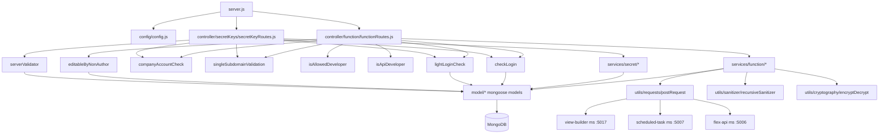

# functions_ms

## 1. Summary

`functions_ms` is the function-authoring service of the Inhouz platform. It owns the lifecycle of a
low-code "function" object: create, edit, version, delete, deploy to an environment, and register
execution operations. It also owns per-company secret keys. It is the write side of the `functions`
and `deployedFunctions` collections that `function_parser_ms` and
`scheduled_task_function_parser_ms` read at execution time. The service lives in its own repository
at `apps/functions_ms/` (repo id `functions_ms` in `.kilo/repos.json`).

## 2. Stack and commands

| Item | Value | Source |
|---|---|---|
| Runtime | Node.js, `>=12.0.0 <17.5.0` | `package.json:6-8` |
| Container base | `node:16.4-alpine` | `Dockerfile:1` |
| Framework | Express 4 | `package.json:22` |
| ODM | Mongoose 7 | `package.json:34` |
| Start command | `node server.js` (`npm run start`) | `package.json:11`, `Dockerfile:11` |
| Test command | `npm test` → `echo "Error: no test specified" && exit 1` | `package.json:10` |
| HTTP port | `PORT` (k8s sets 5001) | `server.js:92`, `k8s/functions-ms-cluster-ip-service.yml:10` |
| Package manager | npm (`npm install` in the image) | `Dockerfile:7` |

There is no lint script and no test script that runs anything.

## 3. Entry points

| Entry point | file:line | How it starts |
|---|---|---|
| HTTP server bootstrap | `server.js:92` | `node server.js`; Express listens on `process.env.PORT` |
| Cluster master | `server.js:28-45` | Forks `os.cpus().length` workers in `production`, 1 otherwise; refork on worker exit |
| Route registration — functions | `server.js:61` → `controller/function/functionRoutes.js:20` | Mounted as a function that receives `app` |
| Route registration — secrets | `server.js:62` → `controller/secretKeys/secretKeyRoutes.js:11` | Mounted as a function that receives `app` |
| Mongo connect | `server.js:97-108` | Called at boot and on `disconnected` after a 5 s `setTimeout` (`server.js:71-78`) |
| Health probe (side binary) | `healthcheck.js:1-21` | Docker `HEALTHCHECK`-style binary; GETs `localhost:$PORT/healthz` |
| Graceful shutdown | `server.js:82-90` | `SIGINT`, `SIGTERM`, `uncaughtException` → close mongoose connection |

Model modules are loaded eagerly at `server.js:13-26` so the schemas register before any service
module calls `mongoose.model(...)`.

## 4. Module inventory

Route handlers receive `(req, res)` and send the response themselves. Mongoose access happens
through `mongoose.model(config.<x>Model)` indirection, so every model-backed handler is `effectful`.

### Controllers (route tables)

| Module | file:line | Responsibility | Public API | Kind |
|---|---|---|---|---|
| functionRoutes | `controller/function/functionRoutes.js:20` | 11 POST routes for function lifecycle | `(app) => void` | effectful (registers state on the Express app) |
| secretKeyRoutes | `controller/secretKeys/secretKeyRoutes.js:11` | 5 POST routes for secret keys | `(app) => void` | effectful (registers state on the Express app) |

### Services — function

| Module | file:line | Responsibility | Public API | Kind |
|---|---|---|---|---|
| createFunction | `services/function/createFunction.js:9` | Creates version 1 of a function plus its version tracker | `(req,res)` | effectful (Mongo write) |
| editFunction | `services/function/editFunction.js:9` | Updates the active version | `(req,res)` | effectful |
| deleteFunction | `services/function/deleteFunction.js:9` | Deletes/archives a function and its tracker | `(req,res)` | effectful |
| getFunctions | `services/function/getFunctions.js:7` | Lists functions for a company | `(req,res)` | effectful (read) |
| getFunction | `services/function/getFunction.js:7` | Fetches one function plus its deployed copy | `(req,res)` | effectful (read) |
| getFunctionVersions | `services/function/getFunctionVersions.js:8` | Reads the version tracker | `(req,res)` | effectful (read) |
| setFunctionVersion | `services/function/setFunctionVersion.js:9` | Marks a version active | `(req,res)` | effectful |
| deployFunction | `services/function/deployFunction.js:11` | Copies a version into `deployedFunctions` and triggers rebuilds | `(req,res)` | effectful (Mongo + 3 HTTP POSTs) |
| deployFunctionOld | `services/function/deployFunctionOld.js:11` | Previous deploy implementation, not routed | `(req,res)` | effectful |
| registerOperation | `services/function/registerOperation.js:7` | Appends an operation-tracker entry | `(req,res)` | effectful |
| migrateAppFunctions | `services/function/migrateAppFunctions.js:10` | Copies functions out of `inhouzApps` into `functions` | `(req,res)` | effectful |
| migrateApiFunctions | `services/function/migrateApiFunctions.js:10` | Copies functions out of `flexApi` into `functions` | `(req,res)` | effectful |
| appFunctionMigration | `services/function/appFunctionMigration.js` | Helper for the app migration | module exports | effectful |

### Services — secret

| Module | file:line | Responsibility | Public API | Kind |
|---|---|---|---|---|
| createSecret | `services/secret/createSecret.js:10` | Creates a secret key record | `(req,res)` | effectful |
| editSecret | `services/secret/editSecret.js:10` | Updates a secret key record | `(req,res)` | effectful |
| getSecretKeys | `services/secret/getSecretKeys.js:7` | Lists secret keys for a company | `(req,res)` | effectful (read) |
| getSecretKey | `services/secret/getSecretKey.js:9` | Returns one secret key (also used by server-to-server auth) | `(req,res)` | effectful (read) |

### Middlewares

| Module | file:line | Responsibility | Kind |
|---|---|---|---|
| checkLogin | `middlewares/login/checkLogin.js:9` | Full session + company + user hydration, decrypts session cookie | effectful (Mongo, crypto, logging) |
| lightLoginCheck | `middlewares/login/lightLoginCheck.js:9` | Cheaper session check used by read routes | effectful (Mongo, crypto) |
| companyAccountCheck | `middlewares/company/companyAccountCheck.js:1` | Verifies the company account is active | effectful (Mongo) |
| subdomainCheck (singleSubdomainValidation) | `middlewares/subdomain/singleSubdomainValidation.js:1` | Enforces single-subdomain company scoping | effectful |
| isAllowedDeveloper | `middlewares/permissions/isAllowedDeveloper.js:3` | Requires `UI_DEVELOPER_PERMISSION` | pure (reads `req.user.permissions`) |
| isApiDeveloper | `middlewares/permissions/isApiDeveloper.js:3` | Requires `API_DEVELOPER_PERMISSION` | pure (reads `req.user.permissions`) |
| editableByNonAuthor | `middlewares/function/editableByNonAuthor.js:7` | Author/visibility/restrict-access guard before edit | effectful (Mongo read) |
| moduleAccessCheck | `middlewares/module/moduleAccessCheck.js:7` | Flex-module access guard, not wired into the two route tables | effectful (Mongo read) |
| serverValidator | `middlewares/serverValidator/serverValidator.js:5` | Server-to-server auth for `getserversecret` | effectful (Mongo read) |

### Utilities

| Module | file:line | Responsibility | Kind |
|---|---|---|---|
| encryptDecrypt | `utils/cryptography/encryptDecrypt.js:3` | RSA/AES envelope encrypt/decrypt for cross-service payloads | effectful (crypto) |
| recursiveSanitizer | `utils/sanitizer/recursiveSanitizer.js:19` | Deep-sanitizes a request body | pure |
| createEditByObject | `utils/user/createEditByObject.js:1` | Builds the `createdBy` / `deployedBy` sub-document from `req.user` | pure |
| getUser | `utils/user/getUser.js:5` | Loads a user by id | effectful (Mongo) |
| getRequest | `utils/requests/getRequest.js:3` | `node-fetch` GET wrapper | effectful (network) |
| postRequest | `utils/requests/postRequest.js:3` | `node-fetch` POST wrapper | effectful (network) |
| deleteRequest | `utils/requests/deleteRequest.js:3` | `node-fetch` DELETE wrapper | effectful (network) |
| functionExtractor | `utils/function/functionExtractor.js:5` | Loads deployed functions by id list | effectful (Mongo) |
| getAppFunctions | `utils/function/getAppFunctions.js:5` | Extracts function ids from an app document | effectful (Mongo) |

### Models (one row each; details in §7)

`model/functions/function.js:261`, `model/functions/deployedFunction.js:98`,
`model/functions/functionVersionTracker.js:75`, `model/functions/operationTracker.js:28`,
`model/secretKey/secretKey.js:109`, `model/rolesAndPermissions/permissions.js:89`,
`model/rolesAndPermissions/roles.js:87`, `model/user/user.js:97`, `model/user/useRoles.js:51`,
`model/session/session.js:28`, `model/company/company.js:108`,
`model/serverValidation/serverValidations.js:29`, `model/appBuilder/inhouzApp.js:310`,
`model/api/flexApi.js:233`.

## 5. Side effects

| Effect | Where | Detail |
|---|---|---|
| MongoDB read/write | Every service under `services/`, plus `utils/function/*` and `utils/user/getUser.js` | via `mongoose.model(config.*)` |
| MongoDB connect | `server.js:97-108` | single connection, `maxPoolSize: 1` |
| Mongo reconnect timer | `server.js:74-76` | `setTimeout(..., 5000)` on `disconnected` |
| HTTP POST to view builder | `services/function/deployFunction.js:306-310` | `POST {VIEW_BUILDER_URL}/api/viewbuilder/systemrebuild` |
| HTTP POST to scheduled task ms | `services/function/deployFunction.js:311-315` | `POST {SCHEDULED_TASK_MS_URL}/api/scheduledtask/rebuildscheduledtasks` |
| HTTP POST to flex api ms | `services/function/deployFunction.js:316-320` | `POST {FLEX_API_MS_URL}/api/flexapi/rebuildendpoints` |
| Outbound HTTP (unrouted duplicate) | `services/function/deployFunctionOld.js:321,326,331` | same three calls |
| Filesystem read | `config/config.js:9-14` | reads a secret file from `SECRETS_PATH` (default `/mnt/secrets`) |
| Env read | `config/config.js:20-68` | the whole config is env-derived and cached at module scope (`config/config.js:17-19`) |
| Logging | `server.js:35-44,69,80,93,107`; `services/function/*.js` catch blocks | `console.log` / `console.error` only; no logger library |
| Clock | `services/function/createFunction.js:30,53`, `deployFunction.js:24,139,300` | `new Date().getTime()`, `moment()` |
| Randomness | `services/function/createFunction.js:52` | `new mongoose.Types.ObjectId()` as function id |
| Crypto | `utils/cryptography/encryptDecrypt.js:3`, `config/config.js:49-60` | node-rsa key objects built at config time |
| Network listener | `server.js:92` | Express on `PORT` |
| Cluster fork | `server.js:28-32,44` | forks worker processes |

## 6. State and state transitions

A function version has a deployment state rather than an explicit state machine. The stored flags
are `activeVersion`, `deployed`, `archived` and the per-environment `deployedFunctions` document.

| From | To | Trigger | Guard |
|---|---|---|---|
| absent | created, `version = 1`, `activeVersion = true`, `deployed = true` | `POST /api/function/create` → `createFunction.js:58-66` | logged in, company account active, subdomain, UI developer permission, non-empty `functionObject` (`createFunction.js:17-23`) |
| created (no tracker) | deleted | rollback when the version tracker write fails | `createFunction.js:86-95` |
| any version | `activeVersion = true` | `POST /api/function/setfunctionversion` → `setFunctionVersion.js` | logged in, company account, subdomain, UI developer |
| version N | deployed in environment E | `POST /api/function/deploy` → `deployFunction.js:204-236` (upsert on `{companyId, functionId, environment}`) | function exists and is active; `editableByOthers` or author; external company needs `visibleToExternalUsers`; internal company needs a write permission when `restrictAccess`; production needs `FUNCTION_PRODUCTION_DEPLOYMENT_PERMISSION` (`deployFunction.js:56-64`) |
| deployed in E | merge-deployed in E2 | `mergeDeployment: true` with `fromEnvironment` | same guards as deploy, plus the source environment must have a deployed copy (`deployFunction.js:160-170`) |
| function | archived | `POST /api/function/deletefunction` → `deleteFunction.js` | logged in, subdomain, UI developer; production deletion additionally needs `DELETE_PRODUCTION_FUNCTION_PERMISSION` (declared at `config/config.js:65-66`) |
| inhouzApps / flexApi function | migrated into `functions` | `migrateappfunctions` / `migrateapifunctions` | logged in, company account, subdomain, and UI/API developer respectively (`functionRoutes.js:30-31`) |

`archived` is a soft-delete flag on the schema (`model/functions/function.js:226-229`). The exact
delete path (`deleteMany` vs `archived: true`) is set inside `services/function/deleteFunction.js`,
which was not opened in this pass; see §14.

No explicit state machine is modelled in code — the flags are written directly by the handlers.

## 7. Data

Collection names come from env vars, so the deployment decides them. The table lists the env var,
the collection name used in this deployment (from the brief's mechanical pass), and the schema.

| Model | Env var | Collection | Key fields | Validation |
|---|---|---|---|---|
| Function | `FUNCTION_MODEL` | `functions` | `functionId`, `companyId` (required), `functionName`, `version`, `activeVersion`, `deployed`, `archived`, `functionConfig`, `parameters[]`, `variables[]`, `tests[]`, `executionObject`, `createdBy` | `companyId` required; every `email` sub-field validated with `validator.isEmail`; `strict: false` so unknown keys are persisted (`model/functions/function.js:246-250`); compound index at `model/functions/function.js:252-259` |
| DeployedFunction | `DEPLOYED_FUNCTION_MODEL` | `deployedFunctions` | copy of a function plus `environment`, `deploymentDate`, `deployedBy` | see `model/functions/deployedFunction.js` |
| FunctionVersionTracker | `FUNCTION_VERSION_TRACKER_MODEL` | `functionVersionTracker` | `functionId`, `companyId`, `versions[]`, `<env>Version`, `<env>DeployDate` | `deployFunction.js:239-249` writes dynamic keys per environment |
| OperationTracker | `OPERATION_TRACKER_MODEL` | `operationTracker` | operation entries | `model/functions/operationTracker.js` |
| SecretKey | `SECRET_KEY_MODEL` | `secretKeys` | per-company secret keys | `model/secretKey/secretKey.js` |
| Permission | `PERMISSION_MODEL` | `permissions` | permission ids | `model/rolesAndPermissions/permissions.js` |
| Role | `ROLE_MODEL` | `roles` | role → permissions | `model/rolesAndPermissions/roles.js` |
| User | `USER_MODEL` | `User` | user identity, `companyId` | `model/user/user.js` |
| UserRoles | `USER_ROLES_MODEL` | `userRoles` | user ↔ role | `model/user/useRoles.js:51` |
| Session | `SESSION_MODEL` | `session` | session records | `model/session/session.js` |
| Company | `COMPANY_MODEL` | `company` | company account + subdomain | `model/company/company.js` |
| ServerValidation | `SERVER_VALIDATOR_MODEL` | `serverValidators` | server-to-server tokens | `model/serverValidation/serverValidations.js` |
| InhouzApp | `INHOUZ_APP_MODEL` | `inhouzApps` | app definitions holding functions (migration source) | `model/appBuilder/inhouzApp.js:310` |
| FlexApi | `FLEX_API_MODEL` | `flexApi` | API definitions holding functions (migration source) | `model/api/flexApi.js:233` |

`functions`, `permissions`, `roles`, `secretKeys`, `serverValidators`, `session`, `userRoles` and
`flexApi` pass the collection name as a third argument to `mongoose.model`, so those collections are
fixed by env value and shared with other services reading the same env var. The other models let
mongoose pluralize the model name, which means the collection name follows the env var value.

**Shared collections (data coupling).** `functions` and `deployedFunctions` are read by
`function_parser_ms` and `scheduled_task_function_parser_ms` — that is why this service posts to
their rebuild endpoints after a deploy (`deployFunction.js:306-320`). `session`, `company`, `User`,
`roles`, `permissions` and `userRoles` are the shared auth tables used by every other
`*_ms` service that validates a session cookie.

## 8. Public interfaces

All routes are `POST` and accept/return JSON. Error responses consistently use
`{ error: { message } }`; `deployFunction` also returns HTTP 400/403/404/500 with that shape
(`deployFunction.js:49-53,58-63,83-88,231-236,329-334`).

### Function routes — `controller/function/functionRoutes.js`

| Method | Path | Middleware chain | Handler | Request fields |
|---|---|---|---|---|
| POST | `/api/function/create` | isLoggedIn → companyAccountCheck → subdomainCheck → isAllowedDeveloper | `createFunction.js:9` | `functionObject`, `encryptedCompanyId` (`createFunction.js:13-15`) |
| POST | `/api/function/edit` | isLoggedIn → companyAccountCheck → subdomainCheck → isAllowedDeveloper → editableByNonAuthor | `editFunction.js:9` | function fields |
| POST | `/api/function/deletefunction` | isLoggedIn → subdomainCheck → isAllowedDeveloper | `deleteFunction.js:9` | function id |
| POST | `/api/function/getfunctions` | isLoggedIn → subdomainCheck | `getFunctions.js:7` | query |
| POST | `/api/function/getfunction` | lightLoginCheck | `getFunction.js:7` | function id |
| POST | `/api/function/setfunctionversion` | isLoggedIn → companyAccountCheck → subdomainCheck → isAllowedDeveloper | `setFunctionVersion.js:9` | function id, version |
| POST | `/api/function/getFunctionVersions` | isLoggedIn → subdomainCheck | `getFunctionVersions.js:8` | function id |
| POST | `/api/function/deploy` | isLoggedIn → companyAccountCheck → subdomainCheck → isAllowedDeveloper | `deployFunction.js:11` | `functionId`, `versionToDeploy`, `encryptedCompanyId`, `toEnvironment`, `fromEnvironment`, `mergeDeployment` |
| POST | `/api/function/registeroperation` | isLoggedIn → companyAccountCheck → subdomainCheck → isAllowedDeveloper | `registerOperation.js:7` | operation payload |
| POST | `/api/function/migrateappfunctions` | isLoggedIn → companyAccountCheck → subdomainCheck → isAllowedDeveloper | `migrateAppFunctions.js:10` | app id |
| POST | `/api/function/migrateapifunctions` | isLoggedIn → companyAccountCheck → subdomainCheck → isApiDeveloper | `migrateApiFunctions.js:10` | api id |

`deploy` response: `{ success: true, deployedVersion }` (`deployFunction.js:323-326`).

### Secret routes — `controller/secretKeys/secretKeyRoutes.js`

| Method | Path | Middleware chain | Handler |
|---|---|---|---|
| POST | `/api/secret/create` | isLoggedIn → companyAccountCheck → subdomainCheck | `createSecret.js:10` |
| POST | `/api/secret/edit` | isLoggedIn → companyAccountCheck → subdomainCheck | `editSecret.js:10` |
| POST | `/api/secret/getsecrets` | isLoggedIn → subdomainCheck | `getSecretKeys.js:7` |
| POST | `/api/secret/getsecret` | lightLoginCheck | `getSecretKey.js:9` |
| POST | `/api/secret/getserversecret` | serverValidator | `getSecretKey.js:9` |

### Outbound calls (this service is a client)

| Target service | Path | Payload | file:line |
|---|---|---|---|
| `view-builder-ms-cluster-ip-service:5017` | `/api/viewbuilder/systemrebuild` | `{ encryptedPayload }` | `deployFunction.js:306-310` |
| `scheduled-task-ms-cluster-ip-service:5007` | `/api/scheduledtask/rebuildscheduledtasks` | `{ encryptedPayload }` | `deployFunction.js:311-315` |
| `flex-api-ms-cluster-ip-service:5006` | `/api/flexapi/rebuildendpoints` | `{ encryptedPayload }` | `deployFunction.js:316-320` |

The payload is the deployed function, `companyId`, `functionId`, `environment`, plus a 5-minute
`expirationTimestamp`, encrypted with `encryptDecrypt(..., true, true)` (`deployFunction.js:297-304`).
Cookies and `x-csrfToken` are forwarded from the incoming request (`deployFunction.js:283-287`).

### Kubernetes surface

ClusterIP `functions-ms-cluster-ip-service`, port 5001 → targetPort 5001
(`k8s/functions-ms-cluster-ip-service.yml:4,10-11`). Deployment `functions-ms-deployment`, image
`inhouz/functions_ms`, replicas 1 (`k8s/functions-ms-deployment.yml:4,6,17`). HPA and VPA manifests
exist (`k8s/functions-ms-hpa.yml`, `k8s/functions-ms-vpa.yml`).

## 9. Configuration

Env var names only. Grouped by purpose.

**Infrastructure:** `PORT`, `MONGO_URL`, `NODE_ENV`, `SECRETS_PATH`.

**Secret-file names read from `SECRETS_PATH`** (`config/config.js:5-15,25,27,35-36,49-60`):
`sendgridapikey`, `mongourl`, `clientsecretkey`, `sessionsecret`, `clientpublickey`. Each falls
back to an env var: `SENDGRID_API_KEY`, `MONGO_URL`, `CLIENT_SECRET_KEY`, `SESSION_SECRET`,
`CLIENT_PUBLIC_KEY`.

**Collection names:** `FUNCTION_MODEL`, `DEPLOYED_FUNCTION_MODEL`, `FUNCTION_VERSION_TRACKER_MODEL`,
`OPERATION_TRACKER_MODEL`, `SECRET_KEY_MODEL`, `PERMISSION_MODEL`, `ROLE_MODEL`, `USER_MODEL`,
`USER_ROLES_MODEL`, `SESSION_MODEL`, `COMPANY_MODEL`, `SERVER_VALIDATOR_MODEL`,
`INHOUZ_APP_MODEL`, `FLEX_API_MODEL`, `FLEX_FORM_FILE_MODEL`, `FLEX_MODULE_MODEL`,
`FLEX_COLLECTION_MODEL`, `FORM_MODEL`.

**Service URLs:** `VIEW_BUILDER_URL`, `SCHEDULED_TASK_MS_URL`, `FLEX_API_MS_URL`.

**Permissions and auth:** `API_DEVELOPER_PERMISSION`, `UI_DEVELOPER_PERMISSION`,
`ADMIN_DEVELOPER_PERMISSION`, `FUNCTION_PRODUCTION_DEPLOYMENT_PERMISSION`,
`DELETE_PRODUCTION_FUNCTION_PERMISSION`, `COOKIE_DOMAIN`, `SESSION_SECRET`.

**Other:** `SMPL_EMAIL`, `SENDGRID_API_KEY`, `CLIENT_SECRET_KEY`, `CLIENT_PUBLIC_KEY`,
`OPEN_EXCHANGE_RATES_API_KEY`, `OPEN_EXCHANGE_RATES_BASE_URL`, `IP_LOCATION_FINDER_URL`,
`INHOUZ_FROM_EMAIL`, `SUBSCRIPTION_SERVICE_CHARGE_FEE`,
`SUBSCRIPTION_SERVICE_CHARGE_TYPE`, `COOKIE_NAME` (set in k8s, not read in `config/config.js`).

Several of those are set in the k8s deployment but are not read by this service's code: they are
left over from the shared config template. See §14.

## 10. Dependencies

| Package | Why |
|---|---|
| `express` | HTTP server |
| `mongoose` | MongoDB ODM |
| `body-parser` | JSON body, 20 MB limit (`server.js:56`) |
| `cookie-parser` | signed cookies, keyed by `SESSION_SECRET` (`server.js:59`) |
| `cors` | restricts origin to `/inhouz.localhost/` with credentials (`server.js:48-54`) |
| `helmet`, `hpp` | security headers, HTTP parameter pollution guard (`server.js:57-58`) |
| `dotenv` | local env loading (`server.js:1`) |
| `lodash` | object helpers |
| `moment` | timestamp arithmetic for encrypted payload expiry (`deployFunction.js:300`) |
| `sanitizer` | HTML sanitization of request bodies (`createFunction.js:1,12`) |
| `validator` | email validation in schemas |
| `node-rsa` | RSA key wrappers in config (`config/config.js:1,49-60`) |
| `node-fetch` | outbound POSTs (`utils/requests/postRequest.js:1`) |
| `cryptr` | AES encryption of the session cookie (`middlewares/login/checkLogin.js:3`) |
| `crypto-js`, `@sendgrid/mail`, `connect-mongo`, `express-session`, `express-useragent`,
  `passport`, `passport-local-mongoose`, `request-ip`, `useragent` | declared but not imported by
  any source file in this repository (see §12) |

## 11. Testing

There are no tests. `npm test` exits 1 with `Error: no test specified` (`package.json:10`). No
`test/`, `__tests__/` or `*.test.js` file exists in the repository. Verification is manual: run
`npm start` against a reachable MongoDB and exercise the routes. The `healthcheck.js` binary is the
only automated check, and it probes a route this service does not register (see §12).

## 12. Known issues and risks

| Issue | Evidence |
|---|---|
| Healthcheck probes `GET /healthz`, but no `/healthz` route is registered, so the probe fails with 404 on any container that relies on it | `healthcheck.js:7` vs `server.js:61-62` (only two route tables) |
| Wide-open body limit of 20 MB on every route | `server.js:56` |
| CORS is hard-coded to the `inhouz.localhost` regex, not configurable per environment | `server.js:50` |
| `uncaughtException` is handled by closing the connection and continuing; the worker does not exit, so the process may run in an undefined state until the cluster master kills it | `server.js:85-90` |
| `deployFunction` fires three rebuild POSTs without `await` and without handling rejection, so a failed rebuild is silently lost while the response says `success: true` | `deployFunction.js:306-321` |
| Config is cached at module scope (`cachedConfig`), so env changes need a process restart | `config/config.js:17-19` |
| `deployFunction` deletes `_id` from a lean object and spreads the whole function document into the deployed document with `$set`, which means every field the schema allows (`strict: false`) is copied | `deployFunction.js:200-221`, `model/functions/function.js:249` |
| `deployFunctionOld.js` is dead code with the same outbound calls; a change in one place will miss the other | `services/function/deployFunctionOld.js:321-331` |
| `function.js` schema is `strict: false`, so unknown request fields are persisted after a shallow sanitize pass | `model/functions/function.js:249` |
| `catch` blocks return `errorPayload: e` to the client, exposing internal error objects | `createFunction.js:105-112`, `deployFunction.js:327-334` |
| Nine declared dependencies are never imported | see §10 last row |
| `moduleAccessCheck`, `healthcheck.js`, `utils/function/getAppFunctions.js` and `functionExtractor.js` are not reachable from the route tables | `controller/*/*Routes.js` (no import) |

No live credential was found embedded in a source file. Secrets are read from `SECRETS_PATH` files
or env vars only (`config/config.js:5-15`).

## 13. Module map

## 14. Open questions

- **`deleteFunction.js` was not opened.** Whether delete hard-deletes or sets `archived: true`, and
  whether it also removes the version tracker, is unconfirmed. The schema has an `archived` flag
  (`model/functions/function.js:226-229`) but the handler's behaviour is not verified.
- **`migrateAppFunctions.js`, `migrateApiFunctions.js`, `appFunctionMigration.js` were not opened.**
  Their exact source/target mapping and idempotency are unconfirmed.
- **`registerOperation.js` and `operationTracker.js` were not opened.** The operation-tracker shape
  is not recorded.
- **`editFunction.js`, `setFunctionVersion.js`, `getFunction(s).js`, `getFunctionVersions.js`,
  secret services and six middlewares were not opened.** Their request fields come from the route
  table and the brief only.
- **Collection names are env-driven.** The names in §7 are the ones the mechanical pass saw in the
  k8s manifest, not literals in code. A different deployment can point at different collections.
- **k8s env vars with no reader.** `AUTH_LOG_MODEL`, `CHURN_TRACKER_MODEL`, `CONTACTS_MODEL`,
  `CUSTOMERS_MODEL`, `EXCHANGE_RATE_CACHE_MODEL`, `IP_ADDRESS_LOCATION_MODEL`,
  `PAYMENT_CHARGE_MODEL`, `PAYMENT_INTENT_MODEL`, `PAYMENT_METHOD_MODEL`, `PAYOUT_ACCOUNT_MODEL`,
  `SERVICE_DISCOUNT_MODEL`, `SUBSCRIBED_PACKAGE_MODEL`, `SUBSCRIBER_*`, `SUBSCRIPTION_*`,
  `INHOUZ_FROM_EMAIL`, `COOKIE_NAME`, `OPEN_EXCHANGE_RATES_*`, `IP_LOCATION_FINDER_URL` appear in
  the deployment but not in `config/config.js`. Whether some other module reads them was not
  determined.
- **Why `deployFunction` requires `encryptedCompanyId` rather than using `req.user.companyId`.**
  Create accepts either; deploy only decrypts the encrypted form (`deployFunction.js:19-28`), so a
  caller that relies on the session company gets a 400.
- **Skipped by design:** `node_modules`, `k8s/*.yml` beyond the service/deployment facts, and the
  `.git` directory were not read.
