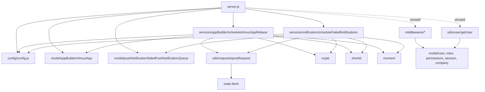

# general_task_scheduler_ms

## 1. Summary

A timer-driven background worker, not an API. It starts two `setInterval` loops: one every hour
that fires at 03:00 America/Chicago and asks the app-version-manager service to rebase stale
Inhouz apps, and one every ten minutes that re-sends queued push notifications through the
push-notification-parser service. It registers no HTTP route; the Express listener exists only so
the container has a port. It lives in its own git repository at
`apps/general_task_scheduler_ms/`; every `file:line` below is relative to that repository.

## 2. Stack and commands

Runtime: Node.js, plain CommonJS. The Dockerfile pins `node:16.4-alpine` (`Dockerfile:1`).
Express 4, Mongoose 7, `node-fetch` (`package.json:15-38`).

**There is no runnable start script.** `package.json:6-8` declares only:

```json
"scripts": { "test": "echo \"Error: no test specified\" && exit 1" }
```

`Dockerfile:11` runs `CMD ["npm", "run", "start"]`, and no `start` script exists, so the image
cannot boot as built. There is no documented command in the repository; the only way to run the
worker from source would be `node server.js`, which is not written down anywhere in the repo.

Port: `PORT`, read at `server.js:77`; the deployment sets `5075` and
`containerPort: 5075` (`k8s/general-task-scheduler-ms-deployment.yml:26-29`). There is **no k8s
Service** object — only a Deployment and a VPA (`k8s/`). Image
`inhouz/general_task_scheduler_ms`, `replicas: 1`
(`k8s/general-task-scheduler-ms-deployment.yml:6`, `:17`).

## 3. Entry points

| Entry point | Location | How it starts |
|---|---|---|
| Express app + listener | `server.js:18-33`, `:77-79` | `node server.js`; no routes registered |
| Hourly app-rebase loop | `server.js:60-68` | `setInterval(..., 1h)`; calls `scheduleInhouzAppRebase()` when local Chicago hour is `3` |
| 10-minute notification retry loop | `server.js:70-75` | `setInterval(..., 10min)`; calls `scheduleFailedNotifications()` unconditionally |
| Model registration | `server.js:15-16` | Requires `inhouzApp` and `failedPushNotificationQueue` schemas |
| Mongo connect / reconnect | `server.js:31-48`, `:81-93` | `connectMongo()`; 5 s retry on disconnect (`:41-43`) |
| Health probe script | `healthcheck.js:1-21` | Standalone `node healthcheck.js`; probes `localhost:$PORT/healthz` |
| Cluster | none | This service does **not** fork workers, unlike its sibling services |

## 4. Module inventory

22 JavaScript files.

| Name | file:line | Responsibility | Public API | Kind |
|---|---|---|---|---|
| `server.js` | `server.js:1-93` | Middleware, Mongo lifecycle, the two intervals, listener | process entry | effectful |
| `config()` | `config/config.js:17-39` | Memoised config; secret files with env fallback | `() => config` | effectful (filesystem, env) |
| `readSecret` | `config/config.js:4-14` | Reads `SECRETS_PATH/<name>` then env fallback | `(name, envFallback) => string` | effectful |
| `scheduleInhouzAppRebase` | `services/appBuilder/scheduleInhouzAppRebase.js:8-77` | Pages over stale `webApp`/`webComponent` apps and posts a rebase request per app | `async () => void` | effectful (DB, HTTP, clock, randomness) |
| `scheduleFailedNotifications` | `services/notification/scheduleFailedNotifications.js:8-65` | Pages over the failed-notification queue and re-posts each entry | `async () => void` | effectful (DB, HTTP, clock, randomness) |
| `postRequest` | `utils/requests/postRequest.js:3-...` | JSON POST with normalised error shape | `async (url, headers, data) => json` | effectful |
| `getRequest` | `utils/requests/getRequest.js` | JSON GET | `async (url) => json` | effectful |
| `deleteRequest` | `utils/requests/deleteRequest.js` | JSON DELETE | `async (url) => json` | effectful |
| `recursiveSanitizer` | `utils/sanitizer/recursiveSanitizer.js` | Deep body sanitisation | `(value, sanitizer) => value` | pure |
| `getUser` | `utils/user/getUser.js:18-130` | User + roles + permissions assembly; not called by the worker | `async (...) => user` | effectful |
| `createEditByObject` | `utils/user/createEditByObject.js` | Audit byline helper; not called | `(...)` | pure |
| `checkLogin` | `middlewares/login/checkLogin.js:1-140` | Session/company lookup; not mounted; nothing calls it | `(req,res,next)` | effectful |
| `moduleAccessCheck` | `middlewares/module/moduleAccessCheck.js:1-40` | Flex module access check; not mounted | `(req,res,next)` | effectful |
| `singleSubdomainValidation` | `middlewares/subdomain/singleSubdomainValidation.js` | Subdomain check; not mounted | `(req,res,next)` | effectful |
| `inhouzApp` model | `model/appBuilder/inhouzApp.js:6-299` | The app document (largest schema); `appType` enum, `rebased`, `editDate` | mongoose model | effectful |
| `company` model | `model/company/company.js:5-108` | Company document | mongoose model | effectful |
| `failedPushNotificationQueue` | `model/pushNotification/failedPushNotificationQueue.js:5-...` | Queue row for failed pushes | mongoose model | effectful |
| `roles`, `permissions`, `useRoles`, `session`, `user` models | `model/rolesAndPermissions/*.js`, `model/user/*.js`, `model/session/session.js` | Shared schemas; only `getUser`/middleware read them, neither is live | mongoose models | effectful |

## 5. Side effects

| Effect | Where |
|---|---|
| MongoDB connect / reconnect | `server.js:31-48`, `:81-93` |
| MongoDB read: stale apps | `scheduleInhouzAppRebase.js:15-35` (`appType` in `webApp`/`webComponent`, `editDate < now-5h`, `rebased:false`) |
| MongoDB read: failed notification queue | `scheduleFailedNotifications.js:15-21` (no filter) |
| Filesystem: secret files | `config/config.js:4-14` |
| HTTP out: `APP_VERSION_MANAGER_MS_URL/api/appversionmanager/inhouzapprebase` | `scheduleInhouzAppRebase.js:60-67` |
| HTTP out: `PUSH_NOTIFICATION_PARSER_MS_URL/api/pushnotificationparser/sendpushnotification` | `scheduleFailedNotifications.js:45-55` |
| Clock: timezone gate | `moment.tz(moment(), "America/Chicago").format("HH")` at `server.js:62` |
| Clock: staleness cutoff | `moment().subtract(5,'hours')` at `scheduleInhouzAppRebase.js:21` |
| Clock: envelope expiry | `moment().add(300,'seconds')` at `scheduleInhouzAppRebase.js:57`, `scheduleFailedNotifications.js:42` |
| Randomness: query keys | `shortid.generate()` at `scheduleInhouzAppRebase.js:55`, `scheduleFailedNotifications.js:40` |
| Crypto: envelope | `new Cryptr(config.sessionSecret)` at `scheduleInhouzAppRebase.js:11`, `scheduleFailedNotifications.js:11` |
| Logging | `console.log` at `server.js:36`, `:39`, `:47`, `:54`, `:62`-adjacent, `:71`, `:78`; service completion logs at `scheduleInhouzAppRebase.js:71`, `scheduleFailedNotifications.js:59` |
| Timers | `server.js:41`, `:60`, `:70` |
| K8s secret material | `service-account.json.enc` at the repo root is an encrypted blob; no plaintext credential was found |

## 6. State and state transitions

The worker owns no state machine of its own. It drives two documents in other services' domains.

**Inhouz app rebase** (fields on `inhouzApps`):

| State | Transition | Trigger | Guard |
|---|---|---|---|
| `rebased: false`, `editDate` older than 5 h | `rebased → true` (by app-version-manager) | hourly tick where Chicago hour is `3` | query filter at `scheduleInhouzAppRebase.js:17-24` |
| `rebased: false`, recently edited | stays | — | `editDate >= now-5h` fails the filter |
| `appType` not `webApp`/`webComponent` | never selected | — | enum filter at `:18` |

The guard "Chicago hour is 3" fires once per day in the intended window, but the interval drifts
against wall-clock boundaries (`server.js:60-68`).

**Failed notification queue:**

| State | Transition | Trigger |
|---|---|---|
| present in `failedPushNotificationQueue` | re-sent (document **not** removed) | every 10 minutes, `scheduleFailedNotifications.js:15-55` |
| removed by push-notification-parser | leaves the loop | external |

Because the worker never deletes a queue row, the same row is re-sent every ten minutes until
another service removes it. That is a loop over external state, not a local state machine.

## 7. Data

Eight schemas are declared in this repository; only two are used by the worker.

| Model file | Schema | Collection env var | Key fields relevant to this worker |
|---|---|---|---|
| `model/appBuilder/inhouzApp.js:6-299` | Inhouz app | `INHOUZ_APP_MODEL` | `appId`, `companyId`, `appType` (`webApp`, `webComponent`, …), `editDate` (epoch ms), `rebased` (boolean) — read at `scheduleInhouzAppRebase.js:25-28` |
| `model/pushNotification/failedPushNotificationQueue.js:5-...` | Failed push queue | `FAILED_PUSH_NOTIFICATION_QUEUE_MODEL` | `companyId`, `environment`, plus the notification body forwarded verbatim at `scheduleFailedNotifications.js:51` |
| `model/company/company.js:5-108` | Company | `COMPANY_MODEL` | shared, unread here |
| `model/user/user.js:6-138` | User | `USER_MODEL` | shared; `email` validated with `validator.isEmail` |
| `model/user/useRoles.js:6-51` | User roles | `USER_ROLES_MODEL` | shared |
| `model/rolesAndPermissions/roles.js:6-87` | Roles | `ROLE_MODEL` | shared |
| `model/rolesAndPermissions/permissions.js:6-89` | Permissions | `PERMISSION_MODEL` | shared |
| `model/session/session.js:5-28` | Session | `SESSION_MODEL` | shared |

**Shared collections.** `inhouzApps` and `failedPushNotificationQueue` are written by other
services: the app-builder and push-notification services respectively. `app-version-manager`
sets `rebased`. This service only reads them; the state change happens in the owning service. The
company, user, role, permission, user-role and session schemas are shared with the rest of the
Inhouz suite and are dead weight here.

## 8. Public interfaces

No inbound HTTP route, no CLI command, no queue subscription. The only interfaces are outbound.

| Outbound call | Body | Where |
|---|---|---|
| `POST {APP_VERSION_MANAGER_MS_URL}/api/appversionmanager/inhouzapprebase` | `{ encryptedPayload, serverEncrypted: true }`; payload decrypts to `{ payload: { appId, companyId, queryKey }, expirationTimestamp }` valid 300 s | `scheduleInhouzAppRebase.js:51-67` |
| `POST {PUSH_NOTIFICATION_PARSER_MS_URL}/api/pushnotificationparser/sendpushnotification` | `{ encryptedPayload, serverEncrypted: true, notifications: [notification], environment, cachedNotification: true }` | `scheduleFailedNotifications.js:37-55` |

The Express listener answers every path with Express's default 404; the service is not addressed by
any other unit. The k8s Deployment has no matching Service, which matches a worker-only role.

## 9. Configuration

Env var names only.

Secrets: `MONGO_URL` (`mongourl`), `SESSION_SECRET` (`sessionsecret`), `CLIENT_SECRET_KEY`
(`clientsecretkey`), plus `SECRETS_PATH` (`config/config.js:4-36`).

Model names: `USER_MODEL`, `COMPANY_MODEL`, `ROLE_MODEL`, `PERMISSION_MODEL`, `USER_ROLES_MODEL`,
`SESSION_MODEL`, `SESSION_VALIDATOR_MODEL`, `INHOUZ_APP_MODEL`,
`FAILED_PUSH_NOTIFICATION_QUEUE_MODEL`.

Service URLs: `APP_VERSION_MANAGER_MS_URL`, `PUSH_NOTIFICATION_PARSER_MS_URL`.

Other: `PORT`, `NODE_ENV`, `COOKIE_DOMAIN`. Constant: `adminPermission = "admin"`
(`config/config.js:29`).

Set in k8s but never read by this code (partial list from the deployment env block):
`PAYMENT_MS_URL`, `APP_BUILDER_MS_URL`, `VIEW_BUILDER_MS_URL`, `INHOUZ_SIGN_MS_URL`,
`DOCUMENT_GENERATION_PARSER_MS_URL`, and the large `*_MODEL` set for app-builder, sign, payment
and identity collections (`k8s/general-task-scheduler-ms-deployment.yml:136-254`). No values are
reproduced.

## 10. Dependencies

| Dependency | Why |
|---|---|
| `express`, `body-parser`, `cors`, `helmet`, `hpp`, `cookie-parser` | Listener and middleware (`server.js:2-8`, `:19-30`); no route uses them |
| `mongoose` | App and notification reads |
| `node-fetch` | Both outbound posts (`utils/requests/*.js`) |
| `cryptr` | Envelope encryption for both outbound payloads |
| `moment`, `moment-timezone` | Timezone gate, staleness cutoff, expiry |
| `shortid` | Per-request `queryKey` |
| `lodash`, `sanitizer`, `validator` | Present in middleware/model code that the worker never executes |
| `crypto-js`, `bcryptjs`, `request-ip`, `connect-mongo`, `express-session`, `@sendgrid/mail` | Carried over from the template; unused by this worker |

## 11. Testing

No tests. `package.json:7` is the placeholder that exits 1. No test framework. Nothing about the
two loops is covered. Verification would require a Mongo instance plus stub
app-version-manager and push-notification-parser endpoints and a clock you can move.

## 12. Known issues and risks

- **The image cannot start.** `Dockerfile:11` runs `npm run start`; `package.json:6-8` has no
  `start` script. Any built container exits immediately.
- **The failed-notification loop resends forever.** `scheduleFailedNotifications` pages over the
  whole queue and never deletes or marks a row (`scheduleFailedNotifications.js:15-57`), so every
  ten minutes it re-posts the same notifications. Duplicate pushes are the expected outcome.
- **Fire-and-forget HTTP.** Both loops call `postRequest(...)` without `await`
  (`scheduleInhouzAppRebase.js:60`, `scheduleFailedNotifications.js:45`), so failures are dropped
  and the "Complete!" log is printed before any request finishes.
- **Unbounded fan-out.** Both loops issue one request per row with no concurrency cap
  (`scheduleInhouzAppRebase.js:45-68`, `scheduleFailedNotifications.js:31-56`). A 2000-row page
  opens 2000 sockets at once.
- **Paging over a mutating query.** `scheduleInhouzAppRebase` filters `rebased:false` and advances
  `skip` across pages while the consumer flips `rebased` asynchronously
  (`scheduleInhouzAppRebase.js:14-69`); rows can be skipped when earlier rows leave the filter.
- **Error path silently exits the loop.** On a query error the code sets `docCount = 0` and
  `continue`s (`scheduleInhouzAppRebase.js:37-40`), which ends the `do…while` without logging the
  page that failed beyond the catch inside the query.
- **The hourly gate can double-fire or miss.** `setInterval` drifts (`server.js:60-68`); if two
  ticks land inside the 03:00 hour, rebase is scheduled twice.
- **CORS pinned to a dev regex.** `origin: /inhouz.localhost/` (`server.js:21`).
- **No health endpoint.** `healthcheck.js:7` probes `/healthz`; no such route exists, so the probe
  always fails.
- **`shutdownFunction` reads `e.message`** on `SIGINT`/`SIGTERM`, where `e` is undefined
  (`server.js:53-54`), throwing inside the shutdown handler.
- **Full queue body is forwarded.** `notifications: [notification]` sends the stored document
  verbatim (`scheduleFailedNotifications.js:51`), including any fields the producer stored.
- **A 5 GiB memory limit with `maxPoolSize: 1`** (`k8s/...deployment.yml:20`, `server.js:89`)
  suggests the limits were not tuned for a worker that only pages two collections.
- **Dead code shipped**: all middleware, `getUser`, and six of eight models are never executed by
  the worker.
- **Encrypted service-account blob in the repo**: `service-account.json.enc` at the repository
  root. It is encrypted, so no credential value is exposed here, but its presence and key custody
  should be confirmed.

No plaintext credential literal was found in the source.

## 13. Module map



## 14. Open questions

- **Mode: full read?** No. Read in full: `server.js`, `config/config.js`, `Dockerfile`,
  `services/appBuilder/scheduleInhouzAppRebase.js`, `services/notification/scheduleFailedNotifications.js`,
  `utils/requests/postRequest.js` (first 30 lines). Read partially: the k8s deployment header and
  URL block. The remaining ~16 files (models, middleware, `getUser`, `getRequest`/`deleteRequest`,
  `createEditByObject`, `recursiveSanitizer`) were catalogued by directory listing and the brief's
  `mongoose.model` / `new Schema` grep. None of them is executed by the worker.
- **How the image is supposed to start** is unresolved. No `start` script, no `npm start`, no
  documented `node server.js`. Either the Dockerfile or the manifest is wrong; the code cannot tell
  which was intended.
- **Whether app-version-manager sets `rebased`** is assumed from the field name and the
  `rebased:false` filter; the write happens outside this repository.
- **Who removes rows from `failedPushNotificationQueue`** cannot be determined here; if nobody
  does, the resend loop is permanent.
- **What `server.js:62` does at the hour boundary** depends on the host clock and `moment-timezone`
  data; the exact fire count per day was not measured.
- **The real collection names** come from `*_MODEL` env vars and are deployment state. The brief's
  mapping (`INHOUZ_APP_MODEL` → `inhouzApps`, `FAILED_PUSH_NOTIFICATION_QUEUE_MODEL` →
  `failedPushNotificationQueue`) could not be verified from code and is treated as deployment
  configuration, not fact.
- **`moment-timezone` is required at `server.js:12` as `momenttimezone` but never referenced**;
  the timezone gate uses `moment.tz` (`:62`), which requires the timezone data to be loaded. This
  is likely fine because `moment-timezone` patches `moment` on require, but it is an implicit
  dependency.
