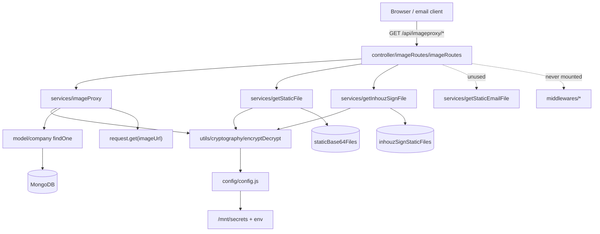

# image_proxy_ms

## 1. Summary

`image_proxy_ms` serves images and files to browsers without exposing storage originals. It has two jobs: proxy an arbitrary remote image URL for an authorised company, and stream a base64-encoded file from MongoDB (`staticBase64Files` or `inhouzSignStaticFiles`) after validating a signed, expiring `imageKey`. Access is gated by an RSA-encrypted key in the query string, not by a session. It lives in its own git repository at `apps/image_proxy_ms/`. k8s: service `image-proxy-ms-cluster-ip-service` on `5034` (`k8s/image-proxy-ms-cluster-ip-service.yml:10`), image `inhouz/image_proxy_ms`, 1 replica (`k8s/image-proxy-ms-deployment.yml:6,17`).

## 2. Stack and commands

- Runtime: Node.js `">=12.0.0 <17.5.0"` (`package.json` `engines`). Express 4.
- Package manager: npm.
- Start: `npm start` → `node server.js` (`package.json:11`); container CMD `npm run start` (`Dockerfile:11`).
- Test: `npm test` → `echo "Error: no test specified" && exit 1` (`package.json:10`).
- Port: `process.env.PORT` (`server.js:75`); k8s exposes `5034`.
- Health probe: `healthcheck.js:8` requests `GET /healthz`; no such route is registered.

## 3. Entry points

| Entry | Where | How it starts |
|---|---|---|
| Cluster master | `server.js:18-35` | Forks one worker per CPU in production, otherwise one |
| HTTP server | `server.js:75` | `app.listen(process.env.PORT)` |
| Route registration | `server.js:41` | `require("./controller/imageRoutes/imageRoutes")(app)` |
| Mongo connection | `server.js:81-89` | `connectMongo()` at `server.js:43`; reconnect timer `server.js:53-58` |
| Model registration | `server.js:13-15` | `company`, `staticBase64File`, `inhouzSignStaticFiles` |
| `GET /api/imageproxy/getimage` | `controller/imageRoutes/imageRoutes.js:6` | `imageProxy` |
| `GET /api/imageproxy/getimage/:imageKey` | `controller/imageRoutes/imageRoutes.js:7` | `imageProxy` (path param unused) |
| `GET /api/imageproxy/getstaticimage/:staticFileId` | `controller/imageRoutes/imageRoutes.js:8` | `getStaticFile` |
| `GET /api/imageproxy/getstaticemailimage/:staticFileId` | `controller/imageRoutes/imageRoutes.js:9` | **`getStaticFile`**, not `getStaticEmailFile` |
| `GET /api/imageproxy/getinhouzsignfile/:staticFileId` | `controller/imageRoutes/imageRoutes.js:10` | `getInhouzSignFile` |

No cron, queue consumer or websocket server.

## 4. Module inventory

| Module / function | `file:line` | Responsibility | Public API | Kind |
|---|---|---|---|---|
| Bootstrap / Express wiring | `server.js:18-79` | Worker fork, CORS (open), body limit 20 mb, Mongo lifecycle | — | `effectful` |
| `connectMongo()` | `server.js:81` | Mongoose connection, `maxPoolSize: 1` | internal | `effectful` |
| `shutdownFunction(e)` | `server.js:68` | Close Mongo on signal / uncaught exception | process hooks | `effectful` |
| Route table | `controller/imageRoutes/imageRoutes.js:4-11` | Mounts five GET routes with no auth middleware | HTTP | `effectful` |
| `imageProxy(req,res)` | `services/imageProxy.js:7` | Decrypt `imageKey`, check company plan, proxy `imageUrl` | `GET /api/imageproxy/getimage` | `effectful` (crypto, DB, outbound network) |
| `getStaticFile(req,res)` | `services/getStaticFile.js:7` | Validate key, read `staticBase64Files`, stream bytes | `GET …/getstaticimage/:staticFileId`, `GET …/getstaticemailimage/:staticFileId` | `effectful` (crypto, DB, response stream) |
| `getInhouzSignFile(req,res)` | `services/getInhouzSignFile.js:7` | Validate key bound to `staticFileId` + `companyId`, read `inhouzSignStaticFiles`, stream bytes | `GET …/getinhouzsignfile/:staticFileId` | `effectful` |
| `getStaticEmailFile` | `services/getStaticEmailFile.js` | Same as `getStaticFile` but unused: no route imports it | — | `effectful` (dead code) |
| `encryptDecrypt` | `utils/cryptography/encryptDecrypt.js` | RSA decrypt of `imageKey` | exports function | `effectful` (crypto, config, logs) |
| `recursiveSanitizer` | `utils/sanitizer/recursiveSanitizer.js` | Sanitizes route params | exports function | `pure` |
| `config()` / `readSecret()` | `config/config.js:17,5` | Env and `/mnt/secrets` reads, cached | returns config | `effectful` |
| `company` model | `model/company/company.js:5-108` | Company schema | Mongoose model | `effectful` |
| `staticBase64File` model | `model/staticFiles/staticBase64File.js:5-20` | Base64 file blobs | Mongoose model | `effectful` |
| `inhouzSignStaticFile` model | `model/inhouzSign/inhouzSignStaticFiles.js:5-20` | Sign-tenant file blobs, includes `companyId` | Mongoose model | `effectful` |
| `user`, `useRoles`, `roles`, `permissions`, `session` models | `model/user/*`, `model/rolesAndPermissions/*`, `model/session/session.js` | Registered but unused by the live routes | Mongoose models | `effectful` |
| `checkLogin`, `moduleAccessCheck`, `singleSubdomainValidation` | `middlewares/*` | HTTP auth middleware, **never mounted** | — | `effectful` |

## 5. Side effects

| Effect | System | `file:line` |
|---|---|---|
| Read secret files | Filesystem `SECRETS_PATH` (default `/mnt/secrets`): `sendgridapikey`, `sessionsecret`, `mongourl`, `clientsecretkey` | `config/config.js:5-13,25,28,29,39` |
| RSA decrypt | Local crypto | `utils/cryptography/encryptDecrypt.js`; `services/imageProxy.js:14`; `services/getStaticFile.js:27`; `services/getInhouzSignFile.js:32` |
| Connect to MongoDB | `config.mongoUrl` | `server.js:82` |
| Read company | MongoDB `company` `findOne({_id, status:'active'})` | `services/imageProxy.js:27-45` |
| **Outbound HTTP GET to `imageUrl`** | Arbitrary remote host via `request` | `services/imageProxy.js:60-65` |
| Stream upstream response to client | HTTP response | `services/imageProxy.js:65` |
| Read base64 file | MongoDB `staticBase64Files` | `services/getStaticFile.js:36-46` |
| Read sign file | MongoDB `inhouzSignStaticFiles` `findOne({_id, companyId})` | `services/getInhouzSignFile.js:44-52` |
| Write response bytes + `Content-Type` | HTTP response | `services/getStaticFile.js:54-62`; `services/getInhouzSignFile.js:63-71` |
| Cache header | `Cache-Control: public, max-age=36000` | `services/imageProxy.js:58` |
| Clock | Expiry check on `expirationTimestamp` | `services/imageProxy.js:17`; `services/getStaticFile.js:29`; `services/getInhouzSignFile.js:34` |
| Logging | stdout `console.log`/`console.error` | `server.js:21-31,47,50,59,70,76`; `services/imageProxy.js:40,62,70`; `services/getStaticFile.js:43`; `services/getInhouzSignFile.js:51` |
| Close Mongo on signal | MongoDB | `server.js:69-71` |

No third-party API is called. No storage bucket is touched; all files come from MongoDB.

## 6. State and state transitions

No persisted state machine. Each request is a one-shot gate:

| Step | Failure | `file:line` |
|---|---|---|
| `imageKey` present and a string | 400 / 500 | `services/imageProxy.js:10-12`; `getStaticFile.js:20-26`; `getInhouzSignFile.js:20-26` |
| Key decrypts and `expirationTimestamp` is in the future | 400 / 500 `Invalid access key` | `imageProxy.js:14-20`; `getStaticFile.js:27-34`; `getInhouzSignFile.js:32-43` |
| Company exists and `status = 'active'` | 400 `Account not found` | `imageProxy.js:27-45` |
| Plan allows proxying (`freelancer` rejected unless `isInhouzSign`) | 400 | `imageProxy.js:46-51` |
| For sign files: key `staticFileId` matches the path and a `companyId` is present | 500 | `getInhouzSignFile.js:36-43` |
| File row exists (and, for sign, matches `companyId`) | 404 | `getStaticFile.js:51`; `getInhouzSignFile.js:59-64` |

The only stored states are the file rows themselves; nothing here transitions them.

## 7. Data

| Collection | Env var | Fields used | `file:line` |
|---|---|---|---|
| `company` | `COMPANY_MODEL` | `_id`, `status`, `companyType` | `services/imageProxy.js:28-37`; schema `model/company/company.js:5-108` |
| `staticBase64Files` | `STATIC_BASE64_FILE_MODEL` | `_id`, `base64` (data URI: `<mime>;base64,<data>`) | `services/getStaticFile.js:36-56`; schema `model/staticFiles/staticBase64File.js:5-20` |
| `inhouzSignStaticFiles` | `INHOUZ_SIGN_STATIC_FILE_MODEL` | `_id`, `companyId`, `base64` | `services/getInhouzSignFile.js:44-64`; schema `model/inhouzSign/inhouzSignStaticFiles.js:5-20` |

The `base64` field is parsed by splitting on `,` and taking the MIME from the prefix (`getStaticFile.js:54-56`), so a row whose value is not a data URI produces a `Buffer` from `undefined` and an empty content type.

Shared-collection coupling: `staticBase64Files` is written by the services that store inline assets (email images, app assets); `inhouzSignStaticFiles` is written by `inhouz_sign_ms` and read here for embedded signature images. Neither collection is written by this repo.

## 8. Public interfaces

All routes are `GET`, return the raw bytes with the stored MIME type, and take the signed key as the query parameter `imageKey`.

| Method | Path | Query | Response |
|---|---|---|---|
| GET | `/api/imageproxy/getimage` | `imageKey`, `imageUrl`, optional `format=base64` | Proxied upstream bytes, `Cache-Control: public, max-age=36000` (`imageProxy.js:52-65`) |
| GET | `/api/imageproxy/getimage/:imageKey` | same; path param ignored (`imageProxy.js:9` reads only `req.query.imageKey`) | same |
| GET | `/api/imageproxy/getstaticimage/:staticFileId` | `imageKey` | File bytes with stored MIME (`getStaticFile.js:57-62`) |
| GET | `/api/imageproxy/getstaticemailimage/:staticFileId` | `imageKey` | Same handler as above (`imageRoutes.js:9`) |
| GET | `/api/imageproxy/getinhouzsignfile/:staticFileId` | `imageKey` | File bytes, key must match `staticFileId` and contain `companyId` (`getInhouzSignFile.js:32-52`) |

Decrypted key envelope: `{ payload: { companyId, isInhouzSign? }, expirationTimestamp }` (`imageProxy.js:16-21`); the sign variant additionally carries `staticFileId` (`getInhouzSignFile.js:36-43`). Keys are URL-encoded with replacements `p1L2u3S`→`+`, `s1L2a3S4h`→`/`, `e1Q2u3A4l`→`=` (`imageProxy.js:14`).

No events, queue topics or CLI commands.

## 9. Configuration

Env var names read here: `SECRETS_PATH`, `PORT`, `NODE_ENV`, `FLEX_FORM_FILE_MODEL`, `FLEX_MODULE_MODEL`, `FLEX_COLLECTION_MODEL`, `FORM_MODEL`, `SENDGRID_API_KEY`, `SMPL_EMAIL`, `DATA_RULE_EXECUTION_RESULT_MODEL`, `SESSION_SECRET`, `MONGO_URL`, `USER_MODEL`, `COMPANY_MODEL`, `ROLE_MODEL`, `PERMISSION_MODEL`, `USER_ROLES_MODEL`, `SESSION_MODEL`, `SESSION_VALIDATOR_MODEL`, `AUTH_LOG_MODEL`, `CLIENT_SECRET_KEY`, `COOKIE_DOMAIN`, `STATIC_BASE64_FILE_MODEL`, `INHOUZ_SIGN_STATIC_FILE_MODEL` (`config/config.js:5-46`).

Secret-file names: `sendgridapikey`, `sessionsecret`, `mongourl`, `clientsecretkey` (`config/config.js:25,28,29,39-42`).

The deployment also injects model names this code never reads (`AUTH_LOG_MODEL`, `CHURN_TRACKER_MODEL`, `CONTACTS_MODEL`, `CUSTOMERS_MODEL`, `EXCHANGE_RATE_CACHE_MODEL`, `FLEX_API_MODEL`, `INHOUZ_APP_MODEL`, `IP_ADDRESS_LOCATION_MODEL`, `IP_LOCATION_FINDER_URL`, `PAYMENT_*`, `PAYOUT_ACCOUNT_MODEL`, `SERVICE_DISCOUNT_MODEL`, `SUBSCRIBER_*`, `SUBSCRIPTION_*`, `VERSION_TRACKER_MODEL`) plus `COOKIE_NAME`, `INHOUZ_FROM_EMAIL`, `OPEN_EXCHANGE_RATES_BASE_URL`, `PAYMENT_MS_URL` (`k8s/image-proxy-ms-deployment.yml`).

## 10. Dependencies

| Package | Why |
|---|---|
| `express` | HTTP server and routes |
| `request` | The upstream image fetch and stream (`services/imageProxy.js:4,60`) |
| `js-base64` | Decodes `format=base64` image URLs (`services/imageProxy.js:5,56`) |
| `mongoose` | Company and file collections |
| `node-rsa` | Decrypt/verify `imageKey` (`config/config.js:1`) |
| `sanitizer` | Route-param sanitizing (`getStaticFile.js:5`) |
| `body-parser`, `cookie-parser`, `cors`, `helmet`, `hpp` | Express middleware (`server.js:4-8,37-40`) |
| `dotenv`, `fs`, `path`, `os`, `cluster`, `http` | Env loading, secret files, worker fork, health probe |
| `@sendgrid/mail`, `bcryptjs`, `connect-mongo`, `crypto-js`, `cryptr`, `express-session`, `lodash`, `moment`, `request-ip`, `shortid`, `validator` | Template leftovers, not used by the live routes |

## 11. Testing

No tests. `npm test` exits 1. No test framework, test directory or CI workflow. The key-expiry boundary, the `freelancer`+`isInhouzSign` exception, and the difference in key binding between `getStaticFile` and `getInhouzSignFile` have no automated coverage.

## 12. Known issues and risks

- **Open proxy / SSRF.** `imageUrl` is taken from the query string and fetched with no scheme or host allow-list (`services/imageProxy.js:53,60-65`). Internal cluster addresses and `file://`-style schemes reachable by `request` are exposed to any holder of a valid `imageKey`.
- **Key not bound to the file in `getStaticFile`.** Any non-expired `imageKey` reads any `staticFileId` (`services/getStaticFile.js:27-34,36-38`). Only the sign variant binds `staticFileId` and `companyId` (`getInhouzSignFile.js:36-52`).
- **Company plan check applies only to `imageProxy`.** The two static routes never check company status or plan (`getStaticFile.js`, `getInhouzSignFile.js`).
- **`getstaticemailimage` is wired to the wrong handler.** `imageRoutes.js:9` uses `getStaticFile`, so `services/getStaticEmailFile.js` is unreachable dead code. If the email variant was meant to differ, that behaviour is missing.
- **Error responses after the stream starts.** `imageProxy` pipes the upstream response and then calls `res.status(500)` in the `error` handler (`imageProxy.js:61-64`), which throws if headers were already sent.
- **`res.static(500)` is not an Express method** (`getStaticFile.js:65`, `getInhouzSignFile.js:74`); the catch block itself throws.
- **Partial cache header.** `Cache-Control` is set before the 404 branch (`imageProxy.js:58,67`), so misses are cached for 10 hours by intermediaries.
- **Sanitizer on params only.** `imageUrl` and `imageKey` are not sanitized (`getStaticFile.js:9`; `imageProxy.js:9`).
- **Open CORS.** `app.use(cors())` allows every origin (`server.js:37`).
- **No auth middleware mounted**; all five routes rely solely on the encrypted key (`imageRoutes.js:6-10`).
- **Health endpoint missing** (`healthcheck.js:8`); no `HEALTHCHECK` in the Dockerfile.
- **Base64 blobs in MongoDB** are loaded fully into memory per request (`getStaticFile.js:54-55`), so large files cost a full document read plus a buffer copy.
- **`status: 'active'` literal** in the proxy query (`imageProxy.js:31`) couples this service to the company status vocabulary.

No credential literal is embedded in the source; secrets come from `/mnt/secrets` or env (`config/config.js:5-13`).

## 13. Module map

## 14. Open questions

- Who mints the `imageKey` payloads, and for how long, is not visible here. Other services must share the same RSA private key, since this service only decrypts.
- Whether `getstaticemailimage` was intended to use `getStaticEmailFile` (the file exists) or to share the generic handler is not recorded.
- The sign-file `companyId` matching assumes every row in `inhouzSignStaticFiles` carries `companyId`; the schema field was not read in full.
- Whether `isInhouzSign` is meant to bypass the freelancer block for all sign-embedded images is inferred from the condition at `imageProxy.js:46-51`, not from a written rule.
- The exact callers of `/api/imageproxy/*` were not enumerated; the brief's "called by: none found" is a grep limit, not evidence that nothing calls it.

Skipped: `build_ga*.sh`, `deploy.sh`, `docker-compose.yml`, `kus/`, `k8s/*-hpa.yml`, `k8s/*-vpa.yml`, `utils/user/` and the `middlewares/` bodies (never mounted), and the model schemas beyond the fields queried.
