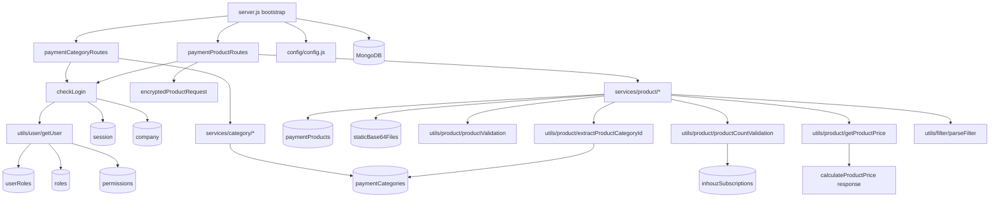

# inhouz_commerce_ms

## 1. Summary

`inhouz_commerce_ms` is the product-catalogue service of the Inhouz platform. It owns CRUD for
payment products and payment categories (create, edit, delete, name availability, single and paged
listing), and it prices a product list on demand with three pricing models: standard unit price,
package volume, and graduated tiers. It also marks products as purchased when a payment has been
made, and refuses to delete a product that has a purchase history. It is authenticated with the
platform session cookie and reads users, companies, roles, permissions and subscription limits
from collections it shares with the rest of the platform. The service lives in its own git
repository at `apps/inhouz_commerce_ms/` (remote `Inhouz-Cloud-AI/inhouz_commerce_ms`).

## 2. Stack and commands

| Item | Value | Source |
|---|---|---|
| Runtime | Node.js 16.4 (alpine container) | `Dockerfile:1` |
| Container command | `npm run start` | `Dockerfile:11` |
| Framework | Express 4.16.4 | `package.json:20` |
| ODM | Mongoose 7.4.0 | `package.json:25` |
| Package name | `micro_service_template` (copied template, not renamed) | `package.json:2` |
| Scripts | `start` → `node server.js`; `test` → `echo "Error: no test specified" && exit 1` | `package.json:7`, `package.json:8` |
| Port | `process.env.PORT` | `server.js:86` |
| k8s service | `inhouz-commerce-ms-cluster-ip-service`, ClusterIP, port 5060 | `k8s/inhouz-commerce-ms-cluster-ip-service.yml:4`, `:10` |
| k8s deployment | `inhouz-commerce-ms-deployment`, image `inhouz/inhouz_commerce_ms`, replicas 1 | `k8s/inhouz-commerce-ms-deployment.yml:4`, `:6`, `:17` |

There is no dev script, no linter config and no test runner. The only way to start the service is
`npm run start`, which runs `node server.js`.

## 3. Entry points

| Entry point | `file:line` | How it starts |
|---|---|---|
| Cluster bootstrap | `server.js:24` | Master process forks `os.cpus().length` workers in production, 1 otherwise (`server.js:25-28`); respawns any worker that exits (`server.js:30-41`) |
| HTTP server | `server.js:86` | `app.listen(process.env.PORT)` inside the worker branch |
| Route registration | `server.js:56-57` | `paymentCategoryRoutes(app)` then `paymentProductRoutes(app)` |
| Mongo connect | `server.js:91-103` | Called when `readyState` is not 1 or 2 (`server.js:58-60`) |
| Mongo reconnect timer | `server.js:65-72` | `setTimeout(connectMongo, 5000)` on `disconnected` |
| Graceful shutdown | `server.js:76-84` | `SIGINT`, `SIGTERM`, `uncaughtException` all close the Mongo connection |
| Container health probe | `healthcheck.js:10` | `GET http://localhost:$PORT/healthz`, exit 0 on 200, exit 1 otherwise |
| Product routes | `controller/product/paymentProductRoutes.js:13-25` | 11 routes |
| Category routes | `controller/product/paymentCategoryRoutes.js:9-16` | 6 routes |

There is no `/healthz` route in the Express app. `healthcheck.js` requests it, but the app only
registers the two API route modules (`server.js:56-57`). See section 12.

## 4. Module inventory

### Models (`model/`)

| Module | `file:line` | Responsibility | Public API | Kind |
|---|---|---|---|---|
| `paymentProduct` | `model/commerce/paymentProduct.js:130` | Product schema, indexes, model registration | mongoose model | `reactive` (schema state, bound to `config.paymentProductModel`) |
| `paymentCategory` | `model/commerce/paymentCategory.js:41` | Category schema, indexes, model registration | mongoose model | `reactive` |
| `company` | `model/company/company.js:108` | Shared company schema (read-only here) | mongoose model | `reactive` |
| `inhouzSubscription` | `model/inhouzSubscription/inhouzSubscription.js:212` | Shared subscription schema; supplies `paymentProductLimit` | mongoose model | `reactive` |
| `permissions` | `model/rolesAndPermissions/permissions.js:89` | Shared permission schema | mongoose model | `reactive` |
| `roles` | `model/rolesAndPermissions/roles.js:87` | Shared role schema | mongoose model | `reactive` |
| `session` | `model/session/session.js:28` | Shared session schema used by the auth middleware | mongoose model | `reactive` |
| `staticBase64File` | `model/staticFiles/staticBase64File.js:20` | Base64 media blobs for product images | mongoose model | `reactive` |
| `userRoles` | `model/user/useRoles.js:51` | User-to-role link | mongoose model | `reactive` |
| `user` | `model/user/user.js:138` | Shared user schema | mongoose model | `reactive` |

### Middleware (`middlewares/`)

| Module | `file:line` | Responsibility | Public API | Kind |
|---|---|---|---|---|
| `checkLogin` | `middlewares/login/checkLogin.js:9` | Validates `SMPL` cookie or `x-access-token` plus `x-csrfToken`, loads session and user, slides the session expiry 60 minutes, sets refreshed cookies, attaches `req.user` and `req.company` | `(req,res,next)` | `effectful` (Mongo read/write, clock, cookies, logging) |
| `encryptedProductRequest` | `middlewares/product/encryptedProductRequest.js:5` | RSA-decrypts an `encryptedPayload`, checks its expiration, rewrites `req.params` to `{systemProvidedCompanyId, productId}` | `(req,res,next)` | `effectful` (RSA, clock) |
| `moduleAccessCheck` | `middlewares/module/moduleAccessCheck.js:7` | Gate for flex-module access; not mounted on any route in this service | `(req,res,next)` | `effectful` (Mongo read) |
| `singleSubdomainValidation` | `middlewares/subdomain/singleSubdomainValidation.js:1` | Subdomain check; not mounted on any route in this service | `(req,res,next)` | `effectful` |

### Services (`services/`)

| Module | `file:line` | Responsibility | Public API | Kind |
|---|---|---|---|---|
| `createCategory` | `services/category/createCategory.js:58` | Insert a category | `(req,res)` | `effectful` |
| `editCategory` | `services/category/editCategory.js:64` | Update a category | `(req,res)` | `effectful` |
| `deleteCategory` | `services/category/deleteCategory.js:59` | Delete a category after checking products attached to it | `(req,res)` | `effectful` |
| `getCategory` | `services/category/getCategory.js:28` | Fetch one category for the company | `(req,res)` | `effectful` |
| `getCategories` | `services/category/getCategories.js:37` | Paged, filtered category list | `(req,res)` | `effectful` |
| `checkCategoryNameAvailability` | `services/category/checkCategoryNameAvailability.js:25` | Name uniqueness per company | `(req,res)` | `effectful` |
| `createProduct` | `services/product/createProduct.js:10` | Validate, enforce product limit, store media base64, insert product | `(req,res)` | `effectful` |
| `editProduct` | `services/product/editProduct.js:46` | Update product, replace/remove media blobs | `(req,res)` | `effectful` |
| `deleteProduct` | `services/product/deleteProduct.js:6` | Refuse if `purchaseExists`, otherwise delete | `(req,res)` | `effectful` |
| `getProduct` | `services/product/getProduct.js:24` | Fetch one product by id and company | `(req,res)` | `effectful` |
| `getProducts` | `services/product/getProducts.js:11` | Filtered, sorted, paged product list plus total count | `(req,res)` | `effectful` |
| `getProductsServerQuery` | `services/product/getProductsServerQuery.js:13` | Server-to-server variant of the product list | `(req,res)` | `effectful` |
| `checkNameAvailability` | `services/product/checkNameAvailability.js:25` | Product name uniqueness per company | `(req,res)` | `effectful` |
| `calculateProductPrice` | `services/product/calculateProductPrice.js:9` | Decrypt a product list, look up each product, sum prices | `(req,res)` | `effectful` |
| `markProductAsPurchased` | `services/product/markProductAsPurchased.js:8` | Set `purchaseExists: true` on a list of product ids | `(req,res)` | `effectful` |

### Utilities (`utils/`)

| Module | `file:line` | Responsibility | Public API | Kind |
|---|---|---|---|---|
| `getProductPrice` | `utils/product/getProductPrice.js:1` | Price one product for a quantity and currency (standard, package, graduated) | `({product, quantity, currency}) -> number \| {error}` | `pure` |
| `productValidation` | `utils/product/productValidation.js:1` | Field validation for a product body | `(body) -> boolean \| error` | `pure` |
| `productCountValidation` | `utils/product/productCountValidation.js:5` | Compare active product count with `paymentProductLimit` from the subscription | `(companyId) -> {valid} \| {error}` | `effectful` (two Mongo reads) |
| `extractProductCategoryId` | `utils/product/extractProductCategoryId.js:4` | Find a category by lowercase name or create it | `(categoryName, companyId) -> {categoryId} \| {error}` | `effectful` |
| `productFilterMap` | `utils/product/productFilterMap.js:1` | Allowed filter keys for the product query | map | `pure` |
| `productTypeMap` | `utils/product/productTypeMap.js:1` | Filter key → type coercion | map | `pure` |
| `productNonRegexMap` | `utils/product/productNonRegexMap.js:1` | Keys matched exactly, not by regex | list | `pure` |
| `categoryFilterMap` | `utils/category/categoryFilterMap.js:1` | Allowed filter keys for the category query | map | `pure` |
| `categoryTypeMap` | `utils/category/categoryTypeMap.js:1` | Filter key → type coercion | map | `pure` |
| `categoryNonRegexMap` | `utils/category/categoryNonRegexMap.js:1` | Keys matched exactly | list | `pure` |
| `parseFilter` | `utils/filter/parseFilter.js:1` | Turn a client filter into a Mongo match object | `(filter, filterMap, nonRegexList, typeMap) -> object` | `pure` |
| `recursiveSanitizer` | `utils/sanitizer/recursiveSanitizer.js:3` | Recursively sanitize strings in an object | `(element, sanitizer)` | `pure` |
| `encryptDecrypt` | `utils/cryptography/encryptDecrypt.js:3` | RSA encrypt (private-key encrypt, toward the client) or decrypt | `(data, encrypt=false)` | `effectful` (RSA key from config) |
| `getUser` | `utils/user/getUser.js:5` | Load user, user-roles, roles and permissions, resolve permission names | `(userId) -> user object` | `effectful` (four Mongo reads) |
| `createEditByObject` | `utils/user/createEditByObject.js:1` | Shape the `{userId, firstName, …}` audit object | `(user, deployDate)` | `pure` |

### Controller

| Module | `file:line` | Responsibility | Public API | Kind |
|---|---|---|---|---|
| `paymentProductRoutes` | `controller/product/paymentProductRoutes.js:13` | Registers 11 product routes | `(app)` | `effectful` (binds handlers) |
| `paymentCategoryRoutes` | `controller/product/paymentCategoryRoutes.js:9` | Registers 6 category routes | `(app)` | `effectful` |

## 5. Side effects

| Effect | Where | `file:line` |
|---|---|---|
| MongoDB connect (pool size 1) | `connectMongo` | `server.js:92-102` |
| MongoDB reconnect after 5 s | `disconnected` handler | `server.js:68` |
| Close connection on signal | `shutdownFunction` | `server.js:80-84` |
| Secret read from filesystem `/mnt/secrets` | `readSecret` | `config/config.js:10` |
| Session read + sliding update | `checkLogin` | `middlewares/login/checkLogin.js:25`, `:83` |
| Company read | `checkLogin` | `middlewares/login/checkLogin.js:106` |
| Cookies `x-java` and `sessionExpirationTimestamp` written | `checkLogin` | `middlewares/login/checkLogin.js:128`, `:136` |
| RSA private-key encrypt/decrypt | `encryptDecrypt` | `utils/cryptography/encryptDecrypt.js:8`, `:10` |
| AES (Cryptr) decrypt of session token, csrf token, payload | `checkLogin`, `calculateProductPrice`, `markProductAsPurchased` | `middlewares/login/checkLogin.js:20-22`, `services/product/calculateProductPrice.js:28`, `services/product/markProductAsPurchased.js:27` |
| Clock reads (`new Date().getTime()`) for expiry and timestamps | many services | `middlewares/login/checkLogin.js:23`, `services/product/calculateProductPrice.js:35`, `utils/product/extractProductCategoryId.js:6` |
| Product collection reads/writes | services | `services/product/createProduct.js:143`, `services/product/editProduct.js:153`, `services/product/deleteProduct.js:56`, `services/product/markProductAsPurchased.js:65` |
| Category collection reads/writes | services and util | `services/category/createCategory.js:58`, `services/category/deleteCategory.js:59`, `utils/product/extractProductCategoryId.js:36` |
| Static base64 file writes/deletes | product create/edit | `services/product/createProduct.js:106`, `services/product/editProduct.js:99`, `:138`, `:193` |
| Subscription read (product limit) | `productCountValidation` | `utils/product/productCountValidation.js:10` |
| Outgoing HTTP | only `healthcheck.js` to `localhost:$PORT/healthz` | `healthcheck.js:10` |
| Logging | `console.log` on every error path | e.g. `services/product/deleteProduct.js:32` |

No outgoing calls to other microservices, Stripe, Cloudflare, S3, Redis, SendGrid or Open Exchange
Rates exist in this repository, although the deployment injects env vars for all of them (section
9). `PAYMENT_MS_URL` is declared in the deployment (`k8s/inhouz-commerce-ms-deployment.yml:186`)
but is never read by `config/config.js`.

## 6. State and state transitions

The service has no explicit state machine. Two implicit transitions matter.

| Entity | From | To | Trigger | Guard |
|---|---|---|---|---|
| Session (`session` collection) | active, `expirationTimestamp > now` | active with expiry extended 60 min | any authenticated request | session and csrf token decrypt, session found, user found, Mongo update returns `modifiedCount` (`middlewares/login/checkLogin.js:56-104`) |
| Session | active | expired | `now > expirationTimestamp` | request rejected with `Not Authorized` (`middlewares/login/checkLogin.js:62-70`) |
| Product | `purchaseExists: false` | `purchaseExists: true` | `POST /api/inhouzcommerce/product/markaspurchased` | product must match `_id` and `companyId` (`services/product/markProductAsPurchased.js:65-77`) |
| Product | any | deleted | `DELETE /api/inhouzcommerce/product/delete/:productId` | `purchaseExists` must be false (`services/product/deleteProduct.js:26-53`) |
| Product | `active: true` | `active: false` | `POST /product/edit` | editable field (`model/commerce/paymentProduct.js:103-106`) |

`purchaseExists` is one-way in this repository: no code sets it back to `false`.

## 7. Data

The collection name is not hard-coded. Every model passes the value of an env var as both the
model name and the collection name, for example
`mongoose.model(config.paymentProductModel, schema, config.paymentProductModel)`
(`model/commerce/paymentProduct.js:130`). The names below are the brief's env → collection mapping;
the actual collection is whatever the deployment sets.

| Env key | Collection (per brief) | Model file | Key fields | Validation | Read / written here | Suffix services on the same collection |
|---|---|---|---|---|---|---|
| `PAYMENT_PRODUCT_MODEL` | `paymentProducts` | `model/commerce/paymentProduct.js:5-128` | `name`, `companyId`, `categoryId`, `pricingType`, `pricingModel`, `priceIndex[]`, `packageVolume`, `graduatedPricing[]`, `media[]`, `productType`, `priceRateType`, `rateTypeCount`, `hasFreeTrial`, `freeTrialDays`, `allowTeamSignup`, `hasTeamSizeLimit`, `teamSizeLimit`, `SKU`, `uniqueName`, `active`, `purchaseExists`, `hasSetupFee`, `setupFeePriceIndex[]` | `name`, `companyId`, `pricingType`, `createTimestamp` required; `pricingType` enum `one-time\|recurring`; `pricingModel` enum `standard\|package\|graduated`; `productType` enum `physical goods\|digital\|services`; `priceRateType` enum `day\|week\|month\|year`; compound index on nine fields (`:123-128`) | read+write | `inhouz_project_ms`, `inhouz_pay_metrics_ms`, `inhouz_sign_ms`, `inhouz_sign_metrics_ms`, `payment_link_ms`, `contact_ms`, `pdf_generator_ms`, `document_*`, `general_task_scheduler_ms`, `module_transfer*`, `push_notification_parser_ms` |
| `PAYMENT_CATEGORY_MODEL` | `paymentCategories` | `model/commerce/paymentCategory.js:5-34` | `name` (lowercased), `companyId`, `description`, `createdById`, `lastUpdatedById`, `createTimestamp`, `updateTimestamp` | `name` and `companyId` required; `strict: true`; compound index `name/companyId/timestamps` (`:36-39`) | read+write | `inhouz_project_ms`, `inhouz_pay_ms`, `inhouz_pay_metrics_ms`, `inhouz_sign_ms`, `inhouz_sign_metrics_ms`, `payment_link_ms`, `contact_ms`, `pdf_generator_ms`, plus the same parser/scheduler set |
| `STATIC_BASE64_FILE_MODEL` | `staticBase64Files` | `model/staticFiles/staticBase64File.js:5-14` | `companyId`, `base64` | `companyId` required; `strict: true`; index on `companyId` (`:16-18`) | read+write | `inhouz_project_ms`, `inhouz_sign_ms`, `inhouz_sign_metrics_ms`, `app_builder_ms`, `authentication_ms`, `contact_ms`, `image_proxy_ms`, `payment_link_ms`, `pdf_generator_ms` |
| `INHOUZ_SUBSCRIPTIONS_MODEL` | `inhouzSubscriptions` | `model/inhouzSubscription/inhouzSubscription.js:5` | `companyId`, `serviceType`, `active`, `paymentProductLimit`, `subscriptionServiceId`, renewal dates | many required fields; enums for `serviceType`, `cancellationReason`, `subscriptionDurationType`, `subscriptionRenewalDayIntervalCount` | read only (`paymentProductLimit`) | ~50 services including `inhouz_subscription_ms`, `subscription_ms`, `inhouz_pay_ms`, `payment_ms`, `app_builder_ms`, `inhouz_project_ms`, `authentication_ms` |
| `SESSION_MODEL` | `session` | `model/session/session.js:5-22` | `ipAddress`, `userId`, `beginTimeStamp`, `expirationTimestamp`, csrf token | `ipAddress`, `userId`, `beginTimeStamp`, `expirationTimestamp` required | read+write (expiry slide) | ~70 services, every service using the platform session |
| `USER_MODEL` | `users` | `model/user/user.js:6` | `firstName`, `lastName`, `userType`, `email`, `companyId`, notification prefs, `key`, `ownerUser`, demographic fields | `firstName`, `lastName`, `userType`, `email`, `companyId`, `key` required; email `validate`; enums for `userType`, `sex`, `maritalStatus`, `ethnicity`, `incomeType` | read only | ~70 services |
| `COMPANY_MODEL` | `company` | `model/company/company.js:5-106` | `companyName`, `companyType`, `subDomain`, `industry`, `stripeCustomerId`, `status`, renewal-failure counters, `promoCode`, `signupTimestamp`, `companyLogoId`, `onDemandPaymentEnabled` | `companyName`, `companyType` required; `status` enum `active\|cancelled\|paused` | read only | ~70 services |
| `ROLE_MODEL` | `roles` | `model/rolesAndPermissions/roles.js:6` | `roleName`, `roleDescription`, `companyId`, `createdBy`, `archived` | `roleName`, `companyId`, `createdBy.userId` required | read only | ~70 services |
| `PERMISSION_MODEL` | `permissions` | `model/rolesAndPermissions/permissions.js:6` | `permissionName`, `permissionDescription`, `companyId`, `signupPermission`, `createdBy`, `archived` | `permissionName`, `companyId` required | read only | ~70 services |
| `USER_ROLES_MODEL` | `userRoles` | `model/user/useRoles.js:6` | `userId`, `companyId`, role list | `userId`, `companyId` required | read only | ~70 services |
| `FLEX_MODULE_MODEL` | read in config, used only by unmounted middleware | `middlewares/module/moduleAccessCheck.js:29` | — | — | read, unreachable from any route | `app_builder_ms`, `flex_module_collection_ms` |

There are no migrations and no seed scripts in the repository. Schema evolution is done by
Mongoose at write time; all collections are `strict` where declared, and no index is created
explicitly at startup.

## 8. Public interfaces

All routes are registered under `/api/inhouzcommerce`.

### Product routes (`controller/product/paymentProductRoutes.js`)

| Method | Path | Auth | Handler | Request body / params | Response |
|---|---|---|---|---|---|
| POST | `/product/create` | `isLoggedIn` | `createProduct` (`:14`) | `{name, categoryId?, categoryName?, encryptedCompanyId?, media[]}` | product doc or error |
| POST | `/product/servercreate` | none | `createProduct` (`:15`) | same, plus `encryptedCompanyId` | product doc or error |
| POST | `/product/edit` | `isLoggedIn` | `editProduct` (`:16`) | product fields and id | `{success}` or error |
| DELETE | `/product/delete/:productId` | `isLoggedIn` | `deleteProduct` (`:17`) | path param | `{success:true}`; 403 when purchased; 500 otherwise |
| POST | `/product/checknameavailability` | `isLoggedIn` | `checkNameAvailability` (`:18`) | `{name, sku?}` | availability flag or error |
| GET | `/product/get/:productId` | `isLoggedIn` | `getProduct` (`:19`) | path param | product doc |
| POST | `/product/encryptedrequest/getproduct` | RSA middleware | `getProduct` (`:20`) | `{encryptedPayload}` | product doc |
| POST | `/product/getproducts` | `isLoggedIn` | `getProducts` (`:21`) | `{filter, sort, limit, skip}` | `{products, total_count}` |
| POST | `/product/getproductserverquery` | none | `getProductsServerQuery` (`:22`) | server query body | product list |
| POST | `/product/markaspurchased` | none (encrypted body) | `markProductAsPurchased` (`:23`) | `{encryptedPayload, serverEncrypted?}` → `{productIds[], companyId}` | `{success:true}` |
| POST | `/product/calculateproductprice` | none (encrypted body) | `calculateProductPrice` (`:24`) | `{encryptedPayload, serverEncrypted?}` → `{products:[{productId,quantity}], companyId, currency}` | `{price, unitPriceMap}` |

### Category routes (`controller/product/paymentCategoryRoutes.js`)

| Method | Path | Auth | Handler |
|---|---|---|---|
| POST | `/category/create` | `isLoggedIn` | `createCategory` (`:10`) |
| POST | `/category/edit` | `isLoggedIn` | `editCategory` (`:11`) |
| DELETE | `/category/delete/:productCategoryId` | `isLoggedIn` | `deleteCategory` (`:12`) |
| POST | `/category/checknameavailability` | `isLoggedIn` | `checkCategoryNameAvailability` (`:13`) |
| GET | `/category/get/:productCategoryId` | `isLoggedIn` | `getCategory` (`:14`) |
| POST | `/category/getcategories` | `isLoggedIn` | `getCategories` (`:15`) |

There are no events, queue topics, cron jobs or CLI commands. The only background timer is the
5-second Mongo reconnect (`server.js:68`).

The encrypted-request contract is shared with sibling services: payloads are RSA-decrypted with the
private key from `CLIENT_SECRET_KEY` (`utils/cryptography/encryptDecrypt.js:5-11`) or, when
`serverEncrypted` is true, AES-decrypted with the session secret
(`services/product/calculateProductPrice.js:27-32`). Both forms carry
`{expirationTimestamp, payload}` and reject an expired timestamp.
`POST /product/servercreate` and `POST /product/getproductserverquery` are the unauthenticated
server-to-server siblings of the logged-in routes.

## 9. Configuration

Names only, no values.

Secrets read from `/mnt/secrets/<name>` with an env fallback (`config/config.js:5-15`):
`sendgridapikey`, `sessionsecret`, `mongourl`, `clientsecretkey`.

Env vars read by code:

- `SECRETS_PATH`, `NODE_ENV`, `PORT`
- `MONGO_URL`, `SESSION_SECRET`, `CLIENT_SECRET_KEY`, `SENDGRID_API_KEY`
- `COOKIE_DOMAIN`
- `USER_MODEL`, `USER_ROLES_MODEL`, `COMPANY_MODEL`, `ROLE_MODEL`, `PERMISSION_MODEL`,
  `SESSION_MODEL`, `SESSION_VALIDATOR_MODEL`, `AUTH_LOG_MODEL`
- `PAYMENT_PRODUCT_MODEL`, `PAYMENT_CATEGORY_MODEL`, `STATIC_BASE64_FILE_MODEL`,
  `INHOUZ_SUBSCRIPTIONS_MODEL`
- `FLEX_FORM_FILE_MODEL`, `FLEX_MODULE_MODEL`, `FLEX_COLLECTION_MODEL`, `FORM_MODEL`,
  `DATA_RULE_EXECUTION_RESULT_MODEL`, `SMPL_EMAIL`

Injected by the deployment but not read by this code (`k8s/inhouz-commerce-ms-deployment.yml`):
`OPEN_EXCHANGE_RATES_API_KEY`, `OPEN_EXCHANGE_RATES_BASE_URL`, `STRIPE_API_KEY`,
`CLOUDFLARE_ZONE_ID`, `CLOUDFLARE_AUTH_EMAIL`, `CLOUDFLARE_AUTH_KEY`, `CLOUDFLARE_API_URL`,
`REDIS_HOST`, `REDIS_PORT`, `REDIS_PASSWORD`, `S3_ACCESS_KEY_ID`, `S3_SECRET_KEY`,
`S3_BUCKET_NAME`, `COOKIE_NAME`, `INHOUZ_FROM_EMAIL`, `PAYMENT_MS_URL`, `IP_LOCATION_FINDER_URL`,
`IP_ADDRESS_LOCATION_MODEL`, `SUBSCRIPTION_SERVICE_CHARGE_FEE`, `SUBSCRIPTION_SERVICE_CHARGE_TYPE`,
plus the ~60 other `*_MODEL` keys listed at `k8s/inhouz-commerce-ms-deployment.yml:100-246`. They are
inherited from the template deployment and belong to sibling services.

`SECRETS_PATH` defaults to `/mnt/secrets` (`config/config.js:6`), which matches the
`secret-provider-class` in the kustomize overlay.

## 10. Dependencies

| Package | Version | Why |
|---|---|---|
| `express` | ^4.16.4 | HTTP server and routing (`server.js:2`) |
| `mongoose` | ^7.4.0 | MongoDB ODM (`server.js:3`) |
| `body-parser` | ^1.18.3 | JSON body parsing, 20 MB limit (`server.js:52`) |
| `cookie-parser` | ^1.4.4 | Signed cookie parsing (`server.js:55`) |
| `cors` | ^2.8.5 | Origin allow-list `*.inhouz.localhost` (`server.js:45-49`) |
| `hpp` | ^0.2.2 | HTTP parameter pollution guard (`server.js:53`) |
| `helmet` | ^3.16.0 | Security headers (`server.js:54`) |
| `dotenv` | ^7.0.0 | Local env loading (`server.js:1`) |
| `node-rsa` | ^1.1.1 | RSA payload and cookie crypto (`config/config.js:1`, `utils/cryptography/encryptDecrypt.js:5`) |
| `cryptr` | 6.0.2 | AES session-token and payload crypto (`middlewares/login/checkLogin.js:3`) |
| `sanitizer` | ^0.1.3 | Input sanitization (`middlewares/product/encryptedProductRequest.js:1`) |
| `lodash` | ^4.17.11 | `isEmpty` checks (`middlewares/login/checkLogin.js:5`) |
| `moment` | ^2.26.0 | Session expiry arithmetic (`middlewares/login/checkLogin.js:82`) |
| `validator` | ^10.11.0 | Email validation in user/role/permission schemas (`model/user/user.js:27`) |

Declared but never `require`d in this repository: `@sendgrid/mail`, `bcryptjs`, `connect-mongo`,
`crypto-js`, `express-session`, `request-ip`, `shortid` (`package.json:13-33`, verified by grep).

## 11. Testing

There are no tests. `npm test` is the template stub that exits 1 (`package.json:8`). There is no
test directory, no fixture and no CI test step; the GitHub workflows only build and deploy
(`.github/workflows/cicd-dev.yml`, `.github/workflows/cicd-prod.yml`). The pricing logic in
`utils/product/getProductPrice.js` is a pure function and is the obvious first candidate for unit
tests; nothing covers it now.

## 12. Known issues and risks

1. **A GitHub token is injected by the machine's global git config, not by this repository.**
   `git config --get remote.origin.url` returns a plain
   `https://github.com/Inhouz-Cloud-AI/inhouz_commerce_ms.git` with no credentials. The token appears
   in `git remote -v` because the global config `/home/node/.gitconfig` defines a
   `url.https://<token>@github.com/.insteadOf https://github.com/` rewrite. The token is in no
   repository and does not travel with a clone, but every command that prints a remote URL writes it
   into logs and agent transcripts. Rotate it at GitHub and drop the rewrite from the global config.
   The value is not reproduced here.
2. **`/healthz` is probed but never routed.** `healthcheck.js:7` requests `/healthz`; the app
   registers only API routes (`server.js:56-57`), so the probe always sees 404 and exits 1. Any
   deployment that runs `healthcheck.js` will restart-loop.
3. **Unauthenticated write path.** `POST /api/inhouzcommerce/product/servercreate` has no auth
   middleware (`controller/product/paymentProductRoutes.js:15`). Anyone who can reach the service can
   create a product if they can produce an `encryptedCompanyId`.
4. **Unauthenticated read path.** `POST /product/getproductserverquery` is also unauthenticated
   (`controller/product/paymentProductRoutes.js:22`).
5. **`markaspurchased` is unauthenticated** and trusts the company id inside the encrypted payload
   (`controller/product/paymentProductRoutes.js:23`,
   `services/product/markProductAsPurchased.js:47-65`). The security boundary is the RSA key alone.
6. **Session token in a cookie named `SMPL` but a header fallback `x-access-token`.** The cookie
   value is AES-encrypted (`middlewares/login/checkLogin.js:11`, `:21`), so a stolen cookie is a
   full session until expiry.
7. **`company._id` dereference before the null check.** `checkLogin` sets `req.company` then reads
   `company._id` (`middlewares/login/checkLogin.js:114-116`); if the company lookup rejects, the
   `.catch` returns `{}` so it survives, but an unset `company` would throw into the outer catch and
   return a misleading auth error.
8. **Product count uses `count()` with the `active` filter** (`utils/product/productCountValidation.js:38-41`),
   while `paymentProductLimit` comes from a subscription row that must exist or the create fails
   (`:26-32`). A company without an `inhouzSubscriptions` row cannot create any product.
9. **No transaction around media writes.** `createProduct` writes base64 files, then the product,
   then deletes the files on failure (`services/product/createProduct.js:106`, `:143`, `:160-181`).
   A process crash between steps leaves orphaned blobs.
10. **`getProducts` uses `aggregate` with a filter built by `parseFilter`** (`services/product/getProducts.js:28`,
    `:140`). Any key that `productFilterMap` allows becomes a raw Mongo match value, so the map is the
    only guard against operator injection from the client body.
11. **`numberOfEmptyLines` of dead env config.** `config/config.js` builds 30 keys, of which about
    ten are used; the rest (`flexformFileModel`, `formModel`, `authLogModel`, `adminPermission`, …)
    are never read. Misconfiguration of the used keys fails silently because `process.env.X` is
    `undefined` and `mongoose.model(undefined, …)` throws only on first use.
12. **Cluster mode and Mongo pool size 1.** Each forked worker opens a pool of one
    (`server.js:99`), so production concurrency is capped at the number of workers.

## 13. Module map

Calls point downward. `getProductPrice` is the only pure pricing core; every service module is an
effectful Express handler.

## 14. Open questions

- The brief says this service is called by `function_parser_ms`, `inhouz_pay_ms` and
  `scheduled_task_function_parser_ms`, but the repository contains no client for any of them. The
  direction of the dependency is therefore inferred from the unauthenticated server routes
  (`product/servercreate`, `product/getproductserverquery`, `product/calculateproductprice`, and the
  RSA-encrypted `getproduct`), not proven from this repo.
- The real collection names depend on deployment env values. The names in section 7 are the brief's
  mapping; the code never hard-codes a collection string.
- `middlewares/subdomain/singleSubdomainValidation.js` and `middlewares/module/moduleAccessCheck.js`
  are present but not mounted. I did not read the subdomain middleware in full, so I cannot say
  whether it is dead code or reserved for a route that was removed. `moduleAccessCheck` is reachable
  only if another service imports this repository, which nothing here does.
- No test, seed or migration path exists, so I could not determine how `paymentProducts` rows are
  bootstrapped in a fresh environment.
- Skipped: `.git/` internals (except the remote URL noted in section 12), `kus/**` kustomize
  overlays beyond the base service/deployment, `.github/workflows/*` beyond confirming there is no
  test step, and `service-account.json.enc` (an encrypted binary blob; not readable, and reading it
  was not necessary).
