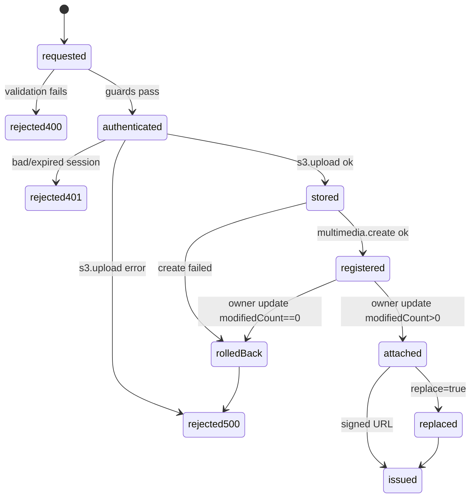
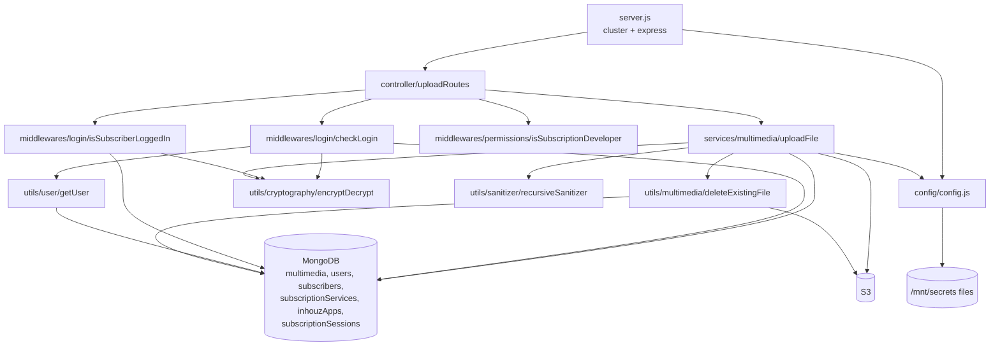

# inhouz_file_upload_ms

## 1. Summary

Image upload service for the Inhouz ERP. It accepts a base64 image in a JSON POST body, writes it to
one S3 bucket, records it in the shared `multimedia` collection, and then points one of four owning
records at the new file key: a user profile, an Inhouz app logo, a subscription service image, or an
external subscriber profile. Every upload is authenticated by a session cookie and authorizes against
the shared `session`, `company`, `subscriberSession` and role/permission collections. There is no
outgoing HTTP call and no message broker; S3 and MongoDB are its only integrations. The service lives
in its own repository at `/workspaces/kilo_inhouz_ai/apps/inhouz_file_upload_ms/` (repository id
`inhouz_file_upload_ms`), not in the control repo.

## 2. Stack and commands

- Runtime: Node.js, image `node:16.4-alpine` (`Dockerfile:1`).
- Framework: Express 4 (`package.json:22`), Mongoose 7 (`package.json:28`).
- Package name is still the template name: `micro_service_template` (`package.json:2`).
- Scripts: only `test` exists, and it is the npm placeholder that exits 1 (`package.json:7`).
  **There is no `start` script**, yet the image runs `CMD ["npm", "run", "start"]`
  (`Dockerfile:12`). See §12.
- Start command by hand: `node server.js` (`server.js:1` reads `.env` first).
- Port: `PORT`, set to `5053` in the deployment (`kus/dev/inhouz-file-upload-ms-deployment.yml:44-45`)
  and in the ClusterIP service (`kus/base/inhouz-file-upload-ms-cluster-ip-service.yml:10-11`).
  The app listens on `process.env.PORT` (`server.js:86`).
- k8s service name: `inhouz-file-upload-ms-cluster-ip-service` (`kus/base/inhouz-file-upload-ms-cluster-ip-service.yml:4`).
- k8s deployment: `inhouz-file-upload-ms-deployment`, image `inhouz/inhouz_file_upload_ms`,
  replicas `1` (`kus/base/inhouz-file-upload-ms-deployment.yml:4,6,27`).
- Health probe: `healthcheck.js` requests `GET /healthz` on `localhost:$PORT` and exits non-zero on
  any non-200 (`healthcheck.js:6,7,13`). No `/healthz` route is registered — see §12.

## 3. Entry points

| Entry point | Location | How it starts |
|---|---|---|
| Cluster master | `server.js:25-42` | `node server.js`; forks `os.cpus().length` workers in production, 1 otherwise (`server.js:26`) and re-forks on worker exit (`server.js:31-42`) |
| HTTP server | `server.js:44,86-88` | `app.listen(process.env.PORT)` inside the worker branch |
| Route registration | `controller/uploadRoutes/uploadRoutes.js:6-11` | called from `server.js:57` |
| POST `/api/inhouzfileupload/userprofile` | `controller/uploadRoutes/uploadRoutes.js:7` | `isLoggedIn` → `uploadFile` |
| POST `/api/inhouzfileupload/inhouzapp` | `controller/uploadRoutes/uploadRoutes.js:8` | `isLoggedIn` → `uploadFile` |
| POST `/api/inhouzfileupload/subscriptionservice` | `controller/uploadRoutes/uploadRoutes.js:9` | `isLoggedIn` → `isSubscriptionDeveloper` → `uploadFile` |
| POST `/api/inhouzfileupload/subscriberprofile` | `controller/uploadRoutes/uploadRoutes.js:10` | `isSubscriberLoggedIn` → `uploadFile` |
| Mongo reconnect loop | `server.js:65-72` | fires on the `disconnected` event, retries after 5 s |
| Health probe script | `healthcheck.js:1-24` | invoked by the Dockerfile `HEALTHCHECK` (not present in this `Dockerfile`; path comment at `healthcheck.js:7`) |

There is no cron, no queue consumer and no websocket endpoint. `server.js:62,65,73` are Mongo
connection event handlers, not a timer: the only timer is the 5 s reconnect delay (`server.js:68`).

## 4. Module inventory

| Module | Location | Owns | Public API | Kind |
|---|---|---|---|---|
| `server` | `server.js:1-103` | cluster bootstrap, middleware chain, Mongo connect, shutdown | none (side-effect entry) | `effectful` |
| `connectMongo` | `server.js:91-102` | opens the Mongoose connection, `maxPoolSize: 1` | internal | `effectful` |
| `config` | `config/config.js:18-62` | all runtime config, secret file reads, RSA private key, upload-type whitelist | `config()` → frozen-in-place cached object | `effectful` (reads env and filesystem, caches the result in `cachedConfig`, `config.js:17,19`) |
| `readSecret` | `config/config.js:5-15` | reads `/mnt/secrets/<name>` with an env fallback | internal | `effectful` |
| `uploadRoutes` | `controller/uploadRoutes/uploadRoutes.js:6-11` | the four POST routes and their guards | `(app) => void` | `effectful` (registers handlers on the app) |
| `uploadFile` | `services/multimedia/uploadFile.js:11-370` | validate body, S3 upload, multimedia record, owner update, S3 cleanup | `(req, res) => Promise<void>` | `effectful` |
| `deleteExistingFile` | `utils/multimedia/deleteExistingFile.js:4-54` | deletes one multimedia doc and its S3 object | `({s3, fileKey, companyId, bucketName}) => Promise<{success|error}>` | `effectful` |
| `recursiveSanitizer` | `utils/sanitizer/recursiveSanitizer.js:19` | deep-sanitizes request values | exported object of helpers | `pure` (assumed; no I/O in the module) |
| `encryptDecrypt` | `utils/cryptography/encryptDecrypt.js:3-17` | RSA encrypt-with-private-key / decrypt with `CLIENT_SECRET_KEY` | `(data, encrypt=false) => string` | `effectful` (holds a key from config; logs on failure, `encryptDecrypt.js:13`) |
| `getUser` | `utils/user/getUser.js:5` | loads user + roles + role permissions from Mongo | `(userId) => Promise<user>` | `effectful` |
| `createEditByObject` | `utils/user/createEditByObject.js:1` | builds created/edited audit stamps | `(user, deployDate) => object` | `pure` |
| `checkLogin` (`isLoggedIn`) | `middlewares/login/checkLogin.js:9-153` | decrypts `SMPL` cookie, validates session + csrf, slides expiry 60 min, loads user and company into `req.user` | Express middleware | `effectful` |
| `isSubscriberLoggedIn` | `middlewares/login/isSubscriberLoggedIn.js:8` | decrypts `SUBSCR`/`refreshToken`/`deviceId` cookies, validates a subscription session, sets `req.user` from the decrypted session blob (`isSubscriberLoggedIn.js:63`) | Express middleware | `effectful` |
| `isSubscriptionDeveloper` | `middlewares/permissions/isSubscriptionDeveloper.js:3-25` | requires `subscriptionAdmin` or `subscriptionDeveloper` in `req.user.permissions` | Express middleware | `pure` (reads only `req.user`; config values are constants) |
| `moduleAccessCheck` | `middlewares/module/moduleAccessCheck.js:7` | flex-module access guard — **not mounted** | Express middleware | `effectful` |
| `singleSubdomainValidation` | `middlewares/subdomain/singleSubdomainValidation.js:1` | subdomain guard — **not mounted** | Express middleware | `effectful` |
| `user` model | `model/user/user.js:6,138` | user document, `imageFileKey` at `user.js:84` | Mongoose model | `effectful` |
| `useRoles` model | `model/user/useRoles.js:6,51` | user↔role join | Mongoose model | `effectful` |
| `roles`, `permissions` models | `model/rolesAndPermissions/roles.js:87`, `.../permissions.js:89` | RBAC | Mongoose models | `effectful` |
| `company` model | `model/company/company.js:5,108` | tenant record | Mongoose model | `effectful` |
| `session` model | `model/session/session.js:5,28` | staff session | Mongoose model | `effectful` |
| `subscriptionSession` model | `model/session/subscriptionSession.js:6,86` | external subscriber session, holds an encrypted session blob | Mongoose model | `effectful` |
| `subscriber` model | `model/subscription/subscriber.js:6,69` | external subscriber, `imageFileKey` at `subscriber.js:44,64` | Mongoose model | `effectful` |
| `subscriptionService` model | `model/subscription/subscriptionService.js:5,386` | service image, `imageFileKey` at `subscriptionService.js:46` | Mongoose model | `effectful` |
| `inhouzApp` model | `model/appBuilder/inhouzApp.js:6,284` | app definition, logo at `settings.imageFileKey` | Mongoose model | `effectful` |
| `multimedia` model | `model/multimedia/multimedia.js:5-59` | file registry | Mongoose model | `effectful` |

## 5. Side effects

**S3 (outbound network, `aws-sdk`)**
- Client constructed per request with credentials from config: `uploadFile.js:78-81`.
- `s3.upload` of the decoded buffer: `uploadFile.js:91`.
- `s3.deleteObject` rollback when the multimedia document cannot be written: `uploadFile.js:148-152`.
- `s3.deleteObject` when the owning record cannot be updated (three call sites through
  `deleteExistingFile`): `uploadFile.js:186,218,250,327`.
- `s3.deleteObject` when replacing an existing file: `uploadFile.js:342-349`.
- `s3.getSignedUrl('getObject', …)` with one-week expiry: `uploadFile.js:351-355`.
- Credential source: `config.s3AccessKeyId` / `config.s3SecretKey` / `config.s3BucketName`
  (`config.js:51-53`), each read from the file `/mnt/secrets/<name>` with an env fallback
  (`config.js:5-15`). **They are deployment-wide credentials, not per-company records.** No company
  document supplies an access key anywhere in this repository.

**MongoDB (reads/writes)**
- `multimedia.create`: `uploadFile.js:130-141`.
- `multimedia.deleteOne`: `utils/multimedia/deleteExistingFile.js:23-26`.
- `subscriptionServices.updateMany` setting `imageFileKey`: `uploadFile.js:169-179`.
- `users.updateOne` setting `imageFileKey`: `uploadFile.js:201-211`.
- `subscribers.updateOne` setting `imageFileKey`: `uploadFile.js:233-243`.
- `subscriptionSessions.findOne` then `updateOne` of `encryptedSessionData`: `uploadFile.js:266-301`.
- `inhouzApps.updateOne` setting `settings.imageFileKey`: `uploadFile.js:310-320`.
- Auth reads: `session.findOne` + expiry slide (`checkLogin.js:25-35,83-92`), `company.findOne`
  (`checkLogin.js:106-108`), role/permission reads (`utils/user/getUser.js:18,44,84,118`),
  `subscriptionSession.findOne` (`isSubscriberLoggedIn.js:31-34`).
- Connection: `server.js:92-102`.

**Filesystem**
- Reads secret files at `/mnt/secrets` (`config.js:6-10`); `SECRETS_PATH` overrides the directory.

**Clock**
- `new Date().getTime()` for timestamps and key suffixes: `uploadFile.js:71,75,114,271,292`;
  session expiry via `moment()`: `checkLogin.js:82`; subscriber session timestamps
  `isSubscriberLoggedIn.js` (uses `moment`/`timestamp`, `isSubscriberLoggedIn.js:6,29`).

**Randomness**
- `new mongoose.Types.ObjectId()` in the file key (`uploadFile.js:75`), which is the only uniqueness
  source for an object key.

**Logging (console only, no logger library)**
- `console.log` on every failure path: `uploadFile.js:97,143,181,213,245,276,303,322,363`;
  `deleteExistingFile.js:29,47`; `server.js:32-40,63,66,74,87,101`; `healthcheck.js:12,19`;
  `encryptDecrypt.js:13`.

**Not present:** no HTTP client to another service, no SendGrid send, no Stripe call, no Stripe or
exchange-rate call, even though `@sendgrid/mail` is a dependency and `SENDGRID_API_KEY` is read
(`config.js:25`). Those are dead config in this service.

## 6. State and state transitions

No explicit state machine and no status field. The upload flow is a compensating sequence, so the
"states" are the observable ones:

| State | Trigger | Guard | Result |
|---|---|---|---|
| `requested` | POST to one of the four routes | body present, `uploadType` in whitelist, per-type required fields present (`uploadFile.js:24-69`); config whitelist at `config.js:45-50` | else 400 |
| `authenticated` | middleware ran | valid session cookie + csrf, unexpired (`checkLogin.js:11-70`); staff path also needs `modifiedCount` on the expiry slide (`checkLogin.js:97`) | else `{error}` body |
| `stored` | `s3.upload` resolves | no `error` key on the response (`uploadFile.js:105`) | else 500 |
| `registered` | `multimedia.create` resolves | document truthy (`uploadFile.js:147`) | else S3 object deleted and 500 |
| `attached` | owner update reports `modifiedCount` | `modifiedCount > 0` (`uploadFile.js:185,217,249,326`) | else new file deleted and 500 |
| `replaced` | `replace === true` after attachment | caller supplied `existingFileKey` (`uploadFile.js:34-39`) | old key deleted from Mongo and S3 |
| `issued` | always at the end | — | `{success, fileKey, signedUrl}` with a 7-day URL |

Transition diagram:



The subscriber branch has one extra non-transactional step: it rewrites the cached
`imageFileKey` inside the encrypted `subscriptionSession` blob (`uploadFile.js:280-307`). If that
write fails the profile is already updated and the session still serves the stale key. There is no
rollback for that step.

## 7. Data

All collections are named by env vars, so the physical name is deployment configuration. The
`mongoose.model(<name>, <schema>, <name>)` calls use the env value as **both** model and collection
name.

| Model | Registration | Collection (from k8s env) | Key fields and rules |
|---|---|---|---|
| Multimedia | `model/multimedia/multimedia.js:59` | `MULTIMEDIA_MODEL` (`multimediaFiles`) | `companyId` required+index, `fileName` required+index, `fileKey` required+index, `mimetype` required, `fileSizeBytes` required Number, `createdDate`/`updatedDate` required Number, `category` enum `['', 'project', 'contact', 'customer', 'app']` (`multimedia.js:21-24`), `tags`, `categoryReferenceId`, `fileStorageServiceId`; `strict: true`, `timestamps: true` (`multimedia.js:54-57`) |
| User | `model/user/user.js:138` | `USER_MODEL` (`User`) — no explicit collection arg, so Mongoose pluralizes | `email` required with `{VALUE} is not a valid email` (`user.js:22-31`), `companyId` required (`user.js:34`), `imageFileKey: String` (`user.js:84`), `passwordHash` required (`user.js:95`) |
| Subscriber | `model/subscription/subscriber.js:69` | `SUBSCRIBER_MODEL` (`subscribers`) | `subscriberType` enum, `email` required+validated (`subscriber.js:17-25`), `companyId`, `assetOwnerCompanyId` (`subscriber.js:39`), `imageFileKey` (`subscriber.js:44,64`) |
| SubscriptionService | `model/subscription/subscriptionService.js:386` | `SUBSCRIPTION_SERVICE_MODEL` (`subscriptionServices`) | `companyId`, `subscriptionServiceId` (`subscriptionService.js:11,19`), `imageFileKey` (`subscriptionService.js:46`) |
| InhouzApp | `model/appBuilder/inhouzApp.js:284` | `INHOUZ_APP_MODEL` (`inhouzApps`) | app identity + `settings.imageFileKey` written at `uploadFile.js:317` |
| SubscriptionSession | `model/session/subscriptionSession.js:86` | `SUBSCRIPTION_SESSION_MODEL` (`subscriptionSessions`) | `encryptedSessionData` (Cryptr blob, rewritten at `uploadFile.js:298`), `sessionDataExpirationTimestamp`, `subscriberEmail`, `subscriberType` (queried at `uploadFile.js:266-273`) |
| Session | `model/session/session.js:28` | `SESSION_MODEL` (`session`) | `_id` used as session id, `csrfToken`, `expirationTimestamp` (`checkLogin.js:25-28,60`) |
| Company | `model/company/company.js:108` | `COMPANY_MODEL` (`company`) — pluralized | tenant |
| Role / Permission / UserRole | `roles.js:87`, `permissions.js:89`, `useRoles.js:51` | `ROLE_MODEL`, `PERMISSION_MODEL`, `USER_ROLES_MODEL` | RBAC |

Migrations: none in this repository. No index definitions beyond the inline `index: true` flags on
`multimedia`.

**Shared collections.** This service writes `imageFileKey` into `User`, `Subscriber`,
`SubscriptionService`, `InhouzApp` and `SubscriptionSession` documents that it does not own. Every
frontend and every other Inhouz service that renders an avatar, a service image or an app logo reads
the same field. Because the repo contains no HTTP client, the other writers of those collections are
not visible here. See §14.

## 8. Public interfaces

All routes are POST, JSON only (`bodyParser.json({limit: '20mb'})`, `server.js:53`), and all return
JSON. There is no versioning and no trailing-slash alias.

Request body (all four routes):

```json
{
  "fileObject": { "filename": "logo.png", "size": 10240, "type": "image/png", "base64": "data:image/png;base64,…" },
  "uploadType": "userProfile | subscriberProfile | subscriptionService | inhouzApp",
  "replace": false,
  "existingFileKey": "…",
  "subscriptionServiceId": "…",
  "assetOwnerCompanyId": "…",
  "encryptedCompanyId": "…",
  "appId": "…"
}
```

| Route | Guard | Extra required fields |
|---|---|---|
| `POST /api/inhouzfileupload/userprofile` | `isLoggedIn` (`uploadRoutes.js:7`) | none; identity comes from `req.user._id` |
| `POST /api/inhouzfileupload/inhouzapp` | `isLoggedIn` (`uploadRoutes.js:8`) | `encryptedCompanyId`, `appId` (`uploadFile.js:54-62`) |
| `POST /api/inhouzfileupload/subscriptionservice` | `isLoggedIn`, `isSubscriptionDeveloper` (`uploadRoutes.js:9`) | `subscriptionServiceId` (`uploadFile.js:40-46`) |
| `POST /api/inhouzfileupload/subscriberprofile` | `isSubscriberLoggedIn` (`uploadRoutes.js:10`) | `assetOwnerCompanyId` (`uploadFile.js:47-53`) |

Responses:
- 200 `{ "success": true, "fileKey": "<s3 key>", "signedUrl": "<presigned GET, 1 week>" }`
  (`uploadFile.js:357-361`).
- 400 `{ "error": { "message": "Invalid request. Required fields are missing." } }`
  (`uploadFile.js:64-68,120-124`).
- 500 `{ "error": { "message": "File upload failed." | "Failed to register multimedia file." |
  "Failed to update subscription service multimedia file" | "Failed to update profile image." |
  "Failed to update app logo." } }` (`uploadFile.js:100,106,160,193,225,257,334`).
- Auth failures are inconsistent: `checkLogin` returns HTTP 200 with `{error:{message:'Not
  Authorized'}}` (`checkLogin.js:13-19,41-46,65-69`), `isSubscriberLoggedIn` returns 401/500
  (`isSubscriberLoggedIn.js:15-19,42-46,50-54`).

Request headers/cookies: staff path reads cookie `SMPL` or header `x-access-token`, plus header
`x-csrfToken` (`checkLogin.js:11-12`). Subscriber path reads cookies `SUBSCR`, `refreshToken` and
`deviceId` plus header `x-csrfToken` (`isSubscriberLoggedIn.js:10-12`). Both set JS-readable cookies
`x-java` and `sessionExpirationTimestamp` (`checkLogin.js:128-143`).

No events, no queue topics, no CLI commands.

## 9. Configuration

Names only.

- Server: `PORT`, `NODE_ENV`, `SECRETS_PATH`.
- Secrets resolved by file first, env second (`config.js:5-15,25-29,51-53`): `SENDGRID_API_KEY`,
  `SESSION_SECRET`, `MONGO_URL`, `CLIENT_SECRET_KEY`, `S3_ACCESS_KEY_ID`, `S3_SECRET_KEY`,
  `S3_BUCKET_NAME`. The file names are `sendgridapikey`, `sessionsecret`, `mongourl`,
  `clientsecretkey`, `s3accesskeyid`, `s3secretkey`, `s3bucketname` (`config.js:25,28,29,42,51-53`).
- Cookies/session: `COOKIE_DOMAIN`, `COOKIE_NAME` (in the manifest, `deployment.yml:91,115`; only
  `COOKIE_DOMAIN` is read, `config.js:39`).
- Collection names: `USER_MODEL`, `COMPANY_MODEL`, `ROLE_MODEL`, `PERMISSION_MODEL`,
  `USER_ROLES_MODEL`, `SESSION_MODEL`, `SESSION_VALIDATOR_MODEL`, `AUTH_LOG_MODEL`,
  `MULTIMEDIA_MODEL`, `SUBSCRIBER_MODEL`, `SUBSCRIPTION_SERVICE_MODEL`,
  `SUBSCRIPTION_SESSION_MODEL`, `INHOUZ_APP_MODEL`, `FLEX_FORM_FILE_MODEL`, `FLEX_MODULE_MODEL`,
  `FLEX_COLLECTION_MODEL`, `FORM_MODEL`, `DATA_RULE_EXECUTION_RESULT_MODEL`, `SMPL_EMAIL`.
  The last six are read into config but never used by any route in this repo.
- Set in the manifest but never read by this repo's code: `INHOUZ_FROM_EMAIL`,
  `SUBSCRIPTION_SESSION_VALIDATOR_MODEL`, `SUBSCRIBER_CHANGE_LOG`, `SUBSCRIPTION_USAGE_LOG`,
  `VERSION_TRACKER_MODEL`, `FLEX_API_MODEL`, `SUBSCRIPTION_SESSION_AUTH_LOG_MODEL`,
  `SUBSCRIBER_ACTION_LOG_MODEL`, `SUBSCRIBER_MIGRATION_QUEUE_MODEL`, `SERVICE_DISCOUNT_MODEL`,
  `CUSTOMERS_MODEL`, `CONTACTS_MODEL`, `PAYOUT_ACCOUNT_MODEL`, `SUBSCRIPTION_MODEL`,
  `IP_ADDRESS_LOCATION_MODEL`, `IP_LOCATION_FINDER_URL`, `SUBSCRIBED_PACKAGE_MODEL`,
  `CHURN_TRACKER_MODEL`, `EXCHANGE_RATE_CACHE_MODEL`, `OPEN_EXCHANGE_RATES_*`,
  `SUBSCRIPTION_SERVICE_CHARGE_*` (`kus/dev/inhouz-file-upload-ms-deployment.yml:91-176`).
- Hard-coded, not configurable: file-upload whitelist (`config.js:45-50`), permission names
  `admin`/`subscriptionAdmin`/`subscriptionDeveloper` (`config.js:38,56,57`), CORS origin regex
  (`server.js:47`), 60-minute session slide (`checkLogin.js:82`), 20 MB body limit (`server.js:53`),
  1-week signed URL (`uploadFile.js:354`).

## 10. Dependencies

Direct only (`package.json:11-34`).

| Package | Why |
|---|---|
| `express` | HTTP server and routing |
| `mongoose` | MongoDB models and queries |
| `aws-sdk` | S3 upload, delete, presigned URL |
| `body-parser` | JSON body parsing with a 20 MB limit |
| `cookie-parser` | reads `SMPL`/`SUBSCR` cookies |
| `cors` | browser access from `*.inhouz.localhost` |
| `helmet`, `hpp` | header hardening, parameter-pollution guard |
| `cryptr` | AES encryption of session blobs and tokens |
| `node-rsa` | RSA keypair used by `encryptDecrypt` and the app-login token |
| `crypto-js` | used by `isSubscriberLoggedIn` alongside Cryptr |
| `lodash` | `isEmpty` checks in auth middleware |
| `moment` | session expiry arithmetic |
| `sanitizer` | HTML sanitizing of incoming strings |
| `validator` | email/string validation inside models |
| `dotenv` | loads `.env` locally |
| `bcryptjs` | password hashing in the user model |
| `connect-mongo`, `express-session` | installed but no `express-session` mount in `server.js` |
| `request-ip`, `shortid` | installed, not required by any module in this repo |
| `@sendgrid/mail` | installed, not required by any module in this repo |

## 11. Testing

There are no tests. `npm test` is the npm placeholder that prints an error and exits 1
(`package.json:7`). There is no test runner, no fixtures and no CI test step in this repository.
Coverage is zero: the validation matrix, the S3 rollback paths, the four owner-update branches and
the two auth middlewares are all unverified by automated tests.

## 12. Known issues and risks

1. **The image cannot start as written.** `Dockerfile:12` runs `npm run start`; `package.json:7` has
   no `start` script. Either the deployed image is built from a different Dockerfile or the
   deployment is broken.
2. **Health probe can never pass.** `healthcheck.js:7` calls `GET /healthz`; no such route is
   registered (`server.js:57` mounts only the four upload routes, `uploadRoutes.js:7-10`), so the
   probe always gets 404 and exits 1.
3. **No content validation on the uploaded file.** Only presence and `typeof` are checked
   (`uploadFile.js:24-39`). `mimetype` is client-supplied and written straight to S3 as
   `ContentType` (`uploadFile.js:88`), and there is no allow-list of image types. Any file type can be
   stored in a bucket that is served to browsers.
4. **Client-declared size is trusted.** `size` goes into `fileSizeBytes` without comparing it to
   `bufferedImage.length` (`uploadFile.js:21,76,134`). The only real ceiling is the 20 MB JSON body
   limit (`server.js:53`), which base64 inflation reduces to roughly 15 MB of file.
5. **`ContentEncoding: 'base64'` is set on decoded bytes.** The body is decoded before upload
   (`uploadFile.js:76`) but the S3 object is still tagged `contentEncoding: 'base64'`
   (`uploadFile.js:87`), so clients that honour the header will try to base64-decode a binary object.
6. **Auth failures return HTTP 200.** `checkLogin` answers `{error}` with status 200
   (`checkLogin.js:13-19,41-46,65-69,97-103`), so a caller checking only the status code treats an
   unauthenticated request as a success.
7. **CORS origin is a hard-coded localhost regex**: `/inhouz.localhost/` (`server.js:47`) with
   `credentials: true`. Production hostnames do not match it.
8. **`uncaughtException` is wired to a handler that only closes Mongo.** `server.js:79` calls
   `shutdownFunction`, which does not `process.exit` (`server.js:80-84`), so the worker keeps running
   in an undefined state and the cluster master never re-forks it.
9. **The app-login branch trusts an unsigned payload.** `encryptedCompanyId` is decrypted with the
   client RSA key and the resulting JSON's `companyId` is accepted on an expiration check alone
   (`uploadFile.js:111-126`); there is no check that the requesting user belongs to that company, so
   a user who can mint that token can attach a logo to another tenant's app.
10. **`appId` is not checked against the caller's company beyond the `companyId` in the query**
    (`uploadFile.js:310-314`), and for `inhouzApp` `companyId` comes from the decrypted token, not
    from `req.user` (`uploadFile.js:110,115`).
11. **Base64 decode is lenient.** `Buffer.from(..., 'base64')` silently drops invalid characters
    (`uploadFile.js:76`), so a malformed payload becomes a truncated file instead of a 400.
12. **Multimedia model carries two clocks.** `timestamps: true` (`multimedia.js:56`) adds
    `createdAt`/`updatedAt` alongside the required numeric `createdDate`/`updatedDate`
    (`multimedia.js:40-47`); readers must know which one is authoritative.
13. **`deleteExistingFile` calls `.lean()` on `deleteOne`** (`deleteExistingFile.js:23-27`), which is
    meaningless there and hides the delete result; it also ignores that result entirely.
14. **No transaction around the multi-collection write.** The multimedia insert, the owner update and
    the S3 call at `uploadFile.js:130,169,201,233,310` are independent; the compensating deletes
    (`uploadFile.js:148,186,218,250,327`) are best-effort and their failures are only logged.
15. **Dead dependency surface.** `@sendgrid/mail`, `express-session`, `connect-mongo`, `request-ip`
    and `shortid` are installed but unused, which enlarges the attack surface of the image.
16. **No embedded credential was found in the source.** `service-account.json.enc` at the repo root is
    an encrypted artifact, not a literal, and is not read by any module in this repository.

## 13. Module map



## 14. Open questions

- **Which other services write `imageFileKey` on the same documents?** The repo has no HTTP client and
  no broker, so the writers of `users`, `subscribers`, `subscriptionServices`, `inhouzApps` and
  `subscriptionSessions` cannot be identified from this checkout. Answering it needs the sibling
  repos' connection strings and collection names.
- **Is the deployed image built from this `Dockerfile`?** The `start` script it invokes does not
  exist (`package.json:7`).
- **Where are the S3 credentials rotated?** They are read from `/mnt/secrets` with env fallback and
  are shared by every replica and every tenant. No per-company credential path exists.
- **Is `service-account.json.enc` used by the build or the runtime?** Nothing in the repo requires it.
- **Why are the twenty-odd collection env vars in the deployment manifest if the code never reads
  them?** Likely copy-paste from a shared deployment template.
- **Skipped:** `k8s/` (legacy duplicate of `kus/`), `.github/workflows/*`, `.travis.yml`,
  `build_ga*.sh`, `deploy.sh`, `docker-compose.yml` — build and deploy plumbing, not service
  behaviour; `kus/*/hpa.yml`, `vpa.yml`, `namespace.yml` — scaling and namespace only;
  `model/appBuilder/inhouzApp.js`, `model/rolesAndPermissions/*`, `model/user/useRoles.js`,
  `model/company/company.js`, `model/session/*`, `middlewares/module/moduleAccessCheck.js`,
  `middlewares/subdomain/singleSubdomainValidation.js` — read by import and registration only, not
  read line by line; they do not change this service's behaviour. `utils/user/getUser.js` and
  `utils/sanitizer/recursiveSanitizer.js` were read at signature level only.
