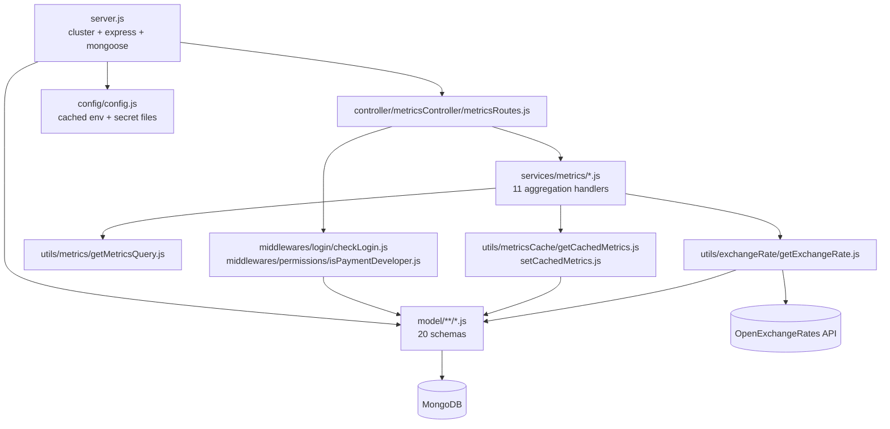

# inhouz_pay_metrics_ms

Repository: `/workspaces/kilo_inhouz_ai/apps/inhouz_pay_metrics_ms` — separate git repo, not inside the control repo.
All `file:line` citations are relative to that repository root.

## 1. Summary

`inhouz_pay_metrics_ms` is the read side of the payment domain. It answers eleven dashboard
queries — top section, recurring revenue and MRR timelines, payment timelines and pies, session
counts and duration, conversion pies, tax totals — by running MongoDB aggregation pipelines over
the collections that `inhouz_pay_ms` writes (`inhouzPaymentMetrics`, `inhouzPayMrrTracker`,
`inhouzPayConversionTracker`, `inhouzPayVisitMetrics`, `inhouzPaySessionDurationLog`,
`inhouzPaymentTaxes`). It writes almost nothing except a five-minute metrics cache
(`metricsCache`) and an hourly exchange-rate cache (`exchangeRateCache`). It has no inbound callers
in the cluster and calls only the OpenExchangeRates API outward.

## 2. Stack and commands

- Runtime: Node.js + Express 4 (`server.js:2`), Mongoose 7.
- Declared package name is `micro_service_template` (`package.json:2`) — template name not replaced.
- Port: `PORT` (`server.js:96`); k8s Service exposes **5064**
  (`k8s/inhouz-pay-metrics-ms-cluster-ip-service.yml:10`).
- npm scripts: only `test`, a stub: `"test": "echo \"Error: no test specified\" && exit 1"`
  (`package.json:7`).
- Start command: `node server.js` (`package.json:5`, no `start` script).
- Health probe: `healthcheck.js` calls `GET /healthz` on `localhost:${PORT}` (`healthcheck.js:6-7`).
  No `/healthz` route is registered in this repository.

## 3. Entry points

| Entry point | `file:line` | How it starts |
|---|---|---|
| HTTP server | `server.js:96` | `node server.js` |
| Cluster fork loop | `server.js:35-52` | automatic; `os.cpus().length` workers when `NODE_ENV=production` (`server.js:36`) |
| Route registration | `server.js:67` | `require("./controller/metricsController/metricsRoutes")(app)` |
| Model registration (20 requires) | `server.js:13-33` | module load; `inhouzPayUniqueVisitorTracker` is required twice (`server.js:21,25`) |
| Mongoose connect | `server.js:101-110` | boot (`server.js:69`) and 5s after a disconnect (`server.js:78-80`) |
| Shutdown handler | `server.js:86-94` | `SIGINT`, `SIGTERM`, `uncaughtException` |
| Health probe client | `healthcheck.js:10` | container `HEALTHCHECK` |
| Cron / interval | none | no `setInterval`; the only timer is the reconnect `setTimeout` (`server.js:78`) |

## 4. Module inventory

11 route handlers, 20 schemas, 4 middleware files, 11 utility folders.

| Module | `file:line` | Owns | Public API | Kind |
|---|---|---|---|---|
| `server.js` | `server.js:1` | boot, cluster, Express wiring, Mongo lifecycle | side-effect module | `effectful` |
| `config/config.js` | `config/config.js:18` | cached config from mounted secret files + env | `module.exports()` | `effectful` (fs + env; cache makes it reactive to first read) |
| `controller/metricsController/metricsRoutes.js` | `controller/metricsController/metricsRoutes.js:15` | binds 11 routes, each behind `checkLogin` + `isPaymentDeveloper` | `(app) => void` | `effectful` |
| `middlewares/login/checkLogin.js` | `middlewares/login/checkLogin.js:9` | cookie/`x-access-token` session auth, expiry check at `:63` | Express middleware | `effectful` |
| `middlewares/permissions/isPaymentDeveloper.js` | `middlewares/permissions/isPaymentDeveloper.js` | requires the `paymentDeveloper` permission | Express middleware | `effectful` |
| `middlewares/subdomain/singleSubdomainValidation.js` | `middlewares/subdomain/singleSubdomainValidation.js` | subdomain/tenant resolution | Express middleware | `effectful` |
| `middlewares/module/moduleAccessCheck.js` | `middlewares/module/moduleAccessCheck.js:29` | module entitlement check, loads `flexModuleModel` | Express middleware | `effectful` (DB) |
| `services/metrics/topSectionMetrics.js` | `services/metrics/topSectionMetrics.js:11` | KPI totals for the payment dashboard | `async (req,res)` | `effectful` (aggregate at `:190`) |
| `services/metrics/getRecurringRevenueMetrics.js` | `:117` | MRR/ARR rollup from `inhouzPayMrrTracker` | `async (req,res)` | `effectful` |
| `services/metrics/recurringRevenueTimelineMetrics.js` | `:127` | MRR over time | `async (req,res)` | `effectful` |
| `services/metrics/paymentTimelineMetrics.js` | `:118` | payment volume over time | `async (req,res)` | `effectful` |
| `services/metrics/paymentPieMetrics.js` | `:117` | payment split by product/category (`:198`, `:235`) | `async (req,res)` | `effectful` |
| `services/metrics/baseSessionMetrics.js` | `:105,131` | checkout session counts and conversions | `async (req,res)` | `effectful` |
| `services/metrics/averageSessionDurationMetrics.js` | `:105` | mean session length | `async (req,res)` | `effectful` |
| `services/metrics/sessionTimelineMetrics.js` | `:110,111` | sessions over time | `async (req,res)` | `effectful` |
| `services/metrics/sessionPieMetrics.js` | `:108` | session split by origin | `async (req,res)` | `effectful` |
| `services/metrics/conversionPieMetrics.js` | `:107` | conversion split | `async (req,res)` | `effectful` |
| `services/metrics/getTaxMetrics.js` | `:118` | tax collected | `async (req,res)` | `effectful` |
| `utils/metrics/getMetricsQuery.js` | `utils/metrics/getMetricsQuery.js:3` | builds the Mongo filter from a request body | `(reqBody, companyId, skipDate) => query \| {error:true}` | `effectful` (reads `moment()` clock at `:39`) |
| `utils/metricsCache/getCachedMetrics.js` | `utils/metricsCache/getCachedMetrics.js:4` | reads a live cache entry | `(params) => document \| false` | `effectful` |
| `utils/metricsCache/setCachedMetrics.js` | `utils/metricsCache/setCachedMetrics.js:5` | upserts a cache entry with a 5-minute TTL (`:19`) | `(params) => void` | `effectful` |
| `utils/exchangeRate/getExchangeRate.js` | `utils/exchangeRate/getExchangeRate.js:5` | currency rates, hourly cache, OpenExchangeRates fallback | `(currency) => rates \| {error}` | `effectful` (DB + network) |
| `utils/sanitizer/recursiveSanitizer.js` | used at `services/metrics/topSectionMetrics.js:13` | deep body sanitisation | pure transform | `pure` |
| `utils/date/monthIndexMap.js`, `utils/payment/timeMaps.js`, `utils/country/ISOCountryList.js` | `utils/` | static lookup tables | constants | `pure` |
| `utils/query/validateQueryKey.js` | `utils/query/validateQueryKey.js` | query-key validation against `queryKeyTracker` | async check | `effectful` |
| `utils/user/getUser.js`, `createEditByObject.js` | `utils/user/` | fetches the acting user, builds an audit `createdBy`/`editedBy` object | async helper / pure builder | `getUser` `effectful`, `createEditByObject` `pure` |
| `model/**/*.js` (20 files) | e.g. `model/metrics/metricsCache.js:27` | schema + model on an env-named collection | `mongoose.model(config.xModel, schema, config.xModel)` | schema literal `pure`; export `effectful` (global model registration) |

## 5. Side effects

| Effect | Where | `file:line` |
|---|---|---|
| MongoDB connect | `server.js` | `server.js:103` (`maxPoolSize: 1` at `server.js:109`) |
| Aggregation reads over payment collections | every metrics handler | `services/metrics/topSectionMetrics.js:190` and the `aggregate`/`find` call in each of the other 10 handlers |
| Metrics cache read | `utils/metricsCache/getCachedMetrics.js` | `:11` |
| Metrics cache write (upsert, 5-min TTL) | `utils/metricsCache/setCachedMetrics.js` | `:11-25`, TTL at `:19` |
| Exchange-rate cache read/write | `utils/exchangeRate/getExchangeRate.js` | `:20`, `:54` |
| **Outbound HTTP to OpenExchangeRates** | `utils/exchangeRate/getExchangeRate.js` | `:37` — `${openExchangeRatesBaseUrl}/latest.json?app_id=…&base=…`, 1-hour staleness window at `:33` |
| Filesystem read of mounted secrets | `config/config.js` | `:6-14` |
| Clock | `getMetricsQuery` (`moment()`), cache TTL, exchange-rate staleness | `utils/metrics/getMetricsQuery.js:39`; `utils/metricsCache/setCachedMetrics.js:19`; `utils/exchangeRate/getExchangeRate.js:18` |
| Logging | `console.log` only, no logger library | `server.js:42,72,75,83,96`; `utils/metricsCache/getCachedMetrics.js:20,26`; `utils/metricsCache/setCachedMetrics.js:29` |

No SendGrid call, no Stripe call, no internal service-to-service HTTP. The `@sendgrid/mail` and
`stripe` dependencies (if present) are unused here; `node-fetch` is used only by the exchange-rate
client.

## 6. State and state transitions

No business state machine. The service is a reader. The two stateful caches are:

| Cache | Key | Written | Expires | `file:line` |
|---|---|---|---|---|
| `metricsCache` | `key` + `companyId` | upsert on each metrics request | `expirationTimestamp = now + 5 minutes` checked with `$gt` on read | `utils/metricsCache/setCachedMetrics.js:19`, `getCachedMetrics.js:11-17` |
| `exchangeRateCache` | `baseCurrency` | upsert when absent or older than 3,600,000 ms | time comparison on read, no TTL index | `utils/exchangeRate/getExchangeRate.js:33,54-60` |

Sessions (auth) have their own state in the shared `session` collection: a request is rejected when
`datestamp > expirationTimestamp` (`middlewares/login/checkLogin.js:63`); the middleware re-issues an
expiry write at `checkLogin.js:89`.

## 7. Data

20 Mongoose schemas, each registered on an env-named collection (third argument to `mongoose.model`,
e.g. `model/metrics/metricsCache.js:27`, `model/payment/inhouzPayment.js:310`).

| Env var | Collection | Schema file | Role here |
|---|---|---|---|
| `INHOUZ_PAYMENT_METRICS_MODEL` | `inhouzPaymentMetrics` | `model/payment/inhouzPaymentMetrics.js:5` | read: top section, payment timeline/pie |
| `INHOUZ_PAY_MRR_TRACKER_MODEL` | `inhouzPayMrrTracker` | `model/payment/inhouzPayMrrTracker.js:5` | read: recurring revenue |
| `INHOUZ_PAY_CONVERSION_TRACKER_MODEL` | `inhouzPayConversionTracker` | `model/payment/inhouzPayConversionTracker.js:5` | read: conversion/session metrics |
| `INHOUZ_PAY_VISIT_METRICS_MODEL` | `inhouzPayVisitMetrics` | `model/payment/inhouzPayVisitMetrics.js:5` | read: session counts, session pie/timeline |
| `INHOUZ_PAY_SESSION_DURATION_LOG_MODEL` | `inhouzPaySessionDurationLog` | `model/payment/inhouzPaySessionDurationLog.js:5` | read: average duration |
| `INHOUZ_PAY_UNIQUE_VISITOR_TRACKER_MODEL` | `inhouzPayUniqueVisitorTracker` | `model/payment/inhouzPayUniqueVisitorTracker.js:5` | read: unique visitors |
| `INHOUZ_PAYMENT_TAX_MODEL` | `inhouzPaymentTaxes` | `model/payment/inhouzPaymentTax.js:5` | read: tax metrics |
| `INHOUZ_PAYMENT_MODEL` | `inhouzPayments` | `model/payment/inhouzPayment.js:5` | read: payment rows |
| `INHOUZ_PAYMENT_METHOD_TRACKER_MODEL` | `inhouzPayPaymentMethodTracker` | `model/payment/inhouzPaymentMethodTracker.js:5` | read: method split |
| `PAYMENT_PRODUCT_MODEL` | paymentProducts | `model/commerce/paymentProduct.js:5` | join for pie labels (`paymentPieMetrics.js:198`) |
| `PAYMENT_CATEGORY_MODEL` | `paymentCategories` | `model/commerce/paymentCategory.js:5` | join for pie labels (`paymentPieMetrics.js:235`) |
| `EXCHANGE_RATE_CACHE_MODEL` | `exchangeRateCache` | `model/payment/exchangeRateCache.js:5` | read/write cache |
| `METRICS_CACHE_MODEL` | `metricsCache` | `model/metrics/metricsCache.js:5` | read/write cache |
| `QUERY_KEY_TRACKER_MODEL` | `queryKeyTracker` | `model/queryTracker/queryKeyTracker.js:5` | query-key validation |
| `FLEX_MODULE_MODEL` / `FLEX_COLLECTION_MODEL` / `FLEX_FORM_FILE_MODEL` / `FORM_MODEL` | `flexModules`, `flexCollections`, `flexFormFiles`, `forms` | config only, no schema file here | loaded by `moduleAccessCheck.js:29` without a schema registered in this repo |
| `DATA_RULE_EXECUTION_RESULT_MODEL` | as configured | config only | no schema file here |
| `SESSION_MODEL` | `session` | `model/session/session.js:5` | auth |
| `USER_MODEL` / `USER_ROLES_MODEL` / `ROLE_MODEL` / `PERMISSION_MODEL` / `COMPANY_MODEL` / `AUTH_LOG_MODEL` | users / userRoles / roles / permissions / company / authenticationLogs | `model/user/user.js:6`, `useRoles.js:6`, `roles.js:6`, `permissions.js:6`, `company.js:5` | auth and tenant |

Validation rules that matter for reads:

- `inhouzPayVisitMetrics.paymentOrigin` enum: `payment link`, `inhouz app`, `subscription service`,
  `on-demand`, `inhouz sign` (`model/payment/inhouzPayVisitMetrics.js:13-19`).
- `inhouzPayVisitMetrics.environment` enum: `production`, `development`, `test` (`:38`).
- `companyId`, `paymentOrigin`, `paymentOriginId`, `datestamp`, `timestamp`, `environment` are
  `required` (`:6-39`).
- `metricsCache` requires `key`, `expirationTimestamp`, `companyId` and has the compound index
  `{key, expirationTimestamp, companyId}` (`model/metrics/metricsCache.js:7-25`).

**Shared-collection coupling.** Everything this service reads is written by `inhouz_pay_ms` and, for
the visit/session tracker collections, by the payment-link and app surfaces that record visits
(`inhouzPayVisitMetrics`, `inhouzPaySessionDurationLog`, `inhouzPayUniqueVisitorTracker`). There is
no write path from this service into any payment collection — if the writer changes a field name,
these aggregations silently return zero rather than fail, because pipelines reference fields by
string.

## 8. Public interfaces

All eleven routes are `POST` with a JSON body, and all sit behind `checkLogin` then
`isPaymentDeveloper` (`controller/metricsController/metricsRoutes.js:16-26`).

| Path | Handler | `file:line` |
|---|---|---|
| `/api/inhouzpaymetrics/gettopsection` | `topSectionMetrics` | `:16` |
| `/api/inhouzpaymetrics/recurringrevenuemetrics` | `getRecurringRevenueMetrics` | `:17` |
| `/api/inhouzpaymetrics/recurringrevenuetimelinemetrics` | `recurringRevenueTimelineMetrics` | `:18` |
| `/api/inhouzpaymetrics/paymenttimelinemetrics` | `paymentTimelineMetrics` | `:19` |
| `/api/inhouzpaymetrics/paymentpiemetrics` | `paymentPieMetrics` | `:20` |
| `/api/inhouzpaymetrics/basesessionmetrics` | `baseSessionMetrics` | `:21` |
| `/api/inhouzpaymetrics/avgsessionduration` | `averageSessionDurationMetrics` | `:22` |
| `/api/inhouzpaymetrics/sessiontimelinemetrics` | `sessionTimelineMetrics` | `:23` |
| `/api/inhouzpaymetrics/sessionpiemetrics` | `sessionPieMetrics` | `:24` |
| `/api/inhouzpaymetrics/conversionpiemetrics` | `conversionPieMetrics` | `:25` |
| `/api/inhouzpaymetrics/taxmetrics` | `getTaxMetrics` | `:26` |

Request body shape (read by `utils/metrics/getMetricsQuery.js:5-10`): `environment`,
`paymentOrigin`, `dateRangeType` (`day`/`week`/`month`/…), `startDate`, `endDate`,
`paymentOriginId`, `subscriptionServiceTierId`, `projectId`. `companyId` is taken from the session,
routed through the middleware chain.

Error shape is `{ error: { message } }` with 400/500 (`services/metrics/topSectionMetrics.js:21,38,69,80,100,109,208`).

Outbound: `GET ${OPEN_EXCHANGE_RATES_BASE_URL}/latest.json?app_id=<key>&base=<currency>`
(`utils/exchangeRate/getExchangeRate.js:37`). No inbound callers found in the cluster manifests of
the other services.

## 9. Configuration

Names only. Secrets are file-backed with an env fallback (`config/config.js:5-15`).

Secrets: `sendgridapikey`/`SENDGRID_API_KEY`, `sessionsecret`/`SESSION_SECRET`,
`mongourl`/`MONGO_URL`, `clientsecretkey`/`CLIENT_SECRET_KEY`,
`openexchangeratesapikey`/`OPEN_EXCHANGE_RATES_API_KEY` (`config/config.js:25-29,41-45,61-64`).

Process config: `SECRETS_PATH`, `SMPL_EMAIL`, `COOKIE_DOMAIN`, `NODE_ENV`, `PORT`,
`OPEN_EXCHANGE_RATES_BASE_URL`.

Collection-name vars read in code: `AUTH_LOG_MODEL`, `COMPANY_MODEL`, `DATA_RULE_EXECUTION_RESULT_MODEL`,
`EXCHANGE_RATE_CACHE_MODEL`, `FLEX_COLLECTION_MODEL`, `FLEX_FORM_FILE_MODEL`, `FLEX_MODULE_MODEL`,
`FORM_MODEL`, `INHOUZ_PAYMENT_METHOD_TRACKER_MODEL`, `INHOUZ_PAYMENT_METRICS_MODEL`,
`INHOUZ_PAYMENT_MODEL`, `INHOUZ_PAYMENT_TAX_MODEL`, `INHOUZ_PAY_CONVERSION_TRACKER_MODEL`,
`INHOUZ_PAY_MRR_TRACKER_MODEL`, `INHOUZ_PAY_SESSION_DURATION_LOG_MODEL`,
`INHOUZ_PAY_UNIQUE_VISITOR_TRACKER_MODEL`, `INHOUZ_PAY_VISIT_METRICS_MODEL`,
`METRICS_CACHE_MODEL`, `PAYMENT_CATEGORY_MODEL`, `PAYMENT_PRODUCT_MODEL`, `PERMISSION_MODEL`,
`QUERY_KEY_TRACKER_MODEL`, `ROLE_MODEL`, `SESSION_MODEL`, `SESSION_VALIDATOR_MODEL`, `USER_MODEL`,
`USER_ROLES_MODEL` (`config/config.js:20-70`).

The k8s manifests also set many vars this code never reads (`CLOUDFLARE_*`, `S3_*`, `REDIS_*`,
`STRIPE_API_KEY`, `PAYMENT_MS_URL`, `INHOUZ_APP_MODEL`, `APP_BUILD_MODEL`, …) — the deployment is a
copy-paste of a shared env block. Constants in `config/config.js:38-40`: `admin`,
`paymentAdmin`, `paymentDeveloper`.

## 10. Dependencies

| Package | Why |
|---|---|
| `express` | HTTP server |
| `mongoose` | aggregation queries over the shared payment collections |
| `node-fetch` | the single outbound call to OpenExchangeRates (`utils/exchangeRate/getExchangeRate.js:3`) |
| `moment` | date range building (`utils/metrics/getMetricsQuery.js:1`) and cache TTL (`setCachedMetrics.js:3`) |
| `sanitizer` | recursive body sanitisation before a query is built |
| `cookie-parser` | reads the session cookie (`server.js:66`) |
| `cryptr` | decrypts the session token (`middlewares/login/checkLogin.js:3,20`) |
| `node-rsa` | builds an RSA key object from mounted secrets (`config/config.js:41`) |
| `cors` | `*.inhouz.localhost` with credentials (`server.js:55-61`) |
| `helmet`, `hpp` | security headers, parameter-pollution guard (`server.js:64-65`) |
| `body-parser` | JSON bodies, 20mb (`server.js:63`) |
| `lodash`, `moment`, `validator` | collection helpers, validation in auth and models |
| `@sendgrid/mail`, `bcryptjs`, `connect-mongo`, `crypto-js`, `express-session`, `request-ip`, `shortid` | declared in `package.json`; no usage found in this repository's code paths (template residue) |
| `stripe` | **not** a dependency of this service — unlike `inhouz_pay_ms` |

## 11. Testing

No tests. `package.json:7` is the stub `echo "Error: no test specified" && exit 1`; there is no test
directory, no `*.test.js`, no `*.spec.js`, no dev dependencies. Nothing is covered: not the
aggregation pipelines, not the cache TTL, not the date-range boundaries in
`utils/metrics/getMetricsQuery.js`.

## 12. Known issues and risks

1. **Health probe targets a missing route.** `healthcheck.js:7` requests `/healthz`; the only routes
   registered are the eleven `/api/inhouzpaymetrics/**` entries
   (`controller/metricsController/metricsRoutes.js:16-26`). See also `server.js:67`.
2. **Metrics correctness is silently coupled to another repo's field names.** The aggregations
   reference document fields by string (`services/metrics/topSectionMetrics.js:190` and siblings).
   A rename in `inhouz_pay_ms` produces empty charts, not an error.
3. **Cache is keyed by `key` + `companyId` only.** `utils/metricsCache/setCachedMetrics.js:12-15`
   does not include the request filters in the key, so a cached result can be served to a different
   filter set that shares the same key. The caller must build a discriminating key; nothing enforces
   it.
4. **Currency filter is commented out.** `utils/metrics/getMetricsQuery.js:33-35` disables the
   `currency` clause while `currency` is still destructured at `:8`, so a currency filter in the body
   is silently ignored.
5. **Exchange-rate fetch has no timeout.** `utils/exchangeRate/getExchangeRate.js:37` uses
   `node-fetch` without a timeout or `AbortController`; a slow provider stalls the request until the
   socket layer gives up.
6. **Exchange-rate cache has no TTL index.** Staleness is decided by an application-side comparison
   (`:33`), so the collection grows one row per base currency and never expires server-side.
7. **Cluster forks `os.cpus().length` workers with a 1-connection pool each.**
   `server.js:36,109`, deployment `replicas: 1` (`k8s/inhouz-pay-metrics-ms-deployment.yml:6`).
8. **Duplicate model require.** `server.js:21` and `server.js:25` both require
   `model/payment/inhouzPayUniqueVisitorTracker`; harmless with the module cache but shows the boot
   order is unmanaged.
9. **Config cached for process lifetime.** `config/config.js:17-19`. Secret rotation needs a restart.
10. **Console logging only.** `console.log` with interpolated error text
    (`utils/metricsCache/getCachedMetrics.js:20`, `setCachedMetrics.js:29`); no request id, no
    structured JSON.
11. **Template identity drift.** `package.json:2` still says `micro_service_template`.
12. **Credentials:** none found embedded in source. All secrets come from `/mnt/secrets` or env
    (`config/config.js:5-15`).

## 13. Module map

Direction: request → auth middleware → handler → query builder → (cache | aggregate) → response.
No handler calls another handler and no outbound call reaches a sibling service.

## 14. Open questions

- The brief says "outgoing internal HTTP: none found" and "called by: none found". That is right
  about internal services, but the service does make one external call to OpenExchangeRates
  (`utils/exchangeRate/getExchangeRate.js:37`), which the brief missed. Recorded here as `effectful`.
- Which frontend builds the `key` for `metricsCache` was not traced; the cache key's uniqueness is
  therefore unverified (§12.3).
- Which service writes `inhouzPayVisitMetrics`, `inhouzPaySessionDurationLog` and
  `inhouzPayUniqueVisitorTracker` was not traced past the k8s env of `inhouz_pay_ms`. The payment
  service has no schema for them, so a visit tracker lives elsewhere.
- `DATA_RULE_EXECUTION_RESULT_MODEL`, `FLEX_MODULE_MODEL`, `FLEX_COLLECTION_MODEL`,
  `FLEX_FORM_FILE_MODEL` and `FORM_MODEL` are read from config but have no schema in this repo; the
  module-access middleware would fail at `mongoose.model(name)` if nothing registered them.
- Skipped and why: I read `server.js`, `package.json`, `config/config.js`, the full routes file,
  `utils/exchangeRate/getExchangeRate.js`, both metrics-cache utilities, `utils/metrics/getMetricsQuery.js`,
  and the first 40 lines of `model/payment/inhouzPayVisitMetrics.js` plus
  `model/metrics/metricsCache.js`. The ten other aggregation handlers were inspected only by
  `grep` of their `module.exports` / `mongoose.model` / `aggregate` lines, so their pipeline detail
  is not documented here.
