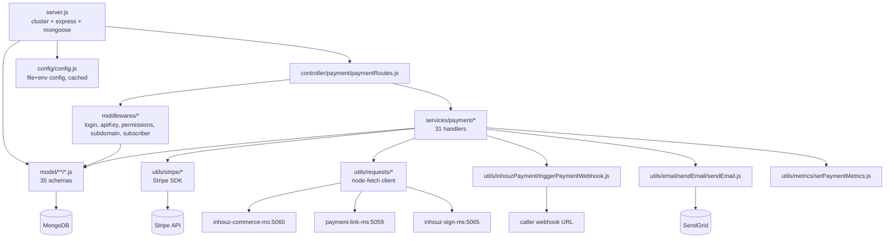

# inhouz_pay_ms

Repository: `/workspaces/kilo_inhouz_ai/apps/inhouz_pay_ms` — separate git repo, not inside the control repo.
All `file:line` citations below are relative to that repository root.

## 1. Summary

`inhouz_pay_ms` is the Inhouz payment engine. It owns the payment intent lifecycle against Stripe,
the local payment record (`inhouzPayments`), refunds, tax calculation, payment-link and
subscription payment flows, payment subscribers, and the metrics/MRR/conversion trackers that sit
beside them. It exposes 38 HTTP routes under `/api/inhouzpay/**`, all unauthenticated at the edge
and guarded per route by session, API-key, portal or subscriber middleware. It writes payment
outcomes to MongoDB and pushes side effects outward: Stripe API calls, webhooks to the caller,
SendGrid email, and HTTP calls to `inhouz-commerce-ms`, `payment-link-ms` and `inhouz-sign-ms`.

## 2. Stack and commands

- Runtime: Node.js with Express 4 (`server.js:2`, `package.json:18`), Mongoose 7 (`package.json:27`).
- Declared package name is `micro_service_template` (`package.json:2`) — the service was copied from
  the factory template and the name was never changed.
- Port: `PORT` env var (`server.js:109`); the k8s Service exposes **5058**
  (`k8s/inhouz-pay-ms-cluster-ip-service.yml:10`).
- npm scripts: only `test`, and it is a stub:
  `"test": "echo \"Error: no test specified\" && exit 1"` (`package.json:7`).
- Start command: `node server.js` (`package.json:5` sets `main`, no start script exists).
- Container health probe: `healthcheck.js` does `GET /healthz` on `localhost:${PORT}`
  (`healthcheck.js:6-7`). **No `/healthz` route is registered anywhere in this repository** — see §12.

## 3. Entry points

| Entry point | `file:line` | How it starts |
|---|---|---|
| HTTP server (`app.listen`) | `server.js:109` | `node server.js` |
| Cluster fork loop (master) | `server.js:47-64` | automatic; `os.cpus().length` workers when `NODE_ENV=production`, else 1 (`server.js:48`) |
| Route registration | `server.js:79` | `require("./controller/payment/paymentRoutes")(app)` |
| Mongoose connect | `server.js:114-126` | called at boot (`server.js:81`) and retried 5s after a disconnect (`server.js:90-92`) |
| Model registration (32 requires) | `server.js:13-45` | module load, before routes |
| Shutdown handler | `server.js:98-107` | `SIGINT`, `SIGTERM`, `uncaughtException`; closes the Mongo connection |
| Health probe client | `healthcheck.js:10` | run by the container `HEALTHCHECK` |
| Cron / interval job | none | `grep` for `setInterval`/`cron` finds nothing; the only timer is the reconnect `setTimeout` at `server.js:90` |

The route table is the sole HTTP surface: 38 routes, all in `controller/payment/paymentRoutes.js:42-79`.

## 4. Module inventory

The repository holds 136 JavaScript files: 1 controller, 31 route handlers, 35 model files,
12 middleware files, 21 utility folders. Rows below describe the modules that carry behaviour;
the remaining utility files are single-purpose helpers reached from these.

| Module | `file:line` | Owns | Public API | Kind |
|---|---|---|---|---|
| `server.js` | `server.js:1` | process boot, cluster, Express wiring, Mongo lifecycle | side-effect module | `effectful` |
| `config/config.js` | `config/config.js:18` | builds and caches one config object from files + env | `module.exports()` returns the cached object | `effectful` (reads `fs` + `env`; the cache makes it reactive to first read) |
| `controller/payment/paymentRoutes.js` | `controller/payment/paymentRoutes.js:41` | binds 38 routes to middleware chains and handlers | `module.exports = (app) => void` | `effectful` (mutates the app router) |
| `middlewares/login/checkLogin.js` | `middlewares/login/checkLogin.js:9` | session-cookie / `x-access-token` auth for back-office routes | Express `(req,res,next)` | `effectful` (Cookie/DB) |
| `middlewares/login/checkPortalLogin.js` | `middlewares/login/checkPortalLogin.js` | customer-portal session auth | Express `(req,res,next)` | `effectful` |
| `middlewares/login/clientEncryptedLogin.js` | `middlewares/login/clientEncryptedLogin.js` | decrypts client-encrypted payloads (RSA) | Express middleware | `effectful` |
| `middlewares/login/serverEncryptedLogin.js` | `middlewares/login/serverEncryptedLogin.js` | decrypts server-encrypted payloads | Express middleware | `effectful` |
| `middlewares/subscription/checkSubscriberLogin.js` | `middlewares/subscription/checkSubscriberLogin.js:26` | subscriber session auth | Express middleware | `effectful` |
| `middlewares/apiKey/apiKeyValidation.js` | `middlewares/apiKey/apiKeyValidation.js:2` | API-key check using `cryptr` | Express middleware | `effectful` |
| `middlewares/permissions/isPaymentAdmin.js` | `middlewares/permissions/isPaymentAdmin.js` | role gate for admin routes | Express middleware | `effectful` |
| `middlewares/permissions/isPaymentDeveloper.js` | `middlewares/permissions/isPaymentDeveloper.js` | role gate for developer routes | Express middleware | `effectful` |
| `middlewares/subdomain/singleSubdomainValidation.js` | `middlewares/subdomain/singleSubdomainValidation.js` | tenant/subdomain check | Express middleware | `effectful` |
| `middlewares/payment/refundValidator.js` | `middlewares/payment/refundValidator.js` | validates refund request shape | Express middleware | `mixed — validates a body (pure shape check) but reads config (`effectful`)` |
| `middlewares/module/moduleAccessCheck.js` | `middlewares/module/moduleAccessCheck.js:29` | module entitlement check; loads `flexModuleModel` | Express middleware | `effectful` (DB) |
| `services/payment/*.js` (31 files) | e.g. `services/payment/getStripePaymentIntent.js:10` | one use case each: intents, setup intents, refunds, subscribers, payment links, on-demand payments | `async (req,res)` Express handler | `effectful` |
| `model/**/*.js` (35 files) | e.g. `model/payment/inhouzPayment.js:323` | Mongoose schema + model registration on an env-named collection | `mongoose.model(config.xModel, schema, config.xModel)` | `pure` for the schema literal; the exported module is `effectful` (registers a global model) |
| `utils/stripe/getInhouzPaySecretKey.js` | `utils/stripe/getInhouzPaySecretKey.js` | selects production or test Stripe key | returns a key string | `effectful` (env/config) |
| `utils/stripe/*.js` (8 files) | `utils/stripe/createStripeCustomer.js:12,20` | Stripe customer, payment method, refund, marketplace transaction calls | async helpers | `effectful` (network) |
| `utils/requests/{get,post,delete}Request.js` | `utils/requests/postRequest.js:3` | generic JSON HTTP client over `node-fetch` | `(url, headers, data)` | `effectful` |
| `utils/inhouzPayment/triggerPaymentWebhook.js` | `utils/inhouzPayment/triggerPaymentWebhook.js:234` | decrypts the stored webhook URL and POSTs the payment event | async helper | `effectful` |
| `utils/email/sendEmail/sendEmail.js` | `utils/email/sendEmail/sendEmail.js:7` | SendGrid send | async helper | `effectful` |
| `utils/sanitizer/recursiveSanitizer.js` | used at `services/payment/getStripePaymentIntent.js:12` | deep-sanitises request bodies | pure transform over input | `pure` |
| `utils/cryptography/encryptDecrypt.js` | `services/payment/getStripePaymentIntent.js:28` | encrypt/decrypt of the `encryptedPayload` envelope | `(ciphertext) => string \| undefined` | `effectful` (uses the session secret from config) |
| `utils/currency/*`, `utils/date/*`, `utils/filter/*`, `utils/query/*` | `utils/` | formatting, date maths, filter building | pure helpers | `pure` (spot-checked; no I/O in the files reached) |
| `utils/metrics/setPaymentMetrics.js` | `utils/metrics/setPaymentMetrics.js` | increments `inhouzPaymentMetrics` | async helper | `effectful` (DB) |

## 5. Side effects

| Effect | Where | `file:line` |
|---|---|---|
| MongoDB connect | `server.js` | `server.js:115` (`maxPoolSize: 1` at `server.js:122`) |
| Mongo reads/writes | every service handler | e.g. `services/payment/markPaymentSuccess.js:80,116,154` |
| Stripe SDK client construction | `utils/stripe/createStripeCustomer.js` | `:12` (production key), `:20` (test key) |
| Stripe calls | `utils/stripe/marketplaceTransaction.js`, `stripeRefund.js`, `createStripeCustomer.js`, `getStripePaymentMethod.js`, `attachCustomerToPaymentMethod.js`, `detachStripePaymentMethod.js`, `deleteStripeCustomer.js` | listed by `grep` of `require("stripe")` |
| Outbound webhook to the caller | `utils/inhouzPayment/triggerPaymentWebhook.js` | `:234-236` (URL decrypted at `:79`) |
| HTTP → `inhouz-commerce-ms` (5060) | `utils/product/enrichProductList.js`, `utils/product/markProductAsPurchased.js`, `services/payment/subscriptionOnDemandPayment.js` | `:33`, `:35`, `:477` |
| HTTP → `payment-link-ms` (5059) | `utils/paymentLink/markPaymentLinkAsUsed.js`, `setPaymentLinkActiveStatus.js`, `recordSplitPayment.js` | `:14`, `:14`, `:14` |
| HTTP → `inhouz-sign-ms` (5065) | `utils/inhouzSign/triggerInhouzSignPostPaymentAction.js` | `:80` |
| SendGrid email | `utils/email/sendEmail/sendEmail.js`; templates in `utils/email/**` | `:7` |
| Google Cloud Storage static images | `config/config.js` banner URLs, `utils/email/emailFunctions/*.js` logo URL | `config/config.js:86-89`, `utils/email/emailFunctions/sendGenericPaymentEmail.js:45` |
| Filesystem read of mounted secrets | `config/config.js` | `:6-14` (`SECRETS_PATH`, default `/mnt/secrets`) |
| Clock | `services/payment/getStripePaymentIntent.js` and every handler using `new Date()` / `moment` | e.g. `services/payment/getStripePaymentIntent.js:27` |
| Randomness | `shortid` in payment-link init flows | `services/payment/initFixedFlexPayment.js:21`, `initSubscriptionPayment.js:22` |
| Logging | `console.log` throughout; no logger library | `server.js:54,85,88,96,103,110`; `utils/inhouzPayment/triggerPaymentWebhook.js:45,89,113,180,248` |

## 6. State and state transitions

The payment record has an explicit state machine in `inhouzPayment.status`
(`model/payment/inhouzPayment.js:184-198`). The enum is:

`success`, `successful payments`, `failed`, `processing`, `unknown`, `issues`,
`awaiting initial payment`, `past due`, `cancelled`.

`markPaymentSuccess` is the transition writer (`services/payment/markPaymentSuccess.js:217,272,284,308`).
The non-recurring branch writes `success`; the recurring branch writes `successful payments`;
a deferred path writes `processing` (`:308`).

| From | To | Trigger | Guard | `file:line` |
|---|---|---|---|---|
| (new) | `processing` | payment intent created | valid `encryptedPayload`, unexpired timestamp, required fields present | `services/payment/getStripePaymentIntent.js:31-42` |
| (new) | `awaiting initial payment` | subscription/fixed-flex initialised | payment-link flow accepted | enum at `model/payment/inhouzPayment.js:194` |
| `processing` | `success` | `POST /api/inhouzpay/payment/markassuccess`, one-off payment | webhook/query-key validation, payment found | `services/payment/markPaymentSuccess.js:80-128,284` |
| `processing` | `successful payments` | same route, recurring payment | `isRecurring` true | `services/payment/markPaymentSuccess.js:217,284` |
| `processing` | `processing` | same route, deferred settlement | handler falls through to the processing write | `services/payment/markPaymentSuccess.js:308` |
| any active | `failed` | gateway rejects or refund fails | — | enum at `model/payment/inhouzPayment.js:191` |
| active | `cancelled` | `POST .../cancelsubscriptions`, `.../terminatesubscription` | `checkPortalLogin` | `controller/payment/paymentRoutes.js:70,75` |
| current | `past due` | scheduled reup date passes unpaid | `reupDate`/`autoReup` fields | `model/payment/inhouzPayment.js:168-175,195` |
| active | (deactivated) | `POST .../deactivateinhouzpayment` | `apiKeyValidation` + both encrypted-login layers + `isPaymentAdmin` | `controller/payment/paymentRoutes.js:48` |

The refund record has its own machine, `paymentRefunds.status`
(`model/payment/paymentRefund.js:67-73`): `pending` → `requires_action` → `succeeded` /
`failed` / `canceled`, written by `markRefundAsSuccess` and `markRefundAsFail`
(`controller/payment/paymentRoutes.js:60-61`).

There is no guard that forbids leaving a terminal state (`success`, `failed`, `cancelled`) — the
handlers check the document exists (`services/payment/markPaymentSuccess.js:128`) but the enum
alone does not restrict transitions.

## 7. Data

35 Mongoose schemas. Every model is registered on a collection whose name comes from an env var,
passed as the third argument (`model/payment/inhouzPayment.js:323`,
`model/payment/paymentRefund.js:99`, `model/subscription/subscriber.js:74`). The collection name is
therefore configuration, not code.

Key collections (env var name → collection name):

| Env var | Collection | Owner of the schema | Notes |
|---|---|---|---|
| `INHOUZ_PAYMENT_MODEL` | `inhouzPayments` | `model/payment/inhouzPayment.js:5` | the central payment record |
| `PAYMENT_CHARGE_MODEL` | `paymentCharges` | `model/payment/paymentCharge.js:5` | |
| `PAYMENT_RFUND_MODEL` | `paymentRefunds` | `model/payment/paymentRefund.js:5` | |
| `PAYMENT_INTENT_MODEL` | `paymentIntents` | `model/payment/paymentIntent.js:5` | |
| `PAYMENT_METHOD_MODEL` | `paymentMethods` | `model/payment/paymentMethod.js:5` | |
| `PAYMENT_SUBSCRIBER_MODEL` | `paymentSubscribers` | `model/payment/paymentSubscribers.js:6` | |
| `PAYMENT_LINK_MODEL` | `paymentLinks` | `model/payment/paymentLink.js:5` | |
| `DEPLOYED_PAYMENT_LINK_MODEL` | `deployedPaymentLinks` | `model/payment/deployedPaymentLink.js:5` | |
| `PAYMENT_METADATA_CACHE_MODEL` | `paymentMetadataCache` | `model/payment/paymentMetadataCache.js:5` | |
| `INHOUZ_PAYMENT_METRICS_MODEL` | `inhouzPaymentMetrics` | `model/payment/inhouzPaymentMetrics.js:5` | |
| `INHOUZ_PAY_MRR_TRACKER_MODEL` | `inhouzPayMrrTracker` | `model/payment/inhouzPayMrrTracker.js:5` | |
| `INHOUZ_PAY_CONVERSION_TRACKER_MODEL` | `inhouzPayConversionTracker` | `model/payment/inhouzPayConversionTracker.js:5` | |
| `INHOUZ_PAYMENT_METHOD_TRACKER_MODEL` | `inhouzPayPaymentMethodTracker` | `model/payment/inhouzPaymentMethodTracker.js:5` | |
| `INHOUZ_PAYMENT_TAX_MODEL` | `inhouzPaymentTaxes` | `model/payment/inhouzPaymentTax.js:5` | |
| `PAYMENT_TAX_RULE_MODEL` | `paymentTaxRules` | `model/payment/paymentTaxRules.js:5` | |
| `PAYMENT_CATEGORY_MODEL` | `paymentCategories` | `model/commerce/paymentCategory.js:5` | |
| `PAYOUT_ACCOUNT_MODEL` | `payoutAccounts` | `model/payment/payoutAccount.js:5` | |
| `SETUP_INTENT_VALIDATION_TRACKER_MODEL` | `setupIntentValidationTracker` | `model/payment/setupIntentValidationTracker.js:5` | |
| `QUERY_KEY_TRACKER_MODEL` | `queryKeyTracker` | `model/queryTracker/queryKeyTracker.js:5` | |
| `SEQUENCE_TRACKER_MODEL` | `sequenceTracker` | `model/sequence/sequenceTracker.js:5` | |
| `SUBSCRIBER_MODEL` | `subscribers` | `model/subscription/subscriber.js:6` | |
| `SUBSCRIPTION_MODEL` | `subscriptions` | `model/subscription/subscription.js:6` | |
| `SUBSCRIPTION_SERVICE_MODEL` | `subscriptionServices` | `model/subscription/subscriptionService.js:5` | |
| `SUBSCRIPTION_SESSION_MODEL` | `subscriptionSession` | `model/subscription/subscriptionSession.js:6` | |
| `INHOUZ_SUBSCRIPTIONS_MODEL` | `inhouzSubscriptions` | `model/inhouzSubscription/inhouzSubscription.js:5` | webhook-delivery state for sign payments |
| `SUBSCRIBED_PACKAGE_MODEL` | `subscribedPackages` | — | read via config, no schema file in this repo |
| `INHOUZ_SIGN_DOC_MODEL` | `inhouzSignDocs` | `model/inhouzSign/inhouzSignDoc.js:6` | schema mirror of another service's data |
| `COMPANY_MODEL` | `company` | `model/company/company.js:5` | |
| `USER_MODEL` | users | `model/user/user.js:6` | |
| `USER_ROLES_MODEL` | userRoles | `model/user/useRoles.js:6` | file name is misspelled (`useRoles`) |
| `ROLE_MODEL` / `PERMISSION_MODEL` | `roles` / `permissions` | `model/rolesAndPermissions/roles.js:6`, `permissions.js:6` | |
| `SESSION_MODEL` / `SESSION_VALIDATOR_MODEL` | `session` / `sessionValidator` | `model/session/session.js:5`, config only | |
| `SYSTEM_USER_MODEL` | systemUsers | `model/system/systemUser.js:6` | |
| `EXCHANGE_RATE_CACHE_MODEL` | `exchangeRateCache` | config only | no schema file in this repo |
| `FLEX_API_MODEL`, `FLEX_COLLECTION_MODEL` | `flexApi`, `flexCollections` | config only | loaded by `middlewares/module/moduleAccessCheck.js:29` without a schema registered here |
| `AUTH_LOG_MODEL`, `CONTACTS_MODEL`, `CUSTOMERS_MODEL`, `CHURN_TRACKER_MODEL`, `IP_ADDRESS_LOCATION_MODEL`, `SERVICE_DISCOUNT_MODEL`, `SUBSCRIBER_ACTION_LOG_MODEL`, `SUBSCRIBER_CHANGE_LOG`, `SUBSCRIBER_MIGRATION_QUEUE_MODEL`, `SUBSCRIPTION_USAGE_LOG`, `VERSION_TRACKER_MODEL` | as set in env | config only | no `new Schema()` for these in the repository |

Key validation rules:

- `status` is `required` with the 9-value enum (`model/payment/inhouzPayment.js:184-198`).
- `companyId`, `paymentRefund.companyId`, `paymentRefund.assetOwnerCompanyId`, `paymentRefund.chargeType`
  and `chargeType` are `required` (`model/payment/inhouzPayment.js:6,54`, `model/payment/paymentRefund.js:6-17`).
- `chargeType` enum: `inhouz account license`, `subscription service`, `inhouz account utility`,
  `in-app payment`, `payment link`, `on-demand` (`model/payment/paymentRefund.js:18-25`).
- `reupSubscriptionRateType` enum includes `day`, `week`, `month`, `year`
  (`model/payment/inhouzPayment.js:159`).

**Shared-collection coupling.** The data coupling that a reader cannot infer from this repo:

- `inhouzPayments`, `paymentCharges`, `paymentRefunds`, `paymentSubscribers`,
  `inhouzPaymentMetrics`, `inhouzPayMrrTracker`, `inhouzPayConversionTracker` are also written by
  `inhouz_pay_metrics_ms`, `inhouz_pay_recurring_stats_ms` and `inhouz_pay_scheduler_ms`
  (same collection names set in their k8s env). This service is the writer of the payment rows;
  the metrics and stats services are readers/aggregators.
- `inhouzSignDocs` is owned by `inhouz_sign_ms`; this service keeps a schema copy at
  `model/inhouzSign/inhouzSignDoc.js` to read sign-payment state.
- `paymentLinks` / `deployedPaymentLinks` are also written by `payment_link_ms`; this service
  updates them through HTTP (`utils/paymentLink/*`), not directly.
- `subscribers`, `subscriptions`, `subscriptionServices` are also used by
  `inhouz_subscription_ms` and `subscription_*` services.
- `session` / `sessionValidator` / `roles` / `permissions` / `company` / `users` are the shared
  identity tables used by `authentication_ms` and every admin-facing service.

## 8. Public interfaces

38 routes, all registered in `controller/payment/paymentRoutes.js:42-79`. Request bodies are JSON,
limited to 20mb (`server.js:75`). Most paid flows take an `encryptedPayload` envelope (RSA or AES)
plus `metadata`; e.g. `services/payment/getStripePaymentIntent.js:13-28`.

| Method | Path | Guard chain | Handler | `file:line` |
|---|---|---|---|---|
| POST | `/api/inhouzpay/stripe/getpublickey` | none | `getStripePublicKey` | `:42` |
| POST | `/api/inhouzpay/stripe/createpaymentintent` | none | `getStripePaymentIntent` | `:43` |
| POST | `/api/inhouzpay/stripe/createsetupintent` | none | `getStripeSetupIntent` | `:44` |
| POST | `/api/inhouzpay/tax/gettaxamount` | none | `getTaxAmount` | `:45` |
| POST | `/api/inhouzpay/stripe/finalizestripeuipayment` | none | `finalizeStripeUiPayment` | `:46` |
| POST | `/api/inhouzpay/stripe/cancelpayment` | none | `cancelStripePayment` | `:47` |
| POST | `/api/inhouzpay/payment/deactivateinhouzpayment` | `apiKeyValidation`, `clientEncryptedLogin`, `serverEncryptedLogin`, `isPaymentAdmin` | `deactivateInhouzPayment` | `:48` |
| POST | `/api/inhouzpay/payment/markassuccess` | none (payload carries its own auth) | `markPaymentSuccess` | `:49` |
| POST | `/api/inhouzpay/payment/cachepaymentmetadata` | none | `setPaymentMetadataCache` | `:50` |
| POST | `/api/inhouzpay/payment/getpayments` | `isLoggedIn`, `subdomainCheck`, `isPaymentDeveloper` | `getInhouzPayments` | `:51` |
| POST | `/api/inhouzpay/payment/getportalpayments` | `checkPortalLogin` | `getInhouzPayments` | `:52` |
| POST | `/api/inhouzpay/payment/getsubscriptionrelatedpayments` | `checkSubscriberLogin` | `getInhouzPayments` | `:53` |
| GET | `/api/inhouzpay/payment/getpayment/:inhouzPaymentId` | `isLoggedIn`, `subdomainCheck`, `isPaymentDeveloper` | `getInhouzPayment` | `:54` |
| GET | `/api/inhouzpay/payment/getportalpayment/:inhouzPaymentId` | `checkPortalLogin` | `getInhouzPayment` | `:55` |
| GET | `/api/inhouzpay/payment/getsubscriptionrelatedpayment/:inhouzPaymentId` | `checkSubscriberLogin` | `getInhouzPayment` | `:56` |
| POST | `/api/inhouzpay/payment/refund` | `isLoggedIn`, `subdomainCheck`, `isPaymentAdmin` | `refundInhouzPayment` | `:57` |
| POST | `/api/inhouzpay/payment/refundweb` | `refundValidator` | `refundInhouzPayment` | `:58` |
| POST | `/api/inhouzpay/payment/refundserver` | `refundValidator` | `refundInhouzPayment` | `:59` |
| POST | `/api/inhouzpay/payment/markrefundassuccess` | none | `markRefundAsSuccess` | `:60` |
| POST | `/api/inhouzpay/payment/markrefundasfail` | none | `markRefundAsFail` | `:61` |
| POST | `/api/inhouzpay/payment/serversubscriptionpayment` | none | `serverSubscriptionPayment` | `:62` |
| POST | `/api/inhouzpay/payment/paymentmethod/getpaymentmethods` | none | `getPaymentMethods` | `:63` |
| POST | `/api/inhouzpay/payment/paymentmethod/changepaymentmethod` | none | `changePaymentMethod` | `:64` |
| POST | `/api/inhouzpay/payment/paymentlink/initfixedflexpayment` | none | `initFixedFlexPayment` | `:65` |
| POST | `/api/inhouzpay/payment/paymentlink/pay/fixedflexschedule` | none | `payFixedFlexPayment` | `:66` |
| POST | `/api/inhouzpay/payment/paymentlink/pay/offscheduledfixedflex` | `checkPortalLogin` | `offScheduledFixedFlexPayment` | `:67` |
| POST | `/api/inhouzpay/payment/paymentlink/initsubscriptionpayment` | none | `initSubscriptionPayment` | `:68` |
| POST | `/api/inhouzpay/payment/paymentlink/pay/subscriptionpayment` | none | `paySubscriptionPayment` | `:69` |
| POST | `/api/inhouzpay/payment/paymentlink/terminatesubscription` | `checkPortalLogin` | `terminateSubscriptionPayment` | `:70` |
| POST | `/api/inhouzpay/payment/subscription/getsubscribers` | `checkPortalLogin` | `getPaymentSubscribers` | `:71` |
| POST | `/api/inhouzpay/payment/subscription/findpaymentsubscribers` | `isLoggedIn` | `getPaymentSubscribers` | `:72` |
| POST | `/api/inhouzpay/payment/subscription/getsubscriber` | `checkPortalLogin` | `getPaymentSubscriber` | `:73` |
| POST | `/api/inhouzpay/payment/subscription/editsubscriber` | `checkPortalLogin` | `editPaymentSubscriber` | `:74` |
| POST | `/api/inhouzpay/payment/subscription/cancelsubscriptions` | `checkPortalLogin` | `editPaymentSubscriber` | `:75` |
| POST | `/api/inhouzpay/payment/subscription/addsubscribers` | none | `addNewPaymentSubscribers` | `:76` |
| POST | `/api/inhouzpay/payment/subscription/paymentsubscriberquery` | none | `getPaymentSubscriberQuery` | `:77` |
| POST | `/api/inhouzpay/payment/subscription/ondemand/web` | none | `subscriptionOnDemandPayment` | `:78` |
| POST | `/api/inhouzpay/payment/subscription/ondemand/server` | none | `subscriptionOnDemandPayment` | `:79` |

Response shape on error is consistently `{ error: { message } }` with 400/401/404/500
(e.g. `services/payment/getStripePaymentIntent.js:20-25`,
`services/payment/markPaymentSuccess.js:27,45,71,91,99`).

No CLI, no queue topic, no websocket endpoint. Outbound calls it makes:
`POST /api/inhouzcommerce/product/getproductserverquery`, `/markaspurchased`,
`/calculateproductprice`; `POST /api/paymentlink/markpaymentlinkasused`, `/setactivestatus`,
`/recordsplitpayment`; `POST /api/inhouzsign/document/postpaymentaction`
(see §5 for `file:line`).

**Callers.** The deployment env of eight services points at `inhouz-pay-ms-cluster-ip-service:5058`:
`function_parser_ms`, `inhouz_pay_scheduler_ms`, `late_payment_ms`, `payment_validation_ms`,
`scheduled_task_function_parser_ms`, `subscription_migration_parser_ms`, `subscription_renewal_ms`,
`subscription_signup_ms` (from their deployment manifests, not from this repo).

## 9. Configuration

Names only. All read through `readSecret` (file under `/mnt/secrets`, env fallback) or
`process.env` in `config/config.js`.

Secrets (file-backed, env fallback): `sendgridapikey`/`SENDGRID_API_KEY`,
`sessionsecret`/`SESSION_SECRET`, `mongourl`/`MONGO_URL`,
`clientpublickey`/`CLIENT_PUBLIC_KEY`, `clientsecretkey`/`CLIENT_SECRET_KEY`,
`stripeapikey`/`STRIPE_API_KEY`, `teststripeapikey`/`TEST_STRIPE_API_KEY`
(`config/config.js:21-25,39-50,68-69`).

Process config: `SECRETS_PATH`, `SMPL_EMAIL`, `INHOUZ_FROM_EMAIL`, `COOKIE_DOMAIN`,
`NODE_ENV` (`server.js:48`; also `middlewares/login/checkLogin.js:131`), `PORT`.

Service URLs: `INHOUZ_COMMERCE_MS_URL`, `PAYMENT_LINK_MS_URL`, `INHOUZ_SIGN_MS_URL`.

Collection-name vars (see §7 for the full list): `USER_MODEL`, `COMPANY_MODEL`, `ROLE_MODEL`,
`PERMISSION_MODEL`, `USER_ROLES_MODEL`, `SESSION_MODEL`, `SESSION_VALIDATOR_MODEL`,
`AUTH_LOG_MODEL`, `PAYMENT_GATEWAY_MODEL`, `PAYMENT_TAX_RULE_MODEL`, `PAYOUT_ACCOUNT_MODEL`,
`PAYMENT_INTENT_MODEL`, `PAYMENT_METHOD_MODEL`, `INHOUZ_PAYMENT_MODEL`,
`QUERY_KEY_TRACKER_MODEL`, `PAYMENT_CHARGE_MODEL`, `INHOUZ_SUBSCRIPTIONS_MODEL`,
`INHOUZ_PAYMENT_METRICS_MODEL`, `INHOUZ_SIGN_DOC_MODEL`, `INHOUZ_PAYMENT_TAX_MODEL`,
`PAYMENT_RFUND_MODEL`, `SEQUENCE_TRACKER_MODEL`, `PAYMENT_LINK_MODEL`,
`DEPLOYED_PAYMENT_LINK_MODEL`, `PAYMENT_CATEGORY_MODEL`,
`SETUP_INTENT_VALIDATION_TRACKER_MODEL`, `INHOUZ_PAY_MRR_TRACKER_MODEL`,
`INHOUZ_PAY_CONVERSION_TRACKER_MODEL`, `INHOUZ_PAYMENT_METHOD_TRACKER_MODEL`,
`PAYMENT_SUBSCRIBER_MODEL`, `PAYMENT_METADATA_CACHE_MODEL`, `SYSTEM_USER_MODEL`,
`SUBSCRIBER_MODEL`, `SUBSCRIPTION_SERVICE_MODEL`, `SUBSCRIPTION_MODEL`,
`SUBSCRIPTION_SESSION_MODEL`.

Hard-coded config values live in `config/config.js` and are not env-driven:
`defaultPaymentFeeRate: 0.05`, `stripeAcceptableStatus`, `productPaymentOrigins`,
`dynamicChargeTypes`, `teamPlans`, `subscriptionServiceChargeType`, the permission-name strings,
and the two `storage.googleapis.com` banner URLs (`config/config.js:34-37,63-64,72,86-89,91,97-98`).

## 10. Dependencies

Direct dependencies from `package.json:11-35`:

| Package | Why |
|---|---|
| `express` | HTTP server |
| `mongoose` | MongoDB ODM, all models |
| `@sendgrid/mail` | payment receipt / link emails (`utils/email/sendEmail/sendEmail.js:7`) |
| `stripe` | Stripe SDK; version `^20.1.0` is far ahead of the rest of the tree |
| `node-fetch` | outbound HTTP to sibling services and webhooks (`utils/requests/*`) |
| `cryptr` | AES encrypt/decrypt of session tokens, webhook URLs, API keys |
| `node-rsa` | RSA client/server key pair for encrypted payloads (`config/config.js:38-49`) |
| `crypto-js` | additional hashing/crypto helpers |
| `bcryptjs` | password hashing (identity tables) |
| `express-session`, `connect-mongo` | session store (declared; the code authenticates by cookie + Mongo session lookup instead, `middlewares/login/checkLogin.js:21-25`) |
| `cookie-parser` | reads the `SMPL` session cookie (`server.js:78`) |
| `body-parser` | JSON bodies, 20mb limit (`server.js:75`) |
| `cors` | allows `*.inhouz.localhost` origins with credentials (`server.js:68-72`) |
| `helmet`, `hpp` | security headers, parameter-pollution guard (`server.js:76-77`) |
| `sanitizer` | recursive body sanitisation (`utils/sanitizer/recursiveSanitizer.js`) |
| `validator` | email/string validation in login middlewares |
| `lodash` | `isEmpty` and collection helpers |
| `moment` | date handling for reup dates |
| `request-ip` | client IP for audit logs |
| `shortid` | generated ids in payment-link flows |

No dev dependencies and no test framework.

## 11. Testing

There are no tests. `package.json:7` defines `test` as `echo "Error: no test specified" && exit 1`,
and `grep` finds no test directory, no `*.test.js`, no `*.spec.js`. Nothing is covered. The only
runnable check is the container health probe (`healthcheck.js`), which itself targets a route that
does not exist in this repository.

## 12. Known issues and risks

1. **Health probe targets a missing route.** `healthcheck.js:7` calls `GET /healthz`; no route
   registers `/healthz` and `paymentRoutes` only registers `/api/inhouzpay/**`
   (`controller/payment/paymentRoutes.js:42-79`). The probe therefore relies on whatever the
   container returns for an unknown path — if Express returns 404, the container is permanently
   unhealthy.
2. **Seven routes have no authentication middleware**, including money-moving ones:
   `markassuccess` (`paymentRoutes.js:49`), `markrefundassuccess` / `markrefundasfail` (`:60-61`),
   `serversubscriptionpayment` (`:62`), `changepaymentmethod` (`:64`),
   `addsubscribers` (`:76`), and both `ondemand/*` routes (`:78-79`). They rely on
   internal-only cluster exposure plus payload-level checks; `markPaymentSuccess` validates a query
   key (`services/payment/markPaymentSuccess.js:80-99`) but the refund-result routes are shown with
   no guard at all.
3. **Cluster worker count is CPU-bound.** `server.js:47-64` forks `os.cpus().length` workers in
   production while the Mongo pool is `maxPoolSize: 1` per worker (`server.js:122`); each worker adds
   a connection and the k8s deployment is capped at `replicas: 1` (`k8s/inhouz-pay-ms-deployment.yml:6`).
4. **`setTimeout` reconnect is unref'd and unguarded.** `server.js:90-92` retries every 5s with no
   backoff and no maximum, and the timer is not cleared on shutdown (`server.js:102-107`).
5. **CORS origin is a development pattern.** `server.js:69` allows only `/inhouz.localhost/`, so a
   browser caller on any other host is blocked while `credentials: true` is set.
6. **Config is cached for the process lifetime.** `config/config.js:17-20` memoises the object, so a
   rotated secret in `/mnt/secrets` is not picked up until restart. This is intended for mounted
   secrets but is undocumented.
7. **Collection names come from env.** A missing model env var yields `mongoose.model(undefined, …)`
   (`model/payment/inhouzPayment.js:323` and every sibling), which throws at boot. The service is
   entirely dependent on its k8s env block being complete.
8. **Declared vs used session stack.** `express-session` and `connect-mongo` are dependencies but no
   `app.use(session(...))` exists; sessions are read manually (`middlewares/login/checkLogin.js:24-26`).
9. **Console logging only.** No structured logger; error context is interpolated strings
   (`utils/inhouzPayment/triggerPaymentWebhook.js:45,89,113,180,248`). Payment failures cannot be
   correlated by id in logs alone.
10. **Package identity drift.** `package.json:2` is `micro_service_template`, and `stripe` is pinned
    `^20.1.0` against an otherwise 2019-era tree (`package.json:33`).
11. **Credentials:** no live credential found embedded in source. All secrets are read from mounted
    files or env (`config/config.js:5-15`). `service-account.json.enc` exists at the repo root and is
    an encrypted blob; it was not read.

## 13. Module map

Direction of calls: `server` → routes → middleware → service → (model | util) → external system.
Services never call each other; every cross-service hop goes through `utils/requests/*`.

## 14. Open questions

- Which routes are meant to be cluster-internal only? The k8s Service is `ClusterIP`
  (`k8s/inhouz-pay-ms-cluster-ip-service.yml:4`), but `ingress`/external exposure was not inspected,
  so the real attack surface of the unauthenticated routes in §12.2 is unknown.
- No schema file exists in this repo for `EXCHANGE_RATE_CACHE_MODEL`, `FLEX_API_MODEL`,
  `FLEX_COLLECTION_MODEL`, `SUBSCRIBED_PACKAGE_MODEL`, `AUTH_LOG_MODEL`, `CONTACTS_MODEL`,
  `CUSTOMERS_MODEL`, `CHURN_TRACKER_MODEL`, `IP_ADDRESS_LOCATION_MODEL`,
  `SERVICE_DISCOUNT_MODEL`, `SUBSCRIBER_ACTION_LOG_MODEL`, `SUBSCRIBER_CHANGE_LOG`,
  `SUBSCRIBER_MIGRATION_QUEUE_MODEL`, `SUBSCRIPTION_USAGE_LOG`, `VERSION_TRACKER_MODEL`,
  `SUBSCRIPTION_SERVICE_CHARGE_FEE`, `SUBSCRIPTION_SERVICE_CHARGE_TYPE`. Either they are read
  through `mongoose.model(name)` after another module registered them, or the entry is dead config.
  `grep` was not exhaustive over all 136 files for each name.
- The two `kus/` (Kustomize) trees and `k8s/` duplicate the manifests; which is deployed was not
  determined.
- `service-account.json.enc` at the repo root: which code path decrypts it, and with which key, was
  not traced. It was not read.
- What skipped and why: I read `server.js`, `package.json`, `config/config.js`, the full route file,
  `model/payment/inhouzPayment.js` (field list + status enum), `model/payment/paymentRefund.js`
  (enums), one service handler in full (`getStripePaymentIntent.js`) and grepped the other 30.
  `utils/email/**` templates (≈2,000 lines of HTML) were only searched for URLs. The 21 utility
  folders were classified by grep, not read file by file.
