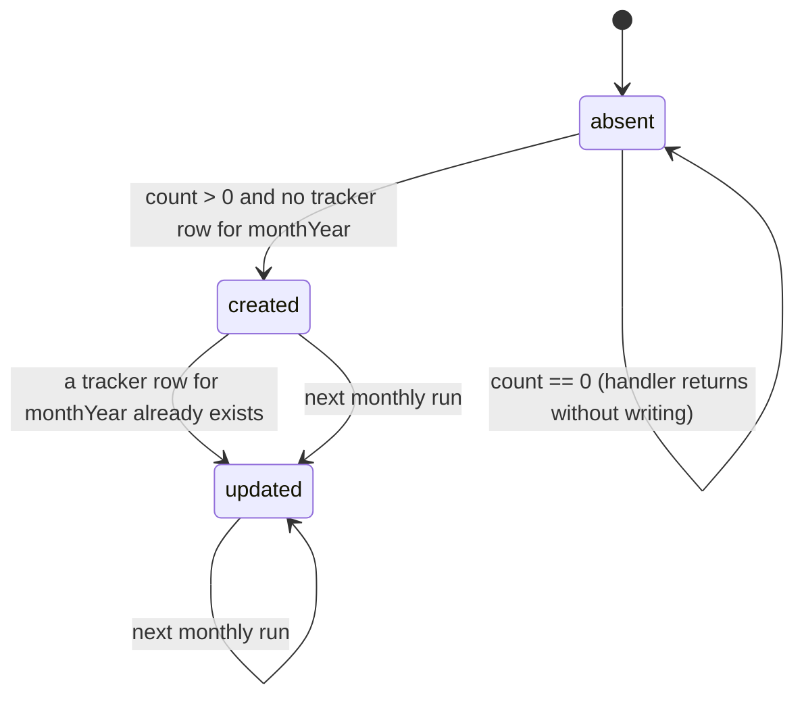
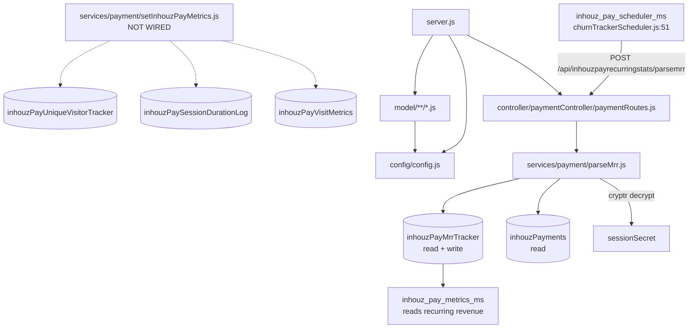

# inhouz_pay_recurring_stats_ms

Repository: `/workspaces/kilo_inhouz_ai/apps/inhouz_pay_recurring_stats_ms` — separate git repo, not
inside the control repo. All `file:line` citations are relative to that repository root.

## 1. Summary

`inhouz_pay_recurring_stats_ms` is a two-hundred-line service that recomputes one company's
recurring-revenue figures and stores them for the month. It exposes exactly one route,
`POST /api/inhouzpayrecurringstats/parsemrr`, which takes an AES-encrypted payload containing a
`companyId`, reads that company's active `inhouzPayments` rows, compares the result with the
previous month's `inhouzPayMrrTracker` document, and inserts or updates the current month's
tracker row with `mrr`, `arr`, `churnRate`, `netRetentionRate`, subscriber counts and currency. It
is called once a month by `inhouz_pay_scheduler_ms`. A second handler that would have written visit
and session metrics exists but is never imported.

## 2. Stack and commands

- Runtime: Node.js + Express 4 (`server.js:2`), Mongoose 7.
- Declared package name is `micro_service_template` (`package.json:2`).
- Port: `PORT` (`server.js:90`); k8s Service exposes **5063**
  (`k8s/inhouz-pay-recurring-stats-ms-cluster-ip-service.yml:10`).
- npm scripts (`package.json:6-9`): `"test": "echo \"Error: no test specified\" && exit 1"` and
  `"start": "node server.js"`. This is the only service in the cluster whose `start` script is real.
- Start command: `npm start` (equivalently `node server.js`).
- Health probe: `healthcheck.js` requests `GET /healthz` on `localhost:${PORT}` (`healthcheck.js:6-7`).
  No `/healthz` route exists in this repository.

## 3. Entry points

| Entry point | `file:line` | How it starts |
|---|---|---|
| HTTP server | `server.js:90` | `npm start` |
| Cluster fork loop | `server.js:29-46` | automatic; `os.cpus().length` workers when `NODE_ENV=production` (`server.js:30`) |
| Route registration | `server.js:61` | `require("./controller/paymentController/paymentRoutes")(app)` |
| Model registration (15 requires) | `server.js:13-27` | module load; `inhouzPayUniqueVisitorTracker` required twice (`server.js:21,25`) |
| Mongoose connect | `server.js:95-104` | boot (`server.js:63`) and 5s after disconnect (`server.js:72-74`) |
| Shutdown handler | `server.js:80-88` | `SIGINT`, `SIGTERM`, `uncaughtException` |
| Health probe client | `healthcheck.js:10` | container `HEALTHCHECK` |
| Cron / interval | none | no `setInterval` in the repo; the only timer is the reconnect `setTimeout` (`server.js:72`) |

The real trigger is external: `inhouz_pay_scheduler_ms` calls this route from
`services/payment/churnTrackerScheduler.js:51` against
`${config.inhouzPayRecurringStatsMsUrl}/api/inhouzpayrecurringstats/parsemrr`, with the URL set from
`inhouz-pay-scheduler-ms-deployment.yml:251` to
`http://inhouz-pay-recurring-stats-ms-cluster-ip-service:5063`.

## 4. Module inventory

| Module | `file:line` | Owns | Public API | Kind |
|---|---|---|---|---|
| `server.js` | `server.js:1` | boot, cluster, Express wiring, Mongo lifecycle | side-effect module | `effectful` |
| `config/config.js` | `config/config.js:18` | cached config from mounted secret files + env | `module.exports()` | `effectful` (fs + env; memoised) |
| `controller/paymentController/paymentRoutes.js` | `controller/paymentController/paymentRoutes.js:3` | the single route binding | `(app) => void` | `effectful` |
| `services/payment/parseMrr.js` | `services/payment/parseMrr.js:10` | decrypts the payload, counts and loads payments, computes MRR/ARR/churn, upserts the month's tracker row | `async (req,res)` | `effectful` (DB + clock + crypto) |
| `services/payment/setInhouzPayMetrics.js` | `services/payment/setInhouzPayMetrics.js:9` | would upsert visit metrics, session-duration logs and unique visitors (`:117,140,157`) | `async (req,res)` | `effectful` — **dead code: no route and no `require` references it** (`grep -rn setInhouzPayMetrics` finds only its own log strings) |
| `middlewares/login/checkLogin.js` | `middlewares/login/checkLogin.js:9` | session auth for back-office routes | Express middleware | `effectful` — **not mounted on the only route** |
| `middlewares/subdomain/singleSubdomainValidation.js` | `middlewares/subdomain/singleSubdomainValidation.js` | subdomain/tenant resolution | Express middleware | `effectful` (unmounted) |
| `middlewares/module/moduleAccessCheck.js` | `middlewares/module/moduleAccessCheck.js:29` | module entitlement check; loads `flexModuleModel`, which has no schema in this repo | Express middleware | `effectful` (unmounted) |
| `utils/query/validateQueryKey.js` | `utils/query/validateQueryKey.js:6` | validates a query key against `queryKeyTracker` | async check | `effectful` — **not called from `parseMrr`** |
| `utils/user/getUser.js` | `utils/user/getUser.js:18,44,84,118` | loads user, roles, permissions | async helper | `effectful` (unmounted) |
| `utils/cryptography/encryptDecrypt.js` | `utils/cryptography/encryptDecrypt.js` | AES envelope used by the payment service | helper | `effectful` (secret from config) — not required by `parseMrr`, which builds `cryptr` directly at `parseMrr.js:28` |
| `utils/sanitizer/recursiveSanitizer.js` | used at `services/payment/parseMrr.js:12` | deep body sanitisation | pure transform | `pure` |
| `utils/date/*`, `utils/payment/*`, `utils/cookie/*` | `utils/` | date and payment helpers | pure helpers | `pure` |
| `model/**/*.js` (14 files) | e.g. `model/payment/inhouzPayMrrTracker.js:87` | schema + model on an env-named collection | `mongoose.model(config.xModel, schema, config.xModel)` | schema literal `pure`; export `effectful` |

## 5. Side effects

| Effect | Where | `file:line` |
|---|---|---|
| MongoDB connect | `server.js` | `server.js:96` (`maxPoolSize: 1` at `server.js:102`) |
| Count active payments | `services/payment/parseMrr.js` | `:66-94` (`count`, then `find` at `:94`) |
| Read previous-month tracker | `services/payment/parseMrr.js` | `:171` |
| Read current-month tracker | `services/payment/parseMrr.js` | `:187` |
| **Insert** tracker row | `services/payment/parseMrr.js` | `:203` |
| **Update** tracker row | `services/payment/parseMrr.js` | `:226` |
| Decrypt request payload | `services/payment/parseMrr.js` | `:28-31` (`cryptr` with `sessionSecret`) |
| Clock | `parseMrr.js` | `:20-25` (`new Date()`, expiry check) |
| Filesystem read of mounted secrets | `config/config.js` | `:6-14` |
| Logging (final catch only) | `services/payment/parseMrr.js` | `:253` area — one `console.log` for the catch block; `server.js:36,66,69,77,90` |

No outbound HTTP, no email, no Stripe, no filesystem writes. `node-fetch` is not a dependency of
this service (contrast `inhouz_pay_metrics_ms`).

## 6. State and state transitions

No request-level state machine, but the MRR tracker has a monthly lifecycle that this service owns:

| Transition | Trigger | Guard | `file:line` |
|---|---|---|---|
| (none) → insert | monthly scheduler call | decrypted payload with a non-empty `companyId`; `paymentCount` > 0 | `services/payment/parseMrr.js:31-52,66,203` |
| (none) → update | monthly scheduler call | same, and `currentMonthTracker` found | `services/payment/parseMrr.js:187,226` |
| previous month → current | monthly run | `prevMonthTracker` lookup by month key | `services/payment/parseMrr.js:171` |

The month key is `monthYear` on the tracker (`model/payment/inhouzPayMrrTracker.js:69-72`,
`required: true`). The record is keyed in the index by
`assetOwnerCompanyId, companyId, monthYear, environment, paymentOrigin, paymentOriginId,
subscriptionTierId, timestamp, datestamp, projectId` (`:80-86`).

## 7. Data

14 Mongoose schemas. Every model is registered on an env-named collection
(`model/payment/inhouzPayMrrTracker.js:87` is the canonical pattern).

| Env var | Collection | Schema file | Role here |
|---|---|---|---|
| `INHOUZ_PAYMENT_MODEL` | `inhouzPayments` | `model/payment/inhouzPayment.js:5` | read: active recurring payments |
| `INHOUZ_PAY_MRR_TRACKER_MODEL` | `inhouzPayMrrTracker` | `model/payment/inhouzPayMrrTracker.js:5` | **read + write**: the output of this service |
| `INHOUZ_PAY_VISIT_METRICS_MODEL` | `inhouzPayVisitMetrics` | `model/payment/inhouzPayVisitMetrics.js:5` | schema only; the writer is dead code |
| `INHOUZ_PAY_SESSION_DURATION_LOG_MODEL` | `inhouzPaySessionDurationLog` | `model/payment/inhouzPaySessionDurationLog.js:5` | schema only; dead writer |
| `INHOUZ_PAY_UNIQUE_VISITOR_TRACKER_MODEL` | `inhouzPayUniqueVisitorTracker` | `model/payment/inhouzPayUniqueVisitorTracker.js:5` | schema only; dead writer |
| `INHOUZ_PAY_CONVERSION_TRACKER_MODEL` | `inhouzPayConversionTracker` | `model/payment/inhouzPayConversionTracker.js:5` | registered, unused by the live path |
| `INHOUZ_PAYMENT_METHOD_TRACKER_MODEL` | `inhouzPayPaymentMethodTracker` | `model/payment/inhouzPaymentMethodTracker.js:5` | registered, unused by the live path |
| `QUERY_KEY_TRACKER_MODEL` | `queryKeyTracker` | `model/queryTracker/queryKeyTracker.js:5` | used only by the unmounted `validateQueryKey` |
| `SESSION_MODEL` / `USER_MODEL` / `USER_ROLES_MODEL` / `ROLE_MODEL` / `PERMISSION_MODEL` / `COMPANY_MODEL` / `AUTH_LOG_MODEL` | `session` / users / userRoles / roles / permissions / company / authenticationLogs | `model/session/session.js:5`, `model/user/user.js:6`, `useRoles.js:6`, `roles.js:6`, `permissions.js:6`, `company.js:5` | registered for the unmounted auth middlewares |
| `FLEX_MODULE_MODEL`, `FLEX_COLLECTION_MODEL`, `FLEX_FORM_FILE_MODEL`, `FORM_MODEL`, `DATA_RULE_EXECUTION_RESULT_MODEL` | as configured | config only, no schema here | read by `moduleAccessCheck.js:29` and friends; unused on the live route |

Validation rules on the output document (`model/payment/inhouzPayMrrTracker.js`):

- `assetOwnerCompanyId`, `paymentOrigin`, `paymentOriginId`, `environment`, `currency`,
  `monthYear` are `required` (`:6-32,49-52,69-72`).
- `paymentOrigin` enum: `payment link`, `inhouz app`, `subscription service`, `on-demand`,
  `inhouz sign` (`:14-20`).
- `environment` enum: `development`, `test`, `production` (`:31`).
- Numeric defaults: `mrr`, `arr`, `churnRate`, `netRetentionRate`, `subscriberCount`,
  `startSubscriberCount`, `lostSubscriberCount`, `addedSubscriberCount` all default `0`
  (`:33-67`).
- Schema options `timestamps: true`, `strict: true` (`:75-78`).

**Shared-collection coupling.** `inhouzPayMrrTracker` is read by `inhouz_pay_metrics_ms`
(`services/metrics/getRecurringRevenueMetrics.js:117`,
`recurringRevenueTimelineMetrics.js:127`) and by `inhouz_pay_ms`
(`model/payment/inhouzPayMrrTracker.js` there). This service is the **writer** of the monthly rows;
the metrics service is the reader. If this job does not run, the recurring-revenue dashboard goes
flat rather than erroring. `inhouzPayments` is owned by `inhouz_pay_ms`; this service only reads it.

## 8. Public interfaces

| Method | Path | Guard | Handler | `file:line` |
|---|---|---|---|---|
| POST | `/api/inhouzpayrecurringstats/parsemrr` | none — the encrypted payload is the only check | `parseMrr` | `controller/paymentController/paymentRoutes.js:4` |

Request body: `{ encryptedPayload: <string> }` (`services/payment/parseMrr.js:13-17`). The
plaintext envelope is `{ payload: { companyId }, expirationTimestamp }` (`:24-26`), encrypted with
`cryptr` using `sessionSecret` (`:28`). A payload past its `expirationTimestamp` is rejected with
400 (`:31-37`). `companyId` must be a non-empty string (`:43-52`).

Response: on success a JSON body from the handler's `res.send` path after the write; errors are
`{ error: { message } }` with 400 (`:21,41,56`) or 500 (`:253`).

Caller: `inhouz_pay_scheduler_ms` → `POST http://inhouz-pay-recurring-stats-ms-cluster-ip-service:5063/api/inhouzpayrecurringstats/parsemrr`
(`apps/inhouz_pay_scheduler_ms/services/payment/churnTrackerScheduler.js:51`).

No queue topic, no CLI, no websocket.

## 9. Configuration

Names only. Secrets are file-backed with env fallback (`config/config.js:5-15`).

Secrets: `sendgridapikey`/`SENDGRID_API_KEY`, `sessionsecret`/`SESSION_SECRET`,
`mongourl`/`MONGO_URL`, `clientsecretkey`/`CLIENT_SECRET_KEY`.

Process config: `SECRETS_PATH`, `SMPL_EMAIL`, `COOKIE_DOMAIN`, `NODE_ENV`, `PORT`.

Collection-name vars read in code (`config/config.js:21-56`): `FLEX_FORM_FILE_MODEL`,
`FLEX_MODULE_MODEL`, `FLEX_COLLECTION_MODEL`, `FORM_MODEL`, `DATA_RULE_EXECUTION_RESULT_MODEL`,
`USER_MODEL`, `COMPANY_MODEL`, `ROLE_MODEL`, `PERMISSION_MODEL`, `USER_ROLES_MODEL`,
`SESSION_MODEL`, `SESSION_VALIDATOR_MODEL`, `AUTH_LOG_MODEL`, `INHOUZ_PAYMENT_MODEL`,
`INHOUZ_PAY_MRR_TRACKER_MODEL`, `INHOUZ_PAY_UNIQUE_VISITOR_TRACKER_MODEL`,
`INHOUZ_PAY_CONVERSION_TRACKER_MODEL`, `INHOUZ_PAYMENT_METHOD_TRACKER_MODEL`,
`INHOUZ_PAY_VISIT_METRICS_MODEL`, `INHOUZ_PAY_SESSION_DURATION_LOG_MODEL`,
`QUERY_KEY_TRACKER_MODEL`.

Constant in `config/config.js:38`: `admin`. The service has no `paymentDeveloperPermission`
constant, unlike its two siblings — the permission middlewares are not present here.

Note: `node-fetch` is **not** in `package.json` for this service, and no `require("node-fetch")`
exists. The k8s env still carries `PAYMENT_MS_URL` and other shared vars this code never reads.

## 10. Dependencies

| Package | Why |
|---|---|
| `express` | the single HTTP route |
| `mongoose` | payment read, tracker read/write |
| `cryptr` | decrypts the request envelope (`services/payment/parseMrr.js:4,28`) |
| `moment` | month arithmetic (`services/payment/parseMrr.js:5`) |
| `sanitizer` | body sanitisation before decrypt (`:3,12`) |
| `lodash` | `isEmpty` on the decrypted payload (`:31`) |
| `cookie-parser` | session cookie parser wired at `server.js:60` (unused by the live route) |
| `crypto-js` | hashing helpers in the auth middleware (`middlewares/login/checkLogin.js:4`) |
| `node-rsa` | builds an RSA key from mounted secrets (`config/config.js:22-25`) |
| `cors` | `*.inhouz.localhost`, credentials on (`server.js:49-55`) |
| `helmet`, `hpp` | security headers, parameter-pollution guard (`server.js:58-59`) |
| `body-parser` | JSON bodies, 20mb (`server.js:57`) |
| `@sendgrid/mail`, `bcryptjs`, `connect-mongo`, `express-session`, `request-ip`, `shortid`, `validator` | declared in `package.json`; no usage on the live path (template residue) |

No `stripe`, no `node-fetch`.

## 11. Testing

No tests. `package.json:7` is the stub `echo "Error: no test specified" && exit 1`. There is no test
directory and no dev dependencies. Nothing is covered: not the MRR arithmetic, not the
previous-month comparison, not the double-write guard on `:187`/`:203`.

## 12. Known issues and risks

1. **Health probe targets a missing route.** `healthcheck.js:7` requests `/healthz`; the only route
   is `/api/inhouzpayrecurringstats/parsemrr` (`controller/paymentController/paymentRoutes.js:4`).
2. **The only route has no authentication and no rate limit.** `parseMrr` trusts a secret-key
   encrypted payload (`services/payment/parseMrr.js:28-37`) and nothing else; any pod that can reach
   port 5063 and has the `SESSION_SECRET` (which is the shared AES secret for the whole cluster) can
   rewrite a company's MRR. The `checkLogin`, subdomain and `validateQueryKey` middlewares exist in
   the repo but are not mounted.
3. **Months are recomputed in place, never versioned.** `services/payment/parseMrr.js:187-226`
   overwrites the row for `monthYear`; a re-run after a data fix silently replaces history, so churn
   trend is not reproducible from this collection alone.
4. **`setInhouzPayMetrics.js` is dead code that touches three collections.**
   `services/payment/setInhouzPayMetrics.js:117,140,157` write `inhouzPayUniqueVisitorTracker`,
   `inhouzPayVisitMetrics` and `inhouzPaySessionDurationLog`, but nothing requires the module. If it
   is revived by a copy-paste it will write without the query-key validation its writers elsewhere
   perform.
5. **Duplicate model require.** `server.js:21` and `server.js:25` both require
   `model/payment/inhouzPayUniqueVisitorTracker`.
6. **`FLEX_MODULE_MODEL` has no schema here.** `middlewares/module/moduleAccessCheck.js:29` calls
   `mongoose.model(config.flexModuleModel)`; `server.js:13-27` registers no such model, so mounting
   that middleware would throw.
7. **Exchange-rate and metrics caches are absent.** Unlike `inhouz_pay_metrics_ms`, this service has
   no `metricsCache`; the scheduler's own retry policy is the only protection against duplicate
   monthly runs.
8. **Cluster forks `os.cpus().length` workers with a 1-connection pool each.**
   `server.js:30,102`; deployment `replicas: 1`
   (`k8s/inhouz-pay-recurring-stats-ms-deployment.yml:6`).
9. **Config cached for the process lifetime.** `config/config.js:18-20`.
10. **Console logging only.** One `console.log` in the catch block
    (`services/payment/parseMrr.js:253`) and boot logs in `server.js`. A failed monthly run leaves no
    trace beyond that line.
11. **Template identity drift.** `package.json:2` is `micro_service_template`.
12. **Credentials:** none found embedded in source (`grep` for `sk_live`, `sk_test`, `SG.`, `AIza`,
    `mongodb://` returned nothing). Secrets come from `/mnt/secrets` or env (`config/config.js:5-15`).

## 13. Module map

## 14. Open questions

- Why does `setInhouzPayMetrics.js` exist with no caller? It writes the three collections that
  `inhouz_pay_metrics_ms` reads for session metrics; either a route was removed or the module was
  copied in as a placeholder. No commit history was inspected.
- Which service actually writes `inhouzPayVisitMetrics`, `inhouzPaySessionDurationLog` and
  `inhouzPayUniqueVisitorTracker` today was not traced. `inhouz_pay_ms` does not register those
  schemas.
- The brief says "outgoing internal HTTP: none found"; the code agrees for outbound calls, but the
  service is *called* by `inhouz_pay_scheduler_ms`, which the brief also states. Verified in
  `apps/inhouz_pay_scheduler_ms/services/payment/churnTrackerScheduler.js:51`.
- `parseMrr` uses `count()` at `services/payment/parseMrr.js:66`, which Mongoose 7 removed. Whether
  this throws at runtime depends on the installed Mongoose build; it was not executed.
- Skipped and why: I read `package.json`, `server.js`, the full route file, the first 70 lines of
  `parseMrr.js`, the first 110 lines of `model/payment/inhouzPayMrrTracker.js`, config lines 18-60,
  and grepped `setInhouzPayMetrics.js` for its collection writes. The middle 100 lines of
  `parseMrr.js` (the MRR arithmetic) are summarised, not quoted, and the unmounted middlewares were
  not read in full.
