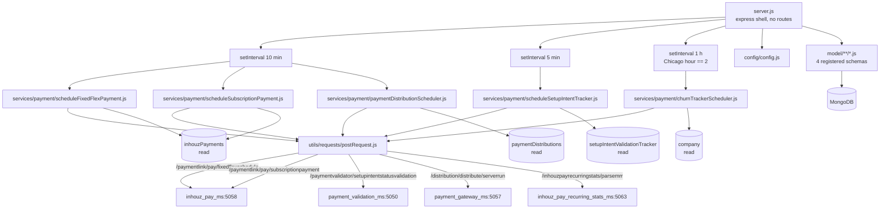

# inhouz_pay_scheduler_ms

Repository: `/workspaces/kilo_inhouz_ai/apps/inhouz_pay_scheduler_ms` — separate git repo, not inside
the control repo. All `file:line` citations are relative to that repository root.

## 1. Summary

`inhouz_pay_scheduler_ms` is the clock of the payment domain. It registers no HTTP routes; it opens
a port, connects to MongoDB, and runs five background jobs on three `setInterval` loops: every ten
minutes it dispatches due fixed-flex and subscription payments and due payout distributions; every
five minutes it re-validates SetupIntent trackers; once an hour, when America/Chicago is at 02:00, it
recomputes MRR for every active company. Each job selects documents from MongoDB, builds an
AES-encrypted payload with the shared `SESSION_SECRET`, and POSTs it to `inhouz_pay_ms`,
`payment_validation_ms`, `payment_gateway_ms` or `inhouz_pay_recurring_stats_ms`. It is the only
service in this cluster that originates scheduled payment work.

## 2. Stack and commands

- Runtime: Node.js + Express 4 (`server.js:2`), Mongoose 7, `moment` + `moment-timezone` (`server.js:9-10`).
- Declared package name is `micro_service_template` (`package.json:2`).
- Port: `PORT` (`server.js:95`); k8s Service exposes **5061**
  (`k8s/inhouz-pay-scheduler-ms-cluster-ip-service.yml:10`). The port serves no routes — it exists
  only so the pod has a listener.
- npm scripts (`package.json:6-9`): `"test": "echo \"Error: no test specified\" && exit 1"`,
  `"start": "node server.js"`.
- Start command: `npm start`.
- Health probe: `healthcheck.js` requests `GET /healthz` on `localhost:${PORT}` (`healthcheck.js:6-7`).
  No route is registered on the Express app, so every path returns Express's default 404.

## 3. Entry points

| Entry point | `file:line` | Cadence | Starts how |
|---|---|---|---|
| HTTP listener (no routes) | `server.js:95` | once | `npm start` |
| Interval A: `scheduleFixedFlexPayment`, `scheduleSubscriptionPayment`, `paymentDistributionScheduler` | `server.js:66-70` | every 600,000 ms (10 min) | first fire 10 min after boot, not immediately |
| Interval B: `scheduleSetupIntentTracker` | `server.js:71-73` | every 300,000 ms (5 min) | first fire 5 min after boot |
| Interval C: churn/MRR job | `server.js:74-82` | every 3,600,000 ms; body runs only when the Chicago hour is `2` (`server.js:76-79`) | **can fire twice** — the hour test is true for every hour-long tick inside 02:00–02:59 |
| Job: fixed-flex and flex-schedule payments | `services/payment/scheduleFixedFlexPayment.js:8` | interval A | `server.js:67` |
| Job: recurring subscription payments | `services/payment/scheduleSubscriptionPayment.js:8` | interval A | `server.js:68` |
| Job: payout distribution | `services/payment/paymentDistributionScheduler.js:7` | interval A | `server.js:69` |
| Job: SetupIntent tracker sweep | `services/payment/scheduleSetupIntentTracker.js:8` | interval B | `server.js:72` |
| Job: MRR / churn recompute | `services/payment/churnTrackerScheduler.js:7` | interval C | `server.js:78` |
| Mongoose connect | `server.js:99-111` | boot (`:42`) and 5s after disconnect (`server.js:51-53`) | |
| Model registration (4 live) | `server.js:23-26` | module load | user/role/session model requires are commented out (`server.js:18-22`) |
| Shutdown handler | `server.js:84-93` | `SIGINT`, `SIGTERM`, `uncaughtException` | closes Mongo; **does not clear the intervals** |

Direct one-shot starts of four jobs are commented out (`server.js:60-64`). Two services were once
run manually and are now only reachable through the intervals.

## 4. Module inventory

There is no `controller/` directory and no middleware is mounted. The whole surface is five exported
job functions plus the fetch client.

| Module | `file:line` | Owns | Public API | Kind |
|---|---|---|---|---|
| `server.js` | `server.js:1` | boot, Express shell, Mongo lifecycle, the three intervals | side-effect module | `effectful` |
| `config/config.js` | `config/config.js:17` | cached config from mounted secret files + env | `module.exports()` | `effectful` (fs + env; memoised) |
| `services/payment/scheduleFixedFlexPayment.js` | `services/payment/scheduleFixedFlexPayment.js:8` | finds due `fixed-schedule`/`flex-schedule` payments and asks `inhouz_pay_ms` to charge them | `async () => void` | `effectful` (DB read, clock, encrypt, HTTP) |
| `services/payment/scheduleSubscriptionPayment.js` | `services/payment/scheduleSubscriptionPayment.js:8` | finds due `recurring` payments not past due and asks `inhouz_pay_ms` to charge them | `async () => void` | `effectful` |
| `services/payment/paymentDistributionScheduler.js` | `services/payment/paymentDistributionScheduler.js:7` | finds `scheduled` production distributions whose `sendTimestamp` has passed and hands them to `payment_gateway_ms` | `async () => void` | `effectful` |
| `services/payment/scheduleSetupIntentTracker.js` | `services/payment/scheduleSetupIntentTracker.js:8` | re-validates **every** SetupIntent tracker row | `async () => void` | `effectful` |
| `services/payment/churnTrackerScheduler.js` | `services/payment/churnTrackerScheduler.js:7` | walks every active non-third-party company and asks `inhouz_pay_recurring_stats_ms` to recompute MRR | `async () => void` | `effectful` |
| `utils/requests/postRequest.js` | `utils/requests/postRequest.js:3` | JSON POST via `node-fetch`; normalises `{error}` / `{hasError}` responses | `(url, headers, data) => response \| {hasError,…}` | `effectful` (network) |
| `utils/requests/getRequest.js`, `deleteRequest.js` | `utils/requests/getRequest.js:1`, `deleteRequest.js:1` | sibling verbs | same shape | `effectful` — defined but **not imported by any job** |
| `utils/user/getUser.js` | `utils/user/getUser.js:18,44,84,118` | loads user, roles, permissions | async helper | `effectful` — not imported by `server.js` or any job |
| `utils/sanitizer/recursiveSanitizer.js` | folder `utils/sanitizer/` | deep body sanitisation | pure transform | `pure` — not imported by any job |
| `middlewares/login/checkLogin.js` | `middlewares/login/checkLogin.js:24,105` | session auth | Express middleware | `effectful` — **unmounted**: no `app.use` registers it |
| `middlewares/subdomain/singleSubdomainValidation.js` | `middlewares/subdomain/singleSubdomainValidation.js` | subdomain check | Express middleware | `effectful` — unmounted |
| `middlewares/module/moduleAccessCheck.js` | `middlewares/module/moduleAccessCheck.js:29` | module entitlement check | Express middleware | `effectful` — unmounted |
| `model/**/*.js` (9 files) | e.g. `model/payment/paymentDistribution.js:59` | schema + model on an env-named collection | `mongoose.model(config.xModel, schema, config.xModel)` | schema literal `pure`; export `effectful` |

## 5. Side effects

| Effect | Where | `file:line` |
|---|---|---|
| MongoDB connect | `server.js` | `server.js:100` (`maxPoolSize: 1` at `server.js:107`) |
| Read active companies (paged 1,000) | `services/payment/churnTrackerScheduler.js` | `:14-30` |
| Read due fixed/flex payments (paged 1,000) | `services/payment/scheduleFixedFlexPayment.js` | `:15-40` |
| Read due recurring payments (paged 1,000) | `services/payment/scheduleSubscriptionPayment.js` | `:15-35` |
| Read due distributions (paged 500) | `services/payment/paymentDistributionScheduler.js` | `:13-31` |
| Read all SetupIntent trackers (paged 2,000) | `services/payment/scheduleSetupIntentTracker.js` | `:15-22` |
| **HTTP → `inhouz_pay_ms` (5058)**: `/api/inhouzpay/payment/paymentlink/pay/fixedflexschedule` | `services/payment/scheduleFixedFlexPayment.js` | `:67` |
| **HTTP → `inhouz_pay_ms` (5058)**: `/api/inhouzpay/payment/paymentlink/pay/subscriptionpayment` | `services/payment/scheduleSubscriptionPayment.js` | `:62` |
| **HTTP → `payment_validation_ms` (5050)**: `/api/paymentvalidator/setupintentstatusvalidation` | `services/payment/scheduleSetupIntentTracker.js` | `:51` |
| **HTTP → `payment_gateway_ms` (5057)**: `/api/paymentgateway/distribution/distribute/serverrun` | `services/payment/paymentDistributionScheduler.js` | `:71` |
| **HTTP → `inhouz_pay_recurring_stats_ms` (5063)**: `/api/inhouzpayrecurringstats/parsemrr` | `services/payment/churnTrackerScheduler.js` | `:51` |
| Encrypt outbound payloads (`SESSION_SECRET` as AES key) | every job | `churnTrackerScheduler.js:11,42`; `scheduleFixedFlexPayment.js:11,56`; `scheduleSubscriptionPayment.js:11,51`; `scheduleSetupIntentTracker.js:11,42`; `paymentDistributionScheduler.js:10,65` |
| Decrypt a stored distribution payload | `services/payment/paymentDistributionScheduler.js` | `:49` |
| Randomness for `queryKey` | `scheduleFixedFlexPayment.js:61`, `scheduleSubscriptionPayment.js:56`, `scheduleSetupIntentTracker.js:45` (`shortid`); `paymentDistributionScheduler.js:50` (`Math.random`) |
| Clock | `paymentDate` / `sendTimestamp` comparisons and payload expiry | `scheduleFixedFlexPayment.js:28,63`; `scheduleSubscriptionPayment.js:23,58`; `paymentDistributionScheduler.js:11,17,61`; `churnTrackerScheduler.js:47`; `server.js:76` |
| Timezone | America/Chicago hour gate | `server.js:76` |
| Filesystem read of mounted secrets | `config/config.js` | `:4-14` |
| Logging | `console.log` in every catch and at boot | `server.js:46,49,57,89,96`; `churnTrackerScheduler.js:28,63`; `scheduleFixedFlexPayment.js:38,79`; `scheduleSubscriptionPayment.js:33,74`; `scheduleSetupIntentTracker.js:24,62`; `paymentDistributionScheduler.js:29,82` |

No filesystem writes, no email, no Stripe call. `@sendgrid/mail` and `stripe` are not used by any
job.

## 6. State and state transitions

The scheduler owns no state of its own, but it drives three record lifecycles in other services'
collections:

**Payment due → charged** (`inhouzPayments`):

| From | To | Trigger | Guard | `file:line` |
|---|---|---|---|---|
| `paymentDate <= now`, `active: true`, `scheduledPaymentComplete: false`, type `fixed-schedule` or `flex-schedule` | charge requested | interval A | `chargeType` in `dynamicChargeTypes` (`payment link`, `on-demand`, `inhouz sign`) | `scheduleFixedFlexPayment.js:15-29` |
| `paymentDate <= now`, `active: true`, `hasPastDue: false`, type `recurring` | charge requested | interval A | `chargeType` in `dynamicChargeTypes` | `scheduleSubscriptionPayment.js:15-24` |

The scheduler only *requests*; the state write happens in `inhouz_pay_ms`
(`/paymentlink/pay/…`). Nothing marks `scheduledPaymentComplete` here.

**Payout distribution** (`paymentDistributions`, enum at `model/payment/paymentDistribution.js:50-58`:
`processing`, `failed`, `complete`, `awaiting approval`, `approval denied`, `pending`, `approved`,
`scheduled`):

| From | To | Trigger | Guard | `file:line` |
|---|---|---|---|---|
| `scheduled` | hand-off to the gateway | interval A | `sendTimestamp < now` **and** `environment === 'production'` | `paymentDistributionScheduler.js:13-20` |
| `scheduled` … | any | performed by `payment_gateway_ms` | — | not in this repo |

**SetupIntent tracker**: every row is submitted on every 5-minute tick, with no status filter
(`scheduleSetupIntentTracker.js:15-16`), so the tracker's own lifecycle is driven entirely by the
downstream response.

**MRR month row**: created or updated monthly by `inhouz_pay_recurring_stats_ms`
(`/api/inhouzpayrecurringstats/parsemrr`), once per active company, triggered here at 02:00 Chicago
(`server.js:76-79`).

## 7. Data

Nine schemas, four of which are registered at boot (`server.js:23-26`); the user/role/permission/
session models are commented out (`server.js:18-22`) but their files remain.

| Env var | Collection | Schema file | Role here |
|---|---|---|---|
| `INHOUZ_PAYMENT_MODEL` | `inhouzPayments` | `model/payment/inhouzPayment.js:5` | read: due payments |
| `PAYMENT_DISTRIBUTION_MODEL` | `paymentDistributions` | `model/payment/paymentDistribution.js:5` | read: due distributions |
| `SETUP_INTENT_VALIDATION_TRACKER_MODEL` | `setupIntentValidationTracker` | `model/payment/setupIntentValidationTracker.js:5` | read: every row, every 5 min |
| `COMPANY_MODEL` | `company` | `model/company/company.js:5` | read: active companies for MRR |
| `USER_MODEL`, `USER_ROLES_MODEL`, `ROLE_MODEL`, `PERMISSION_MODEL`, `SESSION_MODEL`, `SESSION_VALIDATOR_MODEL`, `AUTH_LOG_MODEL` | users / userRoles / roles / permissions / session / sessionValidator / authenticationLogs | `model/user/user.js:6`, `useRoles.js:6`, `roles.js:6`, `permissions.js:6`, `session.js:5` | schema only; boot requires are commented out |
| `FLEX_MODULE_MODEL`, `FLEX_COLLECTION_MODEL`, `FLEX_FORM_FILE_MODEL`, `FORM_MODEL`, `DATA_RULE_EXECUTION_RESULT_MODEL` | as configured | config only, no schema here | unused |

Validation rules that the jobs depend on:

- `paymentDistributions.status` enum (`model/payment/paymentDistribution.js:50-58`), `required`
  `name`, `timestamp`, `assetOwnerCompanyId`, `paymentGatewayId`, `environment`
  (`:6-39`). `sendTimestamp`, `encryptedPayload`, `projectId` are plain fields.
- `paymentDistributions` compound index includes `status`, `sendTimestamp`,
  `sendScheduleProcessed`, `hasSendSchedule` (`:109-115`), which is the index the scheduler's filter
  needs.
- `company.status === 'active'` and `companyType` not `thirdParty` are the only company filters
  (`churnTrackerScheduler.js:16-19`); both are schema fields of `company`.

**Shared-collection coupling.** This service **reads** `inhouzPayments` (written by `inhouz_pay_ms`),
`company` (written by `inhouz_company`/identity flows), `setupIntentValidationTracker` (written by
`inhouz_pay_ms`) and `paymentDistributions` (written by the payment gateway / admin UI). It writes
none of them. The `paymentDate` and `hasPastDue` fields it filters on are maintained by
`inhouz_pay_ms`; if that service stops advancing them, this scheduler re-requests the same charge on
every ten-minute tick.

## 8. Public interfaces

**No inbound interface.** `grep 'app\.(get|post|use)'` finds only CORS, `bodyParser`, `hpp`,
`helmet` and `cookieParser` (`server.js:29-40`); no route is registered. The k8s Service on port
5061 reaches an Express app that 404s everything.

**Outbound requests** (all `POST`, all `{ encryptedPayload, serverEncrypted: true }` with an
AES envelope `{ payload, expirationTimestamp }`):

| Target | Path | Payload fields | Expiry | `file:line` |
|---|---|---|---|---|
| `INHOUZ_PAY_MS_URL` (5058) | `/api/inhouzpay/payment/paymentlink/pay/fixedflexschedule` | `inhouzPaymentId`, `assetOwnerCompanyId`, `environment`, `queryKey` | 30s | `scheduleFixedFlexPayment.js:56-73` |
| `INHOUZ_PAY_MS_URL` (5058) | `/api/inhouzpay/payment/paymentlink/pay/subscriptionpayment` | same | 30s | `scheduleSubscriptionPayment.js:51-68` |
| `PAYMENT_VALIDATOR_MS_URL` (5050) | `/api/paymentvalidator/setupintentstatusvalidation` | `docId`, `queryKey` | 30s | `scheduleSetupIntentTracker.js:42-57` |
| `PAYMENT_GATEWAY_MS_URL` (5057) | `/api/paymentgateway/distribution/distribute/serverrun` | the decrypted distribution plus `paymentDistributionId`, `fromServer`, `queryKey`, `encryptedKey`, `skipValidationCheck` | 60s | `paymentDistributionScheduler.js:51-77` |
| `INHOUZ_PAY_RECURRING_STATS_MS_URL` (5063) | `/api/inhouzpayrecurringstats/parsemrr` | `companyId` | 100s | `churnTrackerScheduler.js:42-57` |

The k8s env maps those names to the cluster services (`k8s/inhouz-pay-scheduler-ms-deployment.yml:244-255`).

## 9. Configuration

Names only. Secrets are file-backed with env fallback (`config/config.js:4-14`).

Secrets: `sendgridapikey`/`SENDGRID_API_KEY`, `sessionsecret`/`SESSION_SECRET`,
`mongourl`/`MONGO_URL`, `clientsecretkey`/`CLIENT_SECRET_KEY`.

Process config: `SECRETS_PATH`, `SMPL_EMAIL`, `COOKIE_DOMAIN`, `PORT`, `NODE_ENV`
(`middlewares/login/checkLogin.js:129`).

Service URLs: `INHOUZ_PAY_MS_URL`, `PAYMENT_VALIDATOR_MS_URL`,
`INHOUZ_PAY_RECURRING_STATS_MS_URL`, `PAYMENT_GATEWAY_MS_URL`.

Collection-name vars read in code (`config/config.js:20-48`): `FLEX_FORM_FILE_MODEL`,
`FLEX_MODULE_MODEL`, `FLEX_COLLECTION_MODEL`, `FORM_MODEL`, `DATA_RULE_EXECUTION_RESULT_MODEL`,
`USER_MODEL`, `COMPANY_MODEL`, `ROLE_MODEL`, `PERMISSION_MODEL`, `USER_ROLES_MODEL`,
`SESSION_MODEL`, `SESSION_VALIDATOR_MODEL`, `AUTH_LOG_MODEL`, `INHOUZ_PAYMENT_MODEL`,
`SETUP_INTENT_VALIDATION_TRACKER_MODEL`, `PAYMENT_DISTRIBUTION_MODEL`.

Constants in code, not env-driven: `dynamicChargeTypes = ["payment link", "on-demand",
"inhouz sign"]` (`config/config.js:46`), `admin` (`:37`), and the three interval periods
(`server.js:70,73,81`).

`package.json` declares `moment-timezone`, used only at `server.js:10,76` for the Chicago gate.

## 10. Dependencies

| Package | Why |
|---|---|
| `express` | an HTTP shell with no routes (`server.js:28-40`) |
| `mongoose` | the reads that select due work |
| `cryptr` | encrypts every outbound payload, decrypts the distribution payload |
| `node-fetch` | the POST client (`utils/requests/postRequest.js:1`) |
| `moment` | payload expiry timestamps |
| `moment-timezone` | `America/Chicago` hour gate (`server.js:76`) |
| `shortid` | `queryKey` generation in the three payment jobs |
| `cookie-parser` | session cookie parser wired at `server.js:40` (unused) |
| `cors`, `helmet`, `hpp`, `body-parser` | the Express shell (`server.js:29-39`) |
| `crypto-js`, `lodash`, `validator` | auth middleware and model validation, reachable only if a middleware were mounted |
| `@sendgrid/mail`, `bcryptjs`, `connect-mongo`, `express-session`, `request-ip`, `sanitizer` | declared in `package.json`; no usage on any live path (template residue) |
| `stripe` | **not** a dependency — this service never touches Stripe directly |

## 11. Testing

No tests. `package.json:7` is the stub `echo "Error: no test specified" && exit 1`. Nothing is
covered, and the risk is highest here: the jobs move money and there is no test for the due-date
filter, the interval arithmetic, the 02:00 gate, or idempotency of a repeated tick.

## 12. Known issues and risks

1. **No route, but a health probe.** `healthcheck.js:7` calls `GET /healthz`; nothing is registered
   (`server.js:29-40`), so the probe sees a 404. If the container treats 404 as unhealthy, the pod
   never reports ready — and this pod is the only thing advancing due payments.
2. **`postRequest` is never awaited, so failures are invisible.** Every job calls
   `postRequest(...)` without `await` (`scheduleFixedFlexPayment.js:66`,
   `scheduleSubscriptionPayment.js:61`, `scheduleSetupIntentTracker.js:50`,
   `paymentDistributionScheduler.js:70`, `churnTrackerScheduler.js:50`). The returned error object is
   discarded, so a downstream 500 or a network failure produces no log and no retry signal.
3. **No idempotency.** Interval A runs every 10 minutes and re-selects the same rows, because the
   fields it filters on (`paymentDate`, `scheduledPaymentComplete`) are only advanced by
   `inhouz_pay_ms`. A downstream that is slow, or that rejects the request, leaves the row due, and
   the next tick charges it again. There is no lock, no in-flight marker and no dedupe key beyond the
   `queryKey` that is generated fresh per attempt (`scheduleFixedFlexPayment.js:61`).
4. **Intervals start only after a full period.** `server.js:66-82` sets intervals with no immediate
   first call, and the four one-shot starts are commented out (`server.js:60-64`). After a pod
   restart, due payments wait up to 10 minutes and SetupIntents up to 5.
5. **The MRR job can run twice in one day.** `server.js:76-79` tests only the hour, and the interval
   is one hour, so any tick that lands inside 02:00–02:59 fires. With a 1-hour period and jitter, two
   ticks in the same hour are possible; each one re-POSTs `parsemrr` for every company.
6. **Timezone is hard-coded.** `America/Chicago` (`server.js:76`) is not configurable, so
   daylight-saving shifts move the monthly window by an hour.
7. **The SetupIntent sweep selects every document.** `scheduleSetupIntentTracker.js:15-16` uses an
   empty filter with no status or age bound and pages 2,000 at a time, so the work grows with the
   collection and every row is re-submitted every 5 minutes forever.
8. **`scheduleSetupIntentTracker` uses `skip` with a collection it does not mutate, but so do the
   payment jobs that do cause writes** — writing during a paged scan is safe only because the writes
   happen in another service and after the page was read; a slow downstream can shift rows across
   page boundaries and skip some.
9. **Shutdown does not clear the intervals.** `server.js:84-93` closes Mongoose but leaves the three
   timers running, so a `SIGTERM` during a job can issue a request against a closing connection.
10. **Production-only distribution gate.** `paymentDistributionScheduler.js:19` filters
    `environment: 'production'` in the query itself, so the same build cannot be smoke-tested in dev
    or test without a code change.
11. **`Math.random()` as a key source.** `paymentDistributionScheduler.js:50` concatenates four
    `Math.random()` values for the query key; the payment jobs use `shortid` plus a timestamp.
12. **Unmounted middleware and dead utilities.** `middlewares/` (3 files), `utils/requests/getRequest.js`,
    `deleteRequest.js`, `utils/user/getUser.js` and `utils/sanitizer/` are never imported by
    `server.js` or any job. The live path is five files.
13. **Config cached for the process lifetime.** `config/config.js:16-19`.
14. **`mongoose.model` for user/role/session is never called** because the requires are commented out
    (`server.js:18-22`); mounting a middleware would throw at `moduleAccessCheck.js:29`.
15. **Template identity drift.** `package.json:2` is `micro_service_template`.
16. **Credentials:** none found embedded in source (`grep` for `sk_live`, `sk_test`, `SG.`, `AIza`,
    `mongodb://` returned nothing). Secrets come from `/mnt/secrets` or env (`config/config.js:4-14`).

## 13. Module map

Direction: timer → job → Mongo read → encrypt → `postRequest` → sibling service. Calls are
fire-and-forget; no job waits for or inspects the response.

## 14. Open questions

- Which process owns `scheduledPaymentComplete`, `hasPastDue` and `paymentDate`? The scheduler reads
  them (`scheduleFixedFlexPayment.js:26-28`, `scheduleSubscriptionPayment.js:21-24`) but never writes
  them, and the update path was not traced into `inhouz_pay_ms`. The retry behaviour in §12.3 depends
  on it.
- Does the k8s deployment run with more than one replica in practice? `k8s/inhouz-pay-scheduler-ms-deployment.yml:6`
  says `replicas: 1`; with more than one, every timer would double-fire, because there is no leader
  election or distributed lock anywhere in the repo.
- The `kus/` overlays set the same URLs as `k8s/` (`kus/prod/…:241-267`); which tree is deployed was
  not determined.
- The brief lists "called by: none found" and that matches: no route exists, so nothing can call it.
  Its *outbound* list also matches, with the added detail that the calls are not awaited.
- I did not verify whether `payment_gateway_ms` and `payment_validation_ms` accept the exact payload
  shapes built here; only the field names are documented.
- Skipped and why: I read `package.json`, `server.js` in full, all five job files in full,
  `config/config.js` in full, `utils/requests/postRequest.js`, and the first 110 lines of
  `model/payment/paymentDistribution.js`. The other eight model files and the three unmounted
  middleware files were not read beyond the grep evidence in §7.
