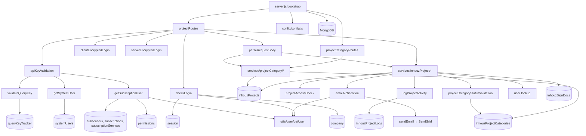

# inhouz_project_ms

## 1. Summary

`inhouz_project_ms` is the project and workspace layer of the Inhouz platform. It owns projects and
project categories: create, edit, get, list, delete, change owner, change status, activate or
deactivate, and check whether a field value is already taken. A project category carries an ordered
status list (name, colour, sequence number), and every project status must exist in its category's
list. The service also writes an activity log row for each project action, and emails the project
owner through SendGrid when the owner, status or active state changes. It is the reading and writing
point for the `inhouzProjects` collection, which `payment_link_ms` also reads. It lives in its own
git repository at `apps/inhouz_project_ms/` (remote `Inhouz-Cloud-AI/inhouz_project_ms`).

## 2. Stack and commands

| Item | Value | Source |
|---|---|---|
| Runtime | Node.js 16.4 (alpine container) | `Dockerfile:1` |
| Engines field | `node >=12.0.0 <17.5.0` | `package.json:6-8` |
| Container command | `npm run start` | `Dockerfile:11` |
| Start script | `node --max-old-space-size=8192 server.js` | `package.json:11` |
| Test script | `echo "Error: no test specified" && exit 1` | `package.json:10` |
| Framework | Express 4.16.4 | `package.json:25` |
| ODM | Mongoose 7.4.0 | `package.json:32` |
| Package name | `scheduled_task_scheduler_ms` (copied template, not renamed) | `package.json:2` |
| Port | `process.env.PORT` | `server.js:92` |
| k8s service | `inhouz-project-ms-cluster-ip-service`, ClusterIP, port 5067 | `k8s/inhouz-project-ms-cluster-ip-service.yml:4`, `:10` |
| k8s deployment | image `inhouz/inhouz_project_ms`, replicas 1 | `k8s/inhouz-project-ms-deployment.yml:6`, `:17` |

No dev script, no linter config and no test runner. `npm run start` is the only way to run the
service.

## 3. Entry points

| Entry point | `file:line` | How it starts |
|---|---|---|
| Cluster bootstrap | `server.js:30` | Master forks `os.cpus().length` workers in production, 1 otherwise (`:31-34`); respawns a dead worker (`:36-47`) |
| Model registration | `server.js:13-28` | 16 `require` calls so every schema is registered before a route can use it |
| HTTP server | `server.js:92` | `app.listen(process.env.PORT)` in the worker branch |
| Route registration | `server.js:62-63` | `projectRoutes(app)`, then `projectCategoryRoutes(app)` |
| Mongo connect | `server.js:97-109` | Called when `readyState` is not 1 or 2 (`:64-66`) |
| Mongo reconnect timer | `server.js:71-78` | `setTimeout(connectMongo, 5000)` on `disconnected` |
| Graceful shutdown | `server.js:82-90` | `SIGINT`, `SIGTERM`, `uncaughtException` close the connection |
| Container health probe | `healthcheck.js:10` | `GET http://localhost:$PORT/healthz`, exit 0 on 200 |
| Project routes | `controller/projectRoutes.js:16-26` | 9 routes |
| Category routes | `controller/projectCategoryRoutes.js:10-17` | 6 routes |

There is no `/healthz` route in the app: `server.js:62-63` registers only the two API route modules,
so the probe in `healthcheck.js:7` always gets 404. See section 12.

There are no cron jobs, workers, queues or CLI commands. The only timer is the 5-second Mongo
reconnect (`server.js:74`).

## 4. Module inventory

### Models (`model/`)

| Module | `file:line` | Responsibility | Public API | Kind |
|---|---|---|---|---|
| `inhouzProject` | `model/inhouzProject/inhouzProject.js:103` | Project document, 14-field compound index | mongoose model | `reactive` |
| `inhouzProjectCategory` | `model/inhouzProject/inhouzProjectCategory.js:55` | Category with embedded `statusList[]` | mongoose model | `reactive` |
| `inhouzProjectLog` | `model/inhouzProject/inhouzProjectLog.js:32` | Append-only activity log per project | mongoose model | `reactive` |
| `contact` | `model/contact/contact.js:78` | Shared contact schema (read-only here) | mongoose model | `reactive` |
| `inhouzSignDoc` | `model/inhouzSign/inhouzSignDoc.js:774` | Shared e-sign document schema; only checked for existence | mongoose model | `reactive` |
| `queryKeyTracker` | `model/queryTracker/queryKeyTracker.js:23` | One row per API key already seen (replay cache) | mongoose model | `reactive` |
| `company` | `model/company/company.js:108` | Shared company schema (read-only) | mongoose model | `reactive` |
| `permissions` | `model/rolesAndPermissions/permissions.js:89` | Shared permission schema (read-only) | mongoose model | `reactive` |
| `roles` | `model/rolesAndPermissions/roles.js:87` | Shared role schema (read-only) | mongoose model | `reactive` |
| `session` | `model/session/session.js:28` | Shared session schema; sliding expiry | mongoose model | `reactive` |
| `subscriber` | `model/subscription/subscriber.js:68` | Shared subscriber schema (read-only) | mongoose model | `reactive` |
| `subscription` | `model/subscription/subscription.js:210` | Shared subscription schema (read-only) | mongoose model | `reactive` |
| `subscriptionService` | `model/subscription/subscriptionService.js:378` | Shared service-catalogue schema (read-only) | mongoose model | `reactive` |
| `systemUser` | `model/system/systemUser.js:65` | Shared system-user schema with encrypted API keys | mongoose model | `reactive` |
| `user` | `model/user/user.js:108` | Shared user schema (read-only) | mongoose model | `reactive` |
| `userRoles` | `model/user/userRoles.js:51` | User-to-role link (read-only) | mongoose model | `reactive` |

### Middleware (`middlewares/`)

| Module | `file:line` | Responsibility | Public API | Kind |
|---|---|---|---|---|
| `apiKeyValidation` | `middlewares/apiKey/apiKeyValidation.js:8` | Reads `X-SE-API-KEY`/`X-CE-API-KEY`, decrypts it, checks expiry, checks the query key, loads a system user or a subscription user, sets `req.user` | `(req,res,next)` | `effectful` (crypto, Mongo, clock) |
| `clientEncryptedLogin` | `middlewares/login/clientEncryptedLogin.js:5` | RSA client header `clientEncryptedAccessHeader` → user | `(req,res,next)` | `effectful` |
| `serverEncryptedLogin` | `middlewares/login/serverEncryptedLogin.js:6` | AES server header `serverEncryptedAccessHeader` → user | `(req,res,next)` | `effectful` |
| `checkLogin` | `middlewares/login/checkLogin.js:9` | Cookie `SMPL` or `x-access-token` plus `x-csrfToken`; slides session 60 minutes; refreshes `x-java` and `sessionExpirationTimestamp` cookies; loads company | `(req,res,next)` | `effectful` (Mongo read/write, clock, cookies) |
| `parseRequestBody` | `middlewares/request/parseRequestBody.js:7` | Decrypts `{encryptedPayload, serverEncrypted}` into `req.payload`, rejects expired payloads | `(req,res,next)` | `effectful` (crypto, clock) |
| `moduleAccessCheck` | `middlewares/module/moduleAccessCheck.js:7` | Flex-module gate; not mounted on any route | `(req,res,next)` | `effectful` |
| `singleSubdomainValidation` | `middlewares/subdomain/singleSubdomainValidation.js:1` | Subdomain check; not mounted on any route | `(req,res,next)` | `effectful` |

### Services (`services/`)

| Module | `file:line` | Responsibility | Public API | Kind |
|---|---|---|---|---|
| `createProject` | `services/inhouzProject/createProject.js:7` | Validate, resolve owner by id or email, validate status against category, insert, log | `(req,res)` | `effectful` |
| `editProject` | `services/inhouzProject/editProject.js:8` | Update project, detect status/owner change, log and notify | `(req,res)` | `effectful` |
| `deleteProject` | `services/inhouzProject/deleteProject.js:7` | Refuse if e-sign docs or contacts exist, then hard delete | `(req,res)` | `effectful` |
| `getProject` | `services/inhouzProject/getProject.js:5` | Read one project, then access-check it | `(req,res)` | `effectful` |
| `getProjects` | `services/inhouzProject/getProjects.js:9` | Filtered, sorted, paged list via aggregate plus total count | `(req,res)` | `effectful` |
| `updateProjectStatus` | `services/inhouzProject/updateProjectStatus.js:8` | Validate status against the category then update, log, notify | `(req,res)` | `effectful` |
| `updateProjectOwner` | `services/inhouzProject/updateProjectOwner.js:7` | Reassign the owner, log, notify | `(req,res)` | `effectful` |
| `changeProjectState` | `services/inhouzProject/changeProjectState.js:7` | Toggle `active`, log, notify | `(req,res)` | `effectful` |
| `fieldAvailabilityCheck` | `services/inhouzProject/fieldAvailabilityCheck.js:6` | Query for any client-named field and value on the project collection | `(req,res)` | `effectful` |
| `createProjectCategory` | `services/projectCategory/createProjectCategory.js:4` | Insert a category with a status list | `(req,res)` | `effectful` |
| `editProjectCategory` | `services/projectCategory/editProjectCategory.js:4` | Update a category | `(req,res)` | `effectful` |
| `deleteProjectCategory` | `services/projectCategory/deleteProjectCategory.js:4` | Refuse while projects reference the category, then delete | `(req,res)` | `effectful` |
| `getProjectCategory` | `services/projectCategory/getProjectCategory.js:4` | Read one category | `(req,res)` | `effectful` |
| `getProjectCategories` | `services/projectCategory/getProjectCategories.js:9` | Paged, filtered category list | `(req,res)` | `effectful` |
| `getProjectCategoryStatusList` | `services/projectCategory/getProjectCategoryStatusList.js:4` | Return the status list of one category | `(req,res)` | `effectful` |

### Utilities (`utils/`)

| Module | `file:line` | Responsibility | Public API | Kind |
|---|---|---|---|---|
| `projectAccessCheck` | `utils/project/projectAccessCheck.js:4` | Owner, permitted-user or read/write permission check | `({projectId, companyId, user, accessType}) -> {access, isOwner, project} \| {error}` | `effectful` (Mongo read) |
| `logProjectActivity` | `utils/project/logProjectActivity.js:4` | Insert a log row with a server timestamp | `({projectId, companyId, createdById, activity})` | `effectful` |
| `validateProjectName` | `utils/project/validateProjectName.js:5` | Name uniqueness per company, allows an unchanged name on edit | `(params) -> {isValid} \| {error}` | `effectful` |
| `projectCategoryStatusValidation` | `utils/projectCategory/projectCategoryStatusValidation.js:4` | Status must appear in the category's `statusList[].name` | `({companyId, status, projectCategoryId}) -> {isValid} \| {error}` | `effectful` |
| `validateQueryKey` | `utils/query/validateQueryKey.js:4` | One-time API key check: reject a key already in `queryKeyTracker`, otherwise cache it | `(queryKey) -> {success} \| {error}` | `effectful` (read + write) |
| `getSubscriptionUser` | `utils/subscriptionUser/getSubscriptionUser.js:5` | Resolve a subscriber, user, company, subscription, service, tier and permission list | `(info) -> user \| {error}` | `effectful` (six Mongo reads) |
| `getSystemUser` | `utils/systemUser/getSystemUser.js:4` | Resolve a system user, company and permissions | `(info, req) -> user \| {error}` | `effectful` |
| `getUser` | `utils/user/getUser.js:5` | User, user-roles, roles and permissions | `(userId) -> user` | `effectful` (four Mongo reads) |
| `emailNotification` | `utils/email/emailNotification.js:5` | Load the user, render the generic template, send | `({userId, subject, message})` | `effectful` |
| `sendEmail` | `utils/sendEmail/sendEmail.js:5` | SendGrid send with the API key from config | `(to, from, subject, text, html, fromName, attachments)` | `effectful` |
| `genericEmailTemplate` | `utils/emailTemplates/genericEmailTemplate.js:1` | HTML body string | `({name, message}) -> {emailTemplate}` | `pure` |
| `encryptDecrypt` | `utils/cryptography/encryptDecrypt.js:3` | RSA decrypt, or encrypt-private / encrypt-public | `(data, encrypt=false, publicEncryt=false)` | `effectful` (key from config) |
| `parseFilter` | `utils/filter/parseFilter.js:1` | Client filter → Mongo match | `(filter, filterMap, nonRegexList, typeMap)` | `pure` |
| `recursiveSanitizer` | `utils/sanitizer/recursiveSanitizer.js:19` | Recursive string sanitization | `(element, sanitizer)` | `pure` |
| `createEditByObject` | `utils/user/createEditByObject.js:1` | Build the `{userId, firstName, …}` audit object | `(user, deployDate)` | `pure` |
| `projectFilterMap`, `projectNonRegexMap`, `projectTypeMap` | `utils/project/filter/*.js` | Allowed filter keys and coercions | maps / list | `pure` |
| `projectCategoryFilterMap`, `projectCategoryNonRegexMap`, `projectCategoryTypeMap` | `utils/projectCategory/filter/*.js` | Allowed category filter keys | maps / list | `pure` |
| `getRequest`, `postRequest`, `deleteRequest` | `utils/requests/getRequest.js:3`, `postRequest.js:3`, `deleteRequest.js:3` | `node-fetch` wrappers with a uniform `{hasError, errorMessage}` shape | `(url, headers, data)` | `effectful` (network) — **no caller in this repository** |

### Controller

| Module | `file:line` | Responsibility | Public API | Kind |
|---|---|---|---|---|
| `projectRoutes` | `controller/projectRoutes.js:16` | Registers 9 project routes with their middleware chains | `(app)` | `effectful` |
| `projectCategoryRoutes` | `controller/projectCategoryRoutes.js:10` | Registers 6 category routes | `(app)` | `effectful` |

## 5. Side effects

| Effect | Where | `file:line` |
|---|---|---|
| MongoDB connect, pool size 1 | `connectMongo` | `server.js:98-106` |
| Reconnect after 5 s | `disconnected` handler | `server.js:74` |
| Secret read from `/mnt/secrets` | `readSecret` | `config/config.js:10` |
| Session read and sliding update | `checkLogin` | `middlewares/login/checkLogin.js:28`, `:86` |
| Company read | `checkLogin` | `middlewares/login/checkLogin.js:108` |
| Cookies `x-java`, `sessionExpirationTimestamp` | `checkLogin` | `middlewares/login/checkLogin.js:131`, `:139` |
| AES (Cryptr) decrypt of header or payload | `apiKeyValidation`, `serverEncryptedLogin`, `parseRequestBody` | `middlewares/apiKey/apiKeyValidation.js:20`, `middlewares/login/serverEncryptedLogin.js:21`, `middlewares/request/parseRequestBody.js:27` |
| RSA decrypt / encrypt | `encryptDecrypt` | `utils/cryptography/encryptDecrypt.js:7-13` |
| Query-key cache write | `validateQueryKey` | `utils/query/validateQueryKey.js:33-36` |
| Project collection reads/writes | services | `services/inhouzProject/createProject.js:181`, `updateProjectStatus.js:109`, `changeProjectState.js:49`, `deleteProject.js:130`, `updateProjectOwner.js:57`, `editProject.js:214` |
| Category reads/writes | services | `services/projectCategory/createProjectCategory.js:50`, `editProjectCategory.js:28`, `deleteProjectCategory.js:54` |
| Log insert | `logProjectActivity` | `utils/project/logProjectActivity.js:28-31` |
| Contact existence check | `deleteProject` | `services/inhouzProject/deleteProject.js:81` |
| E-sign doc existence check | `deleteProject` | `services/inhouzProject/deleteProject.js:49` |
| User read for owner resolution | `createProject`, `editProject` | `services/inhouzProject/createProject.js:131-137`, `editProject.js:174-181` |
| Email send (SendGrid) | `sendEmail` | `utils/sendEmail/sendEmail.js:7` |
| Clock reads | every handler and logger | `services/inhouzProject/createProject.js:18`, `utils/project/logProjectActivity.js:31` |
| Logging | `console.log` on every error path | `services/inhouzProject/createProject.js:73` |
| Outgoing HTTP | none at runtime | only the three unused `utils/requests/*.js` wrappers (`utils/requests/getRequest.js:4`) |

No service module imports `utils/requests/*`, so the running service makes no outbound HTTP call.
The deployment injects sibling base URLs (`APP_BUILDER_MS_URL`, `INHOUZ_SIGN_MS_URL`,
`VIEW_BUILDER_MS_URL`, `DOCUMENT_GENERATION_PARSER_MS_URL`, `PAYMENT_MS_URL`), and
`config.scheduledTaskParserMsUrl` is read from `SCHEDULED_TASK_PARSER_MS_URL`
(`config/config.js:42`) but nothing in the repository uses it.

## 6. State and state transitions

Two independent state axes on a project.

**Axis 1 — `active` (boolean).** Toggled only by `POST /project/changeprojectstate`.

| From | To | Trigger | Guard |
|---|---|---|---|
| `true` | `false` | `changeprojectstate` with `active: false` | `projectAccessCheck(accessType: 'write')` must return `access: true` (`services/inhouzProject/changeProjectState.js:29-46`); Mongo update must return `modifiedCount` (`:67-73`) |
| `false` | `true` | same, `active: true` | same |

**Axis 2 — `status` (string).** Any name in the project category's `statusList`.

| From | To | Trigger | Guard |
|---|---|---|---|
| any status | any status in `category.statusList[].name` | `POST /project/changestatus` or `POST /project/edit` with a different status | write access (`updateProjectStatus.js:31-48`); status must be in the list (`utils/projectCategory/projectCategoryStatusValidation.js:43-49`) |

There is **no transition graph**. The check is membership, not ordering: a project can move from the
last status to the first. The `sequenceNumber` field on each status is stored
(`model/inhouzProject/inhouzProjectCategory.js:26-29`) but no code reads it.

**Deletion.**

| From | To | Trigger | Guard |
|---|---|---|---|
| project exists | project row gone | `POST /project/delete` | write access; no `inhouzSignDocs` row for the project (`services/inhouzProject/deleteProject.js:49-78`); no contact row (`:81-110`) |

Delete is a hard delete (`services/inhouzProject/deleteProject.js:130`). The log rows written for
that project are not deleted, so they become dangling `projectId` references.

**Session.** Same sliding-expiry transition as every other service: a valid session is extended 60
minutes on each authenticated request (`middlewares/login/checkLogin.js:82-104`), and an expired one
is rejected (`:66`).

## 7. Data

The collection name is the value of an env var, passed as both the model name and the collection
name, e.g. `mongoose.model(config.inhouzProjectModel, schema, config.inhouzProjectModel)`
(`model/inhouzProject/inhouzProject.js:103`). The names below are the brief's env → collection
mapping; the deployment decides the real string.

| Env key | Collection (per brief) | Model file | Key fields | Validation | Access here | Sibling services on the same collection |
|---|---|---|---|---|---|---|
| `INHOUZ_PROJECT_MODEL` | `inhouzProjects` | `model/inhouzProject/inhouzProject.js:5-91` | `name`, `companyId`, `categoryId`, `categoryName`, `uniqueProjectKey`, `restrictAccess`, `readPermissionIds[]`, `writePermissionIds[]`, `permittedUserIds[]`, `status`, `projectOwnerId`, `projectStartDate`, `projectEndDate`, `projectCompleteDate`, `estimatedMonetaryValue`, `currency`, `taskStatusList[]`, `metadata`, `active` | `name`, `companyId`, `categoryId`, `createdDate`, `createdById`, `status`, `createdByEmail` required; `strict: true`; 14-field compound index (`:93-101`). No uniqueness index on `name` or `uniqueProjectKey` — uniqueness is enforced only by a find-then-insert (`services/inhouzProject/createProject.js:67-127`) | read + write | `payment_link_ms` (grep of `INHOUZ_PROJECT_MODEL` across `apps/`) |
| `INHOUZ_PROJECT_CATEGORY_MODEL` | `inhouzProjectCategories` | `model/inhouzProject/inhouzProjectCategory.js:5-48` | `name`, `description`, `companyId`, `statusList[]{name, color, sequenceNumber}`, `createdDate`, `createdById`, `editDate`, `lastUpdatedById` | `name`, `companyId`, `createdDate`, `createdById` required; each status entry requires `name`, `color`, `sequenceNumber`; `strict: true` | read + write | none — this service only |
| `INHOUZ_PROJECT_LOG_MODEL` | `inhouzProjectLogs` | `model/inhouzProject/inhouzProjectLog.js:5-26` | `projectId`, `companyId`, `activity`, `timestamp`, `createdById` | `projectId`, `companyId`, `activity`, `timestamp` required; index on `projectId/companyId/timestamp` | write (and read nowhere) | none — this service only |
| `CONTACT_MODEL` | `inhouzContacts` | `model/contact/contact.js:6-68` | `companyId`, `projectId`, names, `email`, `phoneNumber`, `address`, `organizationId`, demographics, timestamps | `companyId`, `firstName`, `lastName`, `email`, `createdTimestamp`, `updatedTimestamp` required; email `validator.isEmail`; enums for `sex`, `maritalStatus`, `ethnicity` | read (existence check) | `contact_ms`, `inhouz_sign_ms`, `inhouz_sign_metrics_ms`, `inhouz_security_ms`, `document_*`, `general_task_scheduler_ms`, `module_transfer*`, `pdf_generator_ms`, `push_notification_parser_ms` |
| `INHOUZ_SIGN_DOC_MODEL` | `inhouzSignDocs` | `model/inhouzSign/inhouzSignDoc.js:6-773` | document, template, `projectId`, `companyId`, `status`, signer list, restriction policies, payment fields | `documentName`, `environment`, `companyId`, `status` required; enums for `environment`, `status`, signature type, password restriction type, extra-policy type | read (existence check) | `inhouz_sign_ms`, `inhouz_sign_metrics_ms`, `app_builder_ms`, `appviewer_log_ms`, `customer_portal_ms`, `contact_ms`, `inhouz_pay_ms`, `inhouz_security_ms`, `document_generation_parser_ms`, `pdf_generator_ms` and the parser/scheduler set |
| `QUERY_KEY_TRACKER_MODEL` | `queryKeyTracker` | `model/queryTracker/queryKeyTracker.js:5-17` | `key`, `timestamp` | `key`, `timestamp` required; index `key/timestamp`; **no TTL index** | read + write | ~30 services including `authentication_ms`, `app_builder_ms`, `inhouz_sign_ms`, `payment_gateway_ms`, `subscription_ms` |
| `SUBSCRIBER_MODEL` | `subscribers` | `model/subscription/subscriber.js:6-67` | `subscriberId`, `subscriberType`, `email`, `companyId`, `assetOwnerCompanyId`, `isAdmin`, `active` | `subscriberType` required, enum `internal\|external`; `email` validated; `companyId`, `assetOwnerCompanyId` required | read | ~70 services |
| `SUBSCRIPTION_MODEL` | `subscriptions` | `model/subscription/subscription.js:6-209` | `subscriberEmail`, `companyId`, `subscriptionType`, `assetOwnerCompanyId`, `subscriptionServiceId`, `subscriptionServiceTierId`, `serviceType`, renewal fields | many required fields; enums for `subscriptionType`, `serviceType`, `reupSubscriptionRateType` | read | ~70 services |
| `SUBSCRIPTION_SERVICE_MODEL` | `subscriptionServices` | `model/subscription/subscriptionService.js:5-378` | service catalogue, `customPaymentTiers`, `assetType`, `signupExtraDataFields` | — | read | ~70 services |
| `SYSTEM_USER_MODEL` | `systemUsers` | `model/system/systemUser.js:6-64` | `companyId`, `userName`, `email`, per-environment encrypted API keys | `companyId`, `userName`, `createdDate`, `createdById` required; email validated | read | ~30 services including `system_users_ms`, `authentication_ms`, `inhouz_sign_ms` |
| `USER_MODEL` | `users` | `model/user/user.js:6` | identity, `email`, `companyId`, `passwordHash`, `active`, notification prefs | `email` validated; `active` default | read | ~70 services |
| `COMPANY_MODEL`, `ROLE_MODEL`, `PERMISSION_MODEL`, `USER_ROLES_MODEL`, `SESSION_MODEL` | `company`, `roles`, `permissions`, `userRoles`, `session` | `model/company/company.js:108`, `model/rolesAndPermissions/roles.js:87`, `permissions.js:89`, `model/user/userRoles.js:51`, `model/session/session.js:28` | as in the rest of the platform | — | read, plus a session write for the sliding expiry | ~70 services |

There are no migrations and no seed scripts. The category status list is free-form data, so the set
of valid project statuses is per company, not enforced by a schema enum.

## 8. Public interfaces

All routes are POST under `/api/inhouzproject`. Every body is an encrypted envelope
`{encryptedPayload, serverEncrypted}` decoded by `parseRequestBody` into `req.payload`
(`middlewares/request/parseRequestBody.js:10-46`), except `fieldavailabilitycheck`, which reads
`req.body` directly (`services/inhouzProject/fieldAvailabilityCheck.js:9`).

### Project routes (`controller/projectRoutes.js`)

| Method | Path | Middleware chain | Payload | Response |
|---|---|---|---|---|
| POST | `/project/create` | apiKey → clientEncrypted → serverEncrypted → login → parseBody | `{name, categoryId, status, projectOwnerId?}` or `projectOwnerEmail`, optional dates, permission ids, `restrictAccess` | project document |
| POST | `/project/edit` | clientEncrypted → serverEncrypted → login → parseBody | `{_id, name, categoryId, projectOwnerId, status, …}` | `{success}` or project update result |
| POST | `/project/getproject` | apiKey → clientEncrypted → serverEncrypted → login → parseBody | `{projectId}` | project document |
| POST | `/project/getprojects` | apiKey → clientEncrypted → serverEncrypted → login → parseBody | `{filter, sort, limit, skip}` | `{inhouzProjects, total_count}` |
| POST | `/project/changestatus` | apiKey → clientEncrypted → serverEncrypted → login → parseBody | `{_id, status}` | `{success: true}` |
| POST | `/project/changeowner` | apiKey → login → parseBody | `{_id, projectOwnerId}` | `{success: true}` |
| POST | `/project/fieldavailabilitycheck` | login only | `{field, value, projectId?}` (plain JSON) | availability flag or error |
| POST | `/project/changeprojectstate` | apiKey → clientEncrypted → serverEncrypted → login → parseBody | `{projectId, active}` | `{success: true}` |
| POST | `/project/delete` | apiKey → clientEncrypted → serverEncrypted → login → parseBody | `{projectId}` | `{success: true}` |

### Category routes (`controller/projectCategoryRoutes.js`)

| Method | Path | Middleware chain |
|---|---|---|
| POST | `/projectcategory/create` | login → parseBody |
| POST | `/projectcategory/edit` | login → parseBody |
| POST | `/projectcategory/getprojectcategory` | login → parseBody |
| POST | `/projectcategory/getprojectcategories` | login → parseBody |
| POST | `/projectcategory/delete` | login → parseBody |
| POST | `/projectcategory/getstatuslist` | login → parseBody |

### The access envelope

Three ways a caller authenticates, tried in this order:

1. `X-SE-API-KEY` header: AES with the session secret (`middlewares/apiKey/apiKeyValidation.js:20`).
2. `X-CE-API-KEY` header: RSA with the client private key (`:22`).
3. `clientEncryptedAccessHeader` (RSA) or `serverEncryptedAccessHeader` (AES), then the session
   cookie.

The decrypted envelope is always `{expirationTimestamp, payload}` and an expired timestamp is
rejected. The API-key payload carries `X-API-KEY`, `companyId`, `queryKey` and `environment`
(`middlewares/apiKey/apiKeyValidation.js:42-56`); the inner key carries `userId`, `userType`,
`companyId`, `subscriptionId`, `isInternal`. `userType: 'systemUser'` resolves through
`getSystemUser`, anything else through `getSubscriptionUser` (`:99-132`).

The query key is single-use: the first request caches it in `queryKeyTracker` and every later request
with the same key is rejected as `Expired authorization token.`
(`utils/query/validateQueryKey.js:24-36`).

There are no events, queue topics or CLI commands.

## 9. Configuration

Names only.

Secrets read from `/mnt/secrets/<name>` with an env fallback (`config/config.js:5-15`):
`sendgridapikey`, `sessionsecret`, `mongourl`, `clientsecretkey`, `clientpublickey`.

Env vars read by code (`config/config.js:17-61`):

- `SECRETS_PATH`, `NODE_ENV`, `PORT`
- `MONGO_URL`, `SESSION_SECRET`, `CLIENT_SECRET_KEY`, `CLIENT_PUBLIC_KEY`, `SENDGRID_API_KEY`
- `COOKIE_DOMAIN`
- `USER_MODEL`, `USER_ROLES_MODEL`, `COMPANY_MODEL`, `ROLE_MODEL`, `PERMISSION_MODEL`,
  `SESSION_MODEL`, `SESSION_VALIDATOR_MODEL`, `AUTH_LOG_MODEL`
- `INHOUZ_PROJECT_MODEL`, `INHOUZ_PROJECT_LOG_MODEL`, `INHOUZ_PROJECT_CATEGORY_MODEL`,
  `INHOUZ_SIGN_DOC_MODEL`, `CONTACT_MODEL`, `QUERY_KEY_TRACKER_MODEL`
- `SYSTEM_USER_MODEL`, `SUBSCRIBER_MODEL`, `SUBSCRIPTION_MODEL`, `SUBSCRIPTION_SERVICE_MODEL`
- `FLEX_FORM_FILE_MODEL`, `FLEX_MODULE_MODEL`, `FLEX_COLLECTION_MODEL`, `FORM_MODEL`,
  `DATA_RULE_EXECUTION_RESULT_MODEL`, `SMPL_EMAIL`
- `SCHEDULED_TASK_PARSER_MS_URL` (read into config, never used)

Injected by the deployment but not read by this code (`k8s/inhouz-project-ms-deployment.yml`):
`APP_BUILDER_MS_URL`, `VIEW_BUILDER_MS_URL`, `INHOUZ_SIGN_MS_URL`,
`DOCUMENT_GENERATION_PARSER_MS_URL`, `PAYMENT_MS_URL`, `OPEN_EXCHANGE_RATES_API_KEY`,
`OPEN_EXCHANGE_RATES_BASE_URL`, `CLOUDFLARE_*`, `REDIS_*`, `S3_*`, `COOKIE_NAME`,
`INHOUZ_FROM_EMAIL`, `IP_LOCATION_FINDER_URL`, `INHOUZ_SUBSCRIPTIONS_MODEL`, and roughly 60 other
`*_MODEL` keys that belong to sibling services (the app-builder, sign, payment and subscription
model sets).

## 10. Dependencies

| Package | Version | Why |
|---|---|---|
| `express` | ^4.16.4 | HTTP server and routing (`server.js:2`) |
| `mongoose` | ^7.4.0 | MongoDB ODM (`server.js:3`) |
| `body-parser` | ^1.18.3 | JSON parsing, 20 MB limit (`server.js:58`) |
| `cookie-parser` | ^1.4.4 | Session cookie parsing (`server.js:61`) |
| `cors` | ^2.8.5 | Origin allow-list `*.inhouz.localhost` (`server.js:51-55`) |
| `hpp` | ^0.2.2 | Parameter-pollution guard (`server.js:59`) |
| `helmet` | ^3.16.0 | Security headers (`server.js:60`) |
| `dotenv` | ^7.0.0 | Local env loading (`server.js:1`) |
| `node-rsa` | ^1.1.1 | RSA request and key crypto (`config/config.js:1`) |
| `cryptr` | 6.0.2 | AES session, API-key and payload crypto (`middlewares/apiKey/apiKeyValidation.js:2`) |
| `sanitizer` | ^0.1.3 | Input sanitization (`middlewares/request/parseRequestBody.js:3`) |
| `lodash` | ^4.17.11 | `isEmpty`, `isEqual` (`middlewares/login/checkLogin.js:5`, `utils/project/validateProjectName.js:2`) |
| `moment` | ^2.26.0 | Session expiry arithmetic and subscription-user dates (`middlewares/login/checkLogin.js:4`) |
| `validator` | ^10.11.0 | Email validation in schemas and owner lookup (`model/contact/contact.js:3`, `services/inhouzProject/createProject.js:3`) |
| `@sendgrid/mail` | ^6.3.1 | Transactional email (`utils/sendEmail/sendEmail.js:1`) |
| `node-fetch` | 2.6.1 | Only in the unused `utils/requests/*` wrappers (`utils/requests/getRequest.js:1`) |

Declared but never `require`d: `bcryptjs`, `connect-mongo`, `crypto-js`, `express-session`,
`request-ip`, `shortid`, `shrink-string`, `moment-timezone` (`package.json:16-39`, verified by grep).

## 11. Testing

There are no tests. `npm test` is the template stub (`package.json:10`). There is no test directory,
no fixture and no CI test step; the GitHub workflows build and deploy only
(`.github/workflows/cicd-dev.yml`, `.github/workflows/cicd-prod.yml`).

The pure pieces worth testing first: `utils/projectCategory/projectCategoryStatusValidation.js`
(membership only), `utils/filter/parseFilter.js`, `utils/emailTemplates/genericEmailTemplate.js`, and
the status/owner change branches in `services/inhouzProject/editProject.js:138-213`. None are
covered. Run the service with `npm run start` and a `MONGO_URL`; there is no other verification path.

## 12. Known issues and risks

1. **A GitHub token is injected by the machine's global git config, not by this repository.**
   `git config --get remote.origin.url` returns a plain
   `https://github.com/Inhouz-Cloud-AI/inhouz_project_ms.git` with no credentials. The token appears
   in `git remote -v` because the global config `/home/node/.gitconfig` defines a
   `url.https://<token>@github.com/.insteadOf https://github.com/` rewrite. The token is in no
   repository and does not travel with a clone, but every command that prints a remote URL writes it
   into logs and agent transcripts. Rotate it at GitHub and drop the rewrite from the global config.
   The value is not reproduced here.
2. **`/healthz` is probed but never routed.** `healthcheck.js:7` requests it; `server.js:62-63`
   registers only API routes, so the probe gets 404 and any container health check fails.
3. **`fieldavailabilitycheck` builds a Mongo query from a client-named field.** The route has only
   `isLoggedIn` (`controller/projectRoutes.js:23`) and the handler queries
   `{[field]: value}` with `companyId` (`services/inhouzProject/fieldAvailabilityCheck.js:20-23`).
   A caller controls the field name, so any indexed or unindexed field on `inhouzProjects` can be
   probed, and a `$`-prefixed name reaches the driver as an operator position.
4. **`getproject` requires write access to read.** The read route calls
   `projectAccessCheck(accessType: 'write')` (`services/inhouzProject/getProject.js:55`), so a user
   with read-only permission cannot read the project. `getProjects` uses the list filter instead.
5. **`editProject` can crash after a failed owner lookup.** When the new owner is not found, the
   payload key is deleted (`services/inhouzProject/editProject.js:193-195`) but the log message on
   the next line still dereferences `projectOwner['firstName']` (`:202`), which is `undefined` after
   the `findOne` returned `null`/error. The result is a 500, not the intended "owner not found".
6. **API key validation is optional.** `apiKeyValidation` calls `next()` when neither
   `X-SE-API-KEY` nor `X-CE-API-KEY` is present (`middlewares/apiKey/apiKeyValidation.js:13-16`), so
   the only remaining gate on those routes is the session cookie. Any route that lists
   `apiKeyValidation` but not `isLoggedIn` would be open; none currently is.
7. **Single-use query key is not atomic.** `validateQueryKey` does a `findOne` then an un-awaited
   `create` (`utils/query/validateQueryKey.js:7`, `:33-36`). Two concurrent requests with the same
   key both pass, and if the insert fails the failure is logged and ignored.
8. **`queryKeyTracker` has no TTL index** (`model/queryTracker/queryKeyTracker.js:19-21`), so it grows
   without bound.
9. **No transition order on statuses.** `projectCategoryStatusValidation` only checks membership in
   `statusList` (`utils/projectCategory/projectCategoryStatusValidation.js:43-49`). `sequenceNumber`
   is stored and never read, so a project can jump backward or skip states.
10. **Duplicate schema key.** `createdBySystemUser` is declared twice on the project schema
    (`model/inhouzProject/inhouzProject.js:68-71` and `:75-78`); the second definition silently wins.
11. **Uniqueness is not enforced by an index.** Name and `uniqueProjectKey` uniqueness is a
    find-then-insert (`services/inhouzProject/createProject.js:67-127`), so a concurrent double
    submit creates two projects with the same name (`model/inhouzProject/inhouzProject.js:93-101`
    has no unique index).
12. **`createProject` spreads the raw payload** into the document (`services/inhouzProject/createProject.js:182`).
    Server-set fields are written after the spread, so they win, but unknown keys are accepted and
    `_id` is not stripped on create (it is on edit, `editProject.js:102-104`).
13. **Notifications are fire-and-forget.** `emailNotification(...)` is called without `await`
    (`services/inhouzProject/changeProjectState.js:100`, `updateProjectStatus.js:142`,
    `deleteProject.js:155`), so a SendGrid failure is invisible to the caller and to the log.
14. **Hard delete leaves dangling log rows.** `deleteProject` removes the project row
    (`services/inhouzProject/deleteProject.js:130`) but not `inhouzProjectLogs` rows for it.
15. **Cluster mode with Mongo pool size 1.** Each worker opens a pool of one (`server.js:105`), so
    production throughput is capped by worker count.
16. **Template identity.** `package.json:2` still says `scheduled_task_scheduler_ms`, which makes
    dependency and image audits easy to mis-attribute.

## 13. Module map

Calls point downward. `projectAccessCheck`, `logProjectActivity` and `emailNotification` are the
three cross-cutting project utilities; everything that reaches the database is an effectful handler.

## 14. Open questions

- The brief says "outgoing internal HTTP: none found". The code confirms no caller of
  `utils/requests/*`, but the deployment injects five sibling base URLs and the config reads a sixth
  (`SCHEDULED_TASK_PARSER_MS_URL`). I cannot tell whether outbound calls were removed or never
  wired; nothing in this repository calls them.
- The brief says this service is called by `function_parser_ms` and
  `scheduled_task_function_parser_ms`. The routes that allow a server-to-server caller are the ones
  with `apiKeyValidation` and `clientEncryptedLogin`/`serverEncryptedLogin`
  (`controller/projectRoutes.js:17-21`, `:24-25`), which fits that claim, but the callers live
  outside this repository and I did not read them.
- `middlewares/subdomain/singleSubdomainValidation.js` and `middlewares/module/moduleAccessCheck.js`
  are present and unmounted. I did not read the subdomain middleware in full. They look like
  template leftovers, but I cannot prove no other repository imports this one as a library.
- The real collection names depend on deployment env values; the names in section 7 are the brief's
  mapping and the code never hard-codes a string.
- The category status names are data, not code, so the actual status vocabulary for a company can
  only be read from `inhouzProjectCategories` at runtime. I did not query a database.
- Skipped: `.git/` internals (except the remote URL noted in section 12), `kus/**` overlays beyond
  the base service/deployment, `.github/workflows/*` beyond confirming there is no test step,
  `docker-compose.yml`, `build_ga*.sh`, `deploy.sh`, and `service-account.json.enc` (an encrypted
  binary blob; not readable).
