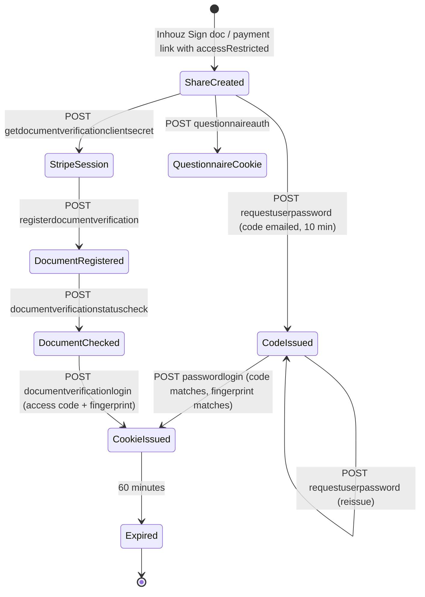
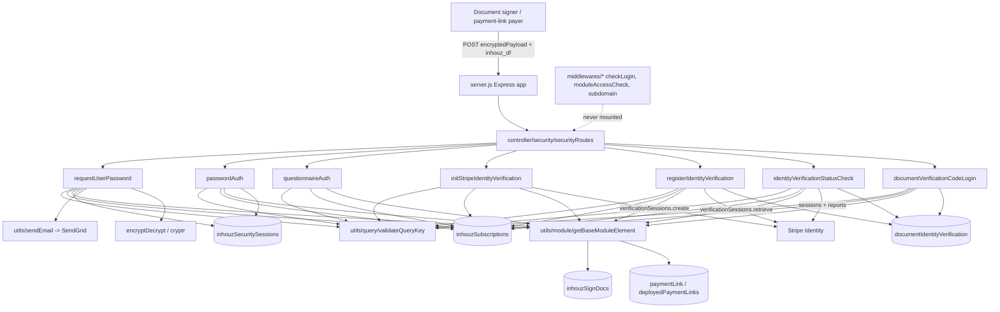

# inhouz_security_ms

## 1. Summary

`inhouz_security_ms` is the access gate for publicly shared Inhouz artefacts. It answers one
question for a caller who is not a logged-in platform user: "may this person open this Inhouz Sign
document or this payment link?" It supports four evidence paths — an emailed access code
(`requestUserPassword` → `passwordlogin`), a questionnaire, a Stripe Identity document check
(`getdocumentverificationclientsecret` → `registerdocumentverification` →
`documentverificationstatuscheck`), and a one-time document-verification access-code login — and on
success it sets an encrypted, per-document cookie that the signing/viewing front end presents. It
also provisions random access codes and stores a per-document security session. It is **not** part
of the platform session scheme: no route uses `checkLogin`, and the middleware tree is present but
never wired. It lives in its own git repository at `apps/inhouz_security_ms/` (repo id
`inhouz_security_ms`); every path here is relative to that repository root. The npm package still
carries the template name `micro_service_template` and the template description.

## 2. Stack and commands

Node.js. `package.json` declares **no `engines` block and no `start` script**; the only script is
`test` → `echo "Error: no test specified" && exit 1` (`package.json:6-8`).

The image is `node:16.4-alpine` and its command is `npm run start` (`Dockerfile:1,11`). Because
`package.json` has no `start` script, that command fails as written (§12, issue 1).

`docker-compose.yml` builds `simple_ms`, sets `NODE_ENV: development`, and maps host `5001` to
container `5001` (`docker-compose.yml:6-12`) — a port that matches neither the k8s Service nor
`PORT`.

Port: `server.js:88` listens on `process.env.PORT`. The k8s Service
`inhouz-security-ms-cluster-ip-service` is ClusterIP on `5068` → targetPort `5068`
(`k8s/inhouz-security-ms-cluster-ip-service.yml:4-11`); the Deployment runs
`inhouz/inhouz_security_ms` with `replicas: 1`
(`k8s/inhouz-security-ms-deployment.yml:6,17`).

Verification command: none. `npm test` exits 1 by design.

## 3. Entry points

| Entry point | Where | How it is started |
|---|---|---|
| HTTP bootstrap | `server.js:45-91` | `node server.js`; the container's `npm run start` (`Dockerfile:11`) cannot resolve a `start` script |
| Cluster fork loop | `server.js:27-44` | Master; `os.cpus().length` workers in production, `1` otherwise (`:28`) |
| Express assembly | `server.js:46-59` | Per worker |
| Route registration | `server.js:59` | `require("./controller/security/securityRoutes")(app)` |
| `app.listen` | `server.js:88` | End of the worker branch |
| Mongo connect / retry | `server.js:93-105`, called `:61`, retried `:70-72` | Module load; 5 s after a disconnect |
| Shutdown | `server.js:78-86` | `SIGINT`, `SIGTERM`, `uncaughtException` → close Mongo only |
| Model registration | `server.js:13-25` | Thirteen model modules |
| Health probe | `healthcheck.js:1-21` | Standalone, unreferenced; probes `GET /healthz` (`:7`), which no route serves |
| Cron / worker / migration | none | Only timer is the Mongo reconnect (`server.js:70`) |

Seven HTTP routes, all registered with **no middleware** (`controller/security/securityRoutes.js:10-16`).

## 4. Module inventory

| Module | `file:line` | Owns | Public API | Kind |
|---|---|---|---|---|
| server bootstrap | `server.js:1-105` | Cluster, middleware stack, Mongo lifecycle | process entry | effectful |
| config loader | `config/config.js:17-56` | Config object and RSA pair; single `default` branch keyed on `NODE_ENV` (`:18`) | `module.exports() -> object` | effectful (FS, env) |
| route table | `controller/security/securityRoutes.js:10-16` | All 7 routes | `module.exports(app)` | reactive |
| `requestUserPassword` | `services/security/requestUserPassword.js:14-283` | Validates the share link, finds the recipient, generates a 7-digit code with `Math.random()` (`:207`), upserts a security session with a 10-minute expiry (`:211-230`), emails the code (`:253-271`) | `(req,res)` | effectful |
| `passwordAuth` | `services/security/passwordAuth.js:14-398` | Verifies the code against the security session, checks the document status, sets the access cookie (`:378-387`) | `(req,res)` | effectful |
| `questionnaireAuth` | `services/security/questionnaireAuth.js:12-…` | Answers-based access, sets a cookie with `questionnaireAuth: true` | `(req,res)` | effectful |
| `initStripeIdentityVerification` | `services/security/initStripeIdentityVerification.js:11-…` | Creates a Stripe Identity `verificationSession` and returns its `client_secret` (`:170,190`) | `(req,res)` | effectful (Stripe) |
| `registerIdentityVerification` | `services/security/registerIdentityVerification.js:17-…` | Retrieves the Stripe session, writes the identity document, updates the subscription (`:181,213,249`) | `(req,res)` | effectful (Stripe) |
| `identityVerificationStatusCheck` | `services/security/identityVerificationStatusCheck.js:15-…` | Retrieves the session and report from Stripe, updates the document (`:123,198,224`) | `(req,res)` | effectful (Stripe) |
| `documentVerificationCodeLogin` | `services/security/documentVerificationCodeLogin.js:12-289` | Looks up a verified identity document by access code + fingerprint, sets the cookie (`:174-188,269-278`) | `(req,res)` | effectful |
| `getBaseModuleElement` | `utils/module/getBaseModuleElement.js:4-…` | Loads an Inhouz Sign doc or payment link depending on `moduleType` (`:12-13,41-55`) | `(params) -> object` | effectful (Mongo) |
| `finalizeVerifiedDocument` | `utils/documentIdentity/finalizeVerifiedDocument.js:5-…` | Applies the verified Stripe report to the identity doc (`:39,70`) | `(params)` | effectful |
| `checkLogin` | `middlewares/login/checkLogin.js:24,105` | Platform session validator — **not mounted by any route** | `(req,res,next)` | effectful |
| `moduleAccessCheck` | `middlewares/module/moduleAccessCheck.js:29` | Module access — **not mounted** | `(req,res,next)` | effectful |
| subdomain middleware | `middlewares/subdomain/*` | — **not mounted** | `(req,res,next)` | pure |
| `validateQueryKey` | `utils/query/validateQueryKey.js` | Validates the per-company query key from the payload | function | effectful (Mongo) |
| `encryptDecrypt` | `utils/cryptography/encryptDecrypt.js` | Symmetric payload/cookie crypto | function | effectful |
| `cleanEncryptedCookie` | `utils/cookie/cleanEncryptedCookie.js` | Reverses the client cookie character substitutions | `(value) -> string` | pure |
| `sendEmail` | `utils/sendEmail/sendEmail.js` | SendGrid delivery | function | effectful |
| `userPasswordNoticeEmailTemplate` | `utils/emailTemplates/userPasswordNoticeEmailTemplate.js` | HTML for the access-code mail | function | pure |
| `getUser` | `utils/user/getUser.js:18,44,84,118` | User + permissions resolution (same helper shape as `authentication_ms`) | `(userId) -> object` | effectful |

## 5. Side effects

**MongoDB**
- Connect `server.js:94-102` (`maxPoolSize: 1`, `:101`); retry `server.js:70`.
- Active platform subscription check: `requestUserPassword.js:84-88`, `passwordAuth.js:92-96`,
  `documentVerificationCodeLogin.js:83-87`, `questionnaireAuth.js:87`,
  `initStripeIdentityVerification.js:80`, `registerIdentityVerification.js:91`,
  `identityVerificationStatusCheck.js:91`.
- Security session upsert: `requestUserPassword.js:210-230`; read: `passwordAuth.js:236-243`.
- Identity document write/read: `registerIdentityVerification.js:213`,
  `identityVerificationStatusCheck.js:149,224`, `documentVerificationCodeLogin.js:174-184`,
  `utils/documentIdentity/finalizeVerifiedDocument.js:70`.
- Module element read: `utils/module/getBaseModuleElement.js:14,55`.
- Subscription update: `registerIdentityVerification.js:249`; `identityVerificationStatusCheck`
  likewise.

**Stripe** (the only external partner this service talks to)
- Client chosen by environment: production key or test key
  (`initStripeIdentityVerification.js:163-167`, `registerIdentityVerification.js:174-178`,
  `identityVerificationStatusCheck.js:116-120`).
- `identity.verificationSessions.create` (`initStripeIdentityVerification.js:170`).
- `identity.verificationSessions.retrieve` (`registerIdentityVerification.js:181`,
  `identityVerificationStatusCheck.js:123`).
- `identity.verificationReports.retrieve` (`identityVerificationStatusCheck.js:198`).

**Email**: SendGrid via `utils/sendEmail/sendEmail.js:1`; called for Inhouz Sign and payment-link
access codes (`requestUserPassword.js:253-271`). The sender address is the literal
`noreply@inhouz.io` (`:256,265`), not a config value.

**HTTP request metadata** used as identity evidence: `CF-IPCountry`
(`passwordAuth.js:316,343`), `CF-Connecting-IP` / `X-Forwarded-For` (`:344`),
`req.hostname` as the cookie domain (`:385`).

**Crypto**
- `cryptr` keyed by `${SESSION_SECRET}_${companyId}` for stored access codes
  (`requestUserPassword.js:178,222`, `passwordAuth.js:187,277`) — a per-company key derived from the
  global secret.
- `encryptDecrypt` for the payload (`passwordAuth.js:32`), the `inhouz_df` fingerprint cookie
  (`:189`), and the access cookie (`:377`).
- `node-rsa` client pair built at config time (`config/config.js:33-40`).

**Randomness**: `Math.random().toFixed(7).slice(3)` as the access code
(`requestUserPassword.js:207`) — 7 decimal digits, not a CSPRNG.

**Filesystem / env**: secret files under `SECRETS_PATH` (`config/config.js:5-15`); secret names
`sendgridapikey`, `sessionsecret`, `mongourl`, `clientpublickey`, `clientsecretkey`, `stripeapikey`,
`teststripeapikey` (`:21-47`).

**Clock**: `new Date().getTime()` (`passwordAuth.js:31,35`), `moment().add(10,'minutes')` for the
code (`requestUserPassword.js:223`), `moment().add(60,'minutes')` for the cookie
(`passwordAuth.js:335`, `documentVerificationCodeLogin.js:255`).

**Logging**: `console.log` in every catch block, e.g. `passwordAuth.js:98,245,391`,
`documentVerificationCodeLogin.js:186,282`; server events `server.js:34,42,65,68,76,89`.

## 6. State and state transitions

Two persisted state machines, both scoped to one `(companyId, moduleType, moduleElementId)`.

### 6.1 Security session (`inhouzSecuritySessions`) — the emailed access code

| State | Meaning | Evidence |
|---|---|---|
| absent | no row for `(moduleType,moduleElementId,companyId,email,fingerprint)` | `passwordAuth.js:249-255` |
| issued | row upserted with `encryptedPassword`, `passwordExpirationTimestamp = now+10m`, `active:false` | `requestUserPassword.js:211-230` |
| valid | `now <= passwordExpirationTimestamp` and decrypted password matches | `passwordAuth.js:277-292` |
| expired | `now > passwordExpirationTimestamp` → 401 "Request a new password." | `passwordAuth.js:286-292` |
| reissued | a new `requestUserPassword` overwrites the password and expiry (upsert) | `requestUserPassword.js:211-230` |

Transition table:

| From | To | Trigger | Guard |
|---|---|---|---|
| absent | issued | `POST /requestuserpassword` | valid payload, valid query key, active subscription, module `accessRestricted` + `setPasswordRestriction` + `passwordRestrictionType === 'userAssignedPassword'`, email in the recipient list (`requestUserPassword.js:127-205`) |
| issued | valid | `POST /passwordlogin` | fingerprint cookie matches the stored row; password equals the decrypted value; not expired (`passwordAuth.js:236-292`) |
| valid | cookie issued (60 min) | same call | cookie set at `:378-387`; returns `{success:true}` |
| issued | reissued | another `POST /requestuserpassword` | same guards |

### 6.2 Identity verification (`documentIdentityVerification`) — Stripe

| State | Meaning | Evidence |
|---|---|---|
| created | Stripe `verificationSession` created, `client_secret` returned to the browser | `initStripeIdentityVerification.js:170,187-190` |
| registered | identity doc written with `expirationTimestamp`, `inhouzAccessKey`, `fingerprint`, `status` | `registerIdentityVerification.js:213-241` |
| checked | Stripe session + report retrieved; `status` compared against `failedIdentityVerificationStatusList` | `identityVerificationStatusCheck.js:123,198`; `config/config.js:48` |
| verified / unverified | billable states | `config/config.js:49` |
| consumed | access-code login by `inhouzAccessKey` + fingerprint, before expiry | `documentVerificationCodeLogin.js:174-216` |
| expired | `now > expirationTimestamp` → 403 | `documentVerificationCodeLogin.js:210-216` |

Document-status guard shared by every entry point: an Inhouz Sign module must be in
`sent`, `partially signed` or `payment pending`, else 400 "no longer available for signing"
(`requestUserPassword.js:127-139`, `passwordAuth.js:135-147`,
`documentVerificationCodeLogin.js:124-136`).

## 7. Data

| Model var | Collection (per brief) | Schema | Key fields / rules |
|---|---|---|---|
| `INHOUZ_SECURITY_SESSION_MODEL` | `inhouzSecuritySessions` | `model/inhouzSecurity/inhouzSecuritySession.js:5-55` | `moduleType` enum `payment link`/`inhouz sign`; `moduleElementId`, `companyId`, `fingerprint` required; `email` lowercased + `isEmail`; `encryptedPassword`; `passwordExpirationTimestamp`; `environment`; `active` default false; `strict: true`; index `:52-55` lists `moduleElementId` twice |
| `DOCUMENT_IDENTITY_VERIFICATION_MODEL` | `documentIdentityVerification` | `model/identity/documentIdentityVerification.js:6-89` | `companyId`, `moduleType` enum, `email` req+lowercase (+ declared twice, `:21` and `:66`), `moduleElementId`, `identityPlatformKey`, `identityReportKey`, `identityPlatform` default `stripe`, `fingerprint`, `expirationHours` default 1, `expirationTimestamp` (**String**), `inhouzAccessKey`, `environment` enum `test/production/development`, `status` req, `mismatch` default false, `fileDownloadList[]`; index at `:95` references `deviceKey`, which is not a schema field |
| `INHOUZ_SIGN_DOC_MODEL` | `inhouzSignDocs` | `model/inhouzSign/inhouzSignDoc.js:6-773` | the signed document; `status`, `recipients[]`, `setPasswordRestriction`, `passwordRestrictionType`, `encryptedPassword`, `accessRestricted` are read by this service |
| `PAYMENT_LINK_MODEL` / `DEPLOYED_PAYMENT_LINK_MODEL` | `paymentLink` / `deployedPaymentLinks` | `model/payment/paymentLink.js:5-…`, `deployedPaymentLink.js:5-…` | the payment-link variant of the same access rules; `userPasswordList[]` |
| `INHOUZ_SUBSCRIPTIONS_MODEL` | `inhouzSubscriptions` | `model/inhouzSubscription/inhouzSubscription.js:5-…` | licence gate: `findOne({companyId, active:true})` |
| `USER_MODEL`, `COMPANY_MODEL`, `ROLE_MODEL`, `PERMISSION_MODEL`, `USER_ROLES_MODEL`, `SESSION_MODEL`, `SESSION_VALIDATOR_MODEL`, `AUTH_LOG_MODEL` | `User`, `company`, `roles`, `permissions`, `userRoles`, `session`, `sessionValidator`, `authenticationLogs` | `model/user/user.js:6-136`, `model/company/company.js:5-…`, … | registered and mounted but unused by the live routes; they exist for the un-used `checkLogin`/`getUser` path |
| `QUERY_KEY_TRACKER_MODEL` | `queryKeyTracker` | `model/queryTracker/queryKeyTracker.js:5-…` | query-key validation |

**Shared collections.** `inhouzSecuritySessions` and `documentIdentityVerification` are written
here; `inhouzSignDocs`, `paymentLink`, `deployedPaymentLinks` and `inhouzSubscriptions` are owned by
`inhouz_sign_ms`, the payment-link services and the subscription services respectively. Every
service that reads the `inhouz_df` fingerprint cookie or the `inhouzSign_*`/`paymentLink_*` access
cookie must share this service's `SESSION_SECRET`-derived key, or the cookie cannot be decrypted.

## 8. Public interfaces

All seven routes are `POST` and none carries authentication middleware — the credential is the
encrypted body payload (`encryptedPayload`) plus, for the password paths, the `inhouz_df`
fingerprint cookie.

| Method | Path | Middleware | Body | Success | File:line |
|---|---|---|---|---|---|
| POST | `/api/inhouzsecurity/requestuserpassword` | none | `{encryptedPayload}` where the payload carries `{moduleType, moduleElementId, email, environment, companyId, queryKey}` | `{success:true}` (code emailed) | `controller/security/securityRoutes.js:10` |
| POST | `/api/inhouzsecurity/passwordlogin` | none | payload `{moduleType, moduleElementId, email, environment, companyId, queryKey, password, passwordType, cookieId}` + `inhouz_df` cookie | `{success:true}` + `Set-Cookie: inhouzSign_<elementId>_<cookieId>` or `paymentLink_<prod\|test>_<elementId>` | `:11` |
| POST | `/api/inhouzsecurity/questionnaireauth` | none | encrypted payload with the questionnaire answers | 200 + cookie with `questionnaireAuth:true` | `:12` |
| POST | `/api/inhouzsecurity/getdocumentverificationclientsecret` | none | encrypted payload | `{clientSecret, ...}` (Stripe client secret) | `:13` |
| POST | `/api/inhouzsecurity/registerdocumentverification` | none | encrypted payload | success after writing the identity doc | `:14` |
| POST | `/api/inhouzsecurity/documentverificationstatuscheck` | none | encrypted payload | `{success:true}` or `{success:false}` | `:15` |
| POST | `/api/inhouzsecurity/documentverificationlogin` | none | payload `{moduleElementId, companyId, accessCode, environment, moduleType, queryKey, cookieId}` | `{success:true}` + access cookie | `:16` |

Common error envelope: `{error:{message}}`. Status codes are set deliberately here (400/401/403/404/
500) — unlike the identity services' auth middleware. Examples: 400 invalid payload
(`passwordAuth.js:24,41,79`), 401 wrong password (`:200,228,279`), 403 expired code
(`documentVerificationCodeLogin.js:211`), 404 no licence (`:94`).

Cookie contract:
- Name: `inhouzSign_<moduleElementId>_<cookieId>` for Inhouz Sign; `paymentLink_<prod|test>_<moduleElementId>`
  for payment links (`passwordAuth.js:296-300`, `documentVerificationCodeLogin.js:219-223`).
- Flags: `httpOnly:false`, `secure:false` always, 60-minute max age, `domain: req.hostname`
  (`passwordAuth.js:378-387`). The cookie is deliberately readable by the front end and is not
  marked secure even in production.
- Content: `{expirationTimestamp, moduleType, moduleElementId, email, fingerprint, country,
  ipAddress, passwordAuth|documentAuth, firstName?, lastName?, identityReportKey?}` then encrypted
  (`passwordAuth.js:336-377`, `documentVerificationCodeLogin.js:253-267`).

Cross-service contract: the cluster ingress owned by `authentication_ms` maps
`/api/inhouzsecurity` → `inhouz-security-ms-cluster-ip-service:5068`.

## 9. Configuration

Names only: `SECRETS_PATH` (`config/config.js:6`), `SENDGRID_API_KEY` (`:21`), `SESSION_SECRET`
(`:22`), `MONGO_URL` (`:23`), `USER_MODEL` (`:24`), `COMPANY_MODEL` (`:25`), `ROLE_MODEL` (`:26`),
`PERMISSION_MODEL` (`:27`), `USER_ROLES_MODEL` (`:28`), `SESSION_MODEL` (`:29`),
`SESSION_VALIDATOR_MODEL` (`:30`), `AUTH_LOG_MODEL` (`:31`), `CLIENT_PUBLIC_KEY` (`:34`),
`CLIENT_SECRET_KEY` (`:38,41`), `COOKIE_DOMAIN` (`:42`), `INHOUZ_SIGN_DOC_MODEL` (`:43`),
`DOCUMENT_IDENTITY_VERIFICATION_MODEL` (`:45`), `STRIPE_API_KEY` (`:46`),
`TEST_STRIPE_API_KEY` (`:47`), `INHOUZ_SUBSCRIPTIONS_MODEL` (`:50`), `PAYMENT_LINK_MODEL` (`:51`),
`DEPLOYED_PAYMENT_LINK_MODEL` (`:52`), `INHOUZ_SECURITY_SESSION_MODEL` (`:53`),
`QUERY_KEY_TRACKER_MODEL` (`:54`); `NODE_ENV` (`:18`, `server.js:28`), `PORT`
(`server.js:88`, `healthcheck.js:6`).

Secret file names under `SECRETS_PATH`: `sendgridapikey`, `sessionsecret`, `mongourl`,
`clientpublickey`, `clientsecretkey`, `stripeapikey`, `teststripeapikey` (`config/config.js:21-47`).

The Deployment also injects `COOKIE_NAME` and a long list of model names for collections this
service registers but the live routes never touch (`k8s/inhouz-security-ms-deployment.yml`).

## 10. Dependencies

| Package | Why |
|---|---|
| `express` | HTTP routing |
| `mongoose` | All persistence |
| `stripe` | Identity verification sessions and reports (`initStripeIdentityVerification.js:165`) |
| `cryptr` | Access-code and cookie encryption |
| `node-rsa` | Client key pair (`config/config.js:33-40`) |
| `@sendgrid/mail` | Access-code email |
| `body-parser` | JSON bodies, 20 MB limit (`server.js:55`) |
| `cookie-parser` | Reads `inhouz_df` and the access cookies (`server.js:58`) |
| `cors`, `helmet`, `hpp` | Browser policy and header hardening (`server.js:47-57`) |
| `moment` | Expiry arithmetic |
| `lodash` | Collection helpers |
| `sanitizer` | Recursive body sanitization |
| `validator` | Email validation in the schemas |
| `shortid` | Identity-flow identifiers (`registerIdentityVerification.js:9`) |
| `request-ip`, `bcryptjs`, `connect-mongo`, `express-session`, `node-fetch`, `crypto-js` | Declared; not found in the modules read. Sessions are cookie-based, not `express-session` |
| `dotenv` | `.env` loading (`server.js:1`) |

## 11. Testing

No tests. `package.json:6-8` is the failing placeholder; there is no test directory, and
`.travis.yml` deploys without running anything (`:20-22`). No unit, integration or contract test
covers the access-code, questionnaire or Stripe flows.

## 12. Known issues and risks

1. **The container cannot start.** `Dockerfile:11` runs `npm run start`, but `package.json:6-8`
   declares only a `test` script. `npm run start` exits non-zero, so the published image would
   crash-loop unless something else starts `node server.js`. This is the highest-impact finding in
   the service.
2. **Every route is unauthenticated by middleware.** `securityRoutes.js:10-16` mounts seven
   handlers with no `checkLogin`, no rate limit, and no signature check; the only credential is the
   self-describing `encryptedPayload`. The whole `middlewares/` tree (`checkLogin.js:24`,
   `moduleAccessCheck.js:29`, subdomain) is dead code — nothing requires it.
3. **Access codes are generated with `Math.random()`.** `requestUserPassword.js:207` produces
   `Math.random().toFixed(7).slice(3)` — predictable, non-cryptographic, and only ~10^7 space. Brute
   force is bounded only by the 10-minute expiry (`:223`) and the fingerprint requirement, and
   there is no attempt counter on this endpoint.
4. **`basicPassword` branch is unreachable.** `passwordAuth.js:176-184` rejects any
   `passwordRestrictionType !== 'userAssignedPassword'` with 400, so the
   `if(passwordRestrictionType === 'basicPassword')` block at `:190-205` can never run.
5. **Access cookies are never `secure`.** `passwordAuth.js:382-383` and
   `documentVerificationCodeLogin.js:273-274` hard-code `secure:false` and `httpOnly:false`, so the
   access cookie travels over plain HTTP and is readable by any script on the origin.
6. **`expirationTimestamp` is a `String` in the identity schema but compared numerically.**
   `model/identity/documentIdentityVerification.js:53-54` vs
   `documentVerificationCodeLogin.js:210`. String-vs-number comparison in JS silently yields
   `false`, so an expired document could pass depending on the stored format.
7. **The identity index names a field that does not exist.** `documentIdentityVerification.js:95-98`
   indexes `deviceKey` while the schema (`strict:true`) has no `deviceKey`; that part of the index
   is never populated.
8. **`email` is declared twice in the identity schema** (`documentIdentityVerification.js:21` and
   `:66`); the later definition silently wins.
9. **The per-company crypto key is derived by string concatenation.** `Cryptr(\`${sessionSecret}_${companyId}\`)`
   (`passwordAuth.js:187`, `requestUserPassword.js:178`) uses the same global secret for every
   tenant with a tenant id appended. Rotating the platform secret invalidates every outstanding
   access code in every company at once.
10. **`identityVerificationStatusCheck.js:140` sends `res.status({...})`** — an object where a
    number is expected. That call is malformed and will throw or emit a nonsense status.
11. **Error messages leak the document's restriction configuration.** 400s at
    `passwordAuth.js:149-174` tell an unauthenticated caller whether access is restricted, whether a
    password is set, and the exact restriction type.
12. **Stripe keys are read from secret files with `NODE_ENV`-independent selection.** The service
    decides production vs test per request from the payload (`initStripeIdentityVerification.js:163-167`),
    not from `NODE_ENV`, so a crafted payload can address the test Stripe account from production.
13. **`healthcheck.js` probes `/healthz`** (`:7`), which no route registers (`server.js:59`).
14. **`docker-compose.yml` maps port 5001** (`:11`) while k8s and the Service use 5068.
15. **`package.json` still carries the template identity**: name `micro_service_template`,
    description "The base of all simple erp microservices", version `1.0.0`.
16. **`uncaughtException` only closes Mongo** (`server.js:81-86`); the process keeps serving.
17. **Cluster mode + `maxPoolSize: 1`** (`server.js:28,101`): Mongo connections scale with CPU
    cores per pod.
18. **No lockfile** committed; `docker-compose.yml:15` mounts a `package-lock.json` that is not in
    the repository.

No credential was found in the source files read. Stripe, SendGrid and Mongo values come from
secret files or env (`config/config.js:5-15`).

## 13. Module map

## 14. Open questions

- **How the container is actually started in production.** `Dockerfile:11` cannot work with the
  current `package.json`. Either a newer manifest exists outside this checkout or the deployed image
  is built differently; that could not be determined here.
- **Whether `expirationTimestamp` is stored as a number string.** The schema says `String`
  (`documentIdentityVerification.js:53`); the comparison at `documentVerificationCodeLogin.js:210`
  only behaves correctly if the stored value is numeric or the string coerces. The writer is in
  `registerIdentityVerification.js:213-241` and was read only through a grep.
- **What the questionnaire answers actually are.** `questionnaireAuth.js` was grepped, not read in
  full; the question set source (`getBaseModuleElement` → module element fields) is not documented
  in this repository.
- **Who consumes the access cookie.** The signing/viewer front end is a separate repository; the
  cookie name and payload shape are recorded in §8, but the reader is not visible here.
- **How `inhouz_df` is issued.** The fingerprint cookie is read at `passwordAuth.js:48`,
  `requestUserPassword.js:48`, `documentVerificationCodeLogin.js:167` but is never set by this
  service; the issuer is external.
- **Skipped on purpose:** `service-account.json.enc` (encrypted Travis GCP credential, not
  decrypted), `kus/`, `build_ga*.sh`, `deploy.sh`, the 700-line `inhouzSignDoc` schema beyond the
  fields the access rules read, and the unused `middlewares/**` bodies. `utils/**` was sampled, so a
  helper-level effect may be under-reported in §5.
