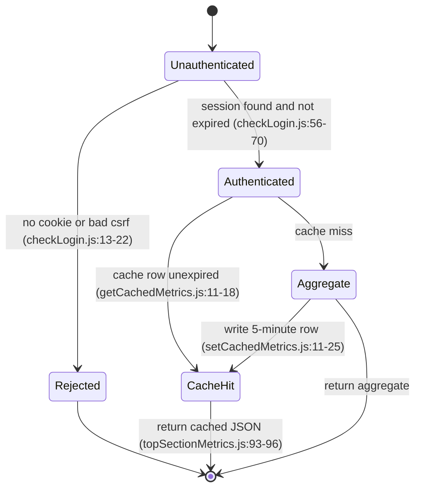
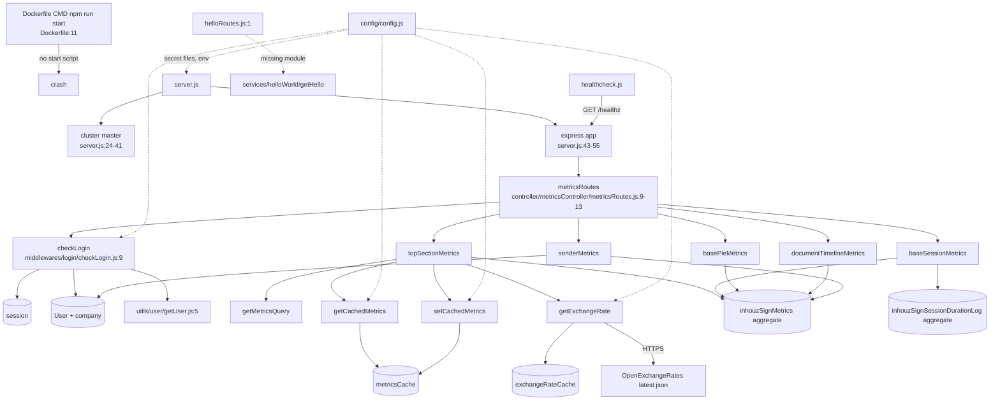

# inhouz_sign_metrics_ms

## 1. Summary

Read-only metrics API for Inhouz Sign. It serves five POST endpoints that aggregate the
`inhouzSignMetrics` and `inhouzSignSessionDurationLog` collections per company and return totals for
documents, payments, sessions, senders and timeline series, with amounts converted from the stored
currency into the currency the caller asks for. It lives in its own repository,
`apps/inhouz_sign_metrics_ms` (repo id `inhouz_sign_metrics_ms` from `.kilo/repos.json`), and is
deployed as the ClusterIP service `inhouz-sign-metrics-ms-cluster-ip-service` on port 5070.

## 2. Stack and commands

- Runtime: Node.js on `node:16.4-alpine` (`Dockerfile:1`).
- `package.json` name is still the template name `micro_service_template` (`package.json:2`).
- Scripts: only `test`, which is the npm placeholder `echo "Error: no test specified" && exit 1`
  (`package.json:6-8`). **There is no `start` script.** The Dockerfile's last line is
  `CMD ["npm", "run", "start"]` (`Dockerfile:11`), so the image cannot start as built.
- Direct start command in this repo would have to be `node server.js`; nothing in the repo declares
  it. Port comes from `process.env.PORT` (`server.js:85`); the deployment sets `PORT` to `5070`
  (`kus/base/inhouz-sign-metrics-ms-deployment.yml:45`, same in `k8s/`, `kus/dev/`, `kus/prod/`).
- Image `inhouz/inhouz_sign_metrics_ms`, `replicas: 1`
  (`kus/base/inhouz-sign-metrics-ms-deployment.yml:6,27`). ClusterIP service port 5070 →
  targetPort 5070 (`k8s/inhouz-sign-metrics-ms-cluster-ip-service.yml:10-11`).
- Verification command: none usable. `npm test` exits 1 by design (`package.json:7`).

## 3. Entry points

| Entry point | Location | How it starts |
|---|---|---|
| HTTP server | `server.js:85` | `app.listen(process.env.PORT, …)` inside the cluster worker branch |
| Cluster master | `server.js:24-28` | forks `os.cpus().length` workers in production, 1 otherwise (`server.js:25-28`) |
| Worker respawn | `server.js:30-41` | `cluster.on("exit")` forks a replacement worker |
| Route registration | `server.js:56` | `require("./controller/metricsController/metricsRoutes")(app)` |
| Mongo connect | `server.js:90-102` | called at `server.js:58` and again from the disconnect handler at `server.js:67` |
| Mongo event handlers | `server.js:61-74` | `connected`, `disconnected`, `error` |
| Shutdown hooks | `server.js:75-83` | `SIGINT` / `SIGTERM` / `uncaughtException` → close mongoose connection |
| Healthcheck probe | `healthcheck.js:7` | separate `node healthcheck.js` process; GET `/healthz` on `PORT` |
| Model registration | `server.js:13-22` | ten `require("./model/…")` calls before the cluster branch |
| Dead route module | `controller/helloWorld/helloRoutes.js:3-4` | never mounted; requires a module that does not exist |
| Timer | `server.js:67` | one `setTimeout(…, 5000)` reconnect retry |

`/healthz` is never registered by any mounted router (`controller/metricsController/metricsRoutes.js:9-13`
is the only mount, `server.js:56`), so the probe in `healthcheck.js:7` receives Express's 404 and
`healthcheck.js:12` sets exit code 1.

## 4. Module inventory

| Module / function | Location | Owns | Public API | Kind |
|---|---|---|---|---|
| bootstrap | `server.js:1-102` | env load, cluster fork, express wiring, mongo lifecycle, signals | side effect on require | effectful |
| `connectMongo()` | `server.js:90-102` | `mongoose.connect` with `maxPoolSize: 1` | none | effectful |
| `shutdownFunction()` | `server.js:79-83` | close mongoose | none | effectful |
| config factory | `config/config.js:18-52` | builds and memoises the config object | `() => config` | effectful — reads env/secret files and caches in the module-level `cachedConfig` (`config/config.js:17,19`) |
| `readSecret(name, envFallback)` | `config/config.js:5-15` | reads `/mnt/secrets/<name>`, falls back to an env var | `(string, string) => string` | effectful (filesystem, env) |
| `checkLogin` | `middlewares/login/checkLogin.js:9` | session cookie → session lookup → user+company load → sliding expiry → cookies | express middleware | effectful (db, clock, cookies) |
| `moduleAccessCheck` | `middlewares/module/moduleAccessCheck.js:7` | module permission check on `moduleId`/`moduleName` | express middleware | effectful (db) — **never mounted** |
| `singleSubdomainValidation` | `middlewares/subdomain/singleSubdomainValidation.js:1` | compares `req.subdomains[0]` with `req.user['subDomain']` | express middleware | reactive (reads request state) — **never mounted** |
| metrics router | `controller/metricsController/metricsRoutes.js:8-14` | registers the five POST routes behind `checkLogin` | `(app) => void` | effectful (registers handlers) |
| hello router | `controller/helloWorld/helloRoutes.js:3-5` | intended `GET /api/helloworld` | `(app) => void` | effectful — dead, requires a missing module |
| `topSectionMetrics` | `services/metrics/topSectionMetrics.js:12-298` | totals of documents and payment amounts, currency-converted | `(req,res)` handler | effectful (db aggregate, external HTTP via exchange rate, db cache write) |
| `documentTimelineMetrics` | `services/metrics/documentTimelineMetrics.js:12-…` | per-bucket timeline series | `(req,res)` handler | effectful (db aggregate, exchange rates) |
| `baseSessionMetrics` | `services/metrics/baseSessionMetrics.js:11-…` | session count and session duration totals | `(req,res)` handler | effectful (db aggregate over two collections) |
| `basePieMetrics` | `services/metrics/basePieMetrics.js:13-…` | country/device breakdown over the tracker objects | `(req,res)` handler | effectful (db aggregate) |
| `senderMetrics` | `services/metrics/senderMetrics.js:12-…` | per-sender totals joined with the user collection | `(req,res)` handler | effectful (db aggregate) |
| `getMetricsQuery` | `utils/metrics/getMetricsQuery.js:3-77` | builds the Mongo match object from the payload and `companyId` | `(payload, companyId, skipDate) => query \| {error:true}` | effectful — pure logic, but reads the clock via `moment()` (`:35,41,43,47,49,53,55,59,61`) |
| `getCachedMetrics` | `utils/metricsCache/getCachedMetrics.js:4-29` | reads a non-expired cache row | `({key, companyId}) => row \| false` | effectful (db, clock) |
| `setCachedMetrics` | `utils/metricsCache/setCachedMetrics.js:5-32` | upserts a cache row with a 5-minute expiry | `({key, companyId, data}) => void` | effectful (db, clock) |
| `getExchangeRate` | `utils/exchangeRate/getExchangeRate.js:5-…` | reads/writes `exchangeRateCache`, calls OpenExchangeRates on a stale row | `(currency) => rates \| {error}` | effectful (db, network, clock) |
| `getUser` | `utils/user/getUser.js:5-…` | loads user, roles, permissions | `(userId) => user \| {error}` | effectful (db) |
| `encryptDecrypt` | `utils/cryptography/encryptDecrypt.js:3` | Crypter for the encrypted request payload and the client cookie | `(data, encrypt=false) => string` | effectful — key material comes from the config/env (`config/config.js:38`) |
| `recursiveSanitizer` | `utils/sanitizer/recursiveSanitizer.js:19` | recursive string sanitisation of request bodies | named export(s) | pure |
| `cleanEncryptedCookie` | `utils/cookie/cleanEncryptedCookie.js:1` | strips/normalises an encrypted cookie value | `(cookieText) => string` | pure |
| `monthIndexMap` | `utils/date/monthIndexMap.js:1` | month index lookup table | constant object | pure |
| `ISOCountryList` | `utils/country/ISOCountryList.js:1` | ISO country list | constant array | pure |
| `createEditByObject` | `utils/user/createEditByObject.js:1` | builds a create/edit attribution object | `(user, deployDate) => object` | pure (signature only; not read in full, §14) |
| model registrations | `model/**/*.js` | mongoose schemas and collection binding (see §7) | model per file | effectful (reads config env at require time) |

## 5. Side effects

| Effect | Location |
|---|---|
| MongoDB connect (`config.mongoUrl`, pool size 1) | `server.js:91-101` |
| Mongo reconnect on disconnect (5 s) | `server.js:67-69` |
| Mongo aggregate on `inhouzSignMetrics` | `services/metrics/topSectionMetrics.js:275`, `services/metrics/basePieMetrics.js:108`, `services/metrics/baseSessionMetrics.js:106`, `services/metrics/documentTimelineMetrics.js:117`, `services/metrics/senderMetrics.js:117` |
| Mongo aggregate on `inhouzSignSessionDurationLog` | `services/metrics/baseSessionMetrics.js:107` |
| Mongo find on `User` | `services/metrics/senderMetrics.js:116`, `utils/user/getUser.js:18` |
| Mongo find on `session` | `middlewares/login/checkLogin.js:25` |
| Session expiry update | `middlewares/login/checkLogin.js:83-92` |
| Mongo find on `company` | `middlewares/login/checkLogin.js:106` |
| Mongo find/upsert on `metricsCache` | `utils/metricsCache/getCachedMetrics.js:11`, `utils/metricsCache/setCachedMetrics.js:11` |
| Mongo find on `exchangeRateCache` | `utils/exchangeRate/getExchangeRate.js:17` |
| External HTTP: OpenExchangeRates `latest.json` | `utils/exchangeRate/getExchangeRate.js:37` |
| Filesystem read of secret files under `SECRETS_PATH` | `config/config.js:10` |
| Response cookies `x-java`, `sessionExpirationTimestamp` | `middlewares/login/checkLogin.js:128,136` |
| Clock reads (`new Date`, `moment()`) | `middlewares/login/checkLogin.js:23,82`; `utils/metrics/getMetricsQuery.js:35`; `utils/metricsCache/*.js:9,19`; `utils/exchangeRate/getExchangeRate.js:16` |
| Logging (`console.log`, `console.info`, `console.error`) | `server.js:31-39,62,65,73,86,100`; `healthcheck.js:11,17`; every service `catch` block, e.g. `services/metrics/topSectionMetrics.js:291`; `utils/metricsCache/setCachedMetrics.js:29`; `utils/metrics/getMetricsQuery.js:74` |
| Outbound HTTP to other internal services | none — no internal service URL is read or fetched in this repo |

## 6. State and state transitions

No application state machine. The service only maintains two expiring cache rows plus the session
expiry it slides forward.

| State holder | States | Transition | Trigger | Guard |
|---|---|---|---|---|
| `metricsCache` row (per `key` + `companyId`) | absent → fresh → expired | upsert with `expirationTimestamp = now + 5 min` | `setCachedMetrics` after a successful aggregate (`services/metrics/topSectionMetrics.js:278-284`, `utils/metricsCache/setCachedMetrics.js:11-25`) | row is only written when the aggregate result is non-empty (`topSectionMetrics.js:278`) |
| | fresh → expired (logical, no writer) | time passes | `getCachedMetrics` filters `expirationTimestamp > now` (`utils/metricsCache/getCachedMetrics.js:13-15`) | expired rows are never deleted, only ignored; the next upsert overwrites them |
| `exchangeRateCache` row (per `baseCurrency`) | absent/stale → filled | fetch from OpenExchangeRates, then persist | `getExchangeRate` (`utils/exchangeRate/getExchangeRate.js:29-37`) | cached row is reused while `now - timestamp <= 3600000` (`:30-32`) |
| `session` expiry | valid → expired | `expirationTimestamp` pushed to `now + 60 min` on every authenticated request | `checkLogin` (`middlewares/login/checkLogin.js:82-92`) | request is rejected when `datestamp > expirationTimestamp` (`:63-70`) |

Mermaid for the request/cache path:

## 7. Data

Collections are bound through env var names that hold the actual collection name. The names below
are the cluster's current values (env → collection) and the schema sites are in this repository.

| Collection | Env var | Schema | Key fields and rules |
|---|---|---|---|
| `inhouzSignMetrics` | `INHOUZ_SIGN_METRICS_MODEL` | `model/inhouzSign/inhouzSignMetrics.js:5-58` | required `companyId` (String), `timestamp` (Number), `datestamp` (Number), `environment` enum `production \| development \| test` (`:50-54`); numeric counters for documents, views, payments and amounts; object trackers `countryTracker`, `deviceTracker`, `deviceSignTracker`, `devicePayAmountTracker`, `devicePayCountTracker`, `countryPayAmountTracker`, `countryPayCountTracker` (`:43-49`); `timestamps: true`, `strict: true`; compound index over `companyId,timestamp,datestamp,environment,currency,projectId,senderUserId` (`:60-64`) |
| `inhouzSignSessionDurationLog` | `INHOUZ_SIGN_SESSION_DURATION_LOG_MODEL` | `model/inhouzSign/inhouzSignSessionDurationLog.js:5-39` | required `companyId`, `timestamp`, `datestamp`; `environment` enum as above; `sessionDurationMillisecond` Number default 0; index over the same seven keys (`:36-39`) |
| `metricsCache` | `METRICS_CACHE_MODEL` | `model/metrics/metricsCache.js:5-25` | required `key` (String), `expirationTimestamp` (Number), `companyId` (String); `data` free-form, stored as a JSON string (`utils/metricsCache/setCachedMetrics.js:18`); compound index `key+expirationTimestamp+companyId` (`:23-25`) |
| `exchangeRateCache` | `EXCHANGE_RATE_CACHE_MODEL` | `model/payment/exchangeRateCache.js:5-17` | required `timestamp` Number, `baseCurrency` String **unique**, `rates` object; `strict: true` |
| `company` | `COMPANY_MODEL` | `model/company/company.js:5-108` | tenant record; loaded per request and merged onto `req.user` (`middlewares/login/checkLogin.js:106-124`) |
| `User` | `USER_MODEL` | `model/user/user.js:6-138` | user record; `companyId` links the user to the tenant (`middlewares/login/checkLogin.js:106-107` uses `user.companyId`) |
| `session` | `SESSION_MODEL` | `model/session/session.js:5-28` | `_id` is the session id, `csrfToken`, `userId`, `expirationTimestamp` (`middlewares/login/checkLogin.js:25-28,57-60`) |
| `roles`, `permissions`, `userRoles` | `ROLE_MODEL`, `PERMISSION_MODEL`, `USER_ROLES_MODEL` | `model/rolesAndPermissions/roles.js:6-87`, `permissions.js:6-89`, `model/user/useRoles.js:6-51` | authorisation records read by `utils/user/getUser.js` |

Shared-collection coupling: this repository only reads `inhouzSignMetrics` and
`inhouzSignSessionDurationLog`; the writers are outside it (open question, §14). `company`, `User`,
`session`, `roles`, `permissions` and `userRoles` are the authentication collections shared with the
rest of the cluster, and `exchangeRateCache` is shared with the payment services. That sharing is by
configured collection name, not by any code in this repository.

Schema note: `metricsCache` passes `timestamp: true` (`model/metrics/metricsCache.js:20`) where
mongoose expects `timestamps`. The other schemas in this repo use `timestamps: true`
(`model/inhouzSign/inhouzSignMetrics.js:56`, `model/inhouzSign/inhouzSignSessionDurationLog.js:35`).

## 8. Public interfaces

All five routes are POST, JSON body, and behind `checkLogin`
(`controller/metricsController/metricsRoutes.js:9-13`). No route is versioned.

| Method and path | Handler |
|---|---|
| `POST /api/inhouzsignmetrics/gettopsection` | `services/metrics/topSectionMetrics.js:12` |
| `POST /api/inhouzsignmetrics/documenttimelinemetrics` | `services/metrics/documentTimelineMetrics.js:12` |
| `POST /api/inhouzsignmetrics/basesessionmetrics` | `services/metrics/baseSessionMetrics.js:11` |
| `POST /api/inhouzsignmetrics/basesessionpiemetrics` | `services/metrics/basePieMetrics.js:13` |
| `POST /api/inhouzsignmetrics/sendermetrics` | `services/metrics/senderMetrics.js:12` |

Dead: `GET /api/helloworld` (`controller/helloWorld/helloRoutes.js:4`) is never mounted and would
throw at require time (`:1`).

**Request envelope.** Body is `{ "encryptedPayload": "<cipher text>" }`
(`services/metrics/topSectionMetrics.js:14-27`). The cipher text decrypts to
`{ expirationTimestamp: <ms>, payload: { … } }`, and the payload must not be expired
(`:30-36`). The inner payload fields used across the handlers are `projectId`, `documentId`,
`senderUserId`, `environment`, `dateRangeType`, `startDate`, `endDate`, `currency`
(`:46-51`; `utils/metrics/getMetricsQuery.js:5-9`).

**Required inner payload.** `environment` and `dateRangeType` must be non-empty strings; for
`dateRangeType === 'custom'` both `startDate` and `endDate` must be numbers
(`services/metrics/topSectionMetrics.js:54-74`). `dateRangeType` values handled:
`day`, `week`, `month`, `halfYear`, `year`, `custom` (`utils/metrics/getMetricsQuery.js:34-69`);
an unknown value silently produces a company-scoped query with no date filter.

**Auth headers.** Session token from cookie `SMPL` or header `x-access-token`; CSRF from header
`x-csrfToken` (`middlewares/login/checkLogin.js:11-12`). Both are Crypter-encrypted and decrypted
with the session secret (`:20-22`).

**Response shape (gettopsection).** Flat object: the summed counters plus `currency`
(`services/metrics/topSectionMetrics.js:286-289`); when no rows match, `results[0]` is missing and
the response is `{ currency }` only (`:276-289`).

**Error shape.** `{ "error": { "message": "<text>" } }`, with 400 for a missing/invalid payload
(`services/metrics/topSectionMetrics.js:22-26,39-43,69-73`) and 500 for query, exchange-rate or
aggregate failures (`:100-114,292-296`). `checkLogin` answers 200 with
`{ error: { message: "Not Authorized" } }` (`middlewares/login/checkLogin.js:13-18,41-46`).

No queues, topics, cron jobs or CLI commands are exposed or consumed.

## 9. Configuration

Environment variables read in this repo (names only):

`SECRETS_PATH`, `SENDGRID_API_KEY`, `SMPL_EMAIL`, `SESSION_SECRET`, `MONGO_URL`, `USER_MODEL`,
`COMPANY_MODEL`, `ROLE_MODEL`, `PERMISSION_MODEL`, `USER_ROLES_MODEL`, `SESSION_MODEL`,
`SESSION_VALIDATOR_MODEL`, `AUTH_LOG_MODEL`, `CLIENT_SECRET_KEY`, `COOKIE_DOMAIN`,
`INHOUZ_SIGN_METRICS_MODEL`, `INHOUZ_SIGN_SESSION_DURATION_LOG_MODEL`, `METRICS_CACHE_MODEL`,
`OPEN_EXCHANGE_RATES_API_KEY`, `OPEN_EXCHANGE_RATES_BASE_URL`, `EXCHANGE_RATE_CACHE_MODEL`,
`PORT`, `NODE_ENV` (`config/config.js:5-50`, `server.js:25,85`, `healthcheck.js:6`,
`middlewares/login/checkLogin.js:131`).

Secret file names read under `SECRETS_PATH`: `sendgridapikey`, `sessionsecret`, `mongourl`,
`clientsecretkey`, `openexchangeratesapikey` (`config/config.js:21,23,24,34,38,44-47`). Config keys
exposed by the factory: `sendGridApiKey`, `smplEmail`, `sessionSecret`, `mongoUrl`, `userModel`,
`companyModel`, `roleModel`, `permissionModel`, `userRolesModel`, `sessionModel`,
`sessionValidatorModel`, `authLogModel`, `NodeRsaClientPrivateKey`, `adminPermission`,
`clientSecretKey`, `cookieDomain`, `inhouzSignMetricsModel`, `inhouzSignSessionDurationLogModel`,
`metricsCacheModel`, `openExchangeRatesApiKey`, `openExchangeRatesBaseUrl`,
`exchangeRateCacheModel` (`config/config.js:20-50`).

The deployment also injects the full cluster-wide model-name block from a ConfigMap/Secret; the
brief lists it, and this repo only reads the subset above.

## 10. Dependencies

Direct `package.json` dependencies (`package.json:11-33`):

| Package | Why it is here |
|---|---|
| `express` | HTTP server and routing (`server.js:2`) |
| `body-parser` | JSON body parsing, 20 MB limit (`server.js:4,52`) |
| `cookie-parser` | session cookie parsing with the session secret (`server.js:5,55`) |
| `cors` | cross-origin access from `inhouz.localhost` (`server.js:6,44-50`) |
| `hpp` | HTTP parameter pollution guard (`server.js:7,53`) |
| `helmet` | security headers (`server.js:8,54`) |
| `mongoose` | all MongoDB access (`server.js:3`) |
| `dotenv` | loads `.env` in development (`server.js:1`) |
| `cryptr` | encrypt/decrypt session token and CSRF token (`middlewares/login/checkLogin.js:3`) |
| `node-rsa` | RSA key object built from the client secret key (`config/config.js:1,33-36`) |
| `crypto-js` | symmetric crypto used by `utils/cryptography/encryptDecrypt.js` |
| `moment` | date-range maths and expiry timestamps (`utils/metrics/getMetricsQuery.js:1`) |
| `lodash` | `isEmpty` checks (`middlewares/login/checkLogin.js:5`, `services/metrics/topSectionMetrics.js:10`) |
| `sanitizer` | input sanitisation (`services/metrics/topSectionMetrics.js:3`, `middlewares/module/moduleAccessCheck.js:2`) |
| `node-fetch` | OpenExchangeRates call (`utils/exchangeRate/getExchangeRate.js:3`) |
| `validator` | schema string validation (`model/rolesAndPermissions/permissions.js:3`, `roles.js:3`) |
| `shortid` | id generation (no use found in the files read) |
| `request-ip` | client IP capture (no use found in the files read) |
| `bcryptjs` | password hashing in the user model (no use found in the files read) |
| `@sendgrid/mail` | mail sending; config holds a SendGrid key (`config/config.js:21`) but no sender is called in the files read |
| `connect-mongo`, `express-session` | session store packages; sessions are handled manually through the `session` collection, no use found |

## 11. Testing

No tests. `npm test` is the npm placeholder that prints an error and exits 1
(`package.json:6-8`). There is no test directory, no test framework and no CI test step in the
repository. Nothing in this service is covered by an automated check; the only runtime check is
`healthcheck.js`, which currently fails because `/healthz` is not routed (§3).

## 12. Known issues and risks

1. **The image cannot start.** `Dockerfile:11` runs `npm run start`, and `package.json:6-8` has no
   `start` script. Any redeploy of this image crash-loops.
2. **The healthcheck always fails.** `healthcheck.js:7` probes `/healthz`; no router registers it
   (`server.js:56` mounts only `metricsRoutes`, `controller/metricsController/metricsRoutes.js:9-13`).
3. **`dateRangeType: "year"` returns six months.** The `year` branch subtracts 6 months, a copy of
   the `halfYear` branch (`utils/metrics/getMetricsQuery.js:58-63` vs `:52-57`).
4. **`day` filters a different field than every other range.** `day` filters `timestamp`
   (`utils/metrics/getMetricsQuery.js:36-39`); `week`, `month`, `halfYear`, `year` filter
   `datestamp` (`:42,48,54,60`). A `day` query and a `week` query therefore match different
   documents.
5. **`custom` range types are not validated as a pair on every handler.** Only
   `topSectionMetrics` validates `startDate`/`endDate` (`services/metrics/topSectionMetrics.js:59-67`);
   the other four handlers pass the payload straight into `getMetricsQuery`, where `custom` accepts
   whatever was sent (`utils/metrics/getMetricsQuery.js:64-69`).
6. **`metricsCache` timestamps are never written.** The schema says `timestamp: true`
   (`model/metrics/metricsCache.js:20`) instead of `timestamps: true`, so no `createdAt`/`updatedAt`
   is maintained and cache rows cannot be aged or audited.
7. **The session-metrics cache is written and never read.** `baseSessionMetrics` calls
   `getCachedMetrics` and then ignores the result because the early return is commented out
   (`services/metrics/baseSessionMetrics.js:88-94`).
8. **Dead route that cannot be required.** `controller/helloWorld/helloRoutes.js:1` requires
   `services/helloWorld/getHello`, and `services/helloWorld` does not exist. The module is not
   mounted (`server.js:56`), so the failure is latent rather than fatal, but any future mount crashes
   at startup.
9. **Two middlewares are dead code.** `moduleAccessCheck` and `singleSubdomainValidation` exist
   (`middlewares/module/moduleAccessCheck.js:7`, `middlewares/subdomain/singleSubdomainValidation.js:1`)
   but are never registered (`server.js:44-55`).
10. **Tenant scoping depends on the payload, not on the session, for `projectId` and
    `senderUserId`.** `companyId` comes from `req.user['companyId']`
    (`services/metrics/topSectionMetrics.js:52`), but `projectId` and `senderUserId` are taken from
    the decrypted client payload (`:46-51`). A caller can pivot across projects inside its company,
    and across senders, by re-encrypting the payload.
11. **Encrypted payload expiry is the only freshness control.** A captured `encryptedPayload` is
    replayable until `expirationTimestamp` (`services/metrics/topSectionMetrics.js:30-36`); the
    endpoint is not idempotency-protected beyond `checkLogin`.
12. **CORS is pinned to `inhouz.localhost`.** `origin: /inhouz.localhost/` (`server.js:46`) rejects
    any other browser origin, including production domains that do not match the pattern.
13. **Worker count vs connection pool.** Production forks one worker per CPU (`server.js:25`) while
    each opens a pool of one (`server.js:98`), so the process count multiplies connections against
    Mongo.
14. **`uncaughtException` does not exit.** The handler closes mongoose but never calls
    `process.exit` (`server.js:78-83`), so a crashed worker can keep serving with a dead connection.
15. **An encrypted service-account blob is committed.** `service-account.json.enc` sits at the
    repository root next to `build_ga.sh` and `build_ga_prod.sh`. The value is encrypted, but the
    decryption key and the deploy scripts' handling of it were not audited (§14).
16. **Package name is the template name** `micro_service_template` (`package.json:2`), which makes
    the artifact indistinguishable from the template in any shared registry or SBOM.

## 13. Module map

## 14. Open questions

- **Who writes `inhouzSignMetrics` and `inhouzSignSessionDurationLog`?** Nothing in this repository
  writes them; every handler is a reader. The likely writer is `inhouz_sign_ms`, but that is not
  verified here.
- **Is the shared crypto key intentional?** `utils/cryptography/encryptDecrypt.js:3` decrypts the
  request payload with material derived from config; if the client-side key is the same across
  tenants, issue 10 in §12 is exploitable and not just a design smell. Not determined.
- **Is `moduleAccessCheck` meant to be mounted?** Its only potential caller would be the metrics
  router (`controller/metricsController/metricsRoutes.js:9-13`), which does not use it.
- **Does the `day`/`datestamp` split match the writer's documents?** Without the writer's schema use
  it is unclear whether `timestamp` and `datestamp` are both always populated. Both are `required`
  in the schema (`model/inhouzSign/inhouzSignMetrics.js:10-17`), so the split is a query inconsistency
  at minimum.
- **What is the intended base currency of `exchangeRateCache`?** `getExchangeRate` looks up by
  `baseCurrency === currency` (`utils/exchangeRate/getExchangeRate.js:18-20`) and then requests
  `?base=${currency}` (`:37`), so the cache stores per-request-base tables. Whether that is intended
  or a misread of the OpenExchangeRates API (which is USD-based on the free tier) is not determined.
- **What does `build_ga.sh` / `build_ga_prod.sh` do with `service-account.json.enc`?** Skipped: not
  read. It may decrypt a GCP service account in CI.
- **Skipped files.** Not read in full: `model/user/user.js`, `model/company/company.js`,
  `model/session/session.js`, `model/rolesAndPermissions/*.js`, `model/user/useRoles.js`,
  `utils/user/getUser.js`, `utils/user/createEditByObject.js`, `utils/cryptography/encryptDecrypt.js`,
  `utils/sanitizer/recursiveSanitizer.js`, `utils/cookie/cleanEncryptedCookie.js`,
  `middlewares/module/moduleAccessCheck.js` (first 15 lines only), and the bodies of
  `documentTimelineMetrics`, `basePieMetrics`, `senderMetrics` beyond the aggregate start line and
  the `module.exports` line. Step budget was spent on the entry points, config, routing, auth
  middleware and the two primary collections.
