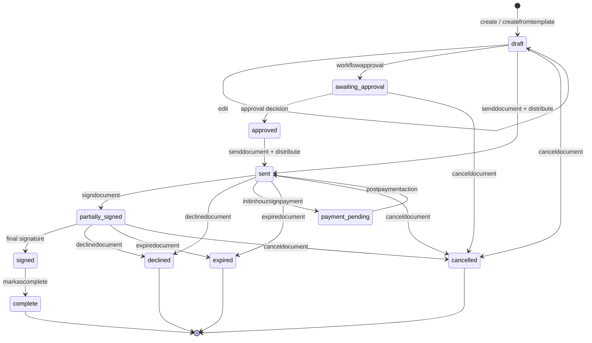

# inhouz_sign_ms

## 1. Summary

`inhouz_sign_ms` is the Inhouz Sign e-signature service. It owns documents (draft → sent →
partially signed → signed/complete, plus decline, cancel, expire and payment-pending branches),
reusable templates, the signing session and its access cookie, signer URLs, reminders, audit logs,
attachments, an approval workflow, and document generation and distribution orchestration. It is
the largest service in this cluster: 45 routes across three route files, 45 models, and outbound
calls to the app builder, view builder, document-generation parser, payment-link service and
Inhouz Pay. It uses the platform session (`SMPL` cookie + `x-csrfToken`) for tenant users, several
alternative header-based logins for server-to-server calls, and a portal cookie for external
third-party signers. It lives in its own git repository at `apps/inhouz_sign_ms/` (repo id
`inhouz_sign_ms`); every path here is relative to that repository root. The npm package still
carries the template identity `micro_service_template`.

## 2. Stack and commands

Node.js. `package.json:2` still reads `micro_service_template` / "The base of all simple erp
microservices". One script beyond the placeholder:

- `start` → `node --max-old-space-size=8192 server.js` (`package.json:8`)
- `test` → `echo "Error: no test specified" && exit 1` (`package.json:7`)

The heap is raised to 8 GB because document payloads are large: the JSON body limit is 300 MB
(`server.js:87`). The image is `node:16.4-alpine` and runs `npm run start` (`Dockerfile:1,11`),
which resolves here (unlike `inhouz_security_ms`).

Port: `server.js:124` listens on `process.env.PORT`. The k8s Service
`inhouz-sign-ms-cluster-ip-service` is ClusterIP on `5065` → targetPort `5065`
(`k8s/inhouz-sign-ms-cluster-ip-service.yml:10-11`); the Deployment runs
`inhouz/inhouz_sign_ms` with `replicas: 1` (`k8s/inhouz-sign-ms-deployment.yml:6,17`).

No test suite exists; `npm test` always fails by design.

## 3. Entry points

| Entry point | Where | How it is started |
|---|---|---|
| HTTP bootstrap | `server.js:77-126` | `node --max-old-space-size=8192 server.js` (`package.json:8`) via `npm run start` (`Dockerfile:11`) |
| Cluster fork loop | `server.js:59-76` | Master; `os.cpus().length` workers in production, `1` otherwise (`:60`) |
| Express assembly | `server.js:78-93` | Per worker |
| Route registration | `server.js:91-93` | Three controllers: `templateRoutes`, `contractRoutes`, `approvalRoutes` |
| `app.listen` | `server.js:124` | End of the worker branch |
| Mongo connect / retry | `server.js:129-141`, called `:95`, retried `:104-107` | Module load; 5 s after a disconnect |
| Shutdown | `server.js:112-122` | `SIGINT`, `SIGTERM`, `uncaughtException`, `unhandledRejection` → close Mongo; logs the error object (`:118`) |
| Model registration | `server.js:13-57` | 45 model modules required at load |
| Health probe | `healthcheck.js:1-21` | Standalone, unreferenced; probes `/healthz` (`:7`), unregistered |
| Cron / worker | none | Reminders and expiry are triggered per request, not by a scheduler in this repo |

The 45 routes are listed with their middleware in §8.

## 4. Module inventory

| Module | `file:line` | Owns | Public API | Kind |
|---|---|---|---|---|
| server bootstrap | `server.js:1-141` | Cluster, stack, Mongo, shutdown | process entry | effectful |
| config loader | `config/config.js:1-…` | ~71 env keys, RSA pair, storage bucket names, service URLs, permission names `:41-42,111-115` | `module.exports() -> object` | effectful |
| template routes | `controller/inhouzSign/templateRoutes.js:13-19` | 7 template routes | `module.exports(app)` | reactive |
| contract routes | `controller/inhouzSign/contractRoutes.js:46-78` | 33 document routes | `module.exports(app)` | reactive |
| approval routes | `controller/inhouzSign/approvalRoutes.js:9-13` | 5 workflow routes | `module.exports(app)` | reactive |
| `checkLogin` | `middlewares/login/checkLogin.js:9-…` | `SMPL` cookie or `x-access-token` + `x-csrfToken`, session lookup, sliding expiry, `req.user` | `(req,res,next)` | effectful |
| `checkServerLogin` | `middlewares/login/checkServerLogin.js:7-…` | `serverEncryptedHeader` decryption; on success sets `req.isServerAuthorized` (`:106`) | `(req,res,next)` | effectful |
| `clientEncryptedLogin` | `middlewares/login/clientEncryptedLogin.js:6-…` | `clientEncryptedAccessHeader`; **passes through when the header is absent** (`:16`), else sets `isServerAuthorized` (`:64,82`) | `(req,res,next)` | effectful |
| `serverEncryptedLogin` | `middlewares/login/serverEncryptedLogin.js:7-…` | `serverEncryptedAccessHeader`; same pass-through (`:17`) and `isServerAuthorized` (`:66,84`) | `(req,res,next)` | effectful |
| `checkPortalLogin` | `middlewares/login/checkPortalLogin.js:6-…` | Decrypts the portal user cookie, requires an external signer context; sets `isServerAuthorized` (`:59`) | `(req,res,next)` | effectful |
| `lightLoginCheck` | `middlewares/login/lightLoginCheck.js:20,81` | Lighter session/company check; **not mounted on any route read** | `(req,res,next)` | effectful |
| `apiKeyValidation` | `middlewares/apiKey/apiKeyValidation.js:8-…` | `X-SE-API-KEY` / `X-CE-API-KEY`; **passes through when absent** (`:15`) | `(req,res,next)` | effectful |
| `hasGenericReadAccess` | `middlewares/permission/hasGenericReadAccess.js:3-26` | requires one of `readInhouzSign`, `inhouzSignAdmin`, `inhouzSignDeveloper` | `(req,res,next)` | pure decision |
| `hasGenericWriteAccess` | `middlewares/permission/hasGenericWriteAccess.js:3-26` | requires one of `writeInhouzSign`, `inhouzSignAdmin`, `inhouzSignDeveloper` | `(req,res,next)` | pure decision |
| `countryWhitelist` / `countryBlocklist` | `middlewares/restrictionPolicy/countryWhitelist.js:1-…`, `countryBlocklist.js` | `CF-IPCountry` gate for anonymous document access | `(req,res,next)` | effectful (Mongo policy) |
| `ipWhitelist` / `ipBlockPolicy` | `middlewares/restrictionPolicy/ipWhitelist.js`, `ipBlockPolicy.js:1-…` | client-IP gate for anonymous document access | `(req,res,next)` | effectful |
| `moduleAccessCheck` | `middlewares/module/moduleAccessCheck.js:29` | flex-module access; not mounted on a route read | `(req,res,next)` | effectful |
| `singleSubdomainValidation` | `middlewares/subdomain/singleSubdomainValidation.js` | tenant subdomain check; not mounted on a route read | `(req,res,next)` | pure decision |
| document services | `services/inhouzSignDocument/*.js` (33 files) | create/edit/delete/get, send/distribute, sign/decline/cancel/complete/expire, reminders, audit logs, files, attachments, generation, payment, questionnaire, password | `(req,res)` | effectful |
| template services | `services/inhouzSignTemplate/*.js` (7 files) | template CRUD, clone, field availability | `(req,res)` | effectful |
| approval services | `services/approvalWorkflow/*.js` (5 files) | global workflow, approval requests, breakdown | `(req,res)` | effectful |
| storage adapters | `utils/inhouzCloudStorage/{aws,googleCloud,microsoftAzure}/*.js` | upload/download/copy/delete/signed URL per provider | function | effectful (network, credentials) |
| `getFileStorageCredentials` | `utils/inhouzCloudStorage/getFileStorageCredentials.js` | Resolves per-company storage credentials | function | effectful |
| `triggerDocumentGeneration` | `utils/inhouzSign/sign/triggerDocumentGeneration.js:78,86` | Calls the document-generation parser | function | effectful |
| `triggerInhouzSignWebhook` | `utils/inhouzSign/sign/triggerInhouzSignWebhook.js:53` | Fires the configured webhook with `node-fetch` | function | effectful |
| `triggerExpireDocument` | `utils/inhouzSignDocument/triggerExpireDocument.js:16` | Calls this service's own expire endpoint | function | effectful |
| `triggerDistributeDocument` / `triggerSendDocument` | `utils/inhouzSignDocument/triggerDistributeDocument.js:105`, `triggerSendDocument.js:84` | Internal re-entry into send/distribute | function | effectful |
| app-builder client | `utils/appBuilder/{build,clone,delete,getInhouzAppBuild}.js` | Creates/deletes/clones app builds | function | effectful |
| `getExchangeRate` | `utils/exchangeRate/getExchangeRate.js:37` | OpenExchangeRates lookup with fallback to cache | function | effectful |
| `initializeDocumentPayment` | `utils/payment/initializeDocumentPayment.js:151,301` | Payment-link / Inhouz Pay initialisation | function | effectful |
| `enrichProductList` | `utils/inhouzCommerce/enrichProductList.js:32` | Commerce product enrichment | function | effectful |
| `recursiveSanitizer` | `utils/sanitizer/recursiveSanitizer.js` | Body sanitization | pure |

## 5. Side effects

**MongoDB** — the service writes every Inhouz Sign collection: documents
(`model/inhouzSign/inhouzSignDoc.js:789`), templates (`:624` of the template model), files,
reminders, metrics, session and session-duration logs, approval queue, global workflow, audit log,
cached contract app, contract app build, the two base64 file stores, plus the shared `company`,
`User`, `session`, `roles`, `permissions`, `userRoles`, `inhouzSubscriptions`, `systemUsers`,
`paymentLink`, `deployedPaymentLink`, `payoutAccount`, `inhouzPayment`, `paymentPageDesign`,
`exchangeRateCache`, `queryKeyTracker`, `sequenceTracker`, `staticBase64Files`, `contact`, and
`documentIdentityVerification` collections. Connect at `server.js:130-140`, retry `:104`.

**Object storage — three providers, chosen per company**
- Google Cloud Storage: `utils/inhouzCloudStorage/googleCloud/*.js:1,10,14`; credentials built
  from `GCS_CLIENT_EMAIL`, `GCS_PRIVATE_KEY`, `GCS_PROJECT_ID`, etc. (see §9).
- AWS S3: `utils/inhouzCloudStorage/aws/awsS3*.js:1`.
- Azure Blob: `utils/inhouzCloudStorage/microsoftAzure/azure*.js:1,11-26` using a company SAS URL.
- Buckets: `INHOUZ_SIGN_DRAFT_BUCKET_NAME`, `INHOUZ_SIGN_ATTACHMENT_BUCKET_NAME`,
  `INHOUZ_SIGN_COMPLETED_DOCUMENT_BUCKET_NAME` (`config/config.js:137-141`).

**Outbound internal HTTP**
- `APP_BUILDER_MS_URL` → `app-builder-ms-cluster-ip-service:5016`
  (`config/config.js:66`, `k8s/inhouz-sign-ms-deployment.yml:305`); `utils/appBuilder/*.js`.
- `VIEW_BUILDER_MS_URL` → `view-builder-ms-cluster-ip-service:5017`
  (`config/config.js:70`, deployment `:307`); template deletion
  (`services/inhouzSignTemplate/deleteTemplate.js:67`).
- `DOCUMENT_GENERATION_PARSER_MS_URL` → `document-generation-parser-ms-cluster-ip-service:5069`
  (`config/config.js:106`, deployment `:327`); `utils/inhouzSign/sign/triggerDocumentGeneration.js:78,86`.
- `INHOUZ_SIGN_MS_URL` → its own Service `inhouz-sign-ms-cluster-ip-service:5065`
  (`config/config.js:72`, deployment `:317`); self-calls for expire/send/distribute
  (`utils/inhouzSignDocument/triggerExpireDocument.js:16`, `triggerSendDocument.js:84`,
  `triggerDistributeDocument.js:105`).
- `PAYMENT_LINK_MS_URL` → `payment-link-ms-cluster-ip-service:5059`
  (`config/config.js:155`, deployment `:349`); `utils/payment/initializeDocumentPayment.js`.
- `INHOUZ_COMMERCE_MS_URL` → `inhouz-commerce-ms` (`config/config.js:142`);
  `utils/inhouzCommerce/enrichProductList.js:32`.

**External APIs**
- OpenExchangeRates: `${OPEN_EXCHANGE_RATES_BASE_URL}/latest.json`
  (`utils/exchangeRate/getExchangeRate.js:37`).
- SendGrid: emails for send/reminder/access code (`utils/sendEmail/sendEmail.js`).
- Customer webhooks: arbitrary URL supplied on the document (`signDocument.js:495,598` →
  `utils/inhouzSign/sign/triggerInhouzSignWebhook.js:53`).

**Crypto**
- `cryptr` with `SESSION_SECRET` for the session cookie and the encrypted access headers
  (`middlewares/login/checkLogin.js:24-25`, `checkServerLogin.js:18`,
  `clientEncryptedLogin.js:20`, `serverEncryptedLogin.js:22`).
- `encryptDecrypt` for anonymous payloads and the portal cookie.
- `node-rsa` client pair at config time (`config/config.js:1`).

**Clock**: `new Date().getTime()` throughout the document services; `moment` / `moment-timezone`
in `distributeDocuments.js:8`.

**Randomness**: `shortid` for access codes and ids (`services/inhouzSignDocument/requestUserPassword.js:9`).

**Filesystem / env**: secret files under `SECRETS_PATH` (`config/config.js:6`).

**Logging**: `console.log` on boot, cluster, Mongo and shutdown (`server.js:66,74,99,102,110,118,125`)
and in service catch blocks.

## 6. State and state transitions

The document status enum is the core state machine
(`model/inhouzSign/inhouzSignDoc.js:52-65`):

`draft`, `sent`, `partially signed`, `signed`, `complete`, `partially agreed`, `agreed`,
`cancelled`, `awaiting approval`, `document scheduled`, `approved`, `expired`, `payment pending`,
`declined`.

| From | To | Trigger | Guard |
|---|---|---|---|
| — | `draft` | `POST /document/create` or `/createfromtemplate` | logged-in user with tenant access (`contractRoutes.js:46-48`) |
| `draft` | `draft` | `POST /document/edit` | `isLoggedIn` (`:49`) |
| `draft` | `awaiting approval` | `POST /document/workflowapproval` | approval workflow configured (`:61`) |
| `awaiting approval` | `approved` | approval decision via `documentApprovalHandler` | approver role (`:61`) |
| `draft`/`approved` | `sent` | `POST /document/senddocument` then `/distribute` | API key / server login / logged-in (`:59-60`) |
| `sent` | `partially signed` | `POST /document/signdocument` by one of several signers | signature valid, not expired (`:66`) |
| `sent`/`partially signed` | `signed` | last signer signs | all signers done (`:66`) |
| `signed` | `complete` | `POST /document/markascomplete` | document fully executed (`:69`) |
| `sent`/`partially signed` | `declined` | `POST /document/declinedocument` | signer declines (`:67`) |
| any pre-complete | `cancelled` | `POST /document/canceldocument` | logged-in owner with `cancelInhouzSign` (`:68`) |
| `sent`/`partially signed` | `expired` | `POST /document/expiredocument` or scheduled trigger | expiry time or explicit call (`:62`) |
| `sent` | `payment pending` | `POST /document/initinhouzsignpayment` | payment required for the document (`:77`) |
| `payment pending` | `sent`/`partially signed` | `POST /document/postpaymentaction` | payment succeeds (`:78`) |
| any | deleted | `POST /document/delete` | API key + server login + logged-in (`:50`) |

A second, smaller machine governs signer access: a signer requests an access code
(`/document/requestpassword`, `contractRoutes.js:65`), receives it by email, then posts a signature
to `/document/signdocument` (`:66`) or declines (`:67`); the portal path
(`/document/getportaldocuments`, `/getportaldocumentfile`) uses a separate portal cookie
(`checkPortalLogin`). The enforcement rules (allowed countries, blocked IPs, access restrictions)
sit in `middlewares/restrictionPolicy/*` and the document's `restrictionPolicy` fields
(`model/inhouzSign/inhouzSignDoc.js`).

Approval workflow state lives in `inhouzSignGlobalApprovalWorkflow` and
`inhouzSignApprovalQueue` (`model/inhouzSign/inhouzSignGlobalApprovalWorkflow.js:6`,
`model/inhouzSign/inhouzSignApprovalQueue.js:6`).

## 7. Data

Every model registers `mongoose.model(config.xModel, schema, config.xModel)`, so the physical
collection name is the env value (`model/inhouzSign/inhouzSignDoc.js:789`).

Owned by this service (schemas in `model/inhouzSign/`):

| Model var | Collection (per brief) | Schema |
|---|---|---|
| `INHOUZ_SIGN_DOC_MODEL` | `inhouzSignDocs` | `model/inhouzSign/inhouzSignDoc.js:6-788`; `status` enum `:52-65`; `functionGenerated` default false `:66-69`; draft/completed file-storage ids `:767-769` |
| `INHOUZ_SIGN_TEMPLATE_MODEL` | `inhouzSignTemplates` | `model/inhouzSign/inhouzSignTemplate.js:6-623` |
| `INHOUZ_SIGN_FILE` | — | `model/inhouzSign/inhouzSignFiles.js:6-43` |
| `INHOUZ_SIGN_REMINDER_MODEL` | `inhouzSignReminders` | `model/inhouzSign/inhouzSignReminder.js:6-…` (ids, counters, timestamps; all required) |
| `INHOUZ_SIGN_METRICS_MODEL` | `inhouzSignMetrics` | `model/inhouzSign/inhouzSignMetrics.js:5-66` |
| `INHOUZ_SIGN_SESSION_MODEL` | — | `model/inhouzSign/inhouzSignSession.js:6-…` |
| `INHOUZ_SIGN_SESSION_DURATION_LOG_MODEL` | `inhouzSignSessionDurationLogs` | `model/inhouzSign/inhouzSignSessionDurationLog.js:5-…` |
| `INHOUZ_SIGN_APPROVAL_QUEUE_MODEL` | `inhouzSignApprovalQueue` | `model/inhouzSign/inhouzSignApprovalQueue.js:6-59` |
| `INHOUZ_SIGN_GLOBAL_APPROVAL_WORKFLOW_MODEL` | — | `model/inhouzSign/inhouzSignGlobalApprovalWorkflow.js:6` |
| `INHOUZ_SIGN_STATIC_FILE_MODEL` | `inhouzSignStaticFiles` | `model/inhouzSign/inhouzSignStaticFiles.js:5-20` |
| `INHOUZ_SIGN_ATTACHMENT_BASE64_FILE_MODEL` | `inhouzSignAttachmentBase64Files` | `model/inhouzSign/inhouzSignAttachmentBase64File.js:5-26` |
| `INHOUZ_SIGN_CONTRACT_BASE64_FILE_MODEL` | `inhouzSignContractBase64Files` | `model/inhouzSign/inhouzSignContractBase64File.js:5-27` |
| `CACHED_CONTRACT_APP_MODEL` | `cachedContractApps` | `model/inhouzSign/cachedContractApp.js:5-28` |
| `CONTRACT_APP_BUILD_MODEL` | `contractAppBuilds` | `model/inhouzSign/contractAppBuild.js:5-36` |
| `CONTRACT_AUDIT_LOG_MODEL` | `contractAuditLogs` | `model/inhouzSign/contractAuditLog.js:6-53` |
| `SEQUENCE_TRACKER_MODEL` | — | `model/sequence/sequenceTracker.js:5-15` |

Shared with other services (registered here, owned elsewhere): `company`, `User`, `session`,
`roles`, `permissions`, `userRoles`, `inhouzSubscriptions`, `systemUsers`, `subscribers`,
`subscriptions`, `subscriptionServices`, `paymentLink`, `deployedPaymentLink`, `payoutAccount`,
`inhouzPayment`, `paymentPageDesign`, `paymentCategory`, `paymentProduct`, `exchangeRateCache`,
`queryKeyTracker`, `staticBase64Files`, `contact`, `documentIdentityVerification`, `inhouzApps`,
`appElements`, `appPage`, `appBuild`, `flexApi`, `flexCollections`, `inhouzCloudStorageFiles`,
`fileStorageServices`.

**Shared collection risk.** `inhouzSignDocs` is read by `inhouz_security_ms`
(`utils/module/getBaseModuleElement.js:12-14`), `inhouz_sign_metrics_ms`, the document scheduler,
and `inhouz_pay_ms`; the `status` enum above is therefore a cross-service contract. Any new status
value must be added in every reader.

## 8. Public interfaces

Auth legend: `login` = `checkLogin` (platform session), `apiKey` = `X-SE-API-KEY`/`X-CE-API-KEY`
(optional), `clientEnc`/`serverEnc` = encrypted access headers (optional, grant
`isServerAuthorized`), `serverLogin` = `serverEncryptedHeader`, `portal` = portal cookie,
`read`/`write` = `hasGenericReadAccess`/`hasGenericWriteAccess`, `policy` = country/IP restriction
chain.

Templates (`controller/inhouzSign/templateRoutes.js`):

| Method | Path | Chain | Line |
|---|---|---|---|
| POST | `/api/inhouzsign/template/create` | login + write | `:13` |
| POST | `/api/inhouzsign/template/createfromclone` | login + write | `:14` |
| POST | `/api/inhouzsign/template/edit` | login + write | `:15` |
| DELETE | `/api/inhouzsign/template/delete/:templateId` | login + write | `:16` |
| GET | `/api/inhouzsign/template/gettemplate/:templateId` | login + read | `:17` |
| POST | `/api/inhouzsign/template/gettemplates` | login + read | `:18` |
| POST | `/api/inhouzsign/template/fieldavailabilitycheck` | login | `:19` |

Documents (`controller/inhouzSign/contractRoutes.js`):

| Method | Path | Chain | Line |
|---|---|---|---|
| POST | `/api/inhouzsign/document/create` | login | `:46` |
| POST | `/api/inhouzsign/document/createfromtemplate` | apiKey + clientEnc + serverEnc + login | `:47` |
| POST | `/api/inhouzsign/document/initcreatefromtemplate` | apiKey + clientEnc + serverEnc + login | `:48` |
| POST | `/api/inhouzsign/document/edit` | login | `:49` |
| POST | `/api/inhouzsign/document/delete` | apiKey + clientEnc + serverEnc + serverLogin + login | `:50` |
| POST | `/api/inhouzsign/document/getdocument` | apiKey + clientEnc + serverEnc + login | `:51` |
| POST | `/api/inhouzsign/document/generatesignerurl` | apiKey + clientEnc + serverEnc + login | `:52` |
| POST | `/api/inhouzsign/document/getdocumentfile` | apiKey + clientEnc + serverEnc + login | `:53` |
| POST | `/api/inhouzsign/document/getportaldocumentfile` | portal | `:54` |
| POST | `/api/inhouzsign/document/getencrypteddocument` | **none** → policy chain only (country whitelist, blocklist, IP whitelist, IP block) | `:55` |
| POST | `/api/inhouzsign/document/getcontractbuild` | **none** | `:56` |
| POST | `/api/inhouzsign/document/getdocuments` | apiKey + clientEnc + serverEnc + login | `:57` |
| POST | `/api/inhouzsign/document/getportaldocuments` | portal | `:58` |
| POST | `/api/inhouzsign/document/senddocument` | apiKey + clientEnc + serverEnc + serverLogin + login | `:59` |
| POST | `/api/inhouzsign/document/distribute` | apiKey + clientEnc + serverEnc + serverLogin + login | `:60` |
| POST | `/api/inhouzsign/document/workflowapproval` | login | `:61` |
| POST | `/api/inhouzsign/document/expiredocument` | **none** | `:62` |
| POST | `/api/inhouzsign/document/sendreminder` | **none** | `:63` |
| POST | `/api/inhouzsign/document/getauditlogs` | **none** | `:64` |
| POST | `/api/inhouzsign/document/requestpassword` | **none** | `:65` |
| POST | `/api/inhouzsign/document/signdocument` | **none** | `:66` |
| POST | `/api/inhouzsign/document/declinedocument` | **none** | `:67` |
| POST | `/api/inhouzsign/document/canceldocument` | apiKey + clientEnc + serverEnc + login | `:68` |
| POST | `/api/inhouzsign/document/markascomplete` | apiKey + clientEnc + serverEnc + login | `:69` |
| POST | `/api/inhouzsign/document/uploadgenerateddocument` | **none** | `:70` |
| POST | `/api/inhouzsign/document/getgeneratedinhouzsignfile` | login | `:71` |
| POST | `/api/inhouzsign/document/startdocumentgeneration` | **none** | `:72` |
| POST | `/api/inhouzsign/document/getidentityverificationlogs` | login | `:73` |
| POST | `/api/inhouzsign/document/attachment/getattachment` | login | `:74` |
| POST | `/api/inhouzsign/document/attachment/getattachments` | login | `:75` |
| POST | `/api/inhouzsign/document/testfilestorage` | **none** | `:76` |
| POST | `/api/inhouzsign/document/initinhouzsignpayment` | login | `:77` |
| POST | `/api/inhouzsign/document/postpaymentaction` | **none** | `:78` |

Approval (`controller/inhouzSign/approvalRoutes.js`):

| Method | Path | Chain | Line |
|---|---|---|---|
| POST | `/api/inhouzsign/approvalworkflow/update` | login | `:9` |
| GET | `/api/inhouzsign/approvalworkflow/getglobalworkflow` | login | `:10` |
| POST | `/api/inhouzsign/approvalworkflow/getapprovalrequests` | login | `:11` |
| POST | `/api/inhouzsign/approvalworkflow/getapprovalrequest` | login | `:12` |
| POST | `/api/inhouzsign/approvalworkflow/getapprovalbreakdown` | login | `:13` |

Shapes: requests are JSON bodies; the large-document paths accept a 300 MB body
(`server.js:87`). Document-scoped calls carry `{documentId, companyId, ...}`; responses are either
`{success:true}` or `{error:{message}}`. The anonymous signing paths
(`requestpassword`, `signdocument`, `declinedocument`, `getencrypteddocument`) authorise by the
signer access code plus the document's restriction policy, not by a session.

## 9. Configuration

Names only. Model and URL keys read in `config/config.js`:

`SECRETS_PATH` (`:6`), `INHOUZ_DOMAIN` (`:21`), `INHOUZ_API_DOMAIN` (`:22`), `INHOUZ_APP_DOMAIN`
(`:23`), `FLEX_FORM_FILE_MODEL` (`:24`), `FLEX_MODULE_MODEL` (`:25`), `FLEX_COLLECTION_MODEL`
(`:26`), `FORM_MODEL` (`:27`), `SMPL_EMAIL` (`:29`), `DATA_RULE_EXECUTION_RESULT_MODEL` (`:30`),
`USER_MODEL` (`:33`), `COMPANY_MODEL` (`:34`), `ROLE_MODEL` (`:35`), `PERMISSION_MODEL` (`:36`),
`USER_ROLES_MODEL` (`:37`), `SESSION_MODEL` (`:38`), `SESSION_VALIDATOR_MODEL` (`:39`),
`AUTH_LOG_MODEL` (`:40`), `COOKIE_DOMAIN` (`:52`), `INHOUZ_SUBSCRIPTIONS_MODEL` (`:53`),
`INHOUZ_SIGN_DOC_MODEL` (`:54`), `INHOUZ_SIGN_TEMPLATE_MODEL` (`:55`), `APP_PAGE_MODEL` (`:56`),
`INHOUZ_APP_MODEL` (`:57`), `APP_ELEMENT_MODEL` (`:58`), `PAYOUT_ACCOUNT_MODEL` (`:60`),
`SEQUENCE_TRACKER_MODEL` (`:61`), `STATIC_BASE64_FILE_MODEL` (`:62`), `INHOUZ_SIGN_FILE` (`:63`),
`PAYMENT_PRODUCT_MODEL` (`:64`), `PAYMENT_CATEGORY_MODEL` (`:65`), `APP_BUILDER_MS_URL` (`:66`),
`CACHED_CONTRACT_APP_MODEL` (`:67`), `CONTRACT_APP_BUILD_MODEL` (`:68`),
`CONTRACT_AUDIT_LOG_MODEL` (`:69`), `VIEW_BUILDER_MS_URL` (`:70`),
`INHOUZ_SIGN_APPROVAL_QUEUE_MODEL` (`:71`), `INHOUZ_SIGN_MS_URL` (`:72`),
`INHOUZ_SIGN_GLOBAL_APPROVAL_WORKFLOW_MODEL` (`:74`), `INHOUZ_SIGN_REMINDER_MODEL` (`:75`),
`QUERY_KEY_TRACKER_MODEL` (`:76`), `INHOUZ_SIGN_SESSION_MODEL` (`:77`),
`INHOUZ_SIGN_STATIC_FILE_MODEL` (`:100`), `INHOUZ_SIGN_ATTACHMENT_BASE64_FILE_MODEL` (`:102`),
`INHOUZ_SIGN_CONTRACT_BASE64_FILE_MODEL` (`:104`),
`DOCUMENT_GENERATION_PARSER_MS_URL` (`:106`), `INHOUZ_SIGN_METRICS_MODEL` (`:107`),
`INHOUZ_SIGN_SESSION_DURATION_LOG_MODEL` (`:109`), `CONTACT_MODEL` (`:110`),
`SYSTEM_USER_MODEL` (`:116`), `SUBSCRIBER_MODEL` (`:117`), `SUBSCRIPTION_SERVICE_MODEL` (`:118`),
`SUBSCRIPTION_MODEL` (`:119`), `DOCUMENT_IDENTITY_VERIFICATION_MODEL` (`:121`),
`INHOUZ_CLOUD_STORAGE_FILE_MODEL` (`:122`), `FILE_STORAGE_SERVICE_MODEL` (`:127`),
`INHOUZ_SIGN_DRAFT_BUCKET_NAME` (`:137`), `INHOUZ_SIGN_ATTACHMENT_BUCKET_NAME` (`:139`),
`INHOUZ_SIGN_COMPLETED_DOCUMENT_BUCKET_NAME` (`:141`), `INHOUZ_COMMERCE_MS_URL` (`:142`),
`BASE_SERVER_URL` (`:143`), `PAYMENT_LINK_MODEL` (`:144`), `DEPLOYED_PAYMENT_LINK_MODEL` (`:145`),
`OPEN_EXCHANGE_RATES_BASE_URL` (`:150`), `EXCHANGE_RATE_CACHE_MODEL` (`:151`),
`INHOUZ_PAYMENT_MODEL` (`:152`), `PAYMENT_PAGE_DESIGN_MODEL` (`:153`), `APP_BUILD_MODEL` (`:154`),
`PAYMENT_LINK_MS_URL` (`:155`), and the app-build model at `:154`.

Secrets, read from files under `SECRETS_PATH` or env: `SESSION_SECRET`, `MONGO_URL`,
`CLIENT_SECRET_KEY`, `CLIENT_PUBLIC_KEY`, `SENDGRID_API_KEY`, `OPEN_EXCHANGE_RATES_API_KEY`,
`S3_ACCESS_KEY_ID`, `S3_SECRET_KEY`, `S3_BUCKET_NAME`, plus GCS service-account keys
`GCS_CLIENT_EMAIL`, `GCS_CLIENT_ID`, `GCS_PRIVATE_KEY`, `GCS_PRIVATE_KEY_ID`, `GCS_PROJECT_ID`,
`GCS_CLIENT_X509_CERT_URL`, and the `INHOUZ_FROM_EMAIL` sender.

Permission **names** are hard-coded strings: `admin` (`:41`), `inhouzSignAdmin` (`:42,115`),
`inhouzSignDeveloper` (`:111`), `readInhouzSign` (`:112`), `writeInhouzSign` (`:113`),
`cancelInhouzSign` (`:114`). Also `PORT` (`server.js:124`) and `NODE_ENV` (`server.js:60`,
`checkLogin.js:135`).

## 10. Dependencies

| Package | Why |
|---|---|
| `express`, `mongoose`, `body-parser` | HTTP, models, 300 MB JSON bodies (`server.js:87`) |
| `@google-cloud/storage` | GCS adapter (`googleCloud/*.js:1`) |
| `@azure/storage-blob` | Azure adapter (`microsoftAzure/*.js:1`) |
| `aws-sdk` | S3 adapter (`aws/awsS3*.js:1`) |
| `js-base64` | Base64 document payloads (`distributeDocuments.js:15`, `generateInhouzSignUrl.js:10`) |
| `object-sizeof` | Payload size guard for uploads (`uploadGeneratedDocument.js:9`) |
| `shrink-string` | Compression of build/document payloads (`getContractBuild.js:7`, `sendDocument.js:18`) |
| `immutability-helper` | Immutable dot-notation updates (`utils/data/dotNotationObjectUpdate.js:1`) |
| `moment-timezone` | Scheduling timestamps (`distributeDocuments.js:8`) |
| `moment` | Expiry and reminder arithmetic |
| `cryptr` | Session and encrypted-header crypto |
| `node-rsa` | Client key pair |
| `@sendgrid/mail` | Signing, reminder and access-code email |
| `shortid` | Access codes and file identifiers |
| `node-fetch` | All outbound HTTP |
| `sanitizer` | Body sanitization |
| `validator` | Email and field validation |
| `lodash` | Collection and object helpers |
| `cookie-parser`, `cors`, `helmet`, `hpp` | Cookie parsing and browser hardening (`server.js:79-90`) |
| `bcryptjs`, `connect-mongo`, `crypto-js`, `express-session`, `request-ip` | Declared; no use found in the modules read |

## 11. Testing

No tests. `package.json:7` is the failing placeholder, there is no test directory, and the Travis
config deploys without a test stage. Nothing is covered: not the 14-state document machine, not
the signing path, not the storage adapters, not the payment integration.

## 12. Known issues and risks

1. **Ten routes have no authentication at all.** `getcontractbuild` (`contractRoutes.js:56`),
   `expiredocument` (`:62`), `sendreminder` (`:63`), `getauditlogs` (`:64`), `requestpassword`
   (`:65`), `signdocument` (`:66`), `declinedocument` (`:67`), `uploadgenerateddocument` (`:70`),
   `startdocumentgeneration` (`:72`), `testfilestorage` (`:76`) and `postpaymentaction` (`:78`) have
   no middleware chain. Several take a `documentId`/`companyId` from the body, so authorization
   depends entirely on checks inside the handlers.
2. **`getencrypteddocument` is guarded only by geo/IP policy.** `contractRoutes.js:55` runs country
   whitelist, blocklist, IP whitelist and block policy, but no credential check. The document id in
   the body is the only selector, so a policy hole is a document-disclosure hole.
3. **Encrypted-login headers are optional and grant a full bypass.** `clientEncryptedLogin`
   (`:16`) and `serverEncryptedLogin` (`:17`) call `next()` when the header is missing, and when it
   is present they set `req.isServerAuthorized = true` (`:64,82` / `:66,84`), which makes
   `checkLogin` return immediately (`checkLogin.js:11-12`). So a caller who can mint a valid
   encrypted header skips the session check entirely.
4. **`apiKeyValidation` is also optional.** `apiKeyValidation.js:13-15` passes through with no
   header. On routes that list it before `isLoggedIn` (`contractRoutes.js:47-53,57,59-60,68-69`)
   the API key adds nothing when absent.
5. **`testfilestorage` is an unauthenticated storage probe.** `contractRoutes.js:76` can be used to
   exercise the per-company storage credentials from outside.
6. **`triggerExpireDocument`, `triggerSendDocument` and `triggerDistributeDocument` re-enter the
   service over HTTP** (`utils/inhouzSignDocument/triggerExpireDocument.js:16`,
   `triggerSendDocument.js:84`, `triggerDistributeDocument.js:105`) through `INHOUZ_SIGN_MS_URL`
   (`config/config.js:72`). That doubles the failure surface of an already multi-step flow and
   makes loops possible if a retry re-triggers.
7. **Document webhooks are fire-and-forget to an attacker-supplied URL.**
   `signDocument.js:495,598` posts to `webhookUrl` from the document, via
   `triggerInhouzSignWebhook.js:53`. There is no allowlist.
8. **`uncaughtException` and `unhandledRejection` only close Mongo.** `server.js:115-122` logs and
   closes the connection but keeps the worker alive, so a worker can serve with a dead DB handle
   until the cluster restarts it.
9. **Body limit is 300 MB with no per-route cap.** `server.js:87` applies to every route, including
   the unauthenticated ones in issue 1 — a memory-exhaustion vector on an already 8 GB heap.
10. **`replicas: 1` with 8 GB heap and cluster mode.** In production the master forks one worker
    per CPU (`server.js:60`), each with `maxPoolSize: 1` (`:137`), so a single pod holds
    `cores × 8 GB` of potential heap.
11. **`lightLoginCheck` and `moduleAccessCheck` are dead.** Both are required in
    `middlewares/` (`lightLoginCheck.js:20,81`, `moduleAccessCheck.js:29`) but neither is mounted
    by any route file read.
12. **Status enum is duplicated across services.** The 14-value enum
    (`model/inhouzSign/inhouzSignDoc.js:52-65`) is also consumed by `inhouz_security_ms`,
    `inhouz_sign_metrics_ms` and the scheduler, with no shared constant.
13. **`healthcheck.js` probes `/healthz`** (`:7`) which no route registers (`server.js:91-93`).
14. **`package.json` still declares the template identity** (`:2-4`), so the image name and the
    service identity disagree with the repository.
15. **No lockfile** is committed; the build resolves dependencies fresh each time.

No credential was found in the source files read. Storage, SendGrid, Stripe-adjacent and Mongo
values come from `SECRETS_PATH` files or env (`config/config.js:6`).

## 13. Module map

```mermaid
graph TD
  User[Tenant user in the app] -->|SMPL + x-csrfToken| App[server.js Express app]
  Server[Server-to-server caller] -->|X-SE-API-KEY / serverEncryptedHeader / clientEncryptedAccessHeader| App
  Signer[External signer / portal user] -->|access code + portal cookie| App

  App --> TR[templateRoutes]
  App --> CR[contractRoutes]
  App --> AR[approvalRoutes]

  TR -->|login + read/write| TplSvc[services/inhouzSignTemplate/*]
  CR -->|login / apiKey / enc headers / portal| DocSvc[services/inhouzSignDocument/*]
  AR -->|login| ApprSvc[services/approvalWorkflow/*]

  DocSvc --> Doc[(inhouzSignDocs)]
  DocSvc --> Tpl[(inhouzSignTemplates)]
  DocSvc --> Files[(inhouzSignFiles / static + base64 stores)]
  DocSvc --> Rem[(inhouzSignReminders)]
  DocSvc --> Audit[(contractAuditLogs)]
  DocSvc --> Sess[(inhouzSignSession + duration logs)]
  DocSvc --> Metrics[(inhouzSignMetrics)]
  ApprSvc --> AQ[(inhouzSignApprovalQueue)]
  ApprSvc --> GW[(inhouzSignGlobalApprovalWorkflow)]

  DocSvc --> Storage[GCS / S3 / Azure adapters]
  DocSvc -->|triggerDocumentGeneration| DocGen[document-generation-parser-ms:5069]
  DocSvc -->|build/clone/delete| AppBuilder[app-builder-ms:5016]
  TplSvc -->|delete template app| ViewBuilder[view-builder-ms:5017]
  DocSvc -->|self HTTP| Self[inhouz-sign-ms:5065]
  DocSvc -->|payment init| PayLink[payment-link-ms:5059]
  DocSvc -->|product enrichment| Commerce[inhouz-commerce-ms]
  DocSvc -->|latest.json| OXR[OpenExchangeRates]
  DocSvc -->|webhook| Customer[Customer webhook URL]
  DocSvc --> Mail[SendGrid]

  DocSvc --> Shared[(company, User, session, roles, permissions, userRoles, subscriptions, payment, identity)]
```

## 14. Open questions

- **How the unauthenticated document routes authorise.** `getcontractbuild`, `expiredocument`,
  `sendreminder`, `getauditlogs`, `uploadgenerateddocument`, `startdocumentgeneration` and
  `testfilestorage` were grepped but their handlers were not read in full; the internal guard (if
  any) is in those files.
- **Where the reminder and expiry schedule runs.** `sendReminder` and `expireDocument` exist here,
  but no cron is registered (`server.js`), so the driver is external — likely
  `document_scheduler_ms`, which the brief lists as a caller.
- **What `INHOUZ_SIGN_METRICS_MODEL` is used for on write.** The metrics model is registered
  (`server.js:30`) but no writer was located in the modules read;
  `inhouz_sign_metrics_ms` is the likely owner.
- **How `getencrypteddocument`'s restriction policy is sourced.** It reads per-company policy
  documents through `middlewares/restrictionPolicy/*`, but the policy collection is not named in
  `config/config.js` and was not traced.
- **Whether `clientEncryptedAccessHeader` and `serverEncryptedAccessHeader` are still issued.**
  They bypass `checkLogin` when present; the issuer is another repository.
- **Skipped on purpose:** `service-account.json.enc` (encrypted Travis credential, not decrypted),
  `kus/`, `build_ga*.sh`, `deploy.sh`, the 45 schemas beyond the document/reminder/metric field
  lists, the 26 `utils/` subdirectories except the storage, request, payment, app-builder and
  document-trigger helpers, and the bodies of the 33 document services beyond the routes and the
  status transitions they drive.
