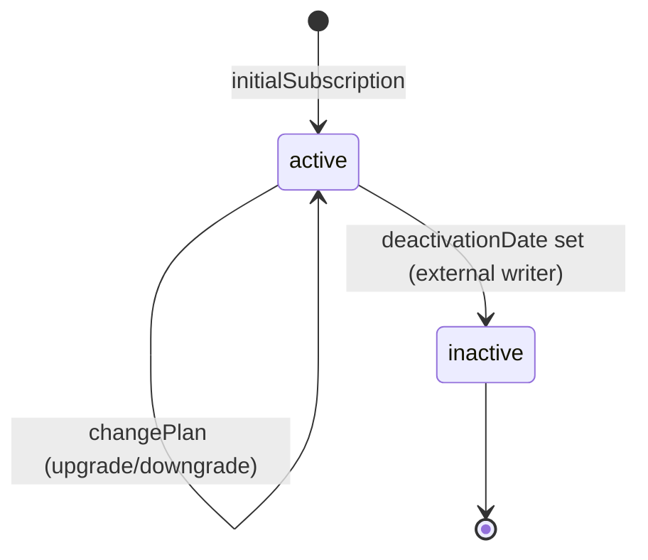
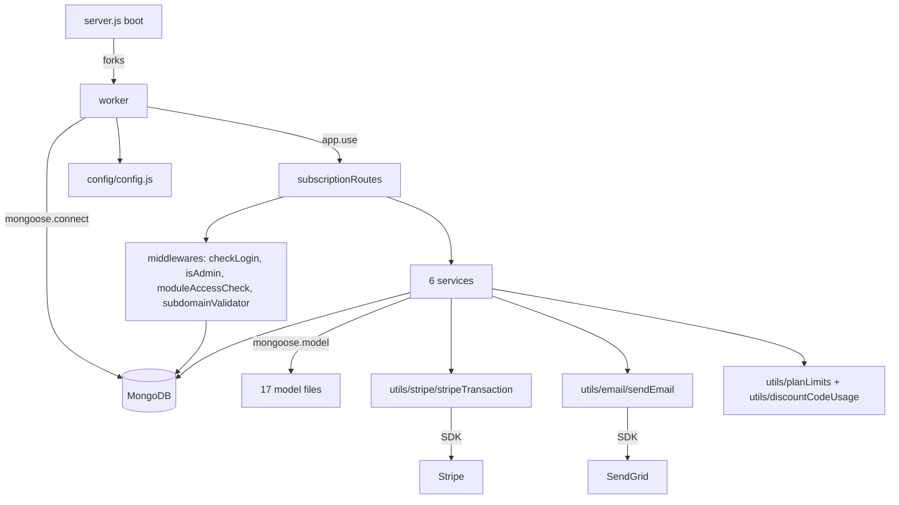

# inhouz_subscription_ms

## 1. Summary

`inhouz_subscription_ms` owns the Inhouz SaaS account-license domain: the subscription plans
(`inhouzSubscriptionServices`), the per-company subscription (`inhouzSubscriptions`), per-user
licences (`inhouzUserLicenses`), signup promo codes and their usage log, plan-change receipts and
billing-error records. It charges via Stripe directly (it does not call `payment_ms`), enforces
plan seat limits, and emails receipts and billing failures through SendGrid. It lives in its own
git repository at `apps/inhouz_subscription_ms/` (repo id `inhouz_subscription_ms`); this handover
lives in the control repository `inhouz_ai`.

## 2. Stack and commands

- Runtime: Node.js `">=12.0.0 <17.5.0"` (`package.json:7-9`), CommonJS, cluster-forked Express.
- Framework: Express 4 (`package.json:24`), Mongoose 7 (`package.json:29`), Stripe 8 (`package.json:35`).
- Scripts (`package.json:10-13`): `npm start` → `node server.js`; `npm test` → fails by design.
- Port: `PORT` (`server.js:94`), set to `5041` by the deployment
  (`k8s/inhouz-subscription-ms-deployment.yml:28`, `containerPort: 5041` at `:26`).
- Image: `inhouz/inhouz_subscription_ms` (`k8s/inhouz-subscription-ms-deployment.yml:17`),
  replicas `1` (`:6`). No HPA or VPA manifest in `k8s/`.
- Kubernetes service: `inhouz-subscription-ms-cluster-ip-service`, ClusterIP, port `5041`
  (`k8s/inhouz-subscription-ms-cluster-ip-service.yml:4,6,10`).
- Health probe: `healthcheck.js:7` requests `/healthz`. **No `/healthz` route is registered**
  (`server.js:63`) — see section 12.

## 3. Entry points

| Entry point | file:line | How it is started |
|---|---|---|
| Cluster master | `server.js:31-48` | `node server.js`; forks `os.cpus().length` in production, 1 otherwise (`server.js:32-35`) |
| Worker HTTP app | `server.js:49-97` | `app.listen(process.env.PORT)` (`server.js:94`) |
| Mongo connect | `server.js:99-111` | At boot (`server.js:64-66`) and after a disconnect (`server.js:71-78`) |
| Reconnect timer | `server.js:74-76` | 5 s `setTimeout` after a `disconnected` event |
| Route registrar | `controller/inhouzSubscription/subscriptionRoutes.js:10` | Mounted at `server.js:63` |
| Model registration | `server.js:13-29` | 16 `require()` calls |
| Health probe | `healthcheck.js:1-21` | Run as a process; probes `/healthz` |
| Shutdown | `server.js:83-92` | `SIGINT`, `SIGTERM`, `uncaughtException` → close Mongo |

No cron, no queue consumer, no websocket. The only timer is `server.js:74`.

## 4. Module inventory

| Name | file:line | Owns | Public API | Kind |
|---|---|---|---|---|
| `subscriptionRoutes` | `controller/inhouzSubscription/subscriptionRoutes.js:10` | 6 account-license endpoints | `(app) => void` | `effectful` |
| `config()` | `config/config.js:19-69` | Cached config; secrets from `SECRETS_PATH` with env fallback | `() => configObject` | `effectful` (filesystem, env, RSA parse at `:30-35`) |
| `readSecret()` | `config/config.js:6-16` | One secret file, env fallback | `(name, fallback) => string` | `effectful` |
| `connectMongo()` | `server.js:99-111` | `mongoose.connect`, `maxPoolSize: 1` | `() => void` | `effectful` |
| `initialSubscription` | `services/inhouzSubscription/initialSubscription.js:10` | Decrypts a signup payload, creates the company subscription + licence | `(req,res) => Promise<void>` | `effectful` (Mongo, clock, crypto) |
| `changePlan` | `services/inhouzSubscription/changePlan.js` (route `:12`) | Upgrade/downgrade, charge, receipt, email | `(req,res) => Promise<void>` | `effectful` (Mongo, Stripe, SendGrid, clock) |
| `validateDiscountCode` | `services/inhouzSubscription/validateDiscountCode.js:6` | Looks up a promo code and its owning company | `(req,res) => Promise<void>` | `effectful` (Mongo) |
| `getDiscountCodeLogs` | `services/inhouzSubscription/getDiscountCodeLogs.js:21` | Promo-code usage log page | `(req,res) => Promise<void>` | `effectful` |
| `updateLicense` | `services/inhouzSubscription/updateLicense.js` (route `:15`) | Adds/removes a user licence | `(req,res) => Promise<void>` | `effectful` |
| `getInhouzLicense` | `services/inhouzSubscription/getInhouzLicense.js:6` | Reads the company licence | `(req,res) => Promise<void>` | `effectful` |
| `stripeTransaction` | `utils/stripe/stripeTransaction.js:5` | Creates and confirms a Stripe PaymentIntent, with optional destination charge | `(params) => Promise<object>` | `effectful` (network, Stripe) |
| `sendEmail` | `utils/email/sendEmail/sendEmail.js` | Sends one SendGrid message | `(msg) => void` | `effectful` (network, fire-and-forget at `:36`) |
| `planLimitMap` | `utils/planLimits/planLimitMap.js:1` | Per-plan seat/app limits | static object | `pure` |
| `minimumPlanSeatMap` | `utils/planLimits/minimumPlanSeatMap.js` | Minimum seats per plan | static object | `pure` |
| `discountCodeUsage/{filterMap,nonRegexMap,typeMap}` | `utils/discountCodeUsage/` | Promo-code usage classification tables | static objects | `pure` |
| `recursiveSanitizer` | `utils/sanitizer/recursiveSanitizer.js` | Recursive string sanitisation | `(obj, sanitizer) => obj` | `pure` |
| `monthMap` | `utils/date/monthMap.js` | Month arithmetic table | static object | `pure` |
| `isLoggedIn` (`checkLogin`) | `middlewares/login/checkLogin.js:24,105` | Session + company + permission resolution | `(req,res,next)` | `effectful` (Mongo, clock, `cryptr`) |
| `isAdmin` | `middlewares/permissions/isAdmin.js:3` | Checks `req.user.permissions` for `config.adminPermission` | `(req,res,next)` | `reactive` (reads request state) |
| `moduleAccessCheck` | `middlewares/module/moduleAccessCheck.js:29` | Flex-module access gate | `(req,res,next)` | `effectful` |
| `subdomainValidator` | `middlewares/subdomain/subdomainValidator.js` | Resolves a company by subdomain | `(req,res,next)` | `effectful` |
| Email builders | `utils/email/{billingError,success}/*.js` | Billing-error, renewal-failure, plan-change and licence emails | functions returning message objects | `pure` (build the message; `sendEmail` does the I/O) |
| `getExchangeRate`-style utils | none in this repo | — | — | — |

## 5. Side effects

| Effect | Where | Detail |
|---|---|---|
| MongoDB | `server.js:99-111` plus every `services/**` and `model/**` | 17 model files, 45 collections declared |
| Stripe SDK | `utils/stripe/stripeTransaction.js:2,40-48` | `paymentIntents.create` with `confirm: true`, `confirmation_method: 'manual'`, optional `on_behalf_of` / `transfer_data` / `application_fee_amount` (`:33-39`) |
| SendGrid | `utils/email/sendEmail/sendEmail.js:1,7,36` | `sgMail.send(msg)` is **not awaited**, so delivery failures are silent |
| Filesystem | `config/config.js:11` | Reads `/mnt/secrets/<name>` |
| Clock | `services/inhouzSubscription/initialSubscription.js:24`, `changePlan.js` (`moment`), `server.js:74` | Expiry checks, renewal dates, reconnect delay |
| Randomness | none | No `shortid`, `Math.random` or `crypto` use in source |
| Logging | `console.log` in every handler catch, e.g. `services/inhouzSubscription/initialSubscription.js:68`, `services/inhouzSubscription/validateDiscountCode.js:29`, `server.js:38-46,69,72,80,95` | Plain stdout |
| Outbound HTTP to Inhouz services | **none** | No `node-fetch`, `axios` or `http.request` in `services/` or `utils/`; the k8s `PAYMENT_MS_URL`, `FUNCTION_MS_URL`, `FUNCTION_PARSER_MS_URL` and `SCHEDULED_TASK_MS_URL` are not read anywhere (section 12) |

## 6. State and state transitions

`inhouzSubscriptions` is the state machine:

| From | To | Trigger | Guard |
|---|---|---|---|
| (none) | `active: true` | `POST /api/inhouzsubscription/initialsubscription` (`controller/inhouzSubscription/subscriptionRoutes.js:11`) | decrypted payload with `expirationTimestamp` in the future and an existing `active` company (`services/inhouzSubscription/initialSubscription.js:33-63`) |
| `active` | `active` (new plan) | `POST /api/inhouzsubscription/changeplan` (`routes.js:12`) | `isLoggedIn`; plan limits and payment must pass (`services/inhouzSubscription/changePlan.js:625-751`) |
| `active: true` | `active: false` | cancellation | sets `deactivationDate` and `cancellationReason` (`model/inhouzSubscription/inhouzSubscription.js:15-21`) |

Fields: `active` (default `true`, `model/inhouzSubscription/inhouzSubscription.js:11-13`),
`cancellationReason` ∈ `''|switchOff|planMigration` (`:15-18`), `deactivationDate` (`:19-21`).
There is no explicit status enum and no route that cancels, so `active:false` is written by
another service.

`inhouzUserLicenses` uses the same boolean pattern: `active` (default `true`) plus `createdDate`
(`model/inhouzSubscription/inhouzUserLicense.js:11-18`).

## 7. Data

| Env var | Collection | Model file | Owned here? | Also used by |
|---|---|---|---|---|
| `INHOUZ_SUBSCRIPTION_SERVICE_MODEL` | `inhouzSubscriptionServices` | `model/inhouzSubscription/inhouzSubscriptionService.js:210` | yes | signup |
| `INHOUZ_SUBSCRIPTIONS_MODEL` | `inhouzSubscriptions` | `model/inhouzSubscription/inhouzSubscription.js:295` | yes | payment, metrics |
| `INHOUZ_USER_LICENSE_MODEL` | `inhouzUserLicenses` | `model/inhouzSubscription/inhouzUserLicense.js:40` | yes | authentication |
| `INHOUZ_SIGNUP_PROMO_CODE_MODEL` | `inhouzSignupPromoCodes` | `model/inhouzSubscription/inhouzSignupPromoCode.js:40` | yes | signup |
| `INHOUZ_SIGNUP_PROMO_USAGE_LOG_MODEL` | `inhouzSignupPromoCodeUsageLogs` | `model/inhouzSubscription/inhouzSignupPromoUsageLog.js:39` | yes | metrics |
| `INHOUZ_PLAN_CHANGE_RECEIPT_MODEL` | `inhouzPlanChangeReceipts` | `model/inhouzSubscription/inhouzPlanChangeReceipt.js:50` | yes | payment |
| `INHOUZ_BILLING_ERROR_MODEL` | `inhouzBillingErrors` | `model/inhouzSubscription/inhouzBillingErrorLog.js:48` | yes | metrics |
| `COMPANY_MODEL` | `company` | `model/company/company.js:108` | no | settings, authentication |
| `USER_MODEL` | `User` | `model/user/user.js:138` | no | authentication |
| `USER_ROLES_MODEL` | `userRoles` | `model/user/useRoles.js:51` | no | authorization |
| `ROLE_MODEL` | `roles` | `model/rolesAndPermissions/roles.js:87` | no | authorization |
| `PERMISSION_MODEL` | `permissions` | `model/rolesAndPermissions/permissions.js:89` | no | authorization |
| `SESSION_MODEL` | `session` | `model/session/session.js:28` | no | authentication |
| `PAYMENT_INTENT_MODEL` | `paymentIntents` | `model/payment/paymentIntent.js:85` | no | payment |
| `PAYMENT_CHARGE_MODEL` | `paymentCharges` | `model/payment/paymentCharge.js:118` | no | payment |
| `PAYMENT_METHOD_MODEL` | `paymentMethods` | `model/payment/paymentMethod.js:88` | no | payment |
| `PAYOUT_ACCOUNT_MODEL` | `payoutAccounts` | no model file in `model/payment/` | no | payment |
| `INHOUZ_APP_MODEL` | `inhouzApps` | `model/appBuilder/inhouzApp.js:272` | no | settings |

Collectively referenced by `changePlan` through `mongoose.model(name)`:
`paymentIntentModel`, `paymentChargeModel`, `payoutAccountModel`,
`inhouzPlanChangeReceiptModel`, `inhouzSignupPromoUsageLogModel`
(`services/inhouzSubscription/changePlan.js:533,566,567,777,796`). `payoutAccountModel` and
`paymentChargeModel` are `mongoose.model()` lookups against names registered only inside the
`payment*` model files, which are required at `server.js:23-25`.

Validation rules:

- `inhouzSubscriptions`: `serviceType` ∈ `custom|default` (`model/inhouzSubscription/inhouzSubscription.js:6-10`);
  `subscriptionDurationType` ∈ `month|year` (`:38-42`);
  `subscriptionRenewalDayIntervalCount` ∈ `30|360` (`:43-47`);
  `subscriptionServicePlanType` ∈ `enterpriseMax|enterprise|solopreneur|entrepreneur|smb|founder|freelancer`
  (`:73-76`); `signupDateTimestamp` (`:30-32`), `subscriptionRenewalDate` (`:48-50`), `utilityRenewalDate` (`:52-54`),
  `perUserMonthPrice` (`:90-92`) and `perUserYearPrice` (`:94-96`) are required.
- `inhouzSubscriptionServices`: `paymentTiers[].planType` uses the same seven-value enum
  (`model/inhouzSubscription/inhouzSubscriptionService.js:35-45`); `serviceName` required and
  indexed (`:20-24`); `serviceType` ∈ `custom|default` (`:5-9`).
- `inhouzSignupPromoCodes`: `promoCode` required and **unique**; `companyId` required and
  **unique** (`model/inhouzSubscription/inhouzSignupPromoCode.js:6-17`); `partnerSplit` between
  0 and 0.3 (`:18-23`); `discountPercentage` max 30, default 20 (`:24-29`).
- `inhouzUserLicenses`: `email` must pass `validator.isEmail` and is lower-cased
  (`model/inhouzSubscription/inhouzUserLicense.js:19-29`); `companyId` and `createdDate` required
  (`:7-18`).
- Plan seat limits are code constants, not schema rules: `utils/planLimits/planLimitMap.js:1-29`
  and `utils/planLimits/minimumPlanSeatMap.js`. `config/config.js:60` also hard-codes
  `singleMemberPlans` = `solopreneur`, `entrepreneur`, `founder`, `freelancer`.

No migrations exist in the repository.

## 8. Public interfaces

`controller/inhouzSubscription/subscriptionRoutes.js:10-17`. Every response uses the
`{error:{message}}` shape on failure.

| Route | Method | Guards | Request | Response |
|---|---|---|---|---|
| `/api/inhouzsubscription/initialsubscription` | POST | **none** | `{encryptedPayload}` — Cryptr-encrypted JSON `{expirationTimestamp, payload:{planType,durationType,companyId,email,...}}` (`services/inhouzSubscription/initialSubscription.js:15-50`) | created subscription; 400 on decrypt/validation failure |
| `/api/inhouzsubscription/changeplan` | POST | `isLoggedIn` | plan-change payload | receipt plus charge result; writes `inhouzPlanChangeReceipts` (`services/inhouzSubscription/changePlan.js:778`) |
| `/api/inhouzsubscription/validatediscountcode` | POST | **none** | `{promoCode}` (`services/inhouzSubscription/validateDiscountCode.js:9-18`) | promo-code + company data; 404 when unknown (`:32`), 500 on Mongo error (`:40`) |
| `/api/inhouzsubscription/getdiscountcodeusagelog` | POST | `isLoggedIn`, `isAdmin` | pagination filters | usage log page |
| `/api/inhouzsubscription/updateaccountlicense` | POST | `isLoggedIn`, `isAdmin` | licence add/remove | updated licence |
| `/api/inhouzsubscription/getaccountlicense` | GET | `isLoggedIn`, `isAdmin` | — | company licence |

Inbound callers: the brief names `authentication_ms`. This service consumes `session` and
`User` written by authentication, so the dependency is data-level, not HTTP. No HTTP reverse call
could be verified from this repository.

Outbound HTTP to other Inhouz services: none (section 5).

## 9. Configuration

Read in `config/config.js`: `SECRETS_PATH` (`:7`), `FLEX_FORM_FILE_MODEL` (`:22`),
`FLEX_MODULE_MODEL` (`:23`), `FLEX_COLLECTION_MODEL` (`:24`), `FORM_MODEL` (`:25`),
`SENDGRID_API_KEY` (`:26`), `SMPL_EMAIL` (`:27`), `DATA_RULE_EXECUTION_RESULT_MODEL` (`:28`),
`SESSION_SECRET` (`:29`), `CLIENT_SECRET_KEY` (`:31,51`), `MONGO_URL` (`:36`), `STRIPE_API_KEY`
(`:37`), `USER_MODEL` (`:38`), `COMPANY_MODEL` (`:39`), `INHOUZ_APP_MODEL` (`:40`),
`ROLE_MODEL` (`:41`), `PERMISSION_MODEL` (`:42`), `USER_ROLES_MODEL` (`:43`),
`SESSION_MODEL` (`:44`), `SESSION_VALIDATOR_MODEL` (`:45`), `AUTH_LOG_MODEL` (`:46`),
`PAYMENT_CHARGE_MODEL` (`:48`), `PAYMENT_METHOD_MODEL` (`:49`), `PAYMENT_INTENT_MODEL` (`:50`),
`COOKIE_DOMAIN` (`:52`), `INHOUZ_SUBSCRIPTION_SERVICE_MODEL` (`:53-54`),
`INHOUZ_SUBSCRIPTIONS_MODEL` (`:55`), `INHOUZ_USER_LICENSE_MODEL` (`:56`),
`INHOUZ_BILLING_ERROR_MODEL` (`:57`), `INHOUZ_SUPPORT_EMAIL` (`:61`),
`INHOUZ_FROM_EMAIL` (`:62`), `INHOUZ_PLAN_CHANGE_RECEIPT_MODEL` (`:63`),
`INHOUZ_SIGNUP_PROMO_CODE_MODEL` (`:64`), `INHOUZ_SIGNUP_PROMO_USAGE_LOG_MODEL` (`:65-66`).

Also read at runtime: `PORT` (`server.js:94`, `healthcheck.js:6`), `NODE_ENV`
(`server.js:32`, `middlewares/login/checkLogin.js:139`).

Names only. Secrets come from files under `SECRETS_PATH` first, env second (`config/config.js:6-16`).

Set in k8s but read by no source file: `COOKIE_NAME` (`k8s/inhouz-subscription-ms-deployment.yml:60`),
`OPEN_EXCHANGE_RATES_API_KEY` (`:50`), `OPEN_EXCHANGE_RATES_BASE_URL` (`:129`),
`PAYMENT_MS_URL` (`:135`), `FUNCTION_MS_URL` (`:90`), `FUNCTION_PARSER_MS_URL` (`:95`),
`SCHEDULED_TASK_MS_URL` (`:88`), `QUERY_MODEL` (`:85`), `SCHEMA_MODEL` (`:86`),
`DATABASE_MODEL` (`:87`), `QUERY_VERSION_TRACKER` (`:89`), `FUNCTION_MODEL` (`:70`),
`FUNCTION_VERSION_TRACKER_MODEL` (`:76`), `OPERATION_TRACKER_MODEL` (`:78`),
`DEPLOYED_API_ENDPOINTS_MODEL` (`:97`), `SUBSCRIBER_MODEL` (`:91`), `SYSTEM_USER_MODEL` (`:93`),
`SUBSCRIPTION_SERVICE_MODEL` (`:99`), `SUBSCRIBER_CHANGE_LOG` (`:101`),
`SUBSCRIPTION_USAGE_LOG` (`:103`), `VERSION_TRACKER_MODEL` (`:105`), `FLEX_API_MODEL` (`:107`),
`SUBSCRIBER_ACTION_LOG_MODEL` (`:109`), `SUBSCRIBER_MIGRATION_QUEUE_MODEL` (`:111`),
`SERVICE_DISCOUNT_MODEL` (`:113`), `CUSTOMERS_MODEL` (`:115`), `CONTACTS_MODEL` (`:117`),
`SUBSCRIPTION_SESSION_MODEL` (`:127`), `SUBSCRIPTION_SERVICE_CHARGE_FEE` (`:131`),
`SUBSCRIPTION_SERVICE_CHARGE_TYPE` (`:133`), `CHURN_TRACKER_MODEL` (`:137`),
`EXCHANGE_RATE_CACHE_MODEL` (`:139`), `SUBSCRIPTION_MODEL` (`:141`), `API_USAGE_LOG_MODEL` (`:143`),
`IP_ADDRESS_LOCATION_MODEL` (`:147`), `IP_LOCATION_FINDER_URL` (`:149`),
`SUBSCRIBED_PACKAGE_MODEL` (`:151`).

## 10. Dependencies

| Package | Why |
|---|---|
| `express` | HTTP server (`server.js:2`) |
| `mongoose` | ODM (`server.js:3`) |
| `dotenv` | `.env` loading (`server.js:1`) |
| `body-parser` | JSON body, 20 MB (`server.js:59`) |
| `cookie-parser` | Signed cookies (`server.js:62`) |
| `cors` | Origin regex `inhouz.localhost` (`server.js:51-57`) |
| `helmet` | Security headers (`server.js:61`) |
| `hpp` | Parameter-pollution guard (`server.js:60`) |
| `node-rsa` | RSA key parsing (`config/config.js:1,30-35`) |
| `cryptr` | Decrypts licence/signup payloads (`services/inhouzSubscription/initialSubscription.js:3,26`) |
| `stripe` | PaymentIntent creation (`utils/stripe/stripeTransaction.js:2`) |
| `@sendgrid/mail` | Receipt and failure email (`utils/email/sendEmail/sendEmail.js:1`) |
| `moment` | Date/renewal arithmetic (`middlewares/login/checkLogin.js:4`, `services/inhouzSubscription/changePlan.js:9`) |
| `sanitizer` | Input sanitisation (`middlewares/module/moduleAccessCheck.js:2`) |
| `validator` | Email/id validation (`model/appBuilder/inhouzApp.js:4`) |
| `lodash` | Collection helpers (`middlewares/login/checkLogin.js:5`) |

Declared but unused (no source reference): `bcryptjs`, `connect-mongo`, `crypto-js`,
`express-session`, `request-ip`, `shortid` (`package.json:16-38`).

## 11. Testing

There are no tests. `package.json:11` defines `test` as
`echo "Error: no test specified" && exit 1`. No `test/`, `__tests__/` or `*.test.js` file exists.
Nothing is covered. `utils/planLimits/*` are pure tables and would be the cheapest first tests,
but none exist.

## 12. Known issues and risks

- **Three endpoints are unauthenticated.** `/initialsubscription` (`controller/inhouzSubscription/subscriptionRoutes.js:11`),
  `/validatediscountcode` (`:13`) and no route-level `isLoggedIn`. `initialsubscription` is
  protected only by an encrypted payload; `validatediscountcode` is protected by nothing beyond
  knowing the code.
- **Promo-code enumeration and company disclosure.** `services/inhouzSubscription/validateDiscountCode.js:22-59`
  returns 404 for unknown codes and 200 with the owning `companyId` for a hit, so the endpoint is
  an oracle for both code existence and company identity.
- **The session secret is also the payload key.** `services/inhouzSubscription/initialSubscription.js:26`
  builds `new Cryptr(config.sessionSecret)` to decrypt an inbound payload, and
  `config/config.js:29` uses the same value for cookie signing (`server.js:62`). One secret has
  two duties, so a leak of either weakens both.
- **Health endpoint missing.** `healthcheck.js:7` probes `/healthz`; no such route is registered
  (`server.js:63`).
- **`uncaughtException` does not exit.** `server.js:86-92` logs and closes Mongo only; the worker
  keeps serving and the cluster master never replaces it (`server.js:37-48`).
- **Hard-coded CORS origin.** `server.js:53` allows only `origin: /inhouz.localhost/`.
- **Mongo pool size 1 per worker** (`server.js:107`).
- **Duplicate key in the plan-limit table.** `utils/planLimits/planLimitMap.js:12-16` and `:22-26`
  both define `founder`; the second silently wins, and the first entry is dead code. `planType`
  also admits `enterprise` and `enterpriseMax`
  (`model/inhouzSubscription/inhouzSubscription.js:73-76`) but neither is in the map.
- **Email send is not awaited.** `utils/email/sendEmail/sendEmail.js:36` calls `sgMail.send(msg)`
  without `await` or a `.catch`, so failures vanish. Receipt and billing-failure emails are
  therefore unverified at the call sites (`services/inhouzSubscription/changePlan.js:827,866`).
- **Promo-code uniqueness per company is over-tight.** `companyId` is `unique: true`
  (`model/inhouzSubscription/inhouzSignupPromoCode.js:13-17`), so a company can never hold two
  promo codes even historically.
- **Dead env configuration.** 37 model and URL env vars are set in k8s and never read
  (section 9). Operators can change them with no effect, and the missing `PAYMENT_MS_URL` wiring
  means this service charges Stripe directly.
- **Encrypted service-account blob committed.** `service-account.json.enc` is in the repo root.
- **No credential literal found in source.** All secrets come from `SECRETS_PATH` files or env
  (`config/config.js:6-16`).

## 13. Module map

## 14. Open questions

- Who writes `active:false` on `inhouzSubscriptions`? No route in this repository cancels a plan;
  only `initialSubscription` and `changePlan` exist.
- Is `initialSubscription` called by `authentication_ms` or by `signup_ms`? The brief says
  `authentication_ms`; both encrypt the payload with `SESSION_SECRET`, so the caller must share
  that secret. No caller is visible here.
- Why does k8s set `PAYMENT_MS_URL` when no code reads it? Either the intent is to route charges
  through `payment_ms` (as `subscription_ms` does) or the env is a leftover.
- What consumes `inhouzBillingErrors` and `inhouzPlanChangeReceipts`? Both are written here and
  no reader exists in this repo. `subscription_metrics_ms` is the likely consumer but is not
  verifiable from here.
- Which plans are valid? `planType` admits seven values, but `minimumPlanSeatMap.js` and
  `planLimitMap.js` cover fewer, so some plans have no limit entry.

Skipped, by budget: `k8s/*.yml` beyond name/port/image/replicas and the env-name list; the bodies
of `changePlan.js` beyond line greps (839 lines, read by grep only); `getInhouzLicense.js`,
`getDiscountCodeLogs.js`, `updateLicense.js` bodies; 14 of 17 model files (three read in full);
`Dockerfile`, `deploy.sh`, `build_ga*.sh`, `docker-compose.yml`, `kus/`, and
`service-account.json.enc`.
