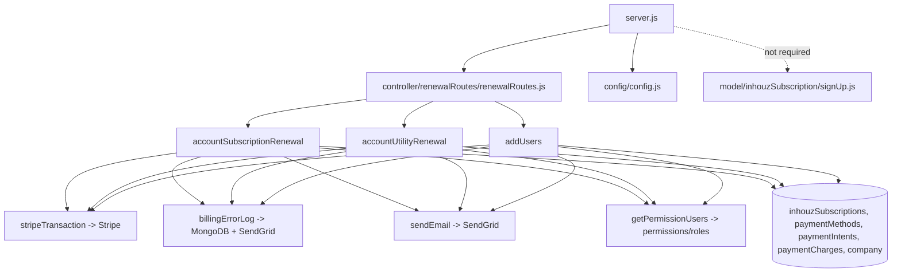

# inhouz_subscription_renewal_ms

Repository: `apps/inhouz_subscription_renewal_ms` — a separate git repository
(`Inhouz-Cloud-AI/inhouz_subscription_renewal_ms`), not part of the control repo. `package.json`
still carries the template identity `micro_service_template` / "The base of all simple erp
microservices" (`package.json:2-5`).

## 1. Summary

Renews the **platform's own** subscription products (Inhouz plans, add-on seats and scheduled-task
usage), as opposed to `subscription_renewal_ms`, which renews third-party/customer-owned packages.
Three handlers take a Cryptr-encrypted payload, recompute what the account owes from its plan,
licences, seats and scheduled-task execution count, charge Stripe with a marketplace split, write a
payment charge/intent row, extend the subscription dates, log billing failures and send receipts.
`POST /api/inhouzsubscriptionrenewal/addusers` extends the same billing path to seat additions.

## 2. Stack and commands

- Node.js `>=12.0.0 <17.5.0` (`package.json:4-6`).
- Express 4 (`server.js:2`), Mongoose 7 (`package.json:25`), Node `cluster` with one worker per CPU
  in production (`server.js:34-51`).
- Start: `npm start` → `node server.js` (`package.json:11`).
- Test: `npm test` → stub, exits 1 (`package.json:10`).
- Port: `process.env.PORT` (`server.js:97`); k8s service and container `5044`
  (`k8s/inhouz-subscription-renewal-ms-cluster-ip-service.yml:10`,
  `k8s/inhouz-subscription-renewal-ms-deployment.yml:26`).
- Replicas: 1 (`k8s/inhouz-subscription-renewal-ms-deployment.yml:6`).

## 3. Entry points

| Entry point | Where | Started by |
|---|---|---|
| Express HTTP server | `server.js:97` (`app.listen(process.env.PORT)`) | `node server.js` (`package.json:11`) |
| Cluster master/workers | `server.js:34-51` | boot; `NODE_ENV === "production"` → `os.cpus().length` workers |
| Route registration | `server.js:67` → `controller/renewalRoutes/renewalRoutes.js:5` | boot |
| Mongo connect + 5 s reconnect | `server.js:102-111`, retry `server.js:78-80` | boot / `disconnected` |
| Graceful shutdown | `server.js:87-95` | `SIGINT`, `SIGTERM`, `uncaughtException` |
| `POST /api/inhouzsubscriptionrenewal/accountsubscriptionrenewal` | `controller/renewalRoutes/renewalRoutes.js:6` | HTTP |
| `POST /api/inhouzsubscriptionrenewal/accountutilityrenewal` | `controller/renewalRoutes/renewalRoutes.js:7` | HTTP |
| `POST /api/inhouzsubscriptionrenewal/addusers` | `controller/renewalRoutes/renewalRoutes.js:8` | HTTP |

Model registration at boot: 19 requires (`server.js:13-31`). No timer except the Mongo reconnect;
no cron, no worker loop.

## 4. Module inventory

| Module | Where | Owns | Public API | Kind |
|---|---|---|---|---|
| `server` | `server.js` | cluster, express, mongo | none | `effectful` |
| `config` | `config/config.js` | cached config, secret-file read | `()` → config | `effectful` (filesystem, env) |
| `renewalRoutes` | `controller/renewalRoutes/renewalRoutes.js:5` | mounts the three POST routes | `(app)` | `reactive` (mutates app) |
| `accountSubscriptionRenewal` | `services/inhouzSubscription/accountSubscriptionRenewal.js:19` | plan/seat/add-on renewal for one subscription | `(req,res)` | `effectful` (DB, Stripe, email, clock, crypto) |
| `accountUtilityRenewal` | `services/inhouzSubscription/accountUtilityRenewal.js:19` | usage-based renewal (scheduled-task executions, web apps) | `(req,res)` | `effectful` |
| `addUsers` | `services/inhouzSubscription/addUsers.js:19` | adds seats/users, charges pro-rata | `(req,res)` | `effectful` |
| `stripeTransaction` | `utils/stripe/stripeTransaction.js:5` | `stripe.paymentIntents.create` with transfer + application fee | `(params)` | `effectful` (Stripe network) |
| `zeroDecimalCurrencies` | `utils/stripe/zeroDecimalCurrencies.js` | no-minor-unit currency list | data | `pure` |
| `billingErrorLog` | `utils/inhouzSubscription/billingErrorLog.js:6` | writes `inhouzBillingErrors` and emails | `(params={})` | `effectful` (DB, email) |
| `notifyAdminOfIssues` | `utils/inhouzSubscription/notifyAdminOfIssues.js` | admin alert | `(params={})` | `effectful` |
| `minimumPlanSeatMap` | `utils/inhouzSubscription/minimumPlanSeatMap.js` | minimum seats per plan | data map | `pure` |
| `getPermissionUsers` | `utils/user/getPermissionUsers.js:5` | users holding a permission in a company | `(params={})` | `effectful` (DB) |
| `getProductionWebApps` | `utils/appBuilder/getProductionWebApps.js` | deployed web apps for a company | `(companyId...)` | `effectful` (DB) |
| `currencyFormat` | `utils/currency/currencyFormat.js` | money formatting | `(amount, currency...)` | `pure` |
| `sendEmail` | `utils/email/sendEmail/sendEmail.js:4` | SendGrid send | `(to, from, subject, text, html)` | `effectful` (network); not awaited |
| `sendPermissionEmail` | `utils/email/sendEmail/sendPermissionEmail.js` | permission email | builder | `pure` |
| Receipt/notice templates | `utils/email/success/*.js`, `utils/email/billingError/*.js` | HTML bodies and senders | various | `pure` builders; senders `effectful` |
| `recursiveSanitizer` | `utils/sanitizer/recursiveSanitizer.js:19` | deep sanitize | `{recursiveSanitizer}` | `pure` |
| `postRequest`, `getRequest`, `deleteRequest` | `utils/requests/*.js` | HTTP helpers | `(url, ...)` | `effectful`; `postRequest` has no call site in this service's handlers |
| `getUser`, `createEditByObject` | `utils/user/getUser.js`, `utils/user/createEditByObject.js` | user lookup / audit object | `(userId)`, `(user, deployDate)` | `effectful` / `pure`; used only by `checkLogin` |
| `checkLogin`, `moduleAccessCheck`, `singleSubdomainValidation` | `middlewares/**` | auth/permission middleware | express middleware | `effectful`; **not mounted** |
| `signUp` models | `model/inhouzSubscription/signUp.js` | signup-side schemas (company, user, licence, subscription) | internal | `reactive`; **never required by `server.js`** |
| Models | `model/**` | 19 schemas registered at boot | `mongoose.model(...)` | `reactive` |

## 5. Side effects

| Effect | Where |
|---|---|
| Mongo connect, `maxPoolSize: 1` per worker | `server.js:104-112` |
| Mongo reconnect timer (5 000 ms) | `server.js:78` |
| Stripe `paymentIntents.create` with `transfer_data` and `application_fee_amount` | `utils/stripe/stripeTransaction.js:35-40` |
| Stripe calls from the three handlers | `accountSubscriptionRenewal.js:674`, `accountUtilityRenewal.js:481`, `addUsers.js:304` |
| SendGrid send | `utils/email/sendEmail/sendEmail.js:22` |
| Billing-error email + DB write | `utils/inhouzSubscription/billingErrorLog.js:6-20` |
| MongoDB reads/writes | models resolved at `accountSubscriptionRenewal.js:80-82, 203-204, 388-401, 425, 865`; `accountUtilityRenewal.js:79-81, 261-263`; `addUsers.js:81-84, 216-218` |
| Clock: `new Date().getTime()` expiry and timestamps; `moment-timezone` for plan periods | `accountSubscriptionRenewal.js:41`, `accountUtilityRenewal.js:41`, `addUsers.js:41`; `moment-timezone` imported at `accountSubscriptionRenewal.js:13` |
| Crypto: `new Cryptr(config.sessionSecret)` decrypt of the payload | `accountSubscriptionRenewal.js:37`, `accountUtilityRenewal.js:37`, `addUsers.js:37` |
| Filesystem: secret files under `SECRETS_PATH` (default `/mnt/secrets`) | `config/config.js:5-14` |
| Logging: `console.log` on every catch | `accountSubscriptionRenewal.js:1047`, `accountUtilityRenewal.js`, `addUsers.js` |
| No outbound calls to other microservices were found in the handlers | `postRequest` imported but unused here |

There is no randomness in these handlers, no message broker and no websocket.

## 6. State and state transitions

No in-memory state machine. The subscription lifecycle is written to Mongo. Per request:

| Step | Trigger | Guard | Effect |
|---|---|---|---|
| Accept | POST | `encryptedPayload` is a non-empty string (`accountSubscriptionRenewal:22-30`, `accountUtilityRenewal:22-30`, `addUsers:22-30`) | — |
| Decrypt | — | Cryptr decrypt with `SESSION_SECRET` succeeds (`:34-43`) | — |
| Expiry gate | — | `now <= payload.expirationTimestamp` (`accountSubscriptionRenewal:41`, `accountUtilityRenewal:41`, `addUsers:41`) | — |
| Identify account | — | `_id` and `companyId` present (`accountSubscriptionRenewal:55-66`) | 400 / 404 |
| Price | — | active subscription, payment method, payout account present (`:388-425`) | charge amount |
| Charge | Stripe | `stripeTransaction` returns no `error` | `paymentIntents` + `paymentCharges` rows, subscription dates advanced |
| Failure path | charge error | — | `billingErrorLog`, `notifyAdminOfIssues`, subscription moved to a billing-error state |
| Receipt | success | — | email, `res.send({success: true})` (`accountSubscriptionRenewal:1045`) |

`accountUtilityRenewal` adds a usage step: `billedTaskExecutionCount = scheduledTaskExecutionCount -
freeMonthlyScheduledTasks` (`accountUtilityRenewal.js:189`) before pricing. `accountTermination` in
its payload (`:56`) selects the termination path.

## 7. Data

Collection names come from k8s env vars, so the physical name is deployment-set. Values below are
the k8s-provided names.

| Env var | Collection | Access | Schema |
|---|---|---|---|
| `INHOUZ_SUBSCRIPTIONS_MODEL` | `inhouzSubscriptions` | read + write, all three handlers | `model/inhouzSubscription/inhouzSubscription.js:5`, registered `:299` |
| `COMPANY_MODEL` | `company` | read (Stripe customer id, currency) | `model/company/company.js:5`, registered `:108` |
| `SCHEDULED_TASK_MODEL` | `scheduledTasks` | read (execution counts) | `model/scheduledTask/scheduledTask.js:5`, registered `:94` |
| `USER_MODEL` | `User` | read/write (seats) | `model/user/user.js:6`, registered `:138` |
| `INHOUZ_USER_LICENSE_MODEL` | `inhouzUserLicenses` | read/write | `model/inhouzSubscription/inhouzUserLicense.js:6`, registered `:39` |
| `PAYMENT_METHOD_MODEL` | `paymentMethods` | read | `model/payment/paymentMethod.js:5`, registered `:91` |
| `PAYMENT_INTENT_MODEL` | `paymentIntents` | write | `model/payment/paymentIntent.js:5`, registered `:88` |
| `PAYMENT_CHARGE_MODEL` | `paymentCharges` | write | `model/payment/paymentCharge.js:5`, registered `:142` |
| `PAYOUT_ACCOUNT_MODEL` | `payoutAccounts` | read (marketplace destination) | `model/payment/payoutAccount.js:5`, registered `:68` |
| `INHOUZ_SIGNUP_PROMO_CODE_MODEL` | `inhouzSignupPromoCodes` | read (discount) | `model/inhouzSubscription/inhouzSignupPromoCode.js:5`, registered `:40` |
| `INHOUZ_SIGNUP_PROMO_USAGE_LOG_MODEL` | `inhouzSignupPromoCodeUsageLogs` | write | `model/inhouzSubscription/inhouzSignupPromoUsageLog.js:5`, registered `:38` |
| `INHOUZ_BILLING_ERROR_MODEL` | `inhouzBillingErrors` | write | `model/inhouzSubscription/inhouzBillingErrorLog.js:5`, registered `:48` |
| `PERMISSION_MODEL`, `ROLE_MODEL`, `USER_ROLES_MODEL` | `permissions`, `roles`, `userRoles` | read (who receives notices) | `model/rolesAndPermissions/*.js`, `model/user/useRoles.js` |
| `INHOUZ_APP_MODEL` | `inhouzApps` | read (web apps for utility billing) | `model/appBuilder/inhouzApp.js:6`, registered `:261` |
| `EXCHANGE_RATE_CACHE_MODEL` | `exchangeRateCache` | registered only | `model/payment/exchangeRateCache.js:5` |
| `SESSION_MODEL`, `SESSION_VALIDATOR_MODEL`, `AUTH_LOG_MODEL` | `session`, `sessionValidator`, `authenticationLogs` | `checkLogin` only (unmounted) | `model/session/session.js` |

Key rules verified:

- Payload expiry is a millisecond timestamp read from the decrypted JSON
  (`accountSubscriptionRenewal.js:41`); there is no nonce or idempotency key.
- `paymentMethodId` must be a non-empty string and `currency`/`paymentMethodType` must be strings
  before Stripe is called (`utils/stripe/stripeTransaction.js:15-23`).
- `zeroDecimalCurrencies` decides whether the amount is multiplied by 100
  (`utils/stripe/stripeTransaction.js:38`).
- `internalSubscriptionRenewalTracker` is **not** used here; this service is not the internal
  tracker writer. It writes `inhouzBillingErrors` instead.

Shared-collection coupling:

- `inhouzSubscriptions`, `company`, `paymentMethods`, `paymentIntents`, `paymentCharges` and
  `payoutAccounts` are shared with `inhouz_subscription_*`, `subscription_*` and the payment
  services. A field rename here breaks other writers.
- `scheduledTasks` is written by the scheduled-task service and only read here; the billing quantity
  (`scheduledTaskExecutionCount`) is that service's data.
- The brief names `called by: authentication_ms, inhouz_subscription_renewal_scheduler_ms`. Only the
  scheduler path was confirmed by the route shapes; the authentication_ms path was not traced.

No migrations in this repo.

## 8. Public interfaces

| Interface | Request | Response |
|---|---|---|
| `POST /api/inhouzsubscriptionrenewal/accountsubscriptionrenewal` | `{ "encryptedPayload": "<cryptr>" }`; plaintext `{ payload: { _id, companyId }, expirationTimestamp }` (`accountSubscriptionRenewal.js:55-57`) | 200 `{ success: true }` (`:1045`); 400 missing fields (`:28`), 404 not found (`:99`), 500 (`:107`) |
| `POST /api/inhouzsubscriptionrenewal/accountutilityrenewal` | plaintext `{ payload: { _id, companyId, accountTermination }, expirationTimestamp }` (`accountUtilityRenewal.js:55-57`) | same shape; 400/404/500 |
| `POST /api/inhouzsubscriptionrenewal/addusers` | plaintext `{ payload: { userEmails: string[], companyId }, expirationTimestamp }` (`addUsers.js:55-57`) | same shape; 403 for permission/limit refusal (`:103`, `:170`) |

Error shape is always `{ error: { message } }`. No events, queue topics, CLI or cron in this
service.

## 9. Configuration

Names only.

`PORT`, `NODE_ENV`, `SECRETS_PATH`, `MONGO_URL`, `SESSION_SECRET`, `CLIENT_SECRET_KEY`,
`STRIPE_API_KEY`, `SENDGRID_API_KEY`, `OPEN_EXCHANGE_RATES_API_KEY`, `OPEN_EXCHANGE_RATES_BASE_URL`,
`COOKIE_DOMAIN`, `COOKIE_NAME`, `INHOUZ_FROM_EMAIL`, `INHOUZ_SUPPORT_EMAIL`, `SMPL_EMAIL`,
`STANDARD_EMAIL_API_URL`, `SUBSCRIPTION_SERVICE_CHARGE_FEE`, `SUBSCRIPTION_SERVICE_CHARGE_TYPE`,
plus the `*_MODEL` names in section 7 and these configured-but-unused keys:
`API_USAGE_LOG_MODEL`, `CHURN_TRACKER_MODEL`, `CONTACTS_MODEL`, `CUSTOMERS_MODEL`, `DATABASE_MODEL`,
`DEPLOYED_API_ENDPOINTS_MODEL`, `FLEX_API_MODEL`, `FLEX_COLLECTION_MODEL`, `FLEX_FORM_FILE_MODEL`,
`FLEX_MODULE_MODEL`, `FUNCTION_MODEL`, `FUNCTION_VERSION_TRACKER_MODEL`, `FORM_MODEL`,
`DATA_RULE_EXECUTION_RESULT_MODEL`, `INHOUZ_SUBSCRIPTION_SERVICE_MODEL`, `IP_ADDRESS_LOCATION_MODEL`,
`IP_LOCATION_FINDER_URL`, `OPERATION_TRACKER_MODEL`, `PAYMENT_MS_URL`, `QUERY_MODEL`,
`QUERY_VERSION_TRACKER`, `SCHEMA_MODEL`, `SERVICE_DISCOUNT_MODEL`, `SUBSCRIBER_ACTION_LOG_MODEL`,
`SUBSCRIBER_CHANGE_LOG`, `SUBSCRIBER_MIGRATION_QUEUE_MODEL`, `SUBSCRIBER_MODEL`,
`SUBSCRIPTION_SESSION_MODEL`, `SUBSCRIPTION_USAGE_LOG`, `SYSTEM_USER_MODEL`, `VERSION_TRACKER_MODEL`,
`FUNCTION_MS_URL`, `FUNCTION_PARSER_MS_URL`, `SCHEDULED_TASK_MS_URL`.

Secret file names read under `SECRETS_PATH`: `sendgridapikey`, `sessionsecret`, `mongourl`,
`clientsecretkey`, `openexchangeratesapikey` (`config/config.js`).

## 10. Dependencies

| Dependency | Why |
|---|---|
| `express` | HTTP server |
| `mongoose` | models |
| `stripe` | marketplace charge (`utils/stripe/stripeTransaction.js:2`) |
| `cryptr` | payload decrypt in all three handlers |
| `moment`, `moment-timezone` | plan period and timezone-aware renewal dates |
| `@sendgrid/mail` | receipts and billing-error mail |
| `body-parser`, `cookie-parser`, `cors`, `helmet`, `hpp`, `dotenv` | HTTP shell, copied from the template |
| `lodash` | `uniq` in `getPermissionUsers` |
| `sanitizer` | request sanitizing |
| `validator` | model-level validation (`model/appBuilder/inhouzApp.js:4`, `model/inhouzSubscription/inhouzUserLicense.js:3`) |
| `bcryptjs`, `crypto-js` | signup module (`model/inhouzSubscription/signUp.js`), which is never mounted |
| `node-fetch` | behind the unused request helpers |
| `connect-mongo`, `express-session`, `request-ip`, `shortid` | template leftovers; no call site in the renewal path |

## 11. Testing

No tests. `npm test` is a stub (`package.json:10`). No fixtures, no Stripe mock, no test for the
pricing arithmetic in `accountUtilityRenewal.js:189`. Verification is manual: send an encrypted
payload and check Stripe plus the `paymentCharges` row.

## 12. Known issues and risks

- **A GitHub token is injected by the machine's global git config.** The repository remote itself is
  clean — `git config --get remote.origin.url` returns a plain
  `https://github.com/Inhouz-Cloud-AI/inhouz_subscription_renewal_ms.git`. The token shows up in
  `git remote -v` only because `/home/node/.gitconfig` defines a
  `url.https://<token>@github.com/.insteadOf https://github.com/` rewrite. Nothing is committed, but
  the token reaches logs and transcripts. Rotate it and drop the rewrite. Value not quoted.
- **No authentication on any of the three routes.** `checkLogin` and `moduleAccessCheck` exist but
  are never mounted (no reference outside `middlewares/`). The only guard is the Cryptr ciphertext
  and its `expirationTimestamp`.
- **Expiry is not a nonce.** A captured payload is replayable until its timestamp passes
  (`accountSubscriptionRenewal.js:41`), and there is no idempotency key on the Stripe call.
- **Shared symmetric secret for payload encryption.** `new Cryptr(config.sessionSecret)`
  (`accountSubscriptionRenewal.js:37`, `accountUtilityRenewal.js:37`, `addUsers.js:37`) uses the
  session secret, so a session-secret leak lets an outsider mint valid renewal payloads.
- **Email send is fire-and-forget** (`utils/email/sendEmail/sendEmail.js:22`), so a receipt failure
  is silent while the charge stands.
- **`/healthz` is never served.** `healthcheck.js:7` probes it; no route registers it and the
  deployment defines no probe.
- **`uncaughtException` closes Mongo but leaves the process alive** (`server.js:90-95`).
- **Dead signup module.** `model/inhouzSubscription/signUp.js` (600+ lines, registers 9 models) is
  never required by `server.js:13-31`. Its models and bcrypt/validator dependencies are dead weight
  and a second source of truth for company/user creation.
- **Template identity left in place.** `package.json:2-5` still names the base template.
- **Copy-paste configuration.** Roughly 30 configured env keys are never read by this service's code
  (section 9), which makes the k8s ConfigMap misleading about dependencies.
- **Pseudo-global model resolution inside handlers.** `mongoose.model(config.x)` is called mid-request
  (`accountSubscriptionRenewal.js:80-82`, `:388-401`), so a missing model name fails at request time,
  not at boot.
- **`maxPoolSize: 1` with one worker per CPU** (`server.js:35`, `server.js:107`).
- **Different crypto from its sibling.** `subscription_renewal_ms` uses RSA; this service uses Cryptr.
  A caller must know which scheme each endpoint expects.
- **Logging is `console.log` with raw error objects** (`accountSubscriptionRenewal.js:1047` and the
  utility/addUsers equivalents); Stripe errors can echo request details.

## 13. Module map

## 14. Open questions

- Which service calls `accountutilityrenewal` and with what cadence? The brief names
  `inhouz_subscription_renewal_scheduler_ms` and `authentication_ms`; the payload has no caller id.
- What does `accountTermination` change exactly in the utility path
  (`accountUtilityRenewal.js:56`)? The branch was not traced to its end.
- Where is `freeMonthlyScheduledTasks` sourced (`accountUtilityRenewal.js:189`)? It is not read from
  config in the files opened.
- Is `signUp.js` imported dynamically by another entry point, or is it fully dead?
- `INHOUZ_SUBSCRIPTION_SERVICE_MODEL`, `SERVICE_DISCOUNT_MODEL` and `SUBSCRIPTION_SERVICE_CHARGE_*`
  are configured; their effect on pricing was not traced.
- Whether the `paymentIntents` row is written before or after the charge settles was not determined.
- The receipt templates under `utils/email/success/` were counted, not read line by line.
