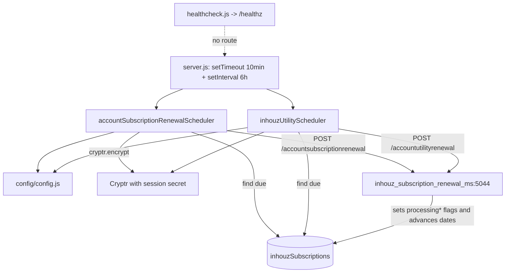

# inhouz_subscription_renewal_scheduler_ms

Repository: `apps/inhouz_subscription_renewal_scheduler_ms` — a separate git repository
(`Inhouz-Cloud-AI/inhouz_subscription_renewal_scheduler_ms`), not part of the control repo.
`package.json` still carries the template identity `micro_service_template` (`package.json:2-4`).

## 1. Summary

The timer that drives `inhouz_subscription_renewal_ms`. Ten minutes after boot, and every six hours
after that, it reads the platform subscription records that are due, encrypts a small
`{ companyId, _id }` payload with Cryptr and POSTs it to the matching renewal endpoint: the plan
endpoint for `subscriptionRenewalDate` (`services/accountSubscriptionRenewalScheduler.js:8-18`) and
the usage endpoint for `utilityRenewalDate` (`services/inhouzUtilityScheduler.js:8-18`). It never
charges anything itself and keeps no state beyond the process timer.

## 2. Stack and commands

- Node.js `>=12.0.0 <17.5.0` (`package.json:6`).
- Express 4 HTTP shell that serves no route (`server.js:2`, no `app.use(controller)`), Mongoose 7.
- Single process: no `cluster` module (`server.js:1-12`), unlike `subscription_renewal_ms`.
- Start: `npm start` → `node server.js` (`package.json:9`).
- Test: `npm test` → stub, exits 1 (`package.json:8`).
- Port: `process.env.PORT` (`server.js:75`); the deployment sets container port `5043`
  (`k8s/inhouz-subscription-renewal-scheduler-ms-deployment.yml:26-29`). There is **no k8s Service
  object** for this scheduler — nothing calls it.

## 3. Entry points

| Entry point | Where | Started by |
|---|---|---|
| Express HTTP server (no routes) | `server.js:75` | `node server.js` (`package.json:9`) |
| First poll, 10 minutes after boot | `server.js:63-66` — `setTimeout(..., 600000)` | boot |
| Recurring poll, every 6 hours | `server.js:69-72` — `setInterval(..., 21600000)` | after boot |
| Mongo connect + 5 s reconnect | `server.js:80-89`, retry `server.js:45` | boot / `disconnected` |
| Graceful shutdown | `server.js:55-61` | `SIGINT`, `SIGTERM`, `uncaughtException` |
| Model registration | `server.js:13-19` (7 requires) | boot |
| `GET /healthz` | not implemented; `healthcheck.js:7` probes it | never served |

Each tick calls both schedulers concurrently and does not await them
(`server.js:64-65`, `server.js:70-71`).

## 4. Module inventory

| Module | Where | Owns | Public API | Kind |
|---|---|---|---|---|
| `server` | `server.js` | express shell, two timers, mongo connect | none | `effectful` (network, DB, env, clock) |
| `config` | `config/config.js:16` | config object built per call; `switch (NODE_ENV)` has only a `default` branch | `()` → config | `effectful` (filesystem, env) |
| `readSecret` | `config/config.js:4` | `/mnt/secrets/<name>` then env fallback | `(name, envFallback)` → string | `effectful` (filesystem, env) |
| `accountSubscriptionRenewalScheduler` | `services/accountSubscriptionRenewalScheduler.js:7` | find due plan subscriptions, encrypt, POST | `()` → Promise<void> | `effectful` (DB read, Cryptr, HTTP, clock) |
| `inhouzUtilityScheduler` | `services/inhouzUtilityScheduler.js:7` | find due usage subscriptions, encrypt, POST | `()` → Promise<void> | `effectful` (same set) |
| `checkLogin` | `middlewares/login/checkLogin.js` | session auth middleware | express middleware | `effectful`; **not mounted** |
| `moduleAccessCheck` | `middlewares/module/moduleAccessCheck.js` | module permission middleware | express middleware | `effectful`; **not mounted** |
| `singleSubdomainValidation` | `middlewares/subdomain/singleSubdomainValidation.js` | subdomain check | express middleware | `effectful`; **not mounted** |
| `getUser` | `utils/user/getUser.js:14` | user/role/permission lookup | `(params)` | `effectful` (DB); used only by `checkLogin` |
| `createEditByObject` | `utils/user/createEditByObject.js:1` | audit object | `(user, deployDate)` | `pure`; used only by `checkLogin` |
| `recursiveSanitizer` | `utils/sanitizer/recursiveSanitizer.js:19` | deep sanitizer | `{recursiveSanitizer}` | `pure`; no call site |
| Models | `model/**` (7 schemas) | mongoose schemas | `mongoose.model(...)` | `reactive` |

## 5. Side effects

| Effect | Where |
|---|---|
| Mongo connect, `maxPoolSize: 1` | `server.js:82-90` |
| Mongo reconnect timer (5 000 ms) | `server.js:45` |
| MongoDB read: `inhouzSubscriptions` where `processingSubscriptionPayment: false`, `active: true`, `subscriptionRenewalDate <= now` | `accountSubscriptionRenewalScheduler.js:9-17` |
| MongoDB read: `inhouzSubscriptions` where `processingUtilityPayment: false`, `active: true`, `utilityRenewalDate <= now` | `inhouzUtilityScheduler.js:9-17` |
| HTTP POST `INHOUZ_RENEWAL_MS_URL` + `/api/inhouzsubscriptionrenewal/accountsubscriptionrenewal` | `accountSubscriptionRenewalScheduler.js:37-46` |
| HTTP POST `INHOUZ_RENEWAL_MS_URL` + `/api/inhouzsubscriptionrenewal/accountutilityrenewal` | `inhouzUtilityScheduler.js:37-46` |
| Cryptr encrypt with `SESSION_SECRET` | `accountSubscriptionRenewalScheduler.js:28`, `inhouzUtilityScheduler.js:28` |
| Clock: `moment().unix() * 1000` cut-off, `now + 600 s` payload expiry | `accountSubscriptionRenewalScheduler.js:14`, `:33`; `inhouzUtilityScheduler.js:14`, `:33` |
| Filesystem: secret files under `SECRETS_PATH` (default `/mnt/secrets`) | `config/config.js:4-14` |
| Logging: `console.log` on query and request errors | `accountSubscriptionRenewalScheduler.js:21`, `:48`, `:57`; `inhouzUtilityScheduler.js:21`, `:48`, `:57`; `server.js:36-53` |
| No filesystem writes, no broker, no websocket, no randomness | — |

## 6. State and state transitions

No in-memory state machine. The lock that prevents two charges for one record lives in the
**renewal service**, not here, and this scheduler reads it as a guard:

| From | Trigger | Guard | To |
|---|---|---|---|
| Plan subscription due | 6-hour tick | `processingSubscriptionPayment: false`, `active: true`, `subscriptionRenewalDate <= now` (`accountSubscriptionRenewalScheduler.js:10-17`) | a POST; the renewal service sets `processingSubscriptionPayment: true` and later back to `false` (`inhouz_subscription_renewal_ms`, `services/inhouzSubscription/accountSubscriptionRenewal.js:502`, `:566`, `:642`, `:742`, `:922`) |
| Usage subscription due | 6-hour tick | `processingUtilityPayment: false`, `active: true`, `utilityRenewalDate <= now` (`inhouzUtilityScheduler.js:10-17`) | same, via `accountUtilityRenewal.js:308` |

The scheduler itself writes nothing. It sends every due row on every tick until the downstream
service moves the date forward, and the `processing*` flag is what stops a duplicate send while a
charge is in flight.

## 7. Data

Read-only. Collection names come from k8s env vars.

| Env var | Collection | Fields used | Schema |
|---|---|---|---|
| `INHOUZ_SUBSCRIPTIONS_MODEL` | `inhouzSubscriptions` | `companyId`, `_id`, `active`, `subscriptionRenewalDate`, `utilityRenewalDate`, `processingSubscriptionPayment`, `processingUtilityPayment` | `model/inhouzSubscription/inhouzSubscription.js:5`, registered `:202` |

Also registered in the repo but unread by the schedulers (`server.js:13-19`, `model/**`): `User`,
`roles`, `permissions`, `userRoles`, `company`, `session`.

Shared-collection coupling, and it is the whole contract of this service:

- `inhouzSubscriptions` is owned by `inhouz_subscription_renewal_ms` and other `inhouz_*` services.
  This scheduler depends on six field names: `active`, `subscriptionRenewalDate`,
  `utilityRenewalDate`, `processingSubscriptionPayment`, `processingUtilityPayment`, and `_id`.
  A rename in the writer silently stops renewals here.
- `processingSubscriptionPayment` / `processingUtilityPayment` are used as a **lock, not an audit
  flag**. The renewal service overwrites them (`accountSubscriptionRenewal.js:502`, `:566`,
  `:642`, `:742`, `:922`; `accountUtilityRenewal.js:308`), so this scheduler and that service must
  be deployed together.

No migrations.

## 8. Public interfaces

| Direction | Interface | Shape |
|---|---|---|
| Out | `POST <INHOUZ_RENEWAL_MS_URL>/api/inhouzsubscriptionrenewal/accountsubscriptionrenewal` | `{ "encryptedPayload": "<cryptr>" }`; plaintext `{ payload: { companyId, _id }, expirationTimestamp: now+600s }` (`accountSubscriptionRenewalScheduler.js:29-36`) |
| Out | `POST <INHOUZ_RENEWAL_MS_URL>/api/inhouzsubscriptionrenewal/accountutilityrenewal` | same body shape (`inhouzUtilityScheduler.js:29-36`) |
| In | none | the container listens on `PORT` but registers no route |
| k8s target | `http://inhouz-subscription-renewal-ms-cluster-ip-service:5044` (`k8s/inhouz-subscription-renewal-scheduler-ms-deployment.yml:61-62`) | — |

No events, queue topics or CLI.

## 9. Configuration

Names only. This config is built on every call — there is no cache, unlike the sibling services.

Keys actually read by the running code: `PORT`, `NODE_ENV`, `SECRETS_PATH`, `MONGO_URL`,
`SESSION_SECRET`, `CLIENT_SECRET_KEY`, `INHOUZ_SUBSCRIPTIONS_MODEL`, `INHOUZ_RENEWAL_MS_URL`
(`config/config.js:16-43`).

Keys present in k8s but not read by this service's code: `API_USAGE_LOG_MODEL`, `AUTH_LOG_MODEL`,
`CHURN_TRACKER_MODEL`, `COMPANY_MODEL`, `CONTACTS_MODEL`, `COOKIE_DOMAIN`, `COOKIE_NAME`,
`CUSTOMERS_MODEL`, `DATABASE_MODEL`, `DEPLOYED_API_ENDPOINTS_MODEL`, `EXCHANGE_RATE_CACHE_MODEL`,
`FLEX_API_MODEL`, `FLEX_COLLECTION_MODEL`, `FUNCTION_MODEL`, `FUNCTION_MS_URL`,
`FUNCTION_PARSER_MS_URL`, `FUNCTION_VERSION_TRACKER_MODEL`, `INHOUZ_APP_MODEL`,
`INHOUZ_FROM_EMAIL`, `IP_ADDRESS_LOCATION_MODEL`, `IP_LOCATION_FINDER_URL`,
`OPEN_EXCHANGE_RATES_API_KEY`, `OPEN_EXCHANGE_RATES_BASE_URL`, `OPERATION_TRACKER_MODEL`,
`PAYMENT_CHARGE_MODEL`, `PAYMENT_INTENT_MODEL`, `PAYMENT_METHOD_MODEL`, `PAYMENT_MS_URL`,
`PAYOUT_ACCOUNT_MODEL`, `PERMISSION_MODEL`, `QUERY_MODEL`, `QUERY_VERSION_TRACKER`, `ROLE_MODEL`,
`SCHEDULED_TASK_MS_URL`, `SCHEMA_MODEL`, `SENDGRID_API_KEY`, `SERVICE_DISCOUNT_MODEL`,
`SESSION_MODEL`, `SESSION_VALIDATOR_MODEL`, `SMPL_EMAIL`, `SUBSCRIBED_PACKAGE_MODEL`,
`SUBSCRIBER_ACTION_LOG_MODEL`, `SUBSCRIBER_CHANGE_LOG`, `SUBSCRIBER_MIGRATION_QUEUE_MODEL`,
`SUBSCRIBER_MODEL`, `SUBSCRIPTION_MODEL`, `SUBSCRIPTION_SERVICE_CHARGE_FEE`,
`SUBSCRIPTION_SERVICE_CHARGE_TYPE`, `SUBSCRIPTION_SERVICE_MODEL`, `SUBSCRIPTION_SESSION_MODEL`,
`SUBSCRIPTION_USAGE_LOG`, `SYSTEM_USER_MODEL`, `USER_MODEL`, `USER_ROLES_MODEL`,
`VERSION_TRACKER_MODEL`.

## 10. Dependencies

| Dependency | Why |
|---|---|
| `express` | HTTP shell with no routes |
| `mongoose` | the one collection read |
| `moment` | due cut-off and payload expiry |
| `node-fetch` | outbound POST |
| `cryptr` | payload encryption |
| `dotenv` | `.env` load at boot (`server.js:1`) |
| `body-parser`, `cookie-parser`, `cors`, `helmet`, `hpp` | Express middleware copied from the template; no inbound request is served |
| `lodash`, `crypto-js`, `validator` | used only by the unmounted `checkLogin`/`moduleAccessCheck` and the models |
| `@sendgrid/mail`, `connect-mongo`, `express-session`, `sanitizer` | no call site in the scheduler path |

There is no `node-rsa` and no `stripe` here, unlike the sibling services, because this scheduler
neither signs RSA payloads nor charges.

## 11. Testing

No tests. `npm test` is a stub (`package.json:8`). Neither the field contract with
`inhouz_subscription_renewal_ms` nor the timer behaviour has a test. Verification today is manual:
read the logs and compare `subscriptionRenewalDate` in Mongo with the charge rows.

## 12. Known issues and risks

- **A GitHub token is injected by the machine's global git config.** The repository remote itself is
  clean — `git config --get remote.origin.url` returns a plain
  `https://github.com/Inhouz-Cloud-AI/inhouz_subscription_renewal_scheduler_ms.git`. The token shows
  up in `git remote -v` only because `/home/node/.gitconfig` defines a
  `url.https://<token>@github.com/.insteadOf https://github.com/` rewrite. Nothing is committed, but
  the token reaches logs and transcripts. Rotate it and drop the rewrite. Value not quoted.
- **Fire-and-forget requests.** `fetch(...)` is not awaited and the response is never read
  (`accountSubscriptionRenewalScheduler.js:37`, `inhouzUtilityScheduler.js:37`). A 400/500 from the
  renewal service is invisible; the next tick re-sends after six hours. The `.catch` only catches a
  transport error, not an HTTP error status.
- **One request per due row with no concurrency limit.** Both ticks run at once
  (`server.js:70-71`), so a large due batch opens an unbounded number of sockets.
- **No lease means scaling is unsafe.** The only guard against a double send is the
  `processing*` flag read *before* the request; two replicas reading the same row before either
  request lands both send, and the renewal service then decides. Deployment is `replicas: 1`
  (`k8s/inhouz-subscription-renewal-scheduler-ms-deployment.yml:6`). The repo's `deploy.sh` style
  targets two GCP regions in the sibling services; if that is copied here, two pollers run.
- **Six-hour granularity against a millisecond due-date.** A subscription due one minute after a
  tick waits almost six hours. The customer keeps or loses access by up to six hours, depending on
  how the reader interprets the renewal date.
- **The first run is 10 minutes after boot, not at boot.** Every restart delays the first renewal
  by 10 minutes (`server.js:63-66`).
- **No k8s Service, but a listening port and a health probe.** The deployment exposes container
  port 5043 and the image ships `healthcheck.js` probing `/healthz`, which no route serves. Nothing
  can reach the pod, and the health check would fail if it ran.
- **Config `switch` has no cases.** `switch (process.env.NODE_ENV)` with a single `default`
  (`config/config.js:17-19`) means a per-environment branch cannot be added without editing code,
  and the object is rebuilt on every call with no cache.
- **Copy-paste configuration.** Around 50 k8s env keys are never read here (section 9).
- **`uncaughtException` closes Mongo but leaves the process alive** (`server.js:55-61`), and it logs
  the raw error (`server.js:56`).
- **Template identity left in place.** `package.json:2-4` still names the micro-service template.
- **Coupling by field name only.** Four due/lock field names and two date field names are the whole
  contract with the renewal service; none is validated on either side.

## 13. Module map

## 14. Open questions

- Why six hours and not a shorter interval, given the due date is checked at millisecond precision?
- Is the 10-minute delay a deliberate grace period after a restart, or a workaround for a race with
  the renewal service's own boot?
- Both schedulers POST to the same renewal service in the same tick. Is there an ordering
  requirement between the plan renewal and the usage renewal for one account? Nothing in either
  repo states one.
- Does the renewal service always clear `processingSubscriptionPayment` on every failure path? If a
  crash leaves it `true`, this scheduler skips that account forever and no code here recovers it.
  That is the highest-impact open question in this file.
- `SMPL_EMAIL` and the other configured keys are unused; is this deployment's ConfigMap copied from
  a sibling?
- Whether a second regional deployment exists was not determined from the repo.
- `middlewares/**` and `utils/user/**` were counted structurally, not read line by line.
