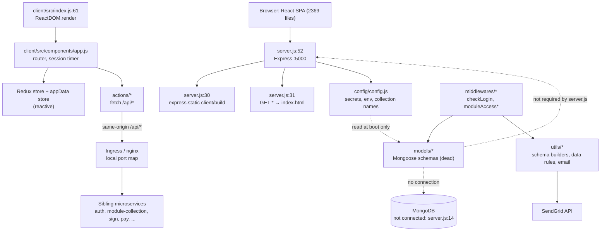

# inhouzio_app_ms

## 1. Summary

`inhouzio_app_ms` is the Inhouz web application shell: a React 16 single-page app (Create React
App, 2,369 `.js` files under `client/src`, `find src -name "*.js" | wc -l`) served by a 54-line
Express server that returns `client/build/index.html` for every path. It is the browser-facing
product surface — login, signup, app builder, app viewer, forms, customization hub, Inhouz Pay,
Inhouz Sign, PDF generator, metrics and system administration. The Express layer holds a set of
Mongoose models, access middleware and collection utilities, but it registers **no API routes and
never opens a MongoDB connection** (`server.js:14-17`, commented out). All data calls are made by
the browser to same-origin `/api/*` paths that a shared ingress routes to sibling microservices.
Repository: `inhouzio_app_ms`, a separate git repository at `apps/inhouzio_app_ms/` (origin
`Inhouz-Cloud-AI/inhouzio_app_ms`). Every `file:line` below is relative to that repository root.

## 2. Stack and commands

- Runtime: Node `>=12.0.0 <17.5.0` (`package.json:7-9`), Express 4.16.3, Mongoose 5.3.0
  (`package.json:14-38`).
- Server start: `npm start` → `node server.js` (`package.json:11`). Dev server:
  `npm run server` → `nodemon server.js` (`package.json:12`).
- Client dev: `npm run client` → `npm run start --prefix client` (`package.json:13`); proxy dev
  pair: `npm run dev` (`package.json:15`).
- Production build: `npm run build` → `npm run build --prefix client` (`package.json:14`).
  Client build script: `react-scripts --max-old-space-size=15000 build` (`client/package.json`,
  `scripts.build`), production variant `buildProd` uses `env-cmd -f .env.production`
  (`client/package.json`, `scripts.buildProd`).
- Client dev server: `react-scripts start` on port 3000 (`client/README.md:9`).
- Container: `FROM node:12.18.4`, installs root and `client/` deps, runs `npm run buildProd`,
  `CMD ["npm", "run", "start"]` (`Dockerfile:1-16`).
- Port: the Express server listens on the literal `5000` (`server.js:52`); the k8s Service maps
  `port: 5000 → targetPort: 5000` (`k8s/inhouzio-app-ms-cluster-ip-service.yml:9-11`).
- No lint or typecheck script exists in either `package.json`. There is no test script on the
  server side; the client has only CRA's `react-scripts test` (`client/package.json`,
  `scripts.test`).

## 3. Entry points

| Entry point | `file:line` | How it starts |
|---|---|---|
| Express HTTP server | `server.js:52` | `npm start`; `app.listen(5000)` |
| Static asset handler | `server.js:30` | `express.static("client/build")` |
| Catch-all SPA route | `server.js:31` | `app.get("*")` — sets a `deviceId` cookie if absent, then `res.sendFile(client/build/index.html)` (`server.js:49`) |
| React bootstrap | `client/src/index.js:61-66` | `ReactDOM.render(<Provider store={store}><App/></Provider>, #root)` |
| Redux store creation | `client/src/index.js:55-59` | `createStore(reducer)` with `redux-promise` + `redux-thunk` |
| In-app route table | `client/src/components/app.js:407-570` | 79 `<Route>` elements inside the app shell |
| Domain redirect guard | `client/src/components/authentication/login/login.js:29-30` | Redirects to `config.loginDomain` when host does not match |
| Session expiry check | `client/src/components/app.js:245-259` | `setInterval(1s)` when `sessionExpirationTimestamp` cookie exists |
| npm helper scripts | `fix_commas.js`, `fix_commas2.js`, `fix_import_commas.js`, `migrate_phase1.js`, `migrate_reducer_calls.js`, `verify_migration.js` | One-off source-rewrite scripts, run by hand; not wired to npm scripts |
| CI deploy | `.travis.yml:15-39` → `deploy.sh:1-16` | Travis on `master`: docker build/push, `kubectl apply -f k8s`, `kubectl set image` in two GCP regions |

There are no cron jobs, workers, queue consumers, websocket servers or migration entry points in
the Node process. The 20 `socket.on(...)` handlers reported by the mechanical brief all live in
`client/src/components/customComponents/appBuilder/appBuilder.js:1468-1658` and run in the browser.

## 4. Module inventory

Kind: `pure` = deterministic no I/O, `reactive` = reads/writes state, `effectful` = DB, network,
filesystem, env, clock, randomness, logging.

### Server-side

| Module | `file:line` | Owns | Public API | Kind |
|---|---|---|---|---|
| `server.js` | `server.js:1-54` | Express app: middleware stack, static host, catch-all | none (side-effect script) | `effectful` — binds a port, reads env, writes cookies |
| `config()` | `config/config.js:17-37` | Cached config object, secret loading | `module.exports()` → config object | `effectful` — reads filesystem and env, module-level cache (`config.js:16`) |
| `readSecret()` | `config/config.js:4-14` | Reads a secret file, env fallback | `readSecret(name, envFallback)` | `effectful` — filesystem + env |
| `checkLogin` | `middlewares/checkLogin.js:1-7` | 401 when `req.isAuthenticated()` is false | Express middleware | `reactive` — reads request session state |
| `moduleAccessCheck` | `middlewares/moduleAccessCheck.js:7-65` | Sanitises body, parses `<module>_<companyId>`, loads `flexModule`, checks `restrictedAccess` and `usersWithAccess` | `async (req,res,next)` | `effectful` — Mongo `findOne` at `:30`, logging at `:57` |
| 11 `moduleAccess/*Access.js` guards | `middlewares/moduleAccess/salesAccess.js:1-11` and siblings | Allow when the user document has the matching boolean (`Sales`, `Accounting`, `Scheduling`, …) | Express middleware | `pure` — boolean test on `req.user`, no I/O |
| `user` model | `models/user.js:5-86` | User document with role booleans, clock in/out, income fields | Mongoose model `User` | `effectful` — schema default `Date.now` |
| `company` model | `models/company.js:5-108` | Company/tenant document, storage defaults, Stripe customer, subscription counters | Mongoose model named by `config.companyModel` | `effectful` — schema defaults, index |
| `flexModules` model | `models/flexModules.js:6-145` | App modules, per-user access list, collection refs | Model named by `config.flexModuleCollectionName` | `effectful` |
| `flexCollections` model | `models/flexCollections.js:6-456` | User-defined collection schema registry | Model `'flexCollections'` | `effectful` |
| `form` model | `models/flexApiForms/form.js:5-124` | Flex form definition, styles, element refs, edit log | Model named by `config.formCollectionName` | `effectful` |
| `formElement` model | `models/flexApiForms/formElement.js:3-196` | Form element definitions | Model `'formElement'` | `effectful` |
| `savedFormElement` model | `models/flexApiForms/savedFormElement.js:3-82` | Saved reusable element styles | Model `'savedFormElement'` | `effectful` |
| `flexFormFile` model | `models/flexFormFile.js:6-186` | Flex form file/document records, assignees | Model named by `config.flexformFileCollectionName` | `effectful` |
| `mongooseModel()` | `utils/model/mongooseModel.js:5-26` | Builds or reuses a dynamic model from a schema object list | `(schemaObjectList, collectionName) => Model \| false` | `effectful` — registers models in Mongoose global registry; logs on error |
| `createEditDocument()` | `utils/flexCollection/createEditDocument.js:6-57` | Create/update/upsert a document in a dynamic collection | `async (collectionName, data, type, user) => doc \| false` | `effectful` — Mongo write; **currently broken** (see §12) |
| `getAllCollectionData()` | `utils/flexFile/getAllCollectionData.js:1-40` | Reads a flex collection | `async (…)` | `effectful` — Mongo read, logs |
| `collectionSchemaBuilder()` | `utils/flexCollection/collectionSchemaBuilder.js:1-48` | Converts schema objects to a Mongoose schema definition | builder function | `pure` |
| `schemaObjectParser()` | `utils/flexCollection/schemaObjectParser.js:1-27` | Delegates field parsing to the validator builder | `(schemaObjects) => object` | `pure` |
| `schemaValidatorBuilder()` | `utils/flexCollection/schemaValidatorBuilder.js:1-140` | Builds per-field type/validation descriptors | function | `pure` |
| `addFieldObjectBuilder()` | `utils/flexCollection/addFieldObjectBuilder.js:1-116` | Builds the add-field object shape | function | `pure` |
| `collectionEditAggPipelineBuilder()` | `utils/flexCollection/collectionEditAggPipelineBuilder.js:1-41` | Builds the aggregation pipeline for collection edits | function | `pure` |
| `defaultSchemaProps` | `utils/flexCollection/defaultSchemaProps.js:1-16` | Base fields merged into every dynamic schema | object literal | `pure` |
| `recursiveSanitizer()` | `utils/sanitizer/recursiveSanitizer.js:3-17` | Walks a body and calls `sanitizer.sanitize` on leaves | `recursiveSanitizer(element, sanitizer)` | `pure` by signature but **no-op** (see §12) |
| `sendEmail()` | `utils/emailFunctions/sendEmail.js:4-29` | Sends mail through SendGrid | `(to, from, subject, text, html) => boolean` | `effectful` — network, logs |
| `approvalRequestEmailBuilder` | `utils/emailFunctions/approvalRequestEmailBuilder.js:1-11` | Builds approval-request mail content | function | `pure` |
| `executeDataRules()` | `utils/flexFile/dataRules/executeDataRules.js:9-236` | Evaluates data-rule evaluations and runs actions | `async (data, dataRules, file, user)` | `effectful` — dispatches actions, logs at `:236` |
| `dataRuleActionParser()` | `utils/flexFile/dataRules/dataRuleActionParser.js:1-55` | Executes one data-rule action | function | `effectful` — delegates to actions, logs |
| `documentApprovalRequest()` | `utils/flexFile/dataRules/documentApprovalRequest.js:1-24` | Approval-request action | function | `effectful` — email/DB via other modules, logs |
| `parseSecondaryDataAction()` | `utils/flexFile/dataRules/parseSecondaryDataAction.js:1-16` | Secondary data action parse | function | `effectful` — logs |
| `bulkEvaluationParser()` | `utils/general/bulkEvaluationParser.js:1-181` | Expression evaluation over a data object | function | `pure` |
| `algorithmArrayParser()` | `utils/general/algorithmArrayParser.js:1-97` | Runs an algorithm array | function | `pure` (logs on error at `:95` — logger call only) |
| `operatorChecker()` | `utils/general/operatorChecker.js:1-53` | Compares operands by operator | function | `pure` |
| `operatorParser()` | `utils/general/operatorParser.js:1-13` | Operator lookup | function | `pure` |
| `secondaryFunctionParser()` | `utils/general/secondaryFunctionParser.js:1-87` | Secondary function dispatch table | function | `pure` |
| `dotNotationMapper()` | `utils/general/dotNotationMapper.js:1-20` | Maps dotted paths into an object | function | `pure` (logs on error) |
| `fake reqUser` | `utils/fakeReqUser/reqUser.js:1-7` | Hard-coded placeholder user for local testing | object literal | `pure` |

None of the modules above are `require`d by `server.js` except `config`
(`server.js:12`). `grep -rn "require('\./"` outside `client/` shows only intra-`utils` requires
(`utils/flexFile/dataRules/executeDataRules.js:1-6`, `utils/flexCollection/createEditDocument.js:1-4`).
The models, middleware and data-rule utilities are therefore dead code in this process.

### Client-side (sampled, not read file by file)

| Module | `file:line` | Owns | Kind |
|---|---|---|---|
| `App` | `client/src/components/app.js` | Root shell: router, header/drawer, session timer, auth cookie handling | `reactive` |
| Redux root reducer | `client/src/reducers/index.js` | Combines 40+ domain reducers | `pure` (composition) |
| Domain reducers | `client/src/reducers/*/` | Per-domain state slices (appBuilder, appViewer, inhouzPay, inhouzSign, …) | `pure` |
| Domain actions | `client/src/actions/*/` | Thunks/promise actions that call `/api/*` | `effectful` — network |
| App data store | `client/src/store/*.js` | Per-`appId` subscription store (`appDataStores`), path updates, batched notify | `reactive` |
| HTTP helpers | `client/src/utils/requests/{get,post,delete,formDataPost}Request.js` | `fetch` wrappers with `credentials: 'include'` and `x-csrfToken` header (`postRequest.js:3-15`) | `effectful` |
| Client config | `client/src/config/config.js` | Permission names, domains, hidden paths, feature constants | `pure` |
| Function parsers | `client/src/utils/functionParser/**` | ~hundreds of parsers that execute app-builder functions in the browser | `effectful` — network, storage |

## 5. Side effects

| Effect | `file:line` | Detail |
|---|---|---|
| Filesystem read | `config/config.js:9` | Reads `SECRETS_PATH/<name>` for each secret |
| Env read | `config/config.js:20-34` | Domain names, `COMPANY_MODEL`, `COOKIE_DOMAIN`, fallback secrets |
| Env read | `server.js:20`, `server.js:40` | `NODE_ENV` selects CORS and cookie `secure` |
| Open port | `server.js:52` | Binds 5000, logs to stdout |
| Serve files | `server.js:30`, `server.js:49` | `express.static` and `sendFile` from `client/build` |
| Set cookie | `server.js:34-47` | `deviceId`, `httpOnly`, optional `secure`, `domain: config.cookieDomain`, 24h max age |
| Randomness / clock | `server.js:36` | Two `new mongoose.Types.ObjectId().toHexString()` values plus `new Date().getTime()` form the device id |
| Logging | `server.js:53`, `middlewares/moduleAccessCheck.js:57`, `utils/model/mongooseModel.js:23`, `utils/emailFunctions/sendEmail.js:26`, `utils/flexCollection/createEditDocument.js:54`, `utils/flexFile/getAllCollectionData.js:38`, `utils/general/algorithmArrayParser.js:95`, `utils/general/dotNotationMapper.js:18`, `utils/flexFile/dataRules/*.js` | `console.log` only; no structured logger, no request logging |
| MongoDB read | `middlewares/moduleAccessCheck.js:30-33` | `FlexModule.findOne({companyId, _id})` — unreachable because no route mounts the middleware |
| MongoDB read | `utils/flexCollection/createEditDocument.js:13-16` | `FlexCollection.findOne` |
| MongoDB write | `utils/flexCollection/createEditDocument.js:33`, `:35-45` | `create` / `findOneAndUpdate` on a dynamic model |
| MongoDB read | `utils/flexFile/getAllCollectionData.js:10` | Dynamic model lookup and query |
| Model registration | `utils/model/mongooseModel.js:9`, `:21` | Mutates Mongoose's global model registry (shared state) |
| Email | `utils/emailFunctions/sendEmail.js:6`, `:23` | `sgMail.setApiKey` then `sgMail.send` (not awaited) |
| Clock in schemas | `models/user.js:76`, `models/flexApiForms/form.js:95`, `models/flexFormFile.js:120,148,171`, `models/flexModules.js:131` | `Date.now` defaults |
| Browser network | `client/src/actions/loginAction.js:3`, `client/src/actions/authentication/authActions.js:10-191`, `client/src/utils/requests/postRequest.js:4` | `fetch` to `/api/*` with cookies |
| Browser tab/network state | `client/src/components/app.js:240-259` | `navigator.onLine` reads and the 1s session timer |
| Browser storage | client `utils` use `localforage`, `idb-keyval`, `react-cookies` (dependencies in `client/package.json`); exact call sites not enumerated | client-side persistence |
| Sibling-service calls from the browser | `client/src/utils/queryBuilder/aggregation/stageOptions/getLookupOptions.js:15`, `getGraphLookupOptions.js:16` | `REACT_APP_MODULE_COLLECTION_MS_URL` + `/api/flexcollection/get/...` |
| Sibling-service call from the browser | `client/src/utils/signUp/subDomain/checkSubDomainAvailability.js:7` | `REACT_APP_AUTHENTICATION_MS` + `/api/authentication/checksubdomainavailability` |

## 6. State and state transitions

The Node process has **no state machine**: it is stateless apart from the cached config object
(`config/config.js:16-19`) and the Mongoose model registry. There is no session store, no job
state, no lifecycle loop.

Data-level enums that behave as states:

| Entity | States | Transition | Guard | `file:line` |
|---|---|---|---|---|
| `company.status` | `active`, `cancelled`, `paused` | written by sibling billing/authentication services | none in this repo | `models/company.js:57-61` |
| `company.companyType` | `enterpriseMax`, `enterprise`, `solopreneur`, `entrepreneur`, `thirdParty`, `smb`, `founder`, `freelancer` | set at signup | Mongoose enum | `models/company.js:10-18` |
| Module access | module accessible / denied | `restrictedAccess` false → next; true → `usersWithAccess` must contain `req.user._id` | `req.user` must exist | `middlewares/moduleAccessCheck.js:43-53` |
| Client session | logged in / expired | 1s tick compares `sessionExpirationTimestamp` cookie with `moment().unix()`; on expiry calls `webLogout` | cookie present, session interval installed only when cookie present at mount | `client/src/components/app.js:245-259` |

Client app data (`client/src/store/*.js`) is a reactive per-`appId` store with subscriber sets and
batched notification; it is browser memory, not persisted here.

## 7. Data

All schemas are Mongoose; collection names come from `config` (`config/config.js:23-26`) or a
literal. No migrations, no seed scripts. The migration files in the repo root
(`migrate_phase1.js`, `migrate_reducer_calls.js`, `verify_migration.js`) rewrite client source
files; they do not touch the database.

| Model (collection) | `file:line` | Key fields | Validation |
|---|---|---|---|
| `company` (value of `COMPANY_MODEL`, k8s sets `company`) | `models/company.js:5-106` | `companyName`, `companyType`, `subDomain`, `industry`, `addresses[]`, `default*StorageServiceId`, `stripeCustomerId`, `status`, `promoCode`, `subscribedAssetIds[]`, `assetOwnerCompanyId`, `environment` | `companyName` required; `companyType` required + enum; `subDomain` lowercased; `status` enum with default `active`; `strict: true`, `timestamps: true`; compound index `companyName, companyType, subDomain, industry, status, subscribedAssetIds, assetOwnerCompanyId, environment` (`:101-106`) |
| `User` (`users`) | `models/user.js:5-86` | `firstName`, `lastName`, `email`, `password`, `companyId`, `branchId`, role booleans (`hqAdmin`, `Sales`, `Accounting`, `Scheduling`, `ProjectManagement`, `FieldOperations`, `Maintenance`, `InventoryManagement`, `MaterialManagement`, `VendorManagement`, `TaskManagement`, `PersonnelManagement`), `clockInDateTime[]`, `clockOutDateTime[]`, `socialSecurityNumber` | `firstName`, `lastName`, `email`, `companyId` required; `email` indexed; plugin `passport-local-mongoose` with `usernameField: 'email'` (`:84`); no enum or length rules |
| `flexModule` (value of `flexModuleCollectionName`, `config/config.js:24`) | `models/flexModules.js:6-145` | `moduleName`, `moduleDescription`, `companyId`, `usersWithAccess[]`, `collections[]`, `createdBy`, `restrictedAccess` | `moduleName` required + `unique` (global, not per-company), `companyId` required + indexed, email validator on `usersWithAccess[].email` (`:36-42`) |
| `flexCollections` | `models/flexCollections.js:6-456` | user-defined collection registry, `companyId`, `collectionName`, `collectionSchemaObjects` | validators in `utils/flexCollection/schemaValidatorBuilder.js:1-140`; `validator` required at `models/flexCollections.js:2` |
| `form` (value of `formCollectionName`, `config/config.js:26`) | `models/flexApiForms/form.js:5-124` | `formName`, `units[]` → `formElement`, `styles{...}`, edit log refs | `formName` required; style fields typed with defaults (`:17-60`) |
| `formElement` | `models/flexApiForms/formElement.js:3-196` | element definition and properties | see file |
| `savedFormElement` | `models/flexApiForms/savedFormElement.js:3-82` | saved element style | see file |
| `flexFormFile` (value of `flexformFileCollectionName`, `config/config.js:23` → `flexFormFile`) | `models/flexFormFile.js:6-186` | `flexFormId`, `companyId`, `fileName`, `creator{}`, `assigneeOnly`, `assigneeList[]`, `status` | `companyId`, `fileName`, `creator.id` required; email validator on creator and assignees; `timestamps`, `strict`; index `companyId, status, flexFormId` (`:184`) |
| Dynamic collections | built at runtime by `utils/model/mongooseModel.js:13-21` and `utils/flexCollection/createEditDocument.js:22-29` | arbitrary schema from `flexCollections.collectionSchemaObjects` plus `defaultSchemaProps` | `timestamps: true`, `strict: true`; field validators from `schemaValidatorBuilder` |

Shared collections across services (the coupling a reader cannot see from this repo alone):

- `company` — written/owned by the authentication and subscription services. Evidence:
  `COMPANY_MODEL` is injected as a plain env value in the deployment
  (`k8s/inhouzio-app-ms-deployment.yml:64-65`); company creation is a call to
  `POST /api/authentication/registercompany` (`client/src/actions/authentication/authActions.js:10`);
  subscription state (`status`, `subscriptionServiceRenewalFailCount`) is only rendered here
  (`client/src/actions/companyActions.js` exports `terminateAccount`, `changePlanFunction`).
- `flexCollections` and `flexModule` — read by the module-collection service; the browser calls
  `${REACT_APP_MODULE_COLLECTION_MS_URL}/api/flexcollection/get/:id/true`
  (`client/src/utils/queryBuilder/aggregation/stageOptions/getLookupOptions.js:15`,
  `getGraphLookupOptions.js:16`).
- Every `/api/*` collection used by the client resolves through the ingress map in §8 to a
  sibling service, so the form, Inhouz Sign, Inhouz Pay, project and PDF data are stored by those
  services, not by this process. This repository declares the schemas but does not own the data.

## 8. Public interfaces

### Express routes (the only server routes)

| Method + path | `file:line` | Response |
|---|---|---|
| `GET *` | `server.js:31` | `client/build/index.html`; sets `deviceId` cookie (`server.js:34-47`) |
| static | `server.js:30` | files from `client/build` |

No JSON API is served. A `POST /api/...` that reaches this pod hits the catch-all and receives
`index.html` with status 200, because there is no `/api` router and no 404 handler.

### Browser-visible SPA routes (79 total, `client/src/components/app.js:407-570`)

Grouped by area, with representative lines:

| Area | Paths | `file:line` |
|---|---|---|
| Auth | `/`, `/login`, `/signup`, `/signup/:planName/:billingType`, `/twofactor`, `/resetpassword` | `app.js:407-412` |
| Account | `/myprofile`, `/usermanagement`, `/companysettings`, `/systemusers` | `app.js:413-414`, `:432`, `:427` |
| Build | `/dashboard`, `/appbuilder/:appId`, `/flexform/:formId`, `/create/form`, `/edit/form/:formId`, `/forms/custom/:module` | `app.js:445-457`, `:563-569` |
| Customization hub | `/databases`, `/flexapihub*`, `/scheduledtasks*`, `/rolesandpermissions`, `/functions`, `/secretkeys`, `/moduletransfer*` | `app.js:417-426`, `:554-556` |
| Billing / subscription | `/subscriptionservices*`, `/subscriptionservice/signup/*`, `/externalsubscriptions` | `app.js:429-442` |
| Inhouz Pay | `/inhouzpayments*`, `/inhouzpayment/*`, `/pay/:paymentMode/:slug`, `/customerportal`, `/paymentdistribution/*` | `app.js:495-506`, `:536-537` |
| Inhouz Sign | `/inhouzsign`, `/inhouzsign/sign/:cookieId/:encryptedKey`, `/inhouzsign/document/:viewType/:documentId` | `app.js:507-523` |
| Inhouz Project | `/inhouzproject`, `/inhouzproject/:inhouzProjectId` | `app.js:534-535` |
| PDF / documents | `/pdfgenerator`, `/pdfgenerator/document/:documentId`, `/pdfgeneration/:moduleName/:encryptedKey`, `/documentation*` | `app.js:540`, `:552-553`, `:439-441` |
| Other | `/apphub`, `/filestorageservices`, `/metricshub`, `/inhouzcontacts`, `/filesearch`, `/flexforms` | `app.js:428-433`, `:494`, `:551`, `:560`, `:570` |

`/appviewer` is commented out (`app.js:558`); viewer rendering happens inside the builder routes.

### `/api/*` prefix map (ingress, from `inhouzapp.io.conf:11-112`)

These are the interfaces the browser consumes; each prefix is proxied to a sibling service port in
the local cluster definition:

`/` → 5018 (this app shell), `/api/remoteexecution` → 5021, `/api/imageproxy` → 5034,
`/api/scheduledtask` → 5007, `/api/secret` and `/api/function` → 5001,
`/api/fileoperations` → 5008, `/api/subscriptionauthentication` → 5030,
`/api/subscriptionauthorization` → 5031, `/api/appviewerpassword` → 5040,
`/api/remotenetworkrequest` → 5045, `/api/appviewerlog` → 5046, `/api/multimedia` → 5013,
`/api/subscribe` → 5023, `/api/subscriberdatafunction` → 5055, `/api/websiteresource` → 5056,
`/api/inhouzpay` → 5058, `/api/paymentlink` → 5059, `/api/inhouzcommerce` → 5060,
`/api/webcomponent` → 5039, `/api/inhouzsign` → 5065, `/api/inhouzproject` → 5067,
`/api/pdfgenerator` → 5072, `/api/systemuser` → 5022, `/api/pushnotificationparser` → 5076,
`/websocket` → 5079 (socket.io).

Note the port mismatch: the nginx file sends `/` to 5018, while the k8s Service and Express bind
5000 (`k8s/inhouzio-app-ms-cluster-ip-service.yml:10`, `server.js:52`). The nginx file is a local
compose definition, not the production ingress.

### Error shape (latent)

The Express middlewares use `{ error: { message, errorPayload } }`
(`middlewares/moduleAccessCheck.js:12-17`, `middlewares/checkLogin.js:3`), and the client request
helper unwraps `jsonResponse.error` / `jsonResponse.hasError`
(`client/src/utils/requests/postRequest.js:36-40`). Endpoints are served by the sibling services,
so this shape is a client-side convention rather than something this process produces.

## 9. Configuration

Names only. Values are set in `k8s/inhouzio-app-ms-deployment.yml:27-75` and
`kus/prod/inhouzio-app-ms-deployment.yml:48-75`.

Server-side reads:

- `SECRETS_PATH`, `SENDGRID_API_KEY`, `SESSION_SECRET`, `MONGO_URL`, `COMPANY_MODEL`,
  `COOKIE_DOMAIN`, `appBaseUrl`, `NODE_ENV`, `PORT` (`config/config.js:5,12,20-34`,
  `server.js:20,40`).
- Secret file names read under `SECRETS_PATH`: `sendgridapikey`, `sessionsecret`, `mongourl`
  (`config/config.js:28-33`).

Client-side (`REACT_APP_*`) names read in code:

`REACT_APP_INHOUZ_DOMAIN`, `REACT_APP_INHOUZ_API_DOMAIN`, `REACT_APP_INHOUZ_APP_DOMAIN`,
`REACT_APP_LOGIN_DOMAIN`, `REACT_APP_ENV`, `REACT_APP_CSRF_KEY`, `REACT_APP_PUBLIC_KEY`,
`REACT_APP_VIEWER_DOMAIN`, `REACT_APP_WEB_PUSH_PUBLIC_KEY`, `REACT_APP_STRIPE_API_KEY`,
`REACT_APP_TEST_STRIPE_API_KEY`, `REACT_APP_CLIENT_SECRET_KEY`, `REACT_APP_AUTHENTICATION_MS`,
`REACT_APP_MODULE_COLLECTION_MS_URL`, `REACT_APP_MEDIA_PROXY_URL`, `REACT_APP_NODE_ENV`,
`REACT_APP_ROUTER_PARAM_INDEX`, `REACT_APP_PLUS_CRYPTO_STRING`,
`REACT_APP_SLASH_CRYPTO_STRING`, `REACT_APP_EQUALS_CRYPTO_STRING`, `REACT_APP_GRAY_BACKGROUND`,
`REACT_APP_GRAY_HOVER_BACKGROUND` (`client/src/config/config.js:26-144` and the call sites listed
in §5).

Config keys inside the config object: `inhouzDomain`, `inhouzApiDomain`, `inhouzAppDomain`,
`flexformFileCollectionName`, `flexModuleCollectionName`, `flexCollectionCollectionName`,
`formCollectionName`, `companyModel`, `sendGridApiKey`, `sessionSecret`, `smplEmail`, `appBaseUrl`,
`dataRuleExecutionResultCollection`, `mongoUrl`, `cookieDomain` (`config/config.js:19-35`).

## 10. Dependencies

Direct runtime dependencies (`package.json:16-38`), and why each is present:

| Dependency | Why (evidence) |
|---|---|
| `express` | HTTP app and static host (`server.js:2`) |
| `compression` | gzip responses (`server.js:10,19`) |
| `cors` | enables cross-origin only outside production (`server.js:7,20-22`) |
| `hpp` | HTTP parameter pollution guard (`server.js:8,24`) |
| `helmet` | baseline security headers (`server.js:11,25`) |
| `body-parser` | JSON body parse, 20 MB limit (`server.js:5,23`) |
| `cookie-parser` | signed cookies with `sessionSecret` (`server.js:6,26`) |
| `dotenv` | loads `.env` at boot (`server.js:1`) |
| `mongoose` | schemas, models, ObjectId for the device id (`server.js:4,36`, all `models/*`) |
| `mongodb` | driver peer to Mongoose (`package.json:30`); not required in source |
| `validator` | email validation in schemas (`models/flexModules.js:3,36-42`) |
| `sanitizer` | leaf sanitisation (`middlewares/moduleAccessCheck.js:2,9`) |
| `lodash` | object checks and emptiness tests (`middlewares/moduleAccessCheck.js:5,34`) |
| `@sendgrid/mail` | transactional email (`utils/emailFunctions/sendEmail.js:1,6,23`) |
| `passport`, `passport-local`, `passport-local-mongoose` | user auth plugin and strategy (`models/user.js:2,84`); **no strategy registered and no passport middleware mounted** |
| `csurf` | CSRF middleware (`package.json:24`); the `require` is commented out (`server.js:9`) and the client sends `x-csrfToken` (`client/src/utils/requests/postRequest.js:11`) without a server verifier |
| `express-session`, `connect-mongo`, `cookie-session` | session store dependencies; no session middleware is mounted |
| `cryptr` | encryption helper in `package.json:25`; no source reference found |
| `node-fetch` | HTTP client dependency; no backend source reference found |
| `ace-builds` | editor assets for the client bundle; no backend use |
| `immutable` | immutable data structures; no backend use |
| `concurrently` | dev script pair (`package.json:15`) |

Client dependencies are declared in `client/package.json` and are not repeated here. Notable ones
with architectural weight: `react`/`react-dom` 16.13, `react-router-dom` 4.2.2,
`react-redux`/`redux`/`redux-thunk`/`redux-promise`, `socket.io-client` 3, `@stripe/*`,
`@carbon/charts`, `d3`, `mapbox-gl`, `jspdf-html2canvas`, `pdf-lib`, `react-table`, `moment`,
`mongoose` 5.4 (shipped to the browser).

## 11. Testing

There are no tests. `find` for `*.test.js`, `*.spec.js` and `__tests__` outside
`client/node_modules` returns nothing. The client declares CRA's runner
(`client/package.json`, `scripts.test` → `react-scripts test`) and the testing-library packages
`@testing-library/{jest-dom,react,user-event}` (`client/package.json`), but no test file uses them.
`.travis.yml` runs docker build and deploy only (`:15-39`); it runs no test command.

Coverage: none. Anything in §4 is unverified by tests.

## 12. Known issues and risks

1. **The backend is not connected to MongoDB.** `mongoose.connect` is commented out
   (`server.js:14-17`), so every model query would fail. The models are also never required by
   `server.js` (`server.js:1-12`), so the process cannot serve any of them.
2. **No API routes exist.** Only `express.static` and `app.get("*")` are mounted
   (`server.js:30-31`). Any `/api/*` request that reaches this pod is answered with `index.html`
   and HTTP 200, which is a confusing failure for clients and a cache-poisoning risk if a proxy
   treats it as a valid response.
3. **`moduleAccessCheck` guard is dead code.** `moduleId` is never declared, so both operands at
   `middlewares/moduleAccessCheck.js:11` are always false and the "module access denied" branch
   cannot fire. `req.user` is also never populated (no passport mount), so the later checks at
   `:20` and `:45` would throw if the middleware were mounted.
4. **`recursiveSanitizer` does not sanitise.** It assigns to a parameter (`element = ...` at
   `utils/sanitizer/recursiveSanitizer.js:13`) and returns the original reference; the mutation
   never reaches the caller's object. It also declares `recursiveSanitizer` without
   `const`/`let` (`:3`), creating an implicit global.
5. **`createEditDocument` cannot run.** `secondaryCollection` (`:15`) and `flexCollectionName`
   (`:29`) are undefined, and `_` (`:17`, `:48`) is never required. Every call throws and is
   swallowed into `false`.
6. **`sendEmail` reports success before sending.** `sgMail.send(msg)` is not awaited
   (`utils/emailFunctions/sendEmail.js:23`), so the function returns `true` even when SendGrid
   rejects the message; only synchronous throws are caught.
7. **A GitHub token is injected by the machine's global git config.** The repository remote itself is
   clean — `git config --get remote.origin.url` returns a plain
   `https://github.com/Inhouz-Cloud-AI/inhouzio_app_ms.git`. The token shows up in `git remote -v`
   only because `/home/node/.gitconfig` defines a
   `url.https://<token>@github.com/.insteadOf https://github.com/` rewrite. Nothing is committed, but
   the token reaches logs and transcripts. Rotate it and drop the rewrite. Value not reproduced.
8. **Plaintext obfuscation constants in manifests.** `REACT_APP_CSRF_KEY` and the three
   `REACT_APP_*_CRYPTO_STRING` values are written as literal values in
   `k8s/inhouzio-app-ms-deployment.yml:56-75` and `kus/prod/inhouzio-app-ms-deployment.yml:56-75`
   instead of a Secret reference. The same file references Secrets for the keys above them, so the
   inconsistency is deliberate-looking rather than accidental.
9. **`csurf` is required in `package.json` but disabled in code** (`server.js:9`), while the
   browser sends an `x-csrfToken` header (`client/src/utils/requests/postRequest.js:11`). CSRF
   protection lives entirely in the sibling services; this repo cannot enforce it.
10. **Dev CORS is wide open.** `cors()` with no options runs whenever `NODE_ENV` is not
    `production` (`server.js:20-22`).
11. **`createEditDocument`/`mongooseModel` mutate the global Mongoose registry** using
    caller-supplied collection names (`utils/model/mongooseModel.js:9,21`,
    `utils/flexCollection/createEditDocument.js:29`). Two tenants with the same collection name
    would silently share one model.
12. **The `flexModule.moduleName` uniqueness rule is global, not per company**
    (`models/flexModules.js:10`), so two companies cannot use the same module name.
13. **Placeholder user with a real-looking email is committed** at
    `utils/fakeReqUser/reqUser.js:6`.
14. **Encrypted service-account blob in the repo** (`service-account.json.enc`), decrypted in CI
    with a key held in Travis variables (`.travis.yml:15`). Rotating that key and the GCP account
    is a standing risk.
15. **Very large, very old frontend.** 2,369 JS files, React 16, `mongoose` 5.4 and `express` 4.17
    shipped in the client bundle (`client/package.json`), `node` pinned below 17.5. Build memory is
    raised to 15 GB (`client/package.json`, `scripts.build`).
16. **Single replica.** `replicas: 1` (`k8s/inhouzio-app-ms-deployment.yml:6`) with an HPA capped
    at 3 (`k8s/inhouzio-app-ms-hpa.yml:9-11`); the shell is stateless, so this is a capacity rather
    than a correctness limit.
17. **Two competing deployment trees.** `k8s/` and `kus/prod/` both deploy
    `inhouzio-app-ms-deployment` with different env wiring (`kus/prod` comments out the four
    Secret refs at `:28-46`). `deploy.sh:13,15` applies `k8s` in both regions, so `kus/prod` is not
    what CI ships.
18. **Domain redirect is hard-coded behaviour.** `login.js:29-30` sends any host other than
    `config.loginDomain` to that domain, so a preview host silently leaves the app.

## 13. Module map

Dashed edges are code paths that exist but are not reachable from the running server.

## 14. Open questions

- What serves `/api/*` in production? `inhouzapp.io.conf:15-112` gives a local port map, but the
  production ingress controller definition is not in this repository. The pod only serves static
  files, so the routing must be external; the exact production rule set is unknown.
- Is `kus/prod/` live or abandoned? It duplicates `k8s/` with the Secret refs commented out, and
  `deploy.sh` ships `k8s/`. No document in the repo explains the split.
- Where are the backend models, middleware and data-rule utilities actually used? Nothing in this
  repo requires them. They look copied from an API service and left behind after the split into
  microservices; `APP_DATA_STORE_MIGRATION.md` and `STEP3_MIGRATION_PLAN.md` in the repo root may
  describe that split but were not read.
- Which service owns the `User` collection? `models/user.js:86` registers `'User'` here, and
  `client/src/actions/authentication/authActions.js:10-191` calls the authentication service for
  register/login/logout/2FA. Ownership is not determinable from this repo.
- Are the `REACT_APP_*_CRYPTO_STRING` values used as encryption keys or only as string
  substitutions? The call sites were not traced. If they are keys, hard-coding them in the
  manifests (`k8s/inhouzio-app-ms-deployment.yml:56-61`) is a security defect, not just a lint.
- Does the client's `socket.io-client` actually connect? The dependency is declared
  (`client/package.json`) and `appBuilder.js` registers 20 `socket.on` handlers
  (`client/src/components/customComponents/appBuilder/appBuilder.js:1468-1658`), but the
  connection setup (`io(...)` call) was not located by grep in this pass.

### What was read, sampled, and skipped

Mode: full read of the backend entry points, sampled read of the client.

- Read in full: `server.js`, `config/config.js`, `models/user.js`, `models/company.js`,
  `middlewares/moduleAccessCheck.js`, `middlewares/checkLogin.js`,
  `middlewares/moduleAccess/salesAccess.js`, `utils/model/mongooseModel.js`,
  `utils/fakeReqUser/reqUser.js`, `utils/emailFunctions/sendEmail.js`,
  `utils/sanitizer/recursiveSanitizer.js`, `utils/flexCollection/createEditDocument.js`,
  `package.json`, `Dockerfile`, `deploy.sh`, `.travis.yml`, the `k8s/*.yml` manifests, the
  `kus/prod/*.yml` manifest names, `inhouzapp.io.conf`, and `client/package.json`,
  `client/README.md`, `client/src/index.js`, `client/src/config/config.js` (head),
  `client/src/utils/requests/postRequest.js`, `client/src/reducers/authReducer.js` (head),
  `client/src/actions/loginAction.js`, `client/src/actions/index.js` (head).
- Sampled by range or grep: `models/flexApiForms/form.js` (lines 1-60 and tail),
  `models/flexModules.js` (1-60 and tail), `models/flexFormFile.js` (1-60 and tail),
  `models/flexCollections.js`, `models/flexApiForms/formElement.js`,
  `models/flexApiForms/savedFormElement.js` (line counts and registration lines only),
  `utils/flexFile/dataRules/executeDataRules.js` (1-40), all remaining `utils/**` files (grep for
  side effects and line counts, not full reads), `client/src/components/app.js` (route table
  `:407-570`, session timer `:230-262`), the 40+ client `actions/` and `reducers/` directory
  listings.
- Not read: the remaining ~2,360 client source files. The client was characterised from its
  package manifest, its entry file, its route table, its Redux/store shape, one request helper and
  grep over the action layer. No individual page or component implementation was read, so the
  per-screen behaviour is not documented here.
- Skipped deliberately: `client/package-lock.json` (generated lockfile, ~large), `client/public`
  (static assets), `client/node_modules` if present, `service-account.json.enc` (encrypted blob),
  `APP_DATA_STORE_MIGRATION.md` and `STEP3_MIGRATION_PLAN.md` (25 KB and 48 KB design notes; they
  describe a migration rather than current behaviour), `fix_commas*.js`, `migrate_*.js`,
  `verify_migration.js` (one-off source-rewrite scripts, not runtime behaviour), and the three
  `.conf` files other than `inhouzapp.io.conf`.
