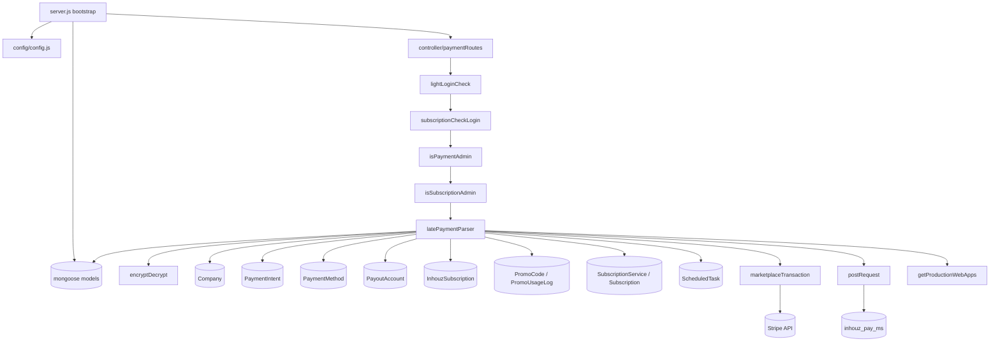

# late_payment_ms

## 1. Summary

Settles a late invoice. A single endpoint takes an encrypted payload naming a company and a
`paymentIntent` (invoice), then either charges the company's Inhouz Cloud payment method through
Stripe, or forwards the debt to `inhouz_pay_ms` for a server-side subscription payment. On success
it records a payment charge, marks the intent processed, advances the account's renewal dates,
reactivates a cancelled company, restarts paused scheduled tasks, and writes promo-code usage.
This file documents the separate git repository `apps/late_payment_ms` (repo id `late_payment_ms`,
path `/workspaces/kilo_inhouz_ai/apps/late_payment_ms`), read from that checkout, not the control
repo.

## 2. Stack and commands

- Runtime: Node.js `"node": ">=12.0.0 <17.5.0"` — `package.json:6-8`
- Entry module: `"main": "server.js"` — `package.json:5`
- Start: `npm start` → `node server.js` — `package.json:11`
- Test: `npm test` → prints "Error: no test specified" and exits 1 — `package.json:10`
- Port: `process.env.PORT` — `server.js:94`; ClusterIP 5051 — `k8s/late-payment-ms-cluster-ip-service.yml:10-11`
- Image `inhouz/late_payment_ms`, replicas 1 — `k8s/late-payment-ms-deployment.yml:6,17`
- Package name is the template default `micro_service_template` (`package.json:2`), though unlike
  the other services in this cluster it does pin `engines`.
- Health probe: `healthcheck.js` calls `GET /healthz` — `healthcheck.js:7`. No such route exists.

## 3. Entry points

| Entry point | `file:line` | How it starts |
|---|---|---|
| Cluster master | `server.js:33-50` | forks one worker per CPU when `NODE_ENV=production`, else one (`server.js:34-37`); re-forks on exit (`server.js:39-50`) |
| Worker / express app | `server.js:51-97` | CORS, body parser 20 MB, hpp, helmet, cookie parser (`server.js:53-64`) |
| Model registration | `server.js:13-31` | 19 `require("./model/...")` calls |
| Mongo connect | `server.js:66-68`, `server.js:99-110` | `connectMongo()`, retried 5s after a disconnect (`server.js:73-80`) |
| HTTP listener | `server.js:94` | `app.listen(process.env.PORT)` |
| Route registration | `server.js:65` → `controller/payment/paymentRoutes.js:9-12` | `require(...)(app)` |
| The single live route | `controller/payment/paymentRoutes.js:10` | `POST /api/latepayment/quickpay` |
| Disabled route | `controller/payment/paymentRoutes.js:11` | `POST /api/latepayment/subscriptionservice/resolve` — commented out |
| Shutdown hooks | `server.js:85-92` | `SIGINT`, `SIGTERM`, `uncaughtException` close mongoose |
| Health probe binary | `healthcheck.js:1-23` | run by the container health check |

No cron, no worker loop, no queue consumer, no websocket handler. The only `setTimeout` is the
Mongo reconnect delay (`server.js:76`). The brief counted it as a timer; it is a retry.

## 4. Module inventory

Paths are from the `apps/late_payment_ms` repository. The repository has 38 files under `model/`,
`services/`, `middlewares/` and `utils/`.

| Module | `file:line` | Owns | Public API | Kind |
|---|---|---|---|---|
| `server.js` bootstrap | `server.js:1-111` | process, cluster, express, DB lifecycle | none | effectful |
| `config()` | `config/config.js:18-65` | secret loading, model names, permission names, service URLs | returns config object | effectful (filesystem, env) + cached state |
| `readSecret()` | `config/config.js:5-15` | reads `SECRETS_PATH/<name>`, env fallback | `(name, envFallback) => string` | effectful |
| `paymentRoutes` | `controller/payment/paymentRoutes.js:9-12` | registers one route | `(app) => void` | effectful |
| `lightLoginCheck` | `middlewares/login/lightLoginCheck.js:9` | decrypts session cookie, validates session, refreshes CSRF cookie | express middleware | effectful (DB, crypto, clock) |
| `subscriptionCheckLogin` | `middlewares/login/subscriptionCheckLogin.js:6` | validates the subscription session | express middleware | effectful (DB) |
| `checkLogin` | `middlewares/login/checkLogin.js:9` | full login check with company load | express middleware | effectful — not mounted on the live route |
| `isPaymentAdmin` | `middlewares/permissions/isPaymentAdmin.js:3` | `paymentAdmin` permission gate | express middleware | reactive (reads `req.user`) |
| `isSubscriptionAdmin` | `middlewares/permissions/isSubscriptionAdmin.js:3` | `subscriptionAdmin` permission gate | express middleware | reactive |
| `moduleAccessCheck` | `middlewares/module/moduleAccessCheck.js:7` | flex-module gate | express middleware | effectful (DB) — not mounted |
| `singleSubdomainValidation` | `middlewares/subdomain/singleSubdomainValidation.js:1` | subdomain match | express middleware | reactive — not mounted |
| `latePaymentParser` | `services/payment/latePaymentParser.js:13-711` | the whole late-payment flow | `(req,res)` | effectful (DB, Stripe, HTTP, clock, crypto) |
| `encryptDecrypt` | `utils/cryptography/encryptDecrypt.js:3` | AES over `crypto-js`; decrypts the request payload, encrypts the outbound one | `(data, encrypt) => string` | pure (deterministic) |
| `marketplaceTransaction` | `utils/payment/stripe/marketplaceTransaction.js:5` | creates a Stripe PaymentIntent, optionally on a connected account | `(params) => stripe object` | effectful (network) |
| `zeroDecimalCurrencies` | `utils/payment/stripe/zeroDecimalCurrencies.js:1` | currency list for amount scaling | array | pure |
| `transactionSplitMap` | `utils/payment/transaction/transactionSplitMap.js:1` | split table used for charge accounting | object | pure |
| `getProductionWebApps` | `utils/appBuilder/getProductionWebApps.js:5` | production sites for a company, refreshed on utility renewal | `(params) => { productionSites }` | effectful (DB) |
| `postRequest` | `utils/requests/postRequest.js:3` | `node-fetch` POST with headers | `(url, headers, data) => json` | effectful (network) |
| `getRequest` | `utils/requests/getRequest.js:3` | `node-fetch` GET | `(url) => json` | effectful (network) |
| `deleteRequest` | `utils/requests/deleteRequest.js:3` | `node-fetch` DELETE | `(url) => json` | effectful (network) |
| `recursiveSanitizer` | `utils/sanitizer/recursiveSanitizer.js:19` | deep sanitises the request body | `{ recursiveSanitizer }` | pure |
| `getUser` | `utils/user/getUser.js:5` | user, roles, permissions | `(userId) => user` | effectful (DB) |
| `createEditByObject` | `utils/user/createEditByObject.js:1` | audit fields | `(user, deployDate) => fields` | pure |

The service is one large handler rather than a layered set of use cases: `latePaymentParser.js:13`
holds the validation, the lookups, the business rules, the external call, the writes and the
response.

## 5. Side effects

| Effect | Where | `file:line` |
|---|---|---|
| MongoDB connect | `server.js` | `server.js:99-110` |
| MongoDB reads: intent, company, payout account, payment method, license, promo code, subscription service | `latePaymentParser` | `:79,148,187,229,268,305,316,328,360` |
| MongoDB writes: charge create, intent update/delete, company status, subscriptions, promo usage log, license renewal, scheduled tasks | `latePaymentParser` | `:413,424,439,535,544,574,620,658,676` |
| Filesystem: secrets | `readSecret` | `config/config.js:5-15` |
| Env read | `config()` | `config/config.js:21-62` |
| Outbound HTTP: `inhouz_pay_ms` server subscription payment | `latePaymentParser` | `:406-410` against `${config.inhouzPayMsUrl}/api/inhouzpay/payment/serversubscriptionpayment`, URL from `config/config.js:62` |
| Outbound HTTP: Stripe PaymentIntent | `marketplaceTransaction` | `utils/payment/stripe/marketplaceTransaction.js:5`, called at `latePaymentParser.js:468` |
| Crypto | `cryptr` for the outbound payload, `encryptDecrypt` for the inbound one, `node-rsa` key load | `:401-405`, `:32`, `config/config.js:43-46` |
| Clock | expiry check, renewal dates, promo window | `:35,301,404,599,614` |
| Logging | `console.log` on every catch branch and on connection state | `:85,153,191,239,274,310,322,334,369,419,434,451,539,558,585,629,644,668,688,704`, `server.js:40-63,71,74,82,95` |

## 6. State and state transitions

The whole service exists to move one `paymentIntent` from unpaid to settled.

Payment intent (`model/payment/paymentIntent.js:25-60`):

| From | To | Trigger | Guard |
|---|---|---|---|
| unpaid (`transactionId` empty) | rejected | `POST /api/latepayment/quickpay` | a `transactionId` already exists → 403 "A transaction already exists for this invoice." (`latePaymentParser.js:133-139`) |
| unpaid | rejected | same | intent not found for the company → 404 (`:89-95`); amount 0 → error body (`:112-118`); company mismatch → 401 (`:65-76`) |
| unpaid | paid | same | Stripe charge returns an id and a status outside `canceled, requires_payment_method, requires_action, requires_source, requires_source_action` (`:468-484`), then charge written (`:535`) and intent updated with `transactionId`, `processed: true`, `inProgress: false` (`:544-557`) |
| unpaid (external service) | paid | same | `inhouz_pay_ms` returns `success` (`:412`), then the intent is deleted (`:413-421`) and the company and subscriptions are set to `active` (`:424-455`) |

Company (`model/company/company.js:5-108`, `status` field):

| From | To | Trigger | Guard |
|---|---|---|---|
| not `active` | rejected | any run | company `status !== 'active'` and not an Inhouz payment → 403 (`:212-221`) |
| vendor not `active` | rejected | any run | asset owner `status !== 'active'` → 403 (`:173-179`) |
| `cancelled` | left alone | successful payment | reactivation is skipped when `company.status === 'cancelled'` (`:656`) |
| inactive | `active` | successful payment with no other unpaid intent | `:649-672` |

License (`model/inhouzSubscription/inhouzSubscription.js`, `active: true` document):

| Field | Transition | Trigger |
|---|---|---|
| `processingSubscriptionPayment`, `inSubscriptionTrial`, `subscriptionRenewalDate`, `lastSubscriptionRenewalDate` | reset on an `inhouz account license` charge (`:596-602`) | `chargeType === 'inhouz account license'` |
| `processingUtilityPayment`, `inUtilityTrial`, `utilityRenewalDate`, counters, `productionWebApps` | reset on any other charge (`:603-617`) | `chargeType !== 'inhouz account license'`; utility renewal is a fixed `+30 days` (`:614`) |

Scheduled task (`model/scheduledTask/scheduledTask.js`, `paused`):

| From | To | Trigger | Guard |
|---|---|---|---|
| `paused: true` | `paused: false` | successful payment | no other due, in-progress Inhouz intent for the company (`:635-692`) |

## 7. Data

MongoDB via mongoose. Collections come from env values
(`mongoose.model(config.xModel, schema, config.xModel)`).

| Model | `file:line` | Env / collection | Key fields and validation | Shared with |
|---|---|---|---|---|
| PaymentIntent | `model/payment/paymentIntent.js:5-87` | `PAYMENT_INTENT_MODEL` → `paymentIntents` | `chargeType` required, enum `inhouz account license, subscription service, inhouz account utility, in-app payment, payment link` (`:9-16`); `companyId`, `timestamp`; `transactionId` is the paid marker; `amount`, `currency`, `processed`, `inProgress`, `dueDate`, `renewalDate`, `isInhouzPayment`, `subscriptionIds`, `subscriptionServiceId`, `assetOwnerCompanyId`; `strict: true`; 12-field index (`:79-84`) | written by the billing schedulers; also read by `payment_ms` for revenue |
| PaymentCharge | `model/payment/paymentCharge.js:5-142` | `PAYMENT_CHARGE_MODEL` → `paymentCharges` | charge ledger: `transactionId`, `stripePaymentIntentId`, `amount`, `currency`, `status`, `initialSuccess`, `transactionSettled`, `inhouzRevenueSplitAmount`, `netChargeRevenueAmount`, `hasPromoCode`, `promoCode`, `chargeOrigination`, `taxState`, `taxCountry` (written at `latePaymentParser.js:502-537`) | `payment_ms` reads it for `getpaymentcharges` |
| PaymentMethod | `model/payment/paymentMethod.js:5-91` | `PAYMENT_METHOD_MODEL` → `paymentMethods` | read for `isInhouzPaymentMethod: true` and `expirationTimestamp > now` (`:229-235`) | `payment_ms` owns writes |
| PayoutAccount | `model/payment/payoutAccount.js:5-68` | `PAYOUT_ACCOUNT_MODEL` → `payoutAccounts` | promo-code payout target, matched on `companyId` and `currency` (`:328-331`) | `payment_ms` owns writes |
| Company | `model/company/company.js:5-108` | `COMPANY_MODEL` → `company` | `status` (`active`, `cancelled`), `stripeCustomerId`, `signupTimestamp`, `companyType` read here | `authentication_ms`, `app_builder_ms` |
| InhouzSubscription | `model/inhouzSubscription/inhouzSubscription.js:5-204` | `INHOUZ_SUBSCRIPTIONS_MODEL` | license document: `active`, `processingSubscriptionPayment`, `subscriptionRenewalDate`, `subscriptionRenewalDayIntervalCount`, `utilityRenewalDate`, `inSubscriptionTrial`, `inUtilityTrial`, counters, `productionWebApps` | `subscription_ms` |
| InhouzSignupPromoCode | `model/inhouzSubscription/inhouzSignupPromoCode.js:5-40` | `INHOUZ_SIGNUP_PROMO_CODE_MODEL` | `promoCode`, `companyId` (the partner), `partnerSplit` | signup flow in `authentication_ms` |
| InhouzSignupPromoUsageLog | `model/inhouzSubscription/inhouzSignupPromoUsageLog.js:5-38` | `INHOUZ_SIGNUP_PROMO_USAGE_LOG_MODEL` | `promoCode`, `assetOwnerCompanyId`, `companyId`, `timestamp`, `activity`, `planName`, `currency`, `amount`, `commission` (`:574-584`) | reporting services |
| Subscription | `model/subscription/subscription.js:6-213` | `SUBSCRIPTION_MODEL` → `subscriptions` | `status` set to `active` for the ids named on the intent (`:439-451`) | `subscription_ms` |
| Subscriber | `model/subscription/subscriber.js:6-73` | `SUBSCRIBER_MODEL` → `subscribers` | subscriber rows; model is registered but no read or write in this service | `subscription_ms` |
| SubscriptionService | `model/subscription/subscriptionService.js:5` | `SUBSCRIPTION_SERVICE_MODEL` → `subscriptionServices` | looked up by `serviceType: 'external'`, `environment: 'production'`, `deployed: true` (`:360-366`) | `subscription_ms` |
| ScheduledTask | `model/scheduledTask/scheduledTask.js:5-94` | `SCHEDULED_TASK_MODEL` → `scheduledTasks` | `active`, `paused`, `companyId`; unpaused after payment (`:676-687`) | `scheduled_task_ms` |
| SubscriptionSession | `model/session/subscriptionSession.js:6-86` | `SUBSCRIPTION_SESSION_MODEL` | subscription login session read by `subscriptionCheckLogin` | `authentication_ms` |
| InhouzApp | `model/appBuilder/inhouzApp.js:6-261` | `INHOUZ_APP_MODEL` | production apps listed on renewal (`utils/appBuilder/getProductionWebApps.js:22`) | `app_builder_ms` |
| Session, User, UserRoles, Role, Permission | `model/session/session.js:5-28`, `model/user/user.js:6-138`, `model/user/useRoles.js:6-51`, `model/rolesAndPermissions/*.js:6-89` | `SESSION_MODEL`, `USER_MODEL`, `USER_ROLES_MODEL`, `ROLE_MODEL`, `PERMISSION_MODEL` | identity and permissions read by the login middlewares | `authentication_ms` writes all of them |

Coupling note: this service is a writer into three other services' domains. It flips
`company.status`, `subscriptions.status`, `scheduledTasks.paused`, and the whole renewal block on
`inhouzSubscriptions`. A change to those field names in `authentication_ms`, `subscription_ms` or
`scheduled_task_ms` breaks late payment silently, because every write has a `.catch` that returns
`{ modifiedCount: 0 }` instead of failing loudly.

## 8. Public interfaces

| Method | Path | Middleware chain | Handler |
|---|---|---|---|
| POST | `/api/latepayment/quickpay` | `lightLoginCheck`, `subscriptionCheckLogin`, `isPaymentAdmin`, `isSubscriptionAdmin` | `controller/payment/paymentRoutes.js:10` |

Request shape (`services/payment/latePaymentParser.js:15-50`):

```
{ encryptedPayload: string }
```

`encryptedPayload` is decrypted by `utils/cryptography/encryptDecrypt.js:3`; the plaintext is
`{ payload: { companyId, paymentIntentId }, expirationTimestamp }` (`:31-50`). Both ids must be
valid ObjectIds, and `companyId` must equal `req.user.companyId` (`:65-76`).

Response shapes:

| Outcome | Status | Body | `file:line` |
|---|---|---|---|
| success (Inhouz path) | 200 | `{ success: true }` | `:701` |
| success (external path) | 200 | `{ success: true }` | `:457` |
| zero-amount invoice | 200 | `{ error: { message } }` | `:113-118` |
| paid but not recorded | 200 | `{ error: { message: "…Please contact support…" } }` | `:564-568` |
| paid but license not updated | 200 | `{ error: { message: "…Please contact support." } }` | `:694-699` |
| unhandled exception | 200 | `{ error: { message: "An error occured while resolving late payment." } }` | `:703-710` |
| bad payload | 400 | `{ error: { message: "Invalid request…" } }` | `:24-28`, `:41-45`, `:58-62` |
| wrong company | 401 | `{ error: { message: "Not Authorized" } }` | `:71-75`, `:126-130` |
| already paid | 403 | `{ error: { message: "A transaction already exists for this invoice." } }` | `:133-139` |
| inactive vendor/account | 403 | `{ error: { message } }` | `:173-179`, `:212-221` |
| missing intent / license / method | 404 | `{ error: { message } }` | `:89-95`, `:278-284`, `:242-248` |
| charge failed / downstream failed | 500 | `{ error: { message } }` | `:479-484`, `:459-464` |

Outbound contract: `POST {INHOUZ_PAY_MS_URL}/api/inhouzpay/payment/serversubscriptionpayment`
with body `{ encryptedPayload }`, where the payload is
`{ payload: { amount, currency, userEmails, subscriptionIds, addonIds, assetOwnerCompanyId, companyId, subscriptionService, tierInFocus, deletePaymentIntentOnFail: true, isRenewal: true, renewalDate, taxIncluded: true }, expirationTimestamp }`
encrypted with `cryptr` and a 30-second expiry (`latePaymentParser.js:384-410`). Expected response:
an object with a truthy `success`, or one with `errorMessage` (`:412`, `:461`).

No events, topics, or CLI commands. No service was found calling this one.

## 9. Configuration

Names only, no values.

Secrets read from files under `SECRETS_PATH` (default `/mnt/secrets`) with env fallback
(`config/config.js:5-15`): `sendgridapikey`/`SENDGRID_API_KEY`, `sessionsecret`/`SESSION_SECRET`,
`mongourl`/`MONGO_URL`, `clientsecretkey`/`CLIENT_SECRET_KEY`, `stripeapikey`/`STRIPE_API_KEY`.

Env vars read in code: `FLEX_FORM_FILE_MODEL`, `FLEX_MODULE_MODEL`, `FLEX_COLLECTION_MODEL`,
`FORM_MODEL`, `SMPL_EMAIL`, `DATA_RULE_EXECUTION_RESULT_MODEL`, `USER_MODEL`, `COMPANY_MODEL`,
`ROLE_MODEL`, `PERMISSION_MODEL`, `USER_ROLES_MODEL`, `SESSION_MODEL`, `SESSION_VALIDATOR_MODEL`,
`AUTH_LOG_MODEL`, `INHOUZ_APP_MODEL`, `COOKIE_DOMAIN`, `PAYMENT_CHARGE_MODEL`,
`PAYMENT_INTENT_MODEL`, `PAYOUT_ACCOUNT_MODEL`, `PAYMENT_METHOD_MODEL`, `SUBSCRIBER_MODEL`,
`SUBSCRIPTION_MODEL`, `INHOUZ_SUBSCRIPTIONS_MODEL`, `SUBSCRIPTION_SESSION_MODEL`,
`SCHEDULED_TASK_MODEL`, `INHOUZ_SIGNUP_PROMO_CODE_MODEL`,
`INHOUZ_SIGNUP_PROMO_USAGE_LOG_MODEL`, `SUBSCRIPTION_SERVICE_MODEL`, `INHOUZ_BASE_URL`,
`INHOUZ_PAY_MS_URL`, `PORT`, `NODE_ENV` (`config/config.js:21-62`, `server.js:34,94`,
`middlewares/login/checkLogin.js:131`).

Set in the deployment but never read by this code: `API_USAGE_LOG_MODEL`, `CHURN_TRACKER_MODEL`,
`CONTACTS_MODEL`, `CUSTOMERS_MODEL`, `DATABASE_MODEL`, `DEPLOYED_API_ENDPOINTS_MODEL`,
`EXCHANGE_RATE_CACHE_MODEL`, `FLEX_API_MODEL`, `FUNCTION_MODEL`, `FUNCTION_VERSION_TRACKER_MODEL`,
`IP_ADDRESS_LOCATION_MODEL`, `IP_LOCATION_FINDER_URL`, `OPEN_EXCHANGE_RATES_API_KEY`,
`OPEN_EXCHANGE_RATES_BASE_URL`, `OPERATION_TRACKER_MODEL`, `QUERY_MODEL`, `QUERY_VERSION_TRACKER`,
`SCHEMA_MODEL`, `SERVICE_DISCOUNT_MODEL`, `SUBSCRIBED_PACKAGE_MODEL`,
`SUBSCRIBER_ACTION_LOG_MODEL`, `SUBSCRIBER_CHANGE_LOG`, `SUBSCRIBER_MIGRATION_QUEUE_MODEL`,
`SUBSCRIPTION_SERVICE_CHARGE_FEE`, `SUBSCRIPTION_SERVICE_CHARGE_TYPE`, `SUBSCRIPTION_USAGE_LOG`,
`SYSTEM_USER_MODEL`, `VERSION_TRACKER_MODEL`, plus `FUNCTION_MS_URL` (`k8s/late-payment-ms-deployment.yml:82`)
and `SCHEDULED_TASK_MS_URL` (`:80`).

Hardcoded config: permission names `admin`, `paymentAdmin` (`config/config.js:38-39`); CORS regex
`/inhouz.localhost/` (`server.js:55`); fixed utility renewal of 30 days
(`services/payment/latePaymentParser.js:614`); 30-second outbound payload expiry (`:404`);
one-year promo window from signup (`:301`).

## 10. Dependencies

From `package.json:12-40` (same set as the template services), direct only.

| Package | Why |
|---|---|
| `express` | HTTP app and routing |
| `mongoose` | MongoDB models and queries |
| `body-parser` | 20 MB JSON bodies (`server.js:61`) |
| `cookie-parser` | signed session cookies (`server.js:64`) |
| `cors` | browser access from the Inhouz apps |
| `helmet`, `hpp` | security headers, parameter pollution guard (`server.js:62-63`) |
| `dotenv` | local `.env` loading (`server.js:1`) |
| `cryptr` | decrypting the inbound payload and encrypting the outbound one (`latePaymentParser.js:401`) |
| `node-rsa` | client key pair (`config/config.js:43-46`) |
| `crypto-js` | payload encryption (`utils/cryptography/encryptDecrypt.js:3`) |
| `stripe` | marketplace charge (`utils/payment/stripe/marketplaceTransaction.js:2`) |
| `node-fetch` | call to `inhouz_pay_ms` (`utils/requests/postRequest.js:3`) |
| `moment` | expiry, renewal dates, promo window |
| `lodash` | `isEqual` comparisons |
| `sanitizer` | request sanitisation |
| `validator` | model field validation in app-builder and role models |
| `shortid` | declared; no call site found in `services/`, `utils/`, `middlewares/`, `config/` |
| `bcryptjs` | declared; no call site found in the same directories |
| `request-ip` | declared; no call site found |
| `@sendgrid/mail` | declared; no send call in this service (no email template here) |
| `connect-mongo`, `express-session` | declared; no session middleware is mounted (`server.js:53-64`) |

## 11. Testing

No tests. `npm test` is the npm stub that exits 1 (`package.json:10`). No test directory, runner or
fixtures. Nothing is covered.

Manual verification needs: a reachable MongoDB (`MONGO_URL`), a session cookie that `lightLoginCheck`
can decrypt with `SESSION_SECRET`, a user holding both `paymentAdmin` and `subscriptionAdmin`, a
seeded unpaid `paymentIntent` with `transactionId` empty, an active `isInhouzPaymentMethod` payment
method with a future `expirationTimestamp`, a Stripe test key, and, for the external path, a
reachable `INHOUZ_PAY_MS_URL`.

## 12. Known issues and risks

1. **One route, and the second is disabled.** `POST /api/latepayment/subscriptionservice/resolve`
   is commented out (`controller/payment/paymentRoutes.js:11`), so the only entry is `quickpay`.
2. **Accidental global.** `payResponse` is assigned without `let`/`const`
   (`services/payment/latePaymentParser.js:406`), so it becomes a process-wide variable shared by
   every request handled by that worker.
3. **Charge written before the intent is marked paid, with no transaction.** The charge is created
   at `:535`, the intent updated at `:544`. If the update fails the caller sees
   "contact support" (`:563-569`) while the money has moved, and the intent still has an empty
   `transactionId`, so the double-payment guard at `:133` does not stop a retry. A retry charges
   the customer again.
4. **Some failures return HTTP 200 with an `error` body** (`:113`, `:564`, `:694`, `:705`), so a
   client that checks only the status treats a failed settlement as success.
5. **`isInhouzPayment: true` hardcoded on the charge** (`:523`) even though the intent carries that
   field (`:107`); the charge record claims an Inhouz payment regardless of the source value.
6. **Promo split is unvalidated.** `partnerSplit` from the promo-code document is used as a
   fraction (`:346`). A value outside 0..1 produces a negative or oversized `serviceFee`.
7. **Silent write failures.** Every write has a `.catch` that returns a count and logs
   (`:434,451,539,558,585,629,668,688`), so a broken schema or lost connection can leave a
   half-settled account with only a log line.
8. **Health check cannot pass.** `healthcheck.js` probes `/healthz` (`healthcheck.js:7`); no route
   serves it (`server.js:65` mounts only the payment route module).
9. **CORS pinned to localhost** (`server.js:55`).
10. **Callback passed to `mongoose.connect` under mongoose 7** (`server.js:99-110`) — the callback
    signature was removed; the connection is not awaited.
11. **Both permission middlewares are required.** The route needs `isPaymentAdmin` and
    `isSubscriptionAdmin` (`controller/payment/paymentRoutes.js:10`); a user missing either cannot
    pay, and the failure body from a permission middleware is HTTP 200 with an `error` object
    (`middlewares/permissions/isSubscriptionAdmin.js:14,22`).
12. **Fixed renewal window.** Utility renewal is hardcoded to 30 days (`:614`) regardless of the
    plan or the `subscriptionRenewalDayIntervalCount` used for the licence path (`:599`).
13. **Template name in `package.json`** (`package.json:2`) and an encrypted credential artifact,
    `service-account.json.enc`, at the repository root.
14. **No tests and no health route**, so nothing exercises the pay path in CI (`package.json:10`).

## 13. Module map



Call direction: one route → four middlewares → one handler → collections, Stripe, and
`inhouz_pay_ms`. There is no domain layer between the handler and the models.

## 14. Open questions

- The brief lists `POST /api/latepayment/subscriptionservice/resolve` as a route; the code has it
  commented out (`controller/payment/paymentRoutes.js:11`). Whether it was removed because the
  external path inside `quickpay` replaced it (`:358-465`) is not stated.
- The brief lists no caller. How a company is directed to this endpoint, and what builds the
  encrypted payload with its `expirationTimestamp`, is not in this repository. The encryption uses
  `config.sessionSecret` (`utils/cryptography/encryptDecrypt.js:3`), so the producer must share
  that secret, but the producer itself was not found.
- `lightLoginCheck` and `subscriptionCheckLogin` were read only at their exported function and
  cookie-writing branches; the exact session and subscription-session conditions were not traced
  line by line.
- Model schemas other than `paymentIntent` were read only at their field-name level, so validation
  rules beyond the listed fields are not documented.
- `kus/` overlays and `deploy.sh` were not read; k8s facts come from `k8s/*.yml`.
- Whether `service-account.json.enc` is used at runtime is unclear: nothing in `server.js`,
  `config/config.js` or the parser references it.
