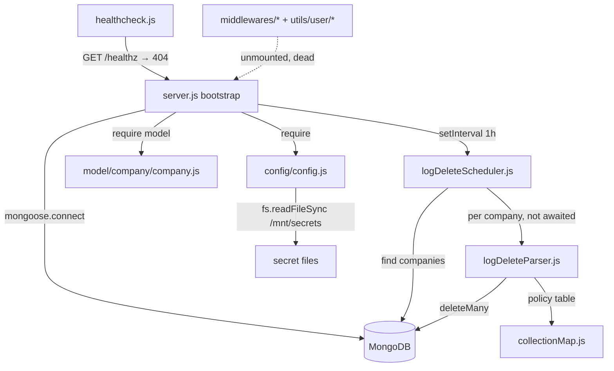

# log_manager_ms

## 1. Summary

`log_manager_ms` is a retention job, not a request-serving service. Once per hour it checks the wall
clock in `America/Chicago`; when the hour is 3 it walks every company in the shared MongoDB and
deletes log and metrics documents older than that company's plan allows. The retention window per
collection lives in a static table (`utils/logManager/collectionMap.js`), so this repository is the
single place where log retention for the whole platform is defined. It lives in its own repository,
`apps/log_manager_ms` (a fork of `micro_service_template`), and ships the image
`inhouz/log_manager_ms`.

## 2. Stack and commands

Node.js on `node:16.4-alpine` (`Dockerfile:1`), Express 4, Mongoose 7
(`package.json:19`, `package.json:24`).

| Item | Value | Evidence |
|---|---|---|
| Package name | `micro_service_template` (leftover from the template) | `package.json:2` |
| `main` | `server.js` | `package.json:5` |
| `test` script | `echo "Error: no test specified" && exit 1` | `package.json:7` |
| `start` script | **none declared** | `package.json:6-8` |
| Container entry | `CMD ["npm", "run", "start"]` | `Dockerfile:11` |
| Port | `process.env.PORT`, k8s sets `5073` | `server.js:68`, `k8s/log-manager-ms-deployment.yml:28-29` |
| Replicas | `1` | `k8s/log-manager-ms-deployment.yml:6` |

The container command does not resolve, because `package.json` has no `start` script. Verified by
reading both files; see section 12. To run it by hand today: `node server.js` with `PORT`,
`MONGO_URL` and `COMPANY_MODEL` set.

## 3. Entry points

| Entry point | Where | How it starts |
|---|---|---|
| Express app | `server.js:16` | Created at require time, inside the process only |
| HTTP listener | `server.js:68` | `app.listen(process.env.PORT, …)` on module load |
| Mongo connection bootstrap | `server.js:29-31` → `server.js:72-84` | Called at load if state is not connected/connecting |
| Hourly retention tick | `server.js:48-56` | `setInterval(…, 1 * 60 * 60 * 1000)` |
| Retention sweep | `utils/logManager/logDeleteScheduler.js:5` | Called from the tick when the Chicago hour is `3` (`server.js:50-53`) |
| Health check probe | `healthcheck.js:1-21` | Separate process, `GET /healthz` on `localhost:$PORT` |

There are **no routes**. `server.js` applies `cors`, `bodyParser.json`, `hpp`, `helmet` and
`cookieParser` (`server.js:17-28`) and then mounts nothing. The only HTTP response the process can
give is Express's default 404, including for `/healthz`.

## 4. Module inventory

| Module / function | `file:line` | Responsibility | Public API | Kind |
|---|---|---|---|---|
| `server.js` bootstrap | `server.js:1-84` | Wire middleware, connect Mongo, start listener, install the hourly tick | none (side-effect module) | `effectful` |
| `connectMongo()` | `server.js:72-84` | `mongoose.connect` with `maxPoolSize: 1` | internal | `effectful` |
| `shutdownFunction()` | `server.js:62-66` | Close the Mongo connection on `SIGINT`/`SIGTERM`/`uncaughtException` | internal | `effectful` |
| hourly tick | `server.js:48-56` | Read Chicago hour, gate on `=== 3`, call scheduler | internal | `effectful` (clock) + `reactive` (keeps no state but reads the clock) |
| `config()` | `config/config.js:17-42` | Build a memoised config object from secret files and env | `() => config` | `effectful`; caches into module-level `cachedConfig` (`config/config.js:16-18`) |
| `readSecret(name, envFallback)` | `config/config.js:4-14` | Read `/mnt/secrets/<name>`, fall back to env | internal | `effectful` (filesystem, env) |
| `logDeleteScheduler()` | `utils/logManager/logDeleteScheduler.js:5-54` | Page through companies, hand each to the parser | `async () => void` | `effectful` |
| `logDeleteParser({company})` | `utils/logManager/logDeleteParser.js:5-52` | Delete expired documents for one company across all mapped collections | `async ({company}) => void` | `effectful` |
| `collectionMap` | `utils/logManager/collectionMap.js:1-171` | Retention policy table: collection → time key, free/paid days, company key, ISO flag | default export object | `pure` |
| `companySchema` / model | `model/company/company.js:5-108` | Company document used to enumerate tenants | `mongoose.model(config.companyModel, …)` | `effectful` (registers a model at require time) |
| `sessionSchema` | `model/session/session.js:5-28` | Session document | model export | `effectful` (registration; file is never required) |
| `userSchema` | `model/user/user.js:6-138` | User document | model export | `effectful` (registration; never required) |
| `userRolesSchema` | `model/user/useRoles.js:6-51` | User-to-role mapping | model export | `effectful` (never required) |
| `roleSchema` | `model/rolesAndPermissions/roles.js:6-87` | Role document | model export | `effectful` (never required) |
| `permissionSchema` | `model/rolesAndPermissions/permissions.js:6-89` | Permission document | model export | `effectful` (never required) |
| `checkLogin` middleware | `middlewares/login/checkLogin.js:9-150` | Session/cookie auth against `sessionModel` | `(req,res,next)` | `effectful`; never mounted |
| `moduleAccessCheck` middleware | `middlewares/module/moduleAccessCheck.js:7-66` | Module entitlement check against `flexModuleModel` | `(req,res,next)` | `effectful`; never mounted |
| `singleSubdomainValidation` middleware | `middlewares/subdomain/singleSubdomainValidation.js:1-24` | Subdomain presence check | `(req,res,next)` | `effectful` (`req` mutation); never mounted |
| `recursiveSanitizer` | `utils/sanitizer/recursiveSanitizer.js:3-19` | Recursively apply an injected sanitizer to an object | `{…}` exports | `pure` (sanitizer is injected) |
| `createEditByObject(user, deployDate)` | `utils/user/createEditByObject.js:1-22` | Build an audit `{createdBy, …}` shape | `(user, deployDate) => object` | `pure`; never required |
| `getUser(userId)` | `utils/user/getUser.js:5-158` | Load user, roles, permissions | `async (userId) => object` | `effectful`; reachable only from `checkLogin` |

Only `utils/logManager/*`, `config/config.js`, `model/company/company.js` and `utils/user/getUser.js`
are reachable from the process. Everything under `middlewares/`, the other `model/` files,
`utils/sanitizer/` and `utils/user/createEditByObject.js` is template scaffolding with no caller.

## 5. Side effects

| Effect | `file:line` | Notes |
|---|---|---|
| Mongo connect | `server.js:73-83` | `maxPoolSize: 1` |
| Mongo reconnect on `disconnected` | `server.js:36-43` | 5 s delay |
| `company.find` | `utils/logManager/logDeleteScheduler.js:11-27` | Paged, 1000 per page |
| `deleteMany` per collection | `utils/logManager/logDeleteParser.js:34-43` | The only write in the service; hard delete |
| `mongoose.model` registration | `utils/logManager/logDeleteParser.js:27-31` | Creates a loose `strict:false` model per unmapped collection |
| Filesystem read | `config/config.js:9` | `fs.readFileSync` on `/mnt/secrets/<name>` |
| Env read | `config/config.js:5`, `:20-39` | Secret names and model names |
| Clock | `server.js:50`, `utils/logManager/logDeleteParser.js:37` | `moment.tz(…,"America/Chicago")`, `moment().subtract(n,'days')` |
| HTTP listen | `server.js:68` | Port 5073 |
| Logging | `server.js:34,37,45,69,82`, `logDeleteScheduler.js:25,41,48,51`, `logDeleteParser.js:41,49` | `console.log` only, including a `console.log('companyId', …)` per company (`logDeleteScheduler.js:41`) |
| Process signal handlers | `server.js:58-61` | `SIGINT`, `SIGTERM`, `uncaughtException` all close Mongo |
| Outbound HTTP | none | No `request`/`axios`/`fetch` in the reachable code |

## 6. State and state transitions

The service has one logical state machine, the retention run. It has no persisted state of its own.

| From | To | Trigger | Guard |
|---|---|---|---|
| idle | tick evaluated | hourly `setInterval` (`server.js:48`) | none |
| tick evaluated | skipped | tick fires | Chicago hour ≠ 3 (`server.js:51`) |
| tick evaluated | sweep started | tick fires | Chicago hour === 3 |
| sweep started | company batch loaded |  | Mongo `find` succeeds |
| company batch loaded | company processed | per-row loop (`logDeleteScheduler.js:39-43`) | none |
| company processed | next batch | last row of a full page | `docCount === limit` (`logDeleteScheduler.js:44-46`) |
| company processed | sweep complete | partial page | `docCount < limit` |
| sweep started | sweep aborted | `find` rejects | `companies['error']` path (`logDeleteScheduler.js:24-33`) |
| any | idle | scheduler returns | always, including on error (`:50-53`) |

The sweep also runs once per overlapping tick: the tick fires every hour and the guard is
`timeHour === 3`, so exactly one hour of each Chicago day qualifies. Because the run is `async` and
not serialised, a run still in flight at 04:00 is not joined by a second one, but a restart between
03:00 and 04:00 re-triggers a full sweep on the next tick.

## 7. Data

This service owns no collection. It reads and deletes in the shared `inhouz` database, so every
collection below is written by another service and only aged out here.

Tenant source: `company` (env `COMPANY_MODEL`, `k8s/log-manager-ms-deployment.yml:52-53`). The
schema is `model/company/company.js:5-108`; the fields this job uses are `_id`, `companyType` and
`companyName`/`subDomain` (index at `model/company/company.js:100-106`). `companyType` is an enum of
`enterpriseMax | enterprise | solopreneur | entrepreneur | thirdParty | smb | founder | freelancer`,
default `solopreneur` (`model/company/company.js:10-18`).

Selection rule: every company except `thirdParty` (`logDeleteScheduler.js:13-16`). Retention:
`freelancer` gets `freePlanDays`, every other type gets `paidPlanDays` (`logDeleteParser.js:11`,
`:22`). There is no subscription or status check, so a lapsed paid tenant keeps the paid window.

Deletion rule per collection: `deleteMany({ [companyKey]: companyId, [timeKey]: { $lte: now - days } })`
(`logDeleteParser.js:34-39`). `timeKey` is a millisecond epoch for every collection except the one
flagged `isISODate`.

Collections and windows, all from `utils/logManager/collectionMap.js:1-171`. The "written by" column
is inferred from the name only; it was not verified against the owning repository.

| Collection | Line | `timeKey` | Company key | Free | Paid | Written by (inferred) |
|---|---|---|---|---|---|---|
| `apiUsageLogs` | `:2` | `timestamp` | `assetOwnerCompanyId` | 5 | 30 | api_service_ms |
| `appBuildReportLog` | `:8` | `deployDate` | `companyId` | 2 | 14 | app_builder_ms |
| `appVisitLogs` | `:14` | `timestamp` | `companyId` | 5 | 30 | inhouzio_app_ms |
| `authenticationLogs` | `:20` | `timestamp` | `companyId` | 5 | 30 | authentication_ms |
| `databaseTransactionLogs` | `:26` | `timestamp` | `companyId` | 5 | 30 | database_execution_ms |
| `flexApiDeleteLogs` | `:32` | `timestamp` | `companyId` | 5 | 30 | flex_api_ms |
| `flexApiDeploymentLogs` | `:38` | `createdDate` | `companyId` | 5 | 30 | flex_api_ms |
| `inhouzAppSessionDurationLogs` | `:44` | `timestamp` | `companyId` | 40 | 380 | app_metrics_ms |
| `inhouzAppMetrics` | `:50` | `timestamp` | `companyId` | 40 | 380 | app_metrics_ms |
| `inhouzAppPageMetrics` | `:56` | `timestamp` | `companyId` | 40 | 380 | app_metrics_ms |
| `inhouzAppUniqueVisitorTracker` | `:62` | `datestamp` | `companyId` | 40 | 380 | app_metrics_ms |
| `inhouzPaySessionDurationLog` | `:68` | `timestamp` | `companyId` | 40 | 380 | inhouz_pay_ms |
| `inhouzPayUniqueVisitorTracker` | `:74` | `datestamp` | `companyId` | 40 | 380 | inhouz_pay_ms |
| `inhouzPayVisitMetrics` | `:80` | `timestamp` | `companyId` | 40 | 380 | inhouz_pay_ms |
| `inhouzPaymentMetrics` | `:86` | `timestamp` | `companyId` | 40 | 380 | payment_ms |
| `inhouzSignMetrics` | `:92` | `timestamp` | `companyId` | 40 | 380 | inhouz_sign_ms |
| `inhouzSignSessionDurationLogs` | `:98` | `timestamp` | `companyId` | 40 | 380 | inhouz_sign_ms |
| `paymentDistributionMetrics` | `:104` | `timestamp` | `companyId` | 40 | 380 | inhouz_pay_ms |
| `pdfGeneratorMetrics` | `:110` | `timestamp` | `companyId` | 40 | 380 | pdf_generator_ms |
| `pdfGeneratorSessionDurationLogs` | `:116` | `timestamp` | `companyId` | 40 | 380 | pdf_generator_ms |
| `remoteNetworkRequestLogs` | `:122` | `timestamp` | `companyId` | 5 | 60 | remote_network_request_ms |
| `scheduledTaskLogs` | `:128` | `executionTimestamp` | `companyId` | 5 | 60 | scheduled_task_* |
| `subscriberActionLogs` | `:134` | `timestamp` | `assetOwnerCompanyId` | 30 | 180 | inhouz_subscription_ms |
| `subscriberDataUpdateLogs` | `:140` | `timestamp` | `assetOwnerCompanyId` | 5 | 45 | inhouz_subscription_ms |
| `subscriberUsageLogs` | `:146` | `usageTimestamp` | `assetOwnerCompanyId` | 7 | 60 | inhouz_subscription_ms |
| `subscriptionSessionAuthLogs` | `:152` | `updatedAt` | `assetOwnerCompanyId` | 2 | 45 | inhouz_subscription_ms (ISO dates, never deleted — §12) |
| `systemUserAccountLogs` | `:159` | `createdDate` | `companyId` | 15 | 60 | authentication_ms |
| `failedPushNotificationQueue` | `:165` | `timestamp` | `companyId` | 1 | 2 | push_notification_parser_ms |

Two company-key families exist, and they are not interchangeable: `companyId` (the tenant acting)
and `assetOwnerCompanyId` (the tenant who owns the asset). The map handles this per collection
(`collectionMap.js:6`, `:138`, `:144`, `:150`, `:157`). A collection missing from the map is never
cleaned, whatever else writes to it.

## 8. Public interfaces

No HTTP routes, no events, no queue topics, no CLI commands.

| Surface | Shape | Evidence |
|---|---|---|
| `GET /healthz` | Expects 200; the app registers nothing, so it returns 404 | `healthcheck.js:6-7`, `server.js:16-70` |
| hourly tick | Internal only; no external trigger | `server.js:48-56` |
| retention policy | `{ [collection]: { timeKey, freePlanDays, paidPlanDays, isISODate?, companyKey } }` | `collectionMap.js:2-170` |

Consumers depend on this service only through the database: deleting from a collection is visible to
every service that reads it, and none of them is notified.

## 9. Configuration

Names only. Values are never reproduced here.

Env read in reachable code: `PORT` (`server.js:68`, `healthcheck.js:6`),
`SECRETS_PATH` (`config/config.js:5`), `COMPANY_MODEL` (`config/config.js:30`), `NODE_ENV`
(`middlewares/login/checkLogin.js:129`). Env read into the config object but unused by the retention
path: `FLEX_FORM_FILE_MODEL`, `FLEX_MODULE_MODEL`, `FLEX_COLLECTION_MODEL`, `FORM_MODEL`,
`SMPL_EMAIL`, `DATA_RULE_EXECUTION_RESULT_MODEL`, `SENDGRID_API_KEY`, `SESSION_SECRET`, `MONGO_URL`,
`CLIENT_SECRET_KEY`, `USER_MODEL`, `ROLE_MODEL`, `PERMISSION_MODEL`, `USER_ROLES_MODEL`,
`SESSION_MODEL`, `SESSION_VALIDATOR_MODEL`, `AUTH_LOG_MODEL`, `COOKIE_DOMAIN`
(`config/config.js:20-39`).

Secret files under `SECRETS_PATH` (default `/mnt/secrets`): `sendgridapikey`, `sessionsecret`,
`mongourl`, `clientsecretkey` (`config/config.js:24`, `:27`, `:28`, `:38`).

Hard-coded config values: `adminPermission: "admin"` (`config/config.js:37`).

Set in k8s but never read by this code: every `*_MODEL` other than `COMPANY_MODEL`,
`COOKIE_NAME`, `INHOUZ_FROM_EMAIL`, `SCHEDULED_TASK_PARSER_MS_URL`, `PAYMENT_MS_URL`,
`OPEN_EXCHANGE_RATES_BASE_URL`, `IP_LOCATION_FINDER_URL`, `SUBSCRIPTION_SERVICE_CHARGE_FEE`,
`SUBSCRIPTION_SERVICE_CHARGE_TYPE`, `SUBSCRIBER_CHANGE_LOG`, `SUBSCRIPTION_USAGE_LOG`
(`k8s/log-manager-ms-deployment.yml:40-125`). They are inherited from a sibling service's manifest.

## 10. Dependencies

Direct, from `package.json:11-33`.

| Package | Why it is here |
|---|---|
| `express` | HTTP shell; no routes are mounted |
| `mongoose` | Connection, model registration, `find`/`deleteMany` |
| `dotenv` | Loads `.env` before config reads env (`server.js:1`) |
| `body-parser`, `cookie-parser`, `cors`, `hpp`, `helmet` | Middleware stack (`server.js:17-28`); none affects the job |
| `moment`, `moment-timezone` | Chicago-hour gate and retention cut-off (`server.js:9-10`, `:50`; `logDeleteParser.js:2`, `:37`). `moment-timezone` is required at `server.js:10` but never referenced |
| `lodash`, `sanitizer` | Used only by the unmounted middlewares and `recursiveSanitizer` |
| `cryptr`, `crypto-js` | Used only by `checkLogin.js:3-4`, `:125` |
| `validator` | Used only by the unrequired role and permission models |
| `@sendgrid/mail`, `bcryptjs`, `connect-mongo`, `express-session`, `shortid`, `request-ip` | Not referenced in the reachable code; carried over from the template |

## 11. Testing

There are no tests. `npm test` is the template stub and exits 1 (`package.json:7`). No test directory,
no test framework in the dependency list. The retention logic, the plan-to-window mapping and the
pagination loop are all unverified by any automated check, and the delete path has no dry-run or
`countDocuments` pre-check.

## 12. Known issues and risks

1. **The container cannot start.** `Dockerfile:11` runs `npm run start`; `package.json:6-8` declares
   only `test`. Risk: deploy fails, or the image is only ever run with an explicit `node server.js`
   override that is not in this repository.
2. **The health check cannot pass.** `healthcheck.js:7` probes `/healthz`; no route is registered
   (`server.js:16-70`) and `Dockerfile` has no `HEALTHCHECK` despite the comment at `healthcheck.js:7`.
   Risk: a liveness or readiness probe wired to this script restarts the pod forever.
3. **`isISODate` collections are never deleted.** `logDeleteParser.js:33` guards a block with no
   `else`, so `subscriptionSessionAuthLogs` (`collectionMap.js:152-158`) is read from the map and
   skipped every run. Risk: unbounded growth in that collection.
4. **A failed page fetch aborts the whole sweep silently.**
   `logDeleteScheduler.js:24-33` returns `{error:true}` from the `.catch`; the check
   `companies['error']` then advances `skip` and `docCount = limit`, so the `do/while` continues with
   no deletions, and `companies.length` on a non-array ends the loop. The service logs
   `logDelete complete` (`:48`) regardless.
5. **Deletes are fire-and-forget.** `logDeleteScheduler.js:42` calls `logDeleteParser({company})`
   without `await` inside the loop, so per-company work overlaps for a 1000-company page and the
   scheduler returns before deletions finish. No concurrency cap, no back-pressure, and rejections are
   swallowed inside the parser (`logDeleteParser.js:48-51`).
6. **Pagination assumes the company collection is stable.** `skip`/`limit` paging over
   `logDeleteScheduler.js:22-23` is only correct because the job never writes to `company`. Any other
   writer that inserts mid-sweep shifts the pages.
7. **Retention ignores subscription state.** `logDeleteParser.js:11` branches on `companyType` only, so
   a churned non-freelancer tenant retains paid-tier log windows indefinitely.
8. **One replica is load-bearing.** `k8s/log-manager-ms-deployment.yml:6`. Two replicas would run two
   concurrent deletions over the same collections, and the job has no lock or leader election.
9. **No service object and no CronJob.** No `kind: Service` exists in `k8s/` or `kus/`, so the pod is
   unreachable; the schedule lives inside the process (`server.js:48`), so a pod restart after 03:00
   Chicago skips that day's sweep.
10. **`git remote -v` prints a credential.** The repository's own remote is clean
    (`apps/log_manager_ms/.git/config:9` is a plain `https://github.com/…` URL). The token appears
    because the workspace global config `/home/node/.gitconfig` defines a
    `url.https://<token>@github.com/.insteadOf https://github.com/` rewrite. The credential is
    therefore environmental, not committed, but any command that echoes the remote leaks it into
    logs and transcripts. Value not reproduced here.
11. **An encrypted service-account blob is committed.** `service-account.json.enc`. Nothing in the
    repository references it: `build_ga.sh`, `build_ga_prod.sh`, `deploy.sh` and the workflows use
    GitHub secrets (`cicd-dev.yml:22`, `cicd-prod.yml:22`) instead. Risk: a stale encrypted credential
    whose key is unknown.
12. **Per-company logging at scale.** `logDeleteScheduler.js:41` prints every company id, which is a
    tenant identifier, once per sweep.
13. **Template debris.** `package.json:2-4` advertises `micro_service_template`; five model files and
    three middlewares are dead; `config.js` builds a 20-key object of which one key (`companyModel`,
    `config.js:30`) is used. Risk: readers assume an API exists that does not.

## 13. Module map

## 14. Open questions

- Which component is supposed to start the process, given `Dockerfile:11` and the missing `start`
  script? Not determinable from this repository; k8s has no `command`/`args` override
  (`k8s/log-manager-ms-deployment.yml:15-126`).
- `subscriptionSessionAuthLogs` uses `updatedAt` with `isISODate` (`collectionMap.js:152-158`). Was the
  ISO branch intended to delete with a Mongo date comparison and never implemented, or was the
  collection meant to be exempt?
- The `*_MODEL` env vars set in `k8s/log-manager-ms-deployment.yml:40-125` are not read here. Is the
  manifest copied from another service, and is a separate CronJob meant to exist?
- No provenance was checked for the "written by" column in section 7. It is inferred from collection
  names only.
- Whether the repository is still maintained: last commit is a merge of `jeremiah-dev`
  (`git log`, `4257544`). No board row was consulted, by instruction.
