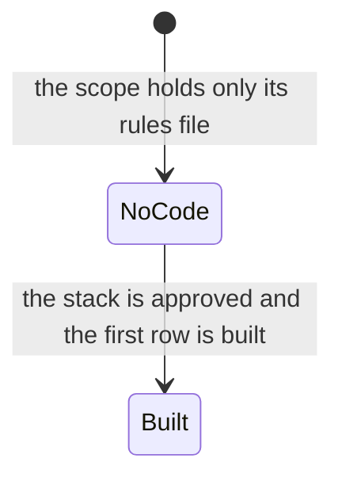
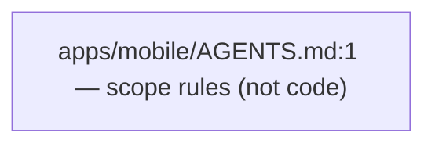

# HANDOVER — `mobile` unit

Every claim below carries a `file:line` citation. A row without one was dropped.

Written by the `docs-writer` agent (`.kilo/agent/docs-writer.md:8`). Mode: **full read** of
`apps/mobile/`.

## 1. Summary

The mobile scope exists as a placeholder. The folder `apps/mobile/` holds exactly one file,
`apps/mobile/AGENTS.md:1`, the scope rules for the mobile builder. There is no source, no package
manifest, no build, no app bundle and no test file. The unit is a rulebook for code that has not
been written yet, and nothing may be written into it before the decision gate and the discovery
interview have run (`AGENTS.md:145`).

## 2. Stack and commands

| Item | Value |
|---|---|
| Stack | `TBD` — `docs/STACK.md:63` |
| Package manager | `TBD` — `docs/STACK.md:66` |
| Dev command | `TBD` — `docs/STACK.md:67` |
| Verification command | `TBD` — `docs/STACK.md:68` |
| Port | `TBD` — `docs/STACK.md:69` |

The stack is decided by the user at the decision gate (`AGENTS.md:214`); nothing is guessed. The
scope rules also say the stack comes from `docs/STACK.md` (`apps/mobile/AGENTS.md:14`).

## 3. Entry points

None yet. There is no executable, no dev server, no screen and no script in this scope. The files
the scope will own once it is built are named by its own rules (`apps/mobile/AGENTS.md:19`):

- screens/components
- navigation
- state
- API access
- storage
- platform integrations
- assets
- tests

The mobile scope must build a component factory before any screen
(`apps/mobile/AGENTS.md:46`), and that gallery is approved by the user (`AGENTS.md:561`).

## 4. Module inventory

| Symbol | file:line | Responsibility | Public API | Kind |
|---|---|---|---|---|
| `apps/mobile/AGENTS.md` | `apps/mobile/AGENTS.md:1` | The scope rules for the mobile builder: scope, structure, code style, the component factory gate, visual quality, QA evidence, production expectations, verification. | The rules themselves. | not code — a Markdown rules file, so it carries no pure/reactive/effectful kind |

There is no other file in this scope, so there is no other row.

## 5. Side effects

None. There is no code in this scope, so it touches no database, network, filesystem, env, clock,
randomness source or logger. Platform integrations and storage are named as future responsibilities
(`apps/mobile/AGENTS.md:19`), not present ones.

## 6. State and state transitions

None yet. The scope rules name `state` and `storage` as places the future code will hold state
(`apps/mobile/AGENTS.md:19`), but no state, no store and no transition exists today.

## 7. Data

None. No models, schemas, collections or migrations exist in this scope. The data contracts for
the application will live in `docs/API_CONTRACTS.md:1`, which is still a placeholder.

## 8. Public interfaces

None yet. No deep links, events, queue topics or CLI commands are exposed by this scope. The
future interface between the mobile app and the `api` unit is not written yet.

## 9. Configuration

None. No env var or config key is used by this scope. `docs/ENVIRONMENT.md:1` holds the empty
table for the whole repository. Names only would be recorded here; values are never written
(`AGENTS.md:1469`).

## 10. Dependencies

None yet. There is no `package.json` in this scope, so the unit has no direct dependency. The
scope rules forbid adding a dependency that the task does not justify
(`apps/mobile/AGENTS.md:19`).

## 11. Testing

None. There is no test runner, no test file and no CI in this scope. The scope rules require the
verification command from `docs/STACK.md` (`apps/mobile/AGENTS.md:104`), which is `TBD` today.

## 12. Known issues and risks

- **The scope rules are written but no application has been built.** Every section of this
  handover is empty because the scope holds one rules file (`apps/mobile/AGENTS.md:1`). That is
  the truth, not a gap in the read.
- **The stack is `TBD`** (`docs/STACK.md:63`), so no command in this scope can be run.
- **Mobile is optional.** `docs/STACK.md:18` marks the mobile dev command as applicable "when
  applicable", so the decision gate may drop this scope entirely.

## 13. Module map

One node, because the scope holds one file. When code arrives it will grow: a component factory
and a gallery first, then screens (`apps/mobile/AGENTS.md:46`).

## 14. Open questions

- What application will this scope build? `DOMAIN.md:1` is `TBD` and the discovery interview
  (`AGENTS.md:145`) has not run.
- Which platform, framework and package manager? `docs/STACK.md:63` is `TBD`.
- Will a mobile scope exist at all? `docs/STACK.md:18` leaves it optional.
