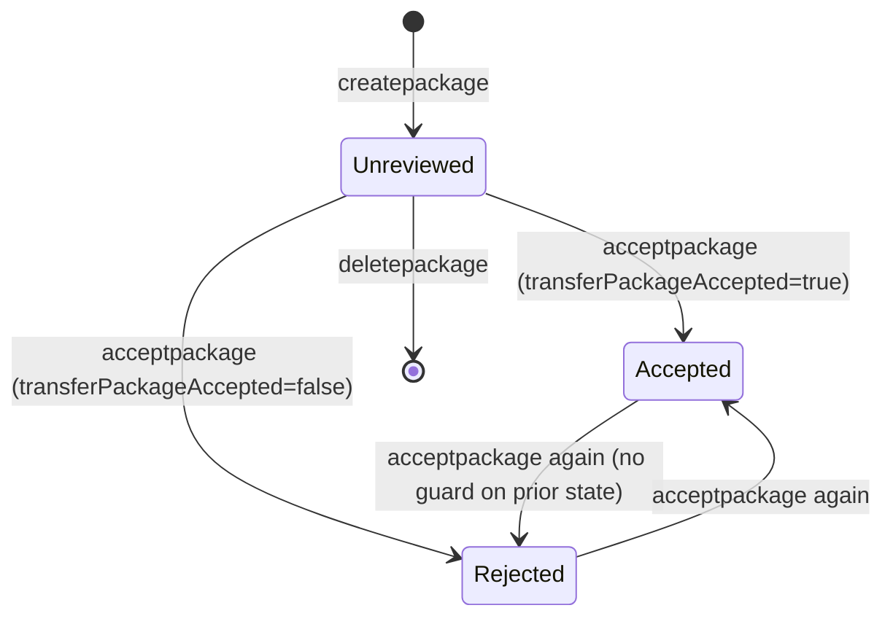
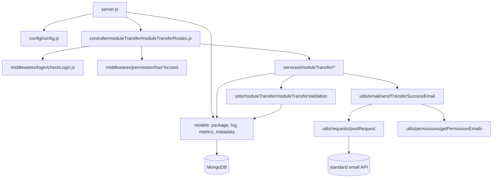

# module_transfer_ms

## 1. Summary

`module_transfer_ms` moves a bundle of app-builder artefacts from one Inhouz company account to
another. A user composes a *module transfer package* naming web apps, web components, Inhouz APIs,
Inhouz Sign templates and PDF generator templates; the recipient company reviews and accepts or
rejects it, and the service records a log and metrics row for each transfer. It lives in the
separate repository `/workspaces/kilo_inhouz_ai/apps/module_transfer_ms/` (repo id is the folder
name itself, resolved through `.kilo/repos.json`), not in the control repo.

## 2. Stack and commands

- Runtime: Node.js on Express 4. No Node version is pinned in the repo (`package.json` has no
  `engines` field).
- `package.json:5` — `main` is `server.js`.
- `package.json:6-8` — the only script is `test`, and it is the npm-init placeholder
  (`echo "Error: no test specified" && exit 1`).
- Start command: `node server.js` (`server.js:1-107`). There is no `start` script.
- Port: `PORT` env var (`server.js:90`); the k8s manifest pins `5078`
  (`k8s/module-transfer-ms-deployment.yml:29`, `k8s/module-transfer-ms-cluster-ip-service.yml:10`).
- Health probe: `node healthcheck.js` requests `http://localhost:$PORT/healthz` (`healthcheck.js:3-8`).
- Container: `Dockerfile`, `docker-compose.yml`, `deploy.sh`, `build_ga.sh`, `build_ga_prod.sh` at
  the repo root.

## 3. Entry points

| Entry point | Location | How it starts |
|---|---|---|
| HTTP server | `server.js:48` (`express()`), `server.js:90` (`app.listen(process.env.PORT)`) | `node server.js` |
| Cluster master | `server.js:29-46` | forks `os.cpus().length` workers in production, 1 otherwise (`server.js:30`) |
| Route registration | `server.js:61` → `controller/moduleTransfer/moduleTransferRoutes.js:15-25` | called once per worker at boot |
| Mongo connect + reconnect | `server.js:62-64`, `server.js:95-107`, retry timer `server.js:72` | on boot, and 5 s after a disconnect event |
| Healthcheck binary | `healthcheck.js:1-21` | `node healthcheck.js` from the container probe |

There is no cron, worker loop, queue consumer or websocket handler. The only timer is the Mongo
reconnect `setTimeout` (`server.js:72`).

## 4. Module inventory

Kind: `pure` = deterministic, no I/O; `reactive` = reads/writes in-process state;
`effectful` = Mongo, network, filesystem, env, clock or logging.

| Module | Location | Owns | Public API | Kind |
|---|---|---|---|---|
| server bootstrap | `server.js:1` | express app, middleware stack, model registration, cluster fork, Mongo connect | none (process entry) | effectful |
| config factory | `config/config.js:18` | reads secrets from `SECRETS_PATH` files with env fallback, caches the object | `module.exports = () => config` | effectful (filesystem, env, module-level cache) |
| `readSecret` | `config/config.js:5` | read one secret file, fall back to an env var | `readSecret(name, envFallback)` | effectful |
| route module | `controller/moduleTransfer/moduleTransferRoutes.js:15` | maps 9 POST routes to middleware + service | `(app) => void` | effectful (mutates app) |
| `createModuleTransferPackage` | `services/moduleTransfer/createModuleTransferPackage.js:10` | validates license/company/plan, validates package, inserts package doc, sends email | `(req,res)` | effectful |
| `editModuleTransferPackage` | `services/moduleTransfer/editModuleTransferPackage.js:7` | updates a package; strips `transferInProgress` from the payload (`:156-157`); refuses edit while a transfer is running (`:129`) | `(req,res)` | effectful |
| `deleteModuleTransferPackage` | `services/moduleTransfer/deleteModuleTransferPackage.js:6` | deletes a package and its logs | `(req,res)` | effectful |
| `getModuleTransferPackage` | `services/moduleTransfer/getModuleTransferPackage.js:6` | reads one package, license-gated | `(req,res)` | effectful |
| `getModuleTransferPackages` | `services/moduleTransfer/getModuleTransferPackages.js:11` | lists packages with filter maps | `(req,res)` | effectful |
| `acceptModuleTransferPackage` | `services/moduleTransfer/acceptModuleTransferPackage.js:7` | recipient accept/reject; sets `transferPackageAccepted` + `transferPackageReviewed` (`:119-130`); sends two emails (`:145-160`) | `(req,res)` | effectful |
| `getModuleTransferLogs` | `services/moduleTransfer/getModuleTransferLogs.js:10` | reads transfer logs for a package | `(req,res)` | effectful |
| `getModuleEnvironmentVariables` | `services/moduleTransfer/getModuleEnvironmentVariables.js:6` | collects env-var names/values from each module type before transfer | `(req,res)` | effectful |
| `checkTransferInProgress` | `services/moduleTransfer/checkTransferInProgress.js:6` | reports `transferInProgress` for a package (`:85-91`) | `(req,res)` | effectful |
| `moduleTransferValidation` | `utils/moduleTransfer/moduleTransferValidation.js:4` | validates package name, both company ids, distinctness, active accounts, and that every module exists for the sender | `(params) => {isValid} \| {error}` | effectful (Mongo reads) — the field checks themselves are pure but it also queries 6 collections |
| `sendTransferSuccessEmail` | `utils/email/sendTransferSuccessEmail.js:5` | builds the notice body per `emailType`, resolves admin recipients, POSTs to the email API | `(params)` | effectful |
| `postRequest` / `getRequest` / `deleteRequest` | `utils/requests/postRequest.js:3`, `getRequest.js:3`, `deleteRequest.js:3` | `node-fetch` wrappers | `(url, headers, data)` | effectful |
| `moduleTransferFilterMap` | `utils/moduleTransfer/moduleTransferFilterMap.js:1` | list-filter field → query map | object | pure |
| `moduleTransferNonRegexMap` | `utils/moduleTransfer/moduleTransferNonRegexMap.js:1` | fields that must not be regex-matched | array | pure |
| `moduleTransferTypeMap` | `utils/moduleTransfer/moduleTransferTypeMap.js:1` | field → cast type | object | pure |
| `checkLogin` | `middlewares/login/checkLogin.js:9` | session cookie decrypt (`:20`), session doc lookup (`:24`), user/company load | `(req,res,next)` | effectful |
| `moduleAccessCheck` | `middlewares/module/moduleAccessCheck.js:7` | app-module entitlement check | `(req,res,next)` | effectful |
| `hasReadAccess` / `hasWriteAccess` / `hasAdminAccess` / `hasRunAccess` | `middlewares/permission/hasReadAccess.js:3`, `hasWriteAccess.js:3`, `hasAdminAccess.js:3`, `hasRunAccess.js:3` | permission gate on `req.user.permissions` (`hasReadAccess.js:7-10`) | `(req,res,next)` | pure (in-memory check, no I/O) |
| `singleSubdomainValidation` | `middlewares/subdomain/singleSubdomainValidation.js:1` | subdomain check; not mounted on this service's routes | `(req,res,next)` | effectful |
| `ModuleTransferPackage` model | `model/moduleTransfer/moduleTransferPackage.js:82` | package schema | mongoose model | effectful |
| `ModuleTransferLog` model | `model/moduleTransfer/moduleTransferLogs.js:49` | one row per transfer attempt | mongoose model | effectful |
| `ModuleTransferMetrics` model | `model/moduleTransfer/moduleTransferMetrics.js:41` | per-package counters and durations | mongoose model | effectful |
| `ModuleTransferMetadata` model | `model/moduleTransfer/moduleTransferMetadata.js:27` | compressed metadata blob per company pair | mongoose model | effectful |
| imported read-only models | `model/company/company.js:108`, `model/inhouzSubscription/inhouzSubscription.js:227`, `model/inhouzApi/flexApi.js:234`, `model/appBuilder/inhouzApp.js:306`, `model/inhouzSign/inhouzSignTemplate.js:624`, `model/pdfGenerator/pdfGeneratorTemplate.js`, `model/user/user.js:138`, `model/rolesAndPermissions/*`, `model/session/session.js:28` | foreign schemas required at boot (`server.js:13-27`) so `mongoose.model()` can resolve them | mongoose models | effectful |

## 5. Side effects

| Effect | Location |
|---|---|
| Secret files read from `SECRETS_PATH` (default `/mnt/secrets`) | `config/config.js:6-10` |
| Env vars read | `config/config.js:22-58`, `server.js:30`, `server.js:90` |
| Mongo connect, pool size 1 | `server.js:96-104` |
| Mongo reconnect timer, 5 s | `server.js:69-76` |
| SIGINT/SIGTERM/uncaughtException close the Mongo connection | `server.js:80-88` |
| Inserts into the package collection | `createModuleTransferPackage.js:103-110` |
| Update reviewed/accepted flags | `acceptModuleTransferPackage.js:119-130` |
| Update package on edit | `editModuleTransferPackage.js:215` |
| Delete package plus logs | `deleteModuleTransferPackage.js:24`, `:52` |
| HTTP POST to the standard email API (`config.standardEmailApiUrl`) | `utils/email/sendTransferSuccessEmail.js:65-69` |
| HTTP client wrappers (`node-fetch`) | `utils/requests/postRequest.js:4` |
| Clock: `new Date().getTime()` for timestamps | `createModuleTransferPackage.js:13` |
| Randomness: none in this service's modules (no `crypto`/`shortid` use found in `services/`, `utils/moduleTransfer/`) | — |
| Logging: `console.log` / `console.error` throughout | e.g. `createModuleTransferPackage.js:21`, `server.js:36`, `healthcheck.js:17` |
| Cluster fork and worker respawn | `server.js:29-46` |

## 6. State and state transitions

The service has no explicit state machine; package state is three booleans on one document.

| State | Field | Set by |
|---|---|---|
| Created / unreviewed | `transferPackageReviewed=false`, `transferPackageAccepted=false` | default at `model/moduleTransfer/moduleTransferPackage.js:18-25`, created at `createModuleTransferPackage.js:103` |
| Reviewed | `transferPackageReviewed=true` | `acceptModuleTransferPackage.js:127` |
| Accepted | `transferPackageAccepted=true`, reviewed true | `acceptModuleTransferPackage.js:125-128` |
| Rejected / switched off | `transferPackageAccepted=false`, reviewed true | same update, value from the request body (`:11`, `:126`) |
| Transfer running | `transferInProgress=true` | never set in this repo; only read (`checkTransferInProgress.js:91`, `editModuleTransferPackage.js:129`) and stripped on edit (`:156-157`) |
| Continuous transfers allowed | `allowContinuousTransfers` | request body at create (`model/...:26-29`) |

Guards:

- Only the recipient company may accept or reject (`acceptModuleTransferPackage.js:111-117`).
- The sender's company must be `status: "active"` (`createModuleTransferPackage.js:67-73`).
- A `freelancer` service plan cannot create a transfer (`createModuleTransferPackage.js:79-85`).
- `transferInProgress` blocks validation (`utils/moduleTransfer/moduleTransferValidation.js:14-20`).
- Sender and recipient must differ (`moduleTransferValidation.js:55-61`).
- Accept/reject requires `modifiedCount > 0` or it returns 500 (`acceptModuleTransferPackage.js:136-142`).

## 7. Data

Four owned collections. Collection names come from env vars, so the physical name is deployment
configuration, not a constant in the repo. The k8s deployment sets them to `moduleTransferPackages`-
style camelCase names for the shared models (see `k8s/module-transfer-ms-deployment.yml:137-203`);
the transfer-specific names are not visible in the repo, only their env var.

| Model | Collection env var | Key fields | Validation |
|---|---|---|---|
| `ModuleTransferPackage` | `MODULE_TRANSFER_PACKAGE_MODEL` (`config/config.js:44`) | `packageName`, `companyId`, `recipientCompanyId`, `modules[]`, `createdDate`, `createdById`, flags | required: `packageName`, `companyId`, `recipientCompanyId`, `createdDate`, `createdById`; `modules[].moduleType` enum `webApp\|webComponent\|pdfGeneratorTemplate\|inhouzSignTemplate\|inhouzAPI` (`model/moduleTransfer/moduleTransferPackage.js:30-55`); `strict: true` (`:72`) |
| `ModuleTransferLog` | `MODULE_TRANSFER_LOG_MODEL` (`config/config.js:45`) | `packageId`, `companyId`, `timestamp`, `createdById`, `transferDurationMs`, `transferStatus`, `failMessage` | `transferStatus` enum `success\|fail` (`model/moduleTransfer/moduleTransferLogs.js:32-36`); five required fields (`:6-31`) |
| `ModuleTransferMetrics` | `MODULE_TRANSFER_METRICS_MODEL` (`config/config.js:46`) | `packageId`, `companyId`, `timestamp`, `datestamp`, `transferCount`, `transferDurationMs` | four required fields, two counters default 0 (`model/moduleTransfer/moduleTransferMetrics.js:5-33`) |
| `ModuleTransferMetadata` | `MODULE_TRANSFER_METADATA_MODEL` (`config/config.js:47`) | `senderCompanyId`, `recipientCompanyId`, `compressedMetadata` | two required ids; index on the pair (`model/moduleTransfer/moduleTransferMetadata.js:5-25`) |

Collections this service **reads but does not own** (shared data coupling):

| Collection env var | Model file | Who else depends on it |
|---|---|---|
| `INHOUZ_SUBSCRIPTIONS_MODEL` | `model/inhouzSubscription/inhouzSubscription.js:227` | subscription/licence services; decides plan type here (`createModuleTransferPackage.js:75-85`) |
| `COMPANY_MODEL` | `model/company/company.js:108` | every service that scopes by `companyId` |
| `INHOUZ_APP_MODEL` | `model/appBuilder/inhouzApp.js:306` | app-builder services; matched by `appId` (`moduleTransferValidation.js:139-147`) |
| `FLEX_API_MODEL` | `model/inhouzApi/flexApi.js:234` | flex API services; matched by `flexApiId` + `activeVersion` (`moduleTransferValidation.js:160-169`) |
| `INHOUZ_SIGN_TEMPLATE_MODEL` | `model/inhouzSign/inhouzSignTemplate.js:624` | Inhouz Sign services |
| `PDF_GENERATOR_TEMPLATE_MODEL` | `model/pdfGenerator/pdfGeneratorTemplate.js` | document generation services |
| `USER_MODEL`, `ROLE_MODEL`, `PERMISSION_MODEL`, `USER_ROLES_MODEL`, `SESSION_MODEL`, `SESSION_VALIDATOR_MODEL`, `AUTH_LOG_MODEL` | `model/user/*`, `model/rolesAndPermissions/*`, `model/session/*` | identity services; used by `checkLogin` and the permission middlewares |

`modules[].environmentVariables` is declared as a free-form object (`model/moduleTransfer/moduleTransferPackage.js:51`)
with no schema, so env-var payloads are stored unvalidated.

## 8. Public interfaces

All routes are `POST /api/moduletransfer/*`, registered at
`controller/moduleTransfer/moduleTransferRoutes.js:16-24`. Every route passes through `isLoggedIn`;
the permission middleware differs per route.

| Route | Middleware | Handler | Request body | Response |
|---|---|---|---|---|
| `/createpackage` | `isLoggedIn`, `hasWriteAccess` | `createModuleTransferPackage.js:10` | `{transferPackage:{packageName, recipientCompanyId, modules[], ...}}` | the created package doc, or `{error:{message}}` |
| `/editpackage` | `isLoggedIn`, `hasWriteAccess` | `editModuleTransferPackage.js:7` | `{transferPackage, packageId}` | updated package |
| `/deletepackage` | `isLoggedIn`, `hasWriteAccess` | `deleteModuleTransferPackage.js:6` | `{packageId}` | success flag |
| `/getpackage` | `isLoggedIn`, `hasReadAccess` | `getModuleTransferPackage.js:6` | `{packageId}` | package doc |
| `/getpackages` | `isLoggedIn`, `hasReadAccess` | `getModuleTransferPackages.js:11` | filter object | package list |
| `/acceptpackage` | `isLoggedIn`, `hasAdminAccess` | `acceptModuleTransferPackage.js:7` | `{packageId, transferPackageAccepted:boolean}` (`:10-12`) | `{success:true}` |
| `/gettransferlogs` | `isLoggedIn`, `hasReadAccess` | `getModuleTransferLogs.js:10` | `{packageId}` | log list |
| `/importenvironmentvariables` | `isLoggedIn`, `hasReadAccess` | `getModuleEnvironmentVariables.js:6` | module ids | env-var map |
| `/checktransferprogress` | `isLoggedIn`, `hasReadAccess` | `checkTransferInProgress.js:6` | `{packageId}` | `{transferInProgress}` |

Status codes used: 400 validation, 401 not authorised, 402 account inactive / plan too low, 404 not
found, 500 internal (`createModuleTransferPackage.js:26-138`, `acceptModuleTransferPackage.js:17-166`).

No events, queue topics or CLI commands. The only outbound HTTP is the email POST
(`utils/email/sendTransferSuccessEmail.js:65`).

## 9. Configuration

Names only, no values.

Read from secret files under `SECRETS_PATH` (falling back to env): `sendgridapikey`
/`SENDGRID_API_KEY`, `sessionsecret`/`SESSION_SECRET`, `mongourl`/`MONGO_URL`,
`clientpublickey`/`CLIENT_PUBLIC_KEY`, `clientsecretkey`/`CLIENT_SECRET_KEY`
(`config/config.js:21-42`).

Read from env: `SECRETS_PATH`, `SMPL_EMAIL`, `USER_MODEL`, `COMPANY_MODEL`, `ROLE_MODEL`,
`PERMISSION_MODEL`, `USER_ROLES_MODEL`, `SESSION_MODEL`, `SESSION_VALIDATOR_MODEL`,
`AUTH_LOG_MODEL`, `COOKIE_DOMAIN`, `MODULE_TRANSFER_PACKAGE_MODEL`, `MODULE_TRANSFER_LOG_MODEL`,
`MODULE_TRANSFER_METRICS_MODEL`, `MODULE_TRANSFER_METADATA_MODEL`, `INHOUZ_SUBSCRIPTIONS_MODEL`,
`FLEX_API_MODEL`, `INHOUZ_APP_MODEL`, `INHOUZ_SIGN_TEMPLATE_MODEL`,
`PDF_GENERATOR_TEMPLATE_MODEL`, `STANDARD_EMAIL_API_URL`, `INHOUZ_FROM_EMAIL`, `PORT`,
`NODE_ENV` (`config/config.js:22-58`, `server.js:30`, `server.js:90`, `middlewares/login/checkLogin.js:131`).

Literal permission names in code: `admin` (`config/config.js:33`), `readModuleTransfer`,
`writeModuleTransfer`, `moduleTransferAdmin`, `runModuleTransfer` (`config/config.js:49-52`).

The k8s deployment also injects roughly 60 model-name env vars this code never reads (for example
`APP_BUILD_MODEL`, `CLOUDFLARE_AUTH_KEY`, `GCS_PRIVATE_KEY`) at
`k8s/module-transfer-ms-deployment.yml:131-203`. They are template leftovers, not configuration of
this service.

## 10. Dependencies

Direct dependencies from `package.json:10-33`, and why each is present:

| Package | Why |
|---|---|
| `express` | HTTP server and routing |
| `mongoose` | MongoDB models and queries |
| `body-parser` | JSON body parsing, 20 MB limit (`server.js:57`) |
| `cookie-parser` | signed cookie parsing with the session secret (`server.js:60`) |
| `cors` | origin allowlist `/inhouz.localhost/` (`server.js:49-55`) |
| `helmet` | security headers (`server.js:59`) |
| `hpp` | HTTP parameter pollution guard (`server.js:58`) |
| `dotenv` | local `.env` loading (`server.js:1`) |
| `node-fetch` | outbound HTTP for the email API (`utils/requests/*.js`) |
| `node-rsa` | RSA keys in config (`config/config.js:1,34-41`) |
| `cryptr` | symmetric encryption of the session cookie (`middlewares/login/checkLogin.js:3,20`) |
| `lodash` | object helpers in the login and module-access middlewares |
| `moment` | time formatting in `checkLogin` |
| `sanitizer` | input sanitising, `recursiveSanitizer` (`createModuleTransferPackage.js:1-2`) |
| `validator` | string validation in the imported model schemas |
| `bcryptjs`, `connect-mongo`, `express-session`, `crypto-js`, `shortid`, `request-ip`, `@sendgrid/mail` | declared but not required by any file in this repo's `server.js`, `services/`, `utils/moduleTransfer/` or `middlewares/`; they come with the shared template (`package.json:8`) |

## 11. Testing

No tests. `package.json:7` is the npm-init placeholder that exits 1, and the repo has no `test/`,
`__tests__/` or `*.test.js` files. Nothing is covered. Verification today is manual: start the
service against a Mongo instance, log in through the cookie flow, and exercise the 9 routes.

## 12. Known issues and risks

- **Health probe cannot pass.** `healthcheck.js:7` requests `/healthz`, but no `/healthz` route is
  registered anywhere; `server.js:61` mounts only the module-transfer routes. The container probe
  will see a 404 and `healthcheck.js:12` exits non-zero.
- **`uncaughtException` shuts the process down silently.** `server.js:83` wires the same shutdown
  function to `uncaughtException`; it only closes Mongo, so the worker exits and the cluster master
  respawns it (`server.js:35-46`) with no error-level log.
- **Email errors are swallowed.** `sendTransferSuccessEmail` is called without `await`
  (`createModuleTransferPackage.js:125`, `acceptModuleTransferPackage.js:145,154`), so a failed
  notification never affects the response and its rejection is unobserved.
- **Accept/reject has no prior-state guard.** `acceptModuleTransferPackage.js:119-130` updates by
  `_id` + `recipientCompanyId` only, so a recipient can flip an accepted package back to rejected
  and the "reviewed" flag is set on every call.
- **`transferInProgress` is write-only from outside.** The field is read
  (`checkTransferInProgress.js:91`, `editModuleTransferPackage.js:129`) and stripped on edit
  (`:156-157`), but no module in this repo sets it true; the writer lives elsewhere or is missing.
- **Two booleans encode three states.** `transferPackageReviewed` and `transferPackageAccepted` are
  independent, so `reviewed=false, accepted=true` is representable and nothing prevents it.
- **Copy-paste error message.** The recipient-not-found branch returns "An valid/active sender
  account was not found." (`utils/moduleTransfer/moduleTransferValidation.js:100-106`).
- **`modules[].environmentVariables` accepts anything.** Declared as `{}` with no sub-schema
  (`model/moduleTransfer/moduleTransferPackage.js:51`) and stored straight from the sanitised body.
- **Cookie CORS is narrow.** `origin: /inhouz.localhost/` (`server.js:51`) means non-localhost
  callers are refused unless the same-origin policy is bypassed; there is no env-driven origin.
- **Secrets are read on every require of the config factory but cached per process**
  (`config/config.js:17-19`), so a rotated secret file is not picked up without a restart.

## 13. Module map

## 14. Open questions

- Which service sets `transferInProgress=true`? Nothing in this repo writes it, and the accept path
  does not clear it.
- What are the real collection names for the four transfer collections? They are env-driven
  (`config/config.js:44-47`) and the k8s manifest excerpt did not show those four keys.
- Where do the actual transfer/copy operations happen? This service creates, edits, deletes and
  records packages and logs, but no module copies data between companies; the `transferStatus` log
  rows must be written by another service.
- Is `hasRunAccess` (`middlewares/permission/hasRunAccess.js:3`) meant to guard `acceptpackage`?
  It is loaded nowhere in the route file; `hasAdminAccess` is used instead
  (`moduleTransferRoutes.js:21`).
- Not read (step budget): `editModuleTransferPackage.js`, `deleteModuleTransferPackage.js`,
  `getModuleTransferPackage.js`, `getModuleTransferPackages.js`, `getModuleTransferLogs.js`,
  `getModuleEnvironmentVariables.js`, `checkTransferInProgress.js`, `middlewares/module/moduleAccessCheck.js`,
  `utils/permissions/*`, the imported foreign models, and the full k8s manifest. Claims about those
  files rest on grep output only.
