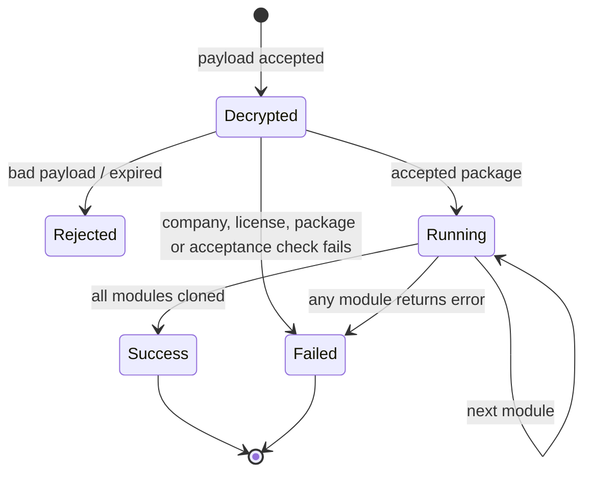
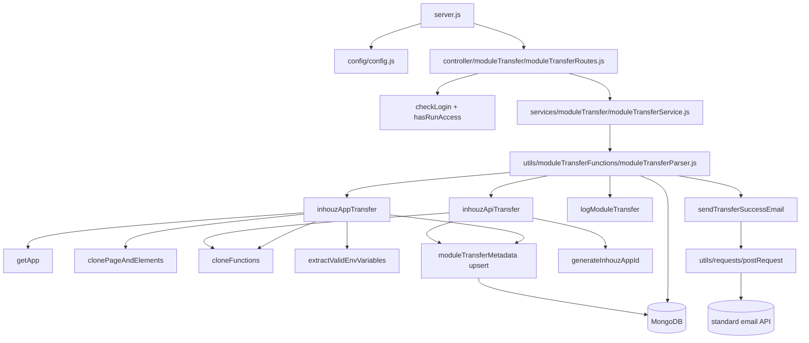

# module_transfer_parser_ms

## 1. Summary

`module_transfer_parser_ms` executes a module transfer that was already composed and accepted
elsewhere. It receives one encrypted payload naming a company and a transfer package, decrypts it,
re-checks the sender's license and the recipient's acceptance, then deep-clones each module in the
package into the recipient's account: Inhouz apps (pages, elements, functions), Inhouz APIs (with
version tracking), Inhouz Sign templates and PDF generator templates. It writes one transfer log row
per attempt and caches a compressed id map so repeated transfers of the same package reuse the ids
already created. It lives in the separate repository
`/workspaces/kilo_inhouz_ai/apps/module_transfer_parser_ms/`.

## 2. Stack and commands

- Runtime: Node.js, Express 4. No `engines` field.
- `package.json:9-11` — scripts: `start` = `node --max-old-space-size=20000 server.js`, `test` =
  the npm-init placeholder that exits 1.
- Port: `PORT` env var (`server.js:115`); k8s pins `5077`
  (`k8s/module-transfer-parser-ms-deployment.yml`, `k8s/module-transfer-parser-ms-cluster-ip-service.yml:10`).
- Container: `Dockerfile`, `docker-compose.yml`, `deploy.sh`, `build_ga.sh`, `build_ga_prod.sh`.
- Health probe: `node healthcheck.js` against `http://localhost:$PORT/healthz` (`healthcheck.js:3-8`).

The 20 GB old-space flag matters: the clone path holds whole apps in memory
(`utils/moduleTransferFunctions/inhouzAppTransfer.js`).

## 3. Entry points

| Entry point | Location | How it starts |
|---|---|---|
| HTTP server | `server.js:73`, `server.js:115` | `npm start` |
| Cluster master / workers | `server.js:54-71` | forks `os.cpus().length` workers in production, else 1 (`server.js:55`) |
| Route registration | `server.js:86` → `controller/moduleTransfer/moduleTransferRoutes.js:5-7` | at boot |
| Mongo connect + 5 s reconnect | `server.js:87-89`, `:120-132`, `:94-101` | at boot and after a disconnect |
| Transfer job (fire-and-forget) | `services/moduleTransfer/moduleTransferService.js:5` | called by the route, not awaited |
| Healthcheck binary | `healthcheck.js:1-20` | container probe |

No cron, no queue consumer, no websocket. Redis is imported in code but commented out
(`server.js:12-25`).

## 4. Module inventory

| Module | Location | Owns | Public API | Kind |
|---|---|---|---|---|
| server bootstrap | `server.js:1` | app, model registration (26 models, `server.js:27-52`), cluster, Mongo | none | effectful |
| config factory | `config/config.js:18` | secrets via `readSecret` (`:5`), model-name env vars, storage-location literals | `() => config` | effectful |
| route module | `controller/moduleTransfer/moduleTransferRoutes.js:5` | one POST route | `(app) => void` | effectful |
| `moduleTransferService` | `services/moduleTransfer/moduleTransferService.js:3` | calls the parser without awaiting it, replies `{inProgress:true}` (`:5-10`) | `(req,res)` | effectful |
| `moduleTransferParser` | `utils/moduleTransferFunctions/moduleTransferParser.js:14` | decrypt payload, validate, dispatch modules, log, email | `(params)` | effectful |
| `inhouzAppTransfer` | `utils/moduleTransferFunctions/inhouzAppTransfer.js:13` | clone an Inhouz app, its pages, elements and functions into the recipient; upsert metadata (`:402-417`) | `(params)` | effectful |
| `inhouzApiTransfer` | `utils/moduleTransferFunctions/inhouzApiTransfer.js:9` | clone a Flex API plus version tracker; upsert metadata (`:231-246`) | `(params)` | effectful |
| `logModuleTransfer` | `utils/moduleTransferFunctions/logModuleTransfer.js:4` | insert one log row with `transferDurationMs = now - timestamp` (`:21`) | `(params)` | effectful |
| `extractValidEnvVariables` | `utils/environmentVariables/extractValidEnvVariables.js:1` | keep env vars that have at least one non-empty value | `(envVariables[]) => []` | pure |
| `sendTransferSuccessEmail` | `utils/email/sendTransferSuccessEmail.js:7` | build notice, resolve admins, POST to the email API (`:40-41`) | `(params)` | effectful |
| `sendEmail` (SendGrid) | `utils/sendEmail/sendEmail.js:5` | direct SendGrid send (`:36`); not wired to the transfer path | `(to,from,subject,text,html,fromName,attachments)` | effectful |
| `getApp` | `utils/appBuilder/getApp.js:25` | load an app with pages/elements/abTests | `(params)` | effectful |
| `generateInhouzAppId` | `utils/appBuilder/generateInhouzAppId.js:15` | allocate a new app id | `(kind)` | effectful |
| `clonePageAndElements` | `utils/appBuilder/clone/clonePageAndElements.js:187` | deep clone pages and elements | `(params)` | effectful |
| `cloneFunctions` | `utils/function/cloneFunctions.js:13-15` | clone functions + deployed functions + version tracker | `(params)` | effectful |
| `functionExtractor` | `utils/function/functionExtractor.js:8` | pull deployed functions for an app | `(params)` | effectful |
| `getFileStorageCredentials` | `utils/inhouzCloudStorage/getFileStorageCredentials.js:19` | resolve file-storage backend credentials | `(params)` | effectful |
| `awsS3CopyFile` | `utils/inhouzCloudStorage/aws/awsS3CopyFile.js:1` | copy objects between S3 buckets | `(params)` | effectful |
| `uploadPdfStaticFile` | `utils/staticFile/uploadPdfStaticFile.js:3` | upload a static PDF file | `(params)` | effectful |
| `checkLogin` | `middlewares/login/checkLogin.js:24` | session cookie decrypt + session lookup | `(req,res,next)` | effectful |
| `hasRunAccess` | `middlewares/permission/hasRunAccess.js:3` | permission gate for `runModuleTransfer` | `(req,res,next)` | pure |
| `moduleAccessCheck` | `middlewares/module/moduleAccessCheck.js:29` | module entitlement check | `(req,res,next)` | effectful |
| transfer models | `model/moduleTransfer/*.js` | package, log, metrics, metadata schemas | mongoose models | effectful |
| foreign models required at boot | `server.js:27-52` | 26 model modules so `mongoose.model()` resolves | mongoose models | effectful |

## 5. Side effects

| Effect | Location |
|---|---|
| Secret files under `SECRETS_PATH` (default `/mnt/secrets`) | `config/config.js:5-15` |
| Env vars | `config/config.js:22-89`, `server.js:55`, `server.js:115` |
| Mongo connect, pool 1 | `server.js:120-132` |
| Reconnect timer 5 s | `server.js:94-101` |
| 20 MB JSON body limit | `server.js:82` |
| Log row insert (per attempt, success or fail) | `utils/moduleTransferFunctions/logModuleTransfer.js:14-24`; called at `moduleTransferParser.js:66,93,110,137,154,173,202,219,246,263,286,316,335,365,673` |
| Package lookup and metadata lookup | `moduleTransferParser.js:191`, `:234`, `:353` |
| App writes: app, pages, elements, functions | `inhouzAppTransfer.js:323`, `:390`, and `clonePageAndElements.js`, `cloneFunctions.js` |
| API writes: flex API and version tracker | `inhouzApiTransfer.js` (clone + `deleteMany` cleanup at `:220`) |
| Template writes: sign template and PDF generator template | `moduleTransferParser.js:512`, `:543`, `:616`, `:647` |
| Metadata upsert (`compressedMetadata`) | `inhouzAppTransfer.js:403-417`, `inhouzApiTransfer.js:232-246` |
| Outbound HTTP to the standard email API | `utils/email/sendTransferSuccessEmail.js:40-41` |
| Outbound SendGrid call (unused path) | `utils/sendEmail/sendEmail.js:36` |
| S3 object copy | `utils/inhouzCloudStorage/aws/awsS3CopyFile.js:1` (`aws-sdk`) |
| GCS / Azure clients declared | `package.json` (`@google-cloud/storage`, `@azure/storage-blob`), config keys at `config/config.js:62-73` |
| Clock: `new Date().getTime()` | `moduleTransferParser.js:33`, `logModuleTransfer.js:21`, transfer modules |
| Randomness: `new mongoose.Types.ObjectId().toHexString()` as `transferKey` | `moduleTransferParser.js:388` |
| Logging: `console.log` on every failure branch | throughout `moduleTransferParser.js` |

## 6. State and state transitions

No formal state machine. Package flags are read, not written, by this service.

| Transition | Trigger | Guard | Effect |
|---|---|---|---|
| Package accepted → transfer allowed | `POST /api/moduletransferparser/run` | `transferPackageAccepted === true` (`moduleTransferParser.js:255-268`) | clones run |
| Package unaccepted → rejected | same route | flag false | log `fail`, return error |
| Transfer already running → rejected | same route | `findOne({transferInProgress:true, companyId})` (`:191-199`) and `overrideInProgressTransfer` false (`:217`) | log `fail` |
| Running → overridden | same route | payload `overrideInProgressTransfer: true` (`:56`, `:217`) | proceeds anyway |
| Expired payload → rejected | decrypt stage | `now <= expirationTimestamp` (`:42`) | error, no log |
| Transfer finished | module loop ends | `transferFailure` flag | log `success` or `fail` (`:667-679`) |

`transferInProgress` is never set by this repo: the parser only reads it. `overrideInProgressTransfer`
can bypass the guard while the flag stays true.

## 7. Data

Owned and shared collections. Physical names come from env vars; the k8s manifest value for the
shared models is the camelCase name in the brief, but the four `MODULE_TRANSFER_*` names are not
set in the repo.

| Collection | Env var | Key fields | Validation |
|---|---|---|---|
| transfer packages (read, plus `transferInProgress` flag) | `MODULE_TRANSFER_PACKAGE_MODEL` (`config/config.js:45`) | `packageName`, `companyId`, `recipientCompanyId`, `modules[]`, `transferPackageAccepted`, `transferInProgress` | `modules[].moduleType` enum of five values (`model/moduleTransfer/moduleTransferPackage.js`) |
| transfer logs (write) | `MODULE_TRANSFER_LOG_MODEL` (`config/config.js:46`) | `packageId`, `companyId`, `transferStatus`, `transferDurationMs`, `failMessage` | `transferStatus` enum `success\|fail` |
| transfer metrics (registered, not written here) | `MODULE_TRANSFER_METRICS_MODEL` (`config/config.js:47`) | `packageId`, counters | required ids and counters |
| transfer metadata (read + upsert) | `MODULE_TRANSFER_METADATA_MODEL` (`config/config.js:85`) | `senderCompanyId`, `recipientCompanyId`, `compressedMetadata` | ids required; unique by pair in practice via the upsert filter (`inhouzAppTransfer.js:403-408`) |

Shared collections this service writes (the data coupling):

| Collection | Writer here | Also used by |
|---|---|---|
| `INHOUZ_APP_MODEL` / `APP_PAGE_MODEL` / `APP_ELEMENT_MODEL` | cloned docs inserted for the recipient (`inhouzAppTransfer.js:323`, `:390`) | app-builder, app-viewer, app-version services |
| `FLEX_API_MODEL` / `FLEX_API_VERSION_TRACKER` | cloned API and version rows (`inhouzApiTransfer.js`) | flex API services |
| `FUNCTION_MODEL` / `DEPLOYED_FUNCTION_MODEL` / `FUNCTION_VERSION_TRACKER_MODEL` | cloned functions (`cloneFunctions.js:13-15`) | scheduled-task and function services |
| `INHOUZ_SIGN_TEMPLATE_MODEL` | template cloned and re-parented (`moduleTransferParser.js:512`, `:543`) | Inhouz Sign |
| `PDF_GENERATOR_TEMPLATE_MODEL` | template cloned and re-parented (`:616`, `:647`) | document generation |
| `INHOUZ_CLOUD_STORAGE_FILE_MODEL` | cloned file rows (`clonePageAndElements.js:187`) | storage services |
| `COMPANY_MODEL`, `INHOUZ_SUBSCRIPTIONS_MODEL` | read only (`moduleTransferParser.js:81`, `:125`) | identity and billing |

Metadata is the idempotency mechanism: `inhouzAppIdMap` and `inhouzApiIdMap` map sender ids to the
recipient ids already created (`inhouzAppTransfer.js:31-52`), so a retry reuses the same clones
instead of duplicating them.

## 8. Public interfaces

| Interface | Shape |
|---|---|
| `POST /api/moduletransferparser/run` (`controller/moduleTransfer/moduleTransferRoutes.js:6`) | middleware `isLoggedIn`, `hasRunAccess`; body `{encryptedPayload: string, serverEncrypted?: boolean}` |
| Decrypted payload | `{expirationTimestamp: number, payload: {companyId, packageId, overrideInProgressTransfer?}}` (`moduleTransferParser.js:33-56`) |
| Response | `{inProgress: true}` immediately (`moduleTransferService.js:10`); the real outcome only lands in the transfer log |

No events, queue topics or CLI commands.

## 9. Configuration

Secret files under `SECRETS_PATH`: `sendgridapikey`, `sessionsecret`, `mongourl`,
`clientpublickey`, `clientsecretkey`, `gcsprojectid`, `gcsprivatekeyid`, `gcsprivatekey`,
`gcsclientemail`, `gcsclientid`, `gcsclientx509certurl` (with `GCS_*`, `CLIENT_*`, `SENDGRID_API_KEY`,
`SESSION_SECRET`, `MONGO_URL` env fallbacks) — `config/config.js:21-70`.

Env vars: `SECRETS_PATH`, `SMPL_EMAIL`, `DATA_RULE_EXECUTION_RESULT_MODEL`, `USER_MODEL`,
`COMPANY_MODEL`, `ROLE_MODEL`, `PERMISSION_MODEL`, `USER_ROLES_MODEL`, `SESSION_MODEL`,
`SESSION_VALIDATOR_MODEL`, `AUTH_LOG_MODEL`, `COOKIE_DOMAIN`, `MODULE_TRANSFER_PACKAGE_MODEL`,
`MODULE_TRANSFER_LOG_MODEL`, `MODULE_TRANSFER_METRICS_MODEL`, `MODULE_TRANSFER_METADATA_MODEL`,
`INHOUZ_SUBSCRIPTIONS_MODEL`, `FUNCTION_MODEL`, `DEPLOYED_FUNCTION_MODEL`,
`FUNCTION_VERSION_TRACKER_MODEL`, `SECRET_KEY_MODEL`, `DATABASE_MODEL`, `FILE_STORAGE_SERVICE_MODEL`,
`SYSTEM_USER_MODEL`, `FLEX_API_MODEL`, `FLEX_API_VERSION_TRACKER`, `INHOUZ_APP_MODEL`,
`APP_ELEMENT_MODEL`, `APP_PAGE_MODEL`, `INHOUZ_CLOUD_STORAGE_FILE_MODEL`,
`INHOUZ_SIGN_DRAFT_BUCKET_NAME`, `INHOUZ_SIGN_ATTACHMENT_BUCKET_NAME`,
`INHOUZ_SIGN_COMPLETED_DOCUMENT_BUCKET_NAME`, `INHOUZ_SIGN_DOC_MODEL`,
`INHOUZ_SIGN_TEMPLATE_MODEL`, `INHOUZ_PDF_GENERATOR_DRAFT_BUCKET_NAME`,
`PDF_GENERATOR_TEMPLATE_MODEL`, `STANDARD_EMAIL_API_URL`, `INHOUZ_FROM_EMAIL`, `PORT`, `NODE_ENV`
(`config/config.js:22-89`, `server.js:55`, `server.js:115`).

Literal permission names: `admin` (`config/config.js:34`), `runModuleTransfer`,
`moduleTransferAdmin` (`config/config.js:86-87`).

## 10. Dependencies

| Package | Why |
|---|---|
| `express`, `body-parser`, `cookie-parser`, `cors`, `helmet`, `hpp`, `dotenv` | HTTP stack and hardening (`server.js:1-8`) |
| `mongoose` | models and queries |
| `node-fetch` | HTTP client in `utils/requests/*` |
| `node-rsa`, `cryptr` | payload decryption and RSA key material (`config/config.js:35-43`) |
| `sanitizer` | `recursiveSanitizer` on the body (`moduleTransferParser.js:1-2`) |
| `lodash` | helpers in the middlewares and parser |
| `moment` | date handling in `checkLogin` and the clone path |
| `shrink-string` | compress/decompress the transfer metadata (`inhouzAppTransfer.js:3`, `inhouzApiTransfer.js:3`) |
| `shortid` | generated ids in `elementDeepClone` (`utils/appBuilder/clone/elementDeepClone.js:3`) |
| `aws-sdk` | S3 copy (`utils/inhouzCloudStorage/aws/awsS3CopyFile.js:1`) |
| `@google-cloud/storage` | GCS copy path |
| `@azure/storage-blob` | Azure blob path |
| `@sendgrid/mail` | `utils/sendEmail/sendEmail.js:1` |
| `object-sizeof` | measures PDF payload size (`utils/staticFile/uploadPdfStaticFile.js:3`) |
| `validator` | schema field validation |
| `redis`, `bluebird` | declared; the Redis client is commented out (`server.js:12-25`) |
| `bcryptjs`, `connect-mongo`, `express-session`, `crypto-js`, `request-ip` | template carry-overs, not required by this repo's transfer path |

## 11. Testing

No tests. `package.json:10` is the placeholder that exits 1; there is no test directory. The clone
logic is exercised only by real transfers.

## 12. Known issues and risks

- **Fire-and-forget handler.** `moduleTransferService.js:5-10` calls the async parser without
  `await` and immediately returns `{inProgress:true}`, so the client never learns the outcome and a
  rejected parser promise is unhandled.
- **`transferInProgress` is never written.** The parser reads it (`moduleTransferParser.js:191`) but
  no code in this repo or in `module_transfer_ms` sets it, so the "already running" guard cannot fire
  and two concurrent runs of the same company are possible.
- **Log write is not awaited.** `logModuleTransfer` is called without `await` at every failure
  branch and at `:673`; a failed log insert is only console-logged inside the util
  (`logModuleTransfer.js:25-28`).
- **Metadata upsert is not awaited in the API path.** `inhouzApiTransfer.js:232-246` starts
  `updateOne` without `await`, unlike the app path (`inhouzAppTransfer.js:403`) which awaits it.
- **No transaction around the clone.** Apps, pages, elements, functions and templates are written
  in sequence with individual `updateOne`/`insertMany` calls; a mid-loop failure leaves a partially
  transferred module behind and still logs the attempt (`moduleTransferParser.js:667-679`).
- **Email failure is silent.** `sendTransferSuccessEmail` is called without `await`
  (`moduleTransferParser.js:686`).
- **SendGrid key path is unused but live.** `utils/sendEmail/sendEmail.js:7` sets the API key from
  config; the transfer path uses `standardEmailApiUrl` instead (`utils/email/sendTransferSuccessEmail.js:40`).
- **Health probe mismatch.** `healthcheck.js:7` requests `/healthz`, but the only route registered
  is `/api/moduletransferparser/run` (`controller/moduleTransfer/moduleTransferRoutes.js:6`).
- **`uncaughtException` only closes Mongo** (`server.js:108-113`), so the worker exits and the
  cluster respawns it (`server.js:60-71`) with no structured error.
- **Envelope encryption depends on a shared secret.** The payload is decrypted with
  `config.sessionSecret` when `serverEncrypted` is true (`moduleTransferParser.js:35-38`); the
  session secret therefore doubles as the transfer cipher key.
- **No test, no validation of `modules[]` type in the parser.** An unknown `moduleType` falls
  through every branch and is silently skipped, yet the transfer still logs `success`.

## 13. Module map

## 14. Open questions

- Who sets `transferInProgress` true, and who clears it after a run? Neither this repo nor
  `module_transfer_ms` writes the flag.
- Is the intended concurrency guard the package flag, or an external lock (Redis is commented out at
  `server.js:12-25`)?
- The parser re-parents cloned sign and PDF templates to a generated app (`moduleTransferParser.js:512-660`);
  the exact parent app contract is not documented anywhere in the repo.
- Not read (step budget): `utils/appBuilder/clone/*`, `utils/function/*`, `utils/inhouzCloudStorage/*`,
  `utils/staticFile/*`, `utils/permissions/*`, and the 26 model files (only their `mongoose.model`
  registrations were verified from the brief and `server.js:27-52`). Claims about those modules rest
  on grep output and the brief.
