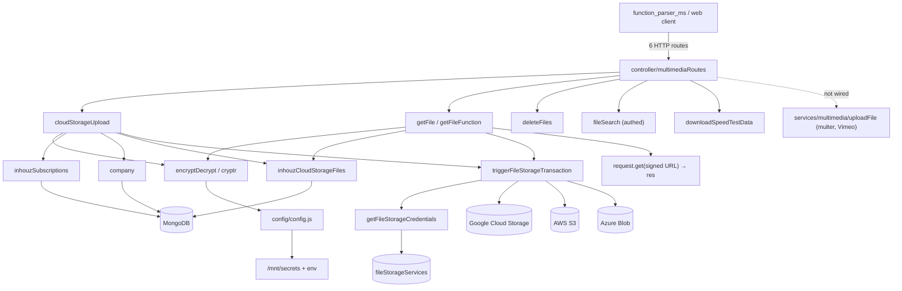

# multimedia_ms

## 1. Summary

`multimedia_ms` is the shared file store for the platform. Callers send an RSA-encrypted payload plus a base64 body; the service checks the company's subscription, resolves a storage provider (`fileStorageServices`, defaulting to Google Cloud Storage), uploads through a provider adapter, records the file in `inhouzCloudStorageFiles`, and returns a signed URL for downloads. It also serves files by key, deletes them, searches the legacy `multimediaFiles` collection, and returns a fixed speed-test payload. It lives in its own git repository at `apps/multimedia_ms/`. k8s: service `multimedia-ms-cluster-ip-service` on `5013` (`k8s/multimedia-ms-cluster-ip-service.yml:10`), image `inhouz/multimedia_ms`, 1 replica (`k8s/multimedia-ms-deployment.yml:6,17`).

## 2. Stack and commands

- Runtime: Node.js `">=12.0.0 <17.5.0"` (`package.json` `engines`). Express 4.
- Start: `npm start` → `node --max-old-space-size=8000 server.js` (`package.json` scripts).
- Test: `npm test` → `echo "Error: no test specified" && exit 1`.
- Port: `process.env.PORT` (`server.js:142`); k8s exposes `5013`.
- Body limit: `10000mb` JSON (`server.js:105`).
- Temp files: `./tmp` under the app root, created at boot (`server.js:31-33`), cleaned every 60 s by the cluster master (`server.js:94-96`).
- Health probe: `healthcheck.js:8` hits `/healthz`; no such route exists.

## 3. Entry points

| Entry | Where | How it starts |
|---|---|---|
| Cluster master + temp-dir cleaner | `server.js:82-97` | `setInterval(clearCachedFiles, 60000)` in the master only |
| HTTP server | `server.js:142` | `app.listen(process.env.PORT)` in a worker |
| Route registration | `server.js:111` | `require("./controller/multimediaRoutes")(app)` |
| Mongo connection | `server.js:148-160` | `connectMongo()` at `server.js:113`; reconnect timer `server.js:121-126` |
| Model registration | `server.js:17-29` | 13 model modules |
| `POST /api/multimedia/upload` | `controller/multimediaRoutes.js:15` | `cloudStorageUpload`, no auth middleware |
| `POST /api/multimedia/getfilefunction` | `controller/multimediaRoutes.js:16` | `getFileFunction`, no auth middleware |
| `GET /api/multimedia/:encryptedKey/:fileKey` | `controller/multimediaRoutes.js:17` | `getFile`, no auth middleware |
| `POST /api/multimedia/deletefiles` | `controller/multimediaRoutes.js:18` | `deleteFiles`, no auth middleware |
| `POST /api/multimedia/filesearch` | `controller/multimediaRoutes.js:19` | `isLoggedIn`, `companyAccountCheck`, `subdomainCheck` |
| `POST /api/multimedia/getspeedtestdata` | `controller/multimediaRoutes.js:20` | `downloadSpeedTestData`, no auth middleware |

No queue consumer or websocket server. `services/multimedia/uploadFile.js` (multer, Vimeo, Azure Files) is never imported by a route.

## 4. Module inventory

| Module / function | `file:line` | Responsibility | Public API | Kind |
|---|---|---|---|---|
| Bootstrap + `multerStorage` | `server.js:23-39` | Disk multer config exported for reuse; no route mounts it | module export | `effectful` (filesystem) |
| `clearCachedFiles()` | `server.js:41-65` | Deletes `./tmp` files older than 10 minutes | interval | `effectful` (filesystem, clock, logging) |
| `connectMongo()` | `server.js:148` | Mongoose connection, `maxPoolSize: 1` | internal | `effectful` |
| `shutdownFunction(e)` | `server.js:135` | Close Mongo on signals | process hooks | `effectful` |
| `cloudStorageUpload` | `services/multimedia/cloudStorageUpload.js:10` | Validate payload, license, company; create file row; upload via provider | `POST /api/multimedia/upload` | `effectful` (crypto, DB, storage, clock) |
| `getFile` | `services/multimedia/getFile.js` | Decrypt path key, find file by `companyId + fileKey`, generate signed URL, proxy bytes | `GET /api/multimedia/:encryptedKey/:fileKey` | `effectful` (crypto, DB, storage, network) |
| `getFileFunction` | `services/multimedia/getFileFunction.js` | Function-call variant of file fetch (license check + storage) | `POST /api/multimedia/getfilefunction` | `effectful` |
| `deleteFiles` | `services/multimedia/deleteFiles.js` | Delete storage objects and `inhouzCloudStorageFiles` rows | `POST /api/multimedia/deletefiles` | `effectful` |
| `fileSearch` | `services/multimedia/fileSearch.js` | Search legacy `multimediaFiles` | `POST /api/multimedia/filesearch` | `effectful` |
| `downloadSpeedTestData` | `services/multimedia/downloadSpeedTestData.js:9` | Return the stored 1 MB sample for a speed test | `POST /api/multimedia/getspeedtestdata` | `effectful` (DB) |
| `uploadFile` | `services/multimedia/uploadFile.js` | Legacy upload with multer, S3, Azure Files, Vimeo; **not wired to a route** | — | `effectful` (dead code) |
| `triggerFileStorageTransaction` | `utils/inhouzCloudStorage/triggerFileStorageTransaction.js` | Dispatch `fileUpload`, `fileUploadStream`, `deleteFile`, `copyFile`, `generateSignedUrl`, `downloadFile` to GCS/S3/Azure | exports function | `effectful` |
| `getFileStorageCredentials` | `utils/inhouzCloudStorage/getFileStorageCredentials.js:6` | Read `fileStorageServices`, decrypt credentials, default to GCS service-account config | exports function | `effectful` (DB, crypto, config) |
| `validateQueryKey` | `utils/query/validateQueryKey.js:6` | One-time `queryKey` check; **commented out in the upload path** | exports function | `effectful` (DB) |
| `getDatabase` / `decryptDatabase` | `utils/database/getDatabase.js:5`, `utils/database/decryptDatabase.js:4` | Legacy app database helpers | exports functions | `effectful` |
| `encryptDecrypt` | `utils/cryptography/encryptDecrypt.js` | RSA decrypt/encrypt of payloads and keys | exports function | `effectful` |
| `recursiveSanitizer` | `utils/sanitizer/recursiveSanitizer.js` | Body sanitizer | exports function | `pure` |
| `config()` / `readSecret()` | `config/config.js:18,5` | Env and `/mnt/secrets`, cached | returns config | `effectful` |
| 13 model modules | `model/**` (`server.js:17-29`) | Company, database, storage service, cloud-storage file, subscription, multimedia, download speed, query tracker, RBAC, session, user | Mongoose models | `effectful` |
| `isLoggedIn`, `companyAccountCheck`, `subdomainCheck` | `middlewares/login/checkLogin.js`, `middlewares/company/companyAccountCheck.js`, `middlewares/subdomain/singleSubdomainValidation.js` | Auth gates on `filesearch` only | Express middleware | `effectful` |

## 5. Side effects

| Effect | System | `file:line` |
|---|---|---|
| Read secret files | Filesystem `SECRETS_PATH` (default `/mnt/secrets`): `sendgridapikey`, `sessionsecret`, `mongourl`, `clientsecretkey`, `gcsprojectid`, `gcsprivatekeyid`, `gcsprivatekey`, `gcsclientemail`, `gcsclientid`, `gcsclientx509certurl` | `config/config.js:5-13,25-61` |
| Create / clean temp dir | Filesystem `./tmp` | `server.js:31-33,41-65` |
| Connect to MongoDB | `config.mongoUrl` | `server.js:149` |
| Read subscription / license | MongoDB `inhouzSubscriptions` | `cloudStorageUpload.js:96-105`; `getFile.js:64-72`; `getFileFunction.js:71-80` |
| Read company | MongoDB `company` | `cloudStorageUpload.js:133-140` |
| Create file row | MongoDB `inhouzCloudStorageFiles` | `cloudStorageUpload.js:161-195` |
| Find file row | MongoDB `inhouzCloudStorageFiles` `{companyId, fileKey}` | `getFile.js:91-96`; `cloudStorageUpload.js:209-212` |
| Delete file row | MongoDB `inhouzCloudStorageFiles` | `cloudStorageUpload.js:242-250`; `services/multimedia/deleteFiles.js:61` |
| **Upload object** | GCS / S3 / Azure via `triggerFileStorageTransaction` | `cloudStorageUpload.js:230-239`; dispatch `utils/inhouzCloudStorage/triggerFileStorageTransaction.js:53-87` |
| **Generate signed URL** | Storage provider | `getFile.js:119-127`; dispatch `triggerFileStorageTransaction.js:126-142` |
| **Download / proxy bytes** | Storage URL via `request.get(...).pipe(res)` | `getFile.js:133-134` |
| **Delete object** | Storage provider | `services/multimedia/deleteFiles.js`; dispatch `triggerFileStorageTransaction.js:88-102` |
| Read storage credentials + `Cryptr` decrypt | MongoDB `fileStorageServices`, local crypto | `utils/inhouzCloudStorage/getFileStorageCredentials.js:19-93` |
| Read legacy multimedia metadata | MongoDB `multimediaFiles` | `services/multimedia/fileSearch.js:29` |
| Read speed sample | MongoDB `downloadSpeedData` `{sizeMb: 1}` | `services/multimedia/downloadSpeedTestData.js:47-53` |
| **Call Vimeo API** (dead path) | `https://api.vimeo.com` | `config/config.js:49`; `services/multimedia/uploadFile.js:327-376` |
| **Azure Files / Blob** (dead path in uploadFile) | `azure-storage` | `services/multimedia/uploadFile.js:241-248` |
| Clock | Timestamps, key expiry, temp-file age | `cloudStorageUpload.js:31`; `getFile.js:125`; `server.js:60` |
| Randomness | Object ids for multer filenames | `server.js:36` |
| Logging | stdout `console.log` | `server.js:47,58,88,96,116,122,129,136`; services at their catch blocks |
| Close Mongo on signal | MongoDB | `server.js:137-139` |

No send-email call happens in the live path despite `SENDGRID_API_KEY` and `sendGridApiKey` config.

## 6. State and state transitions

No formal state machine. Two implicit sequences:

**Upload (single or chunked)** — `cloudStorageUpload.js`:

| State | Trigger | Effect | Guard |
|---|---|---|---|
| Received | `POST /upload` with encrypted payload + base64 | — | `encryptedPayload`, `base64` present (`:18-29`) |
| Authorised | decrypt + expiry check | payload extracted | `expirationTimestamp` in the future (`:38-43`) |
| Licensed | `inhouzSubscriptions.findOne({companyId, active:true})` | — | license exists, plan not `freelancer` (`:96-130`) |
| Row created | first chunk or non-stream upload | `inhouzCloudStorageFiles.create` | `isUploadStream` false or `isFirstChunk` true (`:163-203`) |
| Row reused | later chunk | `findOne({fileKey, companyId})` | `isUploadStream && !isFirstChunk` (`:204-227`) |
| Uploaded | provider transaction | returns row or transaction | provider succeeded, otherwise row is deleted (`:241-254`) |

**Download** — `getFile.js`: decrypt path key → license check → `findOne({companyId, fileKey})` → `generateSignedUrl` → proxy bytes.

## 7. Data

| Collection | Env var | Fields used | `file:line` |
|---|---|---|---|
| `inhouzCloudStorageFiles` | `INHOUZ_CLOUD_STORAGE_FILE_MODEL` | `fileName`, `fileKey`, `fileSizeBytes`, `fileOrigin`, `fileOriginId`, `fileType`, `companyId`, `projectId`, `metaTag`, `bucketName`, `fileStorageServiceId`, `hostedExternally`, `createdTimestamp`, `createdById`, `createdByEmail`, `createdByName` | `cloudStorageUpload.js:170-191`; schema `model/inhouzCloudStorage/inhouzCloudStorageFiles.js:5` |
| `inhouzSubscriptions` | `INHOUZ_SUBSCRIPTIONS_MODEL` | `companyId`, `active`, `subscriptionServicePlanType` | `cloudStorageUpload.js:97-100`; schema `model/inhouzSubscription/inhouzSubscription.js:5-231` |
| `company` | `COMPANY_MODEL` | `_id`, `defaultFileStorageServiceId` | `cloudStorageUpload.js:134-158`; schema `model/company/company.js:5-108` |
| `fileStorageServices` | `FILE_STORAGE_SERVICE_MODEL` | provider type and encrypted credentials (`s3AccessKeyId`, `s3SecretAccessKey`, `awsBucketName`, `awsRegion`, `azure*`, `googleBucketName`, `vimeo*`) | `utils/inhouzCloudStorage/getFileStorageCredentials.js:19-93`; schema `model/database/fileStorageServices.js:5` |
| `multimediaFiles` | `MULTIMEDIA_MODEL` | legacy metadata searched by `fileSearch` | `services/multimedia/fileSearch.js:29`; schema `model/multimedia/multimedia.js:5-60` |
| `downloadSpeedData` | `DOWNLOAD_SPEED_DATA_MODEL` | `sizeMb`, payload used by the speed endpoint | `services/multimedia/downloadSpeedTestData.js:47-53`; schema `model/multimedia/downloadSpeedData.js:5` |
| `queryKeyTracker` | `QUERY_KEY_TRACKER_MODEL` | one-time keys; validation disabled in upload | `utils/query/validateQueryKey.js:6` |
| `database` | `DATABASE_MODEL` | legacy app database credentials | `utils/database/getDatabase.js:20`; schema `model/database/database.js:6-90` |

Shared-collection coupling:
- `inhouzCloudStorageFiles` and `fileStorageServices` are the platform-wide file registry and credential store, shared with `pdf_generator_ms`, the sign services and `view_builder_ms`.
- `company.defaultFileStorageServiceId` is the fallback provider; changing it in the company service changes where this service writes.
- `multimediaFiles` is the pre-`inhouzCloudStorageFiles` collection; both exist, and only search reads the old one.

## 8. Public interfaces

| Method | Path | Auth | Request | Response |
|---|---|---|---|---|
| POST | `/api/multimedia/upload` | encrypted payload only | `{ encryptedPayload, base64, serverEncrypted? }`; decrypted `{ companyId, queryKey, fileName, fileKey, fileSize, fileType, metaTag, fileStorageServiceId, fileOrigin, fileOriginId, bucketName, projectId, isUploadStream, isFirstChunk, user? }` | `inhouzCloudStorageFiles` row, or stream transaction result (`cloudStorageUpload.js:256`) |
| POST | `/api/multimedia/getfilefunction` | encrypted payload | same envelope | file payload from storage |
| GET | `/api/multimedia/:encryptedKey/:fileKey` | encrypted key in path | — | storage bytes with `Cache-Control: public, max-age=36000` (`getFile.js:133-134`) |
| POST | `/api/multimedia/deletefiles` | encrypted payload | file keys | delete result |
| POST | `/api/multimedia/filesearch` | session + company + subdomain | search filters | matching `multimediaFiles` |
| POST | `/api/multimedia/getspeedtestdata` | encrypted payload | — | 1 MB sample |

Decrypted envelope: `{ payload: {...}, expirationTimestamp }` (`cloudStorageUpload.js:38-43`). Error shape `{ error: { message } }` with 400/404/500. Keys use the URL-safe substitutions shared with the other proxying services.

Callers per the brief: `function_parser_ms`, `scheduled_task_function_parser_ms`. Not re-verified in those repos.

## 9. Configuration

Env var names read: `SECRETS_PATH`, `NODE_ENV`, `PORT`, `FLEX_FORM_FILE_MODEL`, `FLEX_MODULE_MODEL`, `FLEX_COLLECTION_MODEL`, `FORM_MODEL`, `SENDGRID_API_KEY`, `SMPL_EMAIL`, `DATA_RULE_EXECUTION_RESULT_MODEL`, `SESSION_SECRET`, `MONGO_URL`, `USER_MODEL`, `COMPANY_MODEL`, `MULTIMEDIA_MODEL`, `ROLE_MODEL`, `PERMISSION_MODEL`, `USER_ROLES_MODEL`, `SESSION_MODEL`, `SESSION_VALIDATOR_MODEL`, `AUTH_LOG_MODEL`, `CLIENT_SECRET_KEY`, `COOKIE_DOMAIN`, `FILE_STORAGE_SERVICE_MODEL`, `DATABASE_MODEL`, `INHOUZ_CLOUD_STORAGE_FILE_MODEL`, `QUERY_KEY_TRACKER_MODEL`, `INHOUZ_SUBSCRIPTIONS_MODEL`, `DOWNLOAD_SPEED_DATA_MODEL`, `GCS_PROJECT_ID`, `GCS_PRIVATE_KEY_ID`, `GCS_PRIVATE_KEY`, `GCS_CLIENT_EMAIL`, `GCS_CLIENT_ID`, `GCS_CLIENT_X509_CERT_URL` (`config/config.js:5-66`).

Secret-file names: `sendgridapikey`, `sessionsecret`, `mongourl`, `clientsecretkey`, `gcsprojectid`, `gcsprivatekeyid`, `gcsprivatekey`, `gcsclientemail`, `gcsclientid`, `gcsclientx509certurl` (`config/config.js:25-61`).

Fixed config literals: `internalDatabaseStorageLocation = "Internal database"`, `awsS3StorageLocation = "AWS S3"`, `azureStorageLocation = "Azure Blob Storage"`, `googleStorageLocation = "Google Cloud Storage"`, `vimeoStorageLocation = "Vimeo"`, `vimeoApiUrl = "https://api.vimeo.com"` (`config/config.js:44-49`).

## 10. Dependencies

| Package | Why |
|---|---|
| `express`, `body-parser`, `cookie-parser`, `cors`, `helmet`, `hpp` | HTTP stack (`server.js:2-8,98-109`) |
| `mongoose` | All collections |
| `@google-cloud/storage`, `aws-sdk`, `@azure/storage-blob` | Provider adapters under `utils/inhouzCloudStorage/*` |
| `azure-storage` | Legacy Azure Files in the unwired `uploadFile.js:9` |
| `vimeo` | Vimeo upload in the unwired `uploadFile.js:13` |
| `multer` | Disk upload storage exported at `server.js:34-39`; no route mounts it |
| `gridfs-stream`, `mongodb` | Legacy GridFS support in the unused upload path |
| `node-rsa` | Payload/key RSA (`config/config.js:1`) |
| `cryptr` | Symmetric encryption of storage credentials and server-side payloads |
| `js-base64` | Decoding path keys in `getFile.js:6` |
| `request` | Proxying the signed storage URL (`getFile.js:7,134`) |
| `node-fetch` | Vimeo API calls and stream uploads |
| `p-limit` | Concurrency limiting in streaming uploads |
| `app-root-path` | Locating `./tmp` (`server.js:11`) |
| `moment` | Expiry timestamps and temp-file age |
| `sanitizer` | Body sanitizing |
| `dotenv`, `fs`, `os`, `cluster`, `http`, `stream`, `path` | Node built-ins / env loading |
| `@sendgrid/mail`, `bcryptjs`, `connect-mongo`, `crypto-js`, `express-session`, `lodash`, `request-ip`, `shortid`, `validator` | Template leftovers |

## 11. Testing

No tests. `npm test` exits 1. No test framework, test directory or CI workflow. Provider dispatch, chunked upload (`isUploadStream`), and the difference between the live and legacy upload paths have no automated coverage.

## 12. Known issues and risks

- **`queryKey` validation is commented out on upload** (`cloudStorageUpload.js:90-94`). Any caller holding the RSA client key and a valid `companyId` with an active non-freelancer license can write files into any bucket the company's storage service allows.
- **Four of six routes have no auth middleware** (`controller/multimediaRoutes.js:15-18,20`); only `filesearch` uses `isLoggedIn`/`companyAccountCheck`/`subdomainCheck`.
- **Download proxies instead of redirecting.** `getFile` asks the provider for a signed URL, then fetches it server-side and pipes it (`getFile.js:119-134`), doubling egress and holding a worker for the transfer.
- **Vimeo and "Internal database" providers are not implemented in the dispatcher.** `config` defines both locations (`config/config.js:44-49`) and `uploadFile.js` supports Vimeo, but `triggerFileStorageTransaction` only branches on GCS, S3 and Azure (`triggerFileStorageTransaction.js:53-158`); a company configured for Vimeo or internal storage gets an undefined `transactionResponse`.
- **`uploadFile.js`, `multerStorage` and the temp-dir cleaner are dead or half-wired.** `uploadFile.js` is imported nowhere; `multerStorage` is exported (`server.js:39`) but the multer middleware is commented out (`multimediaRoutes.js:3-5`); the cleaner still runs every 60 s (`server.js:94-96`).
- **Company check in upload ignores `status`** (`cloudStorageUpload.js:134-136`), unlike `image_proxy_ms` which filters on `active`.
- **Failure deletes the file row only** (`cloudStorageUpload.js:241-254`); a partially written provider object is left behind.
- **Huge JSON limit** (`10000mb`, `server.js:105`) plus base64 payloads; `--max-old-space-size=8000` (`package.json`) is a workaround for memory pressure, not a limit.
- **`hostedExternally` is inverted-looking**: true when no storage service id is present (`cloudStorageUpload.js:182-185`), while the provider defaults to GCS.
- **Chunked upload trusts `fileKey`** from the payload for `findOne` (`cloudStorageUpload.js:209-212`), scoped by `companyId` only.
- **CORS limited to `inhouz.localhost`** (`server.js:100`), so browser callers on `inhouz.io` cannot call it directly.
- **Health endpoint missing** (`healthcheck.js:8`); no `HEALTHCHECK` in the Dockerfile.

No credential literal is embedded in the source. GCS credentials come from `/mnt/secrets` (`config/config.js:54-60`); company storage credentials are read from `fileStorageServices` and decrypted with `Cryptr` (`getFileStorageCredentials.js`).

## 13. Module map

## 14. Open questions

- Why `validateQueryKey` was disabled on upload is not recorded. It is still called in `getFileFunction`; whether that gate is load-bearing is unclear without reading it fully.
- Which caller uses `isUploadStream` chunking, and what chunk size the caller uses, is not visible here.
- Whether Vimeo storage is still sold to any company, or is dead config, cannot be determined from this repo.
- The legacy `multimediaFiles` collection has no writer in this repo; which service still writes it is unknown.
- `getFileFunction` was read only by grepping its model lines; its full payload contract was not verified.
- The brief lists `function_parser_ms` and `scheduled_task_function_parser_ms` as callers; the exact routes they hit were not verified in those repos.

Skipped: `build_ga*.sh`, `deploy.sh`, `docker-compose.yml`, `kus/`, `k8s/*-hpa.yml`, `k8s/*-vpa.yml`, each provider adapter under `utils/{s3,azure,googleCloud,inhouzCloudStorage}/*` (dispatch verified, adapters not opened), the 13 model schemas beyond queried fields, and `services/multimedia/uploadFile.js` beyond its provider branches (dead code).
